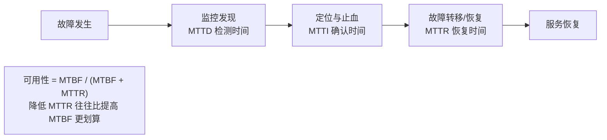
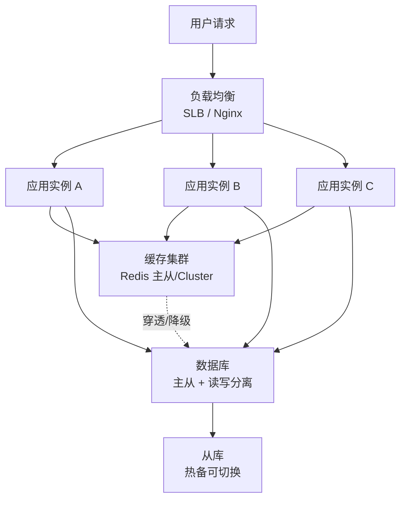
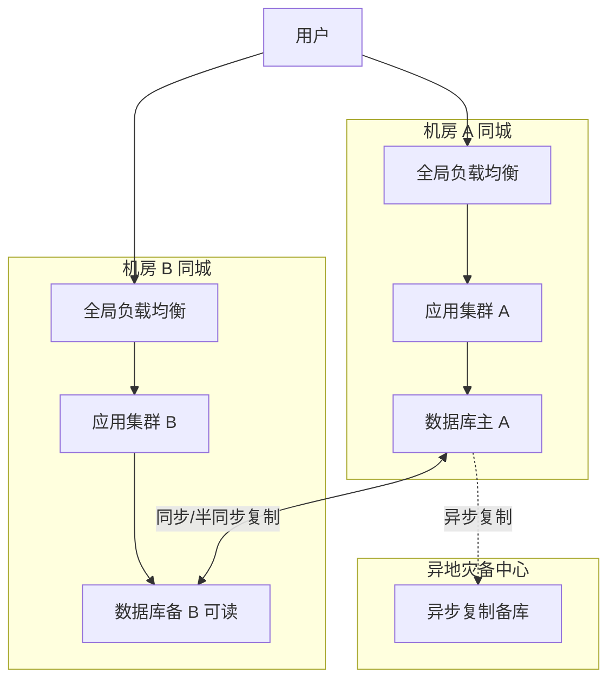

# 高可用架构设计

> 定位：高可用不是「买两台机器」那么简单，而是一整套围绕「故障是常态」设计的系统工程。这篇讲清 SLA 的量化口径、冗余与去单点、故障转移、负载均衡、同城双活与异地多活、RTO/RPO，以及可落地的高可用设计原则——让你在设计一个系统时，能主动回答「它挂了怎么办」。

## 一、为什么需要高可用架构

先讲一个真实的故事。某电商系统大促，凌晨 0 点流量瞬间涨 10 倍，数据库主库 CPU 打满，连接数耗尽，整个下单链路不可用。运维紧急重启，30 分钟后恢复。事后复盘发现：应用是无状态多实例的，数据库却是单点；有从库但从来没切过流量；所谓「容灾方案」躺在 Wiki 里三年没人演练过。

这就是典型的「架构上以为高可用，实际上一捅就破」。高可用的本质不是追求「永不故障」——那是不可能的——而是**在部分组件故障时，系统仍能对外提供可接受的服务**。 Dissecting 这句话有三个关键词：

- **部分故障**：硬件会坏、网络会断、代码有 BUG、人会误操作。要把故障当成设计输入，而不是意外。
- **可接受的服务**：不是所有功能都必须 100% 可用，核心链路（如下单、支付）要保，非核心（如评论、推荐）可以降级。
- **系统性工程**：从硬件、网络、应用、数据到流程，任何一环有单点，整体可用性就被它拉低。

一个系统的可用性取决于**最短的那块板**。100 个组件每个可用性 99.99%，串联起来的整体可用性是 `0.9999^100 ≈ 99.0%`——这就是「乘法效应」，也是为什么去单点和隔离如此重要。

## 二、高可用的度量：SLA 与「几个 9」

谈高可用必须先量化。业界用 **SLA（Service Level Agreement，服务等级协议）** 描述可用性承诺，核心指标是「几个 9」。

| 可用性 | 年不可用时长 | 月不可用时长 | 典型系统 |
|---|---|---|---|
| 99% | 87.6 小时 | 7.3 小时 | 内部工具、非核心系统 |
| 99.9%（三个9） | 8.76 小时 | 43.8 分钟 | 一般业务系统 |
| 99.99%（四个9） | 52.6 分钟 | 4.38 分钟 | 核心在线服务 |
| 99.999%（五个9） | 5.26 分钟 | 26 秒 | 金融、电信级关键系统 |

> 计算方式：不可用时长 = 总时长 × (1 - 可用性)。四个 9 意味着一年只能挂 52 分钟，这直接决定了你的故障恢复速度必须多快。

除了可用性，SLA 还有几个配套指标，面试和生产都要分清：

- **MTBF（Mean Time Between Failures）**：平均无故障时间，衡量「多久坏一次」，反映稳定性。
- **MTTR（Mean Time To Repair）**：平均恢复时间，衡量「坏了多久能修好」，反映可恢复性。
- **可用性 = MTBF / (MTBF + MTTR)**。提升可用性有两条路：让故障更少（提高 MTBF），或让恢复更快（降低 MTTR）。后者往往性价比更高——你很难让代码零 BUG，但可以把故障转移做到秒级。

这张图讲的是故障从发生到恢复的完整时间线。**MTTD（发现时间）** 和 **MTTI（确认时间）** 往往被忽略，但它们包含在 MTTR 里——很多时候「恢复慢」不是修得慢，而是「发现得晚」。所以监控告警的覆盖度和灵敏度，本身就是高可用能力的一部分。

## 三、高可用的核心原理：冗余、无状态与去单点

高可用有三大基石：**冗余（Redundancy）**、**无状态（Statelessness）**、**去单点（No Single Point of Failure）**。三者层层递进。

### 3.1 冗余：消除单点的基本手段

冗余的意思是「关键组件多备几份」。但冗余不是简单地多部署几个实例，它包含三个层次：

- **冗余计算**：应用多实例，前面挂负载均衡。
- **冗余数据**：数据库主从、多副本，主挂了从能顶上。
- **冗余链路**：多运营商、多可用区、多机房。

关键点是：**冗余的组件必须能真正接管，否则就是「摆设冗余」**。很多系统有从库，但从库从不承接读流量、从没做过切换演练，真出事时切过去一堆问题——这叫「冷备」，可用性其实很低。真正有效的是**热备**：备机时刻同步数据、时刻待命，切换是秒级的。

### 3.2 无状态设计：让水平扩展成为可能

**无状态**是指应用实例不保存业务状态（Session、本地缓存的业务数据等），任何请求落到任何实例都能得到相同结果。

为什么它这么重要？因为**有状态会让故障转移极其复杂**。如果用户的 Session 存在实例 A 的内存里，A 挂了，用户的请求切到实例 B 就丢了登录态。而无状态服务，请求打到哪个实例都一样，挂一个直接摘掉即可。

有状态怎么办？把状态外置到专门的地方：

- Session → Redis 等分布式缓存
- 文件上传的临时状态 → 对象存储
- 业务数据 → 数据库

> 判断一个服务是否无状态的简单办法：把它任意一个实例 kill 掉，再把流量切到剩下的实例，业务是否完全不受影响？如果受影响，说明还有状态没外置。

### 3.3 去单点：逐一排查每一层

从用户请求到数据落地，链条上每一层都可能有单点。做高可用设计，就是逐层问「这里挂了怎么办」：

| 层次 | 常见单点 | 去单点手段 |
|---|---|---|
| 接入层 | 单台 Nginx | Keepalived + VIP、多个 SLB |
| 应用层的 | 单实例应用 | 多实例 + 负载均衡 |
| 缓存层 | 单点 Redis | 主从哨兵、Redis Cluster |
| 数据库 | 单主库 | 主从切换、MHA、MGR |
| 中间件 | 单 Kafka/MQ broker | 集群 + 多副本 |
| 基础设施 | 单机房、单运营商 | 同城双活、异地多活 |
| 依赖 | 第三方接口 | 熔断降级、多供应商 |

**任何一个没被覆盖的点，都是整体可用性的上限。**

这张图展示了一个典型的去单点架构：从负载均衡到应用、缓存、数据库，每一层都是多副本。注意缓存到数据库的虚线——缓存挂了要能降级打到数据库，数据库要有热备从库随时可切换。

## 四、关键机制：故障转移与负载均衡

### 4.1 故障转移（Failover）

故障转移是指当活跃组件故障时，自动把流量切到备用组件。它要解决三个问题：

1. **故障检测**：怎么判定组件挂了？靠心跳、健康检查。检测要快，但不能太敏感——否则网络抖动就误切，造成「脑裂」或反复横跳。
2. **流量切换**：怎么把流量导过去？VIP 漂移、DNS 切换、注册中心摘除、客户端重试。
3. **状态接管**：有状态组件（数据库）切换时，要保证数据一致——这通常是最难的。

以数据库主从这个最经典的 failover 场景为例：

- **检测**：MHA / Orchestrator 持续探测主库，连续多次失败才判定宕机。
- **选主**：从库中选一个数据最全的（GTID 最大）提升为新主。
- **切流量**：把 VIP 漂到新主，或修改应用的数据源配置。
- **数据补齐**：把旧主上还没同步的事务尽量补过来（如果旧主还能访问）。

这里有个绕不开的难题——**脑裂（Split-Brain）**：旧主其实没死，只是网络分区，新主已经上位，两个主同时写，数据就乱了。解决办法是** fencing（隔离）**：确认旧主真的不能写（如关闭 VIP、STONITH 直接断电），再提升新主。

### 4.2 负载均衡

负载均衡把流量分发到多个实例，既是扩展手段，也是高可用手段（摘掉故障实例）。

| 层次 | 代表实现 | 调度粒度 | 特点 |
|---|---|---|---|
| DNS 负载均衡 | DNS 轮询 | 域名解析 | 最简单，但缓存导致故障切换慢 |
| 四层（L4） | LVS、SLB | IP + 端口 | 性能高，不解析 HTTP |
| 七层（L7） | Nginx、HAProxy、Envoy | HTTP 内容 | 可按 URL/Header 路由，功能强 |

常见调度算法：轮询、加权轮询、最少连接、一致性哈希。**一致性哈希**在缓存场景特别重要——它让同一个 key 尽量落到同一个节点，节点增减时只影响少量 key，避免缓存大面积失效（缓存雪崩）。

健康检查是负载均衡参与高可用的关键：它定期探测后端实例，连续失败就摘除，恢复后重新加入。参数（检查间隔、失败阈值、成功阈值）要根据业务容忍度设置。

## 五、关键机制：同城双活与异地多活

当单机房不够时，要上升到多机房架构。这是高可用里最复杂的部分，也是面试区分度最高的地方。

### 5.1 概念辨析

- **同城双活**：同一个城市两个机房，距离近（几十公里），网络延迟低（毫秒级），两个机房同时承接流量。
- **两地三中心**：同城双中心 + 异地灾备中心。同城做双活，异地做灾备。
- **异地多活**：多个城市的数据中心同时对外服务，单元化，任一城市挂了其他城市接管。

### 5.2 RTO 与 RPO

衡量容灾能力有两个核心指标：

- **RPO（Recovery Point Objective）**：能容忍丢失多少数据。决定了数据复制的同步程度——RPO=0 要求强同步。
- **RTO（Recovery Time Objective）**：能容忍多久恢复服务。决定了故障转移的速度——RTO 越小，要求越高的自动化和演练。

| 容灾等级 | RPO | RTO | 实现方式 | 成本 |
|---|---|---|---|---|
| 冷备 | 小时级 | 小时级 | 定期备份，出事再恢复 | 低 |
| 温备 | 分钟级 | 十分钟级 | 准实时同步 + 手动切换 | 中 |
| 热备/双活 | 秒级/零 | 分钟/秒级 | 实时同步 + 自动切换 | 高 |

> 没有免费的 RTO=0 和 RPO=0。同步复制要保证数据不丢，就要等所有副本确认，会增加写延迟；异步复制延迟低，但故障时可能丢数据。**这是 CAP 定理在工程上的直接体现**。

这张图是「两地三中心」的典型形态。同城 A/B 机房通过同步或半同步复制保持数据一致，平时双活分担流量；异地灾备中心异步复制，只在同城整体故障时启用。注意同城用的是双向实线（双活），异地是单向虚线（只做灾备）。

### 5.3 异地多活的真正难点

异地多活不只是「多部署几个机房」，难点在于**数据冲突和流量调度**：

- **数据分片（单元化）**：把用户按维度（如 user_id）切分到不同单元，每个单元有自己的应用和数据，单元内闭环。这样跨单元不用强同步。
- **流量路由**：全局负载均衡根据用户维度把请求路由到归属单元。
- **冲突处理**：万一跨单元写了同一条数据怎么办？需要冲突检测与合并策略，或干脆避免跨单元写。
- **全局问题**：全局唯一 ID、库存扣减、账户余额这类「必须全局一致」的数据，是最难单元化的，往往需要专门设计。

## 六、生产坑点与排查

### 坑点 1：从库形同虚设， failover 切不过去

**现象**：主库宕机，切换脚本执行后新主不可用，或者切过去数据缺失、应用报大量主键冲突。
**原因**：从库复制延迟大（big transaction、从库性能差），或者从来没演练过切换，切换脚本有 bug，权限、VIP 配置不对。
**解法**：

- 监控复制延迟（`Seconds_Behind_Master` 或 GTID 差值），延迟超过阈值告警，不允许切换。
- **定期演练**切换，用自动化工具（MHA、Orchestrator）代替手动脚本。
- 切换前做 fencing，避免脑裂。
- 半同步复制（`rpl_semi_sync_master`）保证至少一个从库收到 binlog 才返回，把 RPO 降到接近 0。

### 坑点 2：无状态设计不彻底，Session 还在本地

**现象**：应用做了多实例 + 负载均衡，但用户偶尔「掉登录」，刷新后又好了。
**原因**：Session 还在实例本地内存，负载均衡没开会话保持，请求被分发到不同实例。
**解法**：把 Session 外置到 Redis（Spring Session），或改用无状态 JWT。原则是「任何实例挂掉都不影响用户」。

### 坑点 3：健康检查配置不当引发雪崩

**现象**：某应用实例因为 GC 停顿 2 秒，被负载均衡判定不健康摘除；剩余实例流量翻倍，也相继被摘除，最终全部不可用。
**原因**：健康检查太敏感（超时时间短、失败阈值低），且没有「最小存活实例数」保护。
**解法**：

- 健康检查超时和失败阈值放宽（如连续 3 次失败、每次超时 2 秒）才有意义。
- 设置最小健康实例比例，低于阈值时停止摘除（宁可一起扛，不要逐个被摘）。
- 区分「存活性（liveness）」和「就绪性（readiness）」探针，GC 停顿不应触发重启。

### 坑点 4：缓存雪崩拖垮数据库

**现象**：缓存大面积失效瞬间，数据库 QPS 暴涨，连接池耗尽，整个系统不可用。
**原因**：大量 key 同时过期，或缓存集群整体宕机，流量全部打到数据库。
**解法**：

- 过期时间加随机抖动，避免同时失效。
- 缓存多级兜底（本地缓存 + 分布式缓存）。
- 数据库前加限流，缓存失效时限流保护数据库。
- 热点数据永不过期 + 后台异步更新。

## 七、高可用设计原则与清单

把上面的内容浓缩成可落地的设计原则和检查清单：

| 原则 | 含义 | 落地检查项 |
|---|---|---|
| 故障是常态 | 假设任何组件随时会挂 | 每个组件都问过「挂了怎么办」 |
| 消除单点 | 没有不可替代的组件 | 逐层扫描单点并逐一消除 |
| 无状态 | 状态外置，实例对等 | kill 任一实例业务不受影响 |
| 冗余有效 | 备份能真正接管 | 定期演练切换，不是冷备 |
| 快速失败与恢复 | 降低 MTTR | 自动 failover + 完善监控告警 |
| 隔离 | 故障不扩散 | 核心/非核心分离，限流熔断 |
| 降级 | 保核心舍非核心 | 每个依赖都有降级方案 |
| 可观测 | 故障可见可定位 | 监控、日志、链路追踪齐全 |
| 演练 | 方案经过验证 | 定期故障演练、混沌工程 |

**落地步骤建议**：

1. 先画出系统的全链路依赖图，找出所有单点。
2. 给核心链路定 SLA 目标（如四个 9），反推 RTO/RPO。
3. 逐层去单点：接入层 → 应用层 → 缓存 → 数据库 → 中间件。
4. 补齐监控告警，确保故障能快速发现（降低 MTTD）。
5. 实现自动化 failover，降低 MTTR。
6. 定期演练，用混沌工程验证方案有效性。

## 九、面试高频问法

> 这一节的答案按「面试时能讲透」的标准写：先给一句话结论，再展开机制、原因和坑点。

**Q1：什么是高可用？几个 9 分别代表多少停机时间？**

**一句话结论**：高可用是"系统持续可用"的能力，用 SLA（可用性百分比）衡量；几个 9 对应不同的年停机时间。

| 可用性 | 年停机时间 | 级别 |
|---|---|---|
| 99%（2 个 9） | 3.65 天 | 一般 |
| 99.9%（3 个 9） | 8.76 小时 | 较高 |
| 99.99%（4 个 9） | 52.6 分钟 | 高 |
| 99.999%（5 个 9） | 5.26 分钟 | 极高 |

加分点：说"4 个 9 意味着一年只能停 52 分钟——这个标准下，'发布重启'都可能超时，必须做到'滚动发布、无损下线'"。

**Q2：怎么实现高可用？核心思路是什么？**

**一句话结论**：核心是**消除单点 + 冗余 + 故障转移**——任何组件都不能只有一个，挂了能自动切到备用。

展开：

- **消除单点**：每个组件（网关、服务、数据库、缓存、MQ）都要有备份。
- **冗余**：多实例部署，负载均衡。
- **故障转移**：健康检查 + 自动切换。
- **无状态**：服务本身无状态，方便水平扩展和替换。

加分点：说"高可用的本质是'假设一切都会挂'——设计时就要想'这个组件挂了怎么办'，而不是假设它不会挂"。

**Q3：什么是无状态设计？为什么它对高可用重要？**

**一句话结论**：无状态是"服务不保存请求相关的状态"，任何实例都能处理任何请求；这样实例可以随意增减、挂了不影响。

展开：

- **有状态的问题**：用户 session 存在某个实例，实例挂了 session 就丢了；请求必须打到同一实例（粘性会话），扩展难。
- **无状态的做法**：session 存 Redis、token 无状态、文件存对象存储。
- **好处**：任意实例处理任意请求，水平扩展、故障转移都简单。

加分点：说"无状态是'云原生'的基础——只有无状态，才能'一个实例挂了，负载均衡自动把流量分到其他实例'，用户无感知"。

**Q4：同城双活和异地多活的架构是怎样的？**

**一句话结论**：同城双活是两个同城机房同时服务、数据同步；异地多活是多个城市机房按"单元"服务、数据异步同步。

展开：

- **同城双活**：两个机房距离近，可以做"双写"或"主备"，延迟低，数据一致容易保证。上层用 GSLB/DNS 调度。
- **异地多活**：用户按地域路由到最近机房（单元化），每个单元自给自足，数据异步同步到其他单元。
- **关键**：流量调度（DNS/GSLB）、数据同步、故障时的切流。

加分点：说"异地多活最难的不是'部署多个机房'，是'数据一致性'和'故障时的流量切换'——一个机房挂了，流量要快速切走，且数据不能乱"。

**Q5：RTO 和 RPO 是什么？**

**一句话结论**：RTO 是"故障后多久能恢复"（恢复时间目标），RPO 是"能容忍丢多少数据"（恢复点目标）。

展开：

- **RTO**：从故障到恢复服务的时间。RTO=0 意味着不能停。
- **RPO**：故障时最多丢多长时间的数据。RPO=0 意味着不能丢数据。
- **关系**：RTO/RPO 越小，成本越高（要多副本、同步复制、热备）。

加分点：说"RTO 和 RPO 是'容灾设计的两个核心指标'——先和业务确认'能接受停多久、丢多少'，再设计架构，而不是盲目追求 RTO=0/RPO=0"。

**Q6：负载均衡有哪些层？**

**一句话结论**：DNS/GSLB（地理层）、LVS/F5（四层，TCP）、Nginx/HAProxy（七层，HTTP）、服务端负载均衡（客户端 SDK）。

展开：

| 层 | 代表 | 特点 |
|---|---|---|
| DNS/GSLB | 智能 DNS | 地理路由、机房级 |
| 四层 | LVS、F5 | 高性能、TCP 转发 |
| 七层 | Nginx、HAProxy | 按 URL/Header 路由 |
| 客户端 | Ribbon、LoadBalancer | 服务发现后本地负载 |

加分点：说"分层负载均衡是'逐层收敛'——DNS 分到机房、LVS 分到机器、Nginx 分到服务、客户端分到实例，每层解决不同粒度"。

**Q7：健康检查怎么做？**

**一句话结论**：定期探测实例是否健康（HTTP 接口、TCP 端口、心跳），不健康的摘除流量。

展开：

- **方式**：HTTP 健康检查接口、TCP 端口探测、心跳。
- **深度**：浅检查（端口通）vs 深检查（依赖的 DB/Redis 也正常）。
- **策略**：连续失败 N 次才摘除（避免误判）、恢复后逐步放量。

加分点：说"健康检查的坑是'误判'——网络抖动导致误摘，流量全压到其他实例，引发雪崩；所以要'连续失败才摘、恢复后灰度放量'"。

**Q8：什么是故障转移（failover）？怎么避免脑裂？**

**一句话结论**：故障转移是"主节点挂了，备用节点接管"；避免脑裂要靠"多数派"或"隔离旧主"。

展开：

- **流程**：检测故障 → 选新主 → 切换流量 → 旧主恢复后作为从。
- **脑裂风险**：旧主没真挂、新主已接管，双写。
- **防护**：多数派（MGR）、fencing（强制隔离旧主）、仲裁。

加分点：说"故障转移的关键是'判断真的挂了'——网络分区时，节点 A 看不到 B，不代表 B 挂了；盲目切换会导致脑裂，这是分布式系统的经典难题"。

**Q9：怎么做容量规划和压测来保证高可用？**

**一句话结论**：先估算容量（QPS、存储、连接数），再压测验证，留足余量（通常 30%-50%）。

展开：

- **估算**：根据业务量（DAU、峰值比例）估算 QPS、存储增长。
- **压测**：模拟真实流量，找系统瓶颈和容量上限。
- **余量**：容量按峰值的 1.5-2 倍准备，应对突发。
- **演练**：定期做故障演练（如杀一个实例），验证高可用是否真的生效。

加分点：说"高可用不是'设计了就有'——必须演练验证；很多系统'以为高可用'，真挂一个实例才发现切换不了"。

**Q10：高可用和成本怎么平衡？**

**一句话结论**：按业务重要性分级——核心业务追求高可用（多活、热备），非核心可以降级（单机房、冷备）。

展开：

- **分级**：核心（支付、下单）5 个 9；重要（浏览、搜索）4 个 9；一般（后台）3 个 9。
- **成本**：多活、热备成本高；冷备、单机房成本低。
- **权衡**：不是所有系统都要 5 个 9——按业务价值投入。

加分点：说"高可用是'花钱买可靠性'——盲目追求 5 个 9 会让成本失控；正确做法是'核心系统高可用，边缘系统够用就行'"。

## 小结

- 高可用 = 部分故障时仍提供可接受服务，用 SLA/几个 9 量化，整体可用性受最短板制约（乘法效应）。
- 三大基石：冗余（有效热备）、无状态（状态外置）、去单点（逐层排查）。
- 故障转移三要素：快速检测、流量切换、状态接管；警惕脑裂，用 fencing 隔离。
- 容灾看 RTO/RPO：同城双活延迟低可同步，异地多活靠单元化，全局一致数据最难。
- 提升可用性优先降 MTTR（自动化 failover + 监控 + 演练），方案不演练等于没有。
