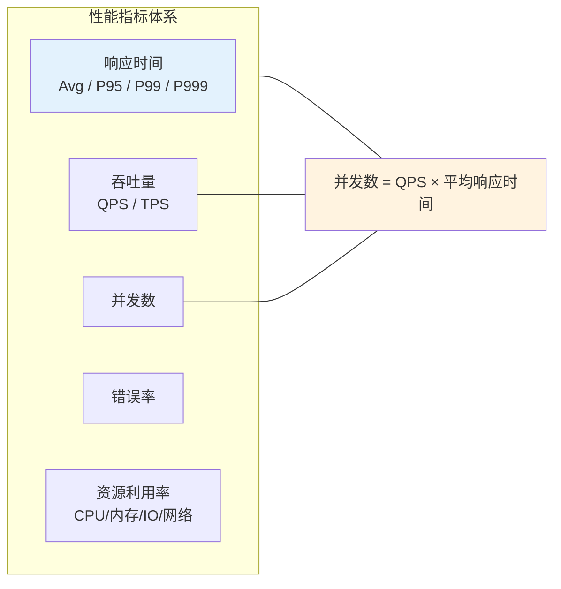
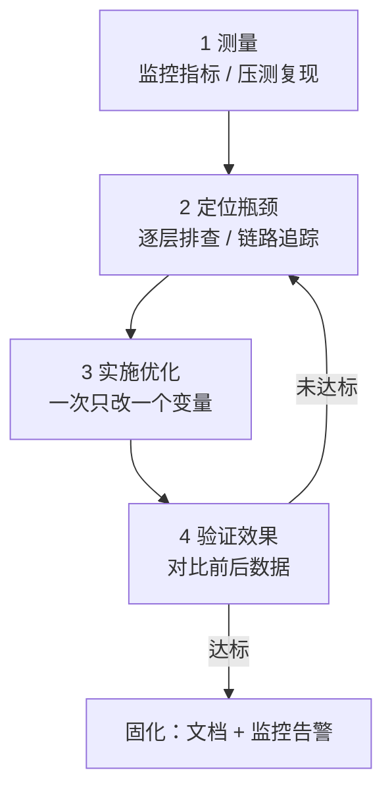

# 性能优化分层

> 定位：性能优化最忌讳「凭感觉调优」——上来就加机器、改 JVM 参数、换缓存，结果瓶颈根本不在那。这篇给你一套方法论：先测量、再定位、后优化，并沿请求链路逐层（SQL/缓存/业务/JVM/网络/OS）拆解手段与适用场景，让每一次优化都有数据支撑。

## 一、为什么需要分层性能优化

见过太多这样的场景：接口慢，第一反应是「加缓存」；加了缓存还是慢，就「加机器」；加了机器还慢，开始「调 JVM 参数」；最后发现是某条 SQL 没走索引，全表扫描了 800 万行。折腾一圈，真正的瓶颈一行索引就解决了。

性能优化的本质是**用最小代价消除系统瓶颈**，而瓶颈永远存在于某个具体环节。没有测量就优化，等于蒙着眼睛开枪——你可能打中了，但更大概率是浪费子弹，甚至引入新问题（过早优化的开销、缓存一致性复杂度、代码可读性下降）。

三条铁律，先刻在脑子里：

1. **没有测量就没有优化**。优化前后必须有可对比的数据，否则你无法证明优化有效。
2. **优化瓶颈，而不是优化一切**。系统的整体性能由最慢的环节决定（阿姆达尔定律），优化非瓶颈环节几乎不提升整体性能。
3. **一次只改一个变量**。同时改 SQL、缓存、JVM，最后性能好了，你不知道是哪个起的作用，也无法复盘。

> 阿姆达尔定律（Amdahl's Law）：系统加速比取决于被优化部分在整体耗时中的占比。如果某环节只占总耗时的 5%，即使把它优化到零耗时，整体也只快 5%。所以**找对瓶颈比优化本身更重要**。

## 二、性能指标：先把「快慢」量化

谈性能必须先统一指标。含糊地说「系统很慢」没有意义，要说清楚是哪个指标慢。

| 指标 | 定义 | 关注点 | 典型目标 |
|---|---|---|---|
| 响应时间（RT） | 一个请求从发出到收到响应的耗时 | 用户体感，越小越好 | 核心接口 P99 < 200ms |
| 吞吐量（Throughput） | 单位时间处理的请求数（QPS/TPS） | 系统容量，越大越好 | 按业务峰值估算 |
| 并发数（Concurrency） | 同时承载的请求/连接数 | 系统负载 | 按 DAU 估算 |
| TPS | 每秒事务数 | 写操作容量 | 下单 TPS |
| QPS | 每秒查询数 | 读操作容量 | 查询 QPS |

三者关系（经典公式）：

```
并发数 = QPS × 平均响应时间
```

比如 QPS=1000，平均响应时间 200ms（0.2s），那么系统并发数约 200。这个公式是容量估算的基础。

**百分位数（Percentile）比平均值重要得多**。平均值会被极端值掩盖：100 个请求里 99 个 10ms，1 个 10 秒，平均 110ms——看起来还行，但那 1 个用户已经投诉了。所以看 P95/P99/P999（95%/99%/99.9% 的请求耗时低于该值）。**长尾请求（P99）往往才是真正影响体验的**。



这张图把性能指标和它们的关系串起来。记住两个核心：**用 P99 而不是平均值看响应时间**，**用「并发数 = QPS × RT」做容量换算**。资源利用率（CPU、内存、IO）是定位瓶颈的线索，错误率是稳定性的底线。

## 三、性能优化方法论：测量 → 定位 → 优化 → 验证

### 3.1 四步闭环



这张图是性能优化的标准闭环。关键在于**循环**：优化不是一次性的，验证没达标就回到定位环节再找下一个瓶颈。很多团队跳过「测量」和「验证」，直接「优化」，结果就是在做无效功。

### 3.2 瓶颈定位：自上而下逐层排查

请求从用户到数据库要穿过很多层，瓶颈可能藏在任何一层。定位的思路是**沿链路自上而下，用数据逐层排除**：

1. **先看全局资源**：CPU、内存、磁盘 IO、网络带宽有没有打满？如果某资源接近 100%，瓶颈很可能就在这。
2. **再看应用链路**：用 APM（链路追踪）看每一跳的耗时，找到最慢的 span。
3. **最后深入单点**：对最慢的环节具体分析（SQL Explain、线程栈、GC 日志）。

关键的判断逻辑：

- **CPU 高但 QPS 上不去** → 可能是代码计算密集、锁竞争、频繁 GC、上下文切换。
- **CPU 不高但 RT 高** → 大概率是 IO 等待（数据库慢、远程调用慢、锁等待）。
- **内存持续涨 + GC 频繁** → 内存泄漏或堆太小。
- **磁盘 IO 高** → 数据库全表扫描、日志写太多、swap。

## 四、分层优化：每层做什么、什么时候做

这是本文的主体。按请求链路从上到下，逐层给出手段和适用场景。

### 4.1 接入层与网络层优化

| 手段 | 原理 | 适用场景 |
|---|---|---|
| CDN | 静态资源缓存到边缘节点 | 图片、JS/CSS、下载 |
| HTTP/2、HTTP/3 | 多路复用、头部压缩 | 大量小请求、高延迟网络 |
| 连接复用 / 长连接 | 减少 TCP 三次握手开销 | 内网服务间调用 |
| 压缩（gzip/br） | 减少传输体积 | 文本类响应 |
| 就近接入（DNS/GSLB） | 用户连最近节点 | 跨地域业务 |

网络层优化的性价比通常很高，因为它不碰业务代码。一个常见的浪费是：**内网服务间调用每次都新建 HTTP 连接**，三次握手 + 慢启动，QPS 高时开销巨大。改用连接池（如 HttpClient 连接池）复用长连接，往往能显著降低 RT。

### 4.2 应用层（JVM/业务代码）优化

这是 most 优化发生的地方，也最容易出问题。

**业务逻辑层**：

- **减少不必要的计算**：循环里重复计算、重复查数据库（N+1 查询）、重复序列化。
- **异步化**：非核心路径（发通知、写日志、更新统计）异步处理，缩短主链路。
- **批量化**：把多次单点调用合并成批量（批量查、批量写），减少网络往返。
- **并发化**：无依赖的多个远程调用并行（CompletableFuture），把串行耗时变成并行。

**JVM 层**：

- **堆大小合理**：`-Xms = -Xmx`，容器环境设为内存的 60%-75%，避免频繁扩容和 OOM Killer。
- **选对 GC**：JDK 8 用 Parallel/CMS，JDK 11+ 推荐 G1，大堆低延迟场景考虑 ZGC/Shenandoah。
- **减少对象分配**：避免短命大对象、复用对象池（谨慎，池化不当反而增加 GC 压力）。
- **锁优化**：缩小锁粒度、用无锁结构（CAS）、避免锁竞争导致上下文切换。

> JVM 调优有个常见误区：以为调几个参数是万能药。**绝大多数性能问题是代码和 SQL 问题，不是 JVM 参数问题**。先把代码和 SQL 治理好，JVM 参数只是最后一步的精修。

### 4.3 缓存层优化

缓存是提升读性能最有效的手段，但用错会引入一致性问题。

| 策略 | 做法 | 适用场景 | 风险 |
|---|---|---|---|
| 本地缓存 | Caffeine/Guava Cache | 高频、低更新、可容忍短暂不一致 | 多实例不一致、内存占用 |
| 分布式缓存 | Redis/Memcached | 多实例共享、大数据量 | 网络开销、缓存穿透击穿雪崩 |
| 多级缓存 | 本地 + 分布式 | 超高 QPS 热点数据 | 复杂度高、一致性更难 |
| 缓存预热 | 启动/定时加载热点 | 热点固定、冷启动慢 | 预热数据的时效性 |

**缓存三兄弟必须分清**：

- **穿透**：查一个根本不存在的 key，每次都打到数据库。解法：布隆过滤器、缓存空值。
- **击穿**：一个热点 key 过期瞬间，大量请求同时打到数据库。解法：互斥锁重建、热点永不过期。
- **雪崩**：大量 key 同时过期或缓存整体宕机。解法：过期时间加随机抖动、多级缓存、限流兜底。

### 4.4 数据库层（SQL）优化

数据库往往是最终瓶颈（因为数据落盘）。优化收益通常最大。

**SQL 优化优先级**：

1. **索引**：最有效。Explain 看是否走索引，避免全表扫描。联合索引遵守最左前缀原则。
2. **避免索引失效**：`where` 里对字段做函数运算、隐式类型转换、`like '%xxx'` 前置通配符、`or` 连接不当，都会让索引失效。
3. **减少返回数据量**：不要 `SELECT *`，只查需要的列；分页用游标/延迟关联，避免深分页。
4. **优化 JOIN**：小表驱动大表，JOIN 字段建索引。
5. **读写分离 / 分库分表**：读多写少用读写分离；单表数据量大（千万级）考虑分库分表。

**一个真实的 Explain 案例**：某接口 P99 高达 3 秒，Explain 发现一条 SQL `select * from orders where date(create_time)=? and status=?`。`date()` 函数让 `create_time` 索引失效，全表扫描 500 万行。改成范围查询 `create_time >= ? and create_time < ?` 并补联合索引 `(status, create_time)` 后，P99 降到 30ms，提升 100 倍。**这就是「找对瓶颈」的威力**。

### 4.5 操作系统层优化

到了这一层，通常是极端性能场景才需要动：

- **文件描述符**：`ulimit -n` 默认 1024，高并发连接场景要调大（如 65535）。
- **TCP 参数**：`tcp_tw_reuse`、`somaxconn`（连接队列）、`tcp_max_syn_backlog` 等，应对大量短连接和高并发。
- **磁盘**：用 SSD、合理的文件系统（ext4/xfs）、IO 调度策略。
- **关闭 swap**：避免内存紧张时换页导致 RT 飙升（Kubernetes 环境常见）。
- **NUMA / CPU 绑核**：极致场景减少跨 NUMA 访问。

## 五、生产坑点与排查

### 坑点 1：用平均值判断性能，忽略长尾

**现象**：监控显示平均 RT 50ms，一切正常，但用户持续投诉「偶尔很卡」。
**原因**：平均值被大量快请求拉低，P99 其实高达 5 秒。少数用户的极端慢请求被掩盖了。
**解法**：监控看 P95/P99/P999，不看平均值。用直方图/热力图（如 Prometheus histogram）观察长尾。对 P99 请求单独打日志、做链路追踪，定位慢在哪个 span。

### 坑点 2：加了缓存反而更慢

**现象**：引入 Redis 后，某接口 RT 从 20ms 涨到 50ms。
**原因**：缓存的数据本身很小、计算很便宜，走 Redis 的网络往返 + 序列化开销反而比直接查本地/数据库更贵。或者缓存命中率低，大多数请求穿透到数据库还要多一次 Redis 调用。
**解法**：评估缓存成本收益——**只有「计算/查询成本高 + 命中率高」才值得缓存**。先看命中率监控，命中率低于 80% 要警惕。小数据、低延迟场景考虑本地缓存。

### 坑点 3：线程池参数盲目调大

**现象**：为了提升吞吐，把核心线程数从 20 调到 200，结果 RT 反而飙升，CPU 上下文切换严重。
**原因**：线程数远超 CPU 核心数，大量线程争抢 CPU，上下文切换开销剧增。IO 密集型也不是越多越好，连接数、下游承载力都有限。
**解法**：CPU 密集型线程数 ≈ CPU 核数（或核数+1）；IO 密集型可按 `核数 × (1 + IO等待时间/CPU计算时间)` 估算。用有界队列 + 拒绝策略，配合压测找到拐点。

### 坑点 4：深分页拖垮数据库

**现象**：`limit 1000000, 20` 这类深分页查询越来越慢。
**原因**：MySQL 需要先扫描并丢弃前 100 万行，再取 20 行。
**解法**：用游标/延迟关联——先按索引查出主键，再回表取数据；或限制最大页码（超过就提示缩小范围）；用「上一页最大 ID」做条件 `where id > lastId limit 20`。

## 六、调优清单与决策表

**优化优先级（收益从高到低，成本从低到高）**：

| 优先级 | 层次 | 手段 | 典型收益 |
|---|---|---|---|
| 1 | SQL | 补索引、改慢 SQL | 10-100 倍 |
| 2 | 缓存 | 热点数据缓存 | 10-100 倍读性能 |
| 3 | 业务 | 异步化、批量、并发 | 2-10 倍 |
| 4 | JVM | GC/堆参数 | 10%-50% |
| 5 | 网络 | 连接复用、CDN、压缩 | 20%-50% |
| 6 | OS | 内核参数、SSD | 极端场景显著 |

**什么时候用哪种手段（决策表）**：

| 现象 | 首要怀疑 | 优先动作 |
|---|---|---|
| 数据库 CPU 高、慢查询多 | SQL 没索引 | Explain + 补索引 |
| 应用 CPU 高、GC 频繁 | 对象分配过多 / 内存泄漏 | dump 堆分析 |
| RT 高但 CPU 不高 | IO 等待（远程调用/锁） | 链路追踪看耗时分布 |
| QPS 到某值后不再涨 | 锁竞争 / 连接池耗尽 / 下游瓶颈 | 看线程栈、连接池指标 |
| 偶发长尾慢请求 | GC 停顿 / 锁 / 热点 | P99 追踪 + GC 日志 |

## 九、面试高频问法

> 这一节的答案按「面试时能讲透」的标准写：先给一句话结论，再展开机制、原因和坑点。

**Q1：性能优化应该怎么做？方法论是什么？**

**一句话结论**：先测量、找瓶颈、再优化——没有数据支撑的优化都是猜测。

展开：

1. **测量**：用监控/压测拿到基线数据（QPS、RT、资源使用率）。
2. **定位瓶颈**：看哪个环节慢（CPU？IO？锁？下游？）。
3. **优化**：针对瓶颈优化（不是盲目加缓存、加机器）。
4. **验证**：优化后再测，确认有效且没有引入新问题。

加分点：说"性能优化最大的误区是'凭感觉优化'——没定位瓶颈就加缓存、加索引，可能优化了不慢的地方，真正瓶颈还在"。

**Q2：性能优化的分层思路是什么？**

**一句话结论**：从外到内分层——SQL/数据库 → 缓存 → 业务逻辑 → JVM → 网络/OS，逐层排查。

展开：

| 层 | 常见优化 |
|---|---|
| SQL/DB | 索引、慢查询、分库分表 |
| 缓存 | 加缓存、减少回源 |
| 业务 | 减少调用、异步、并行 |
| JVM | GC 调优、内存 |
| 网络/OS | 连接池、TCP 参数 |

加分点：说"大部分性能问题在'SQL 和缓存'这两层——先把慢 SQL 干掉、把该缓存的缓存上，往往能解决 80% 的问题；JVM 调优是'最后手段'"。

**Q3：怎么定位一个接口慢在哪？**

**一句话结论**：用链路追踪/Arthas 看耗时分布——是自身计算慢、还是等下游、还是等锁/连接。

展开：

- **链路追踪**：看每个 Span 的耗时，定位慢在哪一跳。
- **Arthas trace**：`trace 类 方法` 看方法内部各调用耗时。
- **火焰图**：async-profiler 看 CPU 热点。
- **线程栈**：jstack 看线程卡在哪。

加分点：说"接口慢先分三类——'计算慢'（CPU 高）、'等待慢'（等 IO/锁/下游）、'排队慢'（线程池/连接池满）；三类解法完全不同"。

**Q4：QPS、RT、并发数是什么关系？**

**一句话结论**：`QPS = 并发数 / 平均 RT`（利特尔法则）——三者互相制约，提升 QPS 要么降 RT，要么加并发。

展开：

- **QPS**：每秒处理的请求数。
- **RT**：响应时间（平均/分位）。
- **并发数**：同时处理的请求数。
- **关系**：并发 = QPS × RT。比如 QPS 1000、RT 100ms，并发 = 100。

加分点：说"这个公式解释了'为什么降 RT 能提 QPS'——RT 从 100ms 降到 50ms，同样并发下 QPS 翻倍；所以优化 RT 和扩容同样重要"。

**Q5：缓存能解决哪些性能问题？不能解决什么？**

**一句话结论**：缓存解决"读多写少、重复读"的性能问题；不能解决"写性能"和"强一致读"。

展开：

- **能解决**：热点数据读、减少数据库压力、降低 RT。
- **不能解决**：写性能（缓存对写没帮助）、强一致读（缓存有一致性问题）、缓存未命中时的穿透。
- **前提**：数据"读多写少"且"能接受短暂不一致"。

加分点：说"缓存不是万能药——写多的场景加缓存没用，强一致的场景加缓存会引入一致性问题；要先判断'数据特征'再决定要不要缓存"。

**Q6：异步和并行怎么提升性能？**

**一句话结论**：异步是"不阻塞等待"（如发消息、写日志），并行是"同时做多件事"（如并行调多个下游）——都能降低 RT。

展开：

- **异步**：把非核心、耗时的操作（发通知、写日志）丢到后台，主流程不等。
- **并行**：多个无依赖的下游调用并行执行，RT 从"求和"变成"取最大"。
- **代价**：异步增加复杂度（要处理失败、顺序）；并行增加线程/连接消耗。

加分点：说"并行调用是'降低 RT 的利器'——串行调 3 个 100ms 的服务是 300ms，并行是 100ms；但要注意线程池隔离，别把线程打满"。

**Q7：数据库连接池和线程池怎么影响性能？**

**一句话结论**：池子太小会排队（RT 高），太大会拖垮下游（连接/线程过多）——要设合理大小并监控。

展开：

- **连接池**：太小，请求等连接；太大，数据库连接数爆、内存高。
- **线程池**：太小，任务排队；太大，上下文切换开销。
- **监控**：等待数、活跃数、获取耗时。

加分点：说"'没报错但很慢'最常见的两个原因就是'线程池满'和'连接池满'——请求在排队，不是执行慢；监控'等待队列长度'能快速发现"。

**Q8：压测应该怎么做？**

**一句话结论**：分阶段——基准压测（找基线）、负载压测（找拐点）、压力压测（找极限）、稳定性压测（长时间跑）。

展开：

- **基准**：单请求、低并发，看基础 RT。
- **负载**：逐步加压，找"RT 开始飙升"的拐点（容量上限）。
- **压力**：超过容量，看系统怎么崩（是否优雅降级）。
- **稳定性**：7×24 跑，看内存泄漏、连接泄漏。

加分点：说"压测最容易被忽略的是'稳定性压测'——短时间压测没问题，跑一天才发现内存泄漏；生产问题很多是'慢性病'"。

**Q9：性能优化有哪些常见误区？**

**一句话结论**：过早优化、盲目加缓存、只看平均值不看分位、优化了不慢的地方、忽略下游瓶颈。

展开：

- **过早优化**：没数据就优化，浪费精力还可能引入 bug。
- **只看平均**：平均 RT 50ms 但 P99 是 2s，用户体验差。
- **加缓存不看一致性**：缓存带来脏数据。
- **忽略下游**：自己优化了，但下游还是瓶颈。

加分点：说"性能要看**分位值**（P95/P99），不是平均值——平均值会掩盖长尾，而用户体验由长尾决定"。

**Q10：怎么建立性能优化的闭环？**

**一句话结论**：监控 → 发现 → 定位 → 优化 → 验证 → 回归监控——形成持续优化的循环。

展开：

1. **监控**：全链路指标（QPS、RT 分位、错误率、资源）。
2. **发现**：告警/巡检发现异常。
3. **定位**：链路追踪/Arthas 找瓶颈。
4. **优化**：针对性优化。
5. **验证**：压测/灰度验证效果。
6. **回归**：持续监控，防劣化。

加分点：说"性能优化不是'一次性项目'，是'持续过程'——业务在变、流量在涨，今天优化了明天可能又慢；要有'性能看板 + 定期巡检'的机制"。

## 小结

- 性能优化三步走：先测量、找瓶颈、再优化，最后用数据验证；优化瓶颈而非一切（阿姆达尔定律）。
- 指标看 P95/P99/P999，不看平均值；记住 `并发数 = QPS × 平均响应时间`。
- 分层收益排序：SQL 索引 > 缓存 > 业务异步批量 > JVM > 网络 > OS。
- 绝大多数性能问题是代码和 SQL 问题，JVM 参数是最后精修，不是万能药。
- 一次只改一个变量；缓存要算成本收益，线程池不是越大越好。
