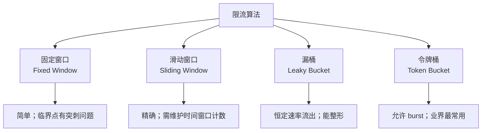
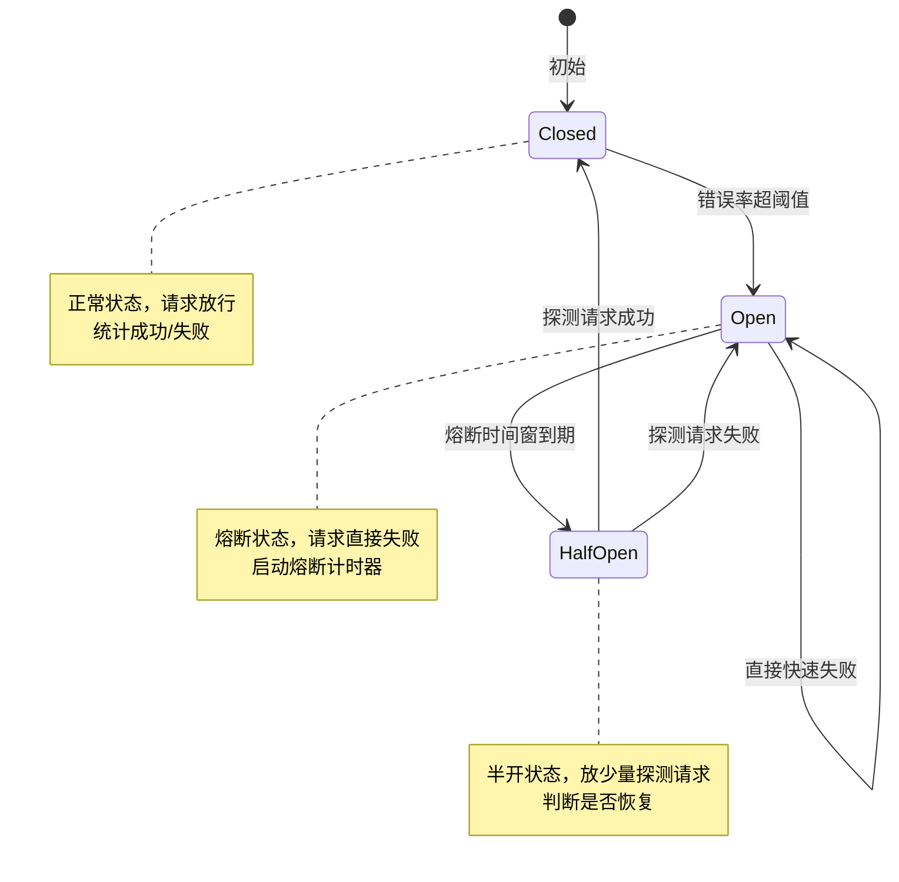
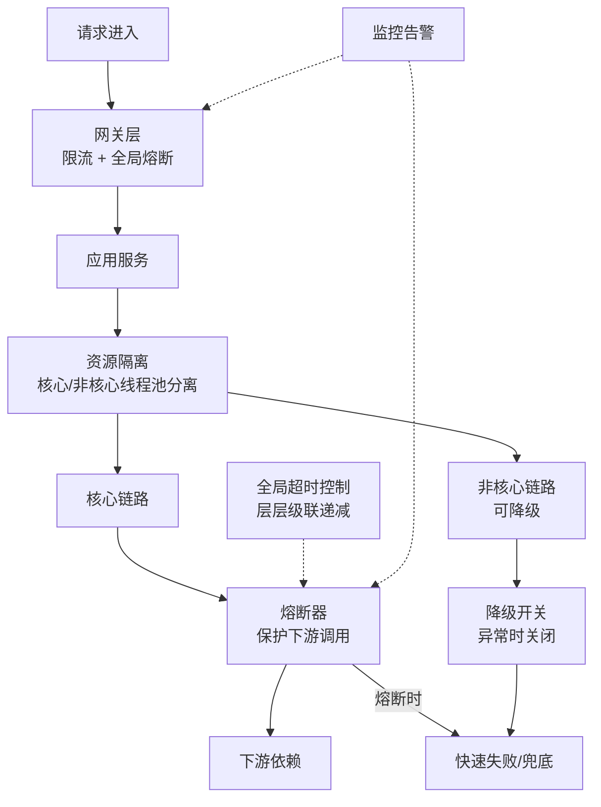

# 限流降级熔断隔离

> 定位：雪崩不是一天塌的，是一个慢依赖拖垮一个线程池、再拖垮整个系统的连锁反应。限流、降级、熔断、隔离是防雪崩的四道防线，但它们解决的是不同问题——这篇讲清每种手段的原理、算法、状态机、参数，以及它们如何配合使用。

## 一、为什么需要这四道防线

一个真实的事故：某系统依赖一个第三方物流查询接口。某天该接口响应从 200ms 劣化到 30 秒。订单服务的线程池 200 个线程很快被这个慢调用全部占满（都在等第三方返回），于是新的订单请求进来无线程可用，整个下单功能不可用。**一个非核心的第三方依赖，拖垮了核心下单链路**——这就是雪崩。

雪崩的传导链条通常是：

```
依赖变慢/不可用 → 线程/连接被占满 → 上游等待堆积 → 资源耗尽 → 扩散到整个系统
```

四道防线各自在不同环节截断这条链：

- **限流**：控制入口流量，不让系统被压垮（防「太多」）。
- **隔离**：把资源分区，一个区域坏了不连累其他区域（防「扩散」）。
- **熔断**：依赖出问题时快速失败，不再等待，保护调用方（防「死等」）。
- **降级**：核心功能受损时，关掉非核心功能保命（防「全挂」）。

> 一句话区分：**限流管「进来的量」，隔离管「坏了的范围」，熔断管「坏依赖的调用」，降级管「保哪些功能」**。它们不是替代关系，而是层层设防。

## 二、限流：算法与实现

限流（Rate Limiting）控制单位时间内的请求数量，超过阈值就拒绝/排队。

### 2.1 四种经典算法



这张图对比了四种限流算法。下面逐个讲清楚原理和坑。

**1. 固定窗口计数器（Fixed Window）**

把时间切成固定窗口（如每秒一个），窗口内计数，超过阈值拒绝，窗口重置。

- 优点：实现极简，一个计数器 + 时间戳。
- 缺点：**临界突刺问题**。假设阈值 100/秒，0.9 秒时进来 100 个，1.1 秒时又进来 100 个，这 0.2 秒内实际通过 200 个，远超阈值。

**2. 滑动窗口（Sliding Window）**

固定窗口的改进，用更细粒度的时间片记录，滑动地统计过去一个窗口的请求数。

- 优点：解决了临界突刺，计数精确。
- 缺点：需要维护多个时间片，内存和计算成本更高。滑动窗口日志（记录每个请求时间戳）精确但耗内存；滑动窗口计数（细分时间片）是折中。

**3. 漏桶（Leaky Bucket）**

请求像水一样注入桶，桶以**恒定速率**漏水（处理请求），桶满则溢出（拒绝）。

- 优点：**强制恒定速率，流量整形效果好**，能平滑突发流量。
- 缺点：无法应对合理的突发——即使系统有空闲，也只能按固定速率处理。

**4. 令牌桶（Token Bucket）**

以恒定速率往桶里放令牌，请求来了要拿到令牌才能通过，桶满则令牌溢出。

- 优点：**既限制平均速率，又允许一定程度的突发**（攒桶里的令牌）。这是最接近真实业务需求的算法，Guava RateLimiter、Sentinel 都基于它。
- 参数：桶容量（burst 上限）、令牌生成速率（QPS）。

> **漏桶 vs 令牌桶的关键区别**：漏桶控制的是「流出速率恒定」，令牌桶控制的是「平均速率 + 突发额度」。业务接口通常允许合理突发，所以令牌桶更常用；需要严格平滑（如下游固定处理能力）用漏桶。

### 2.2 分布式限流

单机限流（如 JVM 内 Guava RateLimiter）只管得住单个实例，多实例场景下总流量是单机阈值 × 实例数。要控制全局 QPS，需要分布式限流：

- **Redis + Lua**：用 Lua 脚本保证「读计数 + 判断 + 更新」的原子性，常见实现。
- **Redis Cell**：Redis 4.0 的 `CL.THROTTLE` 命令，内置令牌桶。
- **Sentinel 集群限流**：有 Token Server 统一发令牌。

> 分布式限流要注意 Redis 本身的性能和可用性——限流依赖挂了不能让业务挂，要有降级策略（如退化为单机限流或放行）。

### 2.3 限流的维度与位置

| 维度 | 例子 | 场景 |
|---|---|---|
| 接口级 | `/order/create` 1000 QPS | 保护核心接口 |
| 用户级 | 每用户 10 QPS | 防刷、防滥用 |
| IP 级 | 每 IP 100 QPS | 防 CC 攻击 |
| 集群级 | 全系统 10000 QPS | 保护整体容量 |

限流位置：网关层（保护整个系统）、应用层（保护具体服务）、方法级（保护关键资源）。越靠前越能保护后端，但粒度越粗。

## 三、隔离：把故障关进笼子

隔离（Bulkhead，舱壁模式）源自造船——船舱分成多个隔水舱，一个破了不会沉整条船。

### 3.1 线程池隔离 vs 信号量隔离

| 维度 | 线程池隔离 | 信号量隔离 |
|---|---|---|
| 资源隔离 | 每个依赖独立线程池 | 用计数器限制并发数 |
| 超时控制 | 支持（可中断） | 不支持（不占线程外的等待） |
| 开销 | 大（每线程有栈、上下文切换） | 小（只是计数） |
| 适用 | 慢调用、需要超时、外部依赖 | 快速调用、内部逻辑、高并发 |

**线程池隔离**：给每个下游依赖分配一个独立线程池。物流接口慢，只占满它自己的线程池，不会占用订单线程池。代价是线程数多、开销大。Hystrix 是典型代表。

**信号量隔离**：用一个计数器（Semaphore）限制某资源的并发调用数，超过就拒绝。不新建线程，调用方线程自己执行。开销小，但**无法做到超时中断**——如果调用卡住，调用方线程还是被占着。适合快速的本地调用或已受控的调用。

> 选型口诀：**调用慢、要超时隔离 → 线程池；调用快、要轻量高并发 → 信号量**。Sentinel 同时支持两种，Hystrix 默认线程池。

### 3.2 其他隔离维度

- **资源隔离**：核心/非核心服务分开部署，不共享线程池和连接池。
- **数据隔离**：读写分离、库表拆分，慢查询不影响主链路。
- **机房/集群隔离**：不同业务用不同集群，故障不跨集群扩散。
- **租户隔离**：SaaS 多租户，大客户独享资源（「吵闹邻居」问题）。

## 四、熔断：不让调用方死等

熔断（Circuit Breaker）模仿电路保险丝：依赖错误率过高时「跳闸」，后续调用直接快速失败，不再打到坏依赖；一段时间后尝试恢复。

### 4.1 熔断状态机



这张图是熔断器的三态状态机，是理解熔断的核心：

- **Closed（闭合）**：正常放行，同时统计错误率。
- **Open（断开）**：错误率超阈值后跳闸，后续请求直接快速失败（走降级），不再调用坏依赖。同时启动熔断计时器。
- **Half-Open（半开）**：计时器到期后，放少量探测请求过去。成功则恢复 Closed，失败则回到 Open 重新计时。

### 4.2 熔断的关键参数

| 参数 | 含义 | 典型值 |
|---|---|---|
| 失败率阈值 | 错误率超过多少触发熔断 | 50% |
| 最小请求数 | 统计窗口内最少多少请求才开始判断 | 20 |
| 统计窗口 | 统计多久的请求 | 10 秒 |
| 熔断时长 | Open 状态持续时间 | 5 秒 |
| 半开探测数 | Half-Open 放多少探测请求 | 3-5 |

> `最小请求数`很重要：如果只有 1 个请求且失败，错误率 100%，但可能是偶发，不应熔断。设最小请求数避免误触发。

熔断 vs 限流的区别（高频考点）：

- **限流**是保护**自己**——控制进入自己的流量，防止被压垮。
- **熔断**是保护**调用方**——依赖坏了，调用方不再傻等，快速失败。

## 五、降级与超时控制

### 5.1 降级（Degradation）

降级是「丢卒保车」：系统压力大或依赖故障时，关闭非核心功能，保证核心可用。

**降级的三种方式**：

| 方式 | 做法 | 例子 |
|---|---|---|
| 开关降级 | 配置中心开关，手动/自动关闭功能 | 大促关闭「猜你喜欢」 |
| 默认值/兜底 | 返回预设的默认结果 | 推荐服务挂了返回热门商品列表 |
| 缓存降级 | 读旧缓存数据 | 数据库压力时返回缓存快照 |

**降级的触发方式**：手动降级（大促预案，提前关掉非核心）、自动降级（基于错误率、RT、系统负载触发）。

**降级要提前设计**——每个非核心依赖都要想好「它挂了返回什么」。临时抱佛脚写降级逻辑，往往来不及。

### 5.2 超时控制

超时是防雪崩的**基础中的基础**——没有超时，慢调用会无限等待，上述所有手段都无从谈起。

**超时的关键点**：

- **每个远程调用都必须设超时**（连接超时 + 读取超时）。
- 超时时间要合理：太短误杀正常慢请求，太长失去保护意义。
- 超时时间要**层层递减**：网关 3s → 服务 A 2s → 服务 B 1s，避免上游超时了下游还在跑（浪费资源）。
- 超时后要**主动释放资源**（关闭连接、中断线程），否则只是「客户端不等了，服务端还在跑」。

> 很多故障的根因就是「没设超时」或「超时设得太长」。一个 30 秒超时的慢依赖，足以在 30 秒内占满整个线程池。**先把超时配好，再谈熔断降级**。

## 六、生产坑点与排查

### 坑点 1：熔断降级配置成「永不开」

**现象**：依赖明显故障了，但系统没有任何熔断降级动作，线程还是被慢慢占满。
**原因**：错误率阈值设得过高（如 90%）、最小请求数设得过大，或统计窗口太长，导致始终不触发；或者降级逻辑本身抛异常。
**解法**：压测模拟依赖故障，观察熔断是否按预期触发。阈值设合理（错误率 50%、最小请求 10-20、窗口 10s）。**降级方法必须经过测试**，确保它比原方法更简单、不依赖同样的资源。

### 坑点 2：降级返回空导致下游 NPE

**现象**：降级返回 `null` 或空集合，调用方没判空，抛出 NullPointerException，故障反而扩大。
**原因**：降级逻辑只想着「返回个东西」，没考虑调用方对返回值的假设。
**解法**：降级返回**语义正确的兜底值**（空集合而非 null、默认值、缓存快照），并保证调用方能正确处理。降级逻辑要和主逻辑一起做单元测试。

### 坑点 3：线程池隔离线程数设置不当

**现象**：给每个依赖都建了独立线程池，几十个依赖 × 20 线程 = 上千线程，内存和上下文切换开销巨大，反而拖慢系统。
**原因**：线程池隔离不是越多越好，依赖数量多时线程总数爆炸。
**解法**：只对**真正慢、真正重要**的外部依赖做线程池隔离；快速调用用信号量隔离。控制线程池总数，设置合理的队列长度和拒绝策略。

### 坑点 4：限流误伤正常流量

**现象**：大促时限流生效，但很多正常用户请求被拒，投诉激增。
**原因**：限流阈值拍脑袋设置，没经过压测；或按单机限流但实例数预估错误，实际总容量不足。
**解法**：限流阈值基于压测得出的容量设置，留 20%-30% 余量。区分用户等级（VIP 用户不限流），对被限流请求返回友好提示或引导重试（`Retry-After`）。限流值要能**动态调整**（配置中心），不用重启。

## 七、四种手段的配合使用与防雪崩体系

### 7.1 对比总表

| 手段 | 解决什么 | 作用位置 | 关键指标 | 触发方式 |
|---|---|---|---|---|
| 限流 | 流量超过容量 | 入口/资源 | QPS、并发数 | 流量超阈值 |
| 隔离 | 故障扩散 | 资源分配 | 线程池/信号量 | 设计期预设 |
| 熔断 | 依赖故障死等 | 调用方 | 错误率、RT | 错误率超阈值 |
| 降级 | 保核心舍非核心 | 功能开关 | 系统负载/依赖状态 | 手动/自动 |

### 7.2 防雪崩体系全景



这张图把四道防线串成一个体系：请求进来先过网关限流，应用内做资源隔离，核心链路走熔断器保护下游，非核心链路随时可降级，全程有超时控制和监控。**防雪崩不是某一个组件，而是贯穿全链路的设计**。

**落地顺序建议**：

1. **先配超时**——基础中的基础，没有超时其他都是空中楼阁。
2. **做隔离**——核心/非核心资源分开，防止扩散。
3. **加熔断**——所有外部依赖都套熔断器。
4. **设降级**——每个非核心功能准备好兜底。
5. **上限流**——在网关和关键接口限流，保护整体容量。
6. **配监控告警**——限流/熔断触发时告警，说明系统已处于异常状态。

## 九、面试高频问法

> 这一节的答案按「面试时能讲透」的标准写：先给一句话结论，再展开机制、原因和坑点。

**Q1：限流、熔断、降级、隔离有什么区别？**

**一句话结论**：限流控入口流量、熔断在下游故障时快速失败、降级牺牲非核心功能、隔离把故障限制在局部。

| 手段 | 解决的问题 | 触发条件 | 手段 |
|---|---|---|---|
| 限流 | 流量超过系统容量 | QPS/并发超阈值 | 拒绝/排队 |
| 熔断 | 下游故障拖垮自己 | 错误率/RT 超阈值 | 快速失败 |
| 降级 | 资源不足保核心 | 系统压力大/依赖不可用 | 关闭非核心 |
| 隔离 | 故障扩散 | 设计时预防 | 线程池/信号量隔离 |

加分点：说"四者是'稳定性四件套'，缺一不可——限流防被打死、熔断防被拖死、降级保核心、隔离防扩散"。

**Q2：熔断器的三个状态是什么？怎么工作？**

**一句话结论**：关闭（正常）→ 打开（熔断，拒绝请求）→ 半开（放一个试探）→ 成功关闭、失败继续打开。

展开：

- **Closed**：正常放行，统计错误率/慢调用比例。
- **Open**：达到阈值后熔断，所有请求快速失败，不调用下游。
- **Half-Open**：熔断一段时间后，放少量请求试探，成功则关闭，失败则继续打开。

加分点：说"半开状态是熔断的精髓——它让系统能'自愈'：下游恢复了，试探成功就自动恢复，不用人工干预"。

**Q3：降级有哪几种方式？**

**一句话结论**：返回兜底数据、关闭非核心功能、读缓存、返回默认值/空。

展开：

- **兜底数据**：推荐服务挂了，返回热门榜单。
- **功能降级**：关闭评论、推荐等非核心功能。
- **读缓存**：数据库压力大，读缓存。
- **默认值**：返回空/默认值，保证流程不中断。

加分点：说"降级的关键是'提前设计好降级方案'——不能等出事了才想'降级降什么'；降级开关要能动态控制，且要演练"。

**Q4：什么是舱壁模式（隔离）？**

**一句话结论**：像船的隔水舱——给不同依赖/业务分配独立资源池（线程池/连接池），一个出问题不影响其他。

展开：

- **线程池隔离**：每个下游依赖一个独立线程池，一个依赖慢了只占满自己的池。
- **信号量隔离**：限制并发数，更轻量。
- **对比**：线程池隔离彻底但开销大；信号量轻量但只能限并发。

加分点：说"隔离的代价是资源利用率下降（每个池都要预留）——但为了'故障不扩散'，这个代价值得；Hystrix 的线程池隔离就是典型"。

**Q5：超时应该怎么设置？为什么重要？**

**一句话结论**：超时是"防雪崩的第一道防线"——没有超时，下游卡住会把调用方线程全部占满。

展开：

- **设置原则**：小于上游超时（逐层递减）、基于 P99、不同接口不同值。
- **为什么重要**：下游慢但没挂，调用方无限等待，线程耗尽，自己先挂。
- **配合**：超时 + 重试 + 熔断，形成完整防护。

加分点：说"很多人只配了连接超时，没配读超时——连接建立了但下游不返回，照样卡死；读超时（response timeout）必须配"。

**Q6：重试和熔断怎么配合？**

**一句话结论**：重试提高成功率，但会放大流量；熔断在下游不健康时阻止重试——两者要配合，避免"重试风暴"。

展开：

- **问题**：下游慢，请求超时重试，流量翻倍，下游更慢，雪崩。
- **配合**：熔断打开时，直接失败不重试；重试要有次数限制和退避。
- **原则**：只重试幂等操作，下游不健康时不重试。

加分点：说"重试是把双刃剑——它假设'失败是偶发的'，但下游过载时失败是'必然的'，重试只会火上浇油；所以重试必须配熔断"。

**Q7：什么是服务降级开关？怎么设计？**

**一句话结论**：降级开关是"动态控制某个功能是否降级"的配置，出问题时一键降级，恢复后一键恢复。

展开：

- **存储**：配置中心（Nacos/Apollo），动态生效。
- **粒度**：按功能、按依赖、按用户（灰度降级）。
- **设计**：默认关闭，出事打开；要有监控和告警。
- **演练**：定期演练降级，确认降级后系统真的能扛。

加分点：说"降级开关最大的坑是'降级了但没恢复'或'降级逻辑本身有 bug'——所以要演练，且降级要有超时自动恢复"。

**Q8：怎么防止缓存雪崩导致的系统崩溃？**

**一句话结论**：缓存雪崩是"大量缓存同时失效，请求全打到数据库"；用"过期时间打散、多级缓存、熔断降级"防。

展开：

- **过期打散**：给过期时间加随机值，避免同时失效。
- **多级缓存**：本地缓存 + Redis，Redis 挂了本地还能挡。
- **熔断**：数据库压力大时熔断，保护数据库。
- **预热**：重启后先预热缓存。

加分点：说"缓存雪崩的连锁反应是'缓存失效 → 数据库被打爆 → 数据库挂 → 整个系统挂'；防护要覆盖每一环，不能只防'缓存失效'"。

**Q9：稳定性建设应该包含哪些方面？**

**一句话结论**：容量（够不够）、冗余（挂了有没有备份）、隔离（故障会不会扩散）、限流降级（过载怎么办）、监控告警（出问题能不能发现）、预案演练（出问题会不会处理）。

展开：

| 方面 | 关键动作 |
|---|---|
| 容量 | 压测、容量规划 |
| 冗余 | 多实例、多机房 |
| 隔离 | 线程池/机房隔离 |
| 限流降级 | 阈值、开关、兜底 |
| 监控告警 | 指标、链路、日志 |
| 预案演练 | 故障演练、混沌工程 |

加分点：说"稳定性是'体系'不是'单点'——只做限流不做监控，出问题发现不了；只做监控不做演练，预案是纸上谈兵"。

**Q10：线上出故障时，第一件事做什么？**

**一句话结论**：先**止血**（恢复服务），再**定位**（找根因），最后**复盘**（防再次发生）——不要在故障时纠结根因。

展开：

- **止血优先**：回滚、降级、扩容、切流量——先让服务恢复。
- **保留现场**：dump、日志、监控快照，方便事后分析。
- **定位根因**：服务恢复后再深入分析。
- **复盘**：写复盘报告，改进。

加分点：说"故障处理最大的误区是'一边救火一边找根因'——用户在等，先恢复服务最重要；根因可以事后慢慢查，但服务不能一直挂着"。

## 小结

- 四道防线各司其职：限流管流量、隔离管范围、熔断管坏依赖、降级管功能取舍；不是替代而是叠加。
- 限流首选令牌桶（平均速率+突发）；漏桶恒定整形；固定窗口有临界突刺。
- 熔断三态 Closed→Open→Half-Open，参数含错误率阈值、最小请求数、统计窗口、熔断时长。
- 超时是地基，必须配且层层递减；隔离优先保护慢的外部依赖；降级返回值要语义正确。
- 落地顺序：超时 → 隔离 → 熔断 → 降级 → 限流 → 监控，防雪崩是贯穿全链路的系统工程。
