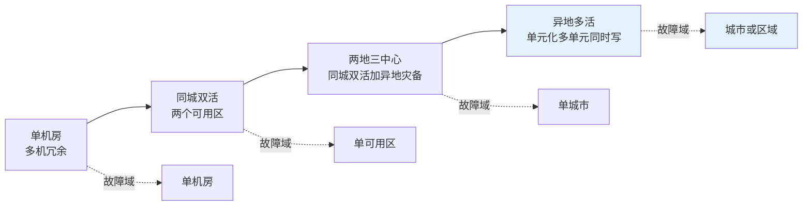
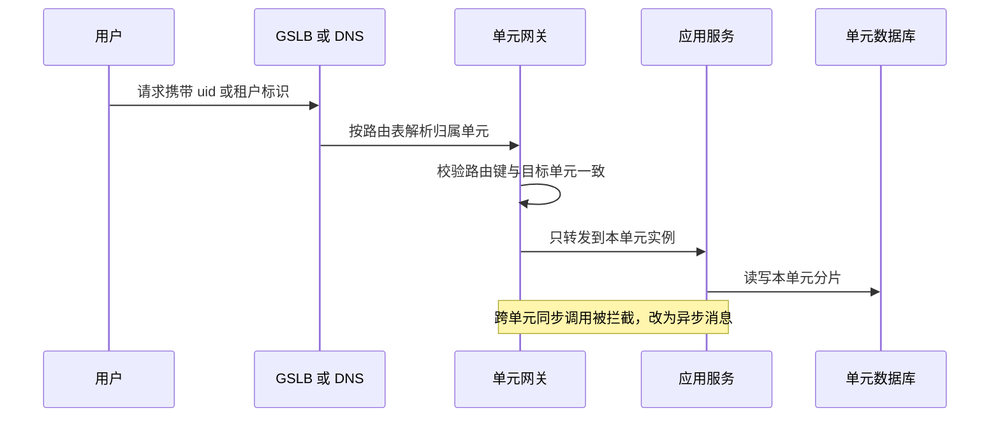
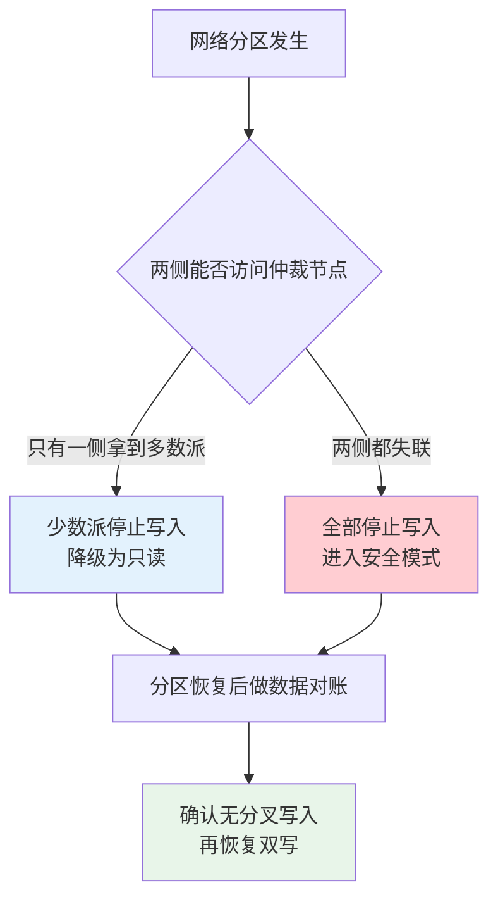
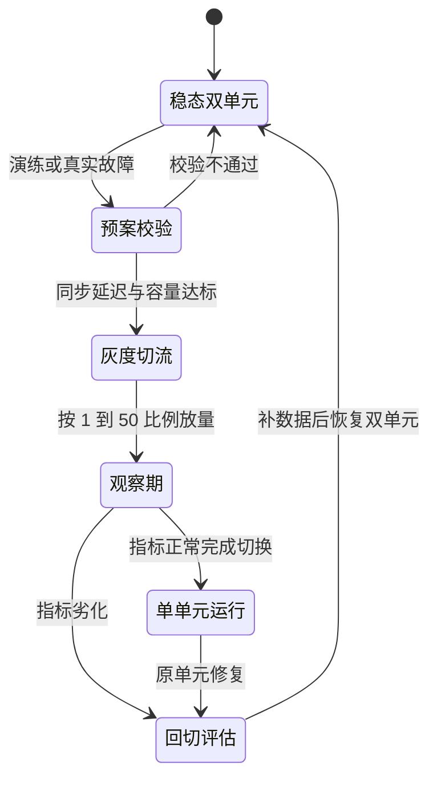

# 单元化与异地多活

> 定位：机房级故障——断电、光缆被挖断、区域网络抖动——不是「多买几台机器」能解决的。这篇讲清单机房 → 同城双活 → 两地三中心 → 异地多活的演进逻辑，拆开单元化（Set 化）的三个核心：流量路由、数据分片、单元内闭环，再落到数据同步、脑裂仲裁、切流与回切状态机、中间件改造清单。读完你能回答两个问题：我的业务该不该做多活？如果做，第一步该改什么？

## 一、为什么需要它

三个很有代表性的场景：

1. **「我们做了同城双活」**：两个机房都部署了应用，但数据库主库只在 A 机房，B 机房的应用连的是 A 的库。A 机房断电后，B 机房的应用一台都起不来——双活只活了接入层。
2. **「我们上了异地多活」**：把 10% 用户切到 B 单元后，这批用户的下单接口开始报「订单不存在」——路由按 user_id 切了，订单表却还按订单号分片，两边对不上。
3. **「切流很顺利，回切翻车了」**：切到 B 单元跑了三天，A 单元修好后要切回来，结果发现这三天 B 单元的新数据没有同步回 A，回切丢了一批订单。

这三个场景对应三个认知，也是本文的主线：

- 多活的单位不是「机房」，而是「**单元**」——一个能独立对外服务的完整闭环。
- 多活的难点不在部署，而在**数据**：怎么分、怎么同步、冲突怎么办、回切怎么补。
- 多活是**组织能力**：没演练过的多活方案，等于没有方案。

面试里问多活，考的不是「你知不知道两地三中心」，而是「你能不能说清哪些数据能切、切过去之后怎么回来」。只讲架构图不讲数据回切的答案，一听就是背的。

## 二、核心原理：从单机房到单元化

### 2.1 四代架构的演进

| 形态 | 故障域 | 数据写入 | RPO | RTO | 典型成本 |
|---|---|---|---|---|---|
| 单机房多机 | 单机 / 单交换机 | 单库单写 | 备份点 | 小时级 | 低 |
| 同城双活 | 单可用区 | 单主库，跨 AZ 半同步 | 秒级 | 分钟级 | 中 |
| 两地三中心 | 单城市 | 同城主备 + 异地异步 | 同城秒级、异地分钟级 | 十分钟级 | 较高 |
| 异地多活 | 单城市 / 单区域 | 多单元同时写 | 单元内秒级、跨单元异步 | 分钟级 | 很高 |



读图要点：每往右走一代，故障域扩大一级，代价是数据一致性的实现方式越来越「绕」。**同城双活是基础设施问题（拉专线、配复制），异地多活是应用架构问题（切分、路由、冲突处理）**——这是两者成本差一个数量级的根本原因。

### 2.2 RPO 与 RTO：先定目标，再谈架构

- **RPO（Recovery Point Objective）**：能容忍丢多少数据，决定数据复制的同步程度。
- **RTO（Recovery Time Objective）**：能容忍多久恢复，决定切换的自动化程度和演练频率。

两个指标都是**业务给的**，不是技术挑的。支付、账务通常要求 RPO=0、RTO 分钟级；资讯、推荐类业务 RPO 几分钟、RTO 半小时也能接受（SLA 的口径见 [高可用架构设计](01-高可用架构设计.md)）。拿着业务目标去选架构，而不是先建了多活再倒推。

| 复制方式 | RPO | 写延迟 | 主要风险 |
|---|---|---|---|
| 异步复制 | 秒级到分钟级，取决于延迟 | 最低 | 主库宕机丢未同步事务 |
| 半同步复制 | 通常接近 0，取决于等待副本数 | 增加一个网络往返 | 超时后退化为异步，监控缺失就以为还是同步 |
| 同步复制 / 多数派 | 0 | 最高，受最慢副本约束 | 副本故障直接阻塞写入 |
| 组复制 / 共识协议 | 0（多数派提交） | 受网络 RTT 影响 | 少数派不可写，跨城部署性能差 |

跨城同步复制在物理上就不划算：一次写入要等几十毫秒级的跨城往返，吞吐直接掉一个数量级。所以**异地多活的正确做法不是「让全局强同步」，而是「把强同步缩小到单元内部」**——这是单元化存在的全部理由。

### 2.3 单元、可用区、机房不是一回事

| 概念 | 本质 | 需要数据分片 | 切换方式 | 典型实现 |
|---|---|---|---|---|
| 机房 / 可用区 | 基础设施故障域 | 否 | 主备切换、VIP 漂移 | 同城双活 |
| 单元（Set） | 能独立服务的业务闭环 | 是 | 流量路由切换 | 异地多活 |
| 单元内的分片 | 单元内再按哈希拆分 | 是 | 无需切换 | 分库分表 |

### 2.4 单元化的三个不变量

任何单元化方案，本质都在维护三条不变量，违反一条，故障时就会暴露：

1. **路由稳定**：同一个路由键（如 uid）永远解析到同一个单元；路由表可以改，但改的时候必须有迁移流程，不能「今天哈希取模、明天换个算法」。
2. **单元闭环**：单元内的同步调用链不跨单元。跨单元调用延迟受公网/专线影响，且对端故障会顺着调用链传导回来，多活就退化成了「多机房串联」。
3. **跨单元异步**：确实需要跨单元交互的，只允许走消息、异步复制、离线对账这类可缓冲、可补偿、可重放的方式。

### 2.5 流量路由：按什么维度切

| 路由维度 | 优点 | 缺点 | 适用 |
|---|---|---|---|
| user_id / 账号 | 分布均匀，天然聚合用户数据 | 新用户要在注册时定归属 | 电商、社交、内容 |
| tenant_id / 企业 | 租户数据天然隔离 | 大租户会造成倾斜 | SaaS、企业服务 |
| 地理位置（省/大区） | 延迟低、合规友好 | 人口流动导致「人岗不匹配」 | 本地生活、政企 |
| 设备号 / 门店号 | 稳定、可预测 | 覆盖不全 | IoT、零售 |

三种路由算法的取舍：

- **取模**：简单，但扩缩容时几乎全量迁移，只适合单元数长期不变。
- **一致性哈希**：扩缩容只迁移相邻区间，但会出现数据倾斜，需要虚拟节点。
- **路由表**（推荐）：uid → 单元的映射存在配置中心或路由服务里，支持灰度、支持指定用户、支持回滚，迁移时改表即可。代价是多一次查询，通常用本地缓存 + 推送解决；同时要满足可查、可改、可审计。

## 三、关键机制

### 3.1 一次请求的完整路由链路



读图要点：路由只在一个地方决策（网关），下游不再重复计算；一旦发现请求的路由键与所在单元不一致，**直接拒绝而不是「就近处理」**——就近处理会悄悄产生跨单元写，等切流时才发现数据分裂。

### 3.2 数据同步的三条路

| 方式 | 原理 | 延迟 | 适用 | 注意 |
|---|---|---|---|---|
| MySQL 原生复制 | binlog 传输 + 回放 | 毫秒到秒级 | 单元内主从、同城灾备 | 半同步会退化；大事务放大延迟 |
| CDC / DTS 类工具 | 订阅 binlog 转成变更流 | 秒级 | 跨单元、跨云、异构同步 | 需要位点管理、断点续传、全量+增量衔接 |
| 双向同步 | 两个方向各跑一条链路 | 秒级 | 迁移期、双写期 | 必须解决回环和冲突 |

半同步复制的两个关键参数（MySQL 8.0，参数名以版本为准；复制原理见 [读写分离与主从复制](../06-数据库体系/06-读写分离与主从复制.md)）：

```sql
-- 主库：开启半同步，至少 1 个副本确认
SET GLOBAL rpl_semi_sync_source_enabled = ON;
SET GLOBAL rpl_semi_sync_source_timeout = 1000;   -- 毫秒，超时后退化为异步
-- 从库
SET GLOBAL rpl_semi_sync_replica_enabled = ON;
```

**这里藏着多活最常见的一颗雷**：`rpl_semi_sync_source_timeout` 一到，主库自动退回异步复制，日志里只有一行 warning。如果没人监控 `Rpl_semi_sync_source_status`，你会一直以为自己是 RPO=0，直到切流那一刻。

同步之外必须有**对账**：全量对账按分片算 checksum，增量对账按时间窗比对变更条数。对账不是为了「实时一致」，而是为了在切流前能回答「两边差多少、差在哪」。

### 3.3 双向同步的冲突处理

双向同步的本质问题是：同一条记录在两个单元被并发修改，谁赢？

| 策略 | 做法 | 优点 | 风险 |
|---|---|---|---|
| 最后写入胜（LWW） | 比较时间戳/版本号，取大者 | 实现简单 | 依赖时钟，可能丢更新 |
| 版本号 + 乐观锁 | 每次写递增 version，冲突则拒绝 | 不丢更新 | 需要业务改造，冲突时失败 |
| 业务字段合并 | 按字段语义合并（如库存取减量） | 语义正确 | 每个字段都要单独设计 |
| 禁止双写 | 全局数据只允许一个单元写 | 最简单最可靠 | 该单元故障时写不可用 |

比冲突策略更重要的是**防回环**：A 的变更同步到 B，B 的 binlog 又把它同步回 A，形成放大循环。常见做法是给每条变更打上来源单元标记（写入单元 ID 或同步链路 ID），回放时过滤掉「来源是自己」的变更。GTID、事务注释、影子表都可以承载这个标记，选一种并全局统一。

### 3.4 脑裂与仲裁

网络分区时，两个单元都可能认为「对方挂了」，于是各自升主、各自接受写入——这就是脑裂，恢复后两边数据无法自动合并。



三层防线，缺一不可：

1. **仲裁（Quorum / Witness）**：奇数个投票成员，只有拿到多数派的一侧才能写。跨城部署时，第三个「见证节点」放在第三地，只投票不存业务数据。
2. **租约（Lease）**：主单元持有带过期时间的租约，续租失败自动降级，避免「永远认为自己还活着」。
3. **隔离（Fencing）**：切换前先确保老主真的写不进去——撤销账号权限、摘除 VIP、切断存储挂载。只靠「它应该已经挂了」的假设，迟早双写。

原则只有一句：**对强一致数据，宁可停写，不可双写**。停写是可恢复的故障，双写是不可恢复的数据损坏。

### 3.5 切流与回切状态机

切流不是「改个 DNS」那么简单，它是有状态、有前置条件、有回退路径的过程。



读图要点：注意 `Single --> Rollback` 这条边——**回切是独立的一步，不是切流的逆操作**。切过去之后新单元产生了新数据，回切必须先把这部分增量补回原单元，再迁回流量。

切流前置检查清单（少一项都不切）：

| 检查项 | 判定标准 | 不达标的后果 |
|---|---|---|
| 复制延迟 | 追平且稳定一段时间 | 切过去丢最近的数据 |
| 数据对账 | 差异条数为 0 或在容忍范围 | 用户看到「数据消失」 |
| 目标单元容量 | 按峰值流量压测通过 | 切过去直接过载 |
| 依赖可用 | 单元内中间件、下游全部就绪 | 切过去才发现调不通 |
| 回切方案 | 增量补数脚本已演练 | 回不去 |

### 3.6 对中间件的要求

| 组件 | 要求 | 常见坑 |
|---|---|---|
| 注册中心 | 实例带单元标签，消费方优先同单元 | 跨单元注册导致调用打穿 |
| RPC 框架 | 支持单元亲和路由、跨单元拦截 | 只按权重轮询，随机跨单元 |
| 消息队列 | 单元内独立 topic/集群，跨单元异步复制 | 共享集群，故障时一起挂 |
| 缓存 | key 带单元前缀，写入只落本单元 | 共享 Redis，切流后读到旧数据 |
| 分布式 ID | 全局唯一 + 可反解单元（见 [分布式ID](../08-分布式理论与共识/03-分布式ID.md)） | 各单元独立发号导致冲突 |
| 定时任务 | 单元内任务本地执行，全局任务单点或分片 | 两个单元各跑一遍，数据翻倍 |

### 3.7 Java 侧：路由上下文与跨单元拦截

路由上下文只在入口解析一次，全链路透传；线程池复用时必须清理，否则会串单元。

```java
public final class UnitContext {

    private static final ThreadLocal<String> CURRENT = new ThreadLocal<>();

    public static void bind(String unitId) { CURRENT.set(unitId); }
    public static String current() { return CURRENT.get(); }
    public static void clear() { CURRENT.remove(); }
}
```

```java
@Component
public class UnitRouteFilter implements Filter {

    private final UnitRouteTable routeTable;   // 路由表，支持热更新与灰度

    public UnitRouteFilter(UnitRouteTable routeTable) {
        this.routeTable = routeTable;
    }

    @Override
    public void doFilter(ServletRequest req, ServletResponse resp, FilterChain chain)
            throws IOException, ServletException {
        HttpServletRequest request = (HttpServletRequest) req;
        String uid = request.getHeader("X-User-Id");
        String unit = routeTable.resolve(uid);          // 查不到时按默认单元兜底
        UnitContext.bind(unit);
        try {
            chain.doFilter(req, resp);
        } finally {
            UnitContext.clear();                        // 线程池复用必须清理
        }
    }
}
```

跨单元调用的拦截放在 RPC 出口，宁可快速失败，也不要「悄悄跨单元成功」——`UnitContext.current()` 与目标单元不一致时直接抛异常，测试环境把异常升级为流水线失败。

## 四、生产坑点与排查

### 坑点 1：路由键和分片键不一致，切流后查不到数据

**现象**：按 uid 把 10% 用户切到 B 单元，这批用户查订单返回空。
**原因**：请求路由用 uid，订单表分片用 order_id，同一个用户的订单散落在两个单元。
**解法**：**分片键必须是路由键或其函数**。已上线系统无法改分片键时，用「基因法」——生成订单号时把 uid 的哈希位编进订单号，保证两者同余；或建立 uid → 单元的路由索引表，查询时先路由再查。

### 坑点 2：隐性跨单元调用，平时看不出、故障时全挂

**现象**：单元化改造完成，平时运行正常；B 单元网络抖动时，A 单元的下单成功率也掉了 30%。
**原因**：某段代码还在查全局库、全局缓存或调用未改造的服务，链路名义上单元化，实际仍串联。
**解法**：用链路追踪按单元着色，统计跨单元调用的 QPS 与占比，目标为 0；在 RPC 出口和 DAO 层加断言，测试环境直接抛异常；把「跨单元调用数」做成发布门禁指标。

### 坑点 3：半同步退化为异步，切流丢了最近的事务

**现象**：主库故障切换后，业务方反馈「最后几分钟的订单没了」。
**原因**：`rpl_semi_sync_source_timeout` 超时后主库自动降级为异步复制，没有任何告警。
**解法**：监控 `Rpl_semi_sync_source_status` 与等待副本数，降级即告警；把 `sync_binlog=1`、`innodb_flush_log_at_trx_commit=1` 与半同步一起纳入基线；切流前强制校验当前复制模式，不允许在异步状态下做 RPO=0 的切换。

### 坑点 4：双向同步回环，一条数据被放大成十几条

**现象**：双向同步上线后，某些记录的更新时间不断刷新，消息量异常增长。
**原因**：A→B 的变更被 B 的 binlog 捕获后又同步回 A，形成循环；或者同步工具把「同步产生的写入」当成业务写入。
**解法**：给变更打来源标记并在回放时过滤；同步账号使用独立账号并在 binlog 里识别；上线前用影子库跑一轮回环测试，观察写入量是否收敛。

### 坑点 5：脑裂后靠「事后对账」兜底，结果对不上

**现象**：机房之间网络分区 20 分钟，恢复后两边都有新订单，无法判断哪条有效。
**原因**：分区期间两侧都能写，没有仲裁和 fencing；对账脚本只能发现差异，不能决定胜负。
**解法**：强一致数据必须走多数派或租约，少数派直接拒写；确需双写的业务数据，设计成「只追加、可合并」的结构（如流水、事件），而不是「覆盖式更新」；对账只作为最后一道校验，不作为一致性方案。

### 坑点 6：只演练切流，不演练回切

**现象**：切流演练评分 95 分，真实故障切过去三天后回切，数据丢了、流程没人会。
**原因**：回切涉及增量补数、双向同步停启顺序、路由表回滚，步骤比切流多一倍，却从未完整走过。
**解法**：演练脚本必须包含「切过去 → 跑一段时间 → 补数据 → 切回来」完整闭环；回切设置独立的检查清单和负责人；把回切耗时也纳入 RTO 统计。

## 五、成本、复杂度与适用边界

单元化的成本不是线性的，它同时放大机器、带宽、人力和组织协调成本：

| 成本项 | 具体表现 | 量级感受 |
|---|---|---|
| 机器与基础设施 | 每个单元都要能独立承接全量流量 | 至少翻倍 |
| 跨单元链路 | 专线、带宽、跨区流量费 | 持续支出 |
| 应用改造 | 路由、分片、幂等、冲突处理 | 数月级工程 |
| 中间件改造 | 注册中心、MQ、缓存、发号器 | 取决于自研程度 |
| 运维与演练 | 多套环境、多套预案、定期切流回切 | 长期投入 |

**不该做多活的场景**，说清楚比说清楚「该做」更有价值：

- **SLA 要求 99.9% 以下的内部系统**：同城双活 + 定期备份足够，单元化是纯粹浪费。
- **强一致全局事务极重的核心账务**：很多银行选择「两地三中心 + 主备」而不是多活双写，因为跨单元事务的复杂度远超收益。
- **数据量小、可接受小时级 RTO 的业务**：备份恢复更便宜、更可靠。
- **没有 7×24 值守和演练机制的团队**：多活会在第一次真实故障时变成「双活双挂」。

推荐的演进路径：**先做同城双活（去单点、跨 AZ 复制）→ 再做数据备份与恢复演练 → 有明确 RTO/RPO 压力时，再对核心域做单元化**。跳步的代价通常在一次真实故障后一次性付清。

## 六、面试高频问法

**Q1：同城双活、两地三中心、异地多活的区别是什么？**

**一句话结论**：同城双活是同一城市两个可用区同时服务、数据同步复制；两地三中心是同城双活加一个异地灾备中心（异地通常只读或冷备）；异地多活是多个城市的数据中心同时对外**写**，靠单元化把数据切分到各单元。

展开：

| 形态 | 是否同时写 | 故障域 | 关键难点 |
|---|---|---|---|
| 同城双活 | 通常单写多读 | 可用区 | 复制延迟、VIP/流量切换 |
| 两地三中心 | 同城写、异地备 | 城市 | 异地复制延迟、切换决策 |
| 异地多活 | 多单元同时写 | 城市/区域 | 数据分片、冲突、回切 |

加分点：说出「同城双活的瓶颈是数据库单主，异地多活的瓶颈是数据一致性」——两者根本不是一个层面的问题，很多候选人会把它们混为一谈。

**Q2：RPO 和 RTO 怎么定？为什么 RPO=0 很贵？**

**一句话结论**：RPO/RTO 由业务定，不由技术定；RPO=0 意味着每次写入都要等副本确认，写延迟和可用性都要付出代价，跨城场景尤其明显。

展开：

- **RPO=0 的代价**：同步/半同步复制多一个网络往返，吞吐下降；副本故障时写入可能被阻塞；跨城 RTT 大，同步复制基本不可行。
- **RTO 的代价**：RTO 越小，越依赖自动切换、健康检查、演练，误切风险也越高。
- **工程折中**：单元内 RPO=0，跨单元异步复制（RPO 秒级）；用业务补偿和对账兜住跨单元的不一致。

加分点：补一句「RPO=0 和 RTO=0 不可能同时便宜地拿到，架构设计是在两者之间做显式取舍，而不是假装都能满足」。

**Q3：什么是单元化？为什么它能解决异地多活？**

**一句话结论**：单元化是把用户按路由键切成若干「能独立服务的闭环」，每个单元有自己的应用和数据；因为同一用户的数据只在一个单元写，跨城强同步的需求就消失了，异地多活才成立。

展开三个不变量：

1. 同一路由键永远落同一单元。
2. 单元内调用闭环，不跨单元同步调用。
3. 跨单元只允许异步、可补偿的交互。

加分点：强调「单元化的本质是把分布式一致性问题转化为路由问题」——路由错了是数据问题，路由对了就不需要跨城事务。

**Q4：跨单元的强一致数据（比如库存）怎么处理？**

**一句话结论**：三条路——集中式（单一单元写，简单但有单点）、按归属方拆分（库存跟着卖家/仓走，推荐）、单元额度预分配加异步调拨（性能好但要处理超卖和回补）。

展开：

| 方案 | 一致性 | 可用性 | 适用 |
|---|---|---|---|
| 集中式写 | 强 | 该单元故障则不可写 | 库存量小、写入集中 |
| 按归属拆分 | 单元内强 | 高 | 库存天然归属某仓/卖家 |
| 额度预分配 | 最终一致 | 最高 | 高并发秒杀、票务 |

加分点：指出「预分配的本质是把一次全局扣减拆成多次本地扣减，代价是要接受短暂超卖或预留浪费」——能讲清这个取舍，说明真做过。

**Q5：双向同步的冲突怎么解决？**

**一句话结论**：先防回环（来源标记过滤），再定冲突策略（LWW、版本号、业务合并），最后用「禁止双写全局数据」从源头消除大部分冲突。

展开：

- **防回环**：变更打来源单元标记，回放时过滤自己产生的变更。
- **冲突策略**：LWW 简单但依赖时钟；版本号不丢更新但会让一方失败；业务合并最准确但成本最高。
- **结构设计**：把易冲突的数据设计成只追加的事件/流水，天然可合并。
- **兜底**：定期对账，差异进入人工或规则化修复队列。

加分点：说「最好的冲突处理是不产生冲突——把全局写收敛到单点，比任何合并算法都可靠」。

**Q6：脑裂怎么防？**

**一句话结论**：三层防线——多数派仲裁决定谁能写、租约让失效的主自动降级、fencing 确保老主真的写不进去；原则是宁可停写，不可双写。

展开：

- **仲裁**：奇数投票成员，第三地放 witness，只有多数派可写。
- **租约**：带过期时间，续租失败即降级，避免「自认为还活着」。
- **Fencing**：切主前撤销权限、摘 VIP、断存储，防止僵尸主继续写。
- **检测**：监控双主写入、序列号回退、复制断链。

加分点：强调「脑裂的破坏不是停机，而是数据分叉——停机可以恢复，分叉只能人工裁决」，这决定了设计上必须优先保证不双写。

**Q7：切流和回切的关键步骤是什么？为什么回切更难？**

**一句话结论**：切流是「校验 → 灰度 → 观察 → 全量」；回切是「补增量 → 停双向 → 迁路由 → 校验」，多了一步数据合并，所以更难。

展开切流清单：复制延迟追平、对账无差异、目标单元压测达标、依赖就绪、回切方案可用、有人值守。

回切难点：

- 切过去期间新单元产生了新数据，必须先补回原单元。
- 双向同步的停启顺序错了会造成回环或丢数。
- 路由表回滚需要支持批量、可审计。
- 团队往往只演练切流，回切流程从没跑通过。

加分点：说出「回切的 RTO 才是真实 RTO」——很多方案切过去很快，切回来要停服半天。

**Q8：单元化对中间件有什么要求？**

**一句话结论**：注册中心要带单元标签并优先同单元、消息要单元内闭环并支持跨单元异步复制、缓存 key 要带单元前缀、发号器要全局唯一且可反解单元、配置中心要支持单元级覆盖。

展开（举两个最容易漏的）：

- **定时任务**：两个单元各跑一遍全量任务，数据直接翻倍；必须做单元内执行或全局分片。
- **缓存**：共享一份 Redis 时，切流后可能读到别的单元写入的旧值；key 前缀隔离比「约定不冲突」可靠。

加分点：补一句「中间件改造的工作量往往超过业务改造——评估多活成本时，这一块最容易被低估」。

## 小结

- 多活的单位是单元，不是机房；单元是能独立服务的完整闭环，核心是「没有别的单元我也能活」。
- 三条不变量：路由稳定、单元内闭环、跨单元只异步；违反任何一条，故障时必然暴露。
- 分片键必须等于路由键，否则切流后必然出现「查不到数据」。
- RPO=0 很贵，正确做法是把强同步缩小到单元内，跨单元用异步复制加对账。
- 脑裂靠多数派、租约、fencing 三层防线，原则是宁可停写不可双写。
- 回切比切流难，因为它要合并两侧数据；只演练切流的多活方案等于没有方案，也只有能切回来的多活才叫多活。

## 参考资料

- MySQL 8.0 Reference Manual，Chapter 17 Replication（含 Semisynchronous Replication、Group Replication 章节）
- Martin Kleppmann，《Designing Data-Intensive Applications》，第 8 章「The Trouble with Distributed Systems」与第 9 章「Consistency and Consensus」（fencing token、网络分区）
- Pat Helland，*Life Beyond Distributed Transactions: an Apostate's Opinion*（2007）
- 阿里云文档，数据传输服务 DTS「数据同步」章节（双向同步与冲突处理）
- Kubernetes 文档，「Pod Topology Spread Constraints」与「Well-Known Labels」中 `topology.kubernetes.io/zone` 相关章节
