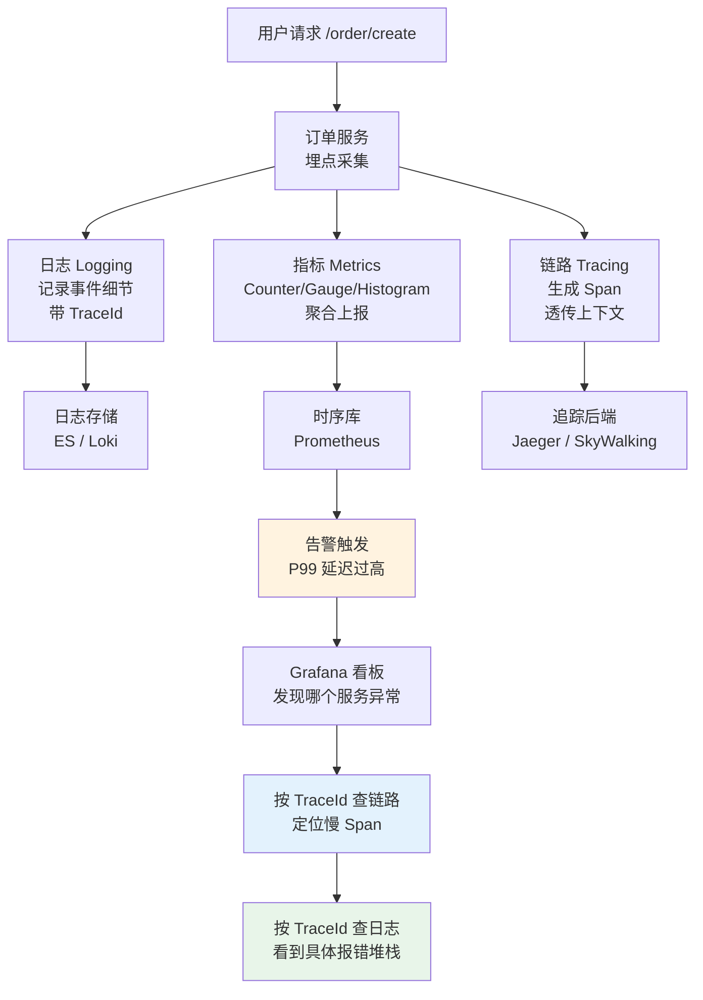
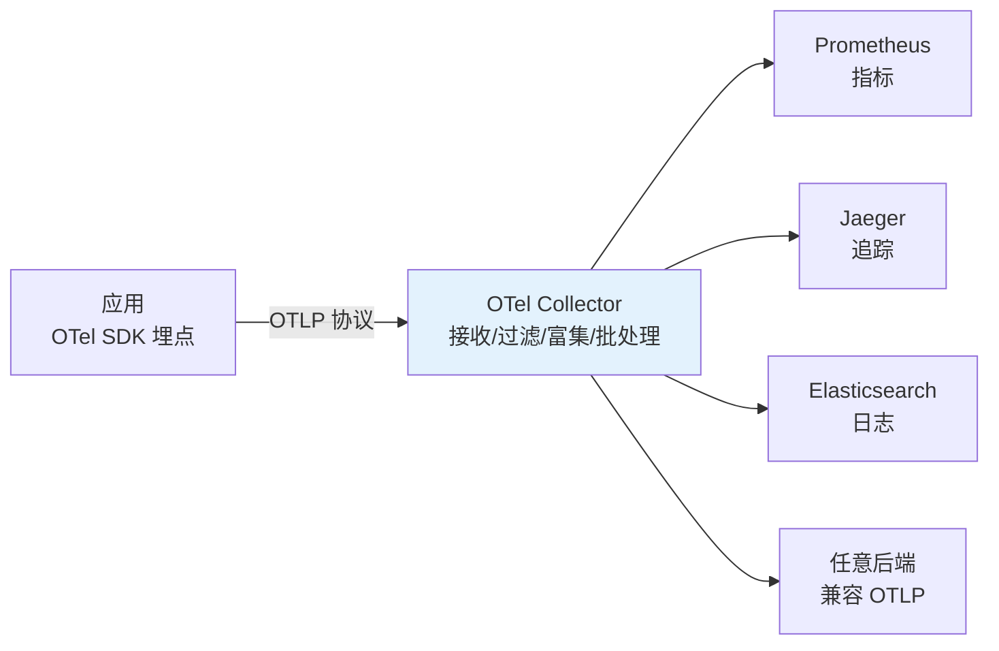

# 可观测性三大支柱

> 定位：搞清「可观测性」和传统「监控」的本质区别，以及支撑它的三根柱子——日志、指标、链路追踪各自解决什么问题、如何协同。这是所有监控、追踪、告警工具选型的思想底座——不理解「为什么需要三根柱子一起上」，你买再多工具也只是堆了一堆数据孤岛。

## 一、为什么需要它：从「监控」到「可观测性」

先讲一个真实场景。凌晨两点，报警响了：订单接口 P99 延迟从 200ms 飙到 5s。

如果你只有传统监控，你看到的是：CPU 80%、内存正常、QPS 没变。于是你盯着这几个仪表盘发呆——**指标告诉你「系统病了」，但没告诉你「为什么病」**。你只能凭经验猜：是不是数据库慢了？是不是下游超时了？然后逐个服务登录、翻日志、对比时间线，半小时过去还没定位。

这就是传统监控的困境：**它基于「预设问题」设计**。你提前想好「CPU 超过 80% 要报警」「错误率超过 1% 要报警」，系统只能回答你已经想到的问题。可生产环境的诡异问题，往往是你从没预设过的——「为什么这个用户的这一笔订单卡住了？」「为什么只有华东区域的请求变慢？」

可观测性（Observability）要解决的是另一类问题：**面对从未预设过的「未知未知」（unknown unknowns），也能通过系统外部输出的数据，推断出系统内部的状态**。它的判断标准不是「有没有仪表盘」，而是——**你能不能回答一个你事先没想过的问题，而不需要改代码重新上线**。

一句经典总结：

> **监控告诉你「系统是否健康」（What），可观测性帮你回答「系统为什么不健康」（Why）。**

要实现这种能力，业界收敛出三根支柱（Three Pillars）：

| 支柱 | 英文 | 回答的问题 | 典型形态 | 优势 | 短板 |
|---|---|---|---|---|---|
| 日志 | Logging | 「发生了什么事件」 | 带时间戳的文本/结构化记录 | 信息最全、最灵活 | 量大、检索慢、难聚合趋势 |
| 指标 | Metrics | 「有多少、多快、多频繁」 | 时间序列数值 | 存储和查询高效、适合告警 | 维度有限、丢失细节 |
| 链路追踪 | Tracing | 「一次请求经过了哪些服务、卡在哪」 | Span 组成的调用树 | 定位跨服务瓶颈 | 采样后丢失部分请求、存储成本高 |

三者不是替代关系，而是**互补**：指标发现「有问题」，链路追踪定位「哪个环节有问题」，日志还原「那个环节到底发生了什么」。

## 二、核心原理：三根柱子如何协同

### 2.1 一张图看懂三者的分工与协作

下面这张图描述了一个典型的「从告警到根因」的可观测性闭环。请重点看三类数据如何在同一次请求上被打上关联标识（TraceId），从而串起来。



读图路径：请求进入订单服务后，**同一处埋点同时产出三类数据**。指标进 Prometheus 触发告警（发现问题），看板引导你按 TraceId 跳到追踪系统（定位环节），再用同一个 TraceId 查到具体日志（看到根因）。三者能串起来的关键是**统一的关联标识 TraceId**——这也是后面 OpenTelemetry 要解决的核心问题之一。

### 2.2 支柱一：日志（Logging）

日志记录**离散事件**：某一刻发生了什么。它是信息密度最高、最灵活的数据——你想记什么就记什么。

- **结构化是关键**。一行 `用户123下单失败，原因库存不足` 是人看的；`{"ts":"...","level":"ERROR","userId":123,"orderId":"O1","reason":"STOCK_NOT_ENOUGH","traceId":"abc"}` 是机器能聚合、过滤、关联的。现代可观测性实践强烈推荐 JSON 结构化日志。
- 日志的软肋是**量**：一个中等规模服务一天几个 GB 很常见，全量存热存储成本高，所以才有分级、采样、冷热分层。

### 2.3 支柱二：指标（Metrics）

指标是**可聚合的时间序列数值**，带标签（label）。比如 `http_requests_total{method="GET",status="500"}`。

- 它的设计目标是**高效**：数值型数据压缩比极高，查「过去一小时的错误率趋势」毫秒级返回。
- 代价是**牺牲细节**：为了减少基数，指标通常把个体聚合掉。你能看到「500 错误涨了」，但看不到「是哪一筆请求的 500」。
- 指标是**告警的主力**：因为便宜、快、稳定，99% 的报警应该基于指标。

### 2.4 支柱三：链路追踪（Tracing）

一次分布式请求会跨多个服务、线程、消息队列。追踪把它还原成一棵 **Span 树**：

- **Trace**：一次完整请求的全局标识（TraceId），整棵树共享。
- **Span**：树上的一个节点，代表一个工作单元（一次 RPC、一次数据库查询），有 SpanId、父 SpanId、开始时间、耗时、标签。

追踪的价值在于**回答「时间都花在哪了」**：一个 5s 的请求，展开 Span 树发现 4.8s 耗在下游 `inventory-service` 的一次 SQL 上——根因一目了然。

### 2.5 三者的「关联」才是精髓

单独看三根柱子只是三堆数据。真正的威力在于**关联（correlation）**：

- 指标看板上的一个异常点 → 点击下钻到对应的 Trace 样本
- 一条 Trace → 点击查看该 Span 对应的具体日志
- 一条 ERROR 日志 → 复制 TraceId 反查整条链路

**实现这种关联的前提，是一套统一的数据模型和上下文传播规范**——这正是 OpenTelemetry 的立身之本。

## 三、关键机制：OpenTelemetry 统一标准

### 3.1 为什么需要 OTel

历史上，每个工具都有自己的数据格式和 SDK：Prometheus 有 Prometheus 的格式，Zipkin 有 Zipkin 的格式， Jaeger 有自己的……导致：

- 应用要埋多套点，代码侵入严重
- 换后端就要改埋点，被厂商锁定（vendor lock-in）
- 三类数据的关联标识对不上

**OpenTelemetry（OTel）** 是 CNCF 的开源项目，目标是把「遥测数据的产生和采集」标准化。它本身**不负责存储和展示**，只解决「数据怎么产生、怎么统一、怎么导出」。

### 3.2 OTel 的核心组成

| 组成 | 作用 |
|---|---|
| **API** | 埋点的接口规范（如 `Tracer`、`Meter`、`Logger`），与具体实现解耦 |
| **SDK** | API 的官方实现，负责采样、批处理、导出等 |
| **Collector** | 独立部署的代理组件，接收/处理/导出遥测数据，是架构里的「万能中转站」 |
| **Semantic Conventions** | 语义约定：统一字段命名（如 `http.method`、`db.system`），保证数据跨语言一致 |

### 3.3 OTel 的数据流



关键理解：

1. **OTLP**（OpenTelemetry Protocol）是统一的导出协议。应用只需埋一次点，数据以 OTLP 发给 Collector。
2. **Collector 是解耦层**。想换后端？改 Collector 配置就行，应用代码不动。还能在 Collector 做过滤（降本）、PII 脱敏、给数据补上 `environment=prod` 这类属性。
3. **三类数据共用同一个 Context**（包含 TraceId/SpanId），天然关联。

### 3.4 一个最小的 OTel 埋点示意（Java）

```java
// 伪代码：用 OTel API 创建一个 Span， Span 会自动挂到当前 Trace 上下文
Tracer tracer = OpenTelemetry.getGlobalTracer("order-service");

Span span = tracer.spanBuilder("queryInventory")
                  .setAttribute("db.system", "mysql")
                  .startSpan();
try (Scope scope = span.makeCurrent()) {
    // 业务逻辑；期间产生的日志会自动带上当前 TraceId/SpanId
    inventoryService.check(skuId);
} catch (Exception e) {
    span.setStatus(StatusCode.ERROR, e.getMessage());
    span.recordException(e);
    throw e;
} finally {
    span.end();  // 必须 end，否则 Span 永远不会上报
}
```

「以版本为准」：OTel 的 API 在快速演进，具体方法名（如 `GlobalOpenTelemetry` vs `OpenTelemetry`）和自动装配方式请对照你使用的 SDK 版本。

## 四、生产坑点与排查

### 坑点 1：三套系统各埋各的点，TraceId 对不上

**现象**：Prometheus 看板发现错误，想跳到链路追踪，却发现 TraceId 格式都不一样，根本关联不上。
**原因**：指标用一套 SDK、追踪用另一套、日志框架又单独配置，三者各自生成标识，没有统一的 Context 传播。
**解法**：
- 用 OTel 统一埋点，三类数据共享同一个 Context。
- 日志框架通过 MDC（如 Logback 的 `MDC.put("traceId", ...)`）把当前 TraceId 注入每条日志，实现日志与链路关联。
- 关联标识至少保证：TraceId 全局唯一、格式统一、在入口生成、跨服务透传。

### 坑点 2：可观测性 = 把所有数据全存下来，成本爆炸

**现象**：上了可观测性平台三个月，ES 集群存储翻了 5 倍，账单失控，于是领导要求「砍掉一半数据」。
**原因**：误以为「数据越多越好」，日志全量 INFO、追踪 100% 采样、指标无限高基数标签，全进昂贵的热存储。
**解法**：
- **指标**：控制标签基数，绝不要把 userId、orderId 这类高基数值做 label（会导致时间序列爆炸）。
- **追踪**：生产环境用**头部采样**（如 1%-10%），关键链路/failed 请求强制采样。
- **日志**：按级别分流，DEBUG 不进生产热存储；30 天以上的日志转冷存储（对象存储）。
- 在 OTel Collector 层做过滤和采样，从源头降本。

### 坑点 3：只建看板不建告警，或者告警全是噪声

**现象**：Grafana 上几十块炫酷的看板，但没人看；出了事还是用户先发现。或者告警几百条/天，大家把通知静音了。
**原因**：把「可视化」当成可观测性的终点，没有建立从指标到告警到响应闭环。
**解法**：
- 告警基于 SLO（服务等级目标）设计：只对「影响用户的症状」报警（如错误率、延迟），不对「原因」报警（如某台机器 CPU 高）。
- 每条告警必须有明确的处理人和 runbook（处理预案）。
- 分级：P0 电话、P1 企业微信、P2 工单，避免一律电话轰炸。

### 坑点 4：埋点本身把服务拖慢

**现象**：接入可观测性 SDK 后，接口 P99 增加了几十毫秒。
**原因**：同步上报数据、每个 Span 都立即导出、日志同步写磁盘、序列化开销大。
**解法**：
- SDK 全部用**批量 + 异步**导出（BatchSpanProcessor 等），设置合理的队列大小和导出间隔。
- Collector 本地部署，应用走内网 UDP/本地端口，避免跨网络同步阻塞。
- 压测对比接入前后性能，确认埋点开销在可接受范围（通常 <5%）。

## 五、调优 / 选型 / 最佳实践

### 5.1 建设路径（分阶段落地）

| 阶段 | 目标 | 关键动作 |
|---|---|---|
| 阶段一：看得见 | 有基础指标和日志 | 接入 Micrometer/Prometheus 指标，统一日志格式，建核心看板 |
| 阶段二：串得起来 | 三支柱关联 | 引入 OTel，注入 TraceId 到日志，全链路追踪打通 |
| 阶段三：查得快 | 从告警到根因闭环 | 看板下钻 Trace、Trace 跳日志，建立排障 runbook |
| 阶段四：防得住 | 从被动到主动 | 基于 SLO 告警、容量预测、异常检测、混沌工程 |

### 5.2 选型决策表

| 需求 | 推荐 | 说明 |
|---|---|---|
| 指标 + 告警 | Prometheus + Grafana | 云原生事实标准 |
| 全链路追踪 | SkyWalking（Java 友好、无侵入）或 Jaeger（OTel 原生） | 前者开箱即用，后者生态标准 |
| 日志 | ELK（功能强）或 Loki（省成本、标签索引） | 已有 ES 用 ELK，追求性价比用 Loki |
| 统一采集 | OTel Collector | 屏蔽后端差异，一处配置多处导出 |
| 线上诊断 | Arthas | 不重启看JVM内部（详见本板块《Arthas线上诊断》） |

### 5.3 核心原则

1. **先关联，后堆量**：TraceId 打不通，数据再多也是孤岛。
2. **指标定告警、追踪定范围、日志定根因**：让每类数据干它最擅长的事。
3. **采样是常态**：100% 采集是开发环境特权，生产必须有采样和保留策略。
4. **可观测性是「能力」不是「项目」**：不是装个工具就结束，而是持续建设排障文化。

## 六、面试高频问法

> 这一节按「面试时能讲透」的标准写：先给一句能直接背的结论，再展开机制、对比和生产坑。建议先自己答一遍，再对照补全。

**Q1：可观测性和监控有什么区别？**

**一句话结论**：监控回答「系统是否健康」这类预设问题，可观测性回答「为什么不健康」这类未预设问题；监控是可观测性的一个子集。

展开三层：

1. **监控**：先定义指标和阈值，再做采集—告警—看图，面向的是已知问题（known knowns / known unknowns），比如 CPU > 80% 就告警。
2. **可观测性**：强调从系统对外输出的数据（指标、日志、链路）推断内部状态，面对的是「未知的未知」（unknown unknowns）——出问题前你并不知道要问哪个问题，但事后能拿到数据把它查出来。
3. **关系**：可观测性是一种**能力**（数据是否全、能否关联、能否下钻），监控是建立在这个能力之上的一个**应用场景**。

加分点：主动接一句「装了 Prometheus 不等于就可观测了，关键看数据能不能回答事先没设计过的问题、能不能跨信号关联」——面试官很吃这个区分。

**Q2：可观测性三大支柱是什么？各自解决什么问题？**

**一句话结论**：Metrics（指标）、Logs（日志）、Traces（链路）三支柱互补——指标发现问题、链路定位范围、日志还原根因。

| 支柱 | 数据形态 | 擅长 | 短板 |
|---|---|---|---|
| Metrics | 聚合的时间序列（数值+标签） | 趋势、告警、容量规划 | 丢弃个体细节 |
| Logs | 离散事件记录 | 细节最全、上下文丰富 | 量大、检索慢、格式易变 |
| Traces | Span 组成的调用树 | 跨服务瓶颈、依赖关系 | 有采样和存储成本 |

关键要点：

- 三者不是三选一，而是按「成本/精度」分层：指标便宜但粗糙，日志精细但昂贵，链路居中且带因果。
- 排障标准动作：先看指标发现异常 → 用链路圈定哪一段慢/错 → 用该 TraceId 捞日志看堆栈和入参。

加分点：可以补充行业趋势——「有人把日志看成带时间戳的事件、把链路看成带因果的事件，边界在模糊，但面试按经典三支柱答最稳」，体现你读过资料而不是死记。

**Q3：一颗 TraceId 如何把日志、指标、链路串起来？**

**一句话结论**：入口生成全局唯一 TraceId 并放进 Context，随调用链透传；日志通过 MDC 带上它、指标通过 exemplar 关联到它、链路以它为主键存储，排障时用它做统一检索键。

展开四步：

1. **生成与透传**：入口按 W3C Trace Context 生成 `traceparent`，格式为 `00-<32位trace-id>-<16位span-id>-<01标志位>`，例如 `00-4bf92f3577b34da6a3ce929d0e0e4736-00f067aa0ba902b7-01`。跨 HTTP 放 Header、跨 gRPC 放 metadata、跨 MQ 放消息属性。
2. **日志关联**：MDC 把 traceId 放进 ThreadLocal，日志 pattern 用 `%X{traceId}` 输出，每条日志自带链路号。
3. **指标关联**：Histogram 的 bucket 上挂 exemplar（含 traceId 和耗时），从 P99 尖刺能直接跳到那条最慢的请求。
4. **统一检索**：以 TraceId 为 key，一次查齐三类数据，避免在不同系统间人肉对时间。

加分点/坑点：线程池和异步会丢 ThreadLocal 导致链路断裂，要用 TransmittableThreadLocal 或 Agent 自动传播，并在 finally 里清理 MDC，否则会出现日志串号。

**Q4：OpenTelemetry 解决了什么问题？**

**一句话结论**：OpenTelemetry（OTel）用统一的 API/SDK/协议和 Collector 标准化遥测数据采集，避免多套埋点和厂商锁定；它只管采集与导出，不负责存储和展示。

展开：

- **背景**：OpenTracing 与 OpenCensus 合并为 OTel（CNCF 项目），结束了接口分裂的局面。
- **统一**：一套 API/SDK 产出 Metrics、Logs、Traces 三类数据；Semantic Conventions 约定字段命名（如 `http.request.method`、`http.status_code`），跨语言一致。
- **传输**：OTLP 是标准传输协议；Collector 充当「接收—处理—导出」中枢，集中做过滤、脱敏、采样、批处理和路由。
- **边界**：后端仍用 Prometheus / Jaeger / Elasticsearch 等，展示用 Grafana / Kiali，OTel 本身不存数据也不画图。

加分点：说清「OTel 的核心价值是采集与后端解耦——换后端只改 Collector 的导出配置，业务埋点代码一行不动」，这是真实的落地收益。

**Q5：为什么指标适合做告警、日志不适合？**

**一句话结论**：指标是数值型时间序列，schema 稳定、基数可控、查询高效，适合持续评估阈值；日志量大、非结构化、格式易变，更适合事后根因分析而非稳定的告警源。

展开：

- 告警要求「每时每刻问同一个问题」：对 Counter 做 `rate(http_requests_total{job="api"}[5m])` 就能持续算错误率，成本低、结果稳定。
- 日志做告警需要全文检索，数据量大、索引贵、字段可能随版本变化，规则脆弱且延迟高。
- 日志的强项是取证：保留原始上下文、打印完整堆栈、还原异常现场。
- 例外处理：确实要按日志关键字告警时，通常先用 Collector 把关键字聚合成一个 Counter 指标，再基于指标告警。

加分点：补一句「告警要基于症状（SLO、错误率、延迟）而不是原因，这样告警更稳定、误报更少」，自然衔接到 SLO 的话题。

**Q6：三类数据在存储和查询上怎么取舍？**

**一句话结论**：指标先聚合存入 TSDB、查询快成本低；日志存原文检索最灵活但最贵；链路按 TraceId 存调用树、成本居中，三者按「成本—精度」梯度配合。

| 维度 | Metrics | Logs | Traces |
|---|---|---|---|
| 存储 | TSDB（Prometheus/Thanos） | 检索引擎（ES）或标签索引（Loki） | 链路库（Jaeger/Tempo） |
| 查询 | PromQL 聚合，快 | 全文/结构化检索，灵活 | 按 TraceId 查树 |
| 成本 | 低（聚合后） | 高（原文全存） | 中（采样可控） |
| 保留 | 长（可降采样） | 短（热冷分层） | 中 |

关键要点：

- 指标先聚合，丢失个体；链路抽样保留；日志体量最大，靠采样和冷热分层控成本。
- 落地顺序建议：先指标建告警，再链路定范围，最后日志查根因。

加分点：点出「Loki 只索引标签、正文压缩存储，所以便宜但全文检索弱」——面试官很吃这种成本与检索能力的权衡对比。

**Q7：什么是高基数问题？在可观测性里怎么避免？**

**一句话结论**：标签或字段的取值过多会导致时间序列/索引条目爆炸，压垮存储与查询；核心解法是只把低基数枚举维度做成标签。

展开：

- **机制**：Prometheus 里一条时间序列 = 指标名 + 标签集。若写 `http_requests_total{userId="u123"}`，每个用户就多一条序列，百万用户就是百万序列。
- **危害**：内存和 TSDB 体积暴涨、查询变慢，严重时直接打爆 Prometheus。
- **规避**：URL 归一化（`/order/123` → `/order/:id`）；userId、orderId、手机号等高基数值交给日志和链路，不进指标标签；用 relabel 丢弃无用标签；限制单指标标签数量。
- **日志侧同理**：把整段报文或流水号当结构化字段也会让索引膨胀。

加分点/坑点：生产常见事故是「有人把 userId 加进指标标签，上线几分钟内存打满」——能讲出这个具体场景，说明你真的踩过或防过。

**Q8：如何控制可观测性的成本？**

**一句话结论**：核心是「采样 + 保留策略 + 分层」，而不是全量采集——指标控基数、链路做采样、日志分级与冷热分层、Collector 统一过滤脱敏。

展开：

- **指标**：控制标签基数，长期数据降采样保留（如原始 15s，历史聚合为 5m/1h）。
- **链路**：头部采样打底（如 1%~10%），尾部采样保留错误和慢请求，关键链路强制采样。
- **日志**：生产不开 DEBUG，ERROR 全留、INFO 采样，热数据放 7 天、冷数据转对象存储留 30~90 天。
- **Collector**：集中过滤无用数据、脱敏、批处理后导出，一个出口统一管控。

加分点：强调「采样不是越少越好，要保证出错的链路一条不丢——尾部采样 + 错误强制采样就是这个思路」，体现成本与可排障性的平衡意识。

**Q9：可观测性建设如何分阶段落地？**

**一句话结论**：按「看得见 → 串得起来 → 查得快 → 防得住」四步走，先建指标告警，再打通 TraceId 关联，最后做根因定位和主动预防。

展开四步：

1. **看得见**：接入指标和基础日志，覆盖黄金信号，先有仪表盘和告警，解决「系统挂了没人知道」。
2. **串得起来**：全链路埋点、TraceId 透传并注入 MDC，让日志、指标、链路能互相跳转。
3. **查得快**：统一查询入口，预置排障 dashboard 和 runbook，缩短 MTTR。
4. **防得住**：基于 SLO 的告警、异常检测、容量规划，从被动响应走向主动预防。

加分点：收一句「可观测性是能力不是项目——不是装个工具就结束，要持续把每次排障经验沉淀成仪表盘和告警规则」，这句话能体现工程视角。

**Q10：RED 方法、USE 方法和四大黄金信号怎么选？**

**一句话结论**：RED（Rate/Errors/Duration）面向服务，USE（Utilization/Saturation/Errors）面向资源，四大黄金信号（延迟/流量/错误/饱和度）是二者的工程化落地。

展开：

- **RED**：每个服务看请求速率、错误数、耗时分布，适合微服务/API 定义 SLO。
- **USE**：每个资源看利用率、饱和度、错误数，适合主机、连接池、磁盘等瓶颈定位。
- **黄金信号**：Latency（区分成功/失败的耗时）、Traffic（QPS/请求量）、Errors（错误率）、Saturation（资源水位）。
- **实践组合**：服务层用 RED 定 SLO，资源层用 USE 定容量告警，两者结合才能覆盖「业务好不好」和「机器够不够」。

加分点：补一句「平均值会掩盖长尾，耗时一定要看 P95/P99」——这是排障老手才会主动提的细节。

## 小结

- 可观测性 ≠ 监控：监控答「What」，可观测性答「Why」，核心是能回答未预设的问题。
- 三支柱互补：指标发现问题、追踪定位环节、日志还原根因，TraceId 是关联的关键。
- OpenTelemetry 用统一 API/SDK/OTLP/Collector 消除埋点碎片化和厂商锁定。
- 生产落地要控成本：控制指标基数、追踪采样、日志分级、Collector 过滤。
- 建设路径分四步：看得见 → 串得起来 → 查得快 → 防得住。
