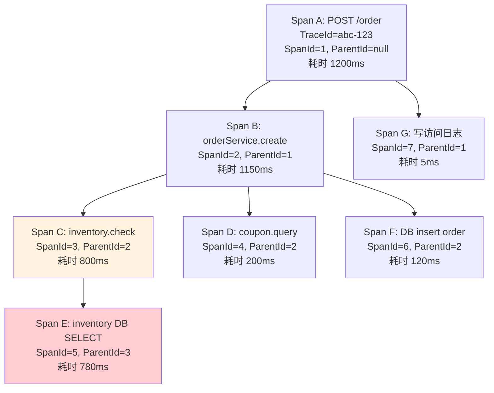
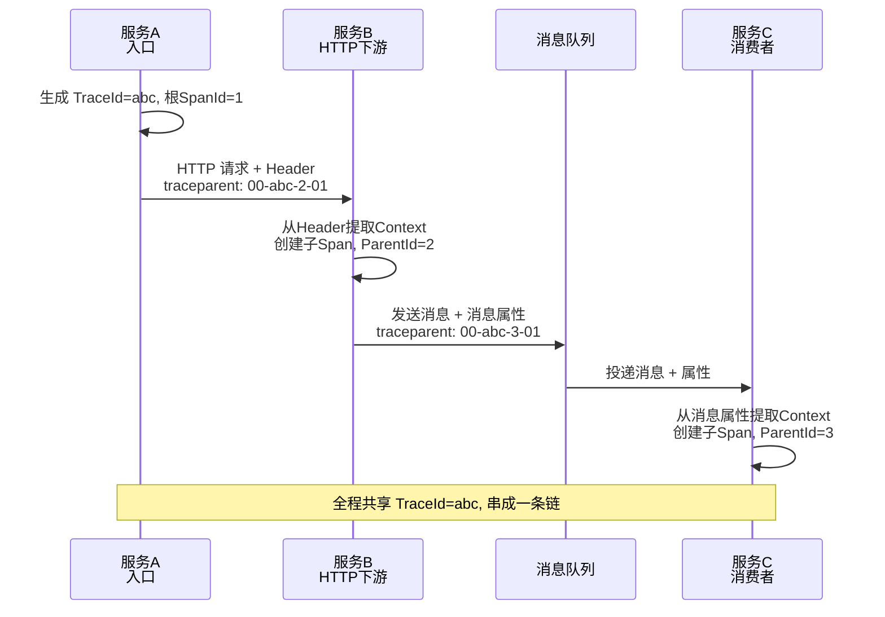
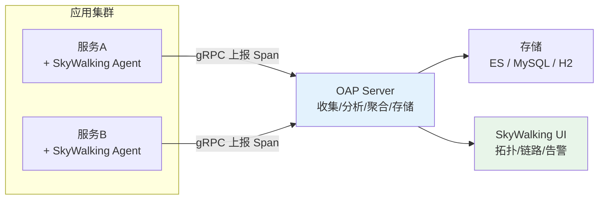

# 链路追踪

> 定位：搞清分布式追踪如何用 Trace/Span 还原一次跨服务请求、上下文如何透传、主流实现（SkyWalking/Pinpoint/Zipkin/Jaeger）怎么选、采样怎么配。微服务出问题时，「这一笔请求到底卡在哪」只能靠链路追踪回答——它是从「系统慢了」到「哪个服务的哪次调用慢了」的桥梁。

## 一、为什么需要它：一次请求穿过十个服务之后

单体时代，一个请求就是一次进程内调用，出问题看堆栈、看日志就够了。微服务时代，一次「下单」请求可能依次经过：

`网关 → 订单服务 → 库存服务 → 优惠券服务 → 支付服务 → 消息队列 → 通知服务 …`

任意一环变慢或报错，整条链路都受影响。此时你面对三个难题：

1. **看不到全貌**：日志分散在十几个服务里，没有统一标识串不起来，你不知道这次请求的完整路径。
2. **定位不了瓶颈**：知道「慢」，但不知道是网络、是数据库、还是某个下游服务的福循环。
3. **复现不了现场**：生产偶发的慢请求，你没法在本地重现，只能靠残留的线索倒推。

链路追踪（Distributed Tracing）就是把一次分布式请求还原成一棵**调用树**，让你像看瀑布图一样看到每个环节的耗时和依赖关系。Google 2010 年的 **Dapper** 论文奠定了现代追踪的理论基础，后来的 Zipkin、Jaeger、SkyWalking 都源于这套模型。

## 二、核心原理：Trace、Span 与上下文透传

### 2.1 核心概念

| 概念 | 含义 | 类比 |
|---|---|---|
| **Trace** | 一次完整请求的调用链，全局唯一 TraceId | 一趟快递的全流程单号 |
| **Span** | 链路中的一个工作单元（一次 RPC/SQL/方法调用），有 SpanId、父 SpanId、耗时、标签 | 快递经过的每个中转站记录 |
| **Parent/Child** | Span 之间的父子关系，构成一棵树 | 中转站的上下游关系 |
| **Context** | 跨进程传递的追踪上下文，核心是 TraceId + 当前 SpanId | 贴在包裹上的单号，走到哪带到哪 |
| ** baggage** | 附在 Context 上的自定义 KV，随链路全程透传 | 包裹上的备注，全程跟着走 |

### 2.2 Dapper 模型：一次请求的 Span 树

下面这张图是一次「下单」请求的 Span 树瀑布图。注意每个 Span 都有 SpanId 和 ParentId，通过这些指针串成树；根 Span 的耗时 ≈ 整条链路耗时，子 Span 的耗时会揭示时间花在哪。

读图要点：根 Span A 耗时 1200ms，展开后发现问题几乎全在 Span E（库存服务的 SQL 查询，780ms）和 Span C（800ms）。**追踪系统把「订单服务慢」这个模糊结论，精确到了「inventory.check 里的一条 SQL 慢」**——这就是链路追踪的核心价值。

### 2.3 上下文透传：最难也最关键的一环

追踪的难点不在单个服务内记录 Span，而在**跨进程时把 Context 传下去**。

- **进程内**：用 `ThreadLocal` 保存当前 Context（OTel 里叫 `Context` 的 scope 管理）。
- **跨 HTTP 调用**：把 TraceId/SpanId 塞进 HTTP Header。W3C 标准是 `traceparent: 00-{trace-id}-{span-id}-{flags}`。调用方在请求头注入，被调方从请求头提取。
- **跨消息队列**：把 Context 作为消息属性（header）随消息发送，消费者从消息属性提取。

### 2.4 跨线程 / 跨线程池的坑

进程内 `ThreadLocal` 在**切换线程时会丢失**。常见翻车场景：

- 业务把任务提交到线程池异步执行 → 子线程 `ThreadLocal` 是空的 → 这段逻辑的 Span 断了，挂到错误的父节点或成为孤立 Span。

解决方案（各框架实现不同，以版本为准）：

- **Java  agent 模式**（SkyWalking/Pinpoint）：字节码增强时自动处理线程池任务的 Context 快照与恢复。
- **手动透传**：提交任务前 `context = Context.current()`，任务里 `context.makeCurrent()` 包住执行。
- **TTL**（TransmittableThreadLocal，阿里开源）：装饰线程池，自动在提交/执行时传递 ThreadLocal。

## 三、关键机制：采样、标识与实现对比

### 3.1 TraceId 与 SpanId

- **TraceId**：整条链全局唯一，通常 128bit（16 字节），如 `4bf92f3577b34da6a3ce929d0e0e4736`。
- **SpanId**：单个 Span 的标识，通常 64bit（8 字节）。
- 两者共同够成 W3C `traceparent` 头。日志里打印 `traceId` 就能把日志和链路对上（见本板块《日志体系》）。

### 3.2 采样策略

100% 采集所有请求的追踪数据，存储和分析成本高得离谱。生产环境必须采样。

| 策略 | 机制 | 优点 | 缺点 |
|---|---|---|---|
| **头部采样** | 在入口按固定比例（如 5%）决定是否采集，整条链统一 | 简单、开销低 | 可能漏掉偶发的错误请求 |
| **尾部采样** | 先全量收集，链结束后根据结果（是否有错、是否超慢）决定是否保留 | 不丢错误/慢请求 | 内存和计算开销大，需 Collector 支持 |
| **速率限制采样** | 每秒最多 N 条 | 流量保护 | 突发流量下采样不均 |
| **强制采样** | 带特定 Header（如 debug）或错误的请求强制采集 | 排障时按需开启 | 依赖人工触发 |

实践建议：**头部采样打底（1%-10%）+ 错误/慢请求尾部或强制采样兜底**。这样既控成本，又不漏关键问题。

### 3.3 主流实现对比

| 工具 | 接入方式 | 语言支持 | 优势 | 劣势 | 适用 |
|---|---|---|---|---|---|
| **SkyWalking** | Java Agent 字节码增强，无侵入 | Java 为主，多语言扩展 | 开箱即用、中文社区活跃、APM 一体 | 与 OTel 生态融合中 | Java 技术栈、要快速落地 |
| **Pinpoint** | Java Agent，无侵入 | Java/Python | 调用拓扑和代码级视图强、监控粒度细 | 性能开销相对大、部署较重 | 深度 Java 诊断 |
| **Zipkin** | 埋点 SDK（Brave 等） | 多语言 | 轻量、结构简单、社区成熟 | 功能较基础、UI 简单 | 想自己搭轻量追踪 |
| **Jaeger** | OTel 原生 / SDK | 多语言 | CNCF 项目、OTel 生态标准、云原生友好 | 需要自己解决接入和 Agent | 已上 OTel、多云环境 |

**核心抉择**：追求「Java 项目最快见效」→ SkyWalking；追求「标准化、长期不被锁定」→ OTel SDK + Jaeger。

### 3.4 一张部署架构图

以 SkyWalking 为例，「Agent 埋点 → OAP 分析 → UI 展示」是典型三段式：

Agent 以 `javaagent` 方式挂到应用上，无侵入地采集 Span，经 gRPC 上报给 OAP，OAP 分析后入库并在 UI 展示。这种「探针 + 分析平台」的模式让 Java 应用几乎零改造就能获得全链路能力。

## 四、生产坑点与排查

### 坑点 1：链路断了——异步/线程池后 Trace 不完整

**现象**：链路树上，异步执行的那段逻辑要么消失，要么挂成一个孤立 Span，父子关系乱了。
**原因**：`ThreadLocal`  Context 在切换线程时丢失，子线程拿不到父线程的 TraceId/SpanId。
**解法**：
- 用 SkyWalking/Pinpoint 的 Agent（自动处理线程池上下文传播）。
- 若手动埋点，用 TransmittableThreadLocal 包装线程池，或在 `Runnable` 提交前快照 Context、执行时恢复。
- MQ 场景务必在发送端注入 header、消费端提取 header，否则跨服务必断。

### 坑点 2：采样率设太高，追踪后端被压垮

**现象**：追踪后端（OAP/Jaeger collector）磁盘猛涨、查询变慢，甚至 OOM。
**原因**：生产全量采样（100%），每秒几十万 Span 涌入，超出存储和采集能力。
**解法**：
- 头部采样先从 1%-5% 起步，观察数据量后再调。
- 关键路径/error 用强制或尾部采样兜底，用少量数据保住排障能力。
- Collector/OAP 层配置丢弃和限流，设置数据保留 TTL（如 7 天）。

### 坑点 3：TraceId 没打进日志，链路和日志对不上

**现象**：追踪系统看到一个慢 Span，想看对应日志的具体报错，却搜不到——日志里根本没有 TraceId。
**原因**：日志框架没配置 MDC 注入，TraceId 只在追踪系统内部流转。
**解法**：
- Agent 模式：SkyWalking 提供 logback/log4j2 的 MDC 插件，配置 `%traceId` 占位符。
- OTel 模式：用 `OpenTelemetryAppender` 把当前 TraceId/SpanId 写入 MDC。
- 日志格式加上 `traceId=%X{traceId}`，确保每条日志都带（详见本板块《日志体系》）。

### 坑点 4：把 TraceId 当用户 ID 或业务主键用

**现象**：有人想用 TraceId 做幂等键、或存进业务表关联订单。
**原因**：混淆了「可观测性标识」和「业务标识」的职责。TraceId 是每次请求新生成的随机值，同一次业务操作重试会生成不同 TraceId。
**解法**：TraceId 只用于排障关联；业务幂等用自己的业务主键（如订单号 + 唯一约束）。

## 五、调优 / 选型 / 最佳实践

### 5.1 落地清单

1. **先打通入口和跨服务透传**：网关生成 TraceId，HTTP/MQ 全链路透传，这是「链不断」的前提。
2. **选接入方式**：Java 栈求快 → SkyWalking Agent；求标准 → OTel SDK + Jaeger。
3. **配采样**：先低比例头部采样，error/慢请求保底，观察量再调。
4. **打通日志关联**：MDC 注入 TraceId，追踪能跳日志、日志能反查链路。
5. **控制成本**：设置 TTL（7-15 天）、冷热分层、Collector 限流。
6. **建拓扑和告警**：用服务拓扑看依赖，用链路延迟 P99 做告警。

### 5.2 排障实战路径

一次「P99 延迟飙高」的排查标准动作：

1. 看指标看板 → 确认是**哪个服务**的延迟升高。
2. 打开该服务的链路追踪 → 按耗时排序，找**耗时最长的 Span**。
3. 展开慢 Span 的标签 → 看是 SQL、RPC 还是本地方法，拿到**具体语句/方法**。
4. 复制 TraceId → 到日志系统查**该请求的完整日志和异常堆栈**。
5. 定位根因后，用 `watch`/`trace`（Arthas）在线验证方法耗时（详见本板块《Arthas线上诊断》）。

### 5.3 选型小结

| 场景 | 首选 |
|---|---|
| Java 为主、要最快见效、无侵入 | SkyWalking |
| 需要代码级细粒度、可接受较重部署 | Pinpoint |
| 轻量自建、多语言简单追踪 | Zipkin |
| 已上 OTel / 多云 / 长期标准化 | Jaeger + OTel |

## 六、面试高频问法

> 这一节按「面试时能讲透」的标准写：先给一句能直接背的结论，再展开机制、对比和生产坑。建议先自己答一遍，再对照补全。

**Q1：Trace、Span、TraceId、SpanId、ParentId 分别是什么？**

**一句话结论**：Trace 是一次请求的完整调用链，Span 是其中一个工作单元；TraceId 全局唯一标识整条链，SpanId 标识单个 Span，ParentId 把 Span 串成树。

展开：

- **Trace**：从入口请求到所有下游调用的完整路径，是一棵由 Span 构成的树。
- **Span**：一个有时间跨度的操作单元，包含开始/结束时间、操作名、属性、事件和状态码，比如一次 RPC 调用、一次 SQL 查询。
- **三个 ID**：TraceId 整条链唯一；SpanId 每个 Span 唯一；ParentId 指向父 Span，根 Span 没有 ParentId。
- **理论来源**：Google 2010 年的 Dapper 论文奠定了现代链路追踪模型，核心要求是低开销、应用级透明和采样。

加分点：能说出「Span 之间的父子关系还原的是调用树，而真正决定端到端耗时的关键路径是最长那条分支」，体现你不只是背概念。

**Q2：链路追踪的上下文如何跨服务传递？**

**一句话结论**：进程内用 ThreadLocal 保存 Context，跨 HTTP 用 Header 注入/提取，跨 MQ 用消息属性携带，标准格式是 W3C `traceparent`。

展开：

- **进程内**：SDK 把当前 Span 放进 ThreadLocal，同一线程内的埋点自动挂到同一条链。
- **跨 HTTP**：调用方把 Context 注入请求头，被调方提取后作为父 Span。W3C Trace Context 的标准头 `traceparent` 形如 `00-4bf92f3577b34da6a3ce929d0e0e4736-00f067aa0ba902b7-01`，分别是版本、TraceId、SpanId、采样标志；Zipkin 生态常用 B3 头（`X-B3-TraceId` 等）。格式以版本/实现为准。
- **跨 MQ**：把 TraceId、SpanId 写进消息属性（header/properties），消费端提取后新建子 Span，实现异步链路的延续。
- **Baggage**：可随链路透传的业务自定义键值（如 tenantId），但体量要克制，避免每张 Span 都膨胀。

加分点/坑点：强调「注入/提取是成对出现的——只注入不提取，链路就在这一跳断掉」，这是排查「链路断了一半」的第一检查点。

**Q3：一次请求跨线程池后链路断了，怎么解决？**

**一句话结论**：根因是 ThreadLocal 不跨线程，任务提交到线程池后 Context 丢失；解法有 Agent 自动传播、TransmittableThreadLocal 装饰线程池、手动快照恢复三类。

展开：

- **根因**：`ThreadLocal` 绑定在具体线程上，主线程里的 Span 上下文到了工作线程就不见了，子 Span 会变成新的根 Span。
- **方案一（省事）**：SkyWalking / Pinpoint 等 Java Agent 通过字节码增强，自动在 `Runnable` / `Callable` 提交和执行处传播 Context。
- **方案二（显式）**：用 TransmittableThreadLocal（TTL）装饰线程池，提交任务时快照 Context、执行前重放、执行后恢复。
- **方案三（手动）**：提交前把 Context 存进任务对象，执行时 `MDC.put` / 设置当前 Span，finally 里清理。

加分点/坑点：补一句「用完一定要在 finally 里清理 MDC，线程池复用时残留的上一个请求 TraceId 会导致日志串号」——这是生产高频事故。

**Q4：为什么要采样？有哪些采样策略？**

**一句话结论**：全量采集的存储和计算成本过高，生产必须采样；常见策略有头部采样、尾部采样、速率限制和强制采样，通常是「头部打底 + 错误/慢请求保底」的组合。

展开：

- **为什么**：一次请求可能产生几十个 Span，QPS 上万时数据量巨大，100% 采集在开发/压测可以，生产不现实。
- **头部采样（head-based）**：在链路入口按比例（如 1%）决定是否采样，决定一旦做出整条链都遵守，优点简单、开销低。
- **尾部采样（tail-based）**：等整条链结束后按结果决定——错误、慢请求、特定接口强制保留，优点是不漏关键问题，缺点是要缓冲整条链、需要按 TraceId 路由到同一 Collector。
- **速率限制采样**：每秒固定采集 N 条，流量突增时比例自动变化。
- **强制采样**：对特定用户/接口或带 debug 标志的请求 100% 采集。

加分点：点出「尾部采样要配合 TraceId 一致性哈希做负载均衡，否则同一条链的 Span 散到不同 Collector，聚合不出来」——这是落地时最容易踩的坑。

**Q5：头部采样和尾部采样有什么区别？**

**一句话结论**：头部采样在请求入口就定采样与否、简单省资源但可能漏掉偶发错误；尾部采样等链结束再按结果决定、能精准保留问题链但成本高、架构复杂。

| 维度 | 头部采样 | 尾部采样 |
|---|---|---|
| 决策时机 | 入口第一跳 | 整条链结束后 |
| 依据 | 比例/速率 | 错误、耗时、业务标签 |
| 存储/缓冲 | 几乎无 | 需缓存整条链 |
| 关键链保留 | 靠运气，可能漏 | 可精确保留 |
| 架构要求 | 简单 | 需 TraceId 亲和路由 |

加分点/坑点：能说出「生产最常见的组合是 1%~10% 头部采样打底，再用尾部采样把错误和 P99 慢请求补回来」——既讲对比又给可落地的数值，面试官很吃这一套。

**Q6：链路追踪如何与日志、指标关联？**

**一句话结论**：把 TraceId 注入日志的 MDC（pattern 用 `%X{traceId}`）、挂到指标的 exemplar 上，就能实现从链路跳日志、从指标尖刺跳链路的双向定位。

展开：

- **链路 → 日志**：每条日志带上当前 TraceId 和 SpanId，在追踪界面点开某个 Span，按 TraceId 去日志系统捞该请求的全部日志。
- **日志 → 链路**：从一条异常日志里读出 TraceId，直接查整条链，看上游传了什么参数、下游哪个环节出错。
- **指标 → 链路**：Histogram 桶上的 exemplar 记录了一个真实请求的 TraceId 和耗时，点 P99 那个点就能跳到具体慢链。
- **前提**：三者必须用同一套 Context 和 Semantic Conventions，否则 TraceId 格式不一致就关联不上。

加分点：强调「关联的价值在于把『哪个接口慢』快速收敛到『哪次请求、哪行代码』，这才是把 MTTR 打下来的关键」。

**Q7：SkyWalking 和 Jaeger 怎么选？**

**一句话结论**：SkyWalking 是 Java Agent 无侵入、开箱即用、APM 一体，适合 Java 栈快速落地；Jaeger 是 CNCF/OTel 生态标准、云原生友好，适合标准化和长期演进。

| 维度 | SkyWalking | Jaeger |
|---|---|---|
| 接入方式 | Java Agent 自动埋点为主 | SDK + OTel 埋点为主 |
| 语言支持 | 多语言但 Java 最强 | 多语言，OTel 原生 |
| 能力 | APM、拓扑、告警一体 | 专注 tracing |
| 生态 | 偏国产/Java 生态 | CNCF 标准生态 |

选型逻辑：

- Java 为主、要最快见效、不想改代码 → SkyWalking。
- 已上 OTel / 多云 / 强调标准化不锁定 → Jaeger（或 Tempo）+ OTel。
- 二者并非互斥，常见做法是 OTel SDK 统一埋点、后端按需要选。

加分点：用一句话收口「核心权衡是『快落地』对『不锁定』」，这条结论面试官非常吃。

**Q8：如何定位一次跨服务请求的瓶颈？**

**一句话结论**：先看链路总耗时和关键路径，再逐个 Span 看自身耗时（self time），找到耗时占比最大的节点，最后用日志和 profiler 下钻到代码。

展开排查路径：

1. **找慢链**：按耗时排序或按 TraceId 定位这一次请求，看整体耗时是否超出 SLO。
2. **看关键路径**：Span 树可能很宽，端到端耗时由最长分支决定，优先看串行链路上耗时最大的 Span。
3. **区分自身耗时与子树耗时**：总耗时含下游调用，自身耗时高才说明这段代码本身有问题（如循环、SQL、正则回溯）。
4. **下钻**：结合 Span tag（SQL 语句、HTTP 状态码、异常）和关联日志；必要时对具体方法用 `trace` / profiler 抓火焰图。

加分点：指出「瓶颈经常在 I/O 等待而非 CPU 计算，所以要看 span 的时间轴是否有大段空白等待」，体现真实排障经验。

**Q9：采样对统计和告警有什么影响？如何避免数据失真？**

**一句话结论**：采样后的链路数据不能直接当全量统计用，错误率和 P99 要基于指标计算；链路数据用于定位，指标数据用于度量，两者职责要分清。

展开：

- **统计偏差**：1% 头部采样下，链路系统里看到的错误数是抽样值，乘 100 外推才接近真实，但误差大，不能拿来做 SLO 判定。
- **正确分工**：错误率、QPS、延迟分位数用不采样的指标（Counter/Histogram）算；链路只回答「这次为什么慢/错」。
- **兜底**：错误和慢请求用尾部/强制采样全留，保证排障素材不缺；对关键业务接口可提高采样率。
- **标识**：采样标志要写进 `traceparent` 的最后一段（采样位），下游据此决定是否上报。

加分点/坑点：常见事故是「拿链路采样数据算错误率，结果和监控对不上还以为埋点错了」——提前讲清这个矛盾，面试很加分。

**Q10：链路追踪落地时有哪些坑？**

**一句话结论**：主要坑是上下文丢失、采样配置不当、Span 爆炸和成本高，核心解法是统一 OTel 埋点、规范采样策略和控制 Span 粒度。

展开：

- **上下文丢失**：跨线程、异步、MQ、定时任务都会断链，需要 Agent 或 TTL 全面覆盖，并在入口/出口做注入提取的成对检查。
- **采样失当**：全量打爆存储，过低又漏问题，采用头部打底 + 错误/慢请求保底的组合。
- **Span 爆炸**：在每个小方法上都建 Span 会让数据量激增、查询变慢，只给有跨边界/有 I/O 的操作建 Span。
- **成本高**：链路数据保留周期要短于指标，历史数据降采样或只留错误链。
- **命名混乱**：span 名和 tag 不统一会导致聚合失效，用 Semantic Conventions 固化字段。

加分点：加一句「先用 `istioctl`/Agent 自动埋点拿到全局拓扑，再逐步补关键路径的自定义 Span，别一上来就全手写埋点」——体现渐进式落地思路。

**Q11：OpenTelemetry 的 Context 和 Baggage 有什么区别？**

**一句话结论**：Context 是链路上下文的载体（含当前 Span、TraceId 等，用于追踪本身），Baggage 是随链路透传的业务键值，用于跨服务传递少量业务属性。

展开：

- **Context**：进程内/跨进程的传播载体，保存当前 Span、TraceFlags（是否采样）等，是链路追踪正常工作的基础。
- **Baggage**：键值对集合，随 Context 一起传播，比如 tenantId、用户分层标签，下游可以直接读取而无需再查库。
- **传播方式**：两者都通过 W3C 的 `traceparent` / `baggage` 头在 HTTP 间传递，格式以版本为准。
- **使用注意**：Baggage 会随每一跳传递、写进每个 Span，体量大时明显增加开销，应只放小而稳定的值，敏感信息不要放。

加分点：能把 Baggage 和「日志 MDC」类比——都是随请求流动的上下文，但 Baggage 跨服务、MDC 通常只在进程内，这个对比很体现理解深度。

## 小结

- 链路追踪把一次分布式请求还原成 Span 树，回答「时间花在哪、卡在哪」，源于 Google Dapper。
- TraceId 全局唯一、SpanId 标识单元、ParentId 串成树；上下文跨 HTTP 用 Header、跨 MQ 用消息属性。
- 跨线程/线程池会因 ThreadLocal 丢失 Context，需 Agent、TTL 或手动快照恢复。
- 生产必须采样：头部打底 + 错误/慢请求保底，控成本又不漏关键问题。
- 选型看场景：Java 求快选 SkyWalking，标准化选 OTel + Jaeger；TraceId 注入 MDC 才能连通日志。
