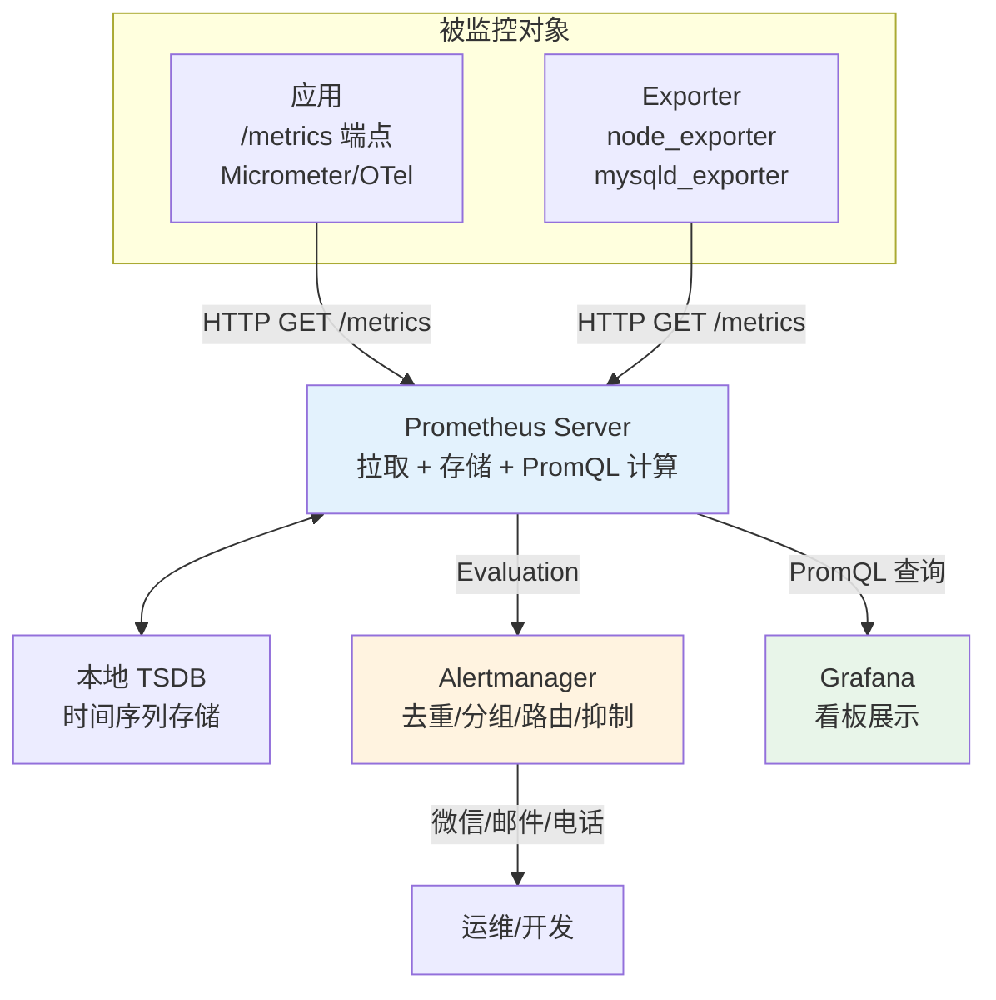
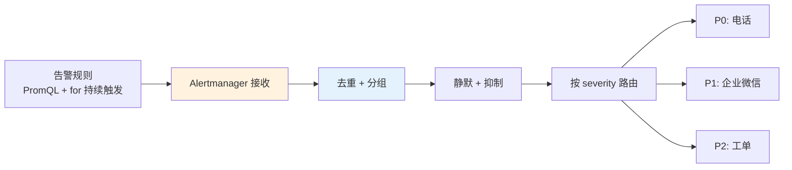

# 监控告警 Prometheus+Grafana

> 定位：掌握 Prometheus 的数据模型、PromQL、四种指标类型与拉取架构，会用 Grafana 建看板、用 Alertmanager 管告警，并能落地 JVM/业务指标监控与告警治理。这套组合是云原生监控的事实标准——不会 PromQL，你连「过去一小时错误率」都算不出来。

## 一、为什么需要它：指标是告警的地基

链路追踪擅长定位单次请求，日志擅长还原细节，但它们都不适合做**持续、低成本的健康判断**。你需要回答「这个服务现在健康吗」「错误率有没有超过阈值」「磁盘还能撑几天」这类问题——这就要靠**指标（Metrics）**：数值型时间序列，存储便宜、查询飞快、稳定可靠。

Prometheus 是这个领域的王者，原因有三：

1. **多维数据模型**：指标带任意标签（label），可以按服务、实例、接口、状态码灵活切片聚合。
2. **强大的查询语言 PromQL**：能直接在查询层做聚合、速率、分位数计算。
3. **拉取（Pull）模式 + 服务发现**：天然适配容器动态环境，Pod 起停自动纳管。

Grafana 则是展示层的事实标准，把 PromQL 查询变成炫酷且实用的看板。二者合体，构成绝大多数公司的监控底座。

## 二、核心原理：数据模型与架构

### 2.1 数据模型：指标名 + 标签 + 时间戳 + 值

一条 Prometheus 时间序列长这样：

```
http_requests_total{method="GET", status="500", instance="10.0.0.1:8080"}  15342923
```

- **指标名** `http_requests_total`：指标的身份。
- **标签集** `{method="GET", ...}`：维度，可任意组合。
- **样本值** `15342923`：一个 float64 数值。
- **时间戳**：实际上样本按时间连续存储，形成时间序列。

一组相同指标名、不同标签值的序列，构成一个「指标向量」。标签的取值数量叫**基数（cardinality）**——这是 Prometheus 最重要的性能概念，后面详述。

### 2.2 整体架构与数据流

下面这张图是 Prometheus 生态的经典架构。注意它是**拉取模式**：Prometheus 主动去目标（exporter / 应用 `/metrics`）拉数据，而不是目标推送。



读图要点：

1. **拉取**：Prometheus 按 `scrape_interval`（默认 15s）定时从目标的 `/metrics` 拉数据。目标地址来自静态配置或服务发现（K8s、Consul 等）。
2. **存储**：数据写入本地 TSDB（也支持远程存储如 Thanos、VictoriaMetrics 做长期保留和高可用）。
3. **告警**：Prometheus 按 `evaluation_interval` 周期执行告警规则，触发后交给 Alertmanager 做去重、分组、静默、路由，再发通知。
4. **展示**：Grafana 配置 Prometheus 为数据源，用 PromQL 查询画图。

### 2.3 拉模式 vs 推模式

| 维度 | 拉取（Prometheus） | 推送（如 StatsD/Telegraf） |
|---|---|---|
| 控制方 | 监控端决定何时拉 | 被监控端决定何时推 |
| 服务发现 | 天然适配动态环境（K8s） | 需额外配置目标 |
| 短生命周期任务 | 不友好（可能还没被拉就结束） | 友好 |
| 防火墙/NAT | 需监控端能访问目标 | 目标能访问网关即可 |
| 代表 | Prometheus | StatsD、InfluxDB、部分 OTel 导出 |

短任务（如 CronJob）想用 Prometheus，通常借助 **Pushgateway** 作为中转——任务推给 Pushgateway，Prometheus 再拉 Pushgateway。

## 三、关键机制：指标类型与 PromQL

### 3.1 四种核心指标类型

| 类型 | 语义 | 典型用途 | 查询特点 |
|---|---|---|---|
| **Counter** | 单调递增的计数器，只增不减（重启归零） | 请求总数、错误总数、处理字节数 | 配 `rate()`/`increase()` 算速率 |
| **Gauge** | 可增可减的瞬时值 | 内存使用、线程数、队列长度、温度 | 直接看当前值、配 `avg_over_time` |
| **Histogram** | 按桶（bucket）统计分布 | 请求耗时、响应大小 | 配 `histogram_quantile()` 算分位数 |
| **Summary** | 直接在客户端计算分位数 | 耗时分位数（客户端聚合） | 查询端直接读分位数值 |

**Counter 的关键认知**：它本身是累计值，直接看意义不大。真正有用的是它的**变化率**：

```promql
# 过去 5 分钟每秒的请求速率
rate(http_requests_total[5m])

# 过去 1 小时的错误总数
increase(http_requests_total{status="500"}[1h])
```

**Histogram vs Summary 的抉择**：

- Histogram 在服务端用 bucket 统计，可以**聚合多实例**算分位数，适合分布式场景（推荐）。
- Summary 在客户端算好分位数，无法跨实例聚合，但查询更省。

### 3.2 PromQL 常用操作

PromQL 是 Prometheus 的灵魂。几个必备模式：

```promql
# 1. 按标签过滤 + 速率
rate(http_requests_total{status=~"5.."}[5m])

# 2. 按 service 聚合求和
sum by (service) (rate(http_requests_total[5m]))

# 3. 错误率 = 5xx 速率 / 总速率
sum(rate(http_requests_total{status=~"5.."}[5m]))
/
sum(rate(http_requests_total[5m]))

# 4. P99 延迟（Histogram，bucket 累计）
histogram_quantile(0.99,
  sum by (le, service) (rate(http_request_duration_seconds_bucket[5m])))

# 5. 数值比较（用于告警：错误率 > 5%）
(
  sum(rate(http_requests_total{status=~"5.."}[5m]))
  /
  sum(rate(http_requests_total[5m]))
) > 0.05
```

- `rate()`：算每秒平均速率，自动处理 Counter 重启归零。
- `increase()`：算区间内的总增量。
- `by (label)`：按指定标签分组聚合。
- `le`：Histogram 的 bucket 上界标签，`histogram_quantile` 依赖它。

### 3.3 告警规则与 Alertmanager

告警规则写在 Prometheus 配置里，本质是一条**持续求值的 PromQL + for 持续时间**：

```yaml
groups:
- name: service-alerts
  rules:
  - alert: HighErrorRate
    expr: |
      (
        sum(rate(http_requests_total{status=~"5.."}[5m]))
        /
        sum(rate(http_requests_total[5m]))
      ) > 0.05
    for: 3m              # 持续 3 分钟才触发，避免抖动误报
    labels:
      severity: critical
    annotations:
      summary: "服务 {{ $labels.service }} 错误率超过 5%"
      runbook: "https://wiki/xxx"   # 处理预案链接
```

Alertmanager 负责「告警发出去之前」的所有治理：

| 能力 | 作用 |
|---|---|
| **去重（Dedup）** | 同源告警合并，避免刷屏 |
| **分组（Grouping）** | 同类告警合并成一条通知 |
| **抑制（Inhibition）** | 上级告警触发时抑制下级（如机器宕机时抑制其上的所有服务告警） |
| **静默（Silence）** | 维护窗口期临时静音 |
| **路由（Routing）** | 按 severity 发不同渠道（P0 电话、P1 企业微信） |

下面这张图是一条告警从「规则触发」到「人收到通知」的完整处理链路。理解它，才知道为什么告警不会把人淹死——中间有去重、分组、抑制、静默层层收敛。



## 四、生产坑点与排查

### 坑点 1：高基数标签打爆 Prometheus

**现象**：Prometheus 内存暴涨、查询超时，甚至 OOM；`tsdb` 目录膨胀飞快。
**原因**：把高基数值做标签，如 `userId`、`orderId`、`requestId`、`url` 带参数。每个不同取值都生成一条时间序列，几百万条直接压垮。
**解法**：
- 标签值必须是**有限、低基数**的枚举（如 method、status、service、region）。
- 高基数值（用户 ID、订单号）绝不进指标，用日志或链路追踪承载。
- 用 `metric_relabel_configs` 在抓取时丢弃危险标签；用 `--storage.tsdb.max-series` 兜底。
- URL 做归一化（`/order/123` → `/order/{id}`），避免每个 ID 一条序列。

### 坑点 2：Counter 重启归零导致速率计算错误

**现象**：应用重启后，错误率/请求速率图表出现一个巨大的尖峰或断崖。
**原因**：Counter 重启后归零，简单的差值计算会算出负值或异常值。
**解法**：
- 用 `rate()`/`increase()` 而非直接相减，它们内置了 Counter 重置检测。
- 监控 `process_start_time_seconds` 等指标感知重启，结合告警规则排除重启瞬间。

### 坑点 3：告警疲劳——几百条告警无人看

**现象**：告警群每几分钟就刷屏，大家设置了免打扰，结果真正的 P0 故障被淹没。
**原因**：告警阈值太敏感、告警的是「原因」而非「症状」、没有分级和抑制。
**解法**：
- **按 SLO/症状告警**：对「错误率、延迟、可用性」这类用户可感知的症状报警，而非「某台机器 CPU 80%」这种原因。
- 合理设置 `for`（如 3-5m）过滤抖动。
- Alertmanager 做好分组、抑制、静默。
- 每条告警配 runbook，无人处理的告警宁可删掉。
- 用「告警有效率」指标持续优化：一条告警若从不导致实际行动，就该调整或下线。

### 坑点 4：拉不到数据——目标 DOWN

**现象**：Grafana 看板上某个实例显示 `up=0`，数据断档。
**原因**：目标应用没暴露 `/metrics`、网络不通、`scrape_interval` 超时、服务发现没配好。
**解法**：
- 先看 `up{job="xxx"}` 指标确认目标状态。
- 在 Prometheus UI 的 Targets 页面看每个目标的抓取状态和错误。
- 检查应用 `/metrics` 端点是否可访问、`scrape_timeout` 是否过小（默认 10s）。
- 容器环境确认 Pod 标签与服务发现配置匹配。

## 五、调优 / 选型 / 最佳实践

### 5.1 JVM 指标监控实践

用 **Micrometer**（Spring Boot Actuator 默认集成）暴露 JVM 指标到 Prometheus：

```yaml
# application.yml
management:
  endpoints:
    web:
      exposure:
        include: health,metrics,prometheus   # 暴露 /actuator/prometheus
  metrics:
    export:
      prometheus:
        enabled: true
  endpoint:
    prometheus:
      enabled: true
```

需要重点监控的 JVM/业务指标：

| 指标 | 来源 | 关注点 |
|---|---|---|
| `jvm_memory_used_bytes` | Micrometer | 堆/非堆使用趋势，配合 GC 看泄漏 |
| `jvm_gc_pause_seconds` | Micrometer | GC 暂停时长和频率 |
| `jvm_threads_live_threads` | Micrometer | 线程数突增可能是线程池失控 |
| `process_cpu_usage` | Micrometer | CPU 趋势 |
| `http_server_requests_seconds` | Micrometer | 请求数、延迟分布、错误率 |
| 自定义业务指标 | `Counter`/`Gauge` Bean | 下单量、支付成功率、队列积压 |

自定义业务指标示例：

```java
// 用 Micrometer 定义业务 Counter
Counter orderCounter = Counter.builder("order_created_total")
        .tag("channel", "app")
        .register(meterRegistry);
orderCounter.increment();
```

### 5.2 选型与演进

| 场景 | 方案 |
|---|---|
| 中小规模、单机 | Prometheus + Grafana 起步 |
| 大规模/高可用/长期存储 | Thanos 或 VictoriaMetrics（兼容 PromQL） |
| 短生命周期任务 | Pushgateway 中转 |
| 多集群联邦 | Prometheus Federation 或 Thanos |
| 日志/追踪统一 | 配合 OTel Collector、Loki、Jaeger（见本板块其他篇） |

### 5.3 黄金指标（Google SRE 四金）

设计监控和告警时，围绕这四个黄金信号：

1. **延迟（Latency）**：请求耗时，区分成功/失败。
2. **流量（Traffic）**：QPS、请求量。
3. **错误（Errors）**：错误率、失败请求数。
4. **饱和度（Saturation）**：资源使用度（CPU、内存、连接池）。

## 六、面试高频问法

> 这一节按「面试时能讲透」的标准写：先给一句能直接背的结论，再展开机制、对比和生产坑。建议先自己答一遍，再对照补全。

**Q1：Prometheus 的数据模型和整体架构是什么？**

**一句话结论**：Prometheus 用「指标名 + 标签集」的多维时间序列模型，采用拉取（Pull）模式采集，内置 TSDB 存储，用 PromQL 查询，呈现交给 Grafana。

展开：

- **数据模型**：时间序列由 `<metric name>{label="value",...}` 唯一标识，每条序列是一串 `(timestamp, value)` 样本，标签支持切片和聚合。
- **架构**：Prometheus Server 按配置定时从 targets 拉取指标 → 存本地 TSDB → PromQL 查询；服务发现动态找 targets；短任务经 Pushgateway 中转；告警规则触发后交给 Alertmanager。
- **拉取模式**：监控端主动去目标拉 `/metrics`，天然适配容器动态 IP 和服务发现。
- **定位**：Prometheus 负责采集、存储和查询，不负责长期海量归档和展示，长期存储用 Thanos / Mimir / remote write。

加分点：说一句「Prometheus 把复杂性放在查询侧（PromQL 很强），存储侧保持简单（本地 TSDB 默认约 15 天）」，体现对设计取舍的理解；具体保留期以版本/配置为准。

**Q2：Prometheus 的四种指标类型是什么？什么时候用哪种？**

**一句话结论**：Counter（单调增、配 `rate` 算速率）、Gauge（可增可减、看瞬时值）、Histogram（bucket 分布、可算分位数并可跨实例聚合）、Summary（客户端算分位数、不可聚合）；分布式耗时优先 Histogram。

| 类型 | 特点 | 典型用法 | 常用函数 |
|---|---|---|---|
| Counter | 只增不减，进程重启归零 | 请求总数、错误总数 | `rate()` / `increase()` |
| Gauge | 可增可减 | 内存、线程数、队列长度 | 直接读、`delta()` |
| Histogram | 按 bucket 累计计数 | 请求耗时分布 | `histogram_quantile()` |
| Summary | 客户端算 φ-分位数 | 单实例分位数 | 直接看 quantile |

加分点：面试官很吃的一句——「Histogram 的分位数在服务端按 bucket 聚合，能跨实例算全局 P99；Summary 在客户端就算好了，多实例无法合并，所以监控分布式系统要选 Histogram」。

**Q3：Counter 为什么要配 `rate()`？直接用原始值有什么问题？**

**一句话结论**：Counter 是累计值，直接看没有意义且会受重启归零干扰；`rate()` 取时间窗口内的每秒增量并自动处理重置，反映真实速率。

展开：

- **原始值的问题**：`http_requests_total` 从 0 涨到 10000，这个累计数本身不能告诉你「现在快不快」，而且进程重启后归零，直接相减会出现负数。
- **`rate()`**：取时间窗口（如 `[5m]`）内 Counter 的增量除以窗口秒数，得到每秒速率，并检测到值下降时按重置处理。
- **`increase()`**：返回窗口内的总增量，适合看「过去 5 分钟错误了多少次」。
- **`irate()`**：用窗口内最后两个样本算瞬时速率，对突发更敏感，但抖动大，告警慎用。

加分点：补一句「窗口选多长有讲究：太短样本少抖动大、太长会稀释突刺，5m 是常用起点，按信号敏感度调整」——体现调参经验。

**Q4：如何计算 P99 延迟？为什么不能只看平均值？**

**一句话结论**：用 Histogram 的 `histogram_quantile` 配合 `rate` 聚合 bucket 计算；平均值会被长尾稀释，掩盖少数极慢请求，分位数才能反映真实体验。

关键 PromQL：

```promql
histogram_quantile(
  0.99,
  sum by (le, job) (rate(http_request_duration_seconds_bucket[5m]))
)
```

要点：

- 指标名来自 Histogram 自动产生的 `_bucket` 时间序列，`le` 是桶上界标签；必须先 `sum by (le)` 再算分位数，否则按实例算出来的是错的。
- 同时看 `_sum / _count` 可以得到平均值，但平均值会被大量快请求拉低，掩盖 P99 的慢请求。
- 除了 P99，通常一起看 P50/P95，形成延迟分布的全貌。

加分点/坑点：一个经典事故是「忘了 `sum by (le)`，直接对单实例 bucket 算分位数，结果和真实 P99 差很多」——讲出这个细节非常加分。

**Q5：Histogram 和 Summary 有什么区别？**

**一句话结论**：Histogram 在服务端按 bucket 统计、可跨实例聚合算分位数但有近似误差；Summary 在客户端直接算分位数、精确但不可跨实例聚合。

| 维度 | Histogram | Summary |
|---|---|---|
| 分位数计算 | 服务端按 bucket 估算 | 客户端直接计算 |
| 跨实例聚合 | 支持（`sum by (le)`） | 不支持 |
| 精度 | 取决于 bucket 划分 | 更精确 |
| 开销 | 时间序列多（每 bucket 一条） | 客户端计算有成本 |
| 适用 | 分布式系统耗时（推荐） | 单实例、不聚合场景 |

加分点：点出「Histogram 的 bucket 边界要按业务量级设计，比如 `le="0.1,0.5,1,5"`（秒），桶划分太粗 P99 就不准」——把选型落到具体配置上。

**Q6：什么是高基数问题？如何避免？**

**一句话结论**：标签取值过多会让时间序列数量爆炸，压垮内存和存储；核心是只把低基数枚举维度做标签，高基数信息交给日志和链路。

展开：

- **机制**：一条时间序列 = 指标名 + 完整标签集，`http_requests_total{userId="u1",path="/order/123"}` 每个组合都是新序列，用户/订单一多就指数级膨胀。
- **危害**：内存暴涨、TSDB 写放大、查询变慢甚至打爆进程。
- **规避**：URL 归一化（`/order/123` → `/order/:id`）；不放 userId、orderId、手机号、traceId 做标签；用 `metric_relabel_configs` 丢弃高基标签；把高基数维度放日志/链路，用 exemplar 关联。
- **排查**：`count by (__name__)({__name__=~".+"})` 可统计各指标序列数，定位基数元凶。

加分点/坑点：生产常见事故是「把 traceId 当标签加进指标，每条请求一条序列，几分钟内存打满」——讲这个具体场景，面试官立刻知道你真懂。

**Q7：Prometheus 为什么用拉取模式？有什么利弊？**

**一句话结论**：拉模式便于集中控制、天然适配服务发现和容器动态环境；代价是短任务可能漏抓（需 Pushgateway）、要求监控端能访问目标网络。

展开：

- **优点**：监控端掌握采集节奏，可统一配置、集中控制；目标 IP 变化时靠服务发现自动更新；target 健康状态（up 指标）一目了然。
- **缺点**：抓取间隔内短暂存在的任务（批处理 Job）可能错过；监控端必须能路由到目标的 `/metrics`，跨网络/NAT 场景受限；拉取失败需要靠 `up==0` 发现。
- **推模式对比**：StatsD / InfluxDB 等用推模式，适合短任务和 NAT 后环境，但控制面分散、目标是否存活不直观。
- **短任务解法**：Pushgateway 让任务主动推指标，Prometheus 再拉 Pushgateway；注意 Pushgateway 数据会常驻，需及时清理 stale 指标。

加分点：补一句「拉模式的本质是把『何时采集、采哪些』的控制权放在监控侧，这让它更适合动态环境」——一句话说透设计动机。

**Q8：Alertmanager 的作用是什么？去重、分组、抑制、静默怎么区分？**

**一句话结论**：Alertmanager 在 Prometheus 发出告警后做治理——去重、分组、抑制、静默和路由，目的是减少告警疲劳，让正确的告警发给正确的人。

展开：

- **去重（deduplication）**：同一告警的多个重复实例按 `group_by` 合并成一条通知。
- **分组（grouping）**：把同类告警（如同一集群的多台机器）合并成一条消息，避免刷屏。
- **抑制（inhibition）**：高级别告警触发时抑制低级别的相关告警，比如「机房挂了」抑制「该机房所有机器高负载」。
- **静默（silence）**：按时间窗口和匹配条件屏蔽已知告警，比如计划内维护期间。
- **路由（routing）**：按 `matchers` 把不同 severity 的告警发到不同 receiver（钉钉/邮件/电话）。

加分点：点出「告警治理的目标不是发得更多，而是让每条告警都可行动（actionable）——收不到噪音，人才会信任告警」。

**Q9：一条好的告警规则应该怎么设计？**

**一句话结论**：基于症状和 SLO（错误率、延迟、可用性）而非原因，用 `for` 过滤抖动，配 severity 分级和 runbook，每条告警有明确处理人。

展开：

- **告警症状而非原因**：「错误率 > 1%」比「CPU > 80%」更贴近用户影响；CPU 高但服务正常不该半夜叫人。
- **用 `for` 抗抖动**：`for: 5m` 表示条件持续 5 分钟才触发，避免瞬时毛刺造成误报。
- **分级**：warning 走工单/消息，critical 才电话；不同级走不同路由。
- **attached runbook**：每条告警附处理文档和负责人，值班的人知道第一步干什么。
- **定期清理**：长期不触发或无法行动的告警要下线，防止告警疲劳。

示例：

```yaml
- alert: HighErrorRate
  expr: rate(http_requests_total{status=~"5.."}[5m]) / rate(http_requests_total[5m]) > 0.01
  for: 5m
  labels: { severity: critical }
  annotations: { summary: "API 错误率超过 1%" }
```

加分点：强调「告警的黄金标准是『触发了就有人需要做事』，做不到这条的告警就该删掉或改成看板」。

**Q10：Prometheus 单机成为瓶颈后如何扩展？**

**一句话结论**：按规模依次采用记录规则降负载、联邦/分片、remote write 到长期存储、Thanos/Mimir 做全局查询与无限保留，具体方案以版本和规模为准。

展开：

- **记录规则（recording rules）**：把昂贵的 PromQL 预计算成新指标， dashboards 直接查新指标，减轻查询压力。
- **联邦（federation）**：上层 Prometheus 从下层拉取聚合后的指标，做层级汇总。
- **分片（sharding）**：按 hash 把 targets 分给多个 Prometheus，每个只采一部分，再用联邦/Thanos 查全局。
- **remote write**：把样本远程写到 Thanos/Mimir/VictoriaMetrics 等，实现长期存储和水平扩展。
- **Thanos**：Sidecar + 对象存储 + Query 层，提供全局视图和无限期保留。

加分点：给出决策梯度——「先加 recording rules，再考虑分片，最后上 Thanos/Mimir」，并强调「别一上来就搞复杂架构」，体现务实态度。

## 小结

- Prometheus = 多维数据模型（指标名+标签）+ PromQL + 拉取模式 + 本地 TSDB。
- 四类型：Counter 用 rate、Gauge 看瞬时、Histogram 算分位数（推荐）、Summary 客户端聚合。
- 告警规则是 PromQL + for，Alertmanager 负责去重/分组/抑制/静默/路由。
- 最大的坑是高基数标签打爆存储——标签必须低基数，高基数交给日志和链路。
- 监控围绕四黄金信号（延迟/流量/错误/饱和度），告警围绕症状和 SLO，避免告警疲劳。
