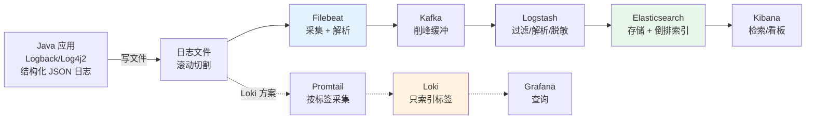

# 日志体系

> 定位：掌握日志规范（级别、格式、TraceId 关联、结构化）、Logback/Log4j2 的选择、ELK/EFK/Loki 的取舍、Filebeat 采集，以及日志治理（防打爆磁盘、敏感信息脱敏）。日志是信息最全的可观测性数据，也是最容易失控的数据——没规范就是一场灾难。

## 一、为什么需要它：日志的「两副面孔」

日志是开发者最熟悉的可观测性数据，但它有两副截然不同的面孔：

- **用得好**：一行带 TraceId 的结构化日志，能让你在 millions 条记录里精准定位一次失败请求的全貌。
- **用不好**：满屏的 `System.out.println`、`e.printStackTrace()`、无级别的 INFO 洪流，既拖慢服务，又在出事时帮你找不到任何有用信息——还顺便把用户手机号、身份证写进了日志。

真实痛点：

1. **格式混乱**：每个开发按自己心情打日志，时间格式不统一、字段各叫各的，机器没法聚合检索。
2. ** TraceId 缺失**：出问题时无法把日志和链路对上，只能靠猜时间范围大海捞针。
3. **量失控**：DEBUG 日志上生产、异常栈重复打印、循环里打日志，一天几百 GB，磁盘打爆、ES 集群跪了。
4. **合规风险**：密码、token、身份证明文进日志，审计过不了，甚至造成数据泄露。

这一篇就是把日志从「随手打」变成「可治理、可关联、可控成本」的体系。

## 二、核心原理：从应用到检索的完整链路

### 2.1 日志的生命周期

一条日志从产生到被人查询，经过：产生（应用）→ 采集（Agent）→ 传输/缓冲（Kafka）→ 存储/索引（ES/Loki）→ 查询展示（Kibana/Grafana）。



读图要点：

- 上半部分是经典 **ELK**（+Filebeat/Kafka）链路：功能强，全文索引，检索快，但存储重。
- 下半部分是 **Loki** 链路：只索引标签（label），日志正文压缩存储，成本低，配合 Grafana 查询语法 LogQL。
- Kafka 是可选项但强烈推荐：**削峰填谷**，避免日志洪峰直接压垮 Logstash/ES。

### 2.2 结构化日志：让机器能读懂

非结构化日志人能看、机器难处理。结构化日志（推荐 JSON）让每条日志成为可被精确过滤、聚合的.record：

```json
{
  "timestamp": "2026-11-22T10:15:30.123+08:00",
  "level": "ERROR",
  "service": "order-service",
  "traceId": "4bf92f3577b34da6a3ce929d0e0e4736",
  "spanId": "a2fb4a1d1a96d312",
  "thread": "http-nio-8080-exec-3",
  "logger": "com.xxx.order.OrderService",
  "message": "创建订单失败: 库存不足",
  "userId": 10086,
  "skuId": "SKU-123",
  "stack": "java.lang.RuntimeException: ..."
}
```

有了 TraceId，你可以在 Kibana 里搜 `traceId: "4bf92f..."` 瞬间捞出这次请求在所有服务里的全部日志——这就是和可观测性其他两支柱关联的关键。

### 2.3 日志级别：该打什么、不该打什么

| 级别 | 用途 | 生产是否开启 |
|---|---|---|
| ERROR | 系统出错，需要立即关注（如调用下游失败、数据不一致） | 开 |
| WARN | 潜在问题，可恢复（如降级、重试、参数异常但已兜底） | 开 |
| INFO | 关键业务节点（如服务启停、重要状态变更、下单成功） | 开（克制） |
| DEBUG | 调试细节（方法入参、中间变量） | 关（按需临时开） |
| TRACE | 最细粒度 | 关 |

**铁律**：生产默认 INFO，DEBUG 按需临时开启（可通过 Arthas 的 `logger` 命令或配置中心动态调级，见《Arthas线上诊断》）。循环里、高频路径上绝不打 INFO/DEBUG。

## 三、关键机制：框架、采集与关联

### 3.1 Logback vs Log4j2

| 维度 | Logback | Log4j2 |
|---|---|---|
| 出身 | Log4j 的继任者，SLF4J 原生 | Apache 重写，吸收 Logback 优点 |
| 性能 | 好 | 更好（异步 Logger 吞吐更高，LMAX Disruptor） |
| 配置 | XML，热加载支持 | XML/JSON/YAML，支持自动重载 |
| 生态 | Spring Boot 默认 | 需排除默认依赖再引入 |
| 异步 | AsyncAppender（基于阻塞队列） | AsyncLogger（基于 Disruptor，性能强） |
| 安全历史 | 较稳 | Log4Shell（CVE-2021-44228）曾爆发，需升级 |

**选择建议**：

- Spring Boot 默认 Logback，够用且省事，多数场景不必换。
- 高并发、对日志吞吐敏感的网关类服务，可考虑 Log4j2 的 AsyncLogger。
- 用 Log4j2 务必升到修复 Log4Shell 的版本，并谨慎对待 JNDI 查找。

### 3.2 TraceId 关联：MDC 机制

SLF4J/Logback、Log4j2 都提供 **MDC（Mapped Diagnostic Context）**——一个基于 ThreadLocal 的 KV 容器。把 TraceId 放进 MDC，日志格式里用占位符引用即可自动带上：

```java
// 在请求入口（如拦截器）放入 TraceId
MDC.put("traceId", traceId);
try {
    chain.doFilter(request, response);
} finally {
    MDC.remove("traceId");   // 必须清理，避免线程复用污染
}
```

Logback 的 pattern 配置（`%X{traceId}` 读取 MDC）：

```xml
<encoder class="net.logstash.logback.encoder.LogstashEncoder">
  <!-- 输出 JSON，自动包含 MDC 中的 traceId -->
</encoder>
<!-- 或纯文本 pattern -->
<pattern>%d{yyyy-MM-dd HH:mm:ss.SSS} [%thread] %-5level %X{traceId} %logger - %msg%n</pattern>
```

如果用 SkyWalking/OTel Agent，通常有现成的 MDC 插件自动注入 TraceId，免去手写（以版本为准）。下面这张图描述了 TraceId 如何从请求入口经过 MDC 进入每一条日志、最终实现「按 TraceId 捞出整条链路日志」：


### 3.3 Filebeat 采集与日志滚动

- **Filebeat**：轻量级日志采集器（Go 写），部署在应用机器上，读日志文件发给 Kafka/Logstash/ES。相比 Logstash 更省资源，是官方推荐的采集端。
- **日志滚动（Rotation）**：Logback 用 `RollingFileAppender`，按大小/时间切割，避免单文件无限增长：

```xml
<rollingPolicy class="ch.qos.logback.core.rolling.SizeAndTimeBasedRollingPolicy">
  <fileNamePattern>/data/logs/order-%d{yyyy-MM-dd}.%i.log.gz</fileNamePattern>
  <maxFileSize>100MB</maxFileSize>
  <maxHistory>15</maxHistory>          <!-- 保留 15 天 -->
  <totalSizeCap>20GB</totalSizeCap>    <!-- 总量上限，防打爆磁盘 -->
</rollingPolicy>
```

`totalSizeCap` 是关键兜底——防止历史日志把磁盘吃满。

## 四、生产坑点与排查

### 坑点 1：异常重复打印 / 循环里打日志，磁盘被打爆

**现象**：磁盘 100%，服务因写日志失败而雪崩，ES 集群也被洪峰压垮。
**原因**：
- `try-catch` 里 `log.error("失败", e)` 后又 `throw e`，上层再打一次，一条异常打印多遍（还可能带完整堆栈）。
- 循环体内打 INFO/DEBUG，QPS 高时日志量指数级增长。
- 没配滚动和 `totalSizeCap`。

**解法**：
- 异常只在最外层打一次，向上抛时不要重复 `log.error`。
- 高频路径禁用 INFO/DEBUG；压测时检查日志量。
- 配 `SizeAndTimeBasedRollingPolicy` + `totalSizeCap` + 保留天数。
- 采集端限流：Filebeat 配 `ignore_older`、`scan_frequency`，Kafka 缓冲削峰。

### 坑点 2：MDC 的 TraceId 串了 / 内存泄漏

**现象**：异步线程里日志的 TraceId 是别的请求的，或者为空。
**原因**：MDC 基于 ThreadLocal，线程池复用线程时，`finally` 没清理干净，导致上一个请求的 TraceId 污染下一个；异步任务没继承父线程的 MDC。
**解法**：
- 入口 `finally` 里必须 `MDC.remove("traceId")`。
- 线程池/异步场景用 `TransmittableThreadLocal` 或框架提供的 MDC 装饰器传递。
- 用 OTel/SkyWalking 的自动 MDC 注入插件更稳妥。

### 坑点 3：敏感信息明文进日志

**现象**：安全审计发现日志里有手机号、身份证、银行卡、密码、token。
**原因**：直接打印了请求对象、DTO 或完整参数，没做脱敏。
**解法**：
- 在 Logstash/Collector 层做脱敏：用 grok/regex 替换（`138****1234`）。
- 代码层用脱敏工具类，打印前处理；`toString()` 里屏蔽敏感字段。
- 严禁打印密码、密钥、完整 token；JWT 只打印前几位或 hash。
- 日志访问权限控制 + 加密存储 + 定期清理，满足合规（如 GDPR、等保）。

### 坑点 4：日志格式不统一，检索困难

**现象**：想统计某接口错误数，却发现各服务的日志字段叫法不一、时间格式各异，没法统一查询。
**原因**：没有强制的日志规范，各服务自由发挥。
**解法**：
- 全公司统一结构化 JSON schema（时间戳、level、service、traceId、message 必填）。
- 用 `LogstashEncoder`/`JsonTemplateLayout` 统一输出，禁止各服务自定义 pattern。
- 字段命名遵循 OTel Semantic Conventions 或内部规范。
- 提供统一的日志 starter/模板，新服务默认接入。

## 五、调优 / 选型 / 最佳实践

### 5.1 ELK vs EFK vs Loki

| 方案 | 组成 | 特点 | 适用 |
|---|---|---|---|
| **ELK** | Elasticsearch + Logstash + Kibana | 全文索引，检索强，功能全；资源重、成本高 | 需要复杂全文检索、分析 |
| **EFK** | Elasticsearch + Fluentd/Fluent Bit + Kibana | 用 Fluent Bit 替代 Filebeat/Logstash，K8s 场景更轻 | K8s 环境、统一采集 |
| **Loki** | Loki + Promtail + Grafana | 只索引标签，正文压缩，成本低，LogQL 查询；全文检索弱 | 成本敏感、已用 Grafana/Prometheus、按标签排障 |

**抉择**：追求强检索引擎 → ELK/EFK；追求成本+与 Prometheus/Grafana 融合 → Loki。很多公司两者并存：核心日志进 ES，普通日志进 Loki。

### 5.2 日志分级与采样

- **按级别分流**：ERROR/WARN 进热存储（ES，长期保存），INFO 进温存储（Loki，短期），DEBUG 不进生产。
- **按服务采样**：非核心服务的 INFO 日志按比例采样入库。
- **冷热分层**：ES 用 ILM（Index Lifecycle Management）让 30 天后的索引转冷/删除；Loki 配 retention。
- **异常全留**：ERROR 日志 100% 保留，这是排障的命根子。

### 5.3 最佳实践清单

1. 用 SLF4J 门面 + Logback/Log4j2 实现，禁止直接用具体日志框架 API。
2. 输出结构化 JSON，字段统一，必带 traceId/service/level/timestamp。
3. 级别克制：生产 INFO 起步，DEBUG 按需动态开启。
4. 配滚动 + `totalSizeCap`，防打爆磁盘。
5. 异常只打一次，不重复打印堆栈。
6. 敏感信息脱敏（采集层 + 代码层双保险）。
7. ERROR 全留、INFO 采样、DEBUG 不留；热冷分层控成本。
8. 日志、指标、链路用同一 TraceId 关联。

## 六、面试高频问法

> 这一节按「面试时能讲透」的标准写：先给一句能直接背的结论，再展开机制、对比和生产坑。建议先自己答一遍，再对照补全。

**Q1：什么是结构化日志？为什么推荐它？**

**一句话结论**：结构化日志输出 JSON 等机器可读格式、字段固定（timestamp/level/traceId/message 等），相比纯文本可被精确过滤、聚合和按 TraceId 关联。

展开：

- **纯文本的问题**：`user 123 login failed at ...` 这种格式要靠正则解析，字段一变就崩，机器难以稳定检索。
- **结构化格式**：一行一个 JSON 对象，字段语义固定，日志系统能直接建索引、按字段过滤（如 `level:ERROR AND service:order`）。
- **关联能力**：统一带上 traceId、spanId、userId 等字段，可以和链路、指标互查。
- **实践**：Spring Boot 可用 logstash-logback-encoder 输出 JSON；字段命名遵循统一 schema，禁止各服务自定义。

加分点：补一句「结构化的价值不在『好看』，而在于让日志从给人读变成给机器查——这是做聚合分析和告警的前提」。

**Q2：日志级别怎么规划？生产环境该开什么级别？**

**一句话结论**：生产默认 INFO，ERROR/WARN 全留、DEBUG 不开；级别要克制，避免用日志代替调试器，靠动态调级应对临时排查。

展开：

- **级别语义**：ERROR（影响功能的错误，需处理）、WARN（潜在问题/可恢复）、INFO（关键业务节点）、DEBUG（开发细节）、TRACE（最细粒度）。
- **生产策略**：默认 INFO；DEBUG 只在不重启即可动态调级（如通过 Actuator / Arthas `logger` 命令）时临时开启，用完立即关。
- **克制使用**：循环体内、高频工具方法里不打 INFO；异常只在一处打完整堆栈，不要每层都打。
- **成本控制**：日志量直接决定存储和检索成本，级别是最直接的阀门。

加分点/坑点：常见事故是「有人上线忘了关 DEBUG，磁盘几小时被打满」——讲这个具体场景，再补一句「用日志级别动态配置 + 磁盘上限双保险」很加分。

**Q3：MDC 是什么？如何用日志关联链路追踪？**

**一句话结论**：MDC（Mapped Diagnostic Context）是基于 ThreadLocal 的诊断上下文，把 TraceId 放进去后，日志 pattern 用 `%X{traceId}` 就能自动在每条日志带上它。

展开：

- **原理**：MDC 内部是 ThreadLocal<Map>，写入的键值由日志框架的 pattern 在格式化时取出。
- **用法**：在链路入口（Filter/Interceptor）执行 `MDC.put("traceId", traceId)`，logback 配置里加 `%X{traceId}`：

```xml
<pattern>%d{HH:mm:ss} %-5level [%X{traceId}] %msg%n</pattern>
```

- **关联效果**：异常日志带 TraceId → 去链路系统查整条调用 → 或从链路 Span 跳回该请求的所有日志。
- **必要条件**：日志框架（logback/log4j2）和追踪 SDK 用同一个 TraceId，字段命名统一。

加分点：说清「MDC 是线程局部的，所以跨线程一定要传递和清理，否则日志不是缺 TraceId 就是串号」——自然引出下一个话题。

**Q4：线程池/异步场景下 MDC 丢失怎么办？**

**一句话结论**：根因是 ThreadLocal 不跨线程；解法是提交任务时快照 MDC、执行前恢复、执行后清理，可用 TransmittableThreadLocal 或框架封装自动完成。

展开：

- **问题**：主线程 MDC 里的 traceId 到了线程池工作线程就丢了，异步日志没有链路号；线程复用还会残留上一个请求的 traceId 造成串号。
- **方案一**：用 TransmittableThreadLocal（TTL）装饰线程池，提交时捕获、执行时重放，框架层统一处理。
- **方案二**：手动包装 `Runnable`——提交前 `Map<String,String> ctx = MDC.getCopyOfContextMap()`，执行时 `MDC.setContextMap(ctx)`，finally 里 `MDC.clear()`。
- **方案三**：用 SkyWalking / OTel Agent 自动注入 TraceId 到日志。
- **协程/响应式**：Reactor 用 `Hooks.enableAutomaticContextPropagation()` 或 `contextWrite`（以版本为准）传递上下文。

加分点/坑点：强调「finally 里 `MDC.clear()` 是必写项——线程池复用时不清，下一个请求会继承上一个的 TraceId，排障时会被错误数据带偏」。

**Q5：Logback 和 Log4j2 怎么选？**

**一句话结论**：Logback 是 Spring Boot 默认、配置简单够用；Log4j2 异步吞吐更高（基于 Disruptor），适合高并发网关，但历史上出过 Log4Shell 漏洞需保持版本更新。

| 维度 | Logback | Log4j2 |
|---|---|---|
| 默认集成 | Spring Boot 默认 | 需替换 starter |
| 异步性能 | 异步 Appender | AsyncLogger（Disruptor），吞吐更高 |
| 配置 | logback.xml，成熟直观 | XML/JSON/YAML |
| 安全历史 | 相对平稳 | Log4Shell（CVE-2021-44228）需升级 |

选型建议：

- 普通业务服务：Logback 足够，省事、生态契合。
- 高吞吐网关/日志密集型：Log4j2 AsyncLogger 收益明显。
- 若用 Log4j2，务必升级到修复版本并关注后续公告，具体安全版本以官方公告为准。

加分点：能主动提「Log4Shell 的根源是 lookups 对 JNDI 的滥用，关闭 lookup / 升级版本都可缓解」，体现你关注过安全细节。

**Q6：ELK、EFK、Loki 的区别和取舍？**

**一句话结论**：ELK 全文检索强但重；EFK 用 Fluent Bit 更轻量、适合 K8s；Loki 只索引标签、正文压缩、成本低、与 Grafana 融合好但全文检索弱。

| 方案 | 采集 | 存储/检索 | 特点 |
|---|---|---|---|
| ELK | Filebeat/Logstash | Elasticsearch | 全文索引强、资源重 |
| EFK | Fluent Bit/Fluentd | Elasticsearch | 更轻量、K8s 友好 |
| Loki | Promtail/Fluent Bit | Loki（标签索引+对象存储） | 便宜、Grafana 原生、检索弱 |

取舍逻辑：

- 需要复杂全文检索、多字段聚合分析 → ELK/EFK。
- 已经用 Prometheus + Grafana、主要按服务/标签查日志 → Loki，成本低且查询体验统一。
- Loki 的查询语言是 LogQL，按标签定位后再在正文里过滤，所以标签设计决定了查询效率。

加分点：用一句话总结「ELK 是『索引一切』，Loki 是『只索引元数据』——本质是用检索能力换成本」，对比非常清晰。

**Q7：如何防止日志打爆磁盘？**

**一句话结论**：级别克制 + 异常不重复打 + 配置滚动切割和总量上限（`maxHistory` / `totalSizeCap`）+ 采集端限流削峰，多管齐下。

展开：

- **源头控制**：生产不开 DEBUG；循环和高频方法不打日志；异常只在最外层打一次完整堆栈。
- **滚动策略**：用 `SizeAndTimeBasedRollingPolicy`，按时间和大小双条件切割：

```xml
<rollingPolicy class="ch.qos.logback.core.rolling.SizeAndTimeBasedRollingPolicy">
  <fileNamePattern>app.%d{yyyy-MM-dd}.%i.log.gz</fileNamePattern>
  <maxFileSize>100MB</maxFileSize>
  <maxHistory>15</maxHistory>
  <totalSizeCap>3GB</totalSizeCap>
</rollingPolicy>
```

- **链路削峰**：Filebeat → Kafka → Logstash/ES，Kafka 缓冲峰值，消费端按能力拉取。
- **分级采样**：ERROR 全留、INFO 采样、热数据本地、冷数据转对象存储。

加分点/坑点：强调「`totalSizeCap` 是最后防线，不配它时再多的 maxHistory 也挡不住单日暴增」——这是很实用的生产经验。

**Q8：日志采集链路怎么设计？为什么要加 Kafka？**

**一句话结论**：典型链路是「应用写文件 → Filebeat/Fluent Bit 采集 → Kafka 削峰 → Logstash 解析 → ES/Loki 存储」，Kafka 的作用是解耦和削峰填谷。

展开：

- **采集端**：Sidecar 里的 Filebeat/Fluent Bit 读容器 stdout 或日志文件，资源占用小，跟随 Pod 生命周期。
- **Kafka 的作用**：日志产生速度波动大，Kafka 作为缓冲队列，避免高峰期压垮 Logstash/ES；消费端可按能力限速，还能多消费者复用（排障、归档各取一份）。
- **解析层**：Logstash 做 grok/json 解析、字段抽取、脱敏；字段解析尽量前置到采集端以减轻中心压力。
- **存储层**：ES 建索引时合理设置分片和生命周期（ILM），Loki 靠标签索引。
- **可靠性**：采集端开 disk queue，防止下游短暂不可用时丢日志。

加分点：点出「Kafka 不是必选——量小可以直接 Filebeat → ES；上了 Kafka 就要承担运维成本，按量级决定」，体现不做过度设计。

**Q9：日志里的敏感信息如何处理？**

**一句话结论**：代码层从源头不打明文 + 采集层正则脱敏双保险，配合访问控制、加密存储和定期清理，满足合规要求。

展开：

- **源头治理**：密码、token、身份证号、手机号、银行卡号不打印；`toString()` 里屏蔽敏感字段；打印前做掩码（`138****1234`）。
- **采集层兜底**：Logstash/Collector 用 grok/正则统一替换敏感模式，防止个别服务漏改。
- **访问控制**：日志系统按最小权限授权，审计查询行为；敏感日志单独索引、更短保留期。
- **存储与合规**：传输/存储加密，按法规要求设定保留期并定期清理。

加分点/坑点：强调「脱敏一定要在『进入索引之前』完成——一旦原文进了 ES，再脱敏就要重建索引，成本和风险都很高」。

**Q10：日志检索慢怎么优化？**

**一句话结论**：从「缩小检索范围、优化索引字段、采样与冷热分层」入手，核心是让查询尽量命中少量标签和时间窗口，而不是全量扫描。

展开：

- **缩小范围**：先按服务、环境、时间窗口过滤，再搜关键字；限制返回条数，避免一次拉几百万条。
- **索引设计**：把高频过滤字段（service、level、traceId）设为索引字段，把长文本和大字段排除索引；ES 控制分片数，避免过多分片拖慢查询。
- **结构化字段**：用 JSON 字段查询替代正文正则匹配，速度数量级提升。
- **采样与分层**：高频 DEBUG 不采；老日志转冷存储，检索时明确时间范围。
- **关联加速**：有 TraceId 就直接按 TraceId 精确查，比按时间+关键字模糊查快得多。

加分点：收一句「最快的查询是不查——把常见的排障问题固化成 dashboard 和告警，日志只在深挖时才用」，体现效率意识。

## 小结

- 日志规范是地基：统一 JSON schema、克制级别、必带 TraceId，禁止自由发挥。
- MDC + `%X{traceId}` 实现日志与链路关联；线程池场景注意清理和传递。
- Logback 默认够用，高并发可考虑 Log4j2 AsyncLogger（注意 Log4Shell）。
- 选型：强检索选 ELK/EFK，成本+ Grafana 融合选 Loki；Kafka 削峰是标配。
- 治理三件事：防打爆磁盘（滚动+上限+采样）、敏感信息脱敏、ERROR 全留做排障命根子。
