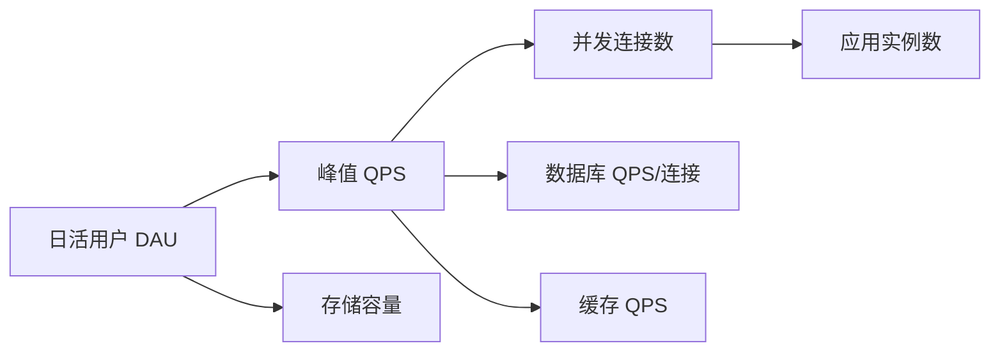
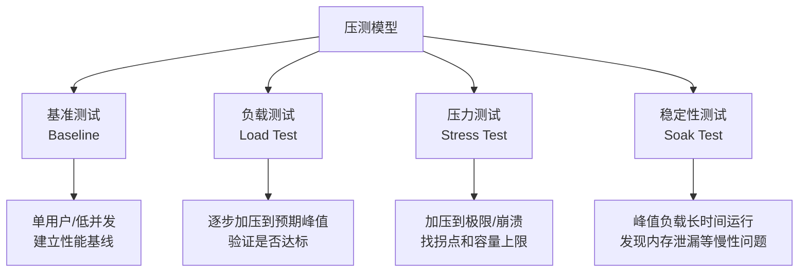
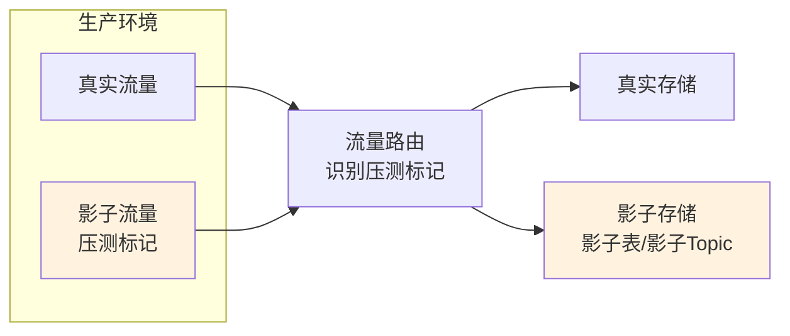

# 容量规划与压测

> 定位：「大促要抗多少 QPS？需要几台机器？数据库撑得住吗？」——这些问题不能靠拍脑袋。容量规划用数据回答「需要多少资源」，压测用实验验证「系统真实能力」。这篇把估算方法、压测模型、瓶颈分析、全链路压测讲成一套可落地的工程。

## 一、为什么需要容量规划与压测

某系统平时日活 10 万，峰值 QPS 500，运维按经验配了 10 台应用。大促当天流量涨 8 倍，QPS 冲到 4000，系统直接被打挂——因为没人算过 4000 QPS 需要多少台机器，也没压测过系统的真实拐点在哪。

容量规划和压测解决的就是这类问题：

- **容量规划**：提前估算系统需要多少资源（CPU、内存、连接数、存储），避免「机器不够被压垮」或「机器过剩浪费钱」。
- **压测**：用真实流量模型验证系统能力，发现瓶颈，验证容量规划的准确性。

两者是闭环：**规划指导压测目标，压测验证并修正规划**。

> 一个常见误区：「我们上云了，弹性扩容，不需要容量规划。」错。弹性扩容有延迟（分钟级），突发流量是秒级的；而且数据库、缓存等有状态服务扩容远没有应用那么容易。容量规划依然必要。

## 二、容量估算：从业务指标推导资源

### 2.1 核心公式与推导

容量估算的起点是业务目标，终点是机器数量。链路是这样的：



这张图展示了从业务指标到资源的推导链。下面逐个讲怎么算。

**1. 估算峰值 QPS**

经典方法——**二八定律**：80% 的请求集中在 20% 的时间。

```
日总请求数 = DAU × 人均请求数
峰值 QPS ≈ 日总请求数 × 0.8 / (一天秒数 × 0.2)
```

例：DAU 100 万，人均 20 次请求 → 日请求 2000 万。峰值 QPS ≈ 2000万 × 0.8 / (86400 × 0.2) ≈ **926 QPS**。再乘一个业务峰值系数（大促可能 5-10 倍）。

> 更精确的做法是看历史监控的**峰值与均值比**（如峰值是均值的 3 倍），用真实数据外推，而不是套二八定律。

**2. 估算并发连接数**

```
并发数 = QPS × 平均响应时间（Little's Law）
```

例：峰值 QPS 1000，平均 RT 200ms → 并发数 ≈ 200。这是系统同时在处理的需求数，决定了连接池、线程池的规模。

**3. 估算应用实例数**

```
单机容量 = 压测得出（如单机 200 QPS）
实例数 = 峰值 QPS × 冗余系数 / 单机容量
```

冗余系数通常 1.5-2（留余量、应对单机故障、发布滚动）。例：峰值 4000 QPS，单机 200 QPS，冗余 1.5 → 需要 30 台。

**4. 估算存储容量**

```
日增数据 = 日请求数 × 单条数据大小 × 写入放大系数
总容量 = 日增 × 保留天数 × 副本数 × (1 + 索引开销)
```

例：每天 1000 万订单，单条 1KB，保留 1 年，3 副本，索引开销 30% → 1000万 × 1KB × 365 × 3 × 1.3 ≈ **14TB**。还要预留 30%-50% 的磁盘水位（磁盘超过 70% 性能下降、扩容需要时间）。

### 2.2 各资源的估算要点

| 资源 | 关键估算 | 常见坑 |
|---|---|---|
| CPU | 按 QPS × 单请求 CPU 耗时 | 忽略 GC、加密、序列化等隐藏 CPU 消耗 |
| 内存 | 堆 + 直接内存 + 线程栈 + 缓存 | 容器内存 limit 设太小被 OOM Killer |
| 连接数 | 并发数 / 连接池大小 | 数据库连接池耗尽、文件描述符不够 |
| 带宽 | QPS × 响应大小 | 忽略内网流量、峰值带宽 |
| 磁盘 | 数据量 × 副本 × 水位 | IOPS 不够、磁盘水位过高 |

## 三、压测方法：工具与模型

### 3.1 压测工具

| 工具 | 特点 | 适用 |
|---|---|---|
| JMeter | Java 实现，GUI + CLI，生态成熟 | 功能全面，团队上手快 |
| Gatling | Scala 实现，DSL 脚本，高并发性能好 | 高并发、代码化维护 |
| wrk/wrk2 | C 实现，单机性能极强 | 简单 HTTP 基准压测 |
| Locust | Python 实现，分布式 | 灵活编程、Python 团队 |
| 云压测服务 | 阿里云 PTS、腾讯云 LTS 等 | 需要大规模施压机器 |

**JMeter vs Gatling**：JMeter 图形化 easy，插件多，但 GUI 模式吃内存，高并发下施压机自身容易成瓶颈；Gatling 用 DSL 写脚本，异步非阻塞，单机能模拟更高并发，适合代码化和 CI 集成。

> 施压机的能力往往被忽略：**施压机自己 CPU 打满、端口耗尽、线程不够时，压出来的数据是假的**（你以为是服务端慢，其实是施压机发不出请求）。单机 JMeter 一般几千并发就到顶，更大规模要用分布式压测或云压测。

### 3.2 四种压测模型



这张图区分了四种压测模型，它们的**目的完全不同**：

- **基准测试（Baseline）**：低并发下单次请求的性能，建立基线，用于后续对比。
- **负载测试（Load Test）**：模拟预期峰值流量，验证系统是否达标（如「5000 QPS 下 P99 < 200ms」）。
- **压力测试（Stress Test）**：持续加压直到系统崩溃，找出**拐点**（性能开始急剧恶化的点）和最大容量。
- **稳定性测试（Soak/Endurance Test）**：在预期负载下长时间运行（几小时到几天），发现内存泄漏、连接泄漏、日志堆积等慢性问题。

> 很多团队只做负载测试，忽略了压力测试和稳定性测试。压力测试告诉你「还能撑多少余量」，稳定性测试告诉你「跑一晚上会不会挂」——后者经常在大促前夜暴露问题。

## 四、压测指标与瓶颈分析

### 4.1 关键指标

| 指标 | 含义 | 健康标准 |
|---|---|---|
| QPS/TPS | 每秒请求/事务数 | 达到目标 |
| 响应时间 | Avg / P95 / P99 | P99 达标（如 < 200ms） |
| 错误率 | 失败请求占比 | < 0.1% |
| CPU 使用率 | 应用/数据库 CPU | < 70%（留余量） |
| 内存 | 堆使用、GC 频率 | 无持续增长 |
| 连接数 | 数据库/Redis 连接池 | 不接近最大值 |
| GC | Young/Full GC 频率与耗时 | Full GC 极少 |
| 队列 | 线程池队列、消息堆积 | 不堆积 |

### 4.2 拐点分析

压力测试的核心产出是找到**拐点**——QPS 增加到某个值后，RT 突然飙升、错误率上升，说明系统到达容量上限。

典型的曲线关系：

- **低压阶段**：QPS 线性增长，RT 平稳，CPU 随 QPS 增长。
- **拐点附近**：QPS 增长放缓，RT 开始上升，某资源（CPU/连接/锁）接近饱和。
- **崩溃阶段**：QPS 不增反降，RT 飙升，错误率激增——系统过载。

**容量规划要留在拐点之前**：如果拐点是 5000 QPS，生产容量应控制在 3000-3500 QPS（留 30% 余量），而不是贴着拐点跑。

### 4.3 瓶颈定位（压测中）

压测发现不达标时，按这个顺序找瓶颈：

1. **看施压机**：CPU 是否打满？端口是否耗尽？先排除施压机瓶颈（否则白测）。
2. **看系统资源**：CPU、内存、磁盘 IO、网络，哪个先到顶？
3. **看应用**：线程栈（是否大量线程 BLOCKED/WAITING）、GC 日志（是否频繁 Full GC）、连接池指标。
4. **看依赖**：数据库慢查询、Redis 命中率、下游接口 RT。
5. **看链路**：APM 找最慢的 span。

> 一个经典假象：压测 QPS 上不去，一直以为服务端瓶颈，最后发现是 JMeter 施压机的 `ulimit -n` 还是默认的 1024，连接数不够。**压测先怀疑施压机**。

## 五、全链路压测

### 5.1 为什么要全链路压测

单服务压测达标，不代表整体达标——因为：

- 服务间调用会相互放大流量（一个请求扇出多个下游）。
- 共享资源（数据库、缓存、中间件）会成为瓶颈。
- 真实流量模型（用户行为路径）和单接口压测差异巨大。

**全链路压测**就是模拟真实的用户场景和流量，覆盖完整的调用链，在接近生产的环境中验证整体容量。

### 5.2 全链路压测的关键设计



这张图是全链路压测的核心机制——**影子流量 + 影子存储**。压测流量带特殊标记（Header/参数），链路中识别后写入影子表/影子 Topic，与真实数据隔离，避免污染生产数据。

**全链路压测的要点**：

- **流量构造**：基于真实流量录制回放，或按真实模型构造（用户路径、比例、峰值曲线），而不是简单打一个接口。
- **数据隔离**：影子库/影子表/影子 Topic，压测数据不污染真实数据。
- **流量染色**：全链路透传压测标记（如 Header `X-Stress-Test: true`），每一跳都要识别和透传。
- **防爆破**：压测流量要经过同样的限流降级逻辑（或专门配置），避免把生产真实流量挤掉；一般选低峰期做，做好止血开关。
- **逐步放量**：从 10% 峰值逐步加到 100%+，每步观察指标，有开关能立即停止。

> 全链路压测风险高（在生产环境打流量），必须有完善的监控、止血开关、演练流程。阿里双 11 全链路压测是业界标杆，但中小团队可以先做「单链路压测 + 灰度放量」，不必一上来就搞全链路。

## 六、生产坑点与排查

### 坑点 1：施压机成为瓶颈，数据失真

**现象**：压测 QPS 卡在某个值上不去，增加并发用户数 QPS 也不涨，服务端 CPU 却很闲。
**原因**：施压机自身瓶颈——CPU 打满、文件描述符耗尽（默认 1024）、端口耗尽（TIME_WAIT 堆积）、JMeter GUI 模式内存不足。
**解法**：压测时监控施压机资源；用 CLI 非 GUI 模式；`ulimit -n` 调大；多机分布式压测；先做施压机自测确认能力上限。

### 坑点 2：压测数据污染生产

**现象**：全链路压测后，生产库里多了大量测试订单，用户看到异常数据。
**原因**：压测流量没有做数据隔离，直接写入了真实表。
**解法**：影子表/影子库方案，压测流量带标记并路由到影子存储；做好流量染色全链路透传；压测前备份、压测后清理；设置「只压特定测试账号」。

### 坑点 3：用平均响应时间判断达标

**现象**：压测报告显示平均 RT 100ms，达标，但上线后用户仍然投诉慢。
**原因**：平均值掩盖长尾，压测时 P99 可能高达 2 秒。
**解法**：压测报告看 P95/P99/P999 和错误率，不看平均值。关注长尾请求的分布，定位慢请求（GC 停顿、锁竞争、热点 key）。

### 坑点 4：容量规划只算平均值不算峰值

**现象**：按日均 QPS 配了机器，峰值一来就扛不住。
**原因**：低估了峰值倍数，没考虑突发流量、重试放大的流量、扇出调用。
**解法**：用历史峰值数据外推，乘业务增长系数和冗余系数；考虑重试风暴（失败重试会放大流量）和扇出（一个请求调多个下游）；留 30%-50% 余量。

## 七、容量规划落地清单

1. **明确业务目标**：DAU、峰值 QPS、增长率、大促倍数。
2. **估算资源**：按本文公式算 QPS、并发数、实例数、存储、带宽。
3. **建立基线**：基准测试测单机容量。
4. **验证容量**：负载测试验证达标，压力测试找拐点。
5. **验证稳定性**：稳定性测试跑够时长，发现慢性问题。
6. **全链路验证**：模拟真实流量模型，影子流量隔离。
7. **留余量**：生产容量控制在拐点的 70% 以内。
8. **持续校准**：上线后用真实监控数据修正估算模型。

## 八、压测结果怎么读

| 指标 | 看什么 | 危险信号 | 结论 |
|---|---|---|---|
| TPS/QPS | 稳态吞吐 | 加压后吞吐不升反降 | 已过拐点，容量到顶 |
| P95/P99 | 尾部延迟 | P99 突然抬升而均值正常 | 排队/GC/锁竞争开始出现 |
| 错误率 | 超时、5xx | 随压力线性上升 | 保护机制不足或资源打满 |
| 资源饱和度 | CPU/内存/IO/连接池 | 任一 >80% 持续 | 该资源是瓶颈 |
| GC/队列 | GC 时间、队列长度 | Full GC 频繁、队列持续涨 | 内存或线程模型有问题 |

**结论写法**：不要只说「能扛 5000 QPS」，要说「单机 5000 QPS 时 P99 120ms、CPU 65%、无错误；到 6500 时 P99 升到 900ms，判断拐点在 5500–6000」。**给出拐点，比给出峰值有用。**

**容量水位三档**：日常 <50%、大促前 <70%、告警线 80%。超过 80% 不是「还能跑」，而是「下一次流量抖动就没有余量」，必须扩容或降级。

**压测环境与生产的四个差异**：数据量（测试库常小一个量级）、流量分布（均匀 vs 倾斜）、依赖（测试下游常是空实现）、网络（同机房 vs 跨可用区）。任何一项差异大，压测结论都要打折，最好用「生产影子流量 + 只读回放」补一轮。

> 容量规划的输出不是「能扛多少」，而是「在什么水位做什么动作」：50% 正常、70% 准备扩容、80% 限流降级。把动作写进预案，比记住一个 QPS 数字有用。

> 补充：容量规划要按「业务峰值日历」做，而不是按月均值。大促、月初出账、发薪日、开学季，峰值形态完全不同，按均值算出来的容量一定会在大促当天翻车。

> 最后提醒：容量规划要每季度复盘一次，把「预测 vs 实际」的偏差写下来。连续两个季度预测偏高，说明模型太保守；连续偏低，说明业务增长被低估——两种偏差都会让扩容决策失真。

> 再补一句：压测报告要附「瓶颈清单与下一步动作」，否则数字只是数字；下一次容量评审时，先核对上次的动作有没有做。

## 九、面试高频问法

> 这一节的答案按「面试时能讲透」的标准写：先给一句话结论，再展开机制、原因和坑点。

**Q1：容量规划怎么做？从哪几个维度估算？**

**一句话结论**：从 QPS、存储、连接数、带宽四个维度估算，按"峰值 × 余量"准备资源。

展开：

- **QPS**：根据 DAU × 人均请求 × 峰值系数估算。
- **存储**：单条数据大小 × 日增量 × 保留天数。
- **连接数**：并发用户数 × 每用户连接数。
- **带宽**：QPS × 平均响应大小。

加分点：说"容量规划的核心是'算清楚峰值'——很多系统按'平均流量'准备，大促时峰值一来就崩；峰值系数通常 3-10 倍"。

**Q2：压测模型有哪几种？**

**一句话结论**：基准压测、负载压测、压力压测、稳定性压测——各测不同的东西。

| 模型 | 目的 | 方法 |
|---|---|---|
| 基准 | 找单请求基线 | 低并发、单请求 |
| 负载 | 找容量拐点 | 逐步加压 |
| 压力 | 找崩溃点 | 超容量加压 |
| 稳定性 | 找慢性问题 | 长时间中等压力 |

加分点：说"负载压测最有价值——它找的是'RT 开始飙升的拐点'，这个点就是系统容量；超过它，系统就进入'越压越慢'的恶性循环"。

**Q3：压测时怎么判断瓶颈在哪？**

**一句话结论**：看资源监控——CPU、内存、IO、网络、连接池、线程池，哪个先到瓶颈就是它。

展开：

- **CPU 高**：计算密集、GC、死循环。
- **IO 高**：磁盘、数据库。
- **连接池满**：数据库连接不够。
- **线程池满**：任务处理不过来。
- **网络**：带宽打满。

加分点：说"压测时'施压机'本身也可能成为瓶颈——施压机 CPU 打满，压不出真实容量；要用多台施压机或监控施压机资源"。

**Q4：全链路压测是什么？怎么做？**

**一句话结论**：模拟真实用户从入口到数据库的完整链路压测，而不是只压单个接口。

展开：

- **为什么**：单接口压测没问题，但全链路（网关→服务→DB→缓存）可能有瓶颈。
- **怎么做**：用流量录制/回放，或构造全链路压测流量，打标区分（避免污染真实数据）。
- **难点**：数据隔离（压测数据不能影响生产）、链路覆盖。

加分点：说"全链路压测是'大促保障'的核心——阿里的双 11 就是靠全链路压测验证容量；单接口压测会漏掉'链路瓶颈'"。

**Q5：流量预估怎么做？**

**一句话结论**：基于历史数据 + 业务预期——历史峰值 × 增长系数 × 活动系数。

展开：

- **历史数据**：去年的峰值、日常峰值。
- **增长系数**：业务增长（如用户翻倍）。
- **活动系数**：大促的流量放大（如 5 倍）。
- **保守估计**：宁可多准备，不可少准备。

加分点：说"流量预估要'分层'——总流量、核心接口流量、依赖流量分别估；总流量达标但某个核心接口被打爆，一样出事"。

**Q6：压测发现瓶颈后怎么优化？**

**一句话结论**：按瓶颈类型优化——CPU 优化算法/加机器、IO 加缓存/优化 SQL、连接池调大/优化、线程池调优。

展开：

- **CPU 瓶颈**：优化算法、减少计算、加机器。
- **IO 瓶颈**：加缓存、优化 SQL、读写分离。
- **连接池**：调大连接数（注意数据库上限）、优化慢查询。
- **线程池**：调大、优化任务、异步化。

加分点：说"优化要'一次改一个'——同时改多个地方，压测结果变好了也不知道是哪个改的有效；而且可能互相掩盖问题"。

**Q7：容量规划和成本怎么平衡？**

**一句话结论**：按"核心业务保容量、非核心弹性伸缩"——核心预留充足，非核心按需扩缩。

展开：

- **核心**：预留峰值 1.5-2 倍，保证稳定。
- **非核心**：用弹性伸缩（K8s HPA），按负载自动扩缩。
- **成本**：云上按量付费 + 预留实例组合。

加分点：说"容量规划不是'越多越好'——过度预留浪费成本；要'核心保稳定、边缘弹性'，用监控数据持续调优"。

**Q8：什么是混沌工程？和压测有什么区别？**

**一句话结论**：压测是"加压看性能"，混沌工程是"主动注入故障看系统韧性"——一个测容量，一个测容错。

展开：

- **压测**：模拟高流量，看系统能扛多少。
- **混沌工程**：主动制造故障（杀进程、断网、延迟），看系统能否自愈。
- **工具**：ChaosBlade、Chaos Monkey。

加分点：说"压测回答'能扛多少'，混沌工程回答'挂了能不能恢复'——高可用系统两个都要测"。

**Q9：大促保障怎么做？**

**一句话结论**：容量（压测扩容）+ 预案（降级限流）+ 演练（故障演练）+ 值守（监控告警）+ 复盘。

展开：

1. **容量**：全链路压测，扩容到峰值 1.5 倍。
2. **预案**：限流阈值、降级开关、切流方案。
3. **演练**：故障演练，验证预案有效。
4. **值守**：大促期间专人盯监控。
5. **复盘**：大促后总结。

加分点：说"大促保障的核心是'确定性'——把能提前做的都做好（容量、预案、演练），大促时只做'执行'，不做'决策'"。

**Q10：容量规划做错了会怎样？怎么兜底？**

**一句话结论**：容量不足会导致过载崩溃；兜底靠"限流 + 降级 + 弹性扩容"——保证'容量不够时优雅降级'而不是'直接崩溃'。

展开：

- **过载崩溃**：请求超过容量，RT 飙升，雪崩。
- **兜底**：
  1. 限流——超过容量直接拒绝，保护系统。
  2. 降级——关非核心，保核心。
  3. 弹性扩容——自动加机器。
- **原则**：宁可"拒绝部分请求"，不要"全部崩溃"。

加分点：说"容量规划一定会有误差——所以必须有'兜底'；好的系统是'容量不够时拒绝 10% 的请求'，坏的系统是'容量不够时 100% 崩溃'"。

## 小结

- 容量估算链路：DAU → 峰值 QPS（二八定律/历史峰值）→ 并发数 = QPS×RT → 实例数 = 峰值×冗余/单机容量 → 存储/带宽。
- 四种压测模型目的不同：基准建基线、负载验达标、压力找拐点、稳定发现慢性问题，缺一不可。
- 压测先怀疑施压机；看 P99 不看平均值；生产容量控制在拐点的 70% 以内。
- 全链路压测核心是影子流量+影子存储+流量染色，风险高需止血开关和逐步放量。
- 容量规划是闭环：规划→压测验证→上线用真实数据校准，上云也需要。
