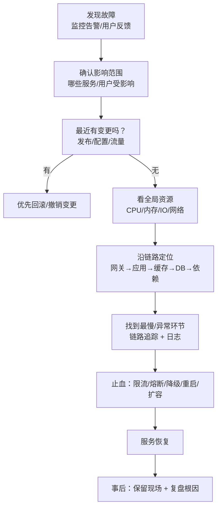

# 线上故障排查与复盘

> 定位：线上故障是高级工程师的试金石——能不能在压力下快速止血、定位根因、并让同类问题不再发生，直接区分了「会写代码」和「能扛事」。这篇给你一套排查方法论、五类常见故障的具体步骤，以及故障应急、复盘文化、混沌工程的完整框架。

## 一、为什么需要系统化的故障处理能力

同一次故障，不同人的处理可能天差地别。新手上来就重启、到处乱改配置，结果故障扩大了；高手先止血恢复服务，再从容查根因，最后推动改进让同类问题不再发生。

差距不在「知道多少命令」，而在**有没有一套方法论和流程**。故障处理有两个阶段，目标完全不同：

- **应急阶段**：目标是**恢复服务**（MTTR 最小化），手段可以粗暴（重启、回滚、切流量、限流降级），先止血再说。
- **复盘阶段**：目标是**找到根因并防止复发**，要冷静分析，产出改进项。

> 铁律：**先止血，后查因**。故障进行中不要在「到底为什么」上纠缠太久，恢复服务优先级最高。根因可以事后慢慢查，用户可等不了。

## 二、故障分类与排查方法论

### 2.1 故障分类

按不同维度给故障分类，有助于快速缩小排查范围：

| 维度 | 分类 | 例子 |
|---|---|---|
| 影响范围 | 全站 / 单服务 / 单用户 | 机房断电 vs 某用户数据异常 |
| 故障性质 | 突发 / 渐趋恶化 | 发布引入 BUG vs 内存缓慢泄漏 |
| 根因层次 | 硬件/网络/应用/数据/人为 | 磁盘坏道、代码 BUG、误删数据 |
| 触发因素 | 发布/配置变更/流量突增/依赖故障 | 上线后报错、大促被打挂 |

统计经验表明，**大部分线上故障由「变更」引起**（发布新代码、改配置、改数据库）。所以排查时第一个要问的问题是：**「最近有变更吗？」**

### 2.2 排查方法论：自上而下 + 分而治之



这张图是故障排查的标准流程。几个关键点：

- **先看影响范围和变更**：快速判断是大面积还是局部，是否和刚做的发布/配置变更相关。
- **自上而下分层排查**：从用户入口沿链路往下，逐层排除，不要一上来就扎进某一台机器。
- **止血优先**：流程里的 H 步骤才是故障中的目标，找到根因是事后（J 步骤）的事。

**三个利器**：

1. **监控大盘**：先看整体——QPS、错误率、RT、CPU、内存，判断「哪里不对」。
2. **链路追踪（Trace）**：一个请求从入口到各依赖的耗时和状态，快速定位「哪一跳慢/错」。
3. **日志**：详细信息，按 traceId 串联全链路日志，看「具体报什么错」。

## 三、常见故障场景排查步骤

这一节是硬功夫，给出五类高频故障的具体命令和步骤。

### 3.1 CPU 飙高

**现象**：应用 CPU 持续 90%+，接口 RT 飙升。

**排查步骤**：

1. 定位进程：`top` 找到高 CPU 的 Java 进程 PID。
2. 定位线程：`top -H -p <pid>` 找到高 CPU 的线程 ID（TID）。
3. 转换线程 ID：`printf "%x\n" <tid>` 转成 16 进制（jstack 里线程 ID 是十六进制）。
4. 抓线程栈：`jstack <pid> | grep -A 30 <16进制tid>`，看这个线程在干什么。
5. 连续抓三次：单次快照可能碰巧，连续三次都在同一栈上才是真凶。

**常见原因与对策**：

- **死循环 / 正则回溯** → 看栈里是否有业务方法在循环，修复代码。
- **频繁 GC** → `jstat -gcutil <pid> 1000` 看 GC 频率，配合堆 dump 查内存泄漏。
- **锁竞争 / 上下文切换** → 大量线程 BLOCKED，用 `jstack` 看WAITING 状态。
- **加密/序列化密集** → 栈在算法库，考虑缓存或优化。

> Arthas 更方便：`thread -n 3` 直接列出最忙的 3 个线程及其栈，不用手动换算。`dashboard` 看全局。

### 3.2 内存溢出（OOM）

**现象**：`OutOfMemoryError`，服务不可用。

**排查步骤**：

1. **看报错后缀**定位区域（见「JVM 内存区域」篇）：`Java heap space` 堆、`Metaspace` 元数据、`Direct buffer memory` 直接内存、`unable to create new native thread` 线程。
2. **保留现场**：务必配 `-XX:+HeapDumpOnOutOfMemoryError -XX:HeapDumpPath=/data/dump`，OOM 时自动 dump。
3. **分析 dump**：用 MAT / JProfiler / VisualVM 打开 heap dump，看 dominant tree（谁占内存最多）、leak suspect（泄漏嫌疑）。
4. 在线但不中断：`jmap -dump:format=b,file=heap.hprof <pid>`（会 STW，谨慎）；Arthas `heapdump`。

**常见原因**：内存泄漏（集合只加不删、ThreadLocal 未清理、缓存无上限）、大对象（一次性加载大量数据）、堆设太小、直接内存泄漏（Netty）。

> 预防大于治疗：加 `-XX:+HeapDumpOnOutOfMemoryError`、配置内存监控告警、容器内堆设为 limit 的 60%-75%。

### 3.3 线程死锁

**现象**：服务「卡死」，请求不响应，CPU 不高但线程都不工作。

**排查步骤**：

1. `jstack <pid>` 抓线程栈，或 Arthas `thread -b` 直接检测死锁线程。
2. 找 `Found one Java-level deadlock` 段落，看互相等待的两个（或多）线程各持有哪些锁、在等哪把锁。
3. 分析加锁顺序：死锁经典原因是两个线程以不同顺序获取两把锁。

**解决**：保证加锁顺序一致；减小锁粒度；用 `tryLock(timeout)` 避免无限等待；定时锁检测。

> jstack 输出里 `waiting to lock` 和 `locked` 是关键信息，顺着它就能画出等待环。

### 3.4 慢 SQL

**现象**：数据库 CPU 高，接口 RT 高，应用线程大量卡在数据库调用。

**排查步骤**：

1. **找慢 SQL**：开启慢查询日志（`slow_query_log`、`long_query_time`，如 1 秒），用 `mysqldumpslow` / `pt-query-digest` 分析。MySQL 8 可查 `performance_schema.events_statements_summary_by_digest`。
2. **Explain 分析**：看 type（是否 ALL 全表扫描）、key（是否用索引）、rows（扫描行数）、Extra（是否 Using filesort/temporary）。
3. **常见病因**：
   - 索引缺失或失效（函数、隐式转换、`like '%x'`、不当 `or`）。
   - 深分页 `limit 1000000,20`。
   - `SELECT *` 返回过多列。
   - 大事务、锁等待。
4. **看锁**：`show processlist` 看是否有大量 `Waiting for lock`；`innodb_trx` 看长事务。

**解决**：补索引、改 SQL、读写分离、分页优化、必要时限流保护数据库。

### 3.5 连接池耗尽

**现象**：应用报 `Could not get JDBC Connection`、`Timeout waiting for connection from pool`，接口大面积超时。

**排查步骤**：

1. 看连接池监控（HikariCP 的 `activeConnections`、`idleConnections`、`pendingThreads`），是否活跃数打满、等待线程堆积。
2. `jstack` 看大量线程是否卡在 `getConnection()`。
3. 找根因：
   - **连接泄漏**：拿到连接没关闭（代码里异常路径未 close，事务未释放）。
   - **慢 SQL**：连接被慢查询长期占用。
   - **池太小**：并发数 > 最大连接数。
   - **数据库侧**：连接数上限（`max_connections`）太低，或数据库本身慢导致连接归还慢。

**解决**：修复泄漏（用 try-with-resources、检查事务边界）；配置合理的池大小（`maximumPoolSize`，按 `并发数 / 实例数` 估）；设 `leakDetectionThreshold`（HikariCP 检测泄漏）；慢 SQL 治理；连接池前加限流。

> HikariCP 是 Spring Boot 2+ 默认连接池，性能优于 Druid 但也提供较少的监控界面。国内很多团队用 Druid（带监控页面）。

## 四、故障应急与止血

故障中的目标是 MTTR 最小化。止血手段按「快→慢」排序：

| 手段 | 适用场景 | 速度 |
|---|---|---|
| 限流 | 流量突增压垮系统 | 秒级 |
| 熔断降级 | 依赖故障拖垮系统 | 秒级（自动） |
| 切换流量 | 单机房/单实例故障 | 秒-分钟 |
| 回滚 | 发布引入的 BUG | 分钟 |
| 扩容 | 容量不足 | 分钟（有状态服务更慢） |
| 重启 | 内存泄漏、线程死锁等 | 分钟 |
| 修复代码 | 根本解决 | 小时 |

**止血的原则**：

- **能回滚先回滚**：如果是发布引起的，回滚是最快最可靠的止血。
- **保留现场**：重启/回滚前，有条件先 dump（jstack、heap dump）、保留日志——不然重启后现场没了，根因永远成谜。这是应急和查因的矛盾点，要权衡：优先恢复，但花 30 秒抓个 jstack 往往值得。
- **信息同步**：拉故障群，同步「谁在处理、当前状态、影响范围」，避免多人重复操作或相互干扰。
- **明确指挥**：一个人做决策（通常是值班 owner），其他人配合，避免多头指挥。

## 五、故障复盘文化

故障恢复不是终点，**复盘（Postmortem）才是让组织进步的关键**。

### 5.1 复盘的正确姿势

**无 blame 文化（Blameless Postmortem）**：复盘聚焦「系统和流程哪里有问题」，而不是「谁背锅」。因为人是会犯错的，好的系统应该让人犯错也不导致故障。**追责文化会让人隐藏问题，反而更不安全**。

**复盘要回答的问题**：

1. **故障时间线**：几点发生、几点发现、几点止血、几点恢复（精确到分钟）。
2. **影响**：影响多少用户、持续多久、损失多大。
3. **根因**：用「5 Whys」挖到根本原因，而不是停留在表象（「代码有 BUG」不是根因，「为什么没测出来」才接近根因）。
4. **做得好的 / 做得不好的**：哪些止血动作有效，哪些拖慢了恢复。
5. **改进项**：每个改进项要有 owner 和 deadline，否则就是空谈。

### 5.2 改进项的层次

| 层次 | 例子 | 效果 |
|---|---|---|
| 治标 | 重启、加机器 | 解决本次 |
| 治本 | 修 BUG、补索引、加超时 | 防同类问题 |
| 体系 | 加监控告警、加测试、改流程 | 防一类问题 |
| 文化 | 复盘制度、故障演练 | 系统性提升 |

好复盘要追求「体系」和「文化」层，而不是只「治标」。

## 六、故障演练与混沌工程

**最好的故障处理训练，就是在受控环境里主动制造故障。**

### 6.1 混沌工程（Chaos Engineering）

混沌工程的核心思想：**在生产环境（或近生产）里，有控制地注入故障，验证系统的容错能力，提前发现问题**。Netflix 的 Chaos Monkey 是开创者——随机关闭生产实例，逼迫团队把系统做成容错的。

**常见故障注入**：

- 杀实例 / 停容器
- 网络延迟、丢包、断网
- CPU/内存打满
- 依赖服务不可用
- 磁盘写满 / IO 变慢
- 时钟漂移

**混沌工程四原则**：

1. 建立稳态假设（系统正常时的指标基线）。
2. 注入真实故障。
3. 在受控范围（可快速停止、影响可控）内进行。
4. 验证稳态假设是否被打破，打破即发现弱点。

> 混沌工程不是「搞破坏」，而是**用实验替代事故**——把可能在凌晨 3 点发生的故障，提前在工作时间暴露出来。

### 6.2 预案与演练

除了混沌工程，还要有**应急预案**：

- **预案库**：每种故障场景的标准处理步骤（数据库主从切换、缓存宕机、机房断电……），让值班同学照着做就能止血。
- **定期演练**：切换演练、容灾演练、回滚演练。演练要像真的一样，记录时间，发现脚本问题。
- **Runbook**：可执行的运维手册，带具体命令和检查项。

> 很多系统的容灾方案「纸面很美」，从没演练过，真出事时完全不可用。**方案的生命力在于演练**。

## 七、生产坑点与排查

### 坑点 1：重启前不保留现场

**现象**：故障恢复后想查根因，发现 jstack、堆 dump 都没抓，日志也被滚动覆盖了，永远不知道为什么。
**原因**：应急时只想着恢复，忘了保留证据。
**解法**：重启/回滚前花几十秒抓现场——`jstack <pid> > stack.log`（连续 3 次，间隔 5 秒）、`jmap -dump`（如果 OOM 已自动 dump 就不用）、`top -H`、保存关键日志段。养成「先抓现场再重启」的肌肉记忆。

### 坑点 2：多人同时操作导致故障扩大

**现象**：故障时多人同时登录机器，有人重启、有人改配置、有人扩容，相互干扰，故障反而更严重。
**原因**：没有明确的指挥和分工。
**解法**：指定唯一的故障指挥官（IC），其他人分工（查日志、查监控、对外沟通），所有操作在群里同步，未经指挥官同意不擅自改动。

### 坑点 3：复盘变成甩锅大会

**现象**：复盘会上互相追责，「是谁改的配置」「谁审批的」，最后变成检讨会，大家不敢说真话。
**原因**：没有建立无 blame 文化。
**解法**：明确复盘目的是改进而非追责；聚焦系统和流程；山根因用 5 Whys；每个改进项有 owner 和 deadline 并跟踪落地。领导带头不追责。

### 坑点 4：告警太多太敏感，真正的故障被淹没

**现象**：告警群每天几百条告警，大家已经麻木，真正严重的故障告警反而没人看。
**原因**：告警阈值设得太低、没有分级、没有收敛。
**解法**：告警分级（P0 电话、P1 短信、P2 群消息）；只告警「需要人行动」的异常；告警收敛（同类型合并）；定期清理无效告警；建立告警响应 SLA。

## 八、面试高频问法

> 这一节的答案按「面试时能讲透」的标准写：先给一句话结论，再展开机制、原因和坑点。

**Q1：线上故障排查的方法论是什么？**

**一句话结论**：先止血再定位——先恢复服务，再找根因，最后复盘防复发。

展开：

1. **止血**：回滚、降级、扩容、切流量，先让服务恢复。
2. **保留现场**：dump、日志、监控快照。
3. **定位**：分层排查（机器→应用→依赖）。
4. **复盘**：根因、改进、防止再发。

加分点：说"故障时最忌讳'一边救火一边找根因'——用户还在等，先止血；根因可以事后查，但服务不能一直挂着"。

**Q2：CPU 飙高怎么排查？**

**一句话结论**：`top -H -p pid` 找高 CPU 线程 → 转十六进制 → `jstack` 找线程栈 → 定位代码。

展开：

```bash
top -H -p <pid>                    # 找高 CPU 的线程 TID
printf '%x\n' <TID>                # 转十六进制
jstack <pid> | grep -A 20 <hex>    # 找线程栈
```

**常见原因**：死循环、频繁 GC、正则回溯、大量计算。

加分点：说"CPU 高先看是'业务线程'还是'GC 线程'——GC 线程高说明内存问题，业务线程高说明代码问题，方向完全不同"。

**Q3：内存溢出（OOM）怎么排查？**

**一句话结论**：先拿 dump（`jmap` 或 OOM 自动 dump），用 MAT 分析大对象和引用链，找内存泄漏点。

展开：

- **拿 dump**：`jmap -dump:format=b,file=heap.hprof <pid>`，或 `-XX:+HeapDumpOnOutOfMemoryError`。
- **分析**：MAT 看"最大的对象""泄漏嫌疑"（Leak Suspects）。
- **常见原因**：集合无限增长、缓存没设上限、大对象、ThreadLocal 没清理。

加分点：说"OOM 分几种——堆 OOM、Metaspace OOM、直接内存 OOM、线程栈 OOM，报错信息不同，排查方向完全不同；先看报错后缀"。

**Q4：线程死锁怎么排查？**

**一句话结论**：`jstack` 会自动检测死锁并打印，看"Found one Java-level deadlock"部分。

展开：

```bash
jstack <pid> | grep -A 30 "deadlock"
```

- **死锁原因**：多个线程以不同顺序获取多把锁。
- **解法**：统一加锁顺序、用 `tryLock` 超时。

加分点：说"死锁排查很直接——jstack 会明确告诉你'哪个线程持有什么锁、在等什么锁'；难的是'怎么从设计上避免'，靠统一加锁顺序"。

**Q5：接口 RT 突然飙升但没报错，怎么排查？**

**一句话结论**：看是"计算慢""等待慢"还是"排队慢"——用链路追踪/Arthas 定位。

展开：

- **计算慢**：CPU 高，看火焰图。
- **等待慢**：等数据库/下游/锁，看链路追踪的 Span。
- **排队慢**：线程池/连接池满，看等待队列。
- **GC**：频繁 Full GC 导致 STW。

加分点：说"'没报错但慢'最容易被误判为'没问题'——其实可能是线程池满、连接池满、GC 停顿，这些都不报错但会让 RT 飙升"。

**Q6：数据库连接池耗尽怎么排查？**

**一句话结论**：看连接池监控（活跃/等待数）、线程 dump（大量线程卡在 getConnection）、慢 SQL。

展开：

- **现象**：请求变慢、获取连接超时。
- **原因**：慢 SQL 占着连接不放、连接泄漏（借了不还）、连接数配置太小。
- **排查**：`show processlist` 看数据库连接、应用连接池监控、慢查询日志。

加分点：说"连接池耗尽是'雪崩的前兆'——一个慢 SQL 占住连接，其他请求排队，很快整个池子耗尽，所有请求都卡住"。

**Q7：MQ 消息堆积怎么应急？**

**一句话结论**：先扩容消费者（注意分区限制），再优化消费逻辑，最后限流生产端。

展开：

- **扩容**：加消费者实例（Kafka 受分区数限制）。
- **提并发**：增加消费线程、批量消费。
- **跳过**：临时跳过非核心消息。
- **限流**：生产端限流，减少堆积。

加分点：说"消息堆积要先判断'是消费慢还是生产快'——消费慢就优化消费，生产突增就限流生产；盲目扩容可能没用（比如分区数不够）"。

**Q8：故障复盘应该怎么做？**

**一句话结论**：复盘不是"追责"，是"找根因、定改进"——5 Why 分析，产出可执行的改进项。

展开：

- **时间线**：什么时候发生、什么时候发现、什么时候恢复。
- **根因**：用 5 Why 层层追问。
- **改进**：技术改进（加监控、加限制）、流程改进（发布卡点）。
- **跟进**：改进项要有负责人和截止时间。

加分点：说"好的复盘是'对事不对人'——追责会让团队隐瞒问题，反而更危险；目标是'同样的故障不再发生'"。

**Q9：怎么做故障演练？**

**一句话结论**：主动注入故障（杀实例、断网、延迟），验证系统的高可用和预案是否真的生效。

展开：

- **工具**：ChaosBlade、Chaos Monkey。
- **场景**：杀进程、网络延迟、磁盘满、依赖超时。
- **原则**：从测试环境开始，逐步到生产（低峰期、有兜底）。

加分点：说"故障演练是'高可用的验收'——设计了高可用不代表真的高可用，必须演练验证'杀一个实例，流量能不能自动切走'"。

**Q10：怎么建立故障应急体系？**

**一句话结论**：监控告警（早发现）+ 预案（知道怎么办）+ 值班（有人响应）+ 演练（练过）+ 复盘（改进）。

展开：

| 环节 | 关键 |
|---|---|
| 监控 | 全链路指标、告警 |
| 预案 | 常见故障的处理手册 |
| 值班 | on-call、升级机制 |
| 演练 | 定期故障演练 |
| 复盘 | 根因 + 改进 |

加分点：说"故障应急的核心是'把决策提前'——出事时人在紧张状态下容易犯错，所以要'预案化'：什么情况做什么，提前写好，出事照做"。

## 小结

- 先止血后查因：应急阶段目标是 MTTR 最小化（回滚/限流/熔断/切换），根因留到复盘。
- 排查方法论：看影响范围→查变更→自上而下分层→链路追踪+日志定位→止血→复盘。
- 五类高频故障：CPU 高（top→线程→jstack）、OOM（后缀定位→dump→MAT）、死锁（jstack 等待环）、慢 SQL（慢日志→Explain）、连接池耗尽（监控→泄漏→池大小）。
- 复盘要无 blame、用 5 Whys 挖根因、改进项带 owner 和 deadline，追求体系和文化层改进。
- 混沌工程用受控故障实验替代真实事故，预案+演练让容灾方案真正有效。
