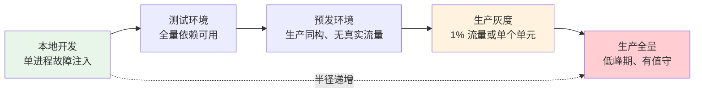
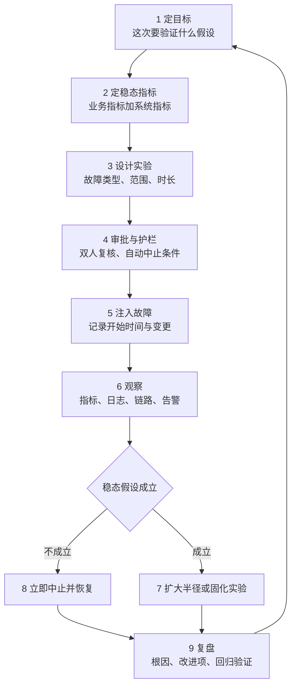
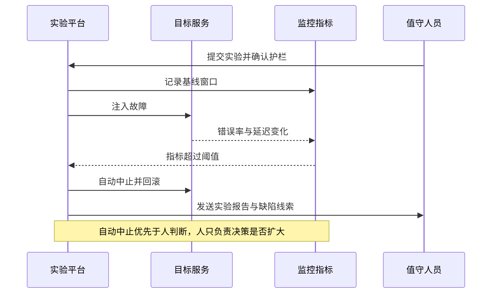

# 混沌工程与故障演练

> 定位：监控全绿、压测达标，不代表系统扛得住故障——因为压测只回答「能扛多少流量」，回答不了「依赖挂了会怎样」。这篇讲清混沌工程的五条原则、稳态假设怎么定、爆炸半径怎么控，给出 Chaos Mesh 的可执行实验模板和 Java 应用最容易被打穿的四处弱点（线程池、连接池、超时、重试风暴），以及一套从「脚本演练」到「生产常态化」的成熟度路径。

## 一、为什么需要它

先看几个问题，能立刻答上来的团队不多：

- Redis 集群整体不可用 30 秒，你的下单接口会发生什么？是快速失败，还是线程全部卡在等连接？
- 订单服务只部署了 3 个 Pod，同时杀掉 2 个，剩下的 1 个能不能扛住剩余流量？
- 下游支付接口的超时是 3 秒，你自己对上游的超时是 5 秒，中间那 2 秒会发生什么？

这三个问题都不是「容量」问题，而是「故障行为」问题。压测（见 [容量规划与压测](04-容量规划与压测.md)）、限流降级（见 [限流降级熔断隔离](03-限流降级熔断隔离.md)）分别解决「能扛多少」「别被打死」「别被拖死」，但它们都建立在「我知道故障长什么样」的前提上——而这个前提，绝大多数团队从未验证过。

混沌工程（Chaos Engineering）就是把这个前提变成实验：**主动注入故障，用可观测数据检验系统是否维持稳态**。它有三个常见误解，先澄清：

1. **不是「搞破坏」**：破坏没有假设、没有观测、没有止损，混沌工程三者缺一不可。
2. **不是「压测」**：压测注入的是流量，混沌注入的是故障。
3. **不是「一次性项目」**：一次演练发现几个问题就收工，等于体检只做一次。

## 二、核心原理

### 2.1 五条原则

业界公认的混沌工程原则（Principles of Chaos Engineering）可以压缩成五条：

| 原则 | 含义 | 落地要求 |
|---|---|---|
| 建立稳态假设 | 先定义「系统正常」的可度量状态 | 有明确的业务与系统指标基线 |
| 模拟真实事件 | 注入现实中会发生的事件 | 故障库来自真实事故与依赖拓扑 |
| 在生产中实验 | 越接近真实环境，结论越可信 | 先预发、再灰度、最后生产 |
| 持续自动化 | 实验要反复跑，而不是一次性 | 接入流水线或定时任务 |
| 最小化爆炸半径 | 把影响面控制在可接受范围 | 按比例、按标签、可一键中止 |

第三、五两条看起来矛盾——既要生产实验，又要控制影响。实际做法是**在生产上做小半径实验**：只影响 1% 的流量、只影响一个单元、只持续几分钟，配合自动中止条件，让风险可控而结论真实。

### 2.2 稳态假设怎么定

稳态假设不是一句「系统正常」，而是一个**可验证的命题**：

> 注入 Redis 200ms 延迟持续 5 分钟，订单创建接口成功率不低于 99%，P99 延迟增幅不超过 300ms，且不触发任何人工介入。

好的稳态指标具备三个特征：

- **业务在前**：下单成功率、支付成功率、消息积压量，这些直接对应钱和用户体验。
- **系统在后**：P99、错误率、线程池活跃数、连接池等待数，用来解释业务指标为什么变化。
- **资源不作为稳态**：CPU 使用率、内存占用是**原因**不是**结果**。用「CPU < 80%」当稳态，注入故障后 CPU 没涨，你会误判「系统没事」，其实业务已经挂了一半。

基线必须来自**未注入时的真实观测**，最好取同时段、同流量的历史数据，而不是拍脑袋写一个数字。

### 2.3 爆炸半径：从哪开始，怎么收住



读图要点：成熟团队不是「只在生产做」，而是**同一种故障在每一层都跑**——本地验证注入工具本身对不对，预发验证系统行为，生产验证真实依赖与流量。直接跳到生产，往往连「实验有没有生效」都判断不了。

控制半径的五个手段，缺一不可：

1. **范围**：按 namespace、标签、Pod 比例、单元筛选，默认最小集合。
2. **时间**：显式设置 `duration`，绝不允许「忘了停」。
3. **熔断**：预设自动中止条件（错误率、P99、核心业务指标），触发即停止实验。
4. **审批**：生产实验双人复核，业务高峰禁用。
5. **隔离**：优先选择无状态、可快速重建的工作负载；有状态服务先做备份与只读验证。

### 2.4 故障注入类型

| 类型 | 具体手段 | 验证什么 | 典型工具 |
|---|---|---|---|
| 延迟 | 网络延迟、jitter、JVM 方法延迟 | 超时设置、线程池堆积 | Chaos Mesh NetworkChaos / JVMChaos |
| 异常 | HTTP 5xx、gRPC 错误码、抛异常 | 降级、重试、幂等 | HTTPChaos / ChaosBlade |
| 资源 | CPU 打满、内存占用、磁盘 IO 延迟 | 资源争抢、GC、限流 | StressChaos / IOChaos |
| 网络 | 丢包、重复、乱序、分区 | 脑裂、重连、超时 | NetworkChaos |
| 依赖 | 数据库只读、MQ 不可用、DNS 错误 | 降级链路、缓存兜底 | DNSChaos / 依赖侧注入 |
| 实例 | Pod kill、容器 kill、进程 kill | 副本冗余、优雅下线 | PodChaos |
| 时间 | 时钟偏移 | 缓存过期、令牌、日志顺序 | TimeChaos |

选择顺序建议：**先做「实例故障」和「网络延迟」**——这两类最容易注入、最容易观测，也最能暴露超时与重试问题；再做「依赖故障」，最后做「组合故障」。

### 2.5 与压测、故障演练、红蓝对抗的区别

| 维度 | 压测 | 故障演练 | 混沌工程 | 红蓝对抗 |
|---|---|---|---|---|
| 注入什么 | 流量 | 预设故障 | 故障 + 假设 + 观测 | 攻击行为 |
| 主要目的 | 找容量拐点 | 验证预案可用 | 发现系统未知弱点 | 检验防御与响应 |
| 判定标准 | RT/QPS/错误率 | 预案步骤是否走通 | 稳态假设是否成立 | 攻防结果 |
| 组织形态 | 性能团队 | 运维主导 | 研发 + SRE 共建 | 安全团队 |
| 产出 | 容量结论 | 演练报告 | 缺陷清单 + 自动化实验 | 风险与整改项 |

## 三、关键机制

### 3.1 工具对比

| 工具 | 形态 | 优势 | 局限 |
|---|---|---|---|
| Chaos Mesh | K8s 原生，CRD 驱动 | 类型全、Workflow 编排、社区活跃 | 只面向 K8s，需要 privileged DaemonSet |
| ChaosBlade | 阿里开源，CLI + Operator | 场景库丰富、支持 JVM 与主机层 | 界面与编排能力弱于 Chaos Mesh |
| LitmusChaos | CNCF 项目，ChaosEngine | 与 GitOps/Argo 集成好 | 实验库质量参差 |
| Gremlin | 商业 SaaS | 开箱即用、护栏完善 | 成本高、数据出网顾虑 |
| 云厂商故障注入 | 云服务（如 AWS FIS） | 与云资源深度集成 | 锁定云平台 |

Java 团队选型建议：K8s 环境优先 Chaos Mesh（CRD 可版本化、可进 Git），需要 JVM 方法级注入时补 ChaosBlade。

### 3.2 演练流程



读图要点：注意 `8 立即中止` 是流程的一部分而不是例外——**实验失败是正常产出**，它说明系统有真实弱点；真正危险的是没有中止能力，让一次实验变成一次事故。

### 3.3 Chaos Mesh 实验模板

延迟注入，验证超时与线程池行为：

```yaml
apiVersion: chaos-mesh.org/v1alpha1
kind: NetworkChaos
metadata:
  name: redis-delay
  namespace: chaos-testing
spec:
  action: delay
  mode: one                       # 只影响一个 Pod，控制爆炸半径
  selector:
    namespaces: ["order"]
    labelSelectors:
      app: order-service
  delay:
    latency: "200ms"
    jitter: "50ms"
    correlation: "50"
  direction: to
  target:
    mode: all
    selector:
      namespaces: ["infra"]
      labelSelectors:
        app: redis
  duration: "5m"
  scheduler:
    cron: "@every 24h"            # 定时重复，形成持续验证
```

实例故障，验证副本冗余与优雅下线：

```yaml
apiVersion: chaos-mesh.org/v1alpha1
kind: PodChaos
metadata:
  name: order-pod-kill
  namespace: chaos-testing
spec:
  action: pod-kill
  mode: one
  selector:
    namespaces: ["order"]
    labelSelectors:
      app: order-service
  gracePeriod: 0                  # 0 表示直接杀，模拟节点掉电
  duration: "1m"
```

### 3.4 一次实验的时间线



读图要点：中止必须由**平台根据指标自动触发**，而不是靠人盯着看。人盯屏的响应时间通常是分钟级，而线程池被打满只需要几秒。

### 3.5 Java 应用最容易被打穿的四处

| 弱点 | 故障下的表现 | 根因 |
|---|---|---|
| 线程池 | 任务排队、RT 飙升、拒绝策略触发 | 队列无界、核心线程过大、无隔离 |
| 连接池 | 获取连接超时、请求堆积 | 池大小与下游承载不匹配、泄漏 |
| 超时 | 请求永远不返回、线程不释放 | 未设超时，或超时链不递减 |
| 重试 | 下游被打垮、故障放大 | 无退避、无抖动、多处叠加重试 |

超时与重试必须成对设计，且遵守两条规则：**下游超时 < 上游超时**，**重试次数 × 实例数不能超过下游承载**。

```yaml
resilience4j:
  retry:
    instances:
      inventory:
        maxAttempts: 3
        waitDuration: 200ms
        enableExponentialBackoff: true
        exponentialBackoffMultiplier: 2
        enableRandomizedWait: true       # 抖动，避免重试风暴同步
  circuitbreaker:
    instances:
      inventory:
        slidingWindowType: COUNT_BASED
        slidingWindowSize: 50
        failureRateThreshold: 50
        waitDurationInOpenState: 10s
        permittedNumberOfCallsInHalfOpenState: 5
  timelimiter:
    instances:
      inventory:
        timeoutDuration: 800ms           # 必须小于调用方超时
        cancelRunningFuture: true
```

```java
@Service
public class InventoryClient {

    private final CircuitBreaker circuitBreaker;

    public InventoryClient(CircuitBreakerRegistry registry) {
        this.circuitBreaker = registry.circuitBreaker("inventory");
    }

    public Stock query(String sku) {
        Supplier<Stock> call = () -> remote.query(sku);
        Supplier<Stock> guarded = CircuitBreaker.decorateSupplier(circuitBreaker, call);
        try {
            return guarded.get();
        } catch (CallNotPermittedException e) {
            return Stock.unknown(sku);       // 熔断打开时走降级，不把线程挂住
        }
    }
}
```

## 四、生产坑点与排查

### 坑点 1：稳态指标选成资源指标，故障被误判为「没影响」

**现象**：注入 Redis 延迟后 CPU、内存都正常，实验判定通过；一周后真实故障，接口大面积超时。
**原因**：稳态只看资源利用率，而延迟类故障首先表现为线程阻塞和 RT 上升，CPU 反而可能下降。
**解法**：稳态必须以业务成功率 + P99 + 池化指标（活跃线程、等待连接数）为主；资源指标只用于解释原因，不用于判定结果。

### 坑点 2：爆炸半径失控，选错标签打了全量

**现象**：本想只打一个测试 Pod，结果整个 namespace 的服务全部受影响。
**原因**：`labelSelectors` 写错、`mode` 用了 `all`、或者选中的工作负载被多个 Service 共享。
**解法**：实验前先 `kubectl get pods -l ...` 确认选中集合与数量；默认 `mode: one`；生产实验优先按「单元 + 比例」选择；在平台层强制显示「本次将影响 N 个 Pod」。

### 坑点 3：只注入单点故障，不注入组合故障

**现象**：单杀 Pod、单加延迟都通过，真实故障时却雪崩。
**原因**：真实故障往往是组合的——机房网络抖动的同时某个依赖重启，重试又把剩余节点打满。
**解法**：用 Chaos Mesh Workflow 编排串行/并行实验（如「延迟 + 一个副本下线」）；优先复刻历史真实事故序列，而不是只做教科书式单点。

### 坑点 4：没有自动中止，靠人盯屏

**现象**：实验开始 3 分钟后才有人发现错误率飙升，此时线程池已满、请求已堆积。
**原因**：缺少指标驱动的自动停止条件，或者停止条件阈值设得过高。
**解法**：以「核心接口错误率」「P99」「线程池排队数」为中止条件，触发即删除 Chaos 对象；演练前验证中止链路本身可用（故意触发一次）。

### 坑点 5：演练环境与生产差异过大，结论不可迁移

**现象**：预发演练完美通过，生产同样的故障直接挂。
**原因**：数据量、依赖版本、实例数、流量模型都不同；预发的「3 个 Pod」在生产是「30 个 Pod 共享一个数据库」。
**解法**：预发尽量与生产同构；关键结论必须在生产灰度验证；把「环境差异」写进实验报告的置信度说明。

### 坑点 6：演练发现的问题没有闭环

**现象**：演练报告写了 12 个问题，三个月后回溯，修了 2 个，其余无人认领。
**原因**：演练被当成「表演」，没有把缺陷转成带负责人和截止时间的工单。
**解法**：每个缺陷必须落到需求池并标注优先级；把「上次演练缺陷修复率」作为下一次演练的准入条件；高风险缺陷未修复前，禁止扩大实验半径（复盘方法见 [线上故障排查与复盘](05-线上故障排查与复盘.md)）。

## 五、成熟度模型与适用边界

| 等级 | 特征 | 组织形态 | 典型产出 |
|---|---|---|---|
| L0 无演练 | 只有预案文档，从未执行 | 无 | 事故时现查文档 |
| L1 手工脚本 | 在测试环境手工注入单点故障 | 运维主导 | 一次性报告 |
| L2 平台化 | 实验模板化、可在预发重复执行 | SRE + 研发 | 缺陷清单、回归用例 |
| L3 生产常态化 | 灰度生产实验、自动中止、定期演练日 | 专职稳定性团队 | 季度演练计划、SLO 改进 |
| L4 混沌即代码 | 实验进 Git、CI/CD 门禁、持续验证 | 平台化自治 | 自动化韧性基线 |

落地路径建议：**L1 先覆盖「实例故障 + 依赖超时」两类**，因为投入最小、暴露问题最多；L2 把实验模板化并接入监控；L3 再引入生产灰度与自动中止；不要一上来就追求 L4，工具再先进也替代不了「有人为结果负责」。

**不该做混沌的场景**，同样要说清楚：

- **没有可观测性**：连基线指标都没有，注入后无法判断影响，只会制造事故。
- **没有止损能力**：不能一键删除实验、不能快速回滚、不能扩容，就不要在生产做。
- **核心交易系统且未做隔离**：先做单元化/隔离，再谈生产实验。
- **团队没有值守**：夜间无人响应时跑生产实验，是把风险留给运气。

## 六、面试高频问法

**Q1：什么是混沌工程？它和压测有什么区别？**

**一句话结论**：混沌工程是「主动注入故障 + 验证稳态假设」的实验方法，回答「坏了会怎样」；压测注入的是流量，回答「能扛多少」。两者常配合：在高负载下注入故障，才接近真实故障场景。

展开：

| 维度 | 压测 | 混沌工程 |
|---|---|---|
| 输入 | 流量 | 故障 |
| 问题 | 容量上限在哪 | 故障时是否维持稳态 |
| 判定 | RT、QPS、错误率拐点 | 稳态假设是否成立 |
| 产出 | 容量结论 | 弱点清单与韧性改进 |

加分点：补一句「压测把系统推到临界点，混沌在临界点上再踹一脚——很多问题只在两者叠加时出现」。

**Q2：混沌工程的五条原则是什么？**

**一句话结论**：建立稳态假设、模拟真实事件、在生产中实验、持续自动化、最小化爆炸半径。

展开：

- **稳态假设**：先用指标定义「正常」，否则实验没有判定标准。
- **真实事件**：故障库来自真实事故与依赖拓扑，不是凭空想象。
- **生产实验**：环境差异会让预发结论失真，最终要在生产灰度验证。
- **持续自动化**：一次实验只能证明「当时没问题」，系统在变，实验要重复跑。
- **最小半径**：按比例、按标签、限时、可中止。

加分点：指出「生产实验和最小半径不矛盾——生产上做小半径实验，才能拿到真实结论又不出事故」，这是最容易被追问的点。

**Q3：稳态假设怎么定？为什么不能用 CPU 使用率？**

**一句话结论**：稳态假设是可验证的业务 + 系统指标命题；CPU 是故障的原因不是结果，用它判定会漏掉「CPU 没涨但业务已挂」的延迟类故障。

展开：

- **业务指标**：下单成功率、支付成功率、消息积压量。
- **系统指标**：P99、错误率、线程池活跃数、连接池等待数。
- **基线**：取同时段、同流量的历史数据，而不是拍脑袋。
- **反例**：Redis 延迟导致线程阻塞，CPU 可能下降，资源指标完全「正常」。

加分点：说「稳态要能回答『用户还能不能下单』，而不是『机器累不累』」——一句话把业务视角讲清楚。

**Q4：爆炸半径怎么控制？**

**一句话结论**：五个手段——范围最小化、时间显式化、指标自动中止、生产双人审批、优先无状态工作负载。

展开：

- **范围**：默认 `mode: one`，按 namespace/标签/比例筛选，实验前确认选中集合。
- **时间**：必须设置 `duration`，禁止无期限实验。
- **中止**：错误率、P99、池化指标触发即删除 Chaos 对象。
- **审批**：生产实验双人复核，业务高峰禁用。
- **隔离**：有状态服务先备份，优先只读验证。

加分点：说「自动中止要比人快——线程池打满只要几秒，人盯屏是分钟级」，体现对故障速度的理解。

**Q5：在生产环境做混沌工程，怎么说服老板？**

**一句话结论**：把它包装成「可控的、小半径的、有自动止损的验证」，用历史事故的成本对比实验成本，并先在灰度环境建立信任。

展开：

- **风险可控**：1% 流量、单 Pod、5 分钟、自动中止，影响面可量化。
- **收益明确**：一次真实故障的损失远大于一次演练投入；未验证的预案等于没有。
- **渐进路径**：预发 → 生产灰度 → 扩大，每一步都有数据支撑。
- **组织保障**：值守、审批、回滚预案齐全，先做「游戏日」而非突然袭击。

加分点：补一句「最危险的不是做实验，而是以为自己高可用」——把「不做」的风险摆到台面上。

**Q6：Chaos Mesh 的原理是什么？**

**一句话结论**：它把故障定义成 CRD（NetworkChaos、PodChaos、StressChaos 等），由 chaos-controller-manager 监听并下发，节点上的 chaos-daemon 通过特权容器执行具体的网络、进程、cgroup 操作。

展开：

- **控制面**：CRD + controller，声明式描述「对谁、做什么、多久」。
- **数据面**：chaos-daemon DaemonSet，负责 tc、iptables、kill、cgroup 等底层操作。
- **编排**：Workflow 支持串行/并行/暂停，Schedule 支持 cron 定时。
- **优势**：实验即 YAML，可进 Git、可审计、可复现。

加分点：说出「CRD 化带来的最大好处是实验可版本化」，这正好接上 GitOps 的话题。

**Q7：重试风暴怎么演练和治理？**

**一句话结论**：演练时注入下游延迟/错误并观察放大倍数；治理靠「指数退避 + 抖动 + 重试预算 + 熔断 + 幂等」，且全链路只允许一层重试。

展开：

- **演练**：让下游错误率升到 30%，观察总请求量是否翻数倍、下游是否被彻底打垮。
- **退避与抖动**：避免所有客户端同一时刻重试。
- **重试预算**：重试请求不超过总请求的一定比例，超出即放弃。
- **单层重试**：网关、RPC、业务代码同时重试，等于把放大倍数相乘。
- **幂等**：重试必须安全，否则会产生重复扣款、重复下单。

加分点：说「重试是放大器不是修复手段——它假设故障是瞬时的，而大多数故障不是」，这个认知比背参数重要。

**Q8：一次完整的故障演练怎么做？**

**一句话结论**：定目标 → 定稳态指标 → 设计实验 → 审批与护栏 → 注入 → 观察 → 自动/手动中止 → 复盘 → 缺陷闭环，形成可重复的循环。

展开：

- **目标**：验证一个具体假设，不是「随便打一下看看」。
- **护栏**：自动中止条件、值班人、回滚路径。
- **观察**：指标、日志、链路、告警四路一起看，确认实验真的生效。
- **复盘**：区分「系统弱点」与「演练流程问题」，前者进需求池，后者改脚本。
- **回归**：修复后再跑同一实验，确认假设成立。

加分点：强调「实验没生效比实验失败更可怕」——先验证故障真的注入了（看延迟、看错误日志），再谈结论。

## 小结

- 压测回答「能扛多少」，混沌回答「坏了会怎样」；在高负载下注入故障才接近真实场景。
- 五原则的核心是「稳态假设 + 最小半径」：没有判定标准是瞎测，没有半径控制是事故。
- 稳态指标业务在前、资源在后；CPU 是原因不是结果。
- Java 应用最先被打穿的是线程池、连接池、超时和重试，超时链要递减、重试要单层且有预算。
- 自动中止必须由平台根据指标触发，人只负责决策是否扩大半径。
- 演练的价值在缺陷闭环，不在报告页数；同一实验修复后要回归。
