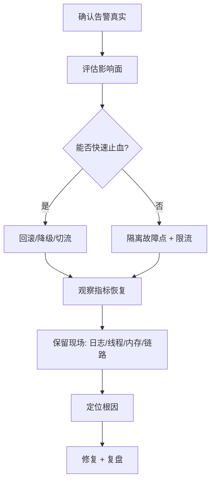

# 现场运维技术：值班、变更、发布与应急处置

> 定位：架构设计得再好，最后都要落到「凌晨两点被告警叫醒时，你能不能 10 分钟内止血」。这篇讲现场：值班与告警分级、变更与发布回滚、事故指挥与沟通、常用排查命令、备份恢复与容量水位，核心目标是**把救火变成可重复的流程**。

## 一、为什么架构师要懂现场

三个现实：

1. **架构假设在现场被证伪**：以为「主从切换 30 秒」，实际 DNS 缓存让切流花了 5 分钟。
2. **变更才是故障主因**：大量事故源于发布、配置、证书、DDL，而不是代码逻辑本身。
3. **设计决定可运维性**：没有健康检查、没有幂等、没有回滚开关的系统，现场只能干瞪眼。

架构师不一定要亲自值班，但必须能回答：这个系统怎么发布、怎么回滚、怎么观测、故障时先动哪里。

## 二、值班与告警：先把「谁会醒」设计好

### 2.1 告警分级

| 级别 | 定义 | 响应 | 通知方式 |
|---|---|---|---|
| P0 | 核心链路不可用/资损/数据泄露 | 立即，全员 | 电话 + 群 + 大屏 |
| P1 | 核心功能降级、错误率超阈值 | 15 分钟内 | 电话 + 群 |
| P2 | 非核心功能异常、容量预警 | 1 小时内 | 群 |
| P3 | 趋势性问题、单实例异常 | 工作时间 | 工单 |

告警设计三条底线：

- **可行动**：每条告警都要有「先做什么」，否则就是噪音；
- **不重复**：同一根因只发一条，其余聚合；
- **有阈值依据**：基于 SLO/历史分位，不拍脑袋。

### 2.2 值班表与升级路径

| 要素 | 做法 |
|---|---|
| 轮值 | 一周一换，主备双人，节假日加人 |
| 交接 | 交接触发条件未闭环的告警、在途变更、已知风险 |
| 升级 | 15 分钟未止血 → 二线；30 分钟 → 架构师/负责人；1 小时 → 事故指挥 |
| 补偿 | 夜班调休、值班津贴，别靠奉献 |

**反模式**：告警只发群、不打电话；值班人不敢升级；没有交接，上一班的坑下一班踩。

### 2.3 告警降噪：症状告警和根因告警要分开

现场最常见的告警风暴，是把「症状」和「根因」混在一起发。例如数据库主从延迟，会同时触发「订单错误率高」「接口 P99 高」「连接池满」「从库延迟」四条告警，值班人看到四条，却不知道先动哪条。

治理方法是分层：

| 层 | 例子 | 处理 |
|---|---|---|
| 根因告警 | DB 主从延迟 > 30s、Redis 主节点不可用 | 电话，直接对应 Runbook |
| 症状告警 | 订单错误率 > 1%、P99 > 1s | 聚合到根因告警下，不单独叫醒 |
| 趋势告警 | 磁盘 7 天增长 > 20%、连接池水位持续 > 80% | 工单，工作时间处理 |
| 噪音 | 单实例抖动、瞬时超时 | 降级为看板，不通知 |

每条根因告警都应该绑定一条 Runbook 和一位 owner。没有 owner 的告警，最后一定变成「大家都看到了，但没人动」。

## 三、变更管理：故障的最大来源

### 3.1 变更分类

| 类型 | 例子 | 审批 | 窗口 |
|---|---|---|---|
| 标准变更 | 常规发布、扩缩容 | 预授权，自动执行 | 任意（有灰度） |
| 常规变更 | 架构调整、DB 变更 | 评审 + 排期 | 低峰期 |
| 紧急变更 | 修 P0、回滚 | 事后补审 | 立即 |

### 3.2 变更前的五个问题

1. **影响面**：哪些服务、哪些用户、是否跨团队？
2. **可回滚**：回滚步骤、耗时、数据是否可逆？
3. **观测**：怎么判断成功/失败？看哪几个指标？
4. **窗口**：是否撞大促、财报、节假日、其他团队发布？
5. **止损线**：错误率/延迟到多少必须回滚？

### 3.3 数据库变更：expand-contract

数据库变更最怕「代码回滚了，DDL 回不去」。标准做法分三步：

| 阶段 | 动作 | 目的 |
|---|---|---|
| Expand | 加新列/新表，双写，旧代码仍可运行 | 向前兼容 |
| Migrate | 回填历史数据，校验一致 | 数据迁移 |
| Contract | 切读新列，观察稳定后删旧列 | 清理 |

配套规则：

- **不做破坏性变更**：不加 `NOT NULL` 无默认值、不改列类型、不重命名；
- **大表 DDL 用在线工具**（pt-osc/gh-ost），避开业务高峰；
- **迁移脚本可重入**，失败能续跑；
- **回滚预案**：代码回滚后，新列仍可保留（Expand 阶段不回滚 DDL）。

### 3.4 变更窗口与 freeze

不是所有变更都适合「随时发」。至少设三类窗口：

| 窗口 | 规则 | 理由 |
|---|---|---|
| 常规窗口 | 工作日低峰（如 10:00–16:00） | 有人能快速响应 |
| 高风险窗口 | 凌晨低峰 + 次日有人值守 | 大版本/DDL 需要观察 |
| Freeze | 大促、财报、重大活动前后 | 避免变更叠加故障 |

Freeze 不是「什么都不改」，而是「只允许紧急修复，且必须走回滚预案」。否则会出现「大促前夜偷偷发版」的经典事故。

变更评审只问五个问题：影响面、回滚、观测、窗口、止损线。答不上来就不批，不要用「大家都很忙」作为放行理由。

## 四、发布与回滚：把「发布」当成一次实验

### 4.1 发布策略

| 策略 | 适用 | 优点 | 代价 |
|---|---|---|---|
| 滚动 | 无状态服务 | 简单、资源省 | 新旧版本并存，兼容性要求高 |
| 蓝绿 | 有状态/大版本 | 回滚快（切流量） | 双倍资源 |
| 金丝雀 | 核心链路 | 风险可控 | 需要流量切分与对比指标 |
| 灰度（按用户/租户） | SaaS | 影响面可控 | 需要开关与路由能力 |

### 4.2 发布检查清单

- [ ] 健康检查就绪/存活探针正确，启动时间已计入
- [ ] 数据库变更已按 expand-contract 完成
- [ ] 配置项已同步，密钥/证书未过期
- [ ] 依赖的下游已确认容量与超时
- [ ] 关键指标看板已打开（错误率、P99、线程池、GC）
- [ ] 回滚包与回滚命令已准备，回滚耗时已知
- [ ] 值班人与上游已通知

### 4.3 回滚决策

**止血优先于定位根因**。满足任一条件就回滚：

- 错误率超过止损线且 5 分钟未恢复；
- P99 翻倍且持续；
- 出现资损/数据不一致；
- 故障影响面在扩大。

回滚后先恢复，再定位；不要一边回滚一边改代码。

### 4.4 灰度看什么：三类指标缺一不可

灰度不是「放 1% 流量就完事」，必须同时看三类指标：

| 类型 | 指标 | 判断 |
|---|---|---|
| 业务 | 下单成功率、支付成功率、转化率 | 与基线比，允许波动范围要提前写 |
| 技术 | 错误率、P99、线程池活跃数、GC 次数 | 是否出现新错误类型/尾延迟抬升 |
| 依赖 | 下游错误率、DB 连接数、Redis 命中率 | 是否把压力转移给下游 |

灰度对比要**同口径**：同一时间段、同一用户群、同一流量来源。拿凌晨的灰度和白天的基线比，只会得出错误结论。

自动回滚的触发条件建议写进发布系统：错误率连续 3 个 1 分钟窗口超过基线 2 倍，或 P99 连续 5 分钟超过阈值，就自动切回。自动化不是替代判断，而是把「止损」从人的反应速度里解耦出来。

## 五、事故处置：角色、时间线与沟通

### 5.1 三个角色

| 角色 | 职责 |
|---|---|
| 事故指挥（IC） | 定优先级、分配任务、决定回滚/降级，不做具体排查 |
| 记录员（Scribe） | 时间线、假设、动作、结论 |
| 沟通（Comms） | 对内同步、对外公告、安抚业务 |

小团队可以一人多角，但**指挥与排查必须分离**——否则指挥官一头扎进日志，没人管全局。

### 5.2 处置顺序



关键原则：

- **先止血，后定位**；
- **保留现场**：重启/回滚前先抓 dump、日志、指标快照；
- **一次只改一个变量**：同时改三个地方，恢复后不知道哪个有效；
- **对外沟通有节奏**：每 30 分钟一次，讲影响、当前动作、下次更新时间。

### 5.3 对外沟通模板

```text
【故障通告】订单创建失败率升高
影响：约 30% 用户下单失败，支付未受影响
时间：14:05 开始
当前动作：14:12 已回滚发布，14:18 错误率降至 1% 以下
下次更新：14:40
```

不要写「系统正在紧急修复中」这种没有信息量的话。

### 5.4 复盘：不是追责，是找「系统性缺口」

一份能落地的复盘包含：

1. **时间线**：以分钟为单位，写「发生了什么」，不写「谁错了」。
2. **影响**：用户、订单、资金、合规，尽量量化。
3. **直接原因**：触发故障的那个变更/依赖/流量。
4. **系统性因素**：为什么没提前发现？为什么没自动止损？为什么恢复慢？
5. **做得好的**：哪些告警/预案/协作起了作用，要保留。
6. **行动项**：每项有 owner、截止、验收标准；分为「止血」「修复」「预防」三类。

复盘最常见的失败是行动项写成「加强监控」「提高意识」——不可验收。合格的行动项是「在支付回调链路增加积压量告警，阈值 > 1 万且持续 2 分钟，owner 张三，12/10 前完成，验收方式是注入 1 万条延迟消息」。

## 六、现场排查：先看全局，再钻细节

### 6.1 主机与进程

```bash
uptime                     # load 与趋势
top -H -p <pid>            # 线程级 CPU
pidstat -p <pid> 1         # 进程 CPU/IO/上下文切换
free -m                    # 内存与 cache
df -h / df -i              # 磁盘空间与 inode
iostat -x 1                # 磁盘 util / await
ss -s / ss -lntp           # 连接状态与监听
dmesg -T | tail            # OOM、网卡、磁盘错误
```

判读要点：

- `load` 高不一定是 CPU：也可能是 IO 等待或不可中断睡眠；
- `%util` 100% 对 SSD/云盘不一定饱和，要看 `await` 与 IOPS；
- `free` 的 `available` 才是可用内存，`buff/cache` 可回收；
- `CLOSE_WAIT` 堆积基本是应用没关连接，不是网络问题。

### 6.2 JVM

```bash
jcmd <pid> VM.version
jcmd <pid> Thread.print > threads.txt
jcmd <pid> GC.heap_info
jcmd <pid> JFR.start duration=60s filename=live.jfr
jcmd <pid> Compiler.codecache
```

- 线程：找 `BLOCKED`、`WAITING` 在同一把锁上的堆栈；
- 内存：看老年代增长与 Full GC 频率，别只看已用；
- CodeCache：满了会停编译，性能断崖；
- JFR：低开销，适合线上常开抓现场。

### 6.3 容器与 K8s

```bash
kubectl get pods -o wide
kubectl describe pod <pod>          # Events 里常有真因
kubectl logs <pod> --previous       # 上一个容器崩溃日志
kubectl top pod
kubectl exec -it <pod> -- sh
```

常见真因：OOMKilled（limit 太小/堆外超用）、探针失败（启动慢于 initialDelay）、镜像拉取失败、节点磁盘压力驱逐。

### 6.4 数据库与缓存

```bash
mysql -e "SHOW PROCESSLIST"        # 慢查询/锁等待
mysql -e "SHOW ENGINE INNODB STATUS\G"
redis-cli --latency
redis-cli info memory / info clients
redis-cli slowlog get 10
```

数据库现场优先看：活跃连接数、锁等待、慢查询、主从延迟；缓存优先看：命中率、内存碎片、连接数、热 key。

### 6.5 网络与依赖：按四层到七层查

| 层 | 命令 | 看什么 |
|---|---|---|
| 连通性 | `ping`、`mtr` | 丢包、路由抖动 |
| 端口 | `nc -zv host port`、`ss -lntp` | 端口是否监听、是否被防火墙拦 |
| DNS | `dig +short host`、`getent hosts` | 解析是否符合预期、是否有缓存 |
| HTTP | `curl -w '%{http_code} %{time_total}\n'` | 状态码、总耗时、TLS 握手 |
| 抓包 | `tcpdump -i any port 8080 -nn` | 重传、RST、握手失败 |

排查依赖时最有用的一招是**分层计时**：DNS、TCP 连接、TLS、首字节、总耗时分别多少。很多「接口慢」其实是 DNS 或连接池等待，不是业务代码。

## 七、备份与恢复：没演练过等于没有

### 7.1 3-2-1 原则

- **3** 份数据（生产 + 两份备份）；
- **2** 种介质/位置；
- **1** 份异地/离线。

### 7.2 恢复指标

| 指标 | 含义 | 设计要点 |
|---|---|---|
| RPO | 能容忍丢多少数据 | 备份频率、binlog 保留、异步复制延迟 |
| RTO | 多久恢复 | 恢复脚本、演练、依赖顺序 |

### 7.3 演练清单

- [ ] 单表误删恢复（含 binlog 时间点恢复）
- [ ] 整库恢复到新实例并校验行数/校验和
- [ ] 对象存储误删恢复
- [ ] 配置/密钥丢失恢复
- [ ] 恢复过程中的依赖顺序（DB → 缓存 → 服务）

**反模式**：备份成功但没恢复过；恢复时需要的人只有一个人；恢复脚本过期。

### 7.4 恢复演练怎么做才有效

- **盲演**：不告诉执行人用哪份备份、恢复到哪个时间点，模拟真实慌乱。
- **限时**：按 RTO 倒计时，记录每一步耗时，找出卡点。
- **校验**：恢复后不仅看「能启动」，还要核对行数、金额汇总、关键业务抽样。
- **换人**：这次张三做，下次李四做；只靠一个人，等于没有预案。
- **记录**：把实际 RTO/RPO 写回复盘，更新 Runbook 和容量假设。

演练不是为了证明「我们没问题」，而是为了发现「哪一步会卡住」。

## 八、容量与水位：现场的另一半

| 水位 | 动作 |
|---|---|
| < 70% | 正常，按增长预测扩容 |
| 70%–85% | 规划扩容，检查单点与热点 |
| 85%–95% | 立即扩容/限流，准备降级 |
| > 95% | 事故状态，先限流保命 |

现场手段：限流（网关/Redis/Sentinel）、降级开关（关非核心）、队列削峰、读写分离、缓存兜底。

**注意**：扩容不是万能——数据库连接数、线程池、下游配额都可能先到瓶颈。

### 8.1 用 Little's Law 估算并发

容量规划最常用的公式是 **L = λ × W**：并发数 = 到达率 × 平均停留时间。

例：接口 10,000 QPS，平均响应 500ms，则平均并发请求数 ≈ 10,000 × 0.5 = 5,000。若每个请求还要调 2 个下游、下游平均 100ms，则下游并发 ≈ 10,000 × 0.1 × 2 = 2,000。

用途：

- 估算 Tomcat/Netty 工作线程、DB 连接池、下游配额；
- 判断「线程池 200 能不能扛 1 万 QPS」——先看平均耗时，200 线程 × (1/0.5s) = 400 QPS，差得远；
- 识别排队：并发超过池大小，请求开始在队列里等，P99 会先恶化。

注意这是**平均值**，大促峰值要用峰值 QPS 和 P99 耗时；异步/批处理场景要按批次算。

## 九、Runbook：把经验变成可执行步骤

一份合格 Runbook 包含：

1. 触发条件（什么告警/现象）；
2. 影响面（用户、服务、资金）；
3. 快速判断（3 条命令/3 个指标）；
4. 止血步骤（回滚/降级/切流，带命令）；
5. 升级路径（谁、什么时候）；
6. 恢复验证（看哪些指标、多久）；
7. 事后动作（保留现场、复盘）。

Runbook 要**每季度演练一次**，否则真出事时没人敢照着做。

### 9.1 一份 Runbook 的样子（订单错误率告警）

```markdown
# Runbook：订单创建错误率 > 1%

## 触发
- 告警：order_create_error_rate > 1%，持续 2 分钟
- 影响：用户下单失败，支付未受影响

## 先判断（3 分钟）
1. 看错误码分布：超时 / 库存不足 / DB 异常 / 下游 5xx
2. 看最近 30 分钟变更：发布、配置、DDL、证书
3. 看依赖：DB 连接数、Redis 延迟、库存服务 P99

## 止血
- 若是发布引起：回滚到上一版本（命令见发布平台）
- 若是库存服务超时：开启本地库存降级开关
- 若是 DB 连接池耗尽：扩容连接池 + 限流下单入口
- 若是流量突增：网关限流至 1.5 倍容量

## 升级
- 10 分钟未恢复 → 二线
- 20 分钟未恢复 → 架构师/负责人
- 涉及资损 → 立即通知财务与客服

## 恢复验证
- 错误率 < 0.5% 持续 10 分钟
- P99 < 300ms
- 库存与订单对账无差异

## 事后
- 保留日志/线程/监控快照
- 24 小时内出复盘，行动项有 owner
```

Runbook 不要写成论文：**能让一个没做过这件事的人在凌晨照着做**，才算合格。

## 十、常见反模式

1. **告警风暴**：一个根因 200 条告警，值班人直接麻木。
2. **重启大法**：重启掩盖问题、丢现场，根因永远找不到。
3. **变更无回滚**：发布前不准备回滚包，出事只能等。
4. **指挥与排查不分**：指挥官钻进日志，没人做决策。
5. **备份不演练**：恢复时才发现备份损坏/脚本过期。
6. **只扩容量不改代码**：连接池/线程池/下游配额先崩。
7. **对外沉默**：业务不知道进展，谣言比故障传播快。

## 面试高频问法

**Q1：线上 P0，你的处置顺序是什么？**

一句话结论：确认影响面 → 快速止血（回滚/降级/切流）→ 保留现场 → 定位根因 → 复盘。

展开：指挥与排查分离；一次只改一个变量；每 30 分钟同步进展；止血优先于查根因。

加分点：强调「重启前先抓线程/内存/日志」。

**Q2：发布后错误率升高，怎么判断是回滚还是继续修？**

一句话结论：看止损线与影响面；超过阈值、5 分钟未恢复、涉资损/数据不一致，立即回滚。

展开：回滚后再定位；如果回滚不可行（DDL 已 Contract），用开关降级/切流。

加分点：提到「数据库变更要 expand-contract，保证代码可回滚」。

**Q3：数据库误删了一张表，怎么恢复？**

一句话结论：停写入 → 评估 RPO → 用备份 + binlog 恢复到误删前的时间点 → 校验 → 切回。

展开：先隔离故障源，避免覆盖；恢复到新实例验证，不要直接覆盖生产；核对行数与校验和。

加分点：指出「备份没演练过，恢复时间不可信」。

**Q4：K8s Pod 一直 CrashLoopBackOff，怎么查？**

一句话结论：看 `describe` 的 Events、`logs --previous`、探针配置与资源 limit。

展开：OOMKilled 看堆外/limit；探针失败看 initialDelay；镜像/密钥/挂载错误看 Events。

加分点：能区分「应用启动失败」与「被 kubelet 杀掉」。

**Q5：值班告警太多，怎么治理？**

一句话结论：按「可行动、不重复、有阈值依据」三条清理，做聚合与分级。

展开：每条告警绑定 Runbook；同根因聚合；用 SLO 而不是瞬时抖动触发；定期复盘噪音。

加分点：提到「告警数量不是勤奋指标，是设计缺陷指标」。

## 小结

- **告警要可行动、不重复、有依据**；值班要有主备、交接与升级路径。
- **变更是故障最大来源**：发布前回答影响面、回滚、观测、窗口、止损线五个问题。
- **数据库变更用 expand-contract**，保证代码回滚时 DDL 不挡路。
- **事故处置先止血后定位**，指挥与排查分离，保留现场，一次只改一个变量。
- **现场排查先全局后细节**：主机 → JVM → 容器 → DB/缓存，命令要形成顺序。
- **备份的核心是恢复**：RPO/RTO 要写清，恢复必须演练。
- **容量看水位**：70/85/95 三档，扩容之前先看连接池与下游配额。
- **Runbook 是经验的产品化**，每季度演练，否则等于没有。
