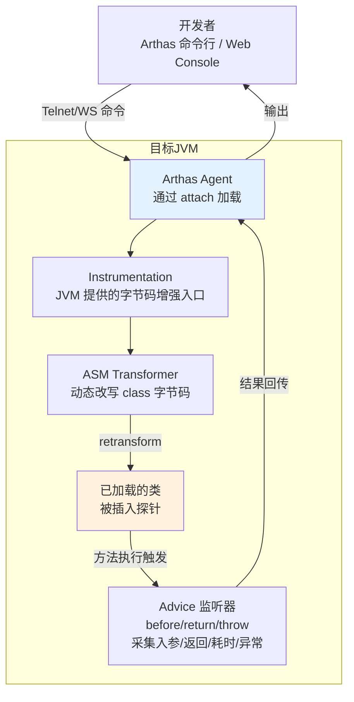
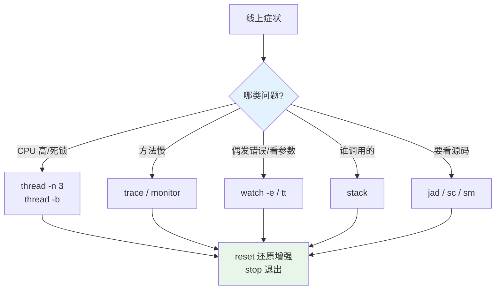

# Arthas 线上诊断

> 定位：掌握 Arthas 的原理与安装、常用命令的真实用法、线上排查案例（CPU 高/死锁/慢方法/参数观察）、热更新与注意事项、风险与最佳实践。它是「不改代码、不重启服务」在线给 JVM 做 CT 的瑞士军刀——很多线上疑难杂症，只有它能当场看清现场。

## 一、为什么需要它：线上问题的「只读手术刀」

线上出了诡异问题，传统手段往往很笨重：

- 加日志 → 要改代码、重新打包、发布、重启，问题现场早没了。
- `jstack`/`jmap` → 能用，但输出原始、不直观，且 `jmap` dump 会 STW，大堆服务不敢轻易用。
- 本地复现 → 生产偶发问题根本复现不了。

Arthas（阿里开源，基于 **Instrumentation + ASM 字节码增强**）解决了这个痛点：**attach 到正在运行的 JVM 上，动态增强类，实时观测方法入参/返回值/耗时/异常、看线程栈、看类加载、甚至热更新代码，全程不用重启服务**。

典型场景：

- 接口突然变慢，想知道慢在哪个方法、每步耗时多少 → `trace`
- 某个方法偶发返回错误，想看当时的入参和返回值 → `watch`/`tt`
- CPU 飙到 300%，想知道哪些线程在跑、卡在哪 → `thread`/`dashboard`
- 怀疑死锁、线程 BLOCKED → `thread -b`
- 紧急修复一个 bug，来不及发版 → `redefine`/`jad`+`mc`+`retransform` 热更新

## 二、核心原理：Arthas 是怎么做到的

### 2.1 整体架构

Arthas 的核心是基于 **Java Instrumentation 的 Agent 机制**。它通过 `attach` API 把自己加载进目标 JVM 的 Agent，然后用 ASM 修改类的字节码，在方法前后插入探针（Advice），从而在不改源码的情况下观测方法执行。



读图要点：

1. **attach**：Arthas 通过 `com.sun.tools.attach` 连接到目标进程 PID，把 Agent 加载进去。
2. **增强**：用 Instrumentation 的 `retransformClasses` 配合 ASM，在目标方法的字节码前后插入探针。
3. **观测**：方法执行时触发 Advice 回调，采集入参、返回值、异常、耗时，回传给命令行。
4. **还原**：退出时 `reset` 可以还原被增强的类（热更新除外）。

### 2.2 安装与连接

```bash
# 下载并启动（官方脚本，会自动 attach 到本机 Java 进程）
curl -O https://arthas.aliyun.com/arthas-boot.jar
java -jar arthas-boot.jar

# 启动后会列出本机所有 Java 进程，输入序号选择要诊断的进程
# 也可以指定 PID 和端口
java -jar arthas-boot.jar <pid> --telnet-port 3658 --http-port 8563
```

连接成功后进入 Arthas 交互命令行，提示符形如 `[arthas@12345]$`。也支持 Web Console（`http://localhost:8563`）和非交互 `-c` 命令。

> 「以版本为准」：Arthas 版本迭代较快，具体命令参数和启动选项请对照你使用的版本，必要时用 `help <命令>` 查看在线帮助。

## 三、关键机制：常用命令实战

下面是高频命令的**真实用法**和看什么。

### 3.1 全局概览：`dashboard`

```
[arthas@12345]$ dashboard
```

实时展示 JVM 的线程、内存、GC、运行时信息（类似 top 的刷屏界面）。`q` 退出。首次排查先看它，对系统状态有个整体判断。

### 3.2 CPU 高排查：`thread`

```bash
# 显示最忙的 N 个线程及其栈（CPU 高首选）
thread -n 3

# 一键检测死锁，显示阻塞线程和它持有的锁
thread -b

# 查看指定线程 ID 的栈（ID 用十进制；dashboard/thread 里显示的是十进制）
thread 12

# 查找处于 BLOCKED/WAITING 状态的线程
thread --state BLOCKED
```

**CPU 高排查三板斧**：`thread -n 3` 找出最耗 CPU 的线程及其栈 → 看栈里是哪个方法在跑 → 对该用 `trace`/`monitor` 深挖。若是死循环或正则回溯，`thread` 栈会直接暴露问题代码行。

### 3.3 方法耗时剖析：`trace`

```bash
# 追踪方法内部调用路径，并打印每个节点的耗时（排查慢方法核心命令）
trace com.xxx.order.OrderService createOrder

# 只追踪耗时超过 100ms 的调用
trace com.xxx.order.OrderService createOrder '#cost > 100'

# 追踪指定方法1的多层调用（-n 限制匹配次数，避免刷屏）
trace -n 5 com.xxx.service.*Service query*
```

输出会显示一棵调用树，每个节点标注总耗时和自身耗时。**重点看「自身耗时」高的节点**——那才是真正的瓶颈，而非仅仅是调用链长。`#cost` 是 Arthas 内置的条件变量，表示单次调用耗时（毫秒）。

### 3.4 观察入参/返回值/异常：`watch`

```bash
# 观察方法返回后的返回值（params 入参，returnObj 返回值，throwObj 异常）
watch com.xxx.order.OrderService createOrder '{params, returnObj, throwObj}' -x 3

# 只观察异常抛出时的入参和异常栈（排查偶发错误利器）
watch com.xxx.order.OrderService createOrder '{params, throwObj}' -e -x 2

# 条件过滤：只看 userId=10086 的调用
watch com.xxx.order.OrderService createOrder '{params[0], returnObj}' 'params[0].userId==10086' -x 2
```

- `-x`：展开层级（对象展开深度，默认 1，调大才能看到对象内部字段）。
- `-e`：只捕获异常场景。
- 第二个参数是**观察表达式**，`params`（入参数组）、`returnObj`、`throwObj` 都可用。

### 3.5 时光隧道：`tt`（TimeTunnel）

```bash
# 记录方法每次调用（入参、返回、异常），可回放
tt -t com.xxx.order.OrderService createOrder

# 查看记录列表
tt -l

# 回放某次调用（索引来自列表，重新执行一次，可改参数）
tt -i 1000 -p

# 重放并修改参数
tt -i 1000 -p --params 'newParam'
```

`tt` 是排查偶发问题的神器：它把每次调用「录下来」，事后挑出出问题的那次**重新回放**，还能改参数验证。比 `watch` 更适合「事后分析」。

### 3.6 统计耗时分布：`monitor`

```bash
# 每 5 秒统计一次方法的调用次数、成功/失败数、平均耗时、成功率
monitor -c 5 com.xxx.order.OrderService createOrder
```

输出一张周期统计表（timestamp、class、method、total、success、fail、avg-cost 等），适合看某方法的**整体健康度和趋势**。

### 3.7 查看调用来源：`stack`

```bash
# 查看方法被调用的调用栈（谁调用了它）
stack com.xxx.order.OrderService createOrder

# 条件过滤
stack com.xxx.order.OrderService createOrder 'params[0].skuId=="SKU-123"'
```

当某个方法被意外调用（如不该删除时却删了），用 `stack` 看是谁、从哪条路径调过来的。

### 3.8 看源码/反编译：`jad`

```bash
# 反编译类的字节码（线上没源码时用）
jad com.xxx.order.OrderService

# 只反编译某个方法
jad com.xxx.order.OrderService createOrder

# 保存到文件
jad --source-only com.xxx.order.OrderService > /tmp/OrderService.java
```

### 3.9 表达式执行：`ognl`

```bash
# 执行 OGNL 表达式，读取静态字段、调用方法、甚至改值
ognl '@com.xxx.config.Config@MAX_SIZE'

# 调用静态 Spring Bean 的方法（需先获取 context，较复杂，谨慎）
ognl '#context=@com.xxx.SpringContextHolder@getContext(), #context.getBean("orderService").query()'
```

`ognl` 极其强大也极其危险——能读写任意对象、调用任意方法。生产上**只读可以用，写操作要极其谨慎**。

### 3.10 类加载信息：`sc` / `sm`

```bash
# 搜索已加载的类（Search Class）
sc -d *OrderService        # -d 显示详细信息（类加载器、位置等）
# 查看类的方法（Search Method）
sm com.xxx.order.OrderService
```

用于确认类是否被加载、由哪个 ClassLoader 加载、方法签名是什么——排查「类冲突」「热更新没生效」时必用。

### 3.11 热更新：`redefine` / `retransform`

```bash
# 经典四步热更新：
# 1. 反编译出源码
jad --source-only com.xxx.order.OrderService > /tmp/OrderService.java
# 2. 修改 /tmp/OrderService.java（修 bug）
# 3. 编译成 class（-Arthas 提供 mc 命令内存编译）
mc /tmp/OrderService.java -d /tmp/classes
# 4. 热更新到 JVM
redefine /tmp/classes/com/xxx/order/OrderService.class
# 或用 retransform（保留增强能力，配合 watch/trace 可继续观测）
retransform /tmp/classes/com/xxx/order/OrderService.class
```

**关键限制（必须记住）**：

- `redefine` 遵循 JVM HotSwap 规则：**只能改方法体，不能增删字段/方法、不能改方法签名、不能改类的继承关系**。违反了会失败。
- `redefine` 后原来的 `watch`/`trace` 等增强会**丢失**；`retransform` 与之不同，能保留增强。
- 热更新是**临时补丁**，重启后失效。必须同步修源码、走正常发布流程，否则下次重启 bug 又回来了。

### 3.12 命令速查表

| 场景 | 命令 |
|---|---|
| 整体状态 | `dashboard` |
| CPU 高 | `thread -n 3`、`thread -b`（死锁） |
| 慢方法 | `trace`、`monitor` |
| 看入参/返回/异常 | `watch`、`tt` |
| 谁调用的 | `stack` |
| 看源码 | `jad` |
| 执行表达式 | `ognl` |
| 类加载信息 | `sc`、`sm` |
| 热更新 | `jad` → `mc` → `redefine`/`retransform` |
| 还原增强 | `reset` |
| 关闭 Arthas | `stop` |

## 四、生产坑点与排查

### 坑点 1：attach 失败——权限/用户不一致

**现象**：`arthas-boot` 提示 `AttachNotSupportedException` 或「can not attach to process」。
**原因**：诊断进程和目标 JVM 的**用户不一致**（如目标用 `appuser` 启动，你用 root attach），或目标 JVM 未开启 attach（极少数容器/安全加固场景），或 `/proc` 权限问题。
**解法**：
- 用**启动目标应用的同一个用户**执行 `arthas-boot`。
- 容器场景进入同一容器 namespace：`kubectl exec -it <pod> -- java -jar arthas-boot.jar`。
- 检查目标 JVM 的 `/tmp/.java_pid<pid>` socket 是否存在、是否有权限。

### 坑点 2：`trace`/`watch` 让服务雪上加霜

**现象**：执行 `trace` 后接口延迟明显增加，甚至服务卡顿。
**原因**：Arthas 的字节码增强和探针采集有开销；`trace` 默认匹配所有调用，高并发下探针被疯狂触发；`-x` 展开层级过大导致对象序列化昂贵。
**解法**：
- 用 `-n` 限制匹配次数（如 `-n 5`），达到次数自动停止。
- 用条件表达式（`#cost > 100`、`params[0].id==xxx`）收窄范围。
- `-x` 展开层级够用就行，别设太大。
- 排查完及时 `reset` 还原增强，不要长期挂着探针。

### 坑点 3：`redefine` 失败或热更新后增强丢失

**现象**：`redefine` 报错「redefine error」；或热更新后之前的 `watch`/`trace` 突然不生效了。
**原因**：
- 修改了方法体外的内容（增删字段/方法、改签名），违反 JVM HotSwap 限制。
- `redefine` 会清除该类上的所有增强，`watch`/`trace` 的探针没了。
**解法**：
- 热更新只改方法体逻辑；结构性改动必须走正常发布。
- 需要保留增强能力时用 `retransform` 而非 `redefine`。
- 更新后用 `jad` 确认新代码已生效、`sc -d` 确认 ClassLoader 正确。

### 坑点 4：热更新当成正式修复，重启后 bug 重现

**现象**：线上用 `redefine` 修了个 bug，大家松了口气；几天后服务重启，同样的 bug 又出现了。
**原因**：热更新只改了内存里的字节码，磁盘上的 class/jar 没变，重启加载的还是老代码。
**解法**：
- 热更新只作为**止血的临时手段**，必须同步修源码、合并、走发布流程。
- 在工单/值班记录里明确标注「已热修复，待正式发布」，避免遗忘。
- 优先修复根本问题，而非长期依赖热更新维持。

## 五、调优 / 选型 / 最佳实践

### 5.1 排查标准流程

1. **先看全局**：`dashboard` 了解 CPU、内存、线程、GC 概况。
2. **定位线程**：CPU 高用 `thread -n 3`，死锁用 `thread -b`。
3. **定位方法**：`trace`/`monitor` 找慢方法，`stack` 看调用来源。
4. **看现场数据**：`watch`/`tt` 抓入参、返回值、异常，必要时 `tt -p` 回放。
5. **看源码**：线上无源码时 `jad` 反编译确认逻辑。
6. **收尾**：`reset` 还原增强，`stop` 关闭 Arthas。

下面这张图把「症状 → 命令」的映射画出来，排查时按图索骥，不用每次都翻文档：



### 5.2 使用风险与最佳实践

| 风险 | 规避 |
|---|---|
| 性能开销 | 限制匹配次数 `-n`、加条件过滤、用完 `reset` |
| 数据泄露 | `watch` 入参可能含敏感数据，注意结果输出可见范围 |
| 热更新失误 | 只在方法体内改，同步正式发布，做好记录 |
| 并发影响 | 避免在流量高峰做重型 `trace`/`tt`，选低峰期 |
| ognl 误操作 | 生产只读为主，写操作极其谨慎 |
| 权限与安全 | Arthas 端口不要暴露公网，限制访问来源 |

### 5.3 与其他工具的分工

| 工具 | 定位 |
|---|---|
| **Arthas** | 在线、单次、交互式诊断，看方法级现场 |
| Prometheus/Grafana | 持续指标监控、趋势、告警 |
| 链路追踪 | 跨服务调用链、全局瓶颈 |
| jstack/jmap + MAT | 离线分析、堆 dump 深度分析 |

**一句话分工**：指标告诉你「病了」，链路告诉你「哪病了」，Arthas 告诉你「病根是什么」。

## 六、面试高频问法

> 这一节的答案按「面试时能讲透」的标准写：先给一句话结论，再展开机制、原因和坑点。

**Q1：Arthas 是什么？它解决什么问题？**

**一句话结论**：Arthas 是阿里开源的 Java 线上诊断工具——不用重启、不用改代码，就能查看线上应用的运行状态、方法耗时、调用链路。

展开：

- **解决的问题**：线上问题难复现、难调试；传统方式（加日志、重启）成本高。
- **原理**：基于 JVM 的 Instrumentation（字节码增强）和 attach 机制，动态修改字节码。
- **能力**：看 JVM 状态、查方法耗时、追踪调用链、热更新代码。

加分点：说"Arthas 的核心价值是'无侵入诊断'——生产环境不能随便重启、加日志，Arthas 能'动态'看问题，这是它比 jstack/jmap 更强的地方"。

**Q2：Arthas 的常用命令有哪些？**

**一句话结论**：dashboard（总览）、thread（线程）、trace（链路耗时）、watch（观察参数/返回值）、jad（反编译）、redefine（热更新）、ognl（执行表达式）。

| 命令 | 作用 |
|---|---|
| dashboard | 实时看 JVM/线程/GC |
| thread | 看线程栈、找 CPU 高/死锁 |
| trace | 追踪方法内部调用耗时 |
| watch | 观察方法入参、返回值、异常 |
| jad | 反编译类，看线上实际代码 |
| redefine | 热更新类 |
| ognl | 执行表达式、调方法 |
| sc/sm | 查看已加载的类/方法 |

加分点：说"trace 和 watch 是'排查神器'——trace 告诉你'慢在哪'，watch 告诉你'参数是什么、返回什么'，配合起来能定位大部分线上问题"。

**Q3：trace 命令怎么用？能解决什么问题？**

**一句话结论**：`trace 类 方法` 追踪方法内部每个子调用的耗时，快速定位"方法慢在哪一行"。

展开：

```bash
trace com.example.OrderService createOrder
# 输出：每个子方法调用的耗时、占比
```

- **用途**：接口慢，但不知道慢在哪个子调用（数据库？下游？计算？）。
- **注意**：trace 有性能开销，生产用要加 `-n`（次数限制）或条件。

加分点：说"trace 是'链路级'的诊断——它比看日志快得多，能直接看到'这个方法里哪一行最耗时'，是定位慢接口的第一步"。

**Q4：watch 命令怎么用？**

**一句话结论**：`watch 类 方法 {params, returnObj, throwExp}` 观察方法的入参、返回值、异常，用于"看线上实际传了什么、返回了什么"。

展开：

```bash
watch com.example.UserService getUser '{params, returnObj, throwExp}' -x 2
```

- **用途**：排查"为什么这个方法返回了 null""参数为什么不对"。
- **-x**：展开层级（默认 1，对象看内部要调大）。
- **条件**：`-b`（方法前）、`-e`（异常时）、`-s`（成功时）。

加分点：说"watch 解决的是'线上到底传了什么参数'的问题——本地复现不了、日志又没打，watch 能直接看，非常实用"。

**Q5：线上 CPU 飙高，用 Arthas 怎么排查？**

**一句话结论**：`dashboard` 看整体 → `thread -n 3` 找最忙的线程 → `thread <id>` 看栈 → 定位代码。

展开：

```bash
dashboard            # 看 CPU、线程数
thread -n 3          # 最忙的 3 个线程
thread <线程ID>       # 看该线程的栈
```

- **配合**：如果是 GC 导致，`dashboard` 能看到 GC 次数；如果死锁，`thread -b` 直接检测。

加分点：说"Arthas 的 thread 命令比 jstack 更友好——它能直接按 CPU 排序、直接检测死锁，不用自己算十六进制线程 ID"。

**Q6：Arthas 怎么热更新代码？有什么风险？**

**一句话结论**：`jad` 反编译 → 改代码 → `mc` 编译 → `redefine` 加载；风险是"改错了可能导致类加载异常，且重启后失效"。

展开：

```bash
jad --source-only com.example.Foo > Foo.java
# 修改 Foo.java
mc Foo.java -d /tmp
redefine /tmp/com/example/Foo.class
```

- **用途**：紧急修复线上 bug（不用发版）。
- **风险**：改错会导致 `ClassFormatError`、行为不一致；redefine 不能改方法签名/字段。

加分点：说"热更新是'急救手段'不是'常规操作'——它能救急，但改完必须尽快发正式版本；而且 redefine 有限制（不能加方法/字段），不是万能的"。

**Q7：Arthas 会影响线上性能吗？**

**一句话结论**：会有一定开销（字节码增强、方法拦截），但可控——用 `-n` 限制次数、用完 `stop` 卸载。

展开：

- **开销来源**：trace/watch 会给方法加拦截，有性能损耗。
- **控制**：`-n 10`（只追踪 10 次）、`-c`（条件过滤）。
- **收尾**：诊断完 `stop` 或 `shutdown`，卸载增强。

加分点：说"Arthas 在'高并发核心接口'上要谨慎——trace 一个 QPS 几万的接口，开销会被放大；要在低峰期、加次数限制"。

**Q8：Arthas 和 jstack/jmap/jstat 有什么区别？**

**一句话结论**：jstack/jmap/jstat 是 JDK 自带的基础工具（看快照），Arthas 是增强版（动态、可交互、功能更全）。

| 工具 | 能力 | 局限 |
|---|---|---|
| jstack | 线程栈 | 只能看快照 |
| jmap | 堆 dump | 只能 dump |
| jstat | GC 统计 | 只能看统计 |
| Arthas | 上面都有 + trace/watch/热更新 | 需额外部署 |

加分点：说"Arthas 不是'替代'JDK 工具，是'增强'——它把 jstack/jmap 的能力整合了，还加了 trace/watch 这些 JDK 没有的；但基础工具更轻量，简单场景够用"。

**Q9：Arthas 能排查哪些典型问题？**

**一句话结论**：CPU 高、内存泄漏、线程死锁、接口慢、参数异常、类冲突、热更新——几乎所有线上疑难杂症。

展开：

- **CPU/线程**：dashboard、thread。
- **慢接口**：trace、monitor。
- **参数/返回**：watch。
- **类问题**：sc、jad、classloader。
- **内存**：heapdump、vmtool。

加分点：说"Arthas 是'线上问题排查的瑞士军刀'——大部分'本地复现不了'的问题，都能用 Arthas 在线上直接看，这是它最大的价值"。

**Q10：Arthas 的使用有哪些注意事项？**

**一句话结论**：生产慎用高开销命令、加次数限制、用完卸载、注意权限（能改代码意味着高风险）。

展开：

- **性能**：trace/watch 有开销，核心接口加 `-n`。
- **安全**：redefine 能改代码，要严格控制权限（谁能用 Arthas）。
- **收尾**：诊断完 stop，避免长期挂着。
- **版本**：不同版本命令有差异。

加分点：说"Arthas 是'双刃剑'——它能解决线上问题，也能'搞坏'线上（改错代码、性能拖垮）；所以生产使用要有规范：谁能用、什么场景用、用完怎么收尾"。

## 小结

- Arthas 用 Instrumentation + ASM 动态增强字节码，attach 到运行中的 JVM 在线诊断，不重启。
- 排查路径：dashboard 看全局 → thread 找问题线程 → trace/monitor 找慢方法 → watch/tt 抓现场 → jad 看源码。
- 关键命令：`thread -n/-b`、`trace`、`watch`、`tt -p`、`monitor`、`stack`、`ognl`、`jad`、`redefine`。
- 热更新只改方法体、重启失效、必须同步正式发布；retransform 保留增强，redefine 清除增强。
- 生产克制使用：-n 限次、条件过滤、用完 reset、敏感数据脱敏、端口不外露。
