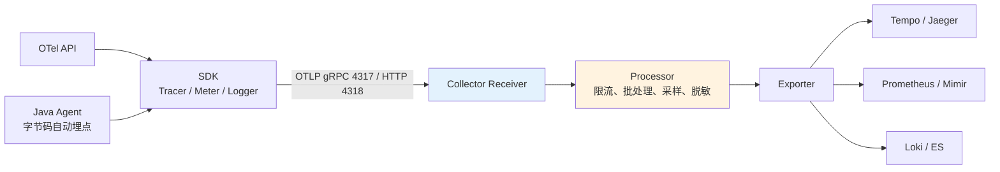
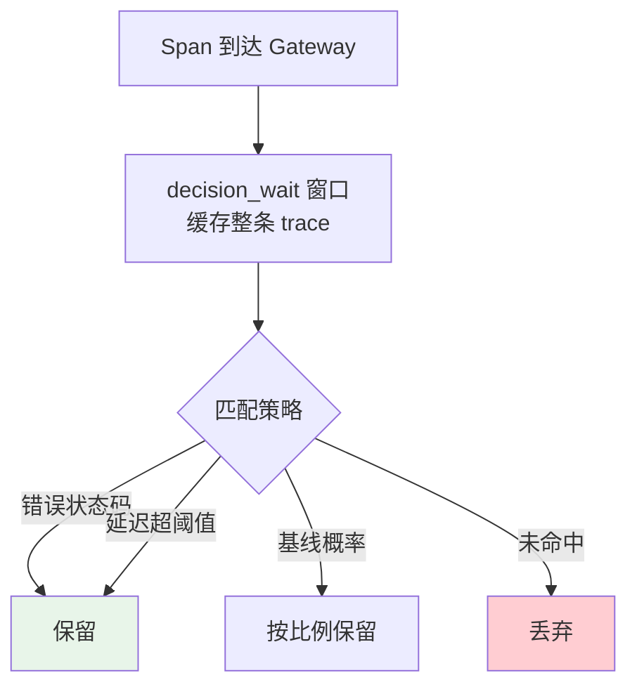
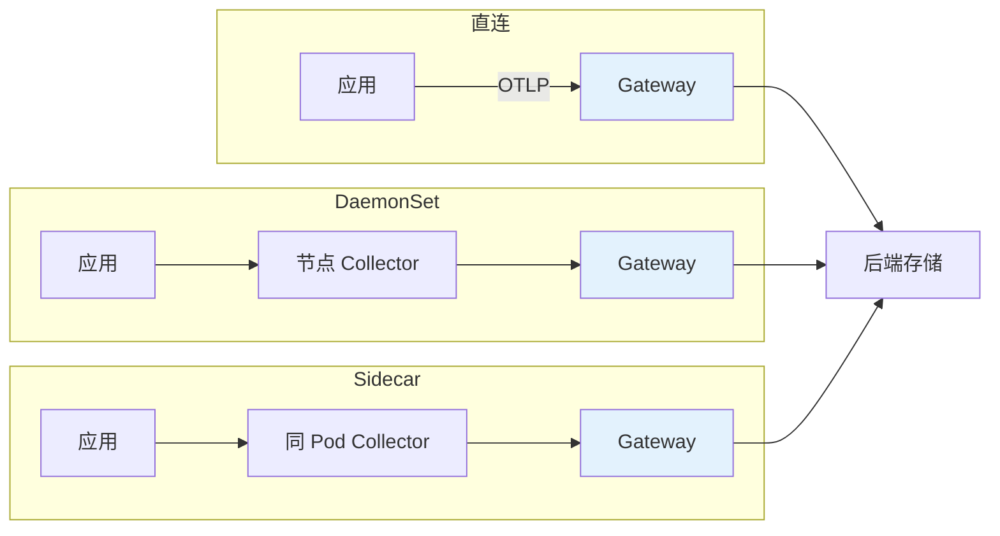

# OpenTelemetry 落地与成本治理

> 定位：链路用 SkyWalking、指标用 Prometheus client、日志用 Filebeat，三套 SDK、三套 Agent、三种 ID 对不上——这是很多团队可观测性建设的现状。这篇讲清 OpenTelemetry（下称 OTel）的三大信号与统一语义约定、SDK/Collector/Exporter 的分层架构、Java Agent 自动埋点与 Micrometer/Spring Boot 3 Observation 的整合方式，再直面一个没人愿意谈的话题：**可观测性账单**——采样、基数、保留期到底怎么治理。

## 一、为什么需要它

一个典型的中型系统，可观测性栈往往长这样：

- 链路（见 [链路追踪](02-链路追踪.md)）：SkyWalking Agent + OAP + ES；
- 指标（见 [监控告警](03-监控告警Prometheus-Grafana.md)）：Micrometer + Prometheus + Grafana；
- 日志（见 [日志体系](04-日志体系.md)）：Logback + Filebeat + ELK。

三套体系各自能用，但拼在一起会出现三个结构性问题：

1. **ID 不通**：链路的 TraceId、日志 MDC 里的 TraceId、指标上的 exemplar，格式各不相同，排障时要手工拼接。
2. **埋点重复**：同一个 HTTP 调用被三套 SDK 各埋一遍，性能开销和代码侵入都翻倍。
3. **后端锁定**：想从 Jaeger 换到 Tempo，或从 ES 换到 Loki，发现 SDK 和协议全是专用的，迁移等于重做。

OTel 解决的是**标准化**问题：统一的 API、统一的数据模型（OTLP）、统一的语义约定（Semantic Conventions），让埋点与后端解耦（三支柱的概念见 [可观测性三大支柱](01-可观测性三大支柱.md)）。但必须提前说清楚：**OTel 不解决成本问题**。它让「采集」变便宜了，反而更容易把数据量放大到账单失控——所以成本治理必须和落地一起设计，而不是等账单来了再补。

## 二、核心原理

### 2.1 三大信号与统一语义约定

| 信号 | API 入口 | 数据模型 | 典型后端 | 关键语义约定字段 |
|---|---|---|---|---|
| Traces | `Tracer` / `Span` | Span（含 TraceId、SpanId、事件、链接） | Tempo、Jaeger、SkyWalking | `http.request.method`、`url.full`、`server.address`、`db.system`、`messaging.system` |
| Metrics | `Meter` / `Counter` / `Histogram` | 时间序列（名字 + 标签 + 值） | Prometheus、Mimir、VictoriaMetrics | `http.server.request.duration`、`http.response.status_code` |
| Logs | `Logger` / Log Bridge | LogRecord（含 TraceId 关联） | Loki、Elasticsearch、ClickHouse | `severity_text`、`trace_id`、`span_id` |

三种信号共享同一套 **Resource** 属性：`service.name`、`service.version`、`deployment.environment.name`、`k8s.pod.name`。这组属性是「把三类数据关联到同一个服务实例」的锚点，命名不统一，后面的聚合全是错的。

> 语义约定在 1.x 期间持续演进（HTTP、数据库、消息等部分已稳定，部分仍在演进）。升级 Collector 或 SDK 时，先看目标版本的语义约定变更说明，不要假设字段永远不变。

### 2.2 SDK / Collector / Exporter 三层架构



读图要点：**应用只负责产生数据，不负责决定数据去哪**。这个解耦是 OTel 最大的价值——换后端只改 Collector 配置，不用重新发版；采样、脱敏、限流也能在 Collector 统一做，而不是每个服务各写一套。

Collector 的 pipeline 由 Receiver（接收 OTLP、SkyWalking、Zipkin 等）、Processor（限流、批处理、采样、脱敏）、Exporter（带重试与发送队列）、Connector（如 `spanmetrics` 从 Trace 生成指标）四类组件构成。

### 2.3 Java Agent 自动埋点与手动埋点

| 方式 | 原理 | 优点 | 代价 |
|---|---|---|---|
| Java Agent | 启动时 `-javaagent` 加载，Byte Buddy 改写字节码 | 零代码接入、覆盖框架全 | 有性能开销、版本兼容需验证 |
| 手动埋点 | 调用 OTel API 创建 Span | 语义精确、可控 | 侵入业务代码、覆盖不全 |
| 混合 | Agent 打底 + 关键路径手工 Span | 兼顾覆盖与语义 | 需要治理重复 Span |

自动埋点的启动方式：

```bash
java -javaagent:/opt/otel/opentelemetry-javaagent.jar \
     -Dotel.service.name=order-service \
     -Dotel.resource.attributes=deployment.environment.name=prod \
     -Dotel.exporter.otlp.endpoint=http://otel-gateway:4317 \
     -Dotel.traces.sampler=parentbased_traceidratio \
     -Dotel.traces.sampler.arg=0.1 \
     -jar order-service.jar
```

手动埋点只加在「有业务语义、且自动埋点覆盖不到」的位置：

```java
Span span = tracer.spanBuilder("inventory.reserve")
        .setAttribute("inventory.sku", sku)
        .setAttribute("inventory.qty", qty)
        .startSpan();
try (Scope ignored = span.makeCurrent()) {
    return inventoryService.reserve(sku, qty);
} catch (RuntimeException e) {
    span.recordException(e);
    span.setStatus(StatusCode.ERROR, e.getMessage());
    throw e;
} finally {
    span.end();
}
```

注意 `setAttribute` 里的 `sku` 是**业务维度**、基数可控；如果把 `orderId`、`userId` 写进去，Span 存储会迅速膨胀——这是后面「基数爆炸」的伏笔。

### 2.4 与 Micrometer、Spring Boot 3 Observation 的整合

Spring Boot 3 的可观测性门面是 **Micrometer Observation**：业务代码只依赖 `ObservationRegistry`，底层由 `micrometer-tracing-bridge-otel` 桥接到 OTel，指标由 `micrometer-registry-otlp` 导出，OTLP 通道由 `opentelemetry-exporter-otlp` 提供。

```properties
management.tracing.sampling.probability=0.1
management.otlp.tracing.endpoint=http://otel-gateway:4318/v1/traces
# 指标导出端点在 3.x 各小版本间有调整，以实际版本文档为准
management.otlp.metrics.export.url=http://otel-gateway:4318/v1/metrics
```

手动观测一段业务逻辑时，用 Observation API 而不是直接依赖 OTel API，这样指标和链路会同时产生：

```java
Observation observation = Observation.createNotStarted("order.create", registry)
        .lowCardinalityKeyValue("channel", channel)          // 进指标标签
        .highCardinalityKeyValue("order.id", orderId)        // 只进 Span，不进指标
        .start();
try (Observation.Scope ignored = observation.openScope()) {
    return orderService.create(command);
} catch (RuntimeException e) {
    observation.error(e);
    throw e;
} finally {
    observation.stop();
}
```

`lowCardinalityKeyValue` 与 `highCardinalityKeyValue` 的区别是很多人踩过的坑：**前者会变成指标标签，后者只附加到链路 Span 上**。把订单号塞进 `lowCardinalityKeyValue`，Prometheus 的时间序列数量会瞬间失控。

### 2.5 采样策略

| 策略 | 决策位置 | 优点 | 缺点 | 适用 |
|---|---|---|---|---|
| 头部采样 | SDK / Agent | 开销小、实现简单 | 无法按结果决策，可能漏掉错误 | 大流量打底 |
| 尾部采样 | Collector | 能按错误、延迟、属性决策 | 需缓存整条 trace，内存与延迟成本高 | 关键链路、排障 |
| 自适应采样 | SDK / Collector | 按流量动态调整比例 | 实现复杂、行为不易预测 | 流量波动大的服务 |

头部采样的两种常见配置：`parentbased_traceidratio` 让根 Span 按比例决策、子 Span 跟随父决策，保证一条链路要么全采、要么全不采；`always_on` 配合 Collector 侧再采样则带宽成本高，只适合内网。

尾部采样是成本与效果的折中：默认 5% 基线采样，错误链路、慢链路 100% 保留。前提是**同一条 trace 的所有 Span 必须到达同一个 Collector 实例**，所以尾部采样只能放在 Gateway 层，不能放在每个 Pod 的 Agent 里。



读图要点：尾部采样的决策依赖**整条 trace 的结果**，所以必须等 `decision_wait` 窗口结束；窗口越长判断越准，内存占用也越高。

## 三、关键机制

### 3.1 Collector 部署模式



读图要点：三种模式的取舍是「网络跳数 vs 隔离性 vs 运维成本」。直连最简单但应用直连后端；DaemonSet 把采集下沉到节点，适合主机指标与日志；Sidecar 隔离性最好，但每个 Pod 多一个容器，资源开销最大。**生产最常见的是 DaemonSet + Gateway 两级**：节点层做批处理与限流，网关层做尾部采样与统一出口。

### 3.2 Collector 配置示例

```yaml
receivers:
  otlp:
    protocols:
      grpc:
        endpoint: 0.0.0.0:4317
      http:
        endpoint: 0.0.0.0:4318

processors:
  memory_limiter:                 # 必须放在 pipeline 第一位
    check_interval: 1s
    limit_mib: 1024
    spike_limit_mib: 256
  attributes/scrub:
    actions:
      - key: http.request.header.authorization
        action: delete
  tail_sampling:                  # 只能部署在 Gateway
    decision_wait: 10s
    num_traces: 50000
    policies:
      - name: errors
        type: status_code
        status_code: { status_codes: [ERROR] }
      - name: slow
        type: latency
        latency: { threshold_ms: 500 }
      - name: baseline
        type: probabilistic
        probabilistic: { sampling_percentage: 5 }
  batch:
    timeout: 5s
    send_batch_size: 8192

exporters:
  otlphttp/backend:
    endpoint: https://otel-backend.internal:4318
    retry_on_failure:
      enabled: true
      max_elapsed_time: 300s
    sending_queue:
      enabled: true
      num_consumers: 10
      queue_size: 5000

service:
  pipelines:
    traces:
      receivers: [otlp]
      processors: [memory_limiter, attributes/scrub, tail_sampling, batch]
      exporters: [otlphttp/backend]
    metrics:
      receivers: [otlp]
      processors: [memory_limiter, batch]
      exporters: [otlphttp/backend]
```

注意三个顺序约束：`memory_limiter` 必须第一个执行，否则采样和脱敏会先把内存吃满；`batch` 必须最后执行，否则一次只发一条，导出 QPS 直接打爆后端；脱敏必须在导出前完成，`attributes/scrub` 是最后一道防线。

### 3.3 从 SkyWalking / Zipkin 迁移

| 阶段 | 动作 | 风险 |
|---|---|---|
| 盘点 | 统计现有 Agent 版本、埋点方式、依赖的后端能力 | 漏掉自定义插件 |
| 双跑验证 | 小流量服务同时上报两套，比对 Trace 完整性与耗时 | 双 Agent 字节码冲突 |
| 协议过渡 | 用 Collector 的 `skywalking`/`zipkin` receiver 接收老数据 | 字段语义映射丢失 |
| 切换 | 按服务灰度切换 Agent，观察 24 小时 | TraceId 格式变化导致日志断链 |
| 下线 | 确认无查询依赖后移除旧后端 | 历史数据无法回溯 |

两个关键点：

- **不要同时加载两个 Java Agent**。SkyWalking Agent 与 OTel Agent 都会改写 Spring MVC、JDBC、Kafka 等字节码，同时存在会重复埋点甚至启动失败。要么分实例灰度，要么先卸一个。
- **TraceId 格式要统一**。SkyWalking 的 TraceId 与 OTel 的 32 位十六进制不是一回事，迁移期日志里的 TraceId 会「跳变」，需要日志侧同时兼容两种格式，或在网关做一次映射。

### 3.4 基数爆炸与指标命名

| 反模式 | 后果 | 正确做法 |
|---|---|---|
| Span 名带路径参数：`/orders/123456` | Span 名无限增长，聚合失效 | 用模板：`/orders/{orderId}` |
| 指标标签放 `userId` / `orderId` | 时间序列爆炸，Prometheus OOM | 只放低基数维度：状态码、渠道、地域 |
| 错误信息当标签 | 每条例外一个新序列 | 错误类型归一到枚举，原文放日志 |
| 自定义指标名随意起 | 无法跨服务聚合 | 遵循语义约定，如 `http.server.request.duration` |

判断一个标签能不能进指标，只看一个问题：**它的取值范围是否可控在几十个以内**。答案是否，就放到 Span 属性或日志里。

## 四、生产坑点与排查

### 坑点 1：Span 名带 ID，链路聚合完全失效

**现象**：链路后端里 `GET /orders/123`、`GET /orders/124` 是成千上万个不同的 Span 名，按接口统计 RT 时无法聚合。
**原因**：自动埋点默认用原始路径，或手动埋点把参数拼进了 Span 名。
**解法**：开启框架的路由模板（Spring MVC 的 `http.route` 已是低基数）；手动埋点用「资源名 + 操作」命名；在 Collector 用 `transform` processor 做兜底改写。

### 坑点 2：在 Agent 里配尾部采样，链路永远不完整

**现象**：开启了 tail sampling，但大部分 trace 只剩一两个 Span，错误链路也经常缺段。
**原因**：Agent 是每 Pod 一个，同一条 trace 的 Span 分散到多个 Agent，每个 Agent 只能看到局部，采样决策基于残缺数据。
**解法**：尾部采样只放在 Gateway；Agent 层用头部采样或全量转发；Gateway 前面用负载均衡 exporter 按 traceId 做一致性路由。

### 坑点 3：Collector OOM，应用侧跟着超时

**现象**：流量高峰 Collector 被 OOMKilled，应用上报阻塞，业务 RT 上升。
**原因**：没配 `memory_limiter`，或配了但顺序不对；`batch` 的批次过大；队列无上限。
**解法**：`memory_limiter` 放第一位并设置 `spike_limit_mib`；限制 `sending_queue.queue_size`；给 Collector 配 HPA 或固定足够的副本；应用侧设置较短的导出超时并允许丢弃。

### 坑点 4：用 1% 采样的链路数据算错误率

**现象**：链路面板显示错误率 2%，监控显示 8%，两个团队各执一词。
**原因**：采样是有偏的，1% 样本乘以 100 外推误差极大，且尾部采样专门保留错误链路，比例更失真。
**解法**：**SLO 与错误率只用不采样的指标计算**（Counter/Histogram）；链路只回答「这次为什么慢/错」；需要精确错误率时用指标侧的 `http.server.request.duration` 与状态码计数。

### 坑点 5：双 Agent 共存，启动即冲突

**现象**：迁移期同时挂 SkyWalking Agent 和 OTel Agent，服务启动报字节码转换异常，或链路出现重复 Span。
**原因**：两个 Agent 都基于字节码增强，改写同一批类，顺序与版本都可能冲突。
**解法**：一个进程只保留一个 Agent；迁移按实例灰度而不是同实例双挂；用 Collector 的 receiver 兼容老协议，而不是在应用侧双写。

## 五、成本治理与选型

可观测性成本可以粗略拆成三部分：**信号量 × 单价 × 保留期**。三个乘数都能治理：

| 手段 | 作用 | 代价 |
|---|---|---|
| 头部采样 | 从源头减少 Span 数量 | 可能漏掉长尾问题 |
| 尾部采样 | 只保留错误/慢链路 | Collector 内存与复杂度 |
| 指标降维 | 删掉高基数标签 | 失去部分下钻能力 |
| 日志分级与采样 | 只保留 WARN 以上全量 | 排查时可能缺上下文 |
| 分层存储 | 热数据 7 天、温 30 天、冷对象存储 | 查询冷数据慢 |
| 缩短保留期 | 最直接的成本杠杆 | 历史回溯受限 |

落地建议：

1. **先定保留期，再谈采样**：链路 7 天、指标 90 天、日志 30 天是常见组合，按合规要求调整。
2. **指标不采样，链路才采样**：指标是 SLO 的依据，必须完整；链路是排障素材，可以抽样。
3. **尾部采样放网关，基线 5% 起步**；Span 只给 HTTP、RPC、DB、MQ、缓存这类跨边界操作建，不要在每个方法上建 Span。

**不适合一上来就做全套 OTel 的场景**：

- 只有几个服务、单体为主，或预算敏感且数据量极大：先用 SkyWalking/厂商 APM，或先把日志降级、指标降维做完。
- 没有专职可观测性负责人：Collector 的采样、队列、内存参数需要持续调，没人维护会变成新的事故源。

## 六、面试高频问法

**Q1：OpenTelemetry 是什么？它解决什么问题？**

**一句话结论**：OTel 是一套厂商中立的可观测性标准，包含统一的 API、SDK、数据协议（OTLP）与语义约定，解决「埋点与后端绑定、三套体系 ID 不通」的问题。

展开：

- **标准化**：一次埋点，可导出到任意兼容后端。
- **三信号统一**：Trace、Metric、Log 共享 Resource 与上下文。
- **可插拔**：Collector 承担路由、采样、脱敏，应用与后端解耦。
- **边界**：它不负责存储与展示，也不自动降低成本。

加分点：说「OTel 是协议和规范，不是 APM 产品」——很多候选人会把它和 Jaeger、SkyWalking 混为一谈。

**Q2：Collector 的架构是什么？为什么需要它？**

**一句话结论**：Collector 由 Receiver、Processor、Exporter、Connector 组成，负责接收、处理、转发遥测数据；它把「数据去哪、怎么采样、怎么脱敏」从应用里抽出来，实现集中治理。

展开：

- **Receiver**：接收 OTLP，也可接 SkyWalking、Zipkin、Prometheus。
- **Processor**：内存限制、批处理、采样、属性改写；顺序有严格要求。
- **Exporter**：带重试和发送队列，抗后端抖动。
- **Connector**：如 spanmetrics，从链路生成指标。

加分点：强调「`memory_limiter` 必须第一个、`batch` 通常最后」——这是配置审查里最常见的两个错误。

**Q3：Java Agent 自动埋点的原理是什么？有什么代价？**

**一句话结论**：通过 `-javaagent` 在类加载期用 Byte Buddy 改写目标类字节码，在方法前后插入 Span 创建与结束逻辑；优点是零代码接入，代价是性能开销与版本兼容风险。

展开：

- **机制**：Instrumentation + Byte Buddy，按框架插件匹配类名与方法。
- **覆盖**：Spring MVC、JDBC、Redis、Kafka、gRPC 等主流框架。
- **代价**：方法增强带来额外 CPU；Agent 版本与框架版本要匹配；双 Agent 会冲突。
- **治理**：用 `otel.instrumentation.*.enabled` 关闭不需要的插件。

加分点：说出「自动埋点解决覆盖率，手动埋点解决语义」，生产上通常是 Agent 打底 + 关键路径手工 Span。

**Q4：头部采样和尾部采样怎么选？**

**一句话结论**：头部采样在请求开始时按比例决定，开销小但看不到结果；尾部采样在 Collector 缓存整条 trace 后按错误/延迟决策，效果好但内存成本高，只能放网关。

展开：

| 维度 | 头部采样 | 尾部采样 |
|---|---|---|
| 决策时机 | 请求开始 | trace 结束后 |
| 能否按错误决策 | 不能 | 能 |
| 资源开销 | 低 | 高（缓存整条 trace） |
| 部署位置 | SDK/Agent | Gateway |

实践组合：Agent 侧用 `parentbased_traceidratio` 打底，Gateway 侧对错误和慢请求全留。

加分点：说出「尾部采样要求同一 trace 的所有 Span 到同一 Collector 实例」，所以必须有负载均衡或一致性路由。

**Q5：Spring Boot 3 项目怎么接入 OTel？**

**一句话结论**：用 Micrometer Observation 作为门面，引入 `micrometer-tracing-bridge-otel` 桥接链路、`micrometer-registry-otlp` 导出指标、`opentelemetry-exporter-otlp` 提供 OTLP 通道，配置采样率与 endpoint 即可。

展开：

- **依赖**：桥接包 + 导出器，不要直接依赖 OTel SDK。
- **配置**：`management.tracing.sampling.probability`、`management.otlp.tracing.endpoint`。
- **代码**：`Observation.createNotStarted(...)`，低基数标签进指标、高基数标签只进 Span。
- **注解**：`@Observed` 需要注册 `ObservedAspect` 才生效。

加分点：强调「业务代码依赖 Observation 而不是 OTel API」，这样未来换后端或换桥接实现不用改业务。

**Q6：从 SkyWalking 迁移到 OTel 要注意什么？**

**一句话结论**：先盘点与双跑验证，再按服务灰度切换 Agent，迁移期用 Collector 兼容老协议；核心风险是双 Agent 冲突和 TraceId 格式变化。

展开：

- **双 Agent 冲突**：一个进程只保留一个 Agent，按实例灰度。
- **协议兼容**：Collector 的 `skywalking` receiver 可接收老数据。
- **TraceId 格式**：日志侧要兼容两种格式，否则排障断链。
- **能力差异**：拓扑图、告警等 APM 能力需要在新栈里补齐，不是换个 Agent 就完事。

加分点：说「迁移的目标不是换工具，而是换标准」——如果只是把数据倒进另一个后端，收益有限。

**Q7：指标基数爆炸怎么治理？**

**一句话结论**：只让低基数维度进标签，高基数信息放 Span 属性或日志；Span 名用路由模板；错误信息归一到枚举。

展开：

- **判定标准**：标签取值范围能否控制在几十个以内。
- **典型反例**：userId、orderId、原始 URL、异常 message。
- **兜底**：Collector 的 `attributes`/`transform` processor 删除或哈希高基数键。
- **命名**：遵循语义约定，指标名不带变量。

加分点：说出「基数爆炸不是存储问题，是建模问题」——一旦标签设计错了，加机器也救不回来。

**Q8：可观测性成本怎么治理？**

**一句话结论**：成本 ≈ 信号量 × 单价 × 保留期；从采样、降维、分级、分层存储、缩短保留期五个方向同时下手，并明确「指标不采样、链路可采样」。

展开：

- **采样**：头部打底 + 尾部保错误与慢请求。
- **降维**：删高基数标签，日志只留关键字段。
- **分级**：WARN 以上全量，INFO 采样。
- **分层**：热 7 天、温 30 天、冷对象存储。
- **治理机制**：按服务出账单，谁产生谁负责。

加分点：说「先定保留期再谈采样，因为保留期是最容易砍且不影响排障时效的杠杆」。

## 小结

- OTel 统一了 API、数据模型与语义约定，让埋点与后端解耦，但它本身不降低成本。
- 三信号共享 Resource 属性，`service.name` 等字段不统一，聚合与关联全部失效。
- Collector 的价值在集中治理：限流、批处理、采样、脱敏；`memory_limiter` 第一、`batch` 最后。
- Java 侧用 Agent 打底、Observation/手动 Span 补语义；低基数标签进指标，高基数只进 Span。
- 头部采样省资源、尾部采样保效果；尾部采样只能放 Gateway。
- 成本治理抓五个杠杆：采样、降维、分级、分层存储、保留期；指标不采样，链路才采样。
