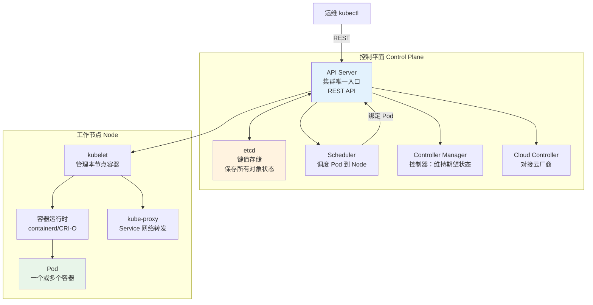
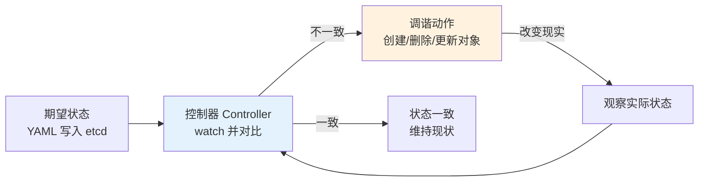

# Kubernetes 核心

> 定位：掌握 K8s 的架构组件、核心对象（Pod/Deployment/Service/ConfigMap/Secret/Ingress/Namespace）、声明式 API 与控制器、调度、探针、滚动更新回滚、requests/limits 与 HPA。K8s 不是「Docker 编排工具」这么简单——它是一套「让系统自动趋近期望状态」的声明式控制体系。

## 一、为什么需要它：从「管容器」到「管集群」

Docker 解决了单机上的容器运行，但生产环境有一堆新问题：

- 容器挂了怎么自动重启？节点宕机了怎么把容器迁到别的机器？
- 流量来了怎么自动扩到 20 个副本、流量退了怎么缩回？
- 怎么在不中断服务的情况下滚动升级、升级失败怎么回滚？
- 怎么给容器分配配置、密钥、网络入口、存储？

Kubernetes（K8s）就是回答这些问题的**容器编排平台**。它的核心哲学是**声明式（Declarative）**：你只声明「我要什么状态」（如「跑 3 个 nginx 副本」），K8s 的控制循环持续检查现状、自动调整到期望状态。你不再一步步命令它怎么做。

## 二、核心原理：架构与对象体系

### 2.1 集群架构

K8s 集群分**控制平面（Master/Control Plane）**和**工作节点（Node）**两部分。



读图要点：

- **API Server** 是集群唯一入口，所有组件、kubectl 都只跟它打交道，状态存进 **etcd**。
- **Scheduler** 负责把新 Pod 选一个合适的 Node（调度）。
- **Controller Manager** 跑着各种控制器，负责「让实际状态 = 期望状态」。
- 每个 **Node** 上的 **kubelet** 是节点代理，按 API Server 的指令管理本节点容器；**kube-proxy** 负责 Service 的网络转发。

### 2.2 声明式 API 与控制器模式

这是 K8s 最核心的思想，务必理解：

1. 你通过 YAML 向 API Server **声明期望状态**（「Deployment 要 3 个副本」）。
2. 状态存入 etcd。
3. 对应的**控制器（Controller）**监听（watch）对象变化，不断对比「期望状态」和「实际状态」。
4. 不一致就调谐（reconcile）：少了副本就创建，多了就删除，直到一致。

这就是**控制循环（Control Loop）/ 调谐循环（Reconciliation Loop）**。它让系统具备自愈能力——你不用命令「扩容」，只需改期望值，控制器会自动把现实拉齐。这张图描述了控制器如何持续对比「期望」与「实际」并调谐：



## 三、关键机制：核心对象与 YAML

### 3.1 Pod：最小调度单元

Pod 是 K8s 最小部署单元，包含一个或多个**紧耦合**容器，共享网络命名空间和存储卷。同一个 Pod 里的容器用 `localhost` 互访。

```yaml
apiVersion: v1
kind: Pod
metadata:
  name: my-nginx
  labels:
    app: nginx
spec:
  containers:
  - name: nginx
    image: nginx:1.25
    ports:
    - containerPort: 80
```

**重点**：生产几乎不直接建 Pod，而是通过 Deployment 等控制器管理——Pod 是「 ephemeral（临时）」的，挂了会被重建，重建后 IP 变化，所以不能依赖 Pod IP。

### 3.2 Deployment：无状态应用的管家

Deployment 管理一组 Pod 副本，支持滚动更新、回滚、扩缩容。它是部署无状态服务的标准方式。

```yaml
apiVersion: apps/v1
kind: Deployment
metadata:
  name: order-service
spec:
  replicas: 3                      # 期望 3 个副本
  selector:
    matchLabels:
      app: order-service
  strategy:
    type: RollingUpdate            # 滚动更新
    rollingUpdate:
      maxSurge: 1                  # 最多比期望多 1 个
      maxUnavailable: 0            # 更新时不允许不可用
  template:                        # Pod 模板
    metadata:
      labels:
        app: order-service
    spec:
      containers:
      - name: order
        image: registry.example.com/order:v1.2.3
        ports:
        - containerPort: 8080
        resources:
          requests:                # 调度时预留
            cpu: "500m"
            memory: "512Mi"
          limits:                  # 运行上限
            cpu: "2"
            memory: "1Gi"
```

### 3.3 Service：稳定的访问入口

Pod 会被重建、IP 会变，Service 提供**稳定的虚拟 IP（ClusterIP）和 DNS 名**，把流量负载均衡到一组匹配 label 的 Pod。

```yaml
apiVersion: v1
kind: Service
metadata:
  name: order-service
spec:
  selector:
    app: order-service             # 选中带此 label 的 Pod
  ports:
  - port: 80                       # Service 端口
    targetPort: 8080               # 容器端口
  type: ClusterIP                  # 集群内访问
```

Service 类型：

| 类型 | 作用 |
|---|---|
| **ClusterIP** | 默认，集群内虚拟 IP，仅内部访问 |
| **NodePort** | 在每个节点开放一个端口（30000-32767），外部可访问 |
| **LoadBalancer** | 云厂商创建外部负载均衡器，生产对外暴露常用 |
| **ExternalName** | 映射到外部 DNS 名 |

### 3.4 ConfigMap 与 Secret：配置与敏感数据

```yaml
# ConfigMap：非敏感配置
apiVersion: v1
kind: ConfigMap
metadata:
  name: app-config
data:
  LOG_LEVEL: "INFO"
  application.yml: |
    spring:
      datasource:
        url: jdbc:mysql://mysql:3306/order

---
# Secret：敏感数据（base64 编码，不是加密！）
apiVersion: v1
kind: Secret
metadata:
  name: app-secret
type: Opaque
data:
  password: cGFzc3dvcmQxMjM=      # echo -n 'password123' | base64
```

在 Pod 里引用：

```yaml
env:
- name: LOG_LEVEL
  valueFrom:
    configMapKeyRef:
      name: app-config
      key: LOG_LEVEL
- name: DB_PASSWORD
  valueFrom:
    secretKeyRef:
      name: app-secret
      key: password
```

> 注意：Secret 默认只是 base64 编码，**不是加密**。生产应配合 etcd 静态加密、RBAC 权限控制，或用外部密钥管理（Vault 等）。

### 3.5 Ingress：七层流量入口

Service 是四层（TCP），Ingress 提供**七层（HTTP/HTTPS）路由**：基于域名、路径把外部流量转发到不同 Service，还能配 TLS。

```yaml
apiVersion: networking.k8s.io/v1
kind: Ingress
metadata:
  name: order-ingress
spec:
  rules:
  - host: order.example.com
    http:
      paths:
      - path: /api
        pathType: Prefix
        backend:
          service:
            name: order-service
            port:
              number: 80
```

Ingress 本身只是规则，需要 **Ingress Controller**（如 nginx-ingress、Traefik）真正实现转发。

### 3.6 Namespace：逻辑隔离

Namespace 把集群资源划分成多个虚拟「子集群」，用于多团队/多环境隔离（dev/test/prod）、资源配额、权限控制。

### 3.7 探针（Health Check）

K8s 用三种探针管理容器生命周期：

| 探针 | 作用 | 失败后果 |
|---|---|---|
| **startupProbe** | 判断应用是否启动完成（慢启动应用） | 失败则不执行其他探针，直到成功 |
| **livenessProbe** | 判断容器是否活着 | 失败则**重启容器** |
| **readinessProbe** | 判断是否就绪可接收流量 | 失败则从 Service **摘除**（不转发流量） |

```yaml
livenessProbe:
  httpGet:
    path: /actuator/health/liveness
    port: 8080
  initialDelaySeconds: 30        # 启动后 30s 开始探测
  periodSeconds: 10              # 每 10s 一次
  failureThreshold: 3            # 连续 3 次失败算失败
readinessProbe:
  httpGet:
    path: /actuator/health/readiness
    port: 8080
  periodSeconds: 5
```

**关键区别**：liveness 失败会**重启**（治「假死」），readiness 失败只**摘流量**（治「没准备好/暂时不可用」）。配错 liveness（如探测依赖的外部 DB 抖动）会导致容器被反复重启，雪上加霜。

### 3.8 滚动更新与回滚

Deployment 默认 RollingUpdate：逐个替换旧 Pod，保证服务不中断。关键参数：

- `maxSurge`：最多比期望副本多几个（默认 25%）
- `maxUnavailable`：更新期间最多允许几个不可用（默认 25%）

```bash
# 更新镜像触发滚动更新
kubectl set image deployment/order-service order=registry.example.com/order:v1.2.4

# 查看更新状态
kubectl rollout status deployment/order-service

# 出问题回滚到上一版
kubectl rollout undo deployment/order-service

# 回滚到指定版本
kubectl rollout undo deployment/order-service --to-revision=2
```

### 3.9 调度机制

Scheduler 为新 Pod 选 Node，分两阶段：

1. **过滤（Filter）**：排除不满足条件的 Node（如资源不够、节点污点不容忍）。
2. **打分（Score）**：对候选 Node 打分，选最高的（如资源均衡、亲和性）。

影响调度的关键机制：

- **resources requests**：调度时按 requests 判断节点剩余资源。
- **nodeSelector / nodeAffinity**：把 Pod 调度到特定标签的节点。
- **taint / toleration**：节点打污点，Pod 声明容忍才能调度上来（专用节点隔离）。
- **podAffinity / podAntiAffinity**：让 Pod 靠近/远离某些 Pod（如反亲和实现高可用分散）。

### 3.10 requests / limits 与 HPA

- **requests**：调度时预留的资源，是「承诺给 Pod 的量」。
- **limits**：运行时上限，CPU 超限被限流（throttle），内存超限被 OOM Kill。

CPU 用 `m`（millicore，1000m=1 核），内存用 `Mi/Gi`。

**HPA（Horizontal Pod Autoscaler）**：根据指标（CPU 利用率、自定义指标）自动增减 Pod 副本数。

```yaml
apiVersion: autoscaling/v2
kind: HorizontalPodAutoscaler
metadata:
  name: order-hpa
spec:
  scaleTargetRef:
    apiVersion: apps/v1
    kind: Deployment
    name: order-service
  minReplicas: 2
  maxReplicas: 20
  metrics:
  - type: Resource
    resource:
      name: cpu
      target:
        type: Utilization
        averageUtilization: 70     # CPU 平均利用率超 70% 就扩容
```

HPA 默认每 15s 同步一次指标，扩容有稳定窗口防止抖动（以版本为准）。

## 四、生产坑点与排查

### 坑点 1：livenessProbe 配错导致容器反复重启（CrashLoopBackOff）

**现象**：Pod 状态 `CrashLoopBackOff`，容器每隔一会儿就重启一次。
**原因**：liveness 探针探测了强依赖（如 `/health` 里检查数据库），数据库抖动时探针失败，K8s 不断重启容器，但问题根本不在应用。或 `initialDelaySeconds` 太短，应用还没启动完就被判死。
**解法**：
- liveness 只探测**应用自身存活**（如一个不依赖外部的 `/actuator/health/liveness`）。
-  readiness 才放外部依赖检查。
- `initialDelaySeconds` 设得比应用最长启动时间略大，慢启动用 `startupProbe` 兜底。
- `kubectl describe pod` 看 Events 和探针失败记录，`kubectl logs <pod> --previous` 看上次崩溃日志。

### 坑点 2：OOMKilled——limits 内存设太小 / JVM 不感知容器

**现象**：容器频繁重启，状态显示 `OOMKilled`，退出码 137。
**原因**：内存超过 `limits.memory` 被 K8s 杀掉。老版本 JVM 不感知 Cgroup 限制，按宿主机内存算默认堆，结果 JVM 总内存超过容器 limit。
**解法**：
- 老 JDK 显式设 `-Xmx`（约为 limits 内存的 60%-75%），或升级到感知容器的版本（JDK 10+ `-XX:+UseContainerSupport` 默认开）。
- 用 `kubectl top pod` 看实际内存，合理设置 requests/limits。
- 区分 OOMKilled（K8s 杀，137）和 Java OOM（应用抛 OutOfMemoryError，退出码 1）。

### 坑点 3：requests 设太大导致资源浪费、调度困难

**现象**：集群明明有大量「空闲」CPU，却总提示 `FailedScheduling: Insufficient cpu`。
**原因**：调度按 **requests** 算，requests 设得远大于实际使用，节点「账面上」满了，但实际很闲。
**解法**：
- requests 按应用的**实际平均用量**设（看 `kubectl top` 历史），而非拍脑袋往大了设。
- limits 可以比 requests 大（允许突发），但不要无限大。
- 用 VPA（Vertical Pod Autoscaler）辅助分析合理 requests，或用 LimitRange 设默认。

### 坑点 4：Service 流量到不了 Pod（selector 不匹配 / 端口写错）

**现象**：Service 有 ClusterIP，但 `curl` 不通，或 `Endpoints` 为空。
**原因**：
- Service 的 `selector` label 和 Pod 的 label 对不上 → Endpoints 为空。
- `targetPort` 写错（写成 Service port 或容器没监听的端口）。
- 网络插件（CNI）异常。
**解法**：
- `kubectl get endpoints <svc>` 看是否有后端 Pod；空则说明 selector 不匹配。
- 核对 Service 的 selector 和 Pod template 的 labels。
- 核对 port/targetPort/containerPort 三者关系。
- `kubectl get pods -o wide` 看 Pod 是否 Running、Ready。

## 五、调优 / 选型 / 最佳实践

### 5.1 核心对象速查

| 对象 | 作用 |
|---|---|
| Pod | 最小调度单元，临时 |
| Deployment | 无状态应用副本管理、滚动更新 |
| StatefulSet | 有状态应用（稳定网络标识/存储） |
| DaemonSet | 每节点跑一个（日志采集/监控 Agent） |
| Service | 稳定访问入口 + 负载均衡 |
| ConfigMap/Secret | 配置 / 敏感数据 |
| Ingress | 七层路由入口 |
| Namespace | 逻辑隔离、配额、权限边界 |

### 5.2 生产配置清单

1. 用 Deployment 而非裸 Pod，设置 `replicas >= 2` 保证高可用。
2. 必配 liveness + readiness 探针，liveness 不依赖外部服务。
3. 合理设 requests/limits：requests≈实际用量，limits 留余量。
4. 滚动更新设 `maxUnavailable: 0` 保证零中断。
5. 配置用 ConfigMap/Secret，不写死在镜像里。
6. 用 Namespace 做环境/团队隔离，配 ResourceQuota。
7. 配 HPA 应对流量波动，设 min/max 边界。
8. 用 podAntiAffinity 把副本分散到不同节点，避免单点。

### 5.3 kubectl 排查速查

```bash
kubectl get pods -o wide              # 看 Pod 状态和所在节点
kubectl describe pod <pod>            # 看 Events、探针、调度详情
kubectl logs <pod> [-f] [--previous]  # 看日志（--previous 看崩溃前）
kubectl top pod / node                # 看资源用量
kubectl exec -it <pod> -- sh          # 进容器
kubectl rollout status deployment/X   # 看滚动更新状态
kubectl get endpoints <svc>           # 看 Service 后端
```

## 九、面试高频问法

> 这一节的答案按「面试时能讲透」的标准写：先给一句话结论，再展开机制、原因和坑点。

**Q1：Kubernetes 的核心架构是什么？**

**一句话结论**：Master（控制面）+ Node（工作节点）——Master 负责"决策"（调度、状态管理），Node 负责"执行"（跑容器）。

展开：

- **Master 组件**：API Server（入口）、etcd（存储）、Scheduler（调度）、Controller Manager（控制器）。
- **Node 组件**：kubelet（管理容器）、kube-proxy（网络代理）、容器运行时（containerd）。
- **声明式**：你声明"期望状态"，Controller 不断调整"实际状态"向期望靠拢。

加分点：说"K8s 的核心思想是'声明式 + 控制器模式'——你写 yaml 说'我要 3 个副本'，Controller 发现只有 2 个就自动补一个；这是它'自愈'的基础"。

**Q2：Pod 是什么？为什么 K8s 的最小单位是 Pod 不是容器？**

**一句话结论**：Pod 是"一个或多个共享网络/存储的容器组"，是 K8s 的最小调度单位——因为有些容器必须"一起部署、共享资源"（如主容器 + 边车）。

展开：

- **共享**：Pod 内的容器共享网络命名空间（同一 IP）、可以共享 volume。
- **为什么不是容器**：边车模式（日志采集、代理）需要和主容器"同生共死、共享网络"。
- **生命周期**：Pod 是临时的，挂了会被重建（IP 会变）。

加分点：说"Pod 内的容器'亲密无间'（共享网络和存储），Pod 之间'相互隔离'——这个设计支持了边车、初始化容器等模式"。

**Q3：Deployment、StatefulSet、DaemonSet 有什么区别？**

**一句话结论**：Deployment 管无状态应用（副本、滚动更新）、StatefulSet 管有状态应用（稳定标识、有序）、DaemonSet 每节点跑一个（日志、监控）。

| 类型 | 适用 | 特点 |
|---|---|---|
| Deployment | 无状态（Web 服务） | 副本、滚动更新、回滚 |
| StatefulSet | 有状态（数据库） | 稳定网络标识、有序部署、持久存储 |
| DaemonSet | 每节点一个 | 日志采集、监控 agent |
| Job/CronJob | 批处理/定时 | 跑完即止 |

加分点：说"有状态应用用 StatefulSet——它给每个 Pod 稳定的名字（如 mysql-0、mysql-1）和存储，重启后还是同一个；Deployment 的 Pod 名字是随机的"。

**Q4：Service 是什么？怎么实现服务发现？**

**一句话结论**：Service 是"一组 Pod 的稳定访问入口"——给动态的 Pod 一个固定的虚拟 IP 和 DNS 名，自动负载均衡。

展开：

- **为什么需要**：Pod IP 会变（重建），Service 提供稳定入口。
- **类型**：ClusterIP（集群内）、NodePort（节点端口）、LoadBalancer（云负载均衡）、ExternalName。
- **实现**：kube-proxy 维护 iptables/IPVS 规则，把 Service IP 的流量转发到 Pod。

加分点：说"Service 是'四层负载均衡'——它只按 IP/端口转发，不理解 HTTP；要做七层路由（按 URL）用 Ingress"。

**Q5：Ingress 是什么？和 Service 什么关系？**

**一句话结论**：Ingress 是"七层（HTTP）入口"——按域名/路径路由到不同 Service；Service 是四层（TCP）入口。

展开：

- **Ingress**：定义"什么域名/路径 → 哪个 Service"，由 Ingress Controller（如 Nginx Ingress）实现。
- **关系**：外部流量 → Ingress（七层路由）→ Service（四层负载）→ Pod。
- **好处**：一个入口暴露多个服务，不用每个服务一个 LoadBalancer。

加分点：说"Ingress 是'集群的网关'——它把'按域名/路径路由'的能力从'每个 Service 一个 LB'收敛到'一个入口'，省钱且好管理"。

**Q6：K8s 的探针有哪几种？**

**一句话结论**：liveness（存活）、readiness（就绪）、startup（启动）——分别解决"要不要重启""要不要接流量""什么时候开始检查"。

| 探针 | 作用 | 失败后果 |
|---|---|---|
| liveness | 容器是否活着 | 重启容器 |
| readiness | 是否准备好接流量 | 从 Service 摘除 |
| startup | 是否启动完成 | 重启（启动期不执行其他探针） |

加分点：说"liveness 和 readiness 别搞混——liveness 失败是'重启'，readiness 失败是'摘流量不重启'；配置错了会导致'服务没启动完就被杀'或'挂了还接流量'"。

**Q7：K8s 怎么实现滚动更新和回滚？**

**一句话结论**：Deployment 逐步替换 Pod（新版本起来、旧版本下线），失败可回滚到上一版本。

展开：

- **滚动更新**：`maxSurge`（最多多几个）、`maxUnavailable`（最多少几个）控制节奏。
- **就绪检查**：新 Pod readiness 通过才接流量。
- **回滚**：`kubectl rollout undo` 回到上一版本。

加分点：说"滚动更新的关键是'readiness 探针'——没有它，新 Pod 还没启动好就接流量，会导致请求失败；滚动更新必须配好探针"。

**Q8：K8s 的调度是怎么工作的？**

**一句话结论**：Scheduler 根据"资源需求、亲和性、污点容忍"等规则，给 Pod 选一个合适的 Node。

展开：

- **过滤**：排除资源不够、不满足亲和性的节点。
- **打分**：对候选节点打分，选最高分。
- **规则**：资源 requests/limits、nodeSelector、亲和/反亲和、污点/容忍。

加分点：说"调度看的是'requests'不是'实际使用'——requests 是'预留'，调度器按预留分配；requests 设太大浪费资源，设太小会超卖导致 OOM"。

**Q9：K8s 怎么实现弹性伸缩？**

**一句话结论**：HPA（水平扩缩 Pod，按 CPU/内存/自定义指标）、VPA（垂直调整资源）、Cluster Autoscaler（扩缩节点）。

展开：

- **HPA**：根据指标（如 CPU 70%）自动增减 Pod 副本数。
- **VPA**：调整 Pod 的 requests/limits。
- **Cluster Autoscaler**：节点不够时加节点，空闲时减节点。

加分点：说"HPA 依赖 metrics-server（或 Prometheus Adapter）——没有指标，HPA 无法工作；而且 HPA 扩容有延迟（分钟级），不适合'秒级突发'"。

**Q10：K8s 的 ConfigMap 和 Secret 有什么区别？**

**一句话结论**：ConfigMap 存非敏感配置（明文），Secret 存敏感信息（base64 编码，可加密）。

展开：

- **ConfigMap**：配置项，可挂载成文件或环境变量。
- **Secret**：密码、token、证书；base64 编码（**不是加密**），可配 etcd 加密。
- **注意**：Secret 默认只是 base64，能解码——生产要开 etcd 加密 + RBAC 控制。

加分点：说"Secret 的 base64 不是加密，是编码——任何人拿到 yaml 都能解码；真正的安全要靠'etcd 加密 + RBAC + 不把 Secret 提交到代码库'"。

## 小结

- K8s = 控制平面（API Server/etcd/Scheduler/Controller）+ 节点（kubelet/kube-proxy）。
- 核心思想是声明式 + 控制循环：声明期望状态，控制器自动调谐到实际一致。
- 核心对象：Pod（最小单元）、Deployment（无状态副本）、Service（稳定入口）、ConfigMap/Secret、Ingress、Namespace。
- 探针：liveness 失败重启、readiness 失败摘流量、startup 管慢启动；liveness 别依赖外部。
- requests 管调度、limits 管上限；滚动更新保零中断，HPA 按指标弹性伸缩。
