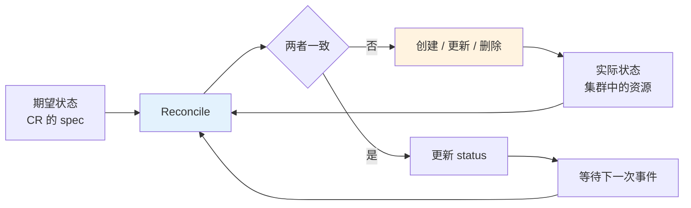
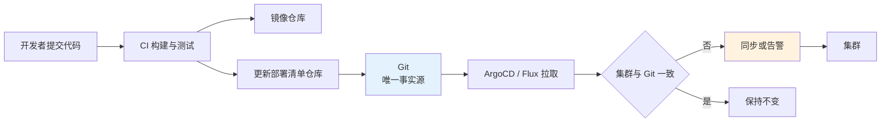
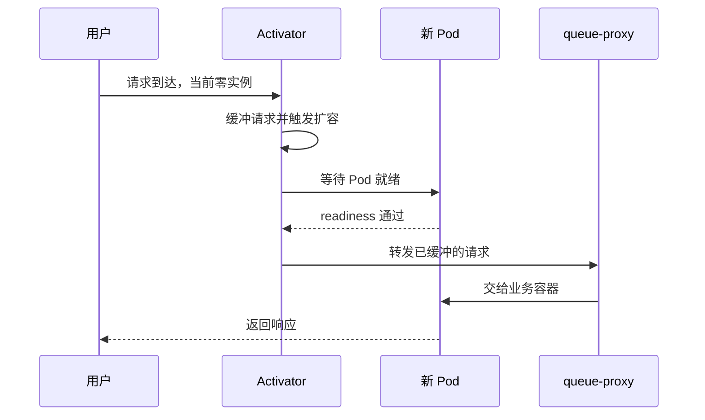

# Operator 与 GitOps 及 Serverless

> 定位：Kubernetes 的声明式 API 不只是「写 YAML」，它背后是一套「控制器不断把实际状态拉回期望状态」的机制。理解它，才能看懂 Prometheus Operator、CloudNativePG 这类组件为什么能自愈；也才能理解 GitOps 为什么要求「Git 是唯一事实源」。这篇从 Reconciler 原理讲到 ArgoCD 同步策略，再到 Knative 的冷启动链路，帮你在「自己写 Operator」「用 GitOps 管发布」「上 Serverless」三个决策上给出有依据的答案。

## 一、为什么需要它

三类问题，正好对应本文三个主题：

1. **「CR 改了，但没生效」**：自定义资源创建成功，底层 StatefulSet 却没变化。是控制器没收到事件，还是 Reconcile 报错被重试掩盖了？
2. **「有人手动改了线上，第二天又变回去了」**：Git 里是 3 副本，线上被人改成 10 副本，ArgoCD 的 `selfHeal` 又改回 3。这到底是保护还是阻碍？
3. **「Serverless 便宜，但第一个请求要 8 秒」**：Java 应用冷启动叠加镜像拉取，用户体验比自建还差。

这三个问题的共同点是：**它们都发生在「期望状态」与「实际状态」之间**。Operator 负责把两者的差距收敛，GitOps 负责让「期望状态」只有一个来源，Serverless 则把「有没有实例」本身也变成了期望状态的一部分。

## 二、核心原理

### 2.1 声明式 API 与控制器模式

Kubernetes 的所有对象都分两部分：`spec` 是**期望状态**，`status` 是**实际状态**（对象体系的回顾见 [Kubernetes 核心](02-Kubernetes核心.md)）。控制器的工作就是写一个循环：读 spec、读实际资源、比较、执行差异动作。



读图要点：这个循环是**电平触发（level-triggered）**而不是边沿触发——控制器不关心「发生了什么事件」，只关心「现在差多少」。好处是丢事件不会导致状态永久错误：下一次 resync 或任何相关事件都会重新对齐。代价是 Reconcile 必须**幂等**，因为同一个对象可能被反复调谐。

### 2.2 CRD、Informer 与 Reconcile

Operator = CRD（定义新类型）+ 控制器（实现调谐逻辑）。运行时链路是：

1. **Reflector** 通过 List-Watch 从 apiserver 拉取对象；
2. 变更写入 **DeltaFIFO** 队列；
3. **Informer** 更新本地缓存（Indexer），并回调事件处理器；
4. 事件处理器只把「对象 key」放进 **WorkQueue**（不传对象本身，避免状态过期）；
5. **Reconcile** 从 WorkQueue 取 key，回缓存读最新对象，执行调谐。

这个设计的精妙之处在于「队列里只有 key」：即使短时间内同一对象被改十次，也只会合并成少数几次调谐，且每次读到的都是最新状态。

### 2.3 开发框架对比

| 框架 | 语言 | 基础 | 适合 |
|---|---|---|---|
| Kubebuilder | Go | controller-runtime | 新建 Go Operator 的主流选择 |
| Operator SDK | Go / Ansible / Helm | controller-runtime | 需要 Ansible/Helm 复用 |
| Java Operator SDK | Java | Fabric8 Kubernetes Client | Java 团队、与现有服务同栈 |
| Quarkus Operator SDK | Java | Quarkus + Java Operator SDK | 需要快速启动与原生镜像 |

Java 团队选 Java Operator SDK 的最大理由是**复用现有技术栈**：序列化、配置、监控、发布流程都不用另起一套。代价是生态与示例少于 Go，复杂场景要自己补。

### 2.4 典型场景

- **有状态中间件**：CloudNativePG（PostgreSQL）、Strimzi（Kafka）、Elastic ECK、Vitess Operator。它们把「建集群、扩副本、做主从切换、备份恢复」编码成调谐逻辑。
- **监控体系**：Prometheus Operator 用 `ServiceMonitor`、`PrometheusRule` 把抓取配置声明化。
- **平台能力**：内部中间件平台把「申请一个 Redis」变成创建一个 `RedisCluster` CR，背后由 Operator 完成资源编排。

判断要不要写 Operator，只看一件事：**这套运维知识是否能被编码成确定的、可重复的调谐步骤**。如果每次故障都要人判断、每次扩缩容都有例外，那先写 Runbook，别急着写 Operator。

### 2.5 GitOps：Git 作为唯一事实源

OpenGitOps 定义了四条原则：

1. **声明式**：系统状态用声明式方式描述；
2. **版本化且不可变**：状态存在 Git 中，有完整历史；
3. **自动拉取**：集群内的 agent 主动拉取，而不是外部推送；
4. **持续调谐**：agent 不断比较并修正漂移。



读图要点：CI 的产物有两个——镜像和「指向该镜像的清单变更」。**部署清单必须单独提交到 Git**，而不是 CI 直接 `kubectl apply`；否则 Git 里记录的永远不是线上真实状态，「回滚」也就无从谈起。

ArgoCD 与 Flux 的差异：ArgoCD 自带 UI、多集群管理与 Application CRD，上手快；Flux 更「控制器化」，每个能力（GitRepository、Kustomization、HelmRelease）都是独立 CRD，组合灵活但学习曲线更陡。两者的分工与流水线设计见 [CI/CD 与发布策略](04-CICD与发布策略.md)。

### 2.6 Serverless 的三种形态

| 形态 | 代表 | 伸缩单位 | 冷启动来源 |
|---|---|---|---|
| FaaS | AWS Lambda、阿里云函数计算 | 函数实例 | 运行时初始化 + 代码加载 |
| Serverless 容器 | Cloud Run、Azure Container Apps | 容器实例 | 镜像拉取 + 进程启动 |
| Knative Serving | Knative + Kourier/Istio | Pod（Revision） | 调度 + 镜像 + 应用启动 |

Knative 是最「Kubernetes 原生」的形态：它用 `Configuration` 管理版本、`Revision` 固化每次变更、`Route` 做流量分配，并在没有流量时缩到零。缩到零之后，请求先到 **Activator** 缓冲，等 Pod 就绪再转发。



读图要点：冷启动延迟 = 扩容决策 + 调度 + 镜像拉取 + 应用启动 + 就绪探针。Java 应用通常卡在「应用启动」这一段，所以 Knative 的优化重点不是调度，而是**让 JVM 更快就绪**（原生镜像、CDS、减少启动期初始化）。

## 三、关键机制

### 3.1 CRD 定义示例

```yaml
apiVersion: apiextensions.k8s.io/v1
kind: CustomResourceDefinition
metadata:
  name: databases.example.com
spec:
  group: example.com
  scope: Namespaced
  names:
    kind: Database
    plural: databases
    singular: database
    shortNames: ["db"]
  versions:
    - name: v1
      served: true
      storage: true
      subresources:
        status: {}
      additionalPrinterColumns:
        - name: Engine
          type: string
          jsonPath: .spec.engine
      schema:
        openAPIV3Schema:
          type: object
          properties:
            spec:
              type: object
              required: ["engine", "version"]
              properties:
                engine:
                  type: string
                  enum: ["mysql", "postgres"]
                version:
                  type: string
                replicas:
                  type: integer
                  minimum: 1
                  default: 3
            status:
              type: object
              properties:
                readyReplicas:
                  type: integer
```

三个细节值得注意：`subresources.status` 让控制器只能改 status 而不能改 spec；schema 里的 `required`、`enum`、`default` 是准入校验的第一道防线；`additionalPrinterColumns` 决定 `kubectl get db` 能看到什么。

### 3.2 Java Reconciler 示例

```java
@ControllerConfiguration
public class DatabaseReconciler implements Reconciler<Database> {

    private final KubernetesClient client;

    public DatabaseReconciler(KubernetesClient client) {
        this.client = client;
    }

    @Override
    public UpdateControl<Database> reconcile(Database db, Context<Database> context) {
        StatefulSet desired = buildStatefulSet(db);          // 由 spec 推导期望资源
        StatefulSet actual = client.apps().statefulSets()
                .inNamespace(db.getMetadata().getNamespace())
                .withName(desired.getMetadata().getName())
                .get();

        if (actual == null) {
            client.apps().statefulSets().resource(desired).create();
        } else if (!Objects.equals(actual.getSpec(), desired.getSpec())) {
            client.apps().statefulSets().resource(desired).update();
        }

        int ready = countReady(db);
        if (db.getStatus() == null || db.getStatus().getReadyReplicas() != ready) {
            db.setStatus(new DatabaseStatus(ready));
            return UpdateControl.updateStatus(db);            // 只在变化时回写
        }
        return UpdateControl.noUpdate();
    }
}
```

这段代码的两个要点就是 Operator 的两条铁律：**先读后写（幂等）**、**status 只在变化时更新（避免自己触发自己）**。

### 3.3 ArgoCD Application 示例

```yaml
apiVersion: argoproj.io/v1alpha1
kind: Application
metadata:
  name: order-service
  namespace: argocd
spec:
  project: default
  source:
    repoURL: https://git.example.com/platform/deploy.git
    targetRevision: main
    path: apps/order-service
  destination:
    server: https://kubernetes.default.svc
    namespace: order
  syncPolicy:
    automated:
      prune: true          # Git 中删除的资源，集群中也删除
      selfHeal: true       # 集群被手改后自动拉回
    syncOptions:
      - CreateNamespace=true
      - ApplyOutOfSyncOnly=true
    retry:
      limit: 3
      backoff:
        duration: 10s
        factor: 2
        maxDuration: 3m
```

`prune` 和 `selfHeal` 是 GitOps 威力的来源，也是事故的来源：前者会删除「Git 里没有但集群里有」的资源，后者会覆盖所有手动变更。**开启前必须确认集群里没有手工维护的遗留资源**，否则第一次同步就是一次删除演练。

### 3.4 漂移检测与回滚

ArgoCD 的漂移检测基于「Git 渲染结果 vs 集群实时状态」的 diff，默认每三分钟比较一次（可配置）。回滚有两种语义：

- **Git 回滚**：`git revert` 清单提交，ArgoCD 自动同步——这是 GitOps 推荐的方式，历史可审计。
- **应用回滚**：在 ArgoCD 上选择历史版本回滚——快，但会让 Git 与集群短暂不一致，需要尽快把变更补回 Git。

## 四、生产坑点与排查

### 坑点 1：Reconcile 非幂等，资源被重复创建

**现象**：调谐日志里频繁出现 `AlreadyExists`，或者同名资源被反复创建删除。
**原因**：代码直接 `create` 而没有先查询；或用 `generateName` 每次生成新名字。
**解法**：严格「先读后写」，资源名由 CR 名称确定性推导；创建冲突时视为成功并继续；用 `Server-Side Apply` 处理字段归属。

### 坑点 2：更新 status 触发自身 watch，形成热循环

**现象**：某个 CR 的调谐次数每秒几十次，控制器 CPU 打满，apiserver 压力上升。
**原因**：Reconcile 无条件写 status，写入又触发 watch 事件，再次进入 Reconcile。
**解法**：只在字段真正变化时 `updateStatus`；用 `observedGeneration` 判断是否已处理过该版本；把 status 更新与业务调谐分离。

### 坑点 3：finalizer 没清理，CR 永远删不掉

**现象**：`kubectl delete database xxx` 后对象一直处于 `Terminating`。
**原因**：控制器注册了 finalizer，但删除逻辑失败或控制器已下线，没人移除 finalizer。
**解法**：删除逻辑要可重入、可重试；监控长期 Terminating 的资源；紧急情况下人工移除 finalizer，但要先确认外部资源已清理。

### 坑点 4：CRD 升级不兼容，旧对象读不出来

**现象**：Operator 升级后，已有的 CR 无法被新版本解析，调谐全部失败。
**原因**：新增了必填字段、改了字段类型、或删除了 storage version 而没做转换。
**解法**：CRD 变更遵守兼容性原则（只加可选字段）；多版本时提供 conversion webhook；升级前在测试集群用真实 CR 做一遍读取验证。

### 坑点 5：ArgoCD 的 prune 删掉了手工资源

**现象**：一次同步后，集群里某个手工创建的 ConfigMap 或 HPA 消失。
**原因**：`prune: true` 会删除「Git 中没有但属于该 Application 管理范围」的资源。
**解法**：开启 prune 前先做一次 dry-run diff；给手工资源加 `argocd.argoproj.io/sync-options: Prune=false` 注解；遗留资源先迁进 Git 再开启。

### 坑点 6：Serverless 冷启动把数据库连接池打爆

**现象**：流量低谷缩到零，第一波请求恢复时数据库报 `too many connections`。
**原因**：每个新实例都创建一个固定大小的连接池，瞬时扩容 N 个实例就是 N × poolSize 个连接。
**解法**：Serverless 场景把池调小并设置较短的 idle 超时；用连接代理（如 PgBouncer）收敛；设置 `minScale` 保留少量热实例；Java 侧用惰性初始化避免启动即建连。

## 五、选型与边界

| 需求 | 建议 | 不推荐 |
|---|---|---|
| 部署一套标准中间件 | 用社区 Operator（CNPG、Strimzi） | 自己从零写 |
| 只是打包应用 | Helm / Kustomize | 写 Operator |
| 需要复杂运维编排 | 自研 Operator | 堆一堆 Job 脚本 |
| 多集群统一发布 | ArgoCD / Flux | 每集群手工 apply |
| 流量稀疏、按量计费 | Serverless 容器 / Knative | 常驻大规格集群 |
| 长连接、低延迟稳定流量 | 常驻 Deployment | 缩到零的 Serverless |

**不该用 Operator 的场景**：运维逻辑尚未稳定、每次故障处理都不一样；团队没有 K8s 控制器开发经验；用 Helm 就能表达清楚。**不该上 GitOps 的场景**：清单还没有版本化、集群里大量手工资源、没有代码评审流程——先把这些补齐，否则只是把混乱搬进 Git。**不该用 Serverless 的场景**：P99 敏感的长连接服务、启动就要加载大模型的 Java 应用、需要固定出口 IP 的对接。

## 六、面试高频问法

**Q1：什么是声明式 API？它和命令式有什么区别？**

**一句话结论**：声明式描述「我要什么状态」，由控制器反复调谐；命令式描述「执行什么动作」，执行完就结束。声明式天然支持自愈与幂等。

展开：

- **声明式**：提交 spec，控制器负责达成；重复提交结果一致。
- **命令式**：`kubectl run`、脚本一步步执行；失败后状态不确定。
- **关键差异**：声明式有「期望 vs 实际」的持续比较，命令式没有；代价是控制器复杂度转移给了平台。

加分点：说「声明式不是凭空变简单，而是把复杂度从调用方转移到了平台」。

**Q2：Operator 的原理是什么？为什么需要 CRD？**

**一句话结论**：CRD 定义新的资源类型，Operator 是监听该类型并调谐其底层资源的控制器；CRD 让「运维知识」可以用 Kubernetes 原生的方式声明和复用。

展开：

- **CRD**：扩展 apiserver 的类型系统，提供 schema 校验与 status 子资源。
- **控制器**：Informer 监听 → WorkQueue → Reconcile → 写回 status。
- **价值**：把「建库、扩容、切主、备份」变成声明式 API。

加分点：说「Operator 封装的是运维领域知识，不是业务逻辑」——判断该不该写 Operator，就看这套知识是否稳定可编码。

**Q3：level-triggered 和 edge-triggered 有什么区别？为什么 K8s 选前者？**

**一句话结论**：edge-triggered 只对「变化事件」作出反应，丢事件就永久错位；level-triggered 每次都比较当前完整状态，丢事件也能在下次调谐中恢复。

展开：

- **edge**：事件驱动，效率高但依赖事件不丢。
- **level**：状态驱动，靠 resync 与全量比较兜底。
- **代价**：Reconcile 必须幂等，且可能被重复调用。

加分点：说「这就是为什么 Reconcile 不能假设自己只被调用一次」，直接连到写 Operator 的第一条铁律。

**Q4：写 Operator 最容易踩哪些坑？**

**一句话结论**：非幂等导致重复创建、无条件写 status 导致热循环、finalizer 卡死删除、CRD 升级不兼容，这四类最常见。

展开：

- **幂等**：先读后写，名称确定性生成。
- **热循环**：只在变化时更新 status，用 `observedGeneration` 去重。
- **finalizer**：删除逻辑可重入，监控长期 Terminating。
- **CRD 演进**：只加可选字段，多版本用 conversion webhook。

加分点：补一句「调谐日志要看重试次数，重试多说明要么冲突多、要么逻辑有副作用」。

**Q5：GitOps 的四条原则是什么？**

**一句话结论**：声明式、版本化且不可变、自动拉取、持续调谐。

展开：

- **声明式**：状态用声明式描述。
- **版本化**：Git 保存完整历史，可审计、可回滚。
- **拉取**：集群内 agent 主动拉，避免外部系统持有集群凭据。
- **持续调谐**：不断检测并修正漂移。

加分点：说「拉模式的安全收益常被忽略——CI 不需要集群的写权限」，这是 GitOps 在安全审计里最常被问的点。

**Q6：ArgoCD 的 selfHeal 和 prune 分别做什么？有什么风险？**

**一句话结论**：`selfHeal` 把手动修改拉回 Git 声明；`prune` 删除 Git 中已不存在的资源。前者会覆盖人工操作，后者可能误删手工资源。

展开：

- **selfHeal**：适合禁止手改的环境；排障期间的临时调整会被回滚。
- **prune**：开启前必须确认 Application 管理范围。
- **保护**：`Prune=false` 注解、sync window、dry-run diff。
- **回滚**：优先 `git revert`，而不是在 UI 上点历史版本。

加分点：说「selfHeal 与紧急止血天然冲突，要有暂停自动同步的流程」，体现生产经验。

**Q7：GitOps 和 CI/CD 是什么关系？**

**一句话结论**：CI 负责构建、测试、产出镜像并更新部署清单；CD 由 GitOps 工具从 Git 拉取并同步到集群。两者是分工，不是替代。

展开：

- **CI**：代码 → 镜像 → 清单变更提交。
- **CD**：Git → 集群，持续调谐。
- **边界**：CI 不直接持有集群写权限；部署状态以 Git 为准。
- **产物**：镜像用不可变 tag，清单里记录确切版本。

加分点：说「GitOps 让『线上跑的是什么版本』这个问题有了唯一答案」，这是它相比脚本发布最大的价值。

**Q8：Serverless 有哪几种形态？冷启动慢在哪？**

**一句话结论**：FaaS、Serverless 容器、Knative 三种形态；冷启动耗时来自调度、镜像拉取、运行时初始化和应用启动，Java 应用主要卡在最后一步。

展开：

- **FaaS**：函数级，运行时初始化占大头。
- **Serverless 容器**：镜像拉取 + 进程启动。
- **Knative**：调度 + 镜像 + 应用启动 + 就绪探针。
- **优化**：`minScale` 保温、原生镜像、CDS、减少启动期远程调用。

加分点：说「冷启动不是平均值问题，是 P99 问题——大部分请求很快，少数请求很慢」，符合 Serverless 的延迟分布特征。

**Q9：Knative 缩到零之后，请求是怎么被接住的？**

**一句话结论**：请求先到 Activator 缓冲，Activator 触发 KPA 扩容并等待 Pod 就绪，再把缓冲的请求经 queue-proxy 转发给业务容器。

展开：

- **Activator**：零实例时的入口，负责缓冲与转发。
- **KPA**：根据并发/请求速率决定副本数。
- **queue-proxy**：每个 Pod 的 sidecar，统计并发并限制单 Pod 请求数。
- **代价**：多一跳、多一份缓冲延迟。

加分点：说「Activator 是冷启动期间唯一在线的组件，它挂了就是全站 503」，能指出这个单点很加分。

**Q10：什么情况下不该用 Operator 或 Serverless？**

**一句话结论**：运维逻辑不稳定、团队没有控制器经验时不该写 Operator；长连接、低延迟、启动重的服务不该用缩到零的 Serverless。

展开：

- **Operator**：Helm 能表达、故障处理每次都不同、缺少开发与测试能力。
- **Serverless**：P99 敏感、需要固定出口 IP、启动即建大量连接。
- **折中**：`minScale` 保温、混合部署、把重服务留在常驻集群。

加分点：能说出「技术选型的成熟度体现在知道什么时候不用」，比罗列优点更有说服力。

## 小结

- Kubernetes 的声明式 API 靠控制器持续调谐，核心是 level-triggered + 幂等 Reconcile；Operator = CRD + 控制器，封装的是稳定的运维知识。
- 写 Operator 的四条铁律：先读后写、status 变化才更新、finalizer 可重入、CRD 只做兼容演进。
- GitOps 四原则：声明式、版本化、自动拉取、持续调谐；Git 是唯一事实源，回滚优先 `git revert`。
- `prune` 与 `selfHeal` 是威力也是风险，开启前先 dry-run、先迁走手工资源。
- Serverless 的成本优势建立在「能缩到零」上，冷启动与连接池是 Java 应用必须提前设计的两件事。

## 参考资料

- Kubernetes 文档，「Custom Resources」「Operator Pattern」与「Controllers」章节
- Kubebuilder Book 的 Reconciliation 章节；Java Operator SDK 官方文档的 Reconciler 与 `UpdateControl` 说明
- Argo CD 文档，「Sync Policy」「Automated Sync」「Diffing」章节；OpenGitOps 原则（CNCF GitOps Working Group）
- Knative Serving 文档，「Autoscaling」「Activator」「Revision」章节
