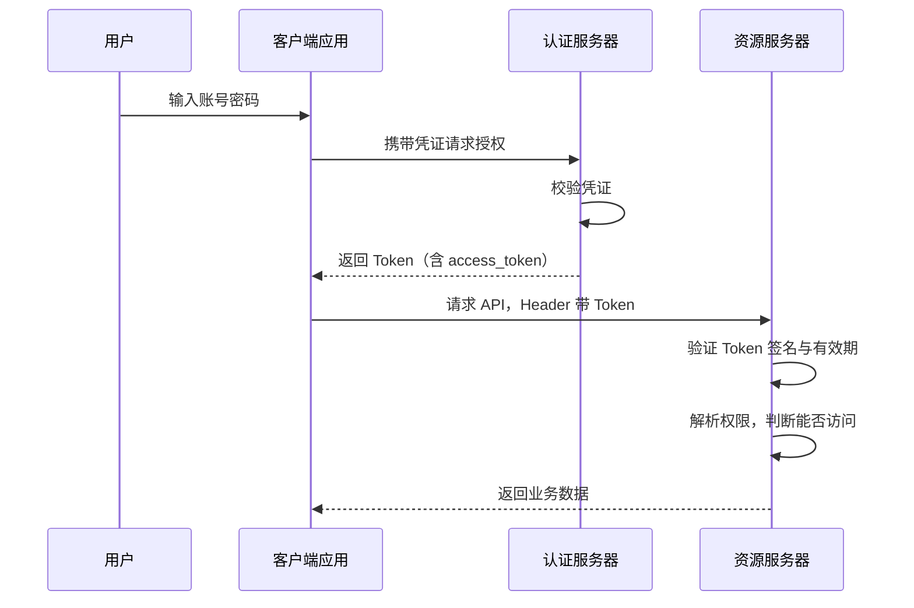
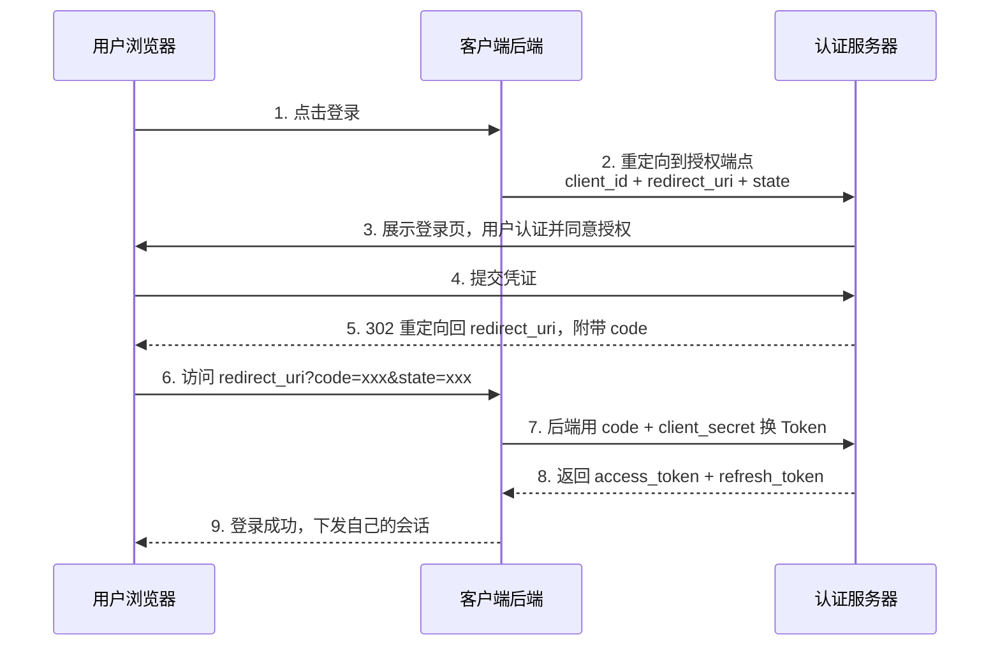
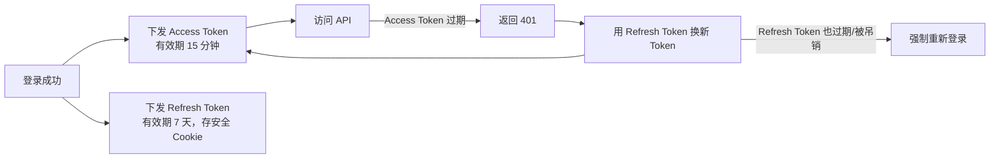
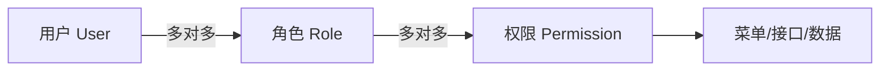

# 认证授权

> 定位：认证解决「你是谁」，授权解决「你能干什么」。这一篇把 OAuth2、OIDC、JWT、RBAC、SSO 这些高频却总被混用的概念串成一条主线，让你在设计登录体系时能讲清「为什么这么选」，而不是照搬 SDK。

## 一、为什么需要它

几乎所有业务系统都绕不开登录，但很多团队做到后面会陷入一团乱麻：App 用 JWT，后台管理用 Session，开放平台接了 OAuth2，内部系统又上了单点登录，Token 过期、刷新、踢人下线各写一套，最后谁也说不清某个接口到底该信任哪种凭证。

问题的根源是**概念没分层**。认证（Authentication）、授权（Authorization）、身份（Identity）、会话（Session）是四件事，却经常被当成一件事讨论：

- **认证**：确认「你声称的身份是真的」——账号密码、手机验证码、人脸识别都是认证手段。
- **授权**：确认「你有权限做这件事」——认证通过后，还要判断你能不能删这条订单。
- **身份协议**：把认证结果标准化、跨系统传递——OIDC 干这个。
- **会话管理**：认证之后如何保持状态——Session / Token 干这个。

先把这几层分清，后面的技术选型才有意义。

## 二、核心原理：从认证到授权的完整链路

一次典型的「登录 + 访问受保护资源」，其实经过了好几跳。先看整体流程，再逐层拆解。



图里有个关键点：**认证服务器（AS）和资源服务器（RS）在逻辑上是两个角色**。它们可以部署在一起，也可以分离——开放平台里，AS 是微信/Google，RS 是你的业务服务。理解这个分离，是理解 OAuth2 的前提。

### 2.1 认证 vs 授权：一句话区分

| 维度 | 认证（Authentication） | 授权（Authorization） |
|---|---|---|
| 解决问题 | 你是谁 | 你能做什么 |
| 发生顺序 | 先发生 | 后发生 |
| 典型产物 | ID Token / Session / 身份断言 | Access Token / 权限列表 |
| 失败状态码 | 401 Unauthorized | 403 Forbidden |
| 类比 | 刷门禁卡进园区 | 进园区后能不能进机房 |

> 记忆技巧：401 是「你没证明身份」，403 是「我知道你是谁，但你不配」。这两个状态码用错，是很多自制网关的通病。

### 2.2 OAuth2 是什么：授权框架，不是认证协议

OAuth2 的本质是一个**授权框架**——它解决的是「如何让第三方应用在不拿到你密码的前提下，访问你在某个服务上的资源」。

举一个最经典的例子：用微信登录某 App。你不希望把微信密码给这个 App，但又想让它读到你的微信头像昵称。OAuth2 的做法是：微信给你一个「授权凭证」，App 拿这个凭证换取一个**Access Token**，之后 App 只能用这个 Token 读你授权的那部分信息，而且你随时可以在微信里撤销它。

OAuth2 定义了四种授权模式（Grant Type）：

| 模式 | 适用场景 | 特点 |
|---|---|---|
| 授权码模式（Authorization Code） | 有后端的 Web 应用、移动 App | 最安全、最常用，Token 不经过浏览器 |
| 简化模式（Implicit） | 纯前端 SPA（已不推荐） | 直接返回 Token，易被截获，逐步淘汰 |
| 密码模式（Password） | 高度信任的第一方应用 | 用户把密码直接给客户端，仅存量系统可见 |
| 客户端凭证模式（Client Credentials） | 服务间调用、机器对机器 | 没有用户参与，代表客户端自己 |

**密码模式和简化模式正在被废弃**：OAuth 2.0 安全最佳实践（RFC 9700）明确建议，SPA 用「授权码 + PKCE」替代简化模式，第一方应用也应迁移到授权码模式。新项目不要用这两个。

### 2.3 授权码模式：重点中的重点

授权码模式最大的设计智慧是：**用一个短命的、一次性的授权码（code）换 Token，而 Token 本身不经过浏览器地址栏传递**，降低了泄露风险。



几个必须讲清的细节：

- **`state` 参数防 CSRF**：第 2 步客户端生成随机 `state` 存 Session，第 6 步回调时校验是否一致。不一致就拒绝——否则攻击者可以诱导用户点击带自己 code 的链接，把受害者账号绑到攻击者上（登录 CSRF）。
- **`redirect_uri` 精确匹配**：认证服务器必须校验回调地址与注册时完全一致，否则开放重定向 + code 泄露。
- **code 只能一次**、有效期很短（通常 60 秒）。
- **PKCE（Proof Key for Code Exchange）**：针对移动端和 SPA 无法安全保存 `client_secret` 的问题。客户端先生成随机 `code_verifier`，派生 `code_challenge` 随授权请求发出，换 Token 时再带上 `code_verifier`，服务端校验二者匹配。这样即使 code 被截获，攻击者没有 verifier 也换不到 Token。现在**授权码 + PKCE 是所有场景的推荐默认**。

### 2.4 OIDC 与 ID Token：给 OAuth2 补上「认证」

OAuth2 只解决授权，它返回的 Access Token 是给资源服务器看的，**客户端其实并不知道用户到底是谁**。OIDC（OpenID Connect）在 OAuth2 之上加了一层身份协议：

- 新增一个 **`id_token`**，它是 JWT 格式，包含用户身份信息（`sub` 用户唯一标识、`iss` 签发者、`aud` 受众、`exp` 过期时间等）。
- 新增一个 `userinfo` 端点，用 Access Token 可以拉取用户资料。
- 明确了一组标准 Scope：`openid`（必须）、`profile`、`email` 等。

所以判断标准很简单：**只要拿到 `id_token`，就是 OIDC（认证 + 授权）；只拿 `access_token`，是纯 OAuth2（授权）**。国内很多「OAuth2 登录」其实用的是 OIDC，只是叫法混了。

### 2.5 JWT：自包含的凭证

JWT（JSON Web Token）有三段，用 `.` 分隔：`Header.Payload.Signature`。

```text
# Header：声明算法和类型
{"alg": "HS256", "typ": "JWT"}

# Payload：声明（claims），存放身份、权限、过期时间
{
  "sub": "10086",
  "name": "zhangsan",
  "roles": ["admin", "dev"],
  "iat": 1710000000,
  "exp": 1710003600
}

# Signature：对前两段签名，防篡改
HMACSHA256(base64url(header) + "." + base64url(payload), secret)
```

关键点：

- **JWT 是 Base64URL 编码，不是加密**。Payload 内容任何人都能解出来，绝不能放密码、身份证号等敏感信息。
- **签名的意义是防篡改**：服务端用密钥验证签名，内容一旦被改，签名对不上。
- **JWS vs JWE**：上面这种是 JWS（签名）；真正要加密内容得用 JWE（加密），但用得少。

| 优点 | 缺点 |
|---|---|
| 自包含，服务端无状态、易水平扩展 | 无法主动作废（签发后到过期前一直有效） |
| 跨语言、跨服务传递方便 | 内容泄露（Base64 可解），不能放敏感数据 |
| 减少数据库查 Session 的开销 | 体积比 Session ID 大，每次请求都带 |
| 天然适合微服务、移动端 | 密钥/私钥泄露影响面大；续期需要额外设计 |

### 2.6 Session vs Token：怎么选

| 维度 | Session（服务端状态） | Token/JWT（客户端状态） |
|---|---|---|
| 状态存放 | 服务端 Session 存储 | 客户端本地，服务端无状态 |
| 扩展性 | 多实例要共享 Session（Redis） | 天然无状态，易扩展 |
| 主动失效 | 容易，删服务端 Session 即可 | 难，需黑名单/短过期时间 |
| 适合场景 | 传统 Web、后台管理、需强管控 | 微服务、API、移动端、跨域 |
| CSRF 风险 | 依赖 Cookie，需防 CSRF | 手动放 Header，通常无 CSRF |

现代系统的常见折中：**用短过期 Access Token（15 分钟）+ 长过期 Refresh Token（7-30 天）**，兼顾安全与体验。



### 2.7 RBAC 权限模型

RBAC（基于角色的访问控制）是企业系统的主流模型：用户关联角色，角色关联权限，不直接给用户授权。



- **用户-角色-权限**三层是最常用的 RBAC0 模型。
- 角色可以继承（RBAC1），如「部门经理」继承「普通员工」的权限。
- 复杂场景引入「用户组」「组织架构」「数据权限」——例如「只能看本部门订单」，这需要把数据范围作为一个维度叠加。
- 权限标识设计建议用 `资源:动作` 格式，如 `order:delete`、`report:export`，便于统一鉴权。

### 2.8 单点登录 SSO

SSO（Single Sign-On）指一次登录，多个系统通行。主流实现是基于共享认证中心的 Cookie + Ticket：

1. 用户访问系统 A，未登录 → 跳转到认证中心。
2. 认证中心登录成功，写入自己的 Cookie（顶层域，如 `.company.com`）。
3. 回调系统 A 时带一个一次性 Ticket，A 用 Ticket 后端换取 Token。
4. 访问系统 B，再跳认证中心，此时 Cookie 已存在，无需再输密码，静默签发 B 的 Ticket。

关键点是**认证中心的 Cookie 设在共享顶层域**，所有子系统都能带上；子系统各自与认证中心换 Token，避免把主凭证暴露给业务系统。OIDC 是目前更标准的 SSO 实现方案。

### 2.9 Logout 与令牌失效：最容易被忽略的环节

「退出登录」在 JWT 无状态模型下不是删个 Session 那么简单：

- **删 Refresh Token**：服务端把它从存储中移除（或加入黑名单），这样刷新链路断掉，最有效。
- **Access Token 无法召回**：因为它自包含且服务端不存。常见做法是把它的 `jti`（Token 唯一 ID）加入 Redis 黑名单，过期时间设为 Token 剩余有效期；代价是每次请求都要查一次黑名单，牺牲了部分无状态性。
- **前端也要清理**：删除本地存储的 Token，否则下次还会带上。
- **OIDC 的 RP-Initiated Logout**：标准做法是调用认证中心的 `end_session_endpoint`，同时清理各依赖方的会话。

## 三、关键机制与参数

落地时有一批必须明确的细节：

| 项 | 推荐值 / 做法 | 说明 |
|---|---|---|
| Access Token 有效期 | 15 分钟 - 2 小时 | 越短越安全，靠 Refresh 续期 |
| Refresh Token 有效期 | 7-30 天 | 存 HttpOnly + Secure Cookie |
| JWT 签名算法 | HS256（单服务）或 RS256（多服务） | 非对称算法便于公私钥分离，私钥只在认证中心 |
| `state` / `nonce` | 每次随机，一次性 | 防 CSRF / 防重放 |
| 密码存储 | bcrypt / PBKDF2 / Argon2 | 加盐慢哈希，绝不明文或 MD5 |
| Token 传输 | Authorization: Bearer xxx | 不走 URL 参数，避免日志泄露 |

一个必须避免的坑：**JWT 算法设为 `none`**。攻击者可以把 `alg` 改成 `none`，绕过签名校验。校验时务必用白名单指定允许的算法，不要信任 Token 头里的 `alg`。

## 四、生产坑点与排查

### 坑点 1：JWT 无法主动失效，用户「退出登录」后 Token 还能用

**现象**：用户点了退出登录，但把旧 Token 放到 Postman 里还能调接口，直到过期才失效。
**原因**：JWT 自包含，服务端不存状态，「退出」只是前端删了本地 Token，服务端无从得知。
**解法**：
- 退出时把 Access Token 的 `jti` 写入 Redis 黑名单，TTL 设为 Token 剩余有效期；网关注入校验逻辑。
- 或者把 Access Token 有效期压到很短（如 10 分钟），配合 Refresh Token 撤销，把窗口降到可接受。
- 高安全场景（如金融）直接选服务端 Session，或有状态 Token。

### 坑点 2：Refresh Token 轮换没做检测，Token 被偷后可无限续期

**现象**：Refresh Token 泄露后，攻击者和服务端的正常用户都在用它刷新，始终发现不了。
**原因**：Refresh Token 是长期凭证，单次使用无感知。
**解法**：
- 实现**Refresh Token 轮换**：每次刷新都签发新 Refresh Token 并作废旧 Token。
- 引入**重放检测**：如果detect到已作废的 Refresh Token 再次使用，说明泄露，立即吊销该用户的所有 Token 链并告警。

### 坑点 3：OAuth2 回调 `state` 没校验，导致登录 CSRF

**现象**：用户莫名其妙账号被绑定/登录到攻击者的第三方账号上。
**原因**：授权请求没带 `state`，或回调时没校验 `state` 与 Session 中的一致性。
**解法**：
- 授权请求生成随机 `state` 存入会话（HttpOnly Cookie），回调时强制比对，不一致直接拒绝。
- OIDC 场景同时校验 `id_token` 中的 `nonce`，防止 Token 重放。

### 坑点 4：把敏感信息塞进 JWT Payload

**现象**：抓包或看日志时发现 Token 被 Base64 解出手机号、身份证号。
**原因**：误以为 JWT「加密了」，其实只是编码 + 签名。
**解法**：Payload 只放非敏感声明（用户 ID、角色、过期时间）；敏感数据放服务端，按 ID 查询。确需加密用 JWE。

## 五、调优 / 选型 / 最佳实践

做认证体系选型时，按场景决策：

| 场景 | 推荐方案 |
|---|---|
| 传统后台管理、需精细管控 | Session + Redis 共享 |
| 微服务 / 多端 / 开放 API | JWT + Refresh Token，网关注入鉴权 |
| 第三方登录 / 开放平台 | OIDC（授权码 + PKCE） |
| 服务间调用 | Client Credentials + 短命 Token |
| 多系统内网 | 统一认证中心 + SSO（OIDC） |

最佳实践清单：

1. 永远用 **HTTPS**，Token 不出现在 URL、日志、前端 localStorage（优先 HttpOnly Cookie）。
2. Access Token 短命，Refresh Token 长命但可撤销，且做轮换与重放检测。
3. 权限用 RBAC 模型，接口层统一鉴权，别在每个 Controller 手写 if。
4. 令牌校验用白名单算法，拒绝 `none`，校验 `iss`、`aud`、`exp`。
5. 审计留痕：登录、登出、Token 刷新、敏感操作都记日志。

## 六、面试高频问法

> 这一节按「能讲透」的标准写：每题先给一句能直接背的结论，再展开机制、对比与生产坑。建议先自己答一遍，再对照补全。

**Q1：认证和授权的区别？401 和 403 分别代表什么？**

**一句话结论**：认证确认"你是谁"，授权确认"你能干什么"；401 是未认证，403 是已认证但无权限，认证一定先于授权。

展开讲四层：

1. **认证（Authentication）**：验证身份凭证，确认你声称的身份是真的。手段有账号密码、手机验证码、人脸识别；产物是 Session、ID Token 或身份断言。
2. **授权（Authorization）**：身份确认后，判断你有没有权限做这件事。产物是 Access Token、权限列表。
3. **状态码**：`401 Unauthorized` 表示"你没证明身份"（未登录、Token 失效、签名错）；`403 Forbidden` 表示"我知道你是谁，但你不配"（权限不足）。
4. **顺序**：没认证就谈不上授权，所以网关里必须先做认证过滤器，再做授权判断。

| 维度 | 认证 | 授权 |
|---|---|---|
| 解决 | 你是谁 | 你能做什么 |
| 失败码 | 401 | 403 |
| 类比 | 刷门禁卡进园区 | 进园区后能否进机房 |

加分点：401 和 403 用反是自制网关的通病。记一句话——"401 是门卫不放你进园区，403 是进了园区但不让你进机房"。规范上 401 响应还应带 `WWW-Authenticate` 头，这个细节很少有人答到。

**Q2：OAuth2 是什么？有哪四种授权模式？为什么推荐授权码模式？**

**一句话结论**：OAuth2 是**授权框架，不是认证协议**，解决"第三方在不拿到你密码的前提下访问你的资源"；四种模式中授权码模式最安全，是推荐默认。

四种模式对比：

| 模式 | 适用场景 | 特点 |
|---|---|---|
| 授权码（Authorization Code） | 有后端的 Web、移动 App | 最安全，Token 由后端用 code 换取，不经过浏览器 |
| 简化（Implicit） | 纯前端 SPA（已不推荐） | 直接返回 Token 到 URL，易被截获 |
| 密码（Password） | 高度信任的第一方 | 用户把密码直接给客户端，仅存量系统可见 |
| 客户端凭证（Client Credentials） | 服务间调用 | 没有用户参与，代表客户端自己 |

**为什么授权码最安全**：Token 不走浏览器地址栏、不经过前端 JS，只在后端用一次性 code + client_secret 交换；code 短命（通常 60 秒）且只能用一次；再叠加 PKCE 后，即使 code 被截获也换不到 Token。

加分点：能说出 RFC 9700（OAuth 2.0 安全最佳实践）已明确建议废弃简化模式和密码模式，SPA 迁移到"授权码 + PKCE"——这是近两年最新的安全结论，面试官很吃这个"版本感"。

**Q3：详细讲一下 OAuth2 授权码模式的完整流程？state 和 PKCE 各自防什么？**

**一句话结论**：用一次性短命 code 换 Token，Token 全程不经浏览器；`state` 防登录 CSRF，PKCE 防 code 被截获后冒用。

完整链路（这是必须能默写的高频题）：

1. 客户端生成随机 `state` 存入会话，重定向到授权端点：`client_id + redirect_uri + response_type=code + state + code_challenge`。
2. 认证服务器展示登录页，用户认证并同意授权。
3. 认证服务器 302 回调 `redirect_uri?code=xxx&state=xxx`。
4. 客户端比对回调的 `state` 与会话中的值，不一致直接拒绝。
5. 客户端**后端**用 `code + client_secret`（+ `code_verifier`）请求 token 端点换 Token。
6. 认证服务器返回 `access_token` + `refresh_token`，前端只拿到自己系统的会话。

**state 防什么**：防登录 CSRF——攻击者诱导用户点击带"攻击者自己 code"的链接，若没有 state，受害者账号就被绑到攻击者第三方账号上。

**PKCE 防什么**：移动端/SPA 无法安全保存 `client_secret`。客户端先生成随机 `code_verifier`，派生出 `code_challenge` 随授权请求发出；换 Token 时带上 `code_verifier`，服务端校验其与 challenge 匹配（通常用 S256 变换）。攻击者截获 code 也没有 verifier，换不到 Token。

加分点：补一句"`redirect_uri` 必须与注册值精确匹配"，否则开放重定向 + code 泄露会形成组合攻击。现在"授权码 + PKCE"是所有场景（含后端 Web）的推荐默认，不只是 SPA。

**Q4：OIDC 和 OAuth2 什么关系？ID Token 里有什么？**

**一句话结论**：OAuth2 只做授权，OIDC 在它之上加了身份层；判断标准很简单——拿到 `id_token` 就是 OIDC，只有 `access_token` 是纯 OAuth2。

展开：

- **OAuth2 的局限**：返回的 Access Token 是给资源服务器看的"资格凭证"，客户端其实并不知道用户到底是谁。
- **OIDC（OpenID Connect）的补充**：新增 `id_token`（JWT 格式）、`userinfo` 端点、标准 Scope（`openid` 必选，还有 `profile`、`email`）。
- **ID Token 的标准声明**：`sub`（用户唯一标识）、`iss`（签发者）、`aud`（受众）、`exp`（过期时间）、`iat`（签发时间）、`nonce`（防重放，与授权请求时的随机值对应）。

| 协议 | 回答的问题 | 产物 |
|---|---|---|
| OAuth2 | 能不能访问资源 | access_token |
| OIDC | 用户是谁 + 能不能访问 | id_token + access_token |

加分点：国内很多"OAuth2 登录"其实是 OIDC，只是叫法混了。加分说法——OIDC 场景下必须校验 id_token 的签名、`iss`、`aud`、`exp` 和 `nonce`，很多自研实现只解 JWT 不校验，这是致命漏洞。

**Q5：JWT 的结构？签名怎么保证安全？优缺点是什么？**

**一句话结论**：JWT 由 `Header.Payload.Signature` 三段组成，签名只能防篡改、内容并不加密；优点是无状态易扩展，缺点是无法主动作废、不能放敏感信息。

展开：

- **三段结构**：Header 声明算法和类型（`{"alg":"HS256","typ":"JWT"}`）；Payload 放声明（`sub`、`roles`、`iat`、`exp`）；Signature = `HMACSHA256(base64url(header)+"."+base64url(payload), secret)`。
- **签名的意义**：服务端用密钥重算签名并比对，Header/Payload 任何一个字节被改，签名就对不上。算法上 HS256（对称，单服务）或 RS256（非对称，多服务，私钥只在认证中心）。
- **优点**：自包含、服务端无状态、易水平扩展、跨语言跨服务传递、省掉查 Session 的开销。
- **缺点**：签发后到过期前无法作废；Base64URL 是编码不是加密，Payload 人人可解；体积比 Session ID 大，每次请求都带；密钥泄露影响面大。

加分点：区分 JWS 和 JWE——上面这种只签名的是 JWS，真要保密内容得用 JWE（加密），但用得少。面试官爱追问"JWT 里能不能放密码/手机号"，答案是绝对不能，Base64 一解就出来。

**Q6：JWT 无法主动失效，用户退出登录后旧 Token 还能用，怎么解决？**

**一句话结论**：JWT 自包含、服务端不存状态，"退出"只删前端 Token 没用；靠 `jti` 黑名单 + 短 Access Token + 撤销 Refresh Token 组合解决。

这是生产常见事故，按三层讲：

1. **现象**：用户点了退出登录，把旧 Token 放 Postman 里还能调接口，直到过期才失效。根因是服务端无从得知"退出"这件事。
2. **解法**：
   - 退出时把 Token 的 `jti`（唯一 ID）写入 Redis 黑名单，TTL 设为 Token 剩余有效期，网关层统一校验；
   - Access Token 有效期压到 10~15 分钟，靠 Refresh Token 续期，把可利用窗口降到可接受；
   - 高安全场景（金融、支付）直接选服务端 Session / 有状态 Token，从根上支持即时失效。
3. **代价**：黑名单让每次请求多一次 Redis 查询，牺牲了部分无状态性和性能。

加分点：主动说"这是无状态认证的固有取舍——想要主动失效，就必须引入某种状态"。OIDC 场景还要调用认证中心的 `end_session_endpoint` 清理各依赖方会话，只删本地 Token 远远不够。

**Q7：Session 和 Token/JWT 怎么选？**

**一句话结论**：Session 服务端存状态、易失效但多实例要共享；JWT 无状态易扩展但难作废；按场景选，现代系统常用"短 Access Token + 长 Refresh Token"折中。

| 维度 | Session（服务端状态） | Token/JWT（客户端状态） |
|---|---|---|
| 状态存放 | 服务端 Session 存储 | 客户端，服务端无状态 |
| 扩展性 | 多实例要 Redis 共享 | 天然无状态，易水平扩展 |
| 主动失效 | 容易，删 Session 即可 | 难，需黑名单/短过期 |
| CSRF 风险 | 依赖 Cookie，需专门防 | 放 Header 天然免疫 |
| 适合场景 | 传统 Web、后台管理、强管控 | 微服务、API、移动端、跨域 |

**常见折中**：Access Token 15 分钟 + Refresh Token 7~30 天（存 HttpOnly + Secure Cookie），兼顾安全与体验；Refresh Token 还要做轮换和重放检测。

加分点：别迷信 JWT。后台管理这类需要"踢人下线、权限变更即时生效"的场景，Session + Redis 反而更简单可靠。JWT 真正的优势在跨服务、跨端传递和减少存储，不在"更安全"。

**Q8：RBAC 权限模型怎么设计？**

**一句话结论**：用户关联角色、角色关联权限，不直接给用户授权；"用户-角色-权限"三层多对多是主流 RBAC0，复杂场景再叠加角色继承和数据权限维度。

展开：

- **三层模型**：`User ↔ Role ↔ Permission`（多对多），Permission 再关联菜单/接口/数据。新增用户只需挂角色，不用逐个配权限，这是 RBAC 相对 ACL 的核心价值。
- **权限标识**：用"资源:动作"格式，如 `order:delete`、`report:export`，接口层用 `@PreAuthorize("hasAuthority('order:delete')")` 统一鉴权，别在每个 Controller 手写 if。
- **演进**：RBAC1 加角色继承（部门经理继承普通员工）；RBAC2 加约束（互斥角色、基数限制）。
- **数据权限**：如"只能看本部门订单"，要把数据范围作为独立维度叠加，查询时拼 `AND dept_id = ?`。

加分点：务必区分**功能权限**和**数据权限**——很多系统只做了"能不能调接口"，漏了"能看谁的数据"，水平越权就出在这里。另一个生产坑：角色固化进 JWT 后，角色变更要等 Token 过期才生效，要么缩短期，要么权限从服务端查。

**Q9：SSO 单点登录的原理是什么？**

**一句话结论**：一次登录多系统通行；核心是共享认证中心的顶层域 Cookie + 一次性 Ticket，子系统后端用 Ticket 换 Token，主凭证不下发给业务系统。

流程四步：

1. 用户访问系统 A，未登录 → 重定向到认证中心。
2. 认证中心登录成功，**Cookie 设在共享顶层域**（如 `.company.com`），所有子系统请求都能带上。
3. 回调系统 A 时带一次性 Ticket，A 在**后端**用 Ticket 换取 Token。
4. 访问系统 B 再跳认证中心，此时 Cookie 已存在，无需再输密码，静默签发 B 的 Ticket。

**为什么要 Ticket 换 Token**：避免把认证中心的主凭证（顶级 Cookie/Token）直接暴露给各业务系统；Ticket 一次性、短命，即使泄露也难以复用。

加分点：能提到 CAS 的 TGT（Ticket Granting Ticket）+ ST（Service Ticket）机制更好；再补一句"OIDC 是目前更标准、更现代的 SSO 实现方案"，把老方案和新技术串起来。

**Q10：JWT 有哪些常见安全坑？**

**一句话结论**：`alg=none` 绕过签名、Payload 放敏感信息、弱密钥、不校验 `iss`/`aud`/`exp`，是 JWT 四大高频坑。

逐个拆：

1. **alg=none 攻击**：攻击者把 Header 的 `alg` 改成 `none` 并去掉签名段，期望服务端跳过校验。防御：服务端用**白名单固定允许的算法**，绝不信任 Token 头里的 `alg`。
2. **敏感信息泄露**：Payload 只是 Base64URL 编码，手机号、身份证一解就出来。只放非敏感声明，敏感数据按 ID 回服务端查。
3. **弱密钥/私钥泄露**：HS256 密钥太短可暴力破解，RS256 私钥泄露则全网可伪造。密钥放 KMS，定期轮换。
4. **不校验标准声明**：必须校验 `exp`（过期）、`iss`（签发者）、`aud`（受众），否则可能接受其他系统签发的 Token。

加分点：还能说出**算法混淆攻击**——若服务端用 RS256 的公钥当 HS256 的密钥去校验，攻击者拿公开公钥就能伪造 Token（CVE 常见套路）。防御同样是白名单固定算法、禁止算法协商。

**Q11：Refresh Token 的轮换和重放检测怎么做？**

**一句话结论**：Refresh Token 是长期凭证，每次刷新都签发新 Token 并作废旧 Token；一旦检测到已作废的 Token 再次使用，判定泄露，立即吊销整个 Token 链。

展开：

- **背景**：Refresh Token 有效期 7~30 天，存 HttpOnly + Secure Cookie；单次使用无感知，被偷后可无限续期，所以必须做检测。
- **轮换（Rotation）**：每次刷新都返回新的 Refresh Token，同时把旧的标记为已作废。
- **重放检测**：如果某个"已作废"的 Refresh Token 又出现了，说明正常用户和攻击者都在用——立即吊销该用户的所有 Token 链（Token Family）并告警。
- **家族树**：记录 Token 血缘关系，一次重放废掉整个家族，而不是只废单个 Token。

加分点：能说出"轮换 + 重放检测是 OAuth 2.0 安全最佳实践对 Refresh Token 的硬性要求"，并点出这需要在服务端保存状态——JWT"完全无状态"的理想在这里被打破，体现了安全与无状态的取舍。

## 小结

- 认证 = 你是谁，授权 = 你能干什么；OAuth2 管授权，OIDC 补认证（ID Token）。
- 授权码 + PKCE 是当前最安全的授权模式，SPA/移动端/后端都适用。
- JWT 自包含、无状态，但无法主动失效且 Payload 不加密；靠短 Access Token + 可撤销 Refresh Token 补齐。
- RBAC 用「用户-角色-权限」建模，接口层统一鉴权；SSO 靠共享认证中心 Cookie + Ticket。
- 退出登录要做黑名单/撤销 Refresh Token + 清前端 + OIDC end_session，三者缺一不可。
