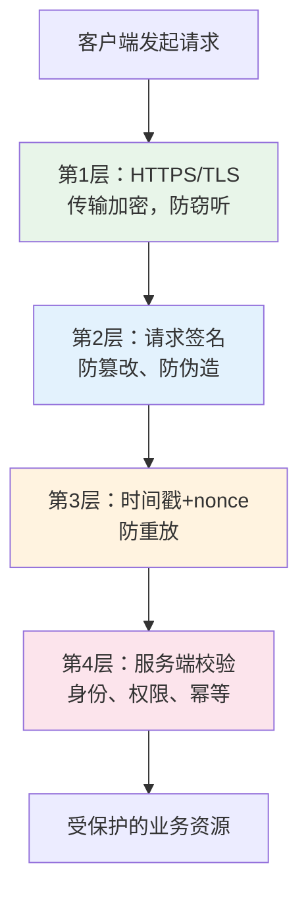
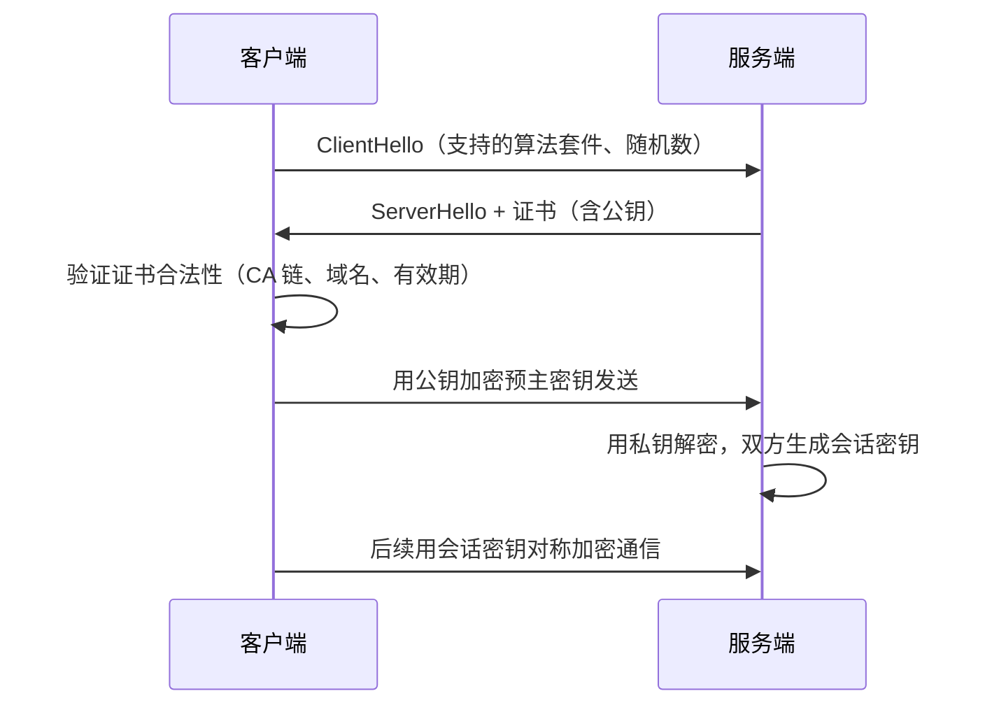
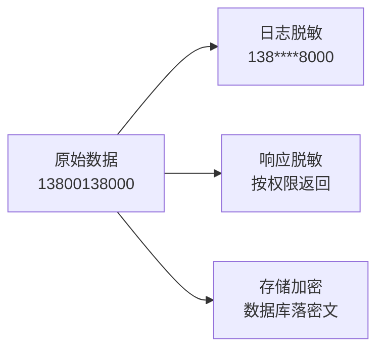

# 接口安全

> 定位：认证解决了「你是谁」，但请求在网络传输中还会被抓包、篡改、重放。这一篇讲清楚接口层如何做到防窃听、防篡改、防重放、防伪造，以及一套可直接落地的 App/开放接口安全方案。

## 一、为什么需要它

假设你做了一个支付接口 `POST /api/pay`，入参有金额和收款人。如果裸奔在公网，攻击者可以：

- 用 Wireshark 抓到明文，看到用户银行卡和金额——这是**窃听**。
- 把金额从 10 改成 10000 再发出去——这是**篡改**。
- 把抓到的合法请求原样重发一百次——这是**重放**。
- 伪装成别人调用接口——这是**伪造**。

认证只验证了「谁在调」，却挡不住上面任何一类攻击。接口安全要补的是**传输与请求本身的可信**：内容不被偷看、不被改动、不能重复使用、不可抵赖。这四件事分别对应 HTTPS、签名、时间戳+nonce、密钥管理。

## 二、核心原理：四层防护模型

一套完整的接口安全方案，通常是四层叠加，每层解决一类威胁。



四层不是可选的「锦上添花」，而是各管各的威胁：TLS 保证链路安全，签名保证请求「没被改且确实来自合法方」，时间戳+nonce 保证请求「是新的、没被重复用」，服务端校验兜底做身份和权限判断。少一层就多一个缺口。

### 2.1 HTTPS 与 TLS：传输层的地基

HTTP 是明文，运营商、Wi-Fi 热点、代理都能看到甚至改内容。HTTPS = HTTP + TLS，在传输层做三件事：

- **机密性**：对称加密传输内容，第三方看不到明文。
- **完整性**：MAC 校验，内容被改会被发现。
- **身份认证**：数字证书证明「你连的确实是 example.com，不是钓鱼站」。

TLS 握手的核心流程（以 TLS 1.2 为例）：



几个必须理解的要点：

- **非对称 + 对称结合**：握手阶段用非对称加密（RSA/ECDHE）安全协商密钥，通信阶段用对称加密（AES-GCM/ChaCha20）保证效率。因为非对称加密慢，只用来传密钥。
- **证书验证是防中间人的关键**：客户端必须校验证书链、域名、有效期。App 里如果图省事设置了「信任所有证书」（`TrustManager` 全通过），等于关掉了这道防线，中间人可随意抓明文。
- **TLS 1.3** 简化了握手（1-RTT 甚至 0-RTT），废弃了不安全算法，新系统应优先启用。
- **HSTS**：通过响应头 `Strict-Transport-Security` 告诉浏览器以后只用 HTTPS，防降级攻击和 Cookie 劫持。

> 生产提示：全站 HTTPS 之后，还要把 Cookie 设为 `Secure`，把 HTTP 请求 301 跳到 HTTPS，否则第一次请求仍可能被劫持。

### 2.2 加解密：对称与非对称

接口安全里两种加密各有用途：

| 类型 | 特点 | 常见算法 | 典型用途 |
|---|---|---|---|
| 对称加密 | 加解密同一把密钥，快 | AES、DES（已废弃）、SM4 | 传输内容加密、字段加密 |
| 非对称加密 | 公钥加密私钥解，慢 | RSA、ECC、SM2 | 密钥交换、签名、证书 |
| 哈希摘要 | 不可逆，定长输出 | SHA-256、SM3 | 签名、完整性校验、密码存储 |

**签名不等于加密**：签名是「用摘要证明内容没被改」，不保密；加密是「让内容不可读」。签名常用 HMAC（对称）或 RSA（非对称）。

### 2.3 请求签名：防篡改与防伪造

签名是接口安全的核心。基本思路：把请求的关键参数按规则排序，拼成一个字符串，用只有双方知道的密钥算摘要，作为 `signature` 一起发出。服务端用同样规则重算并比对。

```java
// 签名伪代码：参数排序 + 拼接 + HMAC
String canonical = method + "\n" + path + "\n"
        + sortedQueryString + "\n" + bodyMd5 + "\n" + timestamp;
String sign = hmacSha256(canonical, secret);
// 请求头：X-Sign: <sign>  X-Timestamp: <ts>  X-Nonce: <nonce>
```

服务端校验的正确姿势：

1. 先用 `timestamp` 判断是否在允许时间窗（如 ±5 分钟）内，超时直接拒绝。
2. 检查 `nonce` 是否在 Redis 里出现过（防重放）。
3. 按同样规则重算签名，用 **`MessageDigest.isEqual()` 常量时间比较**，防止计时攻击；不要用 `String.equals()`（它遇到第一个不同字节就返回，泄漏比对信息）。
4. 校验通过后再处理业务。

签名的三个安全要素：

- **密钥不能下发到前端/App**：一旦密钥被反编译拿到，签名形同虚设。App 场景要用白盒加密、SO 库或动态下发，且配合设备指纹；纯前端 H5 无法安全保存密钥，应走服务端代理签名。
- **参与签名的字段要全覆盖**：URL 参数、Body、关键 Header 都要进签名，否则攻击者改一个没进签名的字段就能绕过。
- **不要只做「加密」不做「签名」**：加密保证看不懂，但攻击者可以重放密文或改密文字节，仍需签名保证完整性。

### 2.4 防重放：时间戳 + nonce

签名只能证明请求「发出时是合法的」，挡不住把合法请求原封不动再发一次。防重放用两个机制：

- **时间戳**：请求带 `timestamp`，服务端只接受当前时间 ±N 分钟内的请求。过期拒绝。缺点：窗口期内仍可重放。
- **nonce（一次性随机数）**：每个请求带一个唯一随机串，服务端用 Redis `SETNX nonce 1 EX 300` 记录，重复出现即拒绝。两者结合，既限制窗口又保证唯一。

```java
// 防重放校验
if (Math.abs(now - timestamp) > 5 * 60 * 1000) {
    throw new ReplayException("请求已过期");
}
Boolean first = redis.setIfAbsent("nonce:" + nonce, "1", 5, MINUTES);
if (!first) {
    throw new ReplayException("重复请求");
}
```

注意 Redis 的过期时间要**略大于**时间窗，否则 nonce 提前失效就防不住窗口末端的重放。

### 2.5 幂等与 Token：重复请求的业务兜底

防重放是「网络层拒重」，但有些场景攻击者换了 nonce 重新签名（合法拿到密钥的内部调用），业务上仍需保证**同一业务请求只执行一次**——这就是幂等。

- **幂等 Token**：下单前先调服务端申请一个 `token`，提交时带上，服务端用 `SETNX` 校验并删除，保证同一 token 只能用一次。
- **业务唯一键**：用「用户 ID + 业务单号」做唯一索引，重复插入直接冲突，数据库层兜底。
- **幂等方法语义**：GET/PUT/DELETE 天然幂等，POST 不幂等；设计接口时尽量让写操作也带上幂等键。

这一层和 04-分布式理论里的幂等设计一脉相承，这里不展开。

### 2.6 数据脱敏：日志、响应、存储

安全不止「防外人」，还要防「内部泄露」。数据脱敏有三类场景：



- **日志脱敏**：日志里绝不打印完整手机号、身份证、银行卡、密码、Token。用 logback 的 `MaskingPatternLayout` 或自定义 `MessageConverter` 做正则替换。很多泄露是「printf 一手 happy」打出来的。
- **响应脱敏**：按用户权限返回不同字段。普通用户看到 `138****8000`，运营后台在二次授权后才能看全量。可用 Jackson 的自定义序列化注解实现字段级脱敏。
- **存储加密**：敏感字段落库前加密（AES/SM4），查询时解密。密钥由 KMS 管理，不和数据库放一起。密码则用加盐慢哈希（bcrypt），永远可逆的加密都不适合存密码。

## 三、关键机制与参数

一套落地的安全参数建议：

| 项 | 推荐做法 |
|---|---|
| 协议 | 全站 TLS 1.2+，优先 TLS 1.3；禁用 SSLv3、TLS 1.0/1.1 |
| 签名算法 | HMAC-SHA256（服务端间）或 RSA-SHA256（需不可抵赖时） |
| 时间窗 | ±5 分钟，按网络环境调整 |
| nonce 有效期 | Redis EX 300s（略大于时间窗） |
| 密钥轮换 | 支持双密钥并存，平滑过渡，定期轮换 |
| 密码比较 | `MessageDigest.isEqual()` 等常量时间比较 |
| 敏感日志 | 正则掩码，`*` 居中保留前后各 3-4 位 |

## 四、生产坑点与排查

### 坑点 1：App 端签名密钥被反编译，接口被伪造

**现象**：上线后出现大量伪造请求，签名看起来「合法」。
**原因**：HMAC 密钥硬编码在 App 里，被反编译提取。
**解法**：
- 密钥不下发；App 侧用 SO 库/白盒加密/设备指纹增加逆向成本，核心校验放服务端。
- 结合设备 ID、行为风控；发现异常密钥签名立即作废旧密钥并轮换。
- 认清事实：**客户端不可信**，App 签名只能提高攻击成本，真正的安全校验必须在服务端。

### 坑点 2：签名只覆盖了部分参数，改字段绕过校验

**现象**：攻击者改了某个 Body 字段（如 `role=user` 改成 `role=admin`），服务端却接受，因为该字段没进签名。
**原因**：签名规则只签了 URL 参数，漏签 Body 或 Header。
**解法**：
- 制定明确的「规范化串」规则，覆盖 method、path、所有 query、整个 body、关键 header。
- HTTP Body 取 MD5 加入签名串，任何字节改动都会导致摘要变化。
- 服务端与客户端共用同一份签名工具库，避免规则不一致。

### 坑点 3：nonce 用 Set 存但没设过期，内存/Redis 被撑爆

**现象**：运行一段时间后 Redis 内存暴涨。
**原因**：nonce 只存不删，无限累积。
**解法**：`SETNX` 必须配 `EXPIRE`（或直接 `SET key val EX 300 NX` 一步到位），过期自动清理。过期时间要大于时间窗但不宜过长。

### 坑点 4：日志打印了完整敏感数据

**现象**：安全审计发现 ELK 日志里有明文手机号、身份证、完整 Token。
**原因**：开发随手 `log.info("req={}", request)`，把整个对象序列化打印。
**解法**：
- 统一日志脱敏组件，对手机号/身份证/银行卡/Token 字段正则掩码。
- 制定日志规范并做 Code Review，禁止打印整个请求/响应对象；上线前用扫描工具检测敏感日志。

## 五、调优 / 选型 / 最佳实践

| 场景 | 推荐方案 |
|---|---|
| Web/App 接口 | HTTPS + 签名 + 时间戳/nonce + 幂等 |
| 服务间调用 | mTLS（双向证书）或 HMAC 签名，配 Service Mesh |
| 开放平台 | OAuth2/OIDC 授权 + 签名 + 限流 + App 密钥管理 |
| 支付/金融 | 全链路加密 + 签名 + 防重放 + 幂等 + 风控 + 审计 |

落地清单：

1. 全站 HTTPS，HSTS，Cookie 加 `Secure`/`HttpOnly`。
2. 签名串覆盖全字段，常量时间比较，密钥支持轮换。
3. 时间戳 + nonce 防重放，Redis 设合理过期。
4. 写接口带幂等键，数据库唯一索引兜底。
5. 日志/响应/存储三处脱敏，密钥交 KMS。
6. 客户端永远是「不可信」的，核心校验放服务端。

## 六、面试高频问法

> 这一节按「能讲透」的标准写：每题先给一句能直接背的结论，再展开机制、对比与生产坑。建议先自己答一遍，再对照补全。

**Q1：如何设计一个防抓包、防篡改、防重放的接口安全方案？**

**一句话结论**：四层叠加——HTTPS 防窃听、请求签名防篡改与伪造、时间戳 + nonce 防重放、服务端校验兜底做身份/权限/幂等，少一层就多一个缺口。

展开四层防护模型：

| 层次 | 机制 | 解决的威胁 |
|---|---|---|
| 第 1 层 | HTTPS/TLS | 传输加密，防窃听、防中间人 |
| 第 2 层 | 请求签名（参数排序 + HMAC） | 防篡改、防伪造 |
| 第 3 层 | 时间戳 + nonce | 防重放 |
| 第 4 层 | 服务端校验身份/权限/幂等 | 业务兜底 |

以支付接口 `POST /api/pay` 为例：裸奔时攻击者能抓包看金额（窃听）、把 10 改成 10000（篡改）、原样重发 100 次（重放）、伪装他人调用（伪造）；认证只解决"谁在调"，这四层才解决"请求本身可信"。

加分点：强调"四层各管各的威胁，不能互相替代"——很多人以为上了 HTTPS 就不用签名，其实 HTTPS 只保护传输链路，业务层的参数语义、防内部伪造、审计溯源还得靠签名。

**Q2：签名和加密的区别？既然有 HTTPS 为什么还要签名？**

**一句话结论**：签名保证完整性和不可抵赖（内容没被改、来源可信），不保密；加密保证机密性（看不懂）；HTTPS 保护链路，签名提供端到端的业务层校验。

展开：

- **签名**：对请求关键参数算摘要，用密钥生成 `signature`，服务端用同样规则重算比对。常用 HMAC（对称，服务端之间）或 RSA（非对称，需不可抵赖）。它回答"这请求是不是合法方发的、有没有被改"。
- **加密**：让内容不可读，分对称（AES/SM4，快）和非对称（RSA/ECC/SM2，慢，多用于密钥交换）。它回答"别人看不看得懂"。
- **为什么有 HTTPS 还要签名**：① HTTPS 只保护客户端到服务端这一跳，经过网关、消息队列、内部服务时链路外的保护失效；② 签名能覆盖业务参数语义（金额、订单号），支持不可抵赖和审计；③ 能防内部合法链路上的伪造。

加分点："签名不等于加密"是高频辨析题——很多人说"加密了就安全了"，其实攻击者改不了密文但可以原样重放密文，所以加密之外仍要签名保证完整性、加时间戳/nonce 保证新鲜度。

**Q3：请求签名怎么设计？服务端校验的正确姿势是什么？**

**一句话结论**：把 method、path、排序后的 query、body 摘要、timestamp 拼成规范化串用 HMAC 算签名；服务端先校验时间窗和 nonce，再重算签名并用常量时间比较。

展开（签名伪代码）：

```java
String canonical = method + "\n" + path + "\n"
        + sortedQueryString + "\n" + bodyMd5 + "\n" + timestamp;
String sign = hmacSha256(canonical, secret);
// 请求头：X-Sign / X-Timestamp / X-Nonce
```

服务端校验四步：

1. 用 `timestamp` 判断是否在允许时间窗（如 ±5 分钟）内，超时直接拒绝。
2. 检查 `nonce` 是否在 Redis 出现过（防重放）。
3. 按同样规则重算签名，用 `MessageDigest.isEqual()` **常量时间比较**，不要用 `String.equals()`（它遇到第一个不同字节就返回，会泄漏比对信息，可被计时攻击逐步猜出签名）。
4. 全部通过后再处理业务。

加分点：三个安全要素——**签名串必须覆盖全字段**（method、path、所有 query、整个 body、关键 header，body 取 MD5 加入签名串）；**密钥不下发前端/App**；**别只加密不签名**。面试官很吃"常量时间比较防计时攻击"这个细节。

**Q4：时间戳 + nonce 防重放的原理？nonce 的 Redis key 要注意什么？**

**一句话结论**：时间戳把请求限制在 ±N 分钟窗口内，nonce 保证窗口内每个请求只能用一次；Redis 用 `SET key val EX N NX`，过期时间要略大于时间窗。

展开：

- **时间戳**：请求带 `timestamp`，服务端只接受当前时间 ±5 分钟内的请求。缺点：窗口期内仍可重放，所以必须配 nonce。
- **nonce**：每个请求带唯一随机串，服务端用 Redis 原子记录，重复出现即拒绝：

```java
if (Math.abs(now - timestamp) > 5 * 60 * 1000) {
    throw new ReplayException("请求已过期");
}
Boolean first = redis.setIfAbsent("nonce:" + nonce, "1", 5, MINUTES);
if (!first) {
    throw new ReplayException("重复请求");
}
```

- **Redis key 两个注意点**：① 必须设过期时间，否则 nonce 无限累积撑爆内存，用 `SET key val EX 300 NX` 一步到位；② 过期时间要**略大于**时间窗（如窗口 ±5 分钟、TTL 设 5 分钟以上），否则 nonce 提前失效就防不住窗口末端的重放。

加分点：能指出"nonce 只保证网络层拒重，如果攻击者是合法拿到密钥的内部调用方、换了 nonce 重新签名，防重放就失效了——这要靠业务幂等（token/唯一键）兜底"，把防重放和幂等的边界讲清。

**Q5：HTTPS/TLS 的握手过程？为什么用非对称 + 对称混合？**

**一句话结论**：握手阶段用非对称加密安全协商会话密钥并验证证书，通信阶段用对称加密保证效率；证书链校验是防中间人的关键。

TLS 1.2 握手核心流程：

1. ClientHello：客户端发送支持的算法套件、随机数。
2. ServerHello + 证书：服务端返回证书（含公钥）。
3. 客户端校验证书合法性：CA 链、域名、有效期——**这一步是防中间人的命门**。
4. 客户端用公钥加密预主密钥发给服务端。
5. 服务端用私钥解密，双方各自生成相同的会话密钥。
6. 后续通信全部用会话密钥对称加密。

**为什么混合**：非对称加密（RSA/ECDHE）慢，只用来安全传密钥和验身份；对称加密（AES-GCM/ChaCha20）快，用来加密大量业务数据。各取所长。

加分点：能说出"App 里图省事把 `TrustManager` 设成全通过（信任所有证书）等于关掉这道防线，中间人可随意抓明文"，以及 TLS 1.3 简化到 1-RTT/0-RTT、废弃不安全算法、新系统应优先启用——生产经验 + 版本感双加分。

**Q6：幂等和防重放有什么区别？怎么实现幂等？**

**一句话结论**：防重放是"网络层拒绝重复请求"，幂等是"业务层保证同一请求只执行一次"；换了 nonce 重新签名的合法重复请求，只能靠幂等兜底。

展开：

- **区别**：防重放靠 timestamp + nonce 拒掉"原样重发"；但如果攻击者（或重试机制）换了 nonce、重新签名发出语义相同的请求，防重放拦不住，这时必须靠业务幂等。
- **实现手段**：
  - **幂等 Token**：下单前先申请 token，提交时带上，服务端用 `SETNX` 校验并删除，保证同一 token 只能用一次。
  - **业务唯一键**：用"用户 ID + 业务单号"建数据库唯一索引，重复插入直接冲突，数据库层兜底。
  - **方法语义**：GET/PUT/DELETE 天然幂等，POST 不幂等；写接口设计时尽量带幂等键。

加分点：指出超时重试、消息队列重复投递、用户手抖双击这些**正常场景**也会造成重复请求——所以幂等不只是安全需求，更是可用性和数据正确性的基础，和分布式理论里的幂等设计一脉相承。

**Q7：对称加密、非对称加密、哈希摘要各有什么用途？**

**一句话结论**：对称加密快、用于大量数据加密；非对称加密慢、用于密钥交换和签名；哈希摘要不可逆、用于完整性校验和密码存储。

| 类型 | 特点 | 常见算法 | 典型用途 |
|---|---|---|---|
| 对称加密 | 加解密同一把密钥，快 | AES、SM4（DES 已废弃） | 传输内容加密、字段加密 |
| 非对称加密 | 公钥加密私钥解，慢 | RSA、ECC、SM2 | 密钥交换、签名、证书 |
| 哈希摘要 | 不可逆、定长输出 | SHA-256、SM3 | 签名、完整性校验、密码存储 |

**组合使用**：TLS 就是典型——非对称协商密钥 + 对称加密通信；签名则是"哈希摘要 + 非对称（或 HMAC）"的组合：先对内容算摘要，再对摘要签名，效率远高于直接对大内容签名。

加分点：能说清"哈希不是加密"——加密可逆、哈希不可逆；以及 MD5/SHA-1 已被破解（碰撞攻击），签名和完整性校验至少用 SHA-256，密码存储则要用 bcrypt/Argon2 这类慢哈希，不能用通用快速哈希。

**Q8：App 端签名密钥被反编译，接口被伪造怎么办？**

**一句话结论**：前提是"客户端永远不可信"——密钥不下发，用 SO 库/白盒加密/设备指纹提高逆向成本，核心校验必须放服务端。

这是生产高频事故，三层应对：

1. **现象与根因**：上线后出现大量"签名合法"的伪造请求，根因是 HMAC 密钥硬编码在 App 里被反编译提取。
2. **提高攻击成本**：密钥不下发；App 侧用 SO 库、白盒加密、设备指纹增加逆向难度；配合设备 ID 和行为风控识别异常。
3. **服务端兜底**：一旦发现异常密钥签名，立即作废旧密钥并轮换；核心安全校验（身份、权限、限流、业务规则）一律放服务端。

加分点：最关键的一句话是"App 签名只能提高攻击成本，不能提供真正的安全——真正的安全校验必须在服务端"。纯前端 H5 根本无法安全保存密钥，应走服务端代理签名。能认识到这一点，说明你不会被"客户端加密就安全"的错觉带偏。

**Q9：数据脱敏一般在哪几个环节做？**

**一句话结论**：三个环节——日志脱敏、响应脱敏、存储加密，核心是让敏感数据"不该看的看不到、该存的存得安全"。

展开：

| 环节 | 做法 | 典型手段 |
|---|---|---|
| 日志脱敏 | 不打印完整敏感数据 | logback `MaskingPatternLayout` 或自定义 `MessageConverter` 正则掩码，如 `138****8000` |
| 响应脱敏 | 按权限返回不同字段 | Jackson 自定义序列化注解，普通用户看掩码、运营二次授权后看全量 |
| 存储加密 | 落库前加密 | AES/SM4 加密敏感字段，密钥由 KMS 管理；密码用 bcrypt 加盐慢哈希 |

加分点：强调"密码存储是特例——必须用不可逆的加盐慢哈希（bcrypt/Argon2），绝不能用可逆加密"，因为可逆加密意味着拿到密钥就能还原所有密码。再补一句"很多泄露是开发随手 `log.info("req={}", request)` 把整个对象打出来的"，体现生产经验。

**Q10：签名只覆盖部分参数、nonce 没设过期，这类生产坑怎么排查？**

**一句话结论**：签名漏签字段导致改字段绕过、nonce 只存不删撑爆 Redis，是最常见的两类实现坑，分别靠"全字段规范化串"和"原子操作 + 过期"解决。

两个典型坑：

1. **漏签绕过**：攻击者把 Body 里的 `role=user` 改成 `role=admin`，服务端却接受——因为签名规则只签了 URL 参数，漏了 Body/Header。解法：制定明确的规范化串规则，覆盖 method、path、所有 query、整个 body（取 MD5）、关键 header；客户端与服务端共用同一份签名工具库，避免规则不一致。
2. **nonce 撑爆内存**：nonce 只存不删，Redis 内存暴涨。解法：`SETNX` 必须配 `EXPIRE`（或一步到位用 `SET key val EX 300 NX`），过期时间大于时间窗但不宜过长。

加分点：再补一个"只加密不签名"的坑——攻击者改不了密文但能重放或篡改密文字节，仍需签名保证完整性。能把"加密、签名、防重放、幂等"四者的职责边界讲清楚，是这道题的满分答法。

**Q11：TLS 1.3 相比 1.2 有哪些改进？密钥如何轮换？**

**一句话结论**：TLS 1.3 简化握手到 1-RTT（甚至 0-RTT）、废弃不安全算法；密钥轮换靠"双密钥并存 + 平滑过渡 + 定期更换"。

展开：

- **TLS 1.3 改进**：握手从 1.2 的 2-RTT 降到 1-RTT（会话恢复可 0-RTT），减少延迟；废弃 RSA 密钥传输、SHA-1、MD5、RC4、3DES 等不安全算法，只保留 AEAD 加密套件（AES-GCM、ChaCha20）和前向安全的密钥交换（ECDHE）。HSTS 响应头还能强制浏览器后续只用 HTTPS，防降级攻击。
- **密钥轮换**：支持新老密钥并存一段时间（新请求用新密钥签，服务端同时信任新旧），待流量切换完成后下线旧密钥；定期轮换，泄露时立即作废旧密钥。

加分点：0-RTT 有个著名风险——**重放攻击**（早期数据可被重放），所以 0-RTT 只适合幂等请求。能说出这个权衡，说明你不是只背"1-RTT 更快"，而是理解协议设计的取舍。

## 小结

- 接口安全四层：HTTPS 防窃听、签名防篡改、时间戳+nonce 防重放、服务端校验兜底。
- 签名串要覆盖全字段，用常量时间比较；密钥不下发客户端，支持轮换。
- 防重放靠时间窗 + nonce（Redis SETNX + 过期），幂等靠 token/唯一键兜底。
- 脱敏覆盖日志、响应、存储三处；客户端永远不可信，校验必须放服务端。
- TLS 用非对称握手 + 对称通信，证书校验是防中间人的关键，别「信任所有证书」。
