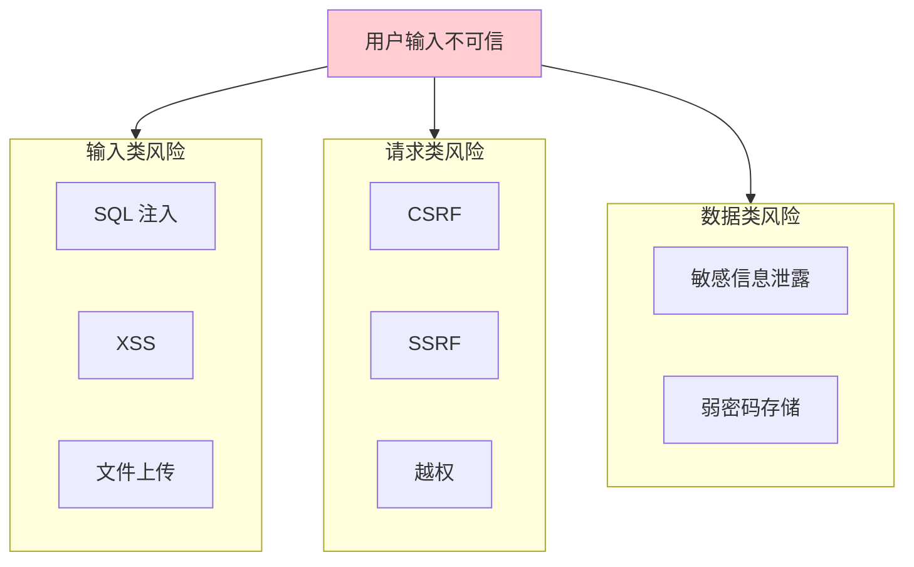
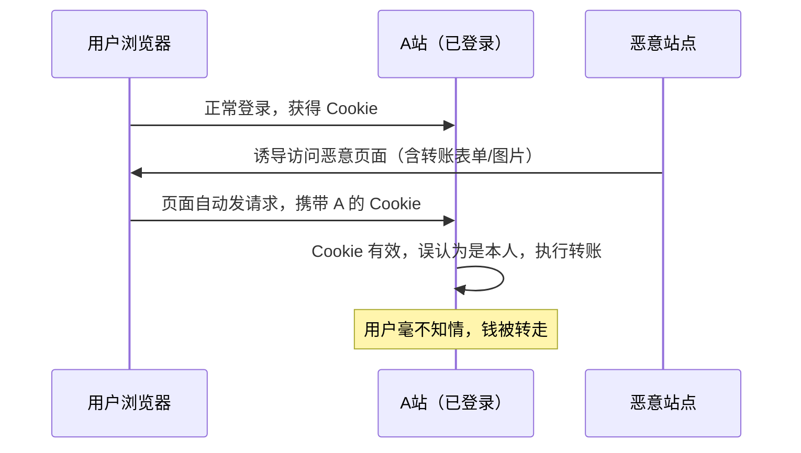

# Web安全风险

> 定位：OWASP Top 10 是 Web 安全的「体检清单」。这一篇把 Java 开发最常踩的注入、XSS、CSRF、SSRF、越权、文件上传等风险逐个拆开，讲清「攻击怎么发生、危害多大、代码怎么防」，让你写业务代码时本能地避开这些坑。

## 一、为什么需要它

安全圈有句老话：**「不是系统没有漏洞，只是还没被人找到。」** 绝大多数 Web 漏洞不是高深的 0day，而是开发时一个想当然的写法：

- 用字符串拼接 SQL：「反正参数来自前端，应该没问题」——SQL 注入。
- 把用户输入直接 `innerHTML` 到页面：「显示个评论而已」——XSS。
- 转账接口只认 Cookie 不认别的：「浏览器会自动带 Cookie」——CSRF。
- 根据 URL 里的 `url` 参数发起 HTTP 请求：「就内部用」——SSRF。

这些漏洞一旦被利用，轻则数据泄露，重则服务器被拿下。更麻烦的是，很多漏洞在功能测试阶段完全正常——它只在「恶意输入」下才暴露。所以必须建立**安全编码本能**，而不是等渗透测试报告。

OWASP Top 10 是业界公认的 Web 风险排名（2021 版），本篇聚焦 Java 开发最常遇到的几类，每一类都按「原理 → 危害 → 防护」三段讲。



记住这条总原则：**所有用户输入都是恶意的，直到被证明无害**。下面每一类风险都是这条原则的具体展开。

## 二、核心原理与防护

### 2.1 SQL 注入（Injection）

**原理**：把用户输入拼进 SQL 字符串，输入里夹带 SQL 语法，改变原语句的语义。

```java
// 危险：字符串拼接
String sql = "SELECT * FROM user WHERE name = '" + name + "' AND pwd = '" + pwd + "'";
// 当 name = "admin' OR '1'='1" 时，SQL 变成：
// SELECT * FROM user WHERE name = 'admin' OR '1'='1' AND pwd = 'xxx'
// 恒真条件，绕过密码校验！
```

**危害**：绕过认证、拖库（泄露全表数据）、篡改/删除数据、甚至通过数据库提权控制服务器。

**防护**：

- **首选预编译语句（PreparedStatement / MyBatis `#{}`）**。参数化查询让输入永远是「数据」而非「SQL 语法」，这是根治手段。
- **MyBatis 用 `#{}`，绝不用 `${}`**：`${}` 是直接拼接，等价于拼接漏洞。`ORDER BY`、`LIMIT` 后的字段不能用 `#{}` 时，要用白名单枚举校验。
- 最小权限数据库账号；错误信息不回显到页面（防止报错注入探测表结构）。

```java
// 正确：预编译参数化
String sql = "SELECT * FROM user WHERE name = ? AND pwd = ?";
ps.setString(1, name);
ps.setString(2, pwd);
```

### 2.2 XSS（跨站脚本）

**原理**：把用户输入的脚本注入到页面执行。分三类：

| 类型 | 触发方式 | 特点 |
|---|---|---|
| 存储型 | 恶意脚本存进数据库，别人浏览时执行 | 危害最大，影响所有访问者 |
| 反射型 | 脚本在 URL 参数里，诱骗点击后由服务端反射到页面 | 一次性，需社工诱导 |
| DOM 型 | 纯前端 JS 把输入写进 DOM（如 `innerHTML`） | 不经过服务端，前端自己挖的坑 |

**危害**：盗取 Cookie/Session、钓鱼、篡改页面、挂马、蠕虫传播（存储型）。

**防护**：

- **输出编码**：按上下文对输出转义（HTML、属性、JS、URL 各不同）。用 OWASP Java Encoder 或框架自带转义（Thymeleaf、Freemarker 默认转义）。
- **富文本用白名单过滤**：用户要发带格式的评论时，用 jsoup 的 `Safelist` 白名单清洗，只保留允许的标签和属性，过滤 `<script>`、`onerror` 等。
- **Cookie 加 `HttpOnly`**，JS 读不到，即使有 XSS 也偷不走会话。
- 配置 CSP（Content-Security-Policy）响应头，限制可执行脚本来源。

```java
// 富文本白名单清洗
String safe = Jsoup.clean(userInput, Safelist.basic());
```

### 2.3 CSRF（跨站请求伪造）

**原理**：用户登录了 A 站，浏览器有 A 的 Cookie；攻击者诱导用户访问恶意页面，页面偷偷向 A 站发请求，浏览器自动带上 Cookie，A 站误以为是用户本人操作。



**危害**：以用户身份发帖子、改密码、转账、下单——所有「仅靠 Cookie 鉴权」的写操作都危险。

**防护**：

- **CSRF Token**：服务端下发随机 Token（放表单隐藏域或 Header），请求时校验。攻击者拿不到 Token（同源策略），伪造请求失败。Spring Security 默认开启。
- **SameSite Cookie**：设 `SameSite=Lax/Strict`，浏览器跨站请求不带 Cookie，从根上缓解。
- **二次校验**：敏感操作要验证码、密码、短信确认。
- **检查 Origin/Referer**：校验请求来源是否同源（辅助手段，不能单独依赖）。

> 注意：JWT 放在 Authorization Header 而非 Cookie 时，浏览器不会自动携带，天然没有 CSRF 问题——这也是「Token 比 Session 更抗 CSRF」的原因。但如果 JWT 也放 Cookie，照样要防 CSRF。

### 2.4 SSRF（服务端请求伪造）

**原理**：服务端根据用户输入发起 HTTP 请求，却没有校验目标地址。攻击者把目标指向内网服务或云元数据地址，让服务器「替他打内网」。

```java
// 危险：直接请求用户给的 URL
String url = request.getParameter("url");
restTemplate.getForObject(url, String.class);
// 攻击者传 http://169.254.169.254/latest/meta-data/ 可偷云主机凭证
// 传 http://192.168.1.100:6379/ 可探测/攻击内网服务
```

**危害**：探测内网端口、攻击内网服务、读取云元数据窃取凭证（历史上多起重大云泄露都源于 SSRF）、打 DNS  rebinding。

**防护**：

- **目标白名单**：只允许请求预设的域名/IP，用 DNS 解析后校验真实 IP（防域名指向内网）。
- **禁私网地址**：拒绝 `127.0.0.0/8`、`10.0.0.0/8`、`172.16.0.0/12`、`192.168.0.0/16`、`169.254.0.0/16` 等内网/保留地址。
- **禁用危险协议**：只允许 http/https，禁 `file://`、`gopher://`、`dict://`。
- **统一出口 + 限制重定向**：出站请求走代理，禁止自动跟随 302 到内网。

### 2.5 文件上传漏洞

**原理**：服务端未校验上传文件，攻击者上传可执行脚本（如 JSP、PHP 木马），再通过 URL 访问执行，拿到 WebShell 控制服务器。

**危害**：远程代码执行（RCE）、服务器被完全控制、挂马、作为跳板攻击内网。

**防护**：

- **白名单校验扩展名 + MIME + 文件头**（三者结合，不能只看客户端传的 Content-Type）。
- **重命名文件**为随机名，去掉原始文件名；**存储放到非 Web 根目录**的独立存储（OSS/专用文件服务），无法直接通过 URL 执行。
- **设置不可执行权限**，CDN/静态服务器禁止解析脚本。
- 限制文件大小、做病毒扫描；图片可用图片处理库重绘（破坏嵌入的脚本）。

### 2.6 越权（水平 / 垂直）

**原理**：

- **水平越权**：同角色用户 A 能访问用户 B 的数据。如把请求里的订单 ID 从 `1001` 改成 `1002` 就能看别人的订单——因为后端只判断「登录了没」，没判断「这条数据是不是你的」。
- **垂直越权**：低权限用户能访问高权限功能。如普通用户直接调 `/api/admin/delete`。

**危害**：数据批量泄露（改 ID 遍历）、未授权操作。

**防护**：

- **每个数据访问都做归属校验**：查询时带上当前用户 ID 作为条件（`WHERE id=? AND user_id=?`），而不是只按 id 查。
- **接口层统一鉴权**：用 RBAC + 注解（如 `@PreAuthorize`）控制功能权限，默认拒绝。
- **不对前端暴露可枚举的自增 ID**，可用 UUID/雪花 ID 增加遍历难度（但这不是根治手段，归属校验才是）。

### 2.7 敏感信息泄露

**原理**：错误配置或编码习惯，把不该暴露的信息暴露出去。

常见场景：

- 接口返回完整对象（含密码哈希、身份证、内部字段）——直接返回 DO 而非 DTO。
- 报错堆栈、SQL 语句回显到前端。
- Git 仓库提交密钥、配置文件含明文密码、Swagger 暴露到公网、Actuator 端点未鉴权。
- 日志打印敏感数据（见前一篇）。

**危害**：泄露凭据、业务逻辑、内网拓扑，为后续攻击提供地图。

**防护**：定义专用 DTO 出参；统一异常处理返回通用错误；密钥放配置中心/KMS 并加入 `.gitignore`；生产关闭 Swagger、Actuator 敏感端点或加鉴权。

### 2.8 密码存储：加盐慢哈希

**原理**：密码绝不能明文存，也不能用快速哈希（MD5/SHA-1）——它们能被彩虹表和 GPU 暴力破解。

正确做法：**加盐 + 慢哈希**。

- **bcrypt**：内置随机盐，可调计算代价（cost，如 10-12），慢到让暴力破解成本极高。
- **PBKDF2**：迭代次数可调（如 60 万次）。
- **Argon2**：现代推荐，抗 GPU/ASIC 攻击（OWASP 首选）。

```java
// bcrypt 示例（Spring Security 的 BCryptPasswordEncoder）
BCryptPasswordEncoder encoder = new BCryptPasswordEncoder(12);
String hash = encoder.encode(rawPassword); // 每条hash自带随机盐，同密码结果不同
boolean ok = encoder.matches(rawPassword, hash); // 校验
```

**关键点**：加盐让相同密码产生不同哈希，废掉彩虹表；「慢」让单次猜测成本变高。绝不要用 MD5/sha256 直接存密码，也绝不用可逆加密。

### 2.9 国密算法（SM2 / SM3 / SM4）

在政务、金融、国企等信创场景，合规要求使用国产密码算法：

| 算法 | 类型 | 对标国际算法 | 用途 |
|---|---|---|---|
| SM2 | 非对称（椭圆曲线） | RSA / ECC | 签名验签、密钥交换、加密 |
| SM3 | 哈希摘要 | SHA-256 | 完整性校验、数字签名摘要 |
| SM4 | 对称分组加密 | AES | 数据加密 |

落地时用经过认证的国密库（如 BouncyCastle 的国密扩展、国密 OpenSSL 分支），注意：

- SM2 签名结果是 `r||s` 拼接，格式与国际算法不同，对接时要确认编码（ASN.1 / 裸拼接）。
- 密钥长度、IV、填充模式要双方约定一致。
- 合规场景还要满足《密码法》和等保测评要求，密钥管理走 KMS/密码机。

## 三、关键机制与参数

| 风险 | 核心防护手段 | 关键参数/要点 |
|---|---|---|
| SQL 注入 | 预编译 / MyBatis `#{}` | `ORDER BY` 用白名单枚举 |
| XSS | 输出编码 + 白名单清洗 | Cookie `HttpOnly`，配置 CSP |
| CSRF | CSRF Token + SameSite | Token 每会话随机 |
| SSRF | 目标白名单 + 禁私网 IP | 禁 `169.254.0.0/16` 等 |
| 文件上传 | 白名单 + 重命名 + 隔离存储 | 大小限制、不可执行 |
| 越权 | 归属校验 + 统一鉴权 | `WHERE id=? AND user_id=?` |
| 密码 | bcrypt(12) / Argon2 | 加盐、慢哈希 |

## 四、生产坑点与排查

### 坑点 1：MyBatis 里用了 `${}` 导致注入

**现象**：安全扫描报 SQL 注入，定位到某 Mapper 用了 `${xxx}`。
**原因**：`${}` 直接拼接字符串，用户输入被当成 SQL。常见于动态表名、`ORDER BY` 字段。
**解法**：能用 `#{}` 的地方全改 `#{}`；动态排序字段用 Java 白名单映射（`{ "time": "create_time", "amount": "amount" }`），只取白名单里的值。

### 坑点 2：接口返回 DO 对象，连带把密码哈希一起吐出去

**现象**：抓包发现 `GET /user/info` 返回体里有 `passwordHash`、`idCard` 字段。
**原因**：Controller 直接 return 数据库实体（DO），字段全暴露。
**解法**：定义专用 DTO/VO，只显式声明要返回的字段；用 MapStruct 或手动转换，禁止直接返回 DO。

### 坑点 3：文件上传只校验了扩展名，被传 `.jsp` 木马

**现象**：服务器出现陌生 WebShell 文件，日志里有可疑上传记录。
**原因**：只在前端/服务端校验了 `filename.endsWith(".jpg")`，攻击者传 `shell.jsp` 或双扩展名 `shell.jpg.jsp` 绕过；且文件存在 Web 目录下可直接执行。
**解法**：服务端白名单校验扩展名 + MIME + 文件头；随机重命名；存到独立对象存储/Web 根之外，禁止脚本执行权限。

### 坑点 4：云上 SSRF 偷取元数据凭证

**现象**：日志出现对 `169.254.169.254` 的异常请求，云账号产生非预期操作。
**原因**：某个「根据 URL 拉取图片/预览」的功能未校验目标，被用作 SSRF 探测云元数据。
**解法**：出站请求做目标白名单 + 私网/元数据地址黑名单；云上启用 IMDSv2（需 token）并限制 hop limit；统一走出站代理审计。

## 五、调优 / 选型 / 最佳实践

1. **编码习惯**：预编译 SQL、输出编码、参数化一切、默认拒绝。
2. **框架能力**：用 Spring Security 的 CSRF、转义模板、统一异常处理，别自己造轮子。
3. **纵深防御**：输入校验 + 输出编码 + 最小权限 + WAF，多道防线叠加。
4. **依赖安全**：用 OWASP Dependency-Check / Dependabot 扫第三方组件漏洞（Log4Shell 就是典型）。
5. **定期检测**：SAST（静态扫描）+ DAST（动态扫描）+ 定期渗透测试。
6. **合规**：信创场景选国密算法并通过合规测评。

## 六、面试高频问法

> 这一节按「能讲透」的标准写：每题先给一句能直接背的结论，再展开机制、对比与生产坑。建议先自己答一遍，再对照补全。

**Q1：OWASP Top 10 是什么？Web 安全的总原则是什么？**

**一句话结论**：OWASP Top 10 是业界公认的 Web 风险排名（2021 版），是安全"体检清单"；总原则是**所有用户输入都是恶意的，直到被证明无害**。

展开：

- 绝大多数漏洞不是高深 0day，而是开发时一个想当然的写法：拼接 SQL、把输入直接 `innerHTML`、转账只认 Cookie、根据 URL 参数发请求——分别对应注入、XSS、CSRF、SSRF。
- OWASP Top 10 聚焦最普遍、危害最大的十类风险（注入、失效的身份认证、敏感数据泄露、XML 外部实体、失效的访问控制、安全配置错误、XSS、不安全反序列化、使用含已知漏洞的组件、日志与监控不足）。
- 关键认知：很多漏洞在功能测试阶段完全正常，它只在"恶意输入"下才暴露，所以必须建立**安全编码本能**，而不是等渗透测试报告。

加分点：强调"注入、XSS、文件上传这类漏洞的本质是同一件事——**没把数据和代码/语法分开**"。能把零散的漏洞类型抽象出共同根因，面试官会觉得你的理解成体系。

**Q2：什么是 SQL 注入？怎么防？**

**一句话结论**：把用户输入拼进 SQL，输入里夹带 SQL 语法改变语句语义；根治手段是预编译参数化查询（PreparedStatement / MyBatis `#{}`）。

展开：

- **攻击原理**：

```java
// 危险：字符串拼接
String sql = "SELECT * FROM user WHERE name = '" + name + "' AND pwd = '" + pwd + "'";
// 当 name = "admin' OR '1'='1" 时，恒真条件绕过密码校验
```

- **危害**：绕过认证、拖库（泄露全表）、篡改删除数据、甚至通过数据库提权控制服务器。
- **防护**：① 首选预编译语句，参数化让输入永远是"数据"而非"SQL 语法"；② MyBatis 用 `#{}`，绝不用 `${}`；③ 数据库账号最小权限；④ 错误信息不回显到页面（防报错注入探测表结构）。

正确写法：

```java
String sql = "SELECT * FROM user WHERE name = ? AND pwd = ?";
ps.setString(1, name);
ps.setString(2, pwd);
```

加分点：注意 `ORDER BY`、`LIMIT` 后跟字段名/数字时不能用 `#{}`（预编译会把字段名当字符串），这时要用**白名单枚举**校验，而不是退回 `${}` 拼接——这是面试和实战里最容易被忽略的注入残留点。

**Q3：MyBatis 里 `#{}` 和 `${}` 有什么区别？动态排序字段怎么办？**

**一句话结论**：`#{}` 是预编译占位符、安全；`${}` 是直接字符串拼接、等价于注入漏洞；动态排序字段要用 Java 白名单映射。

展开：

- **`#{}`**：解析成 `?` 占位符，参数通过 `setXxx()` 绑定，输入被当作纯数据，不参与 SQL 语法解析，杜绝注入。
- **`${}`**：直接把参数值拼进 SQL 文本，用户输入可夹带 SQL 语法，是注入源头。常见于动态表名、`ORDER BY` 字段、分页参数。
- **动态排序的正确做法**：在 Java 里定义白名单映射，只取白名单里的值：

```java
Map<String,String> whitelist = Map.of("time","create_time","amount","amount");
String orderCol = whitelist.getOrDefault(sortBy, "create_time");
// 再用 ${orderCol} 拼接，因为值来自白名单而非用户输入
```

加分点：能说清"为什么 `${}` 不是完全不能用"——只要拼进去的值**完全来自服务端白名单、绝不来自用户输入**，就是安全的。这比简单说"禁用 `${}`"更准确，体现你对预编译原理的真正理解。

**Q4：XSS 有哪几类？如何防护？**

**一句话结论**：XSS 是恶意脚本注入到页面执行，分存储型、反射型、DOM 型三类；核心防护是输出编码 + 白名单清洗 + HttpOnly + CSP。

三类对比：

| 类型 | 触发方式 | 特点 |
|---|---|---|
| 存储型 | 脚本存进数据库，别人浏览时执行 | 危害最大，影响所有访问者 |
| 反射型 | 脚本在 URL 参数里，诱骗点击后由服务端反射到页面 | 一次性，需社工诱导 |
| DOM 型 | 纯前端 JS 把输入写进 DOM（如 `innerHTML`） | 不经过服务端，前端自己挖的坑 |

**防护组合拳**：

- **输出编码**：按上下文对输出转义（HTML、属性、JS、URL 各不同），用 OWASP Java Encoder 或模板框架默认转义（Thymeleaf、Freemarker）。
- **富文本白名单清洗**：用 jsoup 的 Safelist 只保留允许标签属性：`String safe = Jsoup.clean(userInput, Safelist.basic());`
- **Cookie 加 HttpOnly**：JS 读不到，即使有 XSS 也偷不走会话。
- **CSP 响应头**：限制可执行脚本来源，作为纵深防御。

加分点：指出"XSS 的危害不只是盗 Cookie——还能钓鱼、篡改页面、挂马、蠕虫传播（存储型）"。再补一句"HttpOnly 只是让脚本偷不到 Cookie，但 XSS 仍能冒名发请求（因为浏览器会自动带 Cookie），所以 CSRF 防护不能省"，把两个漏洞的关系讲清。

**Q5：CSRF 的原理？和 XSS 有什么区别？**

**一句话结论**：CSRF 是诱导浏览器在用户不知情时带 Cookie 冒名发请求；XSS 是注入脚本在用户浏览器里执行。前者"替你操作"，后者"能读你的数据"。

展开：

- **CSRF 原理**：用户登录了 A 站，浏览器持有 A 的 Cookie；攻击者诱导用户访问恶意页面，页面偷偷向 A 发请求，浏览器自动带上 Cookie，A 站误以为是本人操作（转账、改密码、发帖）。
- **与 XSS 的核心区别**：

| 维度 | CSRF | XSS |
|---|---|---|
| 本质 | 借用户的身份发请求 | 注入脚本并执行 |
| 是否读取响应 | 不能读取响应（同源策略） | 能读取数据、DOM |
| 用户感知 | 完全不知情 | 页面可能出现异常 |

- **防护**：① CSRF Token（服务端下发随机 Token，攻击者拿不到）；② SameSite Cookie（`Lax/Strict`，跨站请求不带 Cookie）；③ 敏感操作二次校验（验证码/密码/短信）；④ 校验 Origin/Referer（辅助，不能单独依赖）。

加分点：讲清"JWT 放在 Authorization Header 而非 Cookie 时，浏览器不会自动携带，天然没有 CSRF 问题——这就是 Token 比 Session 更抗 CSRF 的原因；但如果 JWT 也放 Cookie，照样要防 CSRF"。这个细节很多人答不出来。

**Q6：SSRF 怎么防？为什么云上特别危险？**

**一句话结论**：SSRF 是服务端按用户输入发请求却没校验目标；靠目标白名单 + 禁私网/元数据地址 + 禁危险协议 + 禁跟随重定向防护；云上能偷 `169.254.169.254` 的临时凭证。

展开：

- **攻击原理**：

```java
String url = request.getParameter("url");
restTemplate.getForObject(url, String.class);
// 传 http://169.254.169.254/latest/meta-data/ 可偷云主机凭证
// 传 http://192.168.1.100:6379/ 可探测/攻击内网服务
```

- **危害**：探测内网端口、攻击内网服务、读取云元数据窃取凭证（历史上多起重大云泄露都源于此）、DNS rebinding。
- **防护**：① 目标白名单，DNS 解析后校验真实 IP（防域名指向内网）；② 禁私网/保留地址：`127.0.0.0/8`、`10.0.0.0/8`、`172.16.0.0/12`、`192.168.0.0/16`、`169.254.0.0/16`；③ 只允许 http/https，禁 `file://`、`gopher://`、`dict://`；④ 统一出站代理，禁止自动跟随 302 到内网。

加分点：能说出云上加固手段——启用 **IMDSv2**（需 token 才能访问元数据）并限制 hop limit，让 SSRF 即使发生也拿不到凭证。这是云安全实战里的关键加分项。

**Q7：水平越权和垂直越权的区别？怎么防？**

**一句话结论**：水平越权是访问同级其他用户的数据，垂直越权是访问高权限功能；防护靠数据归属校验 + 接口统一鉴权 + 默认拒绝。

展开：

- **水平越权**：把请求里的订单 ID 从 1001 改成 1002 就能看别人的订单——后端只判断"登录了没"，没判断"这条数据是不是你的"。危害是改 ID 遍历批量泄露。
- **垂直越权**：普通用户直接调 `/api/admin/delete` 能删数据——功能权限没管控。
- **防护**：
  - 每个数据访问都做归属校验：查询带当前用户 ID 作为条件 `WHERE id=? AND user_id=?`，而不是只按 id 查；
  - 接口层统一鉴权：RBAC + 注解（如 `@PreAuthorize`）控制功能权限，默认拒绝；
  - 不暴露可枚举的自增 ID，用 UUID/雪花 ID 增加遍历难度（但只是辅助，归属校验才是根治）。

加分点：强调"用 UUID 只是提高遍历成本，不是根治手段，根治永远是服务端做归属校验"。再补一句"越权是 OWASP Top 10 里的失效访问控制，常年位居前列，是最常见的业务逻辑漏洞"，把这道题的权重点出来。

**Q8：密码应该怎么存？为什么不能用 MD5？**

**一句话结论**：用加盐慢哈希（bcrypt/PBKDF2/Argon2）；MD5 是快速哈希，能被彩虹表和 GPU 暴力破解，绝不能存密码。

展开：

- **MD5 为什么不行**：① 计算极快，GPU 每秒能算几十亿次，弱密码秒破；② 彩虹表（预计算的哈希-明文对照表）可直接反查；③ MD5 已被证明存在碰撞漏洞。
- **正确做法**：
  - **bcrypt**：内置随机盐，cost 可调（如 10~12），慢到让暴力破解成本极高；Spring Security 的 `BCryptPasswordEncoder(12)`。
  - **PBKDF2**：迭代次数可调（如 60 万次）。
  - **Argon2**：现代推荐，抗 GPU/ASIC 攻击，OWASP 首选。
- **关键机制**：加盐让相同密码产生不同哈希（废掉彩虹表），"慢"让单次猜测成本变高（对抗暴力破解）。

```java
BCryptPasswordEncoder encoder = new BCryptPasswordEncoder(12);
String hash = encoder.encode(rawPassword); // 每条 hash 自带随机盐
boolean ok = encoder.matches(rawPassword, hash);
```

加分点：强调"绝不能用可逆加密存密码"——可逆意味着拿到密钥就能还原全部密码。再补"老系统明文密码的迁移技巧：用户登录时用明文重新走一次 bcrypt 编码透明升级"，这是生产实战里非常实在的经验。

**Q9：文件上传漏洞怎么防？**

**一句话结论**：服务端白名单校验扩展名 + MIME + 文件头，随机重命名，存到 Web 根目录之外的独立存储并禁止脚本执行权限。

展开：

- **攻击原理**：服务端未校验上传文件，攻击者上传 JSP/PHP 木马，再通过 URL 访问执行，拿到 WebShell 控制服务器，造成 RCE。
- **防护组合**：
  - **白名单校验三要素**：扩展名 + MIME + 文件头三者结合，不能只看客户端传的 Content-Type；注意双扩展名 `shell.jpg.jsp` 绕过。
  - **随机重命名**：去掉原始文件名，杜绝路径穿越和猜测。
  - **隔离存储**：存到非 Web 根目录的独立存储（OSS/专用文件服务），无法直接通过 URL 执行。
  - **禁止执行权限**：CDN/静态服务器禁止解析脚本；限制文件大小、病毒扫描；图片可用处理库重绘（破坏嵌入脚本）。

加分点：指出"只校验前端扩展名等于没校验——攻击者用 Burp 直接改包就能绕过；校验必须在服务端做，且不能只信任何单一字段"。这种"客户端校验都不可信"的认知适用于所有安全场景。

**Q10：敏感信息泄露有哪些常见场景？怎么防？**

**一句话结论**：接口返回完整 DO、报错堆栈回显、密钥/配置入库、Swagger/Actuator 暴露、日志打印敏感数据，是最常见的泄露场景；靠 DTO 出参 + 统一异常 + 配置外置 + 日志脱敏防护。

展开：

- **常见场景**：
  - Controller 直接返回数据库实体（DO），把 `passwordHash`、`idCard` 一起吐出去；
  - 报错堆栈、SQL 语句回显到前端（也为注入探测提供信息）；
  - Git 仓库提交密钥、配置含明文密码、Swagger 暴露公网、Actuator 端点未鉴权；
  - 日志打印完整手机号、Token。
- **防护**：定义专用 DTO/VO 出参，只显式声明要返回的字段；统一异常处理返回通用错误；密钥放配置中心/KMS 并加 `.gitignore`；生产关闭 Swagger 和 Actuator 敏感端点或加鉴权。

加分点：能点出"直接返回 DO 不只是泄露问题，还会造成接口与数据库结构强耦合——数据库加个字段，接口响应就变了，可能破坏前端。所以 DTO 是安全与可维护性的双重需要"，一题答两个维度。

**Q11：加盐慢哈希 bcrypt/PBKDF2/Argon2 怎么对比？国密算法了解吗？**

**一句话结论**：bcrypt 易用且成熟、Argon2 是 OWASP 首选的抗 GPU 方案、PBKDF2 迭代可调；国密 SM2/SM3/SM4 分别对标 RSA/SHA-256/AES，用于信创合规场景。

展开：

| 算法 | 特点 | 适用场景 |
|---|---|---|
| bcrypt | 内置随机盐，cost 10~12 | 通用密码存储，生态成熟 |
| PBKDF2 | 迭代次数可调（如 60 万次） | 合规要求、FIPS 场景 |
| Argon2 | 抗 GPU/ASIC，内存硬 | OWASP 首选，新建系统推荐 |

**国密算法**（政务、金融、国企信创场景）：

| 算法 | 类型 | 对标 | 用途 |
|---|---|---|---|
| SM2 | 非对称（椭圆曲线） | RSA/ECC | 签名验签、密钥交换 |
| SM3 | 哈希摘要 | SHA-256 | 完整性校验、签名摘要 |
| SM4 | 对称分组加密 | AES | 数据加密 |

加分点：能说出两个实战细节——"SM2 签名结果是 `r||s` 拼接，格式与国际算法的 ASN.1 不同，对接时要确认编码"；"合规场景不仅要算法对，还要满足《密码法》和等保测评要求，密钥管理走 KMS/密码机"。这是信创项目里很容易踩的坑。

## 小结

- 总原则：所有用户输入都不可信；注入、XSS、上传本质是「没把数据和代码/语法分开」。
- SQL 注入靠预编译根治，MyBatis 用 `#{}` 不用 `${}`；XSS 靠输出编码 + 白名单 + HttpOnly + CSP。
- CSRF 靠 Token + SameSite（Token 放 Header 天然免疫）；SSRF 靠目标白名单 + 禁内网/元数据地址。
- 越权靠数据归属校验 + 接口统一鉴权；密码用 bcrypt/Argon2 加盐慢哈希，绝不明文/MD5。
- 敏感信息靠 DTO 出参 + 日志脱敏 + 配置不入库；信创场景用国密 SM2/SM3/SM4 并满足合规。
