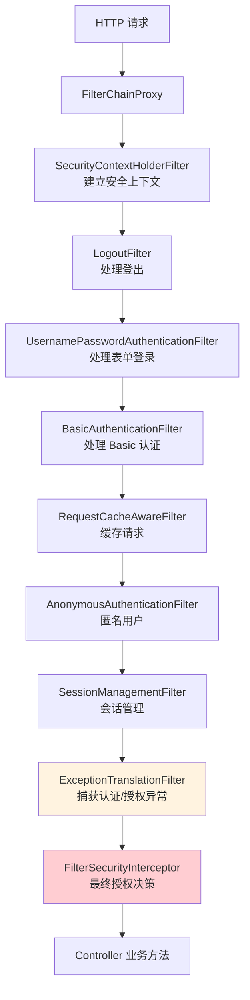
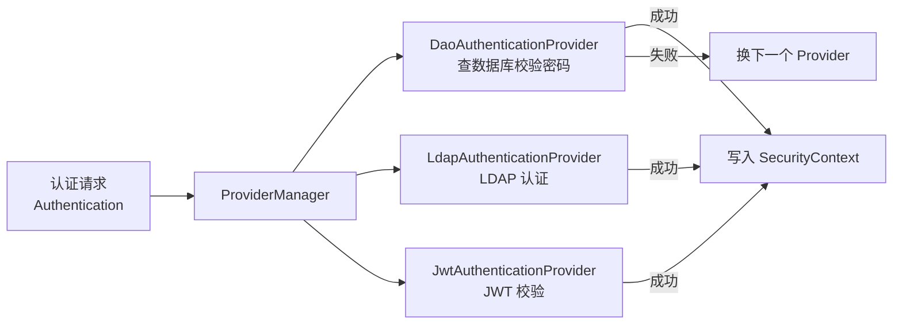
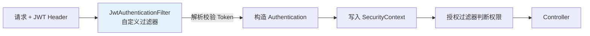

# SpringSecurity原理

> 定位：Spring Security 不是几个注解，而是一条精心设计的过滤器链。这一篇带你从过滤器链切入，把 AuthenticationManager、UserDetailsService、SecurityContext、方法级鉴权的来龙去脉串起来，让你能自己加过滤器、接 JWT、避开配置坑。

## 一、为什么需要它

很多团队用 Spring Security 的体验是「能跑，但不懂」：

- 加个 `@PreAuthorize` 能用，但不知道为什么方法鉴权没生效。
- 照着网上的 `WebSecurityConfigurerAdapter` 配置能登录，但升级 Spring Boot 3 / Security 6 后全报错。
- 想接 JWT，网上抄一段 `OncePerRequestFilter`，结果过滤器顺序错了，Token 校验根本没执行。
- 自定义登录想返回 JSON，却怎么都跳到 `/login` 页面。

这些问题的根源都是**没理解过滤器链**。Spring Security 的所有能力——认证、授权、会话、登出、CSRF——都是挂在这条链上的过滤器实现的。搞懂链的结构和顺序，配置问题就迎刃而解。

> 版本提示：Spring Security 5.7 起弃用 `WebSecurityConfigurerAdapter`，推荐用 `SecurityFilterChain` Bean + `Lambda DSL`；Spring Boot 3（Security 6）彻底移除了前者。本文以新写法为主，老项目「以你使用的版本为准」。

## 二、核心原理：过滤器链是骨架

Spring Security 的入口是一个 **`FilterChainProxy`**，它本身是一个 Filter，注册到 Servlet 容器。它内部维护一组 `SecurityFilterChain`，每条链里有一串 Security Filter。请求进来，按顺序穿过这些过滤器，每个过滤器各管一件事。



这张图要抓住三点：

1. **顺序固定且重要**：比如 `ExceptionTranslationFilter` 必须在 `FilterSecurityInterceptor` 之前，才能捕获授权失败抛出的异常并转成 401/403 响应。
2. **不是所有过滤器都生效**：启用哪些取决于你的配置（表单登录、Basic、JWT 等）。
3. **最后一个过滤器 `FilterSecurityInterceptor`** 做 URL 级别的最终授权决策；方法级鉴权则走另一条 AOP 路径（后面讲）。

### 2.0 这条链是怎么挂到 Servlet 容器上的

理解过滤器链，先要回答一个基础问题：Spring Security 的过滤器又不是 Servlet，怎么拦到 HTTP 请求的？答案是两个代理类：

- **`DelegatingFilterProxy`**：注册在 Servlet 容器（Tomcat）里的一个普通 Filter。它自己不干活，只是在请求到来时，去 Spring 容器里找名为 `springSecurityFilterChain` 的 Bean，把请求委托给它。
- **`FilterChainProxy`**：就是上面那个 Bean，它是 Spring Security 的真正入口，内部维护一条或多条 `SecurityFilterChain`，按顺序执行链上的各个 Security Filter。

所以用一句话概括调用路径：**Tomcat → DelegatingFilterProxy → FilterChainProxy → N 个 Security Filter → DispatcherServlet → Controller**。明白这一点，你就知道为什么自定义过滤器要「注册成 Bean 并加进链」才能生效——它必须被 FilterChainProxy 纳入调度，光加个 `@Component` 是没用的，那只是个普通的 Spring Bean，不在安全链里。

### 2.1 SecurityContext：身份存在哪

`SecurityContextHolder` 是 Spring Security 的「当前登录人」存放处，底层默认用 **`ThreadLocal`** 存储 `SecurityContext`（内含 `Authentication`）。

- 因为用 ThreadLocal，所以同一线程内任何地方都能拿到当前用户：`SecurityContextHolder.getContext().getAuthentication()`。
- Web 请求结束后必须清理，否则线程复用会导致身份串台——这正是 `SecurityContextHolderFilter`（或老版的 `SecurityContextPersistenceFilter`）在请求结束时清空 ThreadLocal 的原因。
- 异步方法 `@Async`、线程池里默认拿不到主线程的安全上下文，需要配置 `DelegatingSecurityContextExecutor` 传递。

### 2.2 AuthenticationManager 与 ProviderManager

`AuthenticationManager` 是认证的统一入口，只有一个方法：`authenticate(Authentication)`。它的默认实现是 **`ProviderManager`**，内部持有一组 `AuthenticationProvider`，逐个尝试认证。



这种「多 Provider」设计的好处是支持多种认证方式并存：同一套系统既可以用账号密码，也可以接 LDAP、JWT，ProviderManager 按顺序挑一个能处理的。

### 2.3 UserDetailsService 与密码校验

`DaoAuthenticationProvider` 是最常用的 Provider，它依赖两个组件：

- **`UserDetailsService`**：根据用户名加载用户信息，返回 `UserDetails`（含用户名、密码哈希、权限集合、账号状态）。你要自定义用户体系，就是实现这个接口从数据库查用户。
- **`PasswordEncoder`**：校验前端传来的明文密码和库里哈希是否匹配。Spring Security **强制要求**用 `PasswordEncoder`，否则报 `There is no PasswordEncoder mapped for the id "null"` 经典错误。生产用 `BCryptPasswordEncoder`。

```java
@Bean
UserDetailsService userDetailsService(UserRepo repo) {
    return username -> repo.findByUsername(username)
        .map(u -> User.withUsername(u.getUsername())
            .password(u.getPassword())       // 库中是 bcrypt 哈希
            .authorities(u.getRoles())        // 角色/权限
            .build())
        .orElseThrow(() -> new UsernameNotFoundException(username));
}

@Bean
PasswordEncoder passwordEncoder() {
    return new BCryptPasswordEncoder(12);
}
```

### 2.4 认证流程完整串讲

以表单登录为例，一次认证的完整链路：

1. 用户提交 `/login`，`UsernamePasswordAuthenticationFilter` 拦截，封装成 `UsernamePasswordAuthenticationToken`（未认证状态）。
2. 调用 `AuthenticationManager.authenticate()` → `ProviderManager` → `DaoAuthenticationProvider`。
3. Provider 调 `UserDetailsService` 加载用户，用 `PasswordEncoder` 校验密码。
4. 成功返回**已认证**的 `Authentication`（含权限），`SessionAuthenticationStrategy` 处理会话（防会话固定攻击，登录时换 sessionId）。
5. `SecurityContextHolder` 写入安全上下文；`AuthenticationSuccessHandler` 决定跳转到哪（或返回 JSON）。
6. 失败则 `AuthenticationFailureHandler` 处理，清上下文，跳失败页。

### 2.5 授权：URL 级与方法级

授权分两层：

- **URL 级（FilterSecurityInterceptor）**：基于 `antMatchers/requestMatchers` 配置，如 `.requestMatchers("/admin/**").hasRole("ADMIN")`。在过滤器链的最后统一判断。
- **方法级（MethodSecurityInterceptor，AOP）**：用 `@PreAuthorize`、`@PostAuthorize` 等注解，通过 AOP 拦截方法调用。要先开启 `@EnableMethodSecurity`。

```java
@EnableMethodSecurity  // 开启方法级安全（Security 6 写法）
@Configuration
public class SecurityConfig { ... }

@Service
public class OrderService {
    @PreAuthorize("hasRole('ADMIN') or #username == authentication.name")
    public Order getOrder(Long id, String username) { ... }
}
```

`@PreAuthorize` 用 SpEL 表达式，支持引用方法参数（`#username`）、当前认证对象（`authentication`）。常用表达式：`hasRole('ADMIN')`、`hasAuthority('order:delete')`、`isAuthenticated()`、`#id == authentication.principal.id`。

> 方法级鉴权的原理是 AOP 代理：Spring 为 `OrderService` 生成代理对象，调用方法前先执行 `MethodSecurityInterceptor` 做表达式求值，通过才放行。所以**同类内部方法自调用（`this.xxx()`）会绕过代理，导致注解失效**——这是个高频坑。

### 2.6 JWT 集成：替换默认会话

Spring Security 默认用 Session 保存登录状态。接 JWT 的思路是：

1. 禁用 Session （`SessionCreationPolicy.STATELESS`）。
2. 写一个自定义 Filter（继承 `OncePerRequestFilter`），从请求头取 Token，校验签名和过期时间，解析出用户和权限，构造 `Authentication` 写入 `SecurityContext`。
3. 把这个 Filter 加到过滤器链的合适位置——通常在 `UsernamePasswordAuthenticationFilter` 之前或 `SecurityContextHolderFilter` 之后。
4. 登录接口单独处理：校验账号密码后签发 JWT 返回，不走默认的 Session 登录过滤器。



关键坑：**过滤器顺序**。JWT Filter 必须在授权过滤器之前执行，否则请求到达授权决策时 `SecurityContext` 还是空的，会被判定为未登录（401）。这就是为什么很多人「Token 校验代码写了却没生效」。

### 2.7 CSRF 与会话防护：链上容易忽视的环节

表单登录场景下，还有几个过滤器默默在做防护，值得单独点出来：

- **`CsrfFilter`**：默认开启，为每个会话生成 CSRF Token，表单要带 `_csrf` 隐藏域，否则 POST 请求被拒。前后端分离项目常把它关掉（改用 JWT + 无状态），但关掉前要确认自己不会有「靠 Cookie 鉴权的写接口」，否则等于敞开 CSRF 大门。
- **会话固定攻击防护**：登录成功后，`SessionAuthenticationStrategy` 默认会**更换 sessionId**（`migrateSession`），防止攻击者事先构造一个 sessionId 诱导用户用它在登录，登录后就拿到同一个会话。
- **`SecurityContextHolderFilter`**：请求开始时从 `SecurityRepository`（如 Session）加载上下文，结束前保存并清理，保证 ThreadLocal 不泄漏。

这些机制默认就生效，你感知不到；但一旦你自定义登录流程、禁用 Session 或替换过滤器，就可能把它们无意中绕过，埋下隐患。

### 2.8 与 Shiro 对比

| 维度 | Spring Security | Apache Shiro |
|---|---|---|
| 生态 | 与 Spring 深度整合，Spring Boot 全家桶首选 | 独立框架，不依赖 Spring，也能用于非 Web |
| 功能 | 认证、授权、OAuth2/OIDC、方法级、响应式全面 | 认证、授权、会话、加密，更轻量 |
| 配置复杂度 | 较复杂，概念多（过滤器链、Provider 等） | 简单直观，易上手 |
| 灵活性 | 极高，几乎处处可扩展 | 较灵活但不如 Security |
| 适用场景 | Spring 生态企业应用（主流选择） | 轻量项目、非 Spring 项目、快速集成 |

现在新项目绝大多数选 Spring Security，Shiro 更多见于存量系统。

## 三、关键机制与参数

| 组件 | 作用 | 常见自定义点 |
|---|---|---|
| `SecurityFilterChain` | 定义过滤器链和 URL 规则 | `requestMatchers`、`csrf`、`sessionManagement` |
| `AuthenticationManager` | 认证入口 | 配置多个 Provider |
| `UserDetailsService` | 加载用户信息 | 接数据库、Redis、LDAP |
| `PasswordEncoder` | 密码校验 | BCrypt / Argon2 |
| `AuthenticationEntryPoint` | 未认证时响应 | 返回 401 JSON 而非跳登录页 |
| `AccessDeniedHandler` | 已认证无权限响应 | 返回 403 JSON |
| `SecurityContextHolder` | 存当前用户 | 异步场景传递策略 |

这里特别解释两个最容易被忽略的「异常处理组件」，它们决定了失败时用户看到什么：

- **`AuthenticationEntryPoint`**（认证入口点）：当**未登录**用户访问受保护资源时，`ExceptionTranslationFilter` 会调用它。默认实现会重定向到登录页或弹 Basic 认证框；前后端分离项目要改成返回统一的 `{"code":401,"msg":"未登录"}` JSON。
- **`AccessDeniedHandler`**（拒绝访问处理器）：当**已登录但无权限**时由 `FilterSecurityInterceptor` 抛出 `AccessDeniedException`，再交给它处理，通常返回 403 JSON。

两者的区别正是 401 和 403 的区别：前者「你没证明身份」，后者「你身份够但权限不够」。很多项目把这两个都配成跳登录页，结果前端拿到一堆 HTML，排查半天才发现是这里没配。

另外要注意 `UserDetails` 里的 `authorities` 和 `hasRole()` 的对应关系：`hasRole("ADMIN")` 实际匹配的是 `ROLE_ADMIN` 这个权限（框架会自动加 `ROLE_` 前缀），而 `hasAuthority("ADMIN")` 才匹配原始的 `ADMIN`。如果你从数据库查出的角色没带 `ROLE_` 前缀却用了 `hasRole()`，就会出现「明明有角色却被拒」的诡异现象——要么按约定给角色加前缀，要么统一用 `hasAuthority`。

前后端分离项目，务必把 `AuthenticationEntryPoint` 和 `AccessDeniedHandler` 改成返回 JSON，否则未登录时会被重定向到 `/login`，前端拿到的是 HTML 而不是预期的 401/403。

## 四、生产坑点与排查

### 坑点 1：`PasswordEncoder` 未配置导致登录报错

**现象**：启动或登录时报 `java.lang.IllegalArgumentException: There is no PasswordEncoder mapped for the id "null"`。
**原因**：Spring Security 5+ 要求密码必须经 `PasswordEncoder` 处理，配置里没声明 Bean。
**解法**：注册一个 `PasswordEncoder` Bean（如 `BCryptPasswordEncoder`），并确保库里存的是对应算法加密后的哈希；老系统明文密码需要写迁移逻辑，在用户登录时透明升级为 bcrypt。

### 坑点 2：升级 Security 6 后 `WebSecurityConfigurerAdapter` 失效

**现象**：升级 Spring Boot 3 后配置类不生效，所有接口被默认保护或全部放行。
**原因**：Security 6 移除了 `WebSecurityConfigurerAdapter`，旧配置不再被加载。
**解法**：改用定义 `SecurityFilterChain` Bean + Lambda DSL 的新写法：

```java
@Bean
SecurityFilterChain filterChain(HttpSecurity http) throws Exception {
    http
      .authorizeHttpRequests(auth -> auth
          .requestMatchers("/public/**").permitAll()
          .anyRequest().authenticated())
      .sessionManagement(s -> s.sessionCreationPolicy(SessionCreationPolicy.STATELESS));
    return http.build();
}
```

### 坑点 3：`@PreAuthorize` 不生效

**现象**：加了注解的方法，无权限用户依然能调用。
**原因**：① 没加 `@EnableMethodSecurity`；② 同类内部方法自调用绕过 AOP 代理；③ 方法不是 `public` 或被 `final` 修饰（CGLIB 无法代理）。
**解法**：开启方法安全；把鉴权方法拆到另一个 Bean 调用；确认方法是 public 且非 final；必要时用 `AopContext.currentProxy()` 调用自身。

### 坑点 4：自定义 JWT 过滤器顺序错误，Token 校验不执行

**现象**：Token 校验 Filter 写了，但请求仍返回 401，调试发现 Filter 没进或上下文被清。
**原因**：`addFilterBefore/After` 放错位置，晚于授权过滤器；或被 `SecurityContextHolderFilter` 清空了上下文。
**解法**：把 JWT Filter 放在 `UsernamePasswordAuthenticationFilter` 之前（或按版本放在 `SecurityContextHolderFilter` 之后、`AnonymousAuthenticationFilter` 之前）；确认校验成功后正确写入 `SecurityContext`；开启 debug 日志（`logging.level.org.springframework.security=DEBUG`）看过滤器执行顺序。

### 坑点 5：异步/子线程里拿不到当前用户

**现象**：`@Async` 方法或新开线程里 `SecurityContextHolder.getContext().getAuthentication()` 为 null。
**原因**：默认 ThreadLocal 不向子线程传递。
**解法**：配置 `DelegatingSecurityContextAsyncTaskExecutor` 包装线程池，或手动在子线程设置/清理上下文。

## 五、调优 / 选型 / 最佳实践

1. 优先用新写法（`SecurityFilterChain` + Lambda DSL），别再抄老教程。
2. 前后端分离：配 `AuthenticationEntryPoint`/`AccessDeniedHandler` 返回 JSON，禁用 Session。
3. 密码用 BCrypt(cost 10-12) 或 Argon2；永远不存明文。
4. 方法级鉴权用 `@PreAuthorize`，注意 AOP 自调用陷阱。
5. 自定义 Filter 一定确认顺序，用 DEBUG 日志验证链路。
6. 最小化放行规则：默认 `.anyRequest().authenticated()`，只显式放行必要路径。
7. 与 OAuth2/OIDC 集成时用 Spring Security 的 `oauth2-resource-server` / `oauth2-client` 原生支持，少造轮子。

## 六、面试高频问法

> 这一节按「能讲透」的标准写：每题先给一句能直接背的结论，再展开机制、对比与生产坑。建议先自己答一遍，再对照补全。

**Q1：Spring Security 的核心原理是什么？**

**一句话结论**：Spring Security 不是几个注解，而是一条 **Servlet Filter 链**——`FilterChainProxy` 管理一组 `SecurityFilterChain`，各过滤器按固定顺序各司其职（认证、会话、匿名、异常转换、授权），请求依次穿过。

展开：

- **入口**：`FilterChainProxy` 本身是一个 Filter，注册到 Servlet 容器，内部维护一条或多条 `SecurityFilterChain`。
- **关键过滤器及顺序**：

| 过滤器 | 职责 |
|---|---|
| `SecurityContextHolderFilter` | 建立/加载安全上下文 |
| `LogoutFilter` | 处理登出 |
| `UsernamePasswordAuthenticationFilter` | 处理表单登录 |
| `BasicAuthenticationFilter` | 处理 Basic 认证 |
| `AnonymousAuthenticationFilter` | 未登录时放入匿名身份 |
| `ExceptionTranslationFilter` | 捕获认证/授权异常，转 401/403 |
| `FilterSecurityInterceptor` | URL 级最终授权决策 |

- **三个要点**：① 顺序固定且重要（异常转换必须在最终授权之前，才能捕获它抛的异常）；② 启用哪些过滤器取决于配置；③ URL 级授权在链尾，方法级授权走另一条 AOP 路径。

加分点：主动点出"所有能力——认证、授权、会话、登出、CSRF——都是挂在这条链上的过滤器实现的"，把零散概念统一到过滤器链这个骨架上，面试官会觉得你的理解是成体系的。

**Q2：一个 HTTP 请求从 Tomcat 到 Controller，Spring Security 的调用路径是怎样的？**

**一句话结论**：Tomcat → `DelegatingFilterProxy` → `FilterChainProxy` → N 个 Security Filter → `DispatcherServlet` → Controller；自定义过滤器必须被纳入这条链才生效。

展开两个代理类：

- **`DelegatingFilterProxy`**：注册在 Tomcat 里的普通 Filter，自己不干活，请求到来时去 Spring 容器找名为 `springSecurityFilterChain` 的 Bean，把请求委托过去。它解决的是"Servlet 容器里的 Filter 如何拿到 Spring 管理的 Bean"这个桥接问题。
- **`FilterChainProxy`**：就是那个 Bean，Spring Security 的真正入口，按顺序执行链上各个 Security Filter。

**为什么自定义 Filter 光加 `@Component` 不生效**：那只是个普通 Spring Bean，不在安全链里。必须用 `addFilterBefore/After` 把它加进 `SecurityFilterChain`，才会被 `FilterChainProxy` 调度。

加分点：能画出完整调用路径并说出两个代理的分工，是区分"背过注解"和"真懂原理"的分水岭。再补一句"多个 `SecurityFilterChain` 可以按 `requestMatcher` 匹配不同请求走不同链"，体现对多链机制的了解。

**Q3：AuthenticationManager、ProviderManager、UserDetailsService 是什么关系？**

**一句话结论**：`AuthenticationManager` 是认证入口接口，默认实现 `ProviderManager` 持有多个 `AuthenticationProvider` 逐个尝试；`DaoAuthenticationProvider` 依赖 `UserDetailsService` 加载用户、`PasswordEncoder` 校验密码。

展开：

- **`AuthenticationManager`**：只有一个方法 `authenticate(Authentication)`，是认证的统一门面。
- **`ProviderManager`**：默认实现，内部持有一组 Provider，按顺序挑一个能处理的；支持账号密码、LDAP、JWT 等多种方式并存。
- **`DaoAuthenticationProvider`**：最常用的 Provider，依赖两个组件：
  - `UserDetailsService`：按用户名加载 `UserDetails`（用户名、密码哈希、权限、账号状态）——自定义用户体系就实现这个接口查数据库；
  - `PasswordEncoder`：校验明文与哈希是否匹配。Spring Security 强制要求配置，**没配会报 `There is no PasswordEncoder mapped for the id "null"`** 经典错误。

加分点：说清"多 Provider 设计的好处是认证方式可插拔"——同一套系统既能账号密码又能接 LDAP、JWT，ProviderManager 逐个尝试，互不影响。再提一句老系统明文密码可用登录时透明升级为 bcrypt 的方式迁移，非常实战。

**Q4：以表单登录为例，讲一下完整认证流程。**

**一句话结论**：拦截 `/login` → 封装 Token → `AuthenticationManager` 认证 → 加载用户校验密码 → 处理会话 → 写 `SecurityContext` → 成功/失败处理器。

这条链路要能和过滤器链对应起来：表单登录的入口是链上的 `UsernamePasswordAuthenticationFilter`，认证逻辑委托给 `AuthenticationManager`，结果写回 `SecurityContext`，最后由两个 Handler 决定响应。六步串讲：

1. 用户提交 `/login`，`UsernamePasswordAuthenticationFilter` 拦截，把用户名密码封装成**未认证**的 `UsernamePasswordAuthenticationToken`（此时 `authenticated=false`，只有 principal 和 credentials）。
2. 过滤器调用注入的 `AuthenticationManager.authenticate()`，委派给 `ProviderManager`，它找到支持该 Token 类型的 `DaoAuthenticationProvider`。
3. Provider 调 `UserDetailsService` 按用户名加载 `UserDetails`（含密码哈希、权限、账号状态，顺便检查账号是否锁定/过期），再用 `PasswordEncoder.matches()` 比对前端明文与库里哈希。
4. 校验成功返回一个**已认证**的 `Authentication`（`authenticated=true`，含用户权限）；`SessionAuthenticationStrategy` 处理会话，默认**更换 sessionId**（`migrateSession`）防会话固定攻击。
5. `SecurityContextHolder` 写入安全上下文；`AuthenticationSuccessHandler` 决定跳转到原页面还是返回 JSON。
6. 失败则抛出 `AuthenticationException`，由 `AuthenticationFailureHandler` 清理上下文、跳失败页或返回错误。

加分点：强调第 4 步的"登录成功后换 sessionId"——这是防**会话固定攻击**的关键：攻击者事先构造一个 sessionId 诱导用户用它登录，若不更换，攻击者就拿着同一个 sessionId 直接获得登录态。这个点很多人忽略了，能主动说出来说明你理解认证流程不只是"校验密码"。

**Q5：SecurityContext 存在哪？为什么请求结束必须清理？**

**一句话结论**：默认用 `ThreadLocal` 存 `SecurityContext`；Web 容器线程复用，不清理会导致身份串台，所以 `SecurityContextHolderFilter` 在请求结束时清空。

展开：

- **存储机制**：`SecurityContextHolder` 底层默认 `ThreadLocal`，所以同一线程任何地方都能拿到当前用户：`SecurityContextHolder.getContext().getAuthentication()`。
- **为什么必须清理**：Tomcat 用线程池复用线程，如果请求 A 结束后不清空 ThreadLocal，请求 B 复用该线程时会读到 A 的身份——这就是**身份串台**，是严重的越权隐患。
- **异步场景**：`@Async`、线程池里默认拿不到主线程的安全上下文，需要配置 `DelegatingSecurityContextAsyncTaskExecutor` 包装线程池来传递，或手动设置/清理。

加分点：能说出"ThreadLocal 的清理放在 finally 里由过滤器保证"这层实现细节，并延伸到"异步传递要用 `DelegatingSecurityContextExecutor`"——这是生产里子线程拿不到当前用户问题的标准答案。

**Q6：URL 级授权和方法级授权有什么区别？`@PreAuthorize` 的原理是什么？**

**一句话结论**：URL 级在过滤器链尾由 `FilterSecurityInterceptor` 统一判断，方法级由 `@PreAuthorize` 经 AOP 拦截；后者要先加 `@EnableMethodSecurity`。

展开：

- **URL 级**：基于 `requestMatchers` 配置，如 `.requestMatchers("/admin/**").hasRole("ADMIN")`，在过滤器链最后统一决策。
- **方法级**：用 `@PreAuthorize`、`@PostAuthorize` 等注解，通过 AOP 代理在方法调用前后做 SpEL 表达式求值：

```java
@PreAuthorize("hasRole('ADMIN') or #username == authentication.name")
public Order getOrder(Long id, String username) { ... }
```

- **原理**：Spring 为 Bean 生成 AOP 代理，调用方法前先执行 `MethodSecurityInterceptor` 求值，通过才放行。SpEL 支持引用方法参数（`#username`）、认证对象（`authentication`）；常用 `hasRole`、`hasAuthority`、`isAuthenticated`。

加分点：一定要提 **`hasRole` 和 `hasAuthority` 的坑**——`hasRole("ADMIN")` 实际匹配 `ROLE_ADMIN`（框架自动加 `ROLE_` 前缀），`hasAuthority("ADMIN")` 才匹配原始值。库里角色没带前缀却用 `hasRole`，就会出现"明明有角色却被拒"的诡异现象。

**Q7：`@PreAuthorize` 加了却不生效，怎么排查？**

**一句话结论**：三大常见原因——没开 `@EnableMethodSecurity`、同类内部自调用绕过 AOP 代理、方法非 public 或被 final 修饰。

展开排查清单：

1. **没开启方法安全**：必须加 `@EnableMethodSecurity`（Security 6 写法），否则注解只是摆设。
2. **同类自调用绕过代理**：`this.xxx()` 这种内部调用不经过 Spring 代理，注解失效。解法：把鉴权方法拆到另一个 Bean；或用 `AopContext.currentProxy()` 调用自身。
3. **方法可见性**：非 `public` 或被 `final` 修饰的方法，CGLIB 无法代理，注解失效。
4. **表达式写错**：如 `hasRole` 与 `hasAuthority` 的前缀问题（见上一题）。

加分点：能说清"根本原因是 AOP 代理机制——只有从外部通过代理对象调用，拦截才会触发；内部 `this` 调用直接绕过代理"，把现象归因到原理，而不是只罗列解决办法。这是高频生产坑。

**Q8：如何在 Spring Security 中集成 JWT？过滤器顺序为什么关键？**

**一句话结论**：禁用 Session（STATELESS），自定义 `OncePerRequestFilter` 解析校验 Token 并写入 `SecurityContext`，且必须放在授权过滤器之前，否则上下文为空会被判 401。

展开五步：

1. 配置 `SessionCreationPolicy.STATELESS` 禁用 Session。
2. 写自定义 Filter（继承 `OncePerRequestFilter`）：从请求头取 Token，校验签名与过期时间，解析用户和权限，构造 `Authentication` 写入 `SecurityContext`。
3. 用 `addFilterBefore` 把它加到 `UsernamePasswordAuthenticationFilter` 之前（或按版本放在 `SecurityContextHolderFilter` 之后、`AnonymousAuthenticationFilter` 之前）。
4. 登录接口单独处理：校验账号密码后签发 JWT 返回，不走默认 Session 登录过滤器。
5. 开启 DEBUG 日志 `logging.level.org.springframework.security=DEBUG` 验证过滤器执行顺序。

加分点：**过滤器顺序是这题的命门**——JWT Filter 必须在授权过滤器之前执行，否则请求到达 `FilterSecurityInterceptor` 时 `SecurityContext` 还是空的，会被判未登录（401）。很多人"Token 校验代码写了却没生效"就是这个原因。

**Q9：`AuthenticationEntryPoint` 和 `AccessDeniedHandler` 有什么区别？**

**一句话结论**：前者处理"未登录"访问受保护资源（返回 401），后者处理"已登录但无权限"（返回 403）；前后端分离项目必须把它们改成返回 JSON。

展开：

- **`AuthenticationEntryPoint`**：未登录用户访问受保护资源时，由 `ExceptionTranslationFilter` 调用。默认实现重定向到登录页或弹 Basic 框；前后端分离要改成返回统一 `{"code":401,"msg":"未登录"}`。
- **`AccessDeniedHandler`**：已登录但无权限时，`FilterSecurityInterceptor` 抛 `AccessDeniedException` 交给它处理，通常返回 403 JSON。
- **本质区别**：正是 401 和 403 的区别——"你没证明身份" vs "你身份够但权限不够"。

加分点：很多项目把这两个都配成跳登录页，结果前端拿到一堆 HTML，排查半天才发现这里没配。能点出这个生产现象，并说明"前后端分离必须返回 JSON 而非重定向"，是很实在的经验分。

**Q10：升级到 Spring Security 6 / Spring Boot 3 后配置失效怎么办？**

**一句话结论**：Security 6 移除了 `WebSecurityConfigurerAdapter`，必须改用 `SecurityFilterChain` Bean + Lambda DSL 的新写法。

展开：

- **版本背景**：Spring Security 5.7 起弃用 `WebSecurityConfigurerAdapter`；Spring Boot 3（Security 6）彻底移除。老教程的 `extends WebSecurityConfigurerAdapter` 写法不再生效，导致"所有接口被默认保护或全部放行"。
- **新写法**：

```java
@Bean
SecurityFilterChain filterChain(HttpSecurity http) throws Exception {
    http
      .authorizeHttpRequests(auth -> auth
          .requestMatchers("/public/**").permitAll()
          .anyRequest().authenticated())
      .sessionManagement(s -> s.sessionCreationPolicy(SessionCreationPolicy.STATELESS));
    return http.build();
}
```

- **其他变化**：`antMatchers` 改为 `requestMatchers`；方法安全注解用 `@EnableMethodSecurity`（老版是 `@EnableGlobalMethodSecurity`）。

加分点：能主动标注"老项目以你使用的版本为准"，并说清"5.7 弃用、6.0 移除"的时间线，体现你踩过升级坑。再补一句"最小化放行规则：默认 `.anyRequest().authenticated()`，只显式放行必要路径"，这是安全配置的最佳实践。

**Q11：Spring Security 和 Shiro 怎么选？**

**一句话结论**：Spring Security 与 Spring 深度整合、功能全面、生态主流但概念多较复杂；Shiro 轻量独立、易上手；新项目绝大多数选 Security，Shiro 多见于存量系统。

展开对比：

| 维度 | Spring Security | Apache Shiro |
|---|---|---|
| 生态 | 与 Spring 深度整合，Boot 全家桶首选 | 独立框架，不依赖 Spring，也能用于非 Web |
| 功能 | 认证、授权、OAuth2/OIDC、方法级、响应式全面 | 认证、授权、会话、加密，更轻量 |
| 配置复杂度 | 较复杂，概念多（过滤器链、Provider 等） | 简单直观，易上手 |
| 适用场景 | Spring 生态企业应用（主流） | 轻量项目、非 Spring 项目、快速集成 |

加分点：能补一句"与 OAuth2/OIDC 集成时，优先用 Spring Security 原生的 `oauth2-resource-server` / `oauth2-client` 支持，少造轮子"——把技术选型和前面的认证篇串起来，说明你考虑的是整体方案而非孤立框架。

## 小结

- Spring Security 的灵魂是过滤器链，顺序固定且关键；FilterChainProxy 统一调度。
- 认证链：AuthenticationFilter → AuthenticationManager(ProviderManager) → UserDetailsService + PasswordEncoder → 写 SecurityContext。
- SecurityContext 用 ThreadLocal 存当前用户，请求结束必清理，异步需传递。
- 授权分 URL 级（FilterSecurityInterceptor）和方法级（@PreAuthorize，AOP + SpEL）。
- 接 JWT 要自定义 Filter 并放在授权之前；升级 6.x 用 SecurityFilterChain 新写法。
