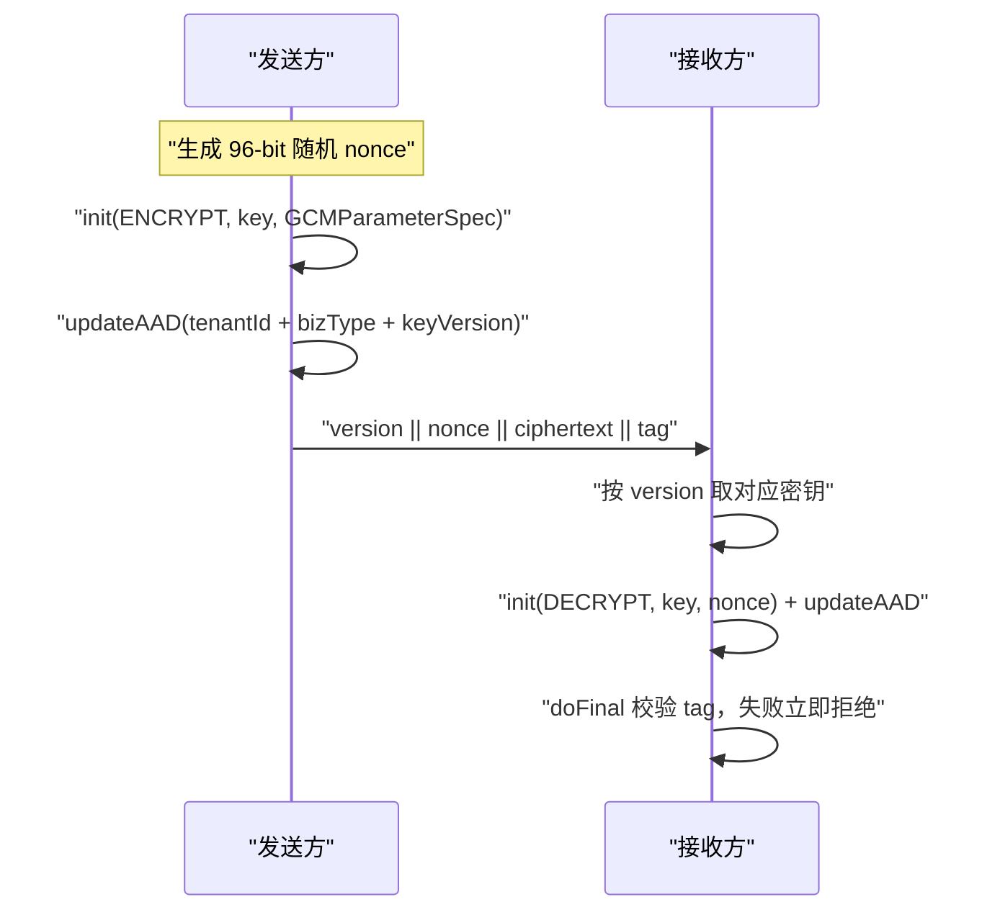
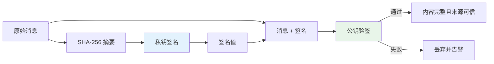
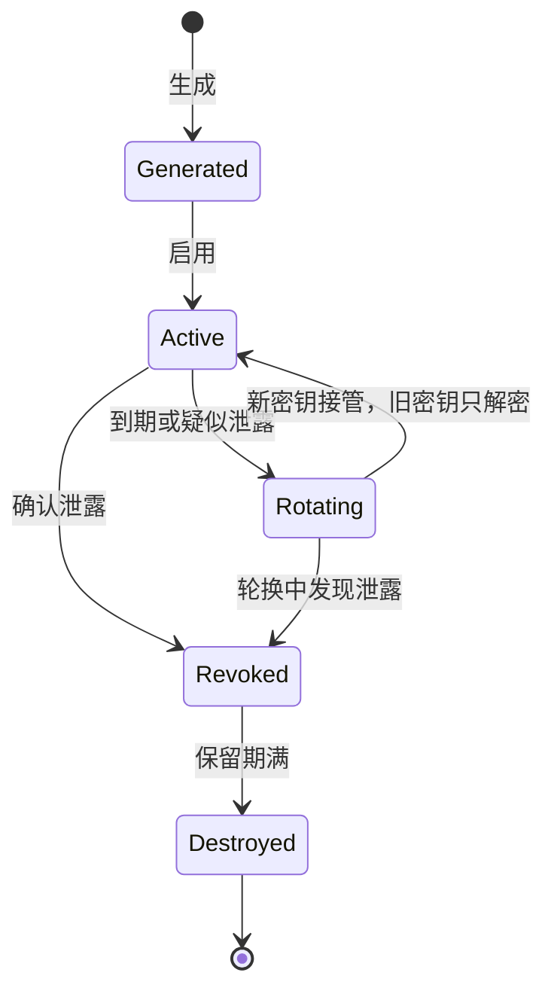
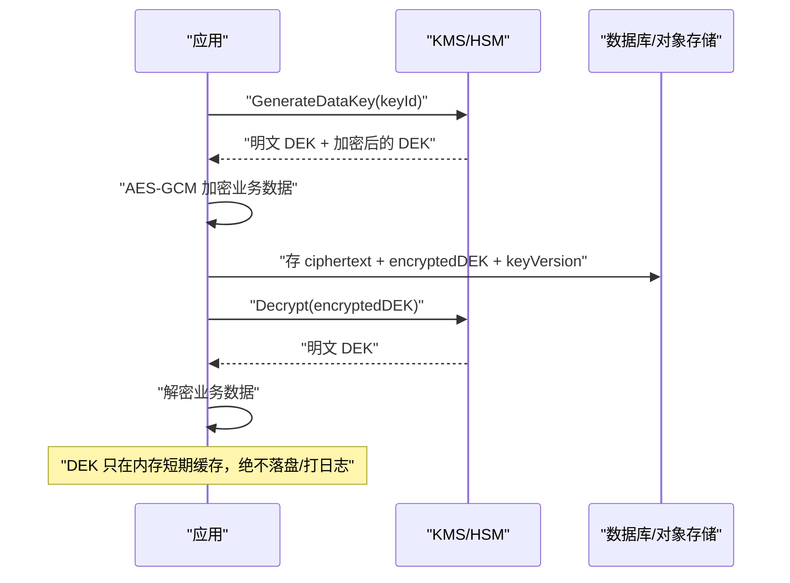

# 密码学与密钥管理

> 定位：线上安全检查最常见的翻车不是「没加密」，而是「加密用错了」——AES 用了 ECB、IV 固定不变、密码用 MD5 存、令牌用 `Random` 生成、密钥写死在 `application.yml` 里、轮换密钥后历史数据解不开。这篇从对称/非对称/哈希/签名四条主线讲清密码学原语，再把密钥生命周期、KMS/HSM、信封加密和 Java JCA 代码串起来，最后给出一份可直接照着改的排查清单。

前置阅读：[接口安全](02-接口安全.md) 讲传输加密与请求签名，[Web安全风险](03-Web安全风险.md) 讲密码存储与国密的基础用法；这篇不重复，而是往密钥生命周期和 Java 实现走。

## 一、为什么需要它

先看五个真实场景：

1. **密钥进了 Git**。开发把 `aes.key=0123456789abcdef` 写进 `application.yml`，仓库转公开后，所有用它加密的敏感数据等于裸奔。
2. **AES 用了 ECB**。相同明文产生相同密文，攻击者不用密钥，只要对比密文就能推断「这两条身份证号相同」。
3. **IV 固定**。GCM 下同一 key + 同一 nonce 加密两次，密钥流复用，明文可被恢复。
4. **密码用 MD5 存**。数据库泄露后彩虹表几分钟跑完；即使加盐，MD5 太快，GPU 爆破依然便宜。
5. **轮换后解密失败**。新密钥上线，历史订单还在用旧密钥，代码只认当前密钥，最后只能回滚。

这些问题的共同点是：**算法、模式、随机数、密钥管理、生命周期任何一环错了，整体安全性就归零**。它和业务 bug 不同——业务 bug 会报错，密码学用错往往功能正常，只是安全性悄悄消失。

> 一句话建立问题意识：**加密只保护「密钥没泄露」前提下的数据；密钥管理才是安全的地基。**

## 二、核心原理

### 2.1 先分清编码、哈希、加密、签名

| 概念 | 是否可逆 | 有无密钥 | 解决什么问题 | 典型算法 |
|---|---|---|---|---|
| **编码** | 可逆 | 无 | 格式转换，**不提供保密性** | Base64、Hex |
| **哈希** | 不可逆 | 通常无 | 完整性、指纹 | SHA-256、SHA-3、SM3 |
| **加密** | 可逆 | 有 | 保密性 | AES、RSA、SM4 |
| **签名** | 不可逆 | 有（私钥签、公钥验） | 身份认证、不可抵赖、完整性 | ECDSA、RSA-PSS、SM2 |

**Base64 不是加密**，谁拿到都能解回来。**哈希不等于加密**，无密钥、不可逆，只适合校验内容有没有变。**签名不等于加密**，签名后的消息仍然明文可读。需要既保密又证明来源时，两件事都要做。

### 2.2 对称加密：AES-GCM 是默认答案

对称加密用同一把密钥，速度快，适合加密大量数据。安全与否主要看**分组模式**：

| 模式 | 是否需 IV | 自带完整性 | 主要问题 | 建议 |
|---|---|---|---|---|
| **ECB** | 不需要 | 否 | 相同明文块产生相同密文块，泄露结构 | **禁止使用** |
| **CBC** | 需要，且随机 | 否 | 需额外 HMAC，否则可篡改 | 仅兼容老系统 |
| **CTR** | 需要，且唯一 | 否 | 必须配合 MAC | 特定流式场景 |
| **GCM** | 96-bit nonce，且唯一 | 是（tag） | nonce 重用灾难性失效 | **新系统首选** |

AES-GCM 同时提供机密性和完整性：密文被改一个字节，解密就会因 tag 校验失败而抛异常。三个关键参数：

- **Key**：128/192/256 位，新系统直接用 256 位。
- **Nonce/IV**：推荐 96 位（12 字节），**同一密钥下绝不能重复**。重复一次，攻击者可以恢复明文甚至伪造密文；单密钥加密量极大时应改用计数器或定期轮换。
- **Tag**：认证标签，常用 128 位，不要截短到 32 位。

**AAD（Additional Authenticated Data）** 是不加密但参与认证的附加数据，比如租户 ID、业务类型、密钥版本。它保证密文不能被挪到另一个业务上下文使用：订单密文拿到用户表解密，AAD 不一致就会失败。



读图要点：**nonce 不需要保密，但必须唯一；tag 必须校验**。版本号放在头部，是为了让解密方找到正确密钥，这是轮换的基础。

### 2.3 非对称加密：RSA 与 ECC

非对称加密用公钥加密、私钥解密（或私钥签名、公钥验签），解决密钥分发问题。它慢，通常只用来加密「对称密钥」或做签名。

| 算法 | 常见长度 | 用途 | 注意 |
|---|---|---|---|
| **RSA-OAEP** | 2048/3072 位 | 加密短数据、封装密钥 | 新系统不要用 PKCS#1 v1.5 填充 |
| **RSA-PSS** | 2048/3072 位 | 签名 | 比 PKCS#1 v1.5 签名安全 |
| **ECDSA** | P-256/P-384 | 签名 | 密钥短、性能好，JWT 常用 ES256 |
| **ECDH/X25519** | 256 位 | 密钥协商 | TLS 1.3 主力，前向安全 |

**RSA 不能直接加密大文件**：3072 位 RSA 一次只能加密几百字节，且比 AES 慢几个数量级。正确做法是**混合加密**——随机生成 AES 密钥加密数据，再用 RSA 公钥加密这个 AES 密钥。ECC 不是「另一种 RSA」，它基于椭圆曲线离散对数，相同安全强度下密钥短得多；曲线要用 P-256/P-384/Curve25519 这类经过广泛分析的参数。

### 2.4 哈希与密码存储

哈希分两类用途：**完整性校验**用 SHA-256/SHA-3/SM3，追求快；**密码存储**必须用 bcrypt、scrypt、Argon2id、PBKDF2，故意慢且吃内存。

| 算法 | 特点 | 参数（以当前主流实践为准） |
|---|---|---|
| **Argon2id** | 内存硬，抗 GPU/ASIC，OWASP 首选 | 内存 19 MiB 起，迭代 2 次，并行度 1 |
| **bcrypt** | 成熟、实现多，内置盐 | cost 10~12，校验控制在 100~300ms |
| **scrypt** | 内存硬 | N=2^14 起，按内存预算调 |
| **PBKDF2** | 兼容/FIPS 场景常用 | 迭代数十万次，按官方建议 |

三个要点：**每条密码的盐唯一且随机**，盐不必保密，和哈希一起存；**慢哈希参数要可调**，登录成功时可顺手用新参数重算；**绝不用可逆加密存密码**，拿到密钥就能还原所有密码。MD5/SHA-1 已能在现实成本下构造碰撞，不能用于安全目的。

### 2.5 数字签名与证书

签名流程：**对内容算摘要 → 私钥签摘要 → 对方用公钥验签**，证明内容没被篡改、签名者持有私钥。



读图要点：签名保护的是「摘要 + 私钥」，不提供保密性。**证书解决「公钥怎么可信地绑定到身份」**：X.509 证书包含公钥、主体、有效期、签发者及 CA 签名，客户端校验域名、有效期、吊销状态和证书链。TLS 防中间人靠的就是这套机制；内部服务可用 mTLS 双向验证书；代码/制品签名、JWT 的 RS256/ES256 也是同一原理。

### 2.6 传输加密与存储加密

| 维度 | 传输加密 | 存储加密 |
|---|---|---|
| **防什么** | 链路窃听、篡改、中间人 | 磁盘/备份被拖走、越权访问 |
| **手段** | TLS 1.2/1.3、mTLS、VPN | TDE、字段级加密、令牌化 |
| **密钥位置** | 服务端证书私钥、会话密钥 | KMS/HSM、密钥管理系统 |
| **失效场景** | 端点被攻破后数据仍是明文 | 应用有权限就能解密 |

TLS 只保护「路上」，数据落库、备份、日志它都管不到。存储加密分三层：**TDE** 防介质丢失，但防不了有数据库账号的人；**字段级加密**由应用在写入前加密，可按字段/租户分密钥，能防 DBA，但牺牲范围查询和模糊搜索；**令牌化**用无意义 token 替代卡号/身份证号，真实值放独立高安全区，适合支付场景。

### 2.7 密钥生命周期与信封加密

密钥生命周期：**生成 → 分发 → 使用 → 轮换 → 吊销 → 销毁**。



读图要点：**轮换不是「删旧换新」，而是「新密钥加密、旧密钥仍可解密」的过渡状态**；确认历史数据全部迁移或过期后，旧密钥才能销毁。

**信封加密**是云上最主流的做法：KMS 生成数据密钥 DEK，返回「明文 DEK + 被 KEK 加密后的 DEK」；应用用明文 DEK 加密业务数据，存储「密文 + 加密后的 DEK + keyVersion」；读取时把加密 DEK 发给 KMS 解密，再解业务数据。



读图要点：**KEK 永远不出 KMS，DEK 可内存缓存但要有 TTL**。轮换只需换 KEK 或重新生成 DEK，不必重新加密所有历史大文件。

**KMS、HSM、Vault、K8s Secret 的分工**：

| 方案 | 是什么 | 适合 | 局限 |
|---|---|---|---|
| **KMS** | 云厂商/自建密钥管理服务 | 绝大多数业务 | 强依赖云，跨云要设计 |
| **HSM** | 专用硬件密码机 | 金融、政务、根密钥、国密 | 贵、运维重、有调用延迟 |
| **Vault** | 密钥/凭据管理平台 | 多云、动态凭据、PKI | 自身要高可用 |
| **K8s Secret** | base64 配置对象 | 普通配置、非高敏 | **默认不加密**，有 etcd 权限就能读 |

## 三、关键机制与 Java 代码

### 3.1 JCA/JCE 核心对象

| 类/接口 | 作用 | 常见用法 |
|---|---|---|
| `Cipher` | 加解密 | `AES/GCM/NoPadding`、`RSA/ECB/OAEPWithSHA-256AndMGF1Padding` |
| `KeyGenerator` | 生成对称密钥 | `KeyGenerator.getInstance("AES")` |
| `SecretKeySpec` | 从字节构造密钥 | 仅用于已有密钥字节 |
| `GCMParameterSpec` | GCM 的 IV + tag 长度 | `new GCMParameterSpec(128, iv)` |
| `SecureRandom` | 密码学安全随机数 | 所有 token、盐、IV |
| `MessageDigest`/`Mac` | 摘要/HMAC | `SHA-256`、`HmacSHA256` |
| `Signature` | 签名/验签 | `SHA256withECDSA`、`SM3withSM2` |
| `KeyStore` | 密钥/证书库 | `PKCS12` |

### 3.2 AES-256-GCM 完整封装

下面这段把「随机 nonce + 版本号 + AAD + tag 校验」都处理了，可作为字段加密的基础设施：

```java
import javax.crypto.Cipher;
import javax.crypto.KeyGenerator;
import javax.crypto.SecretKey;
import javax.crypto.spec.GCMParameterSpec;
import java.nio.ByteBuffer;
import java.security.SecureRandom;
import java.util.Base64;

public final class AesGcmCipher {
    private static final int NONCE_LEN = 12;
    private static final int TAG_BITS = 128;
    private static final SecureRandom RANDOM = new SecureRandom();

    public static SecretKey newKey() throws Exception {
        KeyGenerator kg = KeyGenerator.getInstance("AES");
        kg.init(256);
        return kg.generateKey();
    }

    /** 格式：version(1B) || nonce(12B) || ciphertext+tag */
    public static String encrypt(SecretKey key, byte version,
                                 byte[] plain, byte[] aad) throws Exception {
        byte[] nonce = new byte[NONCE_LEN];
        RANDOM.nextBytes(nonce);                        // 每次必须是新 nonce
        Cipher cipher = Cipher.getInstance("AES/GCM/NoPadding");
        cipher.init(Cipher.ENCRYPT_MODE, key, new GCMParameterSpec(TAG_BITS, nonce));
        if (aad != null && aad.length > 0) cipher.updateAAD(aad);
        byte[] ct = cipher.doFinal(plain);

        ByteBuffer buf = ByteBuffer.allocate(1 + NONCE_LEN + ct.length);
        buf.put(version).put(nonce).put(ct);
        return Base64.getEncoder().encodeToString(buf.array());
    }

    public static byte[] decrypt(SecretKey key, byte[] aad, String encoded) throws Exception {
        ByteBuffer buf = ByteBuffer.wrap(Base64.getDecoder().decode(encoded));
        buf.get();                                      // version，生产应按版本取密钥
        byte[] nonce = new byte[NONCE_LEN];
        buf.get(nonce);
        byte[] ct = new byte[buf.remaining()];
        buf.get(ct);

        Cipher cipher = Cipher.getInstance("AES/GCM/NoPadding");
        cipher.init(Cipher.DECRYPT_MODE, key, new GCMParameterSpec(TAG_BITS, nonce));
        if (aad != null && aad.length > 0) cipher.updateAAD(aad);
        return cipher.doFinal(ct);                      // tag 不匹配抛 AEADBadTagException
    }
}
```

三个生产要点：**nonce 随机且不复用**；**AAD 绑定 `tenantId + bizType + fieldName`**，防止密文跨租户挪用；**`doFinal` 抛异常就是认证失败**，不要 catch 后返回空串或原文。

### 3.3 混合加密与签名

```java
// RSA 只用来封装 AES 密钥，不直接加密业务数据
Cipher rsa = Cipher.getInstance("RSA/ECB/OAEPWithSHA-256AndMGF1Padding");
rsa.init(Cipher.ENCRYPT_MODE, publicKey);
byte[] wrappedDek = rsa.doFinal(aesKey.getEncoded());

// ECDSA 签名与验签
Signature signer = Signature.getInstance("SHA256withECDSA");
signer.initSign(privateKey);
signer.update(data);
byte[] sig = signer.sign();

Signature verifier = Signature.getInstance("SHA256withECDSA");
verifier.initVerify(cert.getPublicKey());
verifier.update(data);
boolean ok = verifier.verify(sig);
```

`RSA/ECB/...` 里的 `ECB` 是 JCE transformation 的历史命名，对 RSA 并不表示分组模式；真正要关注的是 **OAEP + SHA-256**，不要退回 `PKCS1Padding`。私钥不要出现在代码、配置、日志里，PKCS#12 文件放 KMS/HSM 或受限文件系统，密码通过 Vault/环境注入。

### 3.4 密码哈希与国密

```java
// bcrypt（Spring Security）——每条自带随机盐
var encoder = new BCryptPasswordEncoder(12);
String hash = encoder.encode(rawPassword);
boolean ok = encoder.matches(rawPassword, hash);

// Argon2id（BouncyCastle）——参数随哈希一起存，方便以后升级
Argon2Parameters params = new Argon2Parameters.Builder(Argon2Parameters.ARGON2_id)
        .withSalt(salt).withIterations(3).withMemoryAsKB(65536).withParallelism(1).build();
```

**国密适用场景**：政务、金融、国企、信创项目可能强制要求 SM2/SM3/SM4。SM2 对标 RSA/ECDSA，做签名、密钥交换、加密；SM3 对标 SHA-256；SM4 对标 AES（128 位）。必须用经过认证的国密库或密码机，注意 **SM2 签名是 `r||s` 裸拼接**，与 ASN.1 DER 不同，跨系统对接要确认编码；SM4-CBC 要随机 IV + HMAC-SM3，库支持 SM4-GCM 时优先 AEAD。合规还包括《密码法》、等保测评和密钥生命周期审计。

## 四、生产坑点与排查

### 坑点 1：密钥硬编码在代码或配置里

**现象**：Git 历史里扫出 `AES_KEY`、`jdbc.password`；仓库转公开或代码泄露后，攻击者直接解密数据。
**原因**：开发图省事把密钥写进 YAML、常量类、测试脚本；或用 Jasypt 加密配置，但把主口令又写在启动脚本里。
**解法**：密钥放 KMS/Vault，应用按身份拉取；至少用环境变量或挂载文件并加入 `.gitignore`；开启 secret scanning 和 pre-commit 检查；已泄露的密钥立即轮换，**只删当前文件没用，Git 历史里还在**。

### 坑点 2：ECB 模式或固定 IV / nonce 重用

**现象**：审计报告「使用不安全的 ECB 模式」；或 GCM 偶发解密失败、密文可被篡改。
**原因**：抄了 `AES/ECB/PKCS5Padding` 示例；为让解密对上把 IV 写成固定值；GCM nonce 用常量或秒级时间戳，并发下重复。
**解法**：统一 `AES/GCM/NoPadding`，每次生成新的 12 字节随机 nonce 并随密文存储；历史 ECB 数据写迁移程序重加密；代码评审把 `ECB` 加入禁用关键字。

### 坑点 3：用 MD5/SHA-256 存密码

**现象**：渗透报告「密码使用弱哈希」；数据库泄露后大量弱密码被还原。
**原因**：把「哈希」当「密码加密」，用 `MessageDigest.getInstance("MD5")`，或换成 SHA-256 仍是快速哈希。
**解法**：改用 Argon2id/bcrypt，存储格式带算法和参数；老用户登录成功时透明重算；无法重算的离线账户强制重置。不要试图给 MD5 加盐补救，算法本身太快。

### 坑点 4：用 `Random` 生成令牌、盐、IV

**现象**：邀请码、重置密码 token、会话 ID 能被预测，出现越权或账户接管。
**原因**：`new Random()` 是线性同余伪随机，少量输出就能推算后续序列；`Math.random()` 同理。
**解法**：所有安全相关随机数用 `SecureRandom`；令牌至少 128 位；不要用时间戳、自增 ID、用户 ID 做随机源。

### 坑点 5：密钥轮换后历史数据解不开

**现象**：新密钥上线，老订单、老附件解密报 `AEADBadTagException` 或 `BadPaddingException`。
**原因**：密文没有 keyVersion；代码只加载当前密钥；轮换时直接删旧密钥；只改配置没重加密历史数据。
**解法**：密文带版本号；密钥表保留多版本，新数据新密钥、旧数据旧密钥；读旧数据可异步重加密；旧密钥保留到历史数据迁移完再销毁；轮换前做历史数据回归。

### 坑点 6：日志、异常、堆 dump 泄露密钥和明文

**现象**：日志出现完整身份证号、银行卡号、token；异常堆栈带出密钥；OOM 时 heap dump 被下载。
**原因**：`log.info("req={}", object)` 直接打印整个对象；把密钥放进异常消息；生产堆 dump 无权限控制。
**解法**：日志入口统一脱敏；密钥对象 `toString()` 返回掩码；禁止打印 `SecretKey` 字节；heap dump 加权限、加密存储、用完即删；K8s Secret 默认只是 base64，至少开 etcd 静态加密和 RBAC。

## 五、调优 / 选型 / 最佳实践

| 场景 | 推荐 | 不推荐 | 说明 |
|---|---|---|---|
| 业务字段加密 | AES-256-GCM | ECB、固定 IV 的 CBC | 带 AAD、带版本号 |
| 文件/大对象 | AES-256-GCM + 信封加密 | RSA 直接加密文件 | DEK 加密数据，KEK 由 KMS 管 |
| 密码存储 | Argon2id / bcrypt | MD5、SHA-256、可逆加密 | 加盐、慢哈希、参数可升级 |
| 完整性 | SHA-256/HMAC-SHA256 | MD5、SHA-1 | 带密钥认证用 HMAC |
| 数字签名 | ECDSA P-256/RSA-PSS/SM2 | RSA PKCS#1 v1.5 | 私钥放 KMS/HSM |
| 密钥交换 | ECDH/X25519 | 自研协议 | 优先 TLS 1.3 |

**轮换与销毁**：数据密钥常见 90 天、根密钥 1 年；人员变动或疑似泄露立即轮换。轮换时新密钥先 `Active`，旧密钥转 `DecryptOnly`，双读确认无旧数据写入后再下线。销毁要多人审批、等待期和审计；对「删除权」场景可用 crypto-shredding——删掉数据密钥让密文永久不可解，但要确认别处没缓存明文。

**什么时候不该用**：不要自己发明算法或模式；不要用 RSA 加密大量数据；不要用确定性加密做范围查询，除非明确接受相等关系泄露；不要把 Jasypt 静态口令当唯一保护，它防不了拿到代码和启动脚本的人。

## 六、面试高频问法

**Q1：对称和非对称加密有什么区别？为什么实际系统要结合使用？**

**一句话结论**：对称快、适合大量数据但密钥分发难；非对称慢、能安全分发密钥和做签名；实际用「非对称传密钥 + 对称加密数据」。

展开：AES-GCM 吞吐远高于 RSA/ECC，适合业务数据；RSA-OAEP/ECDH 用来加密或协商 AES 密钥。签名用私钥签、公钥验，解决身份和不可抵赖。

加分点：说「RSA 3072 一次也只能加密几百字节，天生不适合直接加密文件」。

**Q2：AES-GCM 的 nonce 为什么不能重复？重复会怎样？**

**一句话结论**：GCM 用 nonce 派生密钥流，同一密钥下 nonce 重复会导致密钥流复用，攻击者可恢复明文并伪造密文。

展开：GCM 本质是 CTR 加密 + GHASH 认证。相同 key + nonce 产生相同密钥流，两个密文异或得到两个明文异或；更严重的是认证密钥可能被恢复，攻击者能伪造任意密文通过校验。

加分点：说「nonce 不必保密但必须唯一；工程上随机 nonce 随密文存，单密钥加密量极大时改用计数器或定期轮换」。

**Q3：为什么密码不能用 SHA-256 存，而要用 bcrypt/Argon2？**

**一句话结论**：SHA-256 太快，GPU 每秒数十亿次，适合完整性但不抗爆破；bcrypt/Argon2 故意慢且吃内存，把单次猜测成本抬高。

展开：密码存储的威胁是数据库泄露后的离线爆破，攻击者可无限尝试。SHA-256 的设计目标是快，正好帮了攻击者；bcrypt 的 cost、Argon2 的内存/迭代参数可随硬件调整，每条密码有唯一盐，废掉彩虹表。

加分点：说「Argon2id 是 OWASP 当前首选，bcrypt 兼容性最好；参数以单次校验 100~300ms 为目标压测，存储格式要带参数」。

**Q4：加密、哈希、签名、编码分别解决什么问题？**

**一句话结论**：编码只换格式不保密；哈希做不可逆指纹；加密保证保密性；签名证明来源和完整性。

展开：Base64 谁都能解；哈希无密钥、不可逆；加密有密钥、可逆；签名私钥签、公钥验。HMAC 是「带密钥的哈希」，属于完整性认证，不是加密。

加分点：说「签名不提供保密性，签名后的消息仍明文可读；需要保密就加密或走 TLS」。

**Q5：HTTPS 已经加密传输，为什么数据库还要加密？**

**一句话结论**：TLS 只保护链路，落盘、备份、日志、DBA 查询都不在保护范围内；存储加密防介质丢失和越权访问。

展开：TLS 的威胁模型是链路窃听/中间人，端点默认可信。数据库备份被拖走、磁盘被偷、DBA 账号被盗，TLS 都管不到。

加分点：说「TDE 防介质丢失但防不了有库权限的人；字段级加密能防 DBA，但牺牲范围查询和模糊搜索」。

**Q6：密钥怎么管理？轮换怎么做才不出事故？**

**一句话结论**：密钥放 KMS/Vault/HSM，应用只拿引用；密文带版本号，轮换时新旧并存，新数据新密钥、旧数据旧密钥，迁移完再销毁。

展开：生命周期是生成、分发、使用、轮换、吊销、销毁。轮换不是删旧换新，而是「新密钥 Active、旧密钥 DecryptOnly」的过渡；读旧数据可异步重加密；销毁要有审批、等待期和审计。

加分点：说「密文不带 keyVersion 是轮换事故头号原因；密钥泄露后只删配置文件没用，Git 历史里还在」。

**Q7：什么是信封加密？KMS 和 HSM 怎么选？**

**一句话结论**：信封加密用 KMS 管 KEK，KEK 加密随机 DEK，DEK 加密业务数据；KMS 适合多数业务，HSM 适合根密钥、金融/政务和国密合规。

展开：KEK 永不出 KMS，DEK 可内存短期缓存。轮换 KEK 不必重加密所有大文件，KMS 调用量也可控。HSM 密钥不出设备，安全最高，但贵、运维重、有延迟。

加分点：说「K8s Secret 默认只是 base64；生产要开 etcd 静态加密、严格 RBAC，最好用 External Secrets 或 Vault 注入」。

**Q8：Java 加解密最容易踩哪些坑？国密怎么落地？**

**一句话结论**：ECB、固定 IV、GCM nonce 重用、`Random` 代替 `SecureRandom`、MD5 存密码、密钥硬编码、日志打印明文；国密用于信创合规，必须用认证库。

展开：JCE 只负责按参数计算，不会阻止你用错模式；`Cipher.getInstance("AES")` 的默认模式随 Provider 变化，必须显式写全。国密 SM2 签名是 `r||s` 拼接，与 ASN.1 DER 不同；SM4 要有随机 IV 和完整性保护。

加分点：说「比较签名/哈希用 `MessageDigest.isEqual` 做常量时间比较；`String.getBytes()` 要带字符集；`AEADBadTagException` 绝不能吞」。

## 小结

- 密码学四件事先分清：编码不保密、哈希不可逆、加密保保密、签名证来源；Base64 不是加密。
- 对称默认 AES-256-GCM，nonce 必须唯一、tag 必须校验、AAD 绑定业务上下文；ECB 和固定 IV 是红线。
- 密码存储用 Argon2id/bcrypt 加盐慢哈希，绝不用 MD5/SHA-256；参数可升级，比较要常量时间。
- 密钥管理核心是生命周期和版本化：密文带 keyVersion，轮换时新旧并存，迁移完再销毁。
- 生产优先信封加密 + KMS/HSM：KEK 不出 KMS，DEK 内存短期缓存；K8s Secret 默认不是加密。
- 最隐蔽的坑是「功能正常但安全失效」：ECB、固定 nonce、`Random`、日志泄露，靠扫描和评审兜底。

## 参考资料

- NIST FIPS 197：Advanced Encryption Standard (AES)
- NIST SP 800-38D：Galois/Counter Mode (GCM) and GMAC
- NIST SP 800-63B：Digital Identity Guidelines，密码存储与认证器要求
- OWASP Password Storage Cheat Sheet
- RFC 8017：PKCS #1: RSA Cryptography Specifications
- GB/T 32918：信息安全技术 SM2 椭圆曲线公钥密码算法
