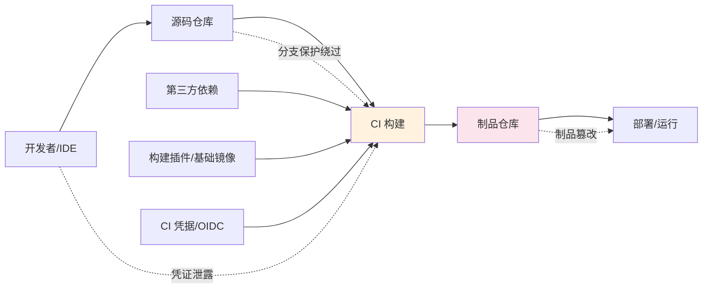
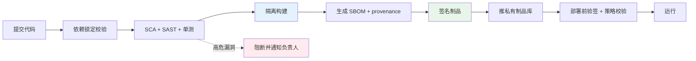
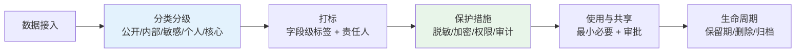

# 供应链安全与数据合规

> 定位：你的系统可能一行漏洞代码都没写，却因为一个被投毒的依赖、一个泄露的 CI Token、一个回传用户数据的第三方 SDK 而整体失守。供应链安全解决「你用的东西是否可信」，数据合规解决「你拿到的数据能不能这么用」。这篇把依赖投毒、SBOM、制品签名、SLSA、CI/CD 最小权限，以及数据分类分级、脱敏、PIPL/GDPR、等保 2.0 串成一条可落地的工程链路。

相关篇目：[CICD 与发布策略](../14-容器与云原生/04-CICD与发布策略.md)、[配置管理与环境治理](../16-项目治理/03-配置管理与环境治理.md)、[日志体系](../13-可观测性/04-日志体系.md)。

## 一、为什么需要它

近十年影响最大的安全事件，很多不是「应用代码被攻破」，而是「供应链被污染」：

- **Log4Shell（CVE-2021-44228）**：一个广泛使用的日志库爆出远程代码执行，企业自己没写错任何代码，却要在几天内盘点「哪些系统用了 Log4j、哪个版本、有没有被利用」——没有 SBOM 的团队只能靠人肉 grep。
- **event-stream（2018）**：知名 npm 包被转手给恶意维护者，攻击者通过新增依赖窃取加密货币钱包。
- **ua-parser-js（2021）**：维护者账号被劫持，恶意版本在安装时执行挖矿/窃密脚本。
- **xz-utils 后门（2024）**：攻击者长期潜伏、获取维护者信任，在构建脚本里植入后门，差点进入主流 Linux 发行版。
- **SolarWinds（2020）**：攻击者入侵构建系统，在合法签名的更新包里植入后门，下游客户「正常升级」即中招。

这些事件的共同点是：**信任被沿着依赖链、构建链、分发链传递了**。你信任了一个包，就等于信任它的所有依赖、它的维护者、它的构建环境。供应链安全就是把这条信任链显式化、可验证化。

数据合规则是另一条线：即使系统没被攻破，**把生产数据拷到测试库、在日志里打印身份证、让第三方 SDK 把通讯录传回服务器**，同样会触发监管处罚和用户诉讼。

## 二、核心原理

### 2.1 供应链攻击面



读图要点：**攻击面不只在「依赖包」**，还包括开发者终端、源码仓库、CI 凭证、构建插件、基础镜像、制品仓库和部署环节。任何一环被攻破，都能让「合法构建」产出恶意制品。

| 攻击面 | 典型手法 | 后果 |
|---|---|---|
| **依赖投毒** | 抢注相似包名、恶意维护者接管、构建脚本执行 | 安装即中招，窃取凭证/挖矿 |
| **typosquatting** | `spring-boot-starter-web` 写成 `spring-boot-stater-web` | 拉到攻击者发布的同名包 |
| **slopsquatting** | AI 编造不存在的包名，攻击者抢先注册 | AI 生成的代码引入恶意依赖 |
| **CI 凭证泄露** | 日志打印 Token、fork PR 读取 Secret、长期云密钥 | 攻击者向制品库推恶意版本 |
| **构建产物篡改** | 入侵构建机、替换基础镜像、污染缓存 | 源码干净但产物带后门 |
| **维护者账号劫持** | 钓鱼、凭据填充、社会工程 | 合法包发布恶意版本 |

### 2.2 SBOM：给依赖拍一张「成分表」

SBOM（Software Bill of Materials，软件物料清单）是制品的「配料表」：包含哪些组件、什么版本、什么许可证、依赖关系如何。出漏洞时，靠它分钟级定位影响面，而不是人肉搜索。

| 标准 | 维护方 | 特点 |
|---|---|---|
| **SPDX** | Linux Foundation | 许可证信息表达强，ISO 标准化 |
| **CycloneDX** | OWASP | 安全场景友好，支持 VEX、服务、AI/ML 组件 |

落地要点：

- **在构建时生成**，和制品同源，不能事后补；每次发布都生成并归档。
- **包含传递依赖**，不能只列直接依赖；要有组件版本、PURL、许可证、依赖关系。
- **和制品绑定**：把 SBOM 作为制品附件签名、存入制品库，部署时能查到「这个镜像对应哪份 SBOM」。
- **SBOM 不是目的**：目的是「漏洞出现时能查、能定位、能处置」，要配合漏洞管理和资产负责人。

### 2.3 依赖扫描与 SCA

SCA（Software Composition Analysis）扫描依赖中的已知漏洞和许可证风险。常见工具：

| 工具 | 形态 | 特点 |
|---|---|---|
| **OWASP Dependency-Check** | 开源，Maven/Gradle 插件 | 基于 CVE/NVD，易集成，误报需治理 |
| **Trivy** | 开源，CLI/CI | 镜像、文件系统、依赖、IaC 一把梭 |
| **Grype + Syft** | 开源 | Syft 生成 SBOM，Grype 按 SBOM 扫漏洞 |
| **Snyk** | 商业 SaaS | 修复建议好，开发者体验好 |
| **Dependabot/Renovate** | 平台/开源 | 自动提 PR 升级依赖 |

扫描结果不能只看「漏洞数量」，要结合四个维度排序：

- **可利用性**：CVSS 分数只是参考，优先看 EPSS（利用概率）和 CISA KEV（已被在野利用）。
- **可达性**：依赖里有漏洞方法，但你的代码根本没调用，风险要降级；这就是 reachability 分析的价值。
- **暴露面**：公网服务、处理敏感数据的服务优先。
- **修复成本**：能否直接升级、有没有破坏性变更、是否有替代库。

### 2.4 依赖锁定与私有仓库

**依赖锁定**保证「今天构建和三个月后构建拿到同一版本」，防止上游偷偷发版导致行为变化或引入漏洞。

- **Maven**：用 `dependencyManagement` + BOM 统一版本；禁止 `LATEST`/`RELEASE`；生产禁用 SNAPSHOT；用 `maven-enforcer-plugin` 的 `bannedDependencies` 禁掉已知危险库和冲突版本。
- **Gradle**：开启 `dependencyLocking`，提交 `gradle.lockfile`；用 `./gradlew dependencies --write-locks` 更新；配合 version catalog 统一版本。
- **私有仓库**：Nexus/Artifactory 做代理和缓存，只允许从私服解析；配置仓库顺序，禁止项目里随意加公网 repository；对关键制品做校验和/签名校验。
- **最小依赖**：能不用就不用，能少一个传递依赖就少一个攻击面；定期清理未使用依赖。

### 2.5 制品签名与 SLSA

**制品签名**解决「这个镜像/JAR 是不是我们构建的、有没有被换过」。主流方案是 Sigstore：

- `cosign sign` 对镜像摘要签名，部署时 `cosign verify` 验签。
- 支持 keyless 模式：用 OIDC 身份（如 CI 的 workload identity）签发短期证书，私钥不落盘。
- 把 SBOM、构建证明（provenance）作为 attestation 附加到制品上。

**SLSA（Supply-chain Levels for Software Artifacts）** 是供应链完整性的分级框架，核心是「构建过程可追溯、防篡改」：

| 级别 | 大致要求 | 解决的问题 |
|---|---|---|
| **Build L1** | 构建过程有文档、有 provenance | 知道制品从哪来 |
| **Build L2** | 托管构建、签名 provenance | 防止构建后被篡改 |
| **Build L3** | 构建环境隔离、不可复用、强身份 | 防止构建环境被污染 |

不要一上来追求最高级。多数团队先做到「构建在受控 CI、产物签名、SBOM 归档、部署验签」，已经能挡住大部分篡改和投毒。

### 2.6 CI/CD 安全

CI/CD 是供应链的「咽喉」，也是最容易泄露凭据的地方。



读图要点：**安全检查要前移，签名和验签要成对出现**。只签名不验签等于没签；只扫描不阻断等于没扫。

CI/CD 的六条硬规则：

1. **最小权限**：CI Token 只授予当前仓库、当前环境所需权限；不用个人长期 Token。
2. **OIDC 换短期凭证**：云厂商支持 GitHub/GitLab OIDC 联合身份，CI 直接换临时凭证，不存长期 AK/SK。
3. **Secret 管理**：密钥放 Vault/KMS/平台 Secret，日志自动掩码；fork PR 默认不给 Secret；构建产物里禁止打包 `.env`。
4. **固定 Action/插件版本**：GitHub Actions 用 commit SHA 固定，不用 `@main`；第三方插件要审计来源。
5. **构建环境隔离**：托管 Runner 或专用隔离 Runner；不把生产构建和不可信 PR 放同一台机器；缓存要防污染。
6. **分支保护与双人评审**：主分支禁止直推，发布流水线变更要评审，制品库写权限只给流水线身份。

### 2.7 数据分类分级、脱敏与合规

**数据分类分级**是所有数据安全工作的起点。没有分级，就不知道哪些数据要加密、哪些能出测试库、哪些不能出境。



读图要点：**分类分级不是一张表，要落到字段级标签和自动化策略**；保护措施要跟着数据走，而不是只在入口做一次。

| 级别 | 示例 | 最低要求 |
|---|---|---|
| **公开** | 官网文案、公开价格 | 完整性保护 |
| **内部** | 内部制度、普通运营数据 | 访问控制、审计 |
| **敏感** | 财务数据、合同、密钥 | 加密存储、严格授权、脱敏展示 |
| **个人** | 手机号、身份证、住址、生物特征 | 告知同意、最小必要、可删除 |
| **核心** | 核心配方、关键算法、大规模用户画像 | 最高等级隔离、专项审计 |

**脱敏分两类**：

- **静态脱敏（SDM）**：数据从生产流向测试/分析环境前，永久替换或泛化。测试库只能用脱敏数据，禁止直接拷生产库。
- **动态脱敏（DDM）**：查询时按用户权限实时遮蔽，底层仍是原值。适合客服、运营后台按权限查看。

脱敏手段包括：掩码（`138****8000`）、替换（假名化）、泛化（精确到城市）、哈希（不可逆索引）、令牌化（用 token 替代真实值）。**密码永远用加盐慢哈希，不能用可逆加密**。

**审计日志**要记录：谁、什么时间、从哪里、访问了哪条数据、做了什么操作、结果如何。审计日志本身要防篡改、单独存储、保留期符合法规。

**PIPL/GDPR 的核心要求**可以用一张表对齐：

| 要求 | PIPL（个人信息保护法） | GDPR | 工程落点 |
|---|---|---|---|
| **合法性基础** | 同意、合同、法定义务等 | 同意、合同、合法利益等 | 记录处理目的和依据 |
| **最小必要** | 限于实现目的的最小范围 | 数据最小化 | 字段准入评审，默认不采集 |
| **告知同意** | 显著告知处理规则，单独同意敏感信息 | 清晰告知，同意可撤回 | 隐私政策、同意管理平台 |
| **目的限制** | 不得超出约定目的 | 目的限制 | 数据打标，跨目的使用需重新评估 |
| **删除权** | 个人可请求删除 | 被遗忘权 | 删除流程 + 备份/派生数据清理 |
| **跨境** | 安全评估/认证/标准合同 | 充分性认定/SCC | 数据出境映射和审批 |
| **泄露通知** | 按规定通知个人和监管 | 72 小时内通知监管 | 事件响应预案和演练 |

**等保 2.0（GB/T 22239-2019）** 的技术要点，落到系统上主要是：身份鉴别（强口令、多因素）、访问控制（最小权限、分离职责）、安全审计（不可篡改日志、留存不少于六个月）、入侵防范（最小服务、漏洞修复、边界防护）、恶意代码防范、数据完整性与保密性（校验、加密）、个人信息保护、备份与恢复。等保是「基线合规」，不是「安全上限」。

## 三、关键配置与代码

### 3.1 Maven：SBOM + 依赖扫描

插件版本用属性占位，实际值以官方当前稳定版为准，不要长期停留在过旧版本。

```xml
<build>
  <plugins>
    <plugin>
      <groupId>org.cyclonedx</groupId>
      <artifactId>cyclonedx-maven-plugin</artifactId>
      <version>${cyclonedx.version}</version>
      <executions>
        <execution>
          <phase>package</phase>
          <goals><goal>makeAggregateBom</goal></goals>
        </execution>
      </executions>
    </plugin>
    <plugin>
      <groupId>org.owasp</groupId>
      <artifactId>dependency-check-maven</artifactId>
      <version>${dependency-check.version}</version>
      <configuration>
        <failBuildOnCVSS>7</failBuildOnCVSS>
        <suppressionFiles>
          <suppressionFile>dependency-check-suppressions.xml</suppressionFile>
        </suppressionFiles>
      </configuration>
    </plugin>
  </plugins>
</build>
```

`failBuildOnCVSS=7` 表示高危漏洞阻断构建；误报用 suppression 文件显式豁免，**每条豁免要写理由和到期时间**，不能一 suppress 了之。

### 3.2 Gradle 依赖锁定

```groovy
dependencyLocking {
    lockAllConfigurations()
}
```

```bash
./gradlew dependencies --write-locks
git add gradle.lockfile
```

锁定后，任何版本变化都必须显式更新 lockfile，评审时能看到 diff。

### 3.3 CI：OIDC 换短期云凭证

```yaml
permissions:
  id-token: write      # 只给 OIDC 所需权限
  contents: read

jobs:
  build:
    runs-on: ubuntu-latest
    steps:
      - uses: actions/checkout@<commit-sha>
      - name: Configure AWS credentials
        uses: aws-actions/configure-aws-credentials@<commit-sha>
        with:
          role-to-assume: arn:aws:iam::123456789012:role/ci-build
          aws-region: cn-north-1
```

关键点：**没有长期 AK/SK**，CI 用 OIDC 换取短期角色凭证；`permissions` 显式收敛；Action 用 commit SHA 固定，防止 `@main` 被改。

### 3.4 制品签名与验签

```bash
# keyless：用 CI 的 OIDC 身份签名，私钥不落盘
cosign sign $IMAGE

# 把 SBOM 作为 attestation 附加
cosign attest --predicate sbom.json --type cyclonedx $IMAGE

# 部署前验签
cosign verify --certificate-identity-regexp '^https://github.com/org/repo/' $IMAGE
```

签名只解决「完整性 + 来源」，**还要配合准入策略**（如 Kyverno/OPA Gatekeeper）在 K8s 部署时拒绝未签名镜像。

### 3.5 Java 数据脱敏

```java
public enum SensitiveType { PHONE, ID_CARD, BANK_CARD, NAME }

@Retention(RetentionPolicy.RUNTIME)
@Target({ElementType.FIELD})
public @interface Sensitive {
    SensitiveType value();
}

public final class Masking {
    public static String mask(String raw, SensitiveType type) {
        if (raw == null || raw.isEmpty()) return raw;
        return switch (type) {
            case PHONE -> raw.replaceAll("(\\d{3})\\d{4}(\\d{4})", "$1****$2");
            case ID_CARD -> raw.replaceAll("(\\d{4})\\d{10}(\\w{4})", "$1**********$2");
            case BANK_CARD -> raw.replaceAll("(\\d{4})\\d+(\\d{4})", "$1 **** **** $2");
            case NAME -> raw.charAt(0) + "**";
        };
    }
}
```

生产上推荐用 Jackson 自定义 `JsonSerializer` 按注解自动脱敏，或在 MyBatis 拦截器/日志 Logger 层统一处理。**脱敏要在出口统一做，不能指望每个开发记得手写**。

## 四、生产坑点与排查

### 坑点 1：测试环境直接使用生产数据

**现象**：测试库里有真实手机号、身份证、银行卡；开发为了方便排查，把生产备份恢复到测试库，权限还很宽。
**原因**：「脱敏太麻烦」「测试数据不真实测不出问题」；没有数据分级和审批流程。
**解法**：建立静态脱敏管道，测试库只允许脱敏数据；生产导出走审批和审计；开发本地用合成数据；对测试库做敏感数据扫描，发现即整改。

### 坑点 2：日志打印身份证、手机号、Token

**现象**：日志平台能搜到完整身份证号；异常堆栈把请求体整个打出来。
**原因**：`log.info("req={}", request)` 打印整个对象；脱敏只在接口响应做，日志没做。
**解法**：日志出口统一脱敏（正则 + 字段白名单）；`toString()` 对敏感字段掩码；禁止打印完整请求体；日志平台按角色授权，保留期到期自动清理。

### 坑点 3：第三方 SDK 回传数据，没人知道

**现象**：App 或服务接入了统计、推送、风控 SDK，SDK 私自采集通讯录、设备信息、剪贴板并回传境外服务器。
**原因**：引入 SDK 时只看功能，不看隐私声明和网络行为；没有出站流量审计。
**解法**：建立 SDK 清单和准入评审；最小化权限；用网络代理/抓包审计出站域名；敏感数据出境前评估；隐私政策里披露第三方共享清单。

### 坑点 4：依赖不锁版本，拉到投毒包或幻觉包

**现象**：本地构建正常，CI 突然拉到一个行为异常的包；或者 AI 生成的依赖名根本不存在，被攻击者抢注。
**原因**：用了 `LATEST`/动态版本；没有 lockfile；私服代理了公网且无审核；AI 编造包名后直接复制。
**解法**：锁定版本、提交 lockfile、生产禁 SNAPSHOT；只从私有仓库解析；新依赖人工确认存在性、维护者、下载量、许可证；CI 做依赖变更 diff 和 SCA。

### 坑点 5：CI Secret 泄露

**现象**：构建日志里出现云 AK/SK、制品库密码；fork PR 的流水线能读到 Secret；构建产物里打包了 `.env`。
**原因**：`echo $SECRET` 调试后没删；fork PR 与主仓库共用 Secret；打包脚本没排除敏感文件。
**解法**：Secret 放 Vault/KMS，日志自动掩码；fork PR 不注入 Secret；用 OIDC 短期凭证替代长期密钥；构建后扫描产物是否含密钥；定期轮换并按最小权限收敛。

### 坑点 6：SBOM 生成了，但没人用

**现象**：流水线每天生成 SBOM，出了 Log4Shell 这类漏洞，仍然靠人肉盘点，SBOM 躺在制品库里吃灰。
**原因**：只把 SBOM 当合规交付物，没有接漏洞管理、资产台账和负责人机制。
**解法**：SBOM 入库并和制品、服务、负责人关联；漏洞情报进来后自动匹配 SBOM；为每个组件指定 owner 和修复 SLA；高危漏洞阻断发布；定期演练「某组件爆漏洞，多久能定位全部影响面」。

## 五、调优 / 选型 / 最佳实践

| 需求 | 推荐 | 不推荐 | 说明 |
|---|---|---|---|
| 依赖漏洞扫描 | Trivy 或 Dependency-Check 起步 | 只靠人工看 CVE | 接入 CI，设阻断阈值 |
| SBOM | CycloneDX（安全场景）/ SPDX（许可证） | 自研格式 | 构建时生成，和制品绑定 |
| 私有仓库 | Nexus/Artifactory 代理 + 审核 | 项目直连公网仓库 | 禁止随意加 repository |
| 制品签名 | Sigstore cosign + 准入控制 | 只签名不验签 | keyless 适合 CI |
| 供应链级别 | 先做 L2，再评估 L3 | 一上来追 L4 | 成本和收益要匹配 |
| 数据脱敏 | 静态 + 动态结合 | 只做前端掩码 | 后端出口也要脱敏 |

**什么时候不该做**：

- 三五个人的内部小工具，不必上来就搭完整 SLSA L3 和 HSM；但依赖锁定、Secret 不入库、日志脱敏是底线。
- 不要用「自研加密/自研脱敏算法」满足合规，用成熟库和标准方案。
- 不要把「买了扫描工具」当成「完成了供应链安全」；没有修复流程和 owner，工具只会制造告警疲劳。
- 不要为了合规把 SBOM 做成「发布前手工填的表格」，那是自欺欺人。

## 六、面试高频问法

**Q1：什么是软件供应链安全？攻击面有哪些？**

**一句话结论**：供应链安全是保证「你引入的依赖、构建过程、制品分发」可信；攻击面包括依赖投毒、维护者劫持、CI 凭证泄露、构建产物篡改和制品仓库入侵。

展开：信任会沿依赖链传递——你信任一个包，就信任了它的所有传递依赖、维护者和构建环境。典型事件有 Log4Shell、event-stream、ua-parser-js、xz 后门、SolarWinds。

加分点：说「攻击面不只在依赖包，开发者终端、CI、基础镜像、构建插件、制品库都算；只扫依赖是 Coverage 不足」。

**Q2：SBOM 是什么？SPDX 和 CycloneDX 怎么选？**

**一句话结论**：SBOM 是软件物料清单，记录组件、版本、许可证和依赖关系；SPDX 许可证表达强，CycloneDX 安全场景更友好。

展开：SBOM 要在构建时生成、包含传递依赖、和制品绑定并归档。它的价值是漏洞爆发时分钟级定位影响面，而不是「交一份表格给合规」。

加分点：说「SBOM 必须和漏洞管理、资产负责人、修复 SLA 联动，否则就是吃灰的交付物」。

**Q3：依赖扫描工具怎么选？扫描结果怎么排优先级？**

**一句话结论**：开源用 Trivy/Dependency-Check 起步，商业可看 Snyk；优先级看可利用性（EPSS/KEV）、可达性、暴露面和修复成本，不只看 CVSS 数量。

展开：CVSS 高但不被调用的漏洞，风险低于 CVSS 中但公网可达、已被在野利用的漏洞。reachability 分析能显著降噪；误报要用 suppression 显式豁免并写理由和到期时间。

加分点：说「扫描要接 CI 并设阻断阈值，否则只是生成报告；漏洞要有 owner 和 SLA」。

**Q4：怎么防止依赖投毒和 typosquatting？**

**一句话结论**：锁定版本、只从私有仓库解析、新依赖人工审核、CI 做依赖变更 diff 和 SCA，AI 生成的包名必须人工确认存在性。

展开：动态版本和 `LATEST` 会让构建不可重现；私服代理要做审核和缓存；对包名、维护者、下载量、许可证做准入检查；构建脚本执行权限要限制。

加分点：说「slopsquatting 是 AI 时代的新风险——模型编造的包名可能被攻击者抢注，不能复制粘贴就装」。

**Q5：CI/CD 怎么做最小权限？OIDC 是什么？**

**一句话结论**：CI Token 只给当前仓库/环境所需权限，用 OIDC 换短期云凭证，Secret 放 Vault/KMS，fork PR 不给 Secret，Action 用 SHA 固定。

展开：长期 AK/SK 一旦泄露就是永久后门；OIDC 让 CI 用工作负载身份换取短期角色凭证，私钥不落盘。构建环境要隔离，防止不可信 PR 污染缓存或读取生产凭证。

加分点：说「签名必须配验签和准入控制；只签名不验签等于没签」。

**Q6：制品签名和 SLSA 解决什么问题？**

**一句话结论**：签名证明制品来源和完整性，SLSA 证明构建过程可追溯、防篡改；两者配合防止「源码干净但产物带后门」。

展开：Sigstore cosign 支持 keyless，用 OIDC 身份签发短期证书；provenance 记录「谁、用什么源码、在什么构建环境、执行了什么命令」。SLSA Build L2/L3 逐级加强构建隔离和身份。

加分点：说「多数团队先把受控 CI + 签名 + SBOM + 部署验签做扎实，比盲目追最高级别更有效」。

**Q7：PIPL 和 GDPR 的核心要求怎么落到系统上？**

**一句话结论**：合法性基础、最小必要、告知同意、目的限制、删除权、跨境评估、泄露通知；落到字段准入、同意管理、数据打标、删除流程和出境审批。

展开：PIPL 对敏感个人信息要求单独同意，跨境要安全评估/认证/标准合同；GDPR 还强调被遗忘权、数据可携权和 72 小时泄露通知。工程上要有数据地图、字段级标签、权限和审计。

加分点：说「删除权不只是删主表——备份、缓存、搜索索引、数据仓库的派生数据都要清理，否则审计过不了」。

**Q8：等保 2.0 的技术要点有哪些？和供应链安全什么关系？**

**一句话结论**：身份鉴别、访问控制、安全审计、入侵防范、恶意代码防范、数据完整性/保密性、个人信息保护、备份恢复；供应链安全是等保中「入侵防范/数据完整性」的延伸。

展开：等保是基线合规，日志留存不少于六个月、重要数据加密、最小权限、漏洞修复都是硬要求。供应链安全帮你证明「软件来源可信、漏洞可追溯」，两者互补。

加分点：说「等保不是买设备堆出来的，技术措施要和管理制度、审计记录、应急预案一起看」。

## 小结

- 供应链安全的核心是「信任链可验证」：依赖可信、构建可追溯、制品可验签、部署有准入。
- SBOM 要在构建时生成、含传递依赖、和制品绑定，并接入漏洞管理和负责人机制，不能只当合规交付物。
- 依赖锁定、私有仓库、版本禁用 SNAPSHOT、新依赖人工审核，是防投毒和 typosquatting 的基本盘。
- CI/CD 用最小权限 + OIDC 短期凭证 + Secret 管理 + Action SHA 固定；签名必须配验签。
- 数据合规从分类分级开始，静态脱敏管测试数据、动态脱敏管查询展示，日志和第三方 SDK 是泄露重灾区。
- PIPL/GDPR 的核心是最小必要、告知同意、目的限制、删除权和跨境评估；等保 2.0 是技术基线，不是上限。

## 参考资料

- NIST SP 800-218：Secure Software Development Framework (SSDF)
- SLSA：Supply-chain Levels for Software Artifacts 规范
- OWASP CycloneDX Specification
- Sigstore Cosign 官方文档
- 中华人民共和国个人信息保护法
- GB/T 22239-2019：信息安全技术 网络安全等级保护基本要求
