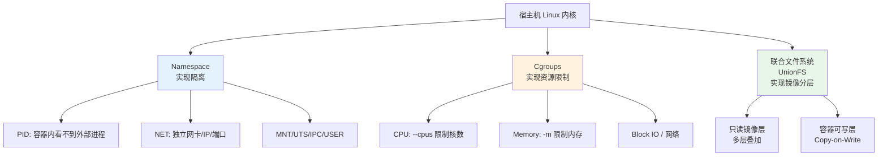
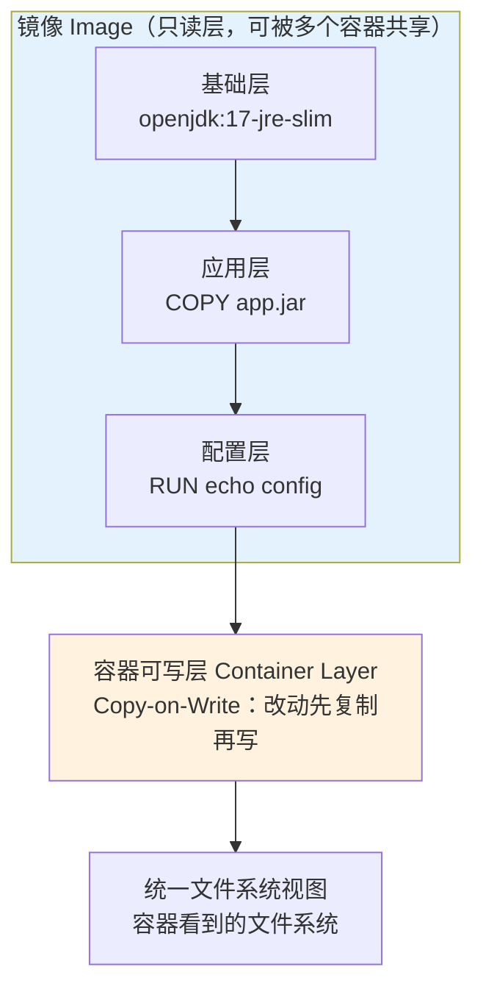

# Docker 原理

> 定位：搞清 Docker 的镜像/容器/仓库、Namespace 与 Cgroups 两大底层基石、镜像分层与联合文件系统、Dockerfile 最佳实践、网络与数据卷、资源限制。容器不是「轻量级虚拟机」这么简单——不理解 Namespace/Cgroups 和镜像分层，你连「容器为什么秒起」「镜像为什么这么大」都答不清。

## 一、为什么需要它：从「部署环境玄学」到「标准化交付」

经典的开发痛点：

> 「在我机器上是好的啊！」——开发环境和生产环境的 JDK 版本、系统库、配置不一致，导致同样的代码行为不同。

传统方案是虚拟机（VM），但 VM 每台都要装完整操作系统，动辄几个 GB、启动几分钟，太重。

Docker 给出了更轻的答案：**把应用和依赖打包成一个标准化的镜像，在任何装了 Docker 的机器上都能一致运行**。它本质不是虚拟化硬件，而是**用 Linux 内核特性把进程隔离起来**——所以秒级启动、MB~百MB 级体积。

## 二、核心原理：三大基石

### 2.1 核心概念

| 概念 | 含义 | 类比 |
|---|---|---|
| **镜像（Image）** | 只读的文件系统模板，含运行应用所需代码/运行时/库/配置 | 安装包 / 类 |
| **容器（Container）** | 镜像的运行实例，是独立运行的一个或一组进程 | 运行中的程序 / 对象 |
| **仓库（Registry）** | 存放镜像的地方（如 Docker Hub、Harbor） | 应用商店 |

一句话：**镜像是静态定义，容器是动态实例**；容器在镜像最上层加了一层可写层。

### 2.2 Namespace：实现「隔离」

Namespace 是 Linux 内核特性，把全局系统资源**分组隔离**，让每个容器觉得自己独占系统。Docker 用到了六种 Namespace：

| Namespace | 隔离的内容 | 效果 |
|---|---|---|
| PID | 进程 ID | 容器内 PID 从 1 开始，看不到宿主机进程 |
| NET | 网络设备/协议栈/端口 | 容器有独立网卡、IP、端口空间 |
| IPC | 进程间通信 | 独立的信号量/消息队列 |
| MNT | 挂载点 | 容器有独立文件系统视图 |
| UTS | 主机名/域名 | 独立 hostname |
| USER | 用户/组 ID | 容器内 root 可映射到宿主机非 root |

### 2.3 Cgroups：实现「限制」

Cgroups（Control Groups）限制、审计一组进程的资源使用，防止一个容器吃光宿主机资源：

- **CPU**：限制 CPU 份额/核数
- **内存**：限制内存上限，超限 OOM
- **磁盘 I/O**：限制读写带宽
- **网络**：配合 tc 限速



读图要点：Docker 的三大基石各司其职——**Namespace 管「看得见什么」（隔离）、Cgroups 管「能用多少」（限制）、联合文件系统管「文件怎么叠」（镜像）**。理解这个三分法，容器就不再是黑盒。

## 三、关键机制：镜像分层、网络与数据

### 3.1 镜像分层与联合文件系统

Docker 镜像是**分层（layer）**的：每一层是只读的文件系统变更，多层叠加形成最终视图。最上层是容器的可写层。

```dockerfile
FROM openjdk:17-jre-slim        # 基础镜像层（只读）
COPY app.jar /app/app.jar        # 新增一层：应用 jar
RUN echo "config" > /app/conf    # 新增一层：配置
```

关键点：

- **每层只读、可被多个镜像共享**：不同镜像基于同一个 base 镜像时，base 层只存一份，省空间。
- **Copy-on-Write（写时复制）**：容器修改文件时，先把底层文件复制到可写层再改，不污染底层镜像。
- **层缓存**：构建时若某层未变，后续层复用缓存，加速构建。所以 Dockerfile 指令顺序影响构建速度。

**为什么删文件镜像不变小**：`RUN rm -rf /tmp/xxx` 只是新增一层「标记删除」，底层文件仍在镜像里。要在**同一层**里创建+删除，或用多阶段构建。

下面这张图把「多层只读镜像 + 容器可写层」的叠加关系画出来。注意容器看到的统一视图，是自底向上逐层叠加的结果；修改任何底层文件时，都先复制到可写层再改（Copy-on-Write）。



### 3.2 Dockerfile 最佳实践

```dockerfile
# 1. 用多阶段构建，减小最终镜像
FROM maven:3.9-eclipse-temurin-17 AS builder
WORKDIR /build
COPY pom.xml .
RUN mvn dependency:go-offline -B      # 依赖单独一层，利用缓存
COPY src ./src
RUN mvn package -DskipTests -B

FROM eclipse-temurin:17-jre-jammy     # 运行阶段只要 JRE
WORKDIR /app
COPY --from=builder /build/target/*.jar app.jar
EXPOSE 8080
ENTRYPOINT ["java", "-jar", "/app/app.jar"]   # exec 格式，正确接收信号
```

实践清单：

| 实践 | 原因 |
|---|---|
| 用体积小的 base 镜像（slim/alpine） | 减小镜像、减少攻击面 |
| 多阶段构建 | 构建工具和源码不进最终镜像 |
| 先 COPY 依赖声明再装依赖 | 利用层缓存，改代码不重装依赖 |
| 合并 RUN 指令、同层清理缓存 | 减少层数、避免垃圾进镜像 |
| 用 exec 格式 ENTRYPOINT/CMD | 正确传递 SIGTERM，优雅停机 |
| 非 root 用户运行 | 安全，降低逃逸风险 |
| `.dockerignore` 排除无关文件 | 减小构建上下文，防止 secrets 进镜像 |

### 3.3 容器网络模式

| 模式 | 说明 | 适用 |
|---|---|---|
| **bridge** | 默认，容器连到 docker0 网桥，有独立 IP，通过 NAT 通信 | 单机默认 |
| **host** | 容器直接用宿主机网络栈，无隔离，性能最好 | 网络性能敏感、端口冲突场景 |
| **none** | 无网络 | 完全隔离的任务 |
| **container** | 共享另一个容器的网络命名空间 | Sidecar 模式 |

端口映射：`docker run -p 8080:8080`（宿主机 8080 → 容器 8080），底层靠 iptables DNAT 实现。

跨主机网络则要靠 CNI 插件（如 Calico、Flannel），这是 K8s 的范畴。

### 3.4 数据卷（Volume）

容器文件系统是临时的，容器删了数据就没了。持久化靠数据卷：

```bash
# 三种挂载方式
docker run -v /data/mysql mysql:8          # 匿名卷
docker run -v myvol:/var/lib/mysql mysql:8 # 命名卷（推荐）
docker run -v /host/path:/container/path nginx  # 绑定挂载（bind mount）
```

- **命名卷（Volume）**：由 Docker 管理，生命周期独立，推荐用于持久化数据。
- **绑定挂载（Bind Mount）**：直接映射宿主机路径，依赖宿主机目录结构，适合配置文件。
- 数据库容器必须用卷，否则容器重建数据全丢。

### 3.5 资源限制

```bash
docker run \
  --cpus=2 \                    # 最多用 2 个 CPU 核
  --memory=2g \                 # 内存上限 2GB
  --memory-swap=3g \            # 内存+swap 上限
  --memory-reservation=1g \     # 软限制
  my-app:latest
```

不设限制是生产大忌：一个内存泄漏的容器能把宿主机拖垮，连累同机所有容器。K8s 里对应 `requests`/`limits`（见下一篇）。

## 四、生产坑点与排查

### 坑点 1：容器里 PID 1 的 Java 应用收不到 SIGTERM，优雅停机失效

**现象**：`docker stop` 后容器等 10 秒被强杀（SIGKILL），正在处理的请求被中断、数据可能不一致。
**原因**：Dockerfile 用了 shell 格式的 `CMD java -jar app.jar`，shell 成为 PID 1，Java 进程是它的子进程，SIGTERM 发给 shell 但 shell 不转发给 Java。
**解法**：
- 用 exec 格式：`ENTRYPOINT ["java","-jar","/app.jar"]`，让 Java 成为 PID 1。
- 应用注册 shutdown hook 处理 SIGTERM；Spring Boot 默认支持优雅停机（配置 `server.shutdown=graceful`，以版本为准）。
- 用 `tini` 作为 init 进程转发信号、回收僵尸进程。

### 坑点 2：容器内存超限被 OOM Killer 杀掉

**现象**：容器突然退出，退出码 137，`dmesg` 显示 "Killed process"。
**原因**：`--memory` 限制太小，或 JVM `-Xmx` 没考虑容器限制（JVM 总内存 > 堆），超过 Cgroup 限额被内核 OOM Killer 杀掉。
**解法**：
- 老版本 JDK 不感知 Cgroup，需显式设 `-Xmx`（约为容器内存的 60%-75%）；JDK 10+ 用 `-XX:+UseContainerSupport`（默认开启）。
- 用 `docker stats` 观察内存趋势，合理设置 `--memory`。
- 区分：JVM 的 OOM（Java heap space，退出码 1）和 Cgroup OOM（被内核杀，退出码 137），排查方向不同。

### 坑点 3：镜像巨大、构建慢， pushing 半天

**现象**：一个简单 Java 应用镜像 1GB+，构建和推送都很慢。
**原因**：用了大的 base 镜像（如完整 JDK + 一堆工具）、没多阶段构建、各层垃圾没清理、把 target 目录和本地文件都 COPY 进去。
**解法**：
- 多阶段构建，运行阶段用 `jre-slim`/`alpine` 或 distroless。
- 写 `.dockerignore` 排除 `.git`、`target`、本地文件。
- 合并 RUN、同层清理 apt/yum 缓存。
- 用 `docker history <image>` 看每层大小，找出大头。

### 坑点 4：容器无法连数据库/其他容器

**现象**：容器里 `curl localhost:3306` 不通，或容器间按 IP 访问时好时坏。
**原因**：误解网络模式。`localhost` 在容器里指**容器自己**，不是宿主机；容器重启 IP 会变。
**解法**：
- 访问宿主机服务用 `host.docker.internal`（Docker Desktop）或宿主机网关 IP。
- 容器间通信用自定义 bridge 网络 + 容器名做 DNS：`docker network create mynet`，`--network mynet` 后用服务名互访。
- 生产用 K8s Service 提供稳定入口，不依赖容器 IP。

## 五、调优 / 选型 / 最佳实践

### 5.1 镜像优化清单

1. 选小 base 镜像（slim / alpine / distroless）。
2. 多阶段构建，构建产物之外的都不进最终镜像。
3. 合理排列 Dockerfile 指令，最大化层缓存命中。
4. 合并 RUN、同层清理，`rm -rf /var/lib/apt/lists/*`。
5. `.dockerignore` 排除无关文件。
6. 非 root 运行：`USER appuser`。
7. 用固定版本 tag，不用 `latest`（可复现）。

### 5.2 安全实践

| 风险 | 措施 |
|---|---|
| 镜像含漏洞 | 用 Trivy 等扫描镜像，及时更新 base |
| 容器逃逸 | 非 root、限制 capabilities、`--security-opt`、Seccomp/AppArmor |
| 敏感信息进镜像 | 用环境变量/Secret 注入，不写死在 Dockerfile/层里 |
| root 运行 | `USER` 切非 root |
| 特权容器 | 避免 `--privileged` |

### 5.3 Docker vs 虚拟机

| 维度 | Docker 容器 | 虚拟机 |
|---|---|---|
| 隔离级别 | 进程级（共享内核） | 硬件级（独立 Guest OS） |
| 启动 | 秒级 | 分钟级 |
| 体积 | MB~百MB | GB |
| 性能 | 接近原生 | 有虚拟化开销 |
| 隔离性 | 较弱（共享内核） | 强 |
| 适用 | 微服务、CI/CD、云原生 | 强隔离、不同操作系统 |

## 六、面试高频问法

> 这一节的答案按「面试时能讲透」的标准写：先给一句话结论，再展开机制、原因和坑点。

**Q1：Docker 的核心原理是什么？**

**一句话结论**：Docker 用 **Namespace 做隔离**（每个容器有独立的进程、网络、文件系统视图）、**Cgroups 做资源限制**（CPU、内存），本质是"被隔离和限制的进程"。

展开：

- **Namespace**：隔离 PID、网络、挂载、UTS、IPC、User——让容器"以为自己是独立的系统"。
- **Cgroups**：限制 CPU、内存、IO——防止一个容器吃光资源。
- **联合文件系统**：镜像分层，容器在镜像之上加一层可写层。

加分点：说"容器不是'轻量级虚拟机'——它和宿主机共享内核，没有硬件虚拟化，所以启动快、开销小；但也意味着'隔离性不如虚拟机'"。

**Q2：Docker 镜像的分层机制是什么？有什么好处？**

**一句话结论**：镜像由多层只读层叠加而成，每层是一次文件系统变更；容器启动时在最上面加一个可写层。

展开：

- **分层**：Dockerfile 每条指令（RUN、COPY）生成一层，层是只读的、可复用。
- **好处**：多个镜像共享基础层，节省存储；构建时只重建变化的层，加速。
- **可写层**：容器运行时的修改在这一层，容器删除就没了（所以数据要用 volume）。

加分点：说"分层是 Docker 高效的核心——比如 10 个镜像都用 ubuntu 基础层，磁盘上只存一份；但要注意'层数越多，镜像越大'，要合并 RUN 指令"。

**Q3：Dockerfile 怎么写才好？有哪些最佳实践？**

**一句话结论**：用多阶段构建、合并 RUN、利用缓存、用非 root 用户、精简基础镜像。

展开：

- **多阶段构建**：编译阶段和运行阶段分开，最终镜像只含运行时（大幅减小）。
- **合并 RUN**：`RUN apt-get update && apt-get install -y xxx && rm -rf /var/lib/apt/lists/*` 一条指令，减少层。
- **利用缓存**：把"不常变的"（依赖）放前面，"常变的"（源码）放后面。
- **安全**：用非 root 用户、固定版本 tag（不用 latest）。

加分点：说"镜像越小越好——小的镜像启动快、传输快、攻击面小；多阶段构建能把'几百 MB 的编译环境'排除在最终镜像外"。

**Q4：容器的网络模式有哪几种？**

**一句话结论**：bridge（默认，NAT）、host（共享宿主机网络）、none（无网络）、container（共享其他容器网络）、overlay（跨主机）。

| 模式 | 特点 | 场景 |
|---|---|---|
| bridge | 默认，容器有独立 IP，NAT 出网 | 单机、默认 |
| host | 共享宿主机网络栈 | 高性能、端口直通 |
| none | 无网络 | 特殊隔离 |
| container | 共享另一个容器的网络 | 边车 |
| overlay | 跨主机网络 | Swarm/多主机 |

加分点：说"bridge 模式最常见——容器有独立 IP，通过 docker0 网桥和 NAT 访问外网；host 模式性能最好（少一层 NAT），但端口会和宿主机冲突"。

**Q5：容器和虚拟机的区别是什么？**

**一句话结论**：虚拟机虚拟化硬件（每台有完整 OS），容器虚拟化操作系统（共享内核）——容器更轻、更快，但隔离性弱。

| 维度 | 虚拟机 | 容器 |
|---|---|---|
| 隔离级别 | 硬件级（强） | 进程级（较弱） |
| 启动速度 | 分钟级 | 秒级 |
| 资源开销 | 大（完整 OS） | 小（共享内核） |
| 密度 | 低 | 高 |
| 安全隔离 | 强 | 较弱 |

加分点：说"容器不是'替代'虚拟机——它们适合不同场景：需要强隔离（多租户）用虚拟机，需要高密度、快速部署用容器；很多生产是'虚拟机里跑容器'"。

**Q6：Docker 的数据怎么持久化？**

**一句话结论**：用 volume（数据卷）或 bind mount（挂载宿主机目录）——容器的可写层删除就没了，数据要放在外面。

展开：

- **volume**：Docker 管理的存储（在 `/var/lib/docker/volumes`），推荐。
- **bind mount**：挂载宿主机指定目录，方便但依赖宿主机路径。
- **tmpfs**：内存文件系统，不持久。

加分点：说"容器的'无状态'原则——容器本身不该存数据，数据放 volume 或外部存储（数据库、对象存储）；这样容器可以随时销毁重建"。

**Q7：怎么限制容器的资源？**

**一句话结论**：用 `--memory`、`--cpus` 限制内存和 CPU，配合 Cgroups 生效。

展开：

```bash
docker run --memory=512m --cpus=1.5 myapp
```

- **内存**：`--memory` 限制，超了 OOM kill。
- **CPU**：`--cpus` 限制核数，`--cpu-shares` 设权重。
- **意义**：防止一个容器吃光宿主机资源，影响其他容器。

加分点：说"Java 容器要注意'JVM 感知容器限制'——老版本 JDK 不认 cgroup，会按宿主机内存设堆，导致 OOM；JDK 10+ 默认支持，或用 `-XX:MaxRAMPercentage`"。

**Q8：镜像怎么优化大小？**

**一句话结论**：用 Alpine/slim 基础镜像、多阶段构建、合并层、清理缓存、只复制必要文件。

展开：

- **基础镜像**：alpine（几 MB）或 distroless（更安全）。
- **多阶段**：编译产物复制到运行镜像，不带编译工具。
- **清理**：apt/yum 缓存、临时文件删掉。
- **.dockerignore**：排除不需要的文件。

加分点：说"镜像大小直接影响'启动速度、传输时间、存储成本'——一个 1GB 的镜像和一个 100MB 的镜像，部署体验天差地别"。

**Q9：Docker 的安全风险有哪些？**

**一句话结论**：容器逃逸（共享内核）、镜像漏洞、特权容器、敏感信息泄露——要最小权限、镜像扫描、非 root 运行。

展开：

- **容器逃逸**：利用内核漏洞从容器逃到宿主机（共享内核的风险）。
- **镜像漏洞**：基础镜像或依赖有 CVE。
- **特权容器**：`--privileged` 给了容器几乎 root 权限，危险。
- **敏感信息**：镜像里硬编码密码。

加分点：说"容器安全的核心是'最小权限'——不用 root 跑、不用 privileged、镜像扫描、 secrets 不写进镜像；容器不是'天然安全'的"。

**Q10：Docker 和 K8s 是什么关系？**

**一句话结论**：Docker 是"容器运行时"（造容器、跑容器），K8s 是"容器编排"（管理大量容器：调度、扩缩、自愈）——K8s 用 Docker（或其他运行时）来跑容器。

展开：

- **Docker**：单机容器管理，解决"怎么打包、怎么跑"。
- **K8s**：集群容器编排，解决"几百个容器怎么调度、怎么扩缩、怎么故障恢复"。
- **关系**：K8s 是"容器的操作系统"，Docker 是"容器引擎"。

加分点：说"K8s 1.24 后弃用了 dockershim（不再直接用 Docker 作为运行时），改用 containerd——但'用 Docker 构建的镜像'仍然能在 K8s 跑，因为遵循 OCI 标准"。

## 小结

- 容器 = Namespace（隔离）+ Cgroups（限制）+ UnionFS（分层），本质是受隔离的进程，非虚拟机。
- 镜像只读分层、可共享，容器顶层可写（Copy-on-Write）；删文件不变小，靠多阶段构建优化。
- Dockerfile：小 base + 多阶段 + 层缓存 + exec 格式 ENTRYPOINT + 非 root。
- 网络默认 bridge（独立 IP/NAT），host 共享宿主机；数据持久化用命名卷。
- 生产必设资源限制、注意 PID1 信号处理、JVM 内存要适配 Cgroup 限额。
