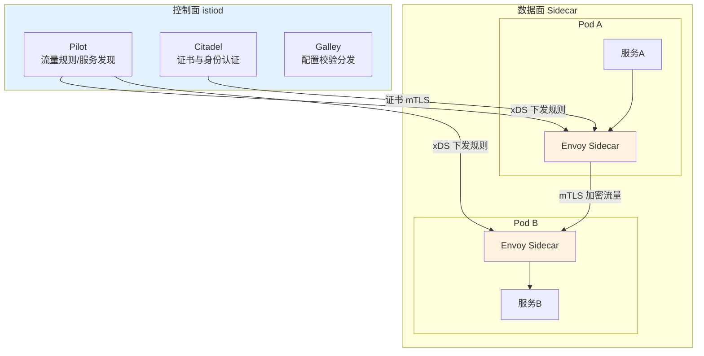
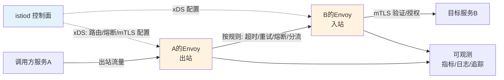

# Istio 服务网格

> 定位：搞清服务网格解决什么问题、Istio 的数据面/控制面架构、流量治理（灰度/金丝雀/熔断/重试）、可观测与安全能力、与 Spring Cloud Gateway/Sentinel 的对比取舍、以及 Service Mesh 的代价。服务网格把「服务间通信治理」从业务代码里剥离到基础设施层——但它不是免费的午餐。

## 一、为什么需要它：微服务治理的「重复造轮子」

Spring Cloud 时代，要做流量治理，你在每个服务里引入一堆 SDK：Ribbon/Feign 做负载均衡、Hystrix/Sentinel 做熔断限流、Gateway 做路由、Sleuth 做链路、各种 filter 做鉴权……问题随之而来：

1. **侵入业务代码**：每个服务都要引入、配置、升级 SDK。SDK 升级要所有服务一起改、一起发版。
2. **多语言困境**：Java 有 Spring Cloud，Go/Python/Node 服务怎么办？每种语言都要一套 SDK，行为还不一致。
3. **治理能力碎片化**：不同 SDK 版本、不同配置，导致治理策略不统一，出问题难排查。

服务网格（Service Mesh）给出新思路：**把服务间通信的治理能力，从应用进程里抽出来，下沉到基础设施层（Sidecar 代理）**。应用只管业务，所有流量都经过代理，代理负责负载均衡、熔断、重试、加密、观测——对应用透明。

一句话概括：**Service Mesh 是专门处理服务间通信的基础设施层，通过在每个服务旁部署代理（Sidecar）来实现，无需修改应用代码**。

## 二、核心原理：数据面与控制面

### 2.1 Sidecar 模式与架构

Istio 分两部分：

- **数据面（Data Plane）**：一组 **Envoy** 代理，以 Sidecar 形式和应用容器部署在同一个 Pod 里，拦截所有进出流量。
- **控制面（Control Plane）**：`istiod`，管理并下发配置给 Envoy，提供服务发现、证书、策略。



读图要点：

1. **流量劫持**：Istio 通过 init 容器配置 iptables，把 Pod 的进出流量透明劫持到 Envoy，应用无感知。
2. **控制面下发**：`istiod` 通过 **xDS 协议**（如 LDS/CDS/EDS/RDS）把路由、集群、端点、监听器配置推给各 Envoy。
3. **服务间通信**：服务 A 调用服务 B，流量先过 A 的 Envoy，经 mTLS 加密，再到 B 的 Envoy，最后进 B 应用。所有治理在 Envoy 间完成。
4. **应用零侵入**：应用代码不用改，治理能力由代理提供。

### 2.2 Envoy 的核心地位

Envoy 是 CNCF 毕业的高性能 C++ 代理，是 Istio 数据面的基石。关键能力：

- 动态配置（xDS，无需重启即可更新路由）
- 负载均衡、重试、超时、熔断、限流
- HTTP/2、gRPC、TLS/mTLS
- 丰富的可观测（指标、访问日志、追踪）

### 2.3 核心 CRD（自定义资源）

Istio 通过 Kubernetes CRD 声明治理规则，常用的有：

| CRD | 作用 |
|---|---|
| **VirtualService** | 定义路由规则（按权重、header 分流）、超时、重试、镜像 |
| **DestinationRule** | 定义目标服务的负载均衡策略、熔断、子集（subset） |
| **Gateway** | 集群入口网关配置（替代 Ingress 的增强版） |
| **ServiceEntry** | 把外部服务纳入网格 |
| **PeerAuthentication** | mTLS 模式配置 |
| **AuthorizationPolicy** | 授权策略（谁可以访问谁） |

## 三、关键机制：流量治理、可观测与安全

### 3.1 灰度 / 金丝雀发布

用 VirtualService + DestinationRule 实现按权重分流（如 90% 到 v1、10% 到 v2）：

```yaml
# 定义服务的两个版本子集
apiVersion: networking.istio.io/v1beta1
kind: DestinationRule
metadata:
  name: order-service
spec:
  host: order-service
  subsets:
  - name: v1
    labels:
      version: v1
  - name: v2
    labels:
      version: v2
---
# 按权重把流量分到 v1/v2
apiVersion: networking.istio.io/v1beta1
kind: VirtualService
metadata:
  name: order-service
spec:
  hosts:
  - order-service
  http:
  - route:
    - destination:
        host: order-service
        subset: v1
      weight: 90
    - destination:
        host: order-service
        subset: v2
      weight: 10
```

要按 header 精准灰度（如内测用户走 v2），可用 `match` 条件：

```yaml
http:
- match:
  - headers:
      x-canary:
        exact: "true"
  route:
  - destination:
      host: order-service
      subset: v2
- route:                      # 其余流量走 v1
  - destination:
      host: order-service
      subset: v1
```

### 3.2 熔断、重试、超时

在 DestinationRule 里配熔断（连接池 + 异常驱逐）：

```yaml
apiVersion: networking.istio.io/v1beta1
kind: DestinationRule
metadata:
  name: inventory-service
spec:
  host: inventory-service
  trafficPolicy:
    connectionPool:
      tcp:
        maxConnections: 100
      http:
        http2MaxRequests: 1000
        maxRequestsPerConnection: 10
    outlierDetection:         # 异常实例驱逐（熔断）
      consecutive5xxErrors: 5 # 连续 5 次 5xx
      interval: 10s
      baseEjectionTime: 30s    # 驱逐 30 秒
```

在 VirtualService 里配重试和超时：

```yaml
http:
- route:
  - destination:
      host: inventory-service
  timeout: 2s                  # 请求超时
  retries:
    attempts: 3                # 重试 3 次
    perTryTimeout: 500ms
    retryOn: 5xx,connect-failure
```

> 重试要小心「重试风暴」：上游重试放大会压垮下游。必须配合超时、熔断、限流，且只对幂等请求重试。

### 3.3 可观测能力

Envoy 作为所有流量的必经之路，天然能采集 golden metrics（延迟、流量、错误、饱和度）、访问日志、分布式追踪上下文。Istio 可对接 Prometheus、Grafana、Jaeger、Kiali（服务拓扑可视化），且**应用无需埋点**就能得到服务级的可观测数据——这是 Mesh 的一大杀手锏。

### 3.4 安全能力：mTLS 与零信任

- **自动 mTLS**：Istio 可在服务间自动启用双向 TLS，实现传输加密和双向身份认证，应用代码不改。
- **授权策略**：`AuthorizationPolicy` 声明「谁能在什么条件下访问谁」，实现细粒度访问控制、零信任网络。
- **身份**：基于 Kubernetes ServiceAccount 分配身份，而非 IP。

```yaml
apiVersion: security.istio.io/v1beta1
kind: PeerAuthentication
metadata:
  name: default
spec:
  mtls:
    mode: STRICT               # 强制 mTLS
```

### 3.5 流量治理全景图

下面这张图把 Sidecar 如何接管流量、控制面如何下发策略、治理能力在哪里生效串起来：



读图要点：调用方的出站 Envoy 执行超时/重试/熔断/权重分流，目标方的入站 Envoy 执行 mTLS 认证和授权；所有规则由 istiod 统一下发；流量经过时自动产生指标、日志、追踪。应用只需处理业务。

## 四、生产坑点与排查

### 坑点 1：Sidecar 注入失败，流量没被接管

**现象**：Pod 正常启动，但服务间调用没有经过 Envoy，Mesh 功能（熔断/重试/追踪）全部失效。
**原因**：命名空间没打 `istio-injection=enabled` 标签，或 Pod 没被自动注入 Sidecar（镜像拉取失败、webhook 异常）。
**解法**：
- `kubectl get namespace <ns> --show-labels` 确认注入标签。
- `kubectl get pod <pod> -o jsonpath='{.spec.containers[*].name}'` 看是否有 `istio-proxy` 容器。
- 检查 istiod webhook 是否健康、Sidecar 镜像是否能拉取。

### 坑点 2：重试导致「重试风暴」，下游被打垮

**现象**：下游服务偶发超时后，流量不降反升，最终被雪崩式重试压垮。
**原因**：多层重试叠加（Mesh 重试 + 应用 SDK 重试）、对非幂等请求重试、没配超时和熔断。一次调用可能被放大成几十次。
**解法**：
- 统一重试策略：只在 Mesh 层重试，关闭应用 SDK 的重复重试。
- 只对幂等请求（GET）重试，写操作谨慎。
- 配 `perTryTimeout` 和总 `timeout`，加 `attempts` 上限（2-3 次）。
- 配合熔断和限流，避免放大效应。

### 坑点 3：mTLS 开启后部分服务调用失败

**现象**：开启 STRICT mTLS 后，某些服务间调用出现 503、连接失败。
**原因**：老服务没注入 Sidecar（无法发起 mTLS）、或 ServiceEntry 配的外部服务不支持 mTLS、或 PeerAuthentication 策略作用范围过广。
**解法**：
- 用 `PERMISSIVE` 模式过渡，逐步迁移到 STRICT。
- 排查 `kubectl get peerauthentication --all-namespaces` 看策略范围和优先级。
- 用 `istioctl proxy-status`、`istioctl analyze` 诊断配置问题。
- 外部服务用 `DestinationRule` 的 `tls.mode: DISABLE` 针对性关闭。

### 坑点 4：性能开销与延迟增加被低估

**现象**：接入 Mesh 后接口 P99 增加几毫秒到十几毫秒，CPU 占用上升。
**原因**：每个请求经过两次 Envoy 代理（出站+入站），有序列化和转发开销；Sidecar 本身占用 CPU/内存（每 Pod 约几百 MB 内存起步）。
**解法**：
- 评估是否真的需要全量 Mesh，核心链路接入即可。
- 合理设置 Sidecar 资源请求，避免资源争抢。
- 用 `Sidecar` CRD 限制配置下发范围（只下发相关服务），减少 Envoy 内存和配置量。
- 压测验证延迟在可接受范围。

## 五、调优 / 选型 / 最佳实践

### 5.1 Service Mesh vs Spring Cloud 生态

| 维度 | Service Mesh（Istio） | Spring Cloud（Gateway/Sentinel） |
|---|---|---|
| 侵入性 | 无侵入，Sidecar 接管 | 侵入，需引入 SDK |
| 语言支持 | 语言无关 | 主要 Java（生态绑定） |
| 治理位置 | 基础设施层 | 应用层 |
| 升级 | 控制面统一升级，应用不动 | 每个服务升级 SDK 并重新发版 |
| 性能 | 多一层代理，有延迟开销 | 进程内调用，开销小 |
| 可观测 | 应用无埋点即可得 | 需集成 Sleuth/Micrometer |
| 运维复杂度 | 高（需维护控制面、Sidecar） | 中 |
| 适用 | 多语言、大规模、平台化 | 纯 Java、中小规模、快速上手 |

**抉择**：

- 纯 Java 中小团队、想快速上手 → Spring Cloud 生态更省事。
- 多语言混合、大规模、治理能力要统一平台化 → Service Mesh 长期收益更大。
- 两者可共存：Gateway 做南北向入口，Mesh 做东西向服务间治理。

### 5.2 Service Mesh 的代价（必须清醒）

1. **复杂度陡增**：多一套控制面、CRD、Sidecar 生命周期要维护，排障链路变长。
2. **性能开销**：两跳代理，延迟 +资源占用。
3. **学习曲线**：团队要理解 xDS、CRD、Envoy、mTLS 等概念。
4. **故障排查难**：网络问题可能在应用、Envoy、控制面、iptables 任一环节。
5. **不是银弹**：业务逻辑层的限流（如按用户限购）仍需在应用里做，Mesh 管的是服务间通信。

### 5.3 落地建议

1. 先小范围试点（非核心服务），验证延迟和资源开销。
2. 灰度推进：PERMISSIVE mTLS 过渡，逐步收紧。
3. 统一重试/超时策略，避免和 SDK 重复。
4. 配 Kiali + Prometheus + Jaeger，先拿到可观测收益。
5. 用 `istioctl analyze` 定期体检配置。

## 六、面试高频问法

> 这一节的答案按「面试时能讲透」的标准写：先给一句话结论，再展开机制、原因和坑点。

**Q1：服务网格（Service Mesh）是什么？解决什么问题？**

**一句话结论**：服务网格是"把服务间的通信（治理、安全、观测）从业务代码里剥离出来"的基础设施——用 Sidecar 代理接管所有服务间流量。

展开：

- **解决的问题**：微服务的通信治理（限流、熔断、重试、加密、追踪）如果写在业务代码里，会侵入、重复、语言绑定。
- **做法**：每个服务旁边部署一个 Sidecar 代理（Envoy），所有进出流量经过它，治理逻辑在代理层做。
- **好处**：业务代码"零侵入"，治理能力"语言无关"。

加分点：说"服务网格是'微服务的网络层抽象'——它把'服务间怎么通信'从'每个服务自己管'变成'基础设施统一管'，这是架构的又一次关注点分离"。

**Q2：Istio 的架构是怎样的？**

**一句话结论**：数据面（Envoy Sidecar）+ 控制面（istiod：Pilot/Citadel/Galley）——控制面下发配置，数据面执行。

展开：

- **数据面**：每个 Pod 注入一个 Envoy Sidecar，接管流量。
- **控制面（istiod）**：Pilot（流量规则）、Citadel（证书/安全）、Galley（配置）。
- **工作方式**：控制面把路由/策略下发给 Envoy，Envoy 执行。

加分点：说"Istio 的核心是'控制面 + 数据面分离'——控制面是'大脑'（决策），Envoy 是'手脚'（执行）；升级治理规则不用改业务代码、不用重启服务"。

**Q3：Istio 怎么实现灰度发布？**

**一句话结论**：用 VirtualService 按权重/Header/用户把流量分到不同版本，逐步调整比例。

展开：

```yaml
apiVersion: networking.istio.io/v1beta1
kind: VirtualService
spec:
  http:
  - route:
    - destination: {host: app, subset: v1}
      weight: 90
    - destination: {host: app, subset: v2}
      weight: 10
```

- **按权重**：90% 到 v1、10% 到 v2。
- **按 Header**：特定 Header 的用户走新版本。
- **按用户**：特定用户 ID 走新版本。

加分点：说"Istio 的灰度是'流量层'的——不用改代码、不用重新部署，改个 yaml 就调整比例；这是它比'应用层灰度'灵活的地方"。

**Q4：Istio 的流量治理能力有哪些？**

**一句话结论**：路由（灰度/AB）、负载均衡、熔断、重试、超时、故障注入、镜像流量——全套。

展开：

- **路由**：按权重、Header、URI 路由。
- **韧性**：超时、重试、熔断、连接池。
- **故障注入**：注入延迟/错误，测试系统韧性。
- **流量镜像**：把生产流量复制一份到新版本（不影响用户）。

加分点：说"Istio 的'流量镜像'很实用——新版本上线前，把真实流量复制一份给它，验证没问题再切；这是'最真实的测试'"。

**Q5：Istio 和 Spring Cloud Gateway / Sentinel 有什么区别？**

**一句话结论**：Gateway/Sentinel 是"应用层"（Java 代码里），Istio 是"基础设施层"（Sidecar 代理）——一个侵入应用、一个不侵入。

| 维度 | Spring Cloud | Istio |
|---|---|---|
| 层次 | 应用层（SDK） | 基础设施层（Sidecar） |
| 侵入 | 侵入（依赖） | 无侵入 |
| 语言 | Java | 语言无关 |
| 能力 | 路由/限流/熔断 | 全套 + 安全 + 观测 |
| 复杂度 | 低 | 高（要运维 K8s/Istio） |

加分点：说"Istio 不是'替代' Spring Cloud——它解决的是'多语言、大规模、统一治理'的问题；小团队用 Spring Cloud 更简单，大厂多语言才值得上 Istio"。

**Q6：Istio 的 Sidecar 注入是怎么工作的？**

**一句话结论**：通过 Admission Webhook 自动给 Pod 注入 Envoy Sidecar——Pod 创建时，Webhook 拦截并加上 Sidecar 容器。

展开：

- **自动注入**：给命名空间打标签 `istio-injection=enabled`，新 Pod 自动注入。
- **原理**：K8s 的 MutatingAdmissionWebhook 在 Pod 创建时修改 Pod 定义，加上 Envoy 容器。
- **流量劫持**：Sidecar 通过 iptables 规则劫持 Pod 的进出流量。

加分点：说"Sidecar 注入是'透明的'——业务无感知，但代价是'每个 Pod 多一个容器'，资源开销增加，且排查问题多了一层"。

**Q7：Istio 怎么保证服务间通信的安全？**

**一句话结论**：mTLS（双向 TLS）——服务间通信自动加密和认证，证书由 Citadel 自动签发和轮换。

展开：

- **mTLS**：双方都要证书，互相验证身份。
- **自动证书**：Citadel 给每个服务发证书，自动轮换。
- **授权**：AuthorizationPolicy 控制"谁能访问谁"。

加分点：说"Istio 的 mTLS 是'零信任'的落地——服务间默认不信任，每次通信都验证身份、加密传输；这对'内网也不安全'的云环境很重要"。

**Q8：Istio 的代价是什么？什么时候不该用？**

**一句话结论**：代价是"复杂度、性能开销、运维成本"——小团队、简单架构、性能敏感场景不该用。

展开：

- **复杂度**：要懂 K8s、Envoy、Istio 一堆概念，学习曲线陡。
- **性能**：多一层 Sidecar，延迟增加（通常几 ms）。
- **运维**：Sidecar 出问题难排查、版本升级复杂。
- **不该用**：小团队、单体/简单微服务、对延迟极敏感。

加分点：说"Istio 是'重武器'——它能解决大规模微服务的治理问题，但'杀鸡用牛刀'会带来不必要的复杂度；先问'我真的需要吗'"。

**Q9：Istio 的可观测性能力有哪些？**

**一句话结论**：自动生成指标（Prometheus）、链路追踪（Jaeger/Zipkin）、访问日志——不用改代码就有。

展开：

- **指标**：Envoy 自动上报请求数、延迟、错误率。
- **追踪**：自动注入 TraceId，生成调用链。
- **日志**：Envoy 访问日志。

加分点：说"Istio 的可观测性是'白送'的——因为所有流量都过 Envoy，Envoy 天然能采集指标和追踪；这是'服务网格'相比'应用层治理'的一个大优势"。

**Q10：什么规模/场景适合上服务网格？**

**一句话结论**：多语言、大规模（几百服务）、需要统一治理和安全、有专门的基础设施团队——才适合。

展开：

- **适合**：服务多、语言多、治理需求复杂、有平台团队。
- **不适合**：服务少、单一语言、团队小、追求简单。
- **过渡**：可以先在部分服务试点，验证收益再推广。

加分点：说"服务网格是'组织能力'的体现——它不只是技术选型，还需要'平台团队'来运维；没有这个能力，上了也是负担"。

## 小结

- 服务网格把服务间通信治理下沉到 Sidecar，应用零侵入、语言无关。
- Istio = 数据面 Envoy Sidecar（劫持流量）+ 控制面 istiod（xDS 下发规则、证书、策略）。
- 核心 CRD：VirtualService（路由/权重/重试/超时）、DestinationRule（负载均衡/熔断/子集）、Gateway、PeerAuthentication。
- 自动 mTLS + 零信任授权 + 无埋点可观测，是 Mesh 的杀手锏。
- 代价真实存在：复杂度、性能开销、排障难；纯 Java 中小规模 Spring Cloud 更省事，多语言大规模选 Mesh。
