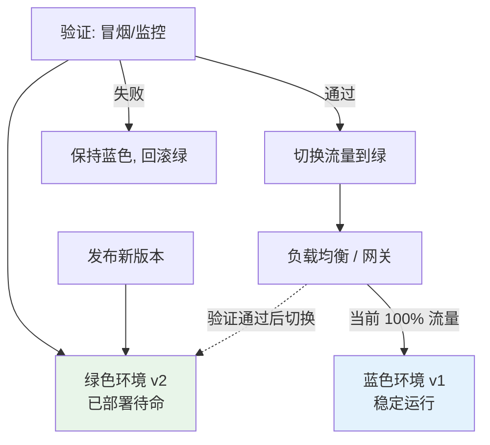

# CI/CD 与发布策略

> 定位：掌握 CI/CD 概念与流水线、主流工具链、镜像构建与制品管理、环境隔离、各种发布策略（蓝绿/灰度/金丝雀/滚动/A-B）、发布回滚、Feature Flag 与 DevOps 实践。发布是把代码变成线上价值的那「最后一公里」——这一公里翻车，前面写得再好也白搭。

## 一、为什么需要它：手动发布的痛

手工发布的典型场景：开发本地打包 → scp 到服务器 → 停服务 → 替换 jar → 启动 → 验证。问题一堆：

- **易出错**：漏步骤、传错文件、改错配置，人的操作不可靠。
- **不可追溯**：谁什么时候发了什么版本？出事了不知道回退到哪个包。
- **慢且痛**：发布要停机、要熬夜，团队不敢频繁发布，一积压就是大版本，风险更高。
- **环境不一致**：测试环境好的，生产又崩了。

CI/CD 的目标就是让发布**自动化、可重复、可追溯、低风险**。

### 核心概念辨析

| 概念 | 全称 | 含义 |
|---|---|---|
| **CI** | Continuous Integration，持续集成 | 开发者频繁提交代码，自动构建+测试，尽早发现集成问题 |
| **CD** | Continuous Delivery，持续交付 | 代码自动构建测试后，随时可部署到生产（但发布需人工确认） |
| **CD** | Continuous Deployment，持续部署 | 通过测试的变更**自动**发布到生产，无需人工 |

三者是递进关系：CI 保证代码质量，持续交付保证「随时可发」，持续部署把「发布」也自动化。

## 二、核心原理：流水线与制品

### 2.1 CI/CD 流水线

一条典型的流水线（Pipeline）是分阶段的自动化流程：

```mermaid
flowchart LR
    DEV["开发者提交代码<br/>git push / MR"] --> BUILD["构建<br/>编译/依赖下载"]

    BUILD --> TEST["测试<br/>单元/集成/静态扫描"]

    TEST --> IMAGE["构建镜像<br/>docker build"]

    IMAGE --> PUSH["推送制品<br/>镜像仓库/Nexus"]

    PUSH --> DEPLOY_TEST["部署测试环境<br/>自动化测试"]

    DEPLOY_TEST --> APPROVE["人工卡点<br/>审批"]

    APPROVE --> DEPLOY_PROD["部署生产<br/>灰度/滚动"]

    DEPLOY_PROD --> VERIFY["验证<br/>监控/健康检查"]

    VERIFY -->|失败| ROLLBACK["回滚"]

    style TEST fill:#e3f2fd
    style DEPLOY_PROD fill:#fff3e0
    style ROLLBACK fill:#ffcdd2
```



读图要点：

- **触发**：代码提交或 Merge Request 触发流水线。
- **构建+测试**：编译、跑单测、代码静态扫描（SonarQube）、依赖漏洞扫描。质量门禁不通过就卡住。
- **制品**：构建产物（镜像/jar）打上版本号推到制品库，**一次构建，多处部署**——这是关键原则，测试和生产用同一个制品，避免「环境不一致」。
- **卡点**：生产发布前设人工审批（持续交付 vs 持续部署的区别就在这）。
- **验证+回滚**：发布后自动健康检查，失败自动回滚。

### 2.2 制品与版本管理

- **制品（Artifact）**：构建产物，如 Docker 镜像、jar 包、前端静态资源。
- **制品库**：Nexus、JFrog Artifactory、Harbor（镜像）、云厂商容器仓库。
- **版本化**：用语义化版本（SemVer，如 `1.2.3`）或 commit SHA 做 tag。**禁用 `latest`**——`latest` 不可追溯、不可复现。
- **一次构建多处部署**：同一个镜像 tag 从测试→预发→生产，保证一致性。

### 2.3 环境隔离

| 环境 | 用途 | 特点 |
|---|---|---|
| 开发（dev） | 开发自测 | 频繁部署，数据可随意造 |
| 测试（test） | QA 测试 | 相对稳定，接近生产配置 |
| 预发（staging/pre） | 上线前验证 | 配置、数据与生产尽量一致 |
| 生产（prod） | 真实用户 | 最高稳定性要求，变更受控 |

隔离方式：

- **命名空间隔离**：K8s 用 Namespace 隔离环境，配合 ResourceQuota、NetworkPolicy。
- **配置差异**：用 ConfigMap/Secret 或配置中心（Nacos/Apollo）区分环境配置，同一镜像不同配置。
- **集群隔离**：高要求场景用独立集群，彻底隔离。

## 三、关键机制：发布策略

### 3.1 发布策略对比

| 策略 | 机制 | 优点 | 缺点 | 适用 |
|---|---|---|---|---|
| **滚动发布** | 逐批替换旧版本实例 | 无停机、资源占用少 | 新旧版本并存、回滚慢 | K8s 默认、常规发布 |
| **蓝绿发布** | 两套环境（蓝=当前，绿=新），验证后切流量 | 切换/回滚快、环境完整 | 资源翻倍 | 关键业务、快速回滚 |
| **灰度/金丝雀** | 先放少量流量到新版本，验证后逐步放量 | 风险最小、可观测反馈 | 流程复杂、需流量控制 | 大规模、高风险变更 |
| **A/B 测试** | 按规则把用户分到 A/B 版本，对比业务指标 | 数据驱动决策 | 需埋点和统计分析 | 产品功能验证 |
| **停机发布** | 停服→部署→启动 | 简单 | 有停机时间 | 内部系统、可停服窗口 |

### 3.2 滚动发布（Rolling Update）

K8s Deployment 默认策略。逐批创建新 Pod、删除旧 Pod，全程服务可用。通过 `maxSurge` / `maxUnavailable` 控制节奏（见《Kubernetes核心》）。

```bash
kubectl set image deployment/order-service order=order:v2
kubectl rollout status deployment/order-service
# 出问题一键回滚
kubectl rollout undo deployment/order-service
```

### 3.3 蓝绿发布

同时维护两套完整环境：

- 蓝色（v1）当前在线，承接全部流量。
- 绿色（v2）部署完成、验证通过后，把流量整体切到绿色。
- 出问题把流量切回蓝色，秒级回滚。



读图要点：蓝绿的核心是「**两套环境 + 原子切换**」。切换前绿色环境已经完整部署并验证，切换只是改路由指向，所以回滚极快。代价是资源翻倍——你要有两套生产规模的实例。

### 3.4 灰度 / 金丝雀发布

金丝雀（Canary）得名于矿工用金丝雀探测瓦斯——先用小流量「试探」新版本。流程：

1. 部署少量 v2 实例（如 1 个）。
2. 先放 1% 流量到 v2，观察错误率、延迟、业务指标。
3. 指标正常，逐步放大到 5% → 20% → 50% → 100%。
4. 任一阶段指标异常，立即把流量切回 v1。

 Istio 可按权重实现（见《Istio服务网格》）：

```yaml
http:
- route:
  - destination:
      host: order-service
      subset: v1
    weight: 95
  - destination:
      host: order-service
      subset: v2
    weight: 5
```

灰度关键是**要有可观测反馈**（错误率、延迟、业务指标），否则放量就是盲飞。可结合服务网格或网关实现精细的流量控制。

### 3.5 A/B 测试

A/B 测试和灰度的区别：灰度关注「新版本是否稳定」，A/B 测试关注「哪个版本业务效果更好」（如转化率、点击率）。按用户维度分流（如 userID 哈希、cookie），保证同一用户始终看到同一版本，对比一段时间后用数据决策。

### 3.6 Feature Flag（功能开关）

Feature Flag 把「发布」和「功能启用」解耦：代码先发布（功能默认关闭），通过配置开关控制是否对某用户/某比例用户开放。

```java
// 伪代码：通过开关控制新功能
if (featureFlag.isEnabled("new-checkout", userId)) {
    return newCheckoutService.checkout(order);   // 新逻辑
}
return legacyCheckoutService.checkout(order);     // 老逻辑
```

价值：

- **发布即部署**：代码上线不等于功能上线，可随时开关。
- **快速止损**：功能出问题，关开关即可，无需回滚代码。
- **渐进放量**：按用户/比例逐步开放。

注意：Feature Flag 是**临时机制**，功能稳定后要清理废弃开关，否则代码里堆积大量分支，反而成为技术债。

## 四、生产坑点与排查

### 坑点 1：测试和生产用了不同制品，「测试好的生产又崩」

**现象**：测试环境部署的镜像是 `order:test-20261122`，生产重新构建了一个 `order:prod-20261122`，结果行为不一致。
**原因**：违反「一次构建多处部署」——每个环境单独构建，构建环境、依赖版本、时间点不同，产物有差异。
**解法**：
- 一次构建产出唯一制品（镜像），用同一个 tag/摘要从测试→预发→生产逐级 promotion（晋升）。
- 用镜像摘要（digest，`sha256:...`）而非可变 tag，保证字节级一致。
- 环境差异只通过配置（ConfigMap/Secret）体现，不通过重新构建。

### 坑点 2：发布后数据库不兼容，回滚失败

**现象**：新版本改了表结构（删字段、改类型），发布后出问题想回滚，但老版本代码读不了新表结构，回滚也无法恢复。
**原因**：数据库变更与应用变更耦合，没有做到「向后兼容」。
**解法**：
- **扩展-迁移-收缩（Expand-Migrate-Contract）** 三步走：
  1. 先加新字段/新表（兼容老代码）。
  2. 应用双写/迁移数据。
  3. 确认无依赖后再删旧字段。
- 数据库变更脚本版本化（Flyway/Liquibase），纳入流水线。
- 发布前评估变更的可回滚性，破坏性变更单独规划。

### 坑点 3：回滚机制形同虚设，真出事回不去

**现象**：文档说「支持一键回滚」，但真出事时才发现回滚脚本从没演练过、旧镜像已被清理、配置没备份，回滚失败。
**原因**：回滚能力没有经过验证，只是「理论上可行」。
**解法**：
- 保留历史版本制品和镜像（设置保留策略，别清理太干净）。
- **定期演练回滚**，把它当成发布流程的一部分。
- 回滚要覆盖：应用版本、配置、数据库（对应回滚脚本）、依赖。
- 明确回滚决策标准（错误率 >X%、P99 >Yms 持续 N 分钟就回滚）。

### 坑点 4：流水线太慢，发布成了瓶颈

**现象**：一条流水线跑 40 分钟，开发改一行代码也要等半天，大家干脆绕过 CI 手动发布。
**原因**：全量测试串行、每次重新下载依赖、构建环境冷启动、测试环境排队。
**解法**：
- 依赖缓存（Maven/Gradle 本地缓存、镜像 layer 缓存）。
- 测试分层：单测必跑、集成测试按需、耗时测试并行或异步。
- 流水线并行化（多个 job 并行跑）。
- 冷热分离：快速反馈流水线（单测+构建，几分钟内）+ 完整验证流水线。
- 用缓存和构建农场（build cache）加速。

## 五、调优 / 选型 / 最佳实践

### 5.1 工具链对比

| 工具 | 定位 | 特点 |
|---|---|---|
| **Jenkins** | 老牌通用自动化服务器 | 生态丰富、插件多、灵活；配置复杂、UI 老旧、需自己维护 |
| **GitLab CI** | GitLab 内置 CI/CD | 与 GitLab 深度集成、YAML 配置、开箱即用 |
| **GitHub Actions** | GitHub 内置 | YAML 工作流、生态市场丰富、与 GitHub 无缝 |
| **Argo CD** | GitOps 持续交付 | 声明式、Git 作为唯一真相源、K8s 原生 |
| **Tekton** | K8s 原生 CI/CD | 云厂商中立、CRD 定义流水线 |

**趋势**：Jenkins 逐步被云原生方案替代；GitHub Actions/GitLab CI 适合代码托管即 CI；Argo CD 代表 **GitOps** 方向（以 Git 声明期望状态，控制器自动同步到集群）。

### 5.2 DevOps 与 GitOps

- **DevOps**：打破开发与运维壁垒，强调自动化、协作、快速反馈、责任共担。CI/CD 是 DevOps 的核心实践。
- **GitOps**：DevOps 的一种实现方式——**Git 是唯一真相源**，所有部署状态以声明式方式存在 Git 里，控制器（如 Argo CD）自动把集群状态同步到 Git 描述的状态。变更通过 Git commit/PR 完成，天然可审计、可回滚。

### 5.3 发布时机与最佳实践

1. 小步快跑：频繁小版本发布，降低单次风险。
2. 自动化一切：构建、测试、部署、验证、回滚。
3. 一次构建多处部署：同一制品逐级晋升。
4. 质量左移：测试和扫描尽早（提交时、构建时）发现。
5. 灰度 + 可观测：小流量试探，指标驱动放量。
6. 回滚常态化：保留制品、定期演练、明确决策标准。
7. Feature Flag 解耦部署与功能启用。
8. 数据库变更向后兼容，版本化管理。

## 六、面试高频问法

> 这一节的答案按「面试时能讲透」的标准写：先给一句话结论，再展开机制、原因和坑点。

**Q1：CI/CD 是什么？区别是什么？**

**一句话结论**：CI（持续集成）是"代码提交后自动构建、测试"，CD 是"持续交付/部署"（自动发布到环境）——CI 保证质量，CD 保证快速上线。

展开：

- **CI**：每次提交触发构建 + 单测 + 静态检查，尽早发现问题。
- **CD（交付）**：构建产物自动部署到测试/预发，随时可发布。
- **CD（部署）**：自动发布到生产。

加分点：说"CI/CD 的价值是'缩短反馈周期'——问题发现得越早，修复成本越低；手动构建部署容易出错、慢，自动化是'工程效率'的基础"。

**Q2：一条完整的 CI/CD 流水线包含哪些阶段？**

**一句话结论**：拉代码 → 构建 → 单测 → 静态检查 → 打镜像 → 推镜像 → 部署 → 验证。

展开：


- **质量门禁**：单测覆盖率、静态扫描（Sonar）、安全扫描。
- **产物**：Docker 镜像推到镜像仓库。

加分点：说"流水线的关键是'质量门禁'——测试不过、扫描有严重问题就阻断；否则流水线只是'自动化地把 bug 发到生产'"。

**Q3：蓝绿部署、灰度发布、金丝雀发布有什么区别？**

**一句话结论**：蓝绿是"两套环境切换"，灰度是"按比例/用户放量"，金丝雀是"先给小部分用户"（灰度的一种）。

| 策略 | 做法 | 特点 |
|---|---|---|
| 蓝绿 | 两套环境，切流量 | 切换快、回滚快，但资源翻倍 |
| 灰度 | 按比例/用户逐步放量 | 风险可控，需路由能力 |
| 金丝雀 | 先给 1%-5% 用户 | 灰度的一种，早发现问题 |
| 滚动 | 逐个替换实例 | K8s 默认，资源省 |

加分点：说"蓝绿适合'快速切换'（资源够），灰度适合'渐进验证'（要路由），滚动是 K8s 默认（省资源但回滚慢）；按场景选"。

**Q4：滚动发布怎么保证不出问题？**

**一句话结论**：就绪探针 + 分批 + 观察指标 + 自动回滚——新实例就绪才接流量，出问题自动回退。

展开：

- **就绪探针**：新 Pod readiness 通过才接流量。
- **分批**：`maxUnavailable` 控制一次替换多少。
- **观察**：发布后监控错误率、延迟。
- **回滚**：指标异常自动/手动回滚。

加分点：说"滚动发布最大的坑是'没有就绪检查'——新实例还没启动好就接流量，用户看到 502；探针是滚动发布的生命线"。

**Q5：怎么做到'发布不影响用户'？**

**一句话结论**：无损下线（先摘流量再停）+ 优雅停机（处理完在途请求）+ 滚动发布 + 快速回滚。

展开：

- **无损下线**：实例关闭前先从注册中心摘除，等流量切走。
- **优雅停机**：收到 SIGTERM 后，不再接新请求，处理完在途请求再退出。
- **滚动**：逐个替换，始终有可用实例。
- **回滚**：出问题快速回退。

加分点：说"很多'发布抖动'是'没做优雅停机'——进程被 kill 时还有请求在处理，直接失败；Spring Boot 要配 `server.shutdown=graceful`"。

**Q6：镜像构建怎么优化？**

**一句话结论**：多阶段构建、缓存依赖层、减小基础镜像、并行构建——让构建又快又小。

展开：

- **多阶段**：编译和运行分离。
- **缓存**：先 COPY 依赖文件（pom/package.json）下载依赖，再 COPY 源码——源码变了不用重下依赖。
- **基础镜像**：alpine/distroless。
- **并行**：多模块并行构建。

加分点：说"构建缓存是'提速关键'——把'不常变的依赖'放前面，Docker 层缓存能命中，构建从几分钟降到几十秒"。

**Q7：多环境（dev/test/prod）怎么管理？**

**一句话结论**：配置分离（配置中心/环境变量）、镜像一致（同一个镜像跑所有环境）、环境隔离（命名空间/集群）。

展开：

- **镜像一致**：构建一次，各环境用同一个镜像，配置通过环境变量/配置中心注入。
- **配置分离**：不同环境不同配置，不打包进镜像。
- **隔离**：K8s 命名空间或独立集群。

加分点：说"'一次构建、多处部署'是核心原则——同一个镜像在 test 验证过，才能保证 prod 行为一致；'每个环境重新构建'是灾难"。

**Q8：Feature Flag（功能开关）是什么？有什么用？**

**一句话结论**：功能开关是"用配置控制功能是否启用"——可以灰度、可以快速关闭，不用发版。

展开：

- **用途**：灰度发布（部分用户启用）、快速回滚（关开关）、A/B 测试。
- **实现**：配置中心 + 代码里判断开关。
- **好处**：发布和"功能启用"解耦——代码发布了但功能可以不开。

加分点：说"Feature Flag 让'部署'和'发布'分离——代码可以先部署上去（不启用），验证没问题再开开关；出问题关开关就行，不用回滚"。

**Q9：CI/CD 的安全怎么保证？**

**一句话结论**：凭据管理（不硬编码）、镜像扫描、依赖扫描、最小权限、审计。

展开：

- **凭据**：用 Secrets（K8s Secret、Vault），不写进代码/镜像。
- **扫描**：镜像漏洞扫描（Trivy）、依赖漏洞扫描（OWASP）。
- **权限**：流水线用最小权限的账号。
- **审计**：谁发布了什么，可追溯。

加分点：说"CI/CD 是'供应链'——它有权部署到生产，一旦被攻破后果严重；所以凭据管理、镜像扫描、权限控制都不能省"。

**Q10：怎么衡量 CI/CD 做得好不好？**

**一句话结论**：看 DORA 指标——部署频率、变更前置时间、变更失败率、恢复时间。

展开：

| 指标 | 含义 |
|---|---|
| 部署频率 | 多久发布一次 |
| 变更前置时间 | 提交到上线的时长 |
| 变更失败率 | 发布导致故障的比例 |
| 恢复时间 | 故障到恢复的时长 |

加分点：说"DORA 四指标是'DevOps 的体检表'——高频部署 + 短前置时间 + 低失败率 + 快速恢复，说明工程能力强；只追求'部署频率'而失败率高，是'瞎发布'"。

## 小结

- CI 保质量、持续交付保「随时可发」、持续部署把发布也自动化；流水线 = 构建→测试→制品→部署→验证。
- 一次构建多处部署、环境间用配置区分、制品版本化禁 latest，是防止「测试好生产崩」的关键。
- 发布策略：滚动（默认、无停机）、蓝绿（快回滚、资源翻倍）、灰度金丝雀（小流量试探、风险最小）、A/B（数据驱动）、Feature Flag（部署与启用解耦）。
- 回滚必须真实可演练，数据库变更要向后兼容（扩展-迁移-收缩）。
- 工具从 Jenkins 走向 GitHub Actions/GitLab CI/Argo CD（GitOps）；DevOps 强调自动化与协作，小步快跑。
