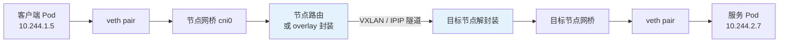
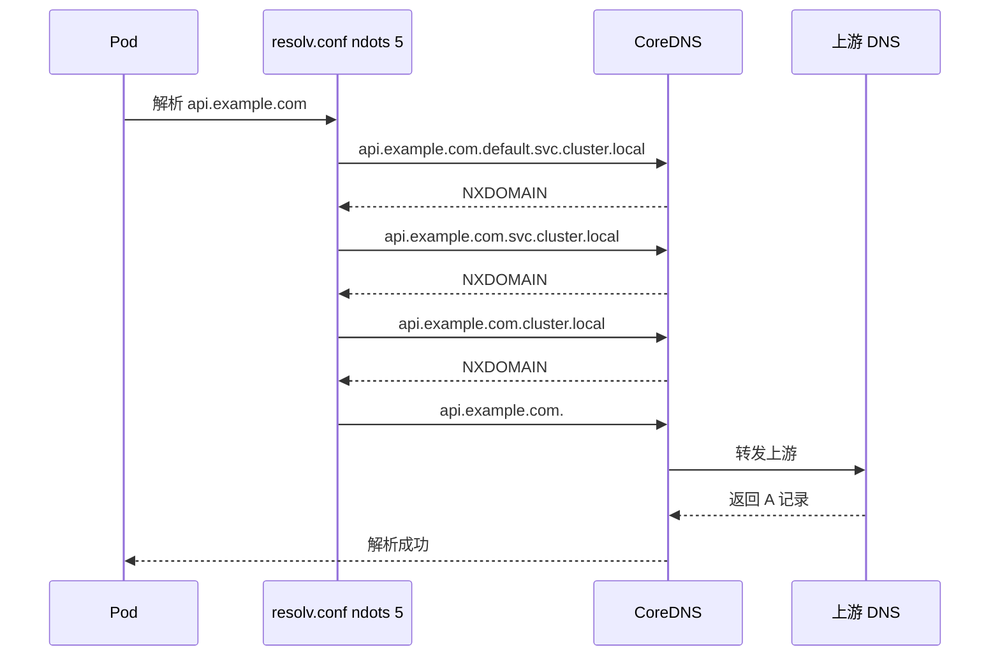
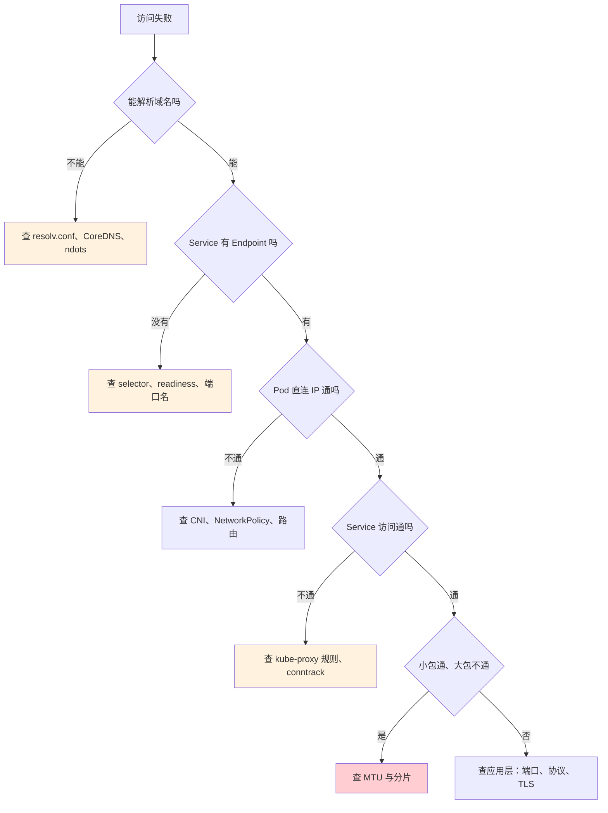

# Kubernetes 网络与排障

> 定位：Pod 是 Running 的、日志也没报错，但调用方就是连不上——这类问题在 K8s 里比在虚拟机上更难查，因为中间多了 CNI、Service、kube-proxy、CoreDNS 四层「隐形的转发」。这篇把 Pod 网络模型、Service 实现、DNS 解析链路讲透，给出从 DNS 到 MTU 的分层排查路径和可复制的抓包命令，最后落到 Java 应用在 K8s 里最容易踩的三个网络坑：连接复用、长连接负载不均、优雅下线。

## 一、为什么需要它

三个线上最常见的现象：

1. **Pod Running 但访问不通**：`kubectl get pod` 一切正常，`curl` Service 却超时。到底是探针没就绪、Endpoints 为空、还是端口映射错了？
2. **DNS 偶发 5 秒超时**：接口 P99 突然多出整整 5 秒，排查发现是解析外部域名时命中了 `timeout:5`。
3. **大响应体卡死**：小请求正常，一返回几 MB 的响应就挂起，最后定位到 MTU 不一致导致大包被丢。

这三个问题的共同点是：**它们都不在应用代码里**，但又都表现为应用故障。要定位，必须能回答「这个包从哪个网卡出、经过哪些规则、在哪一跳被丢了」。

## 二、核心原理

### 2.1 Pod 网络模型与包流转

Kubernetes 的网络模型只有三条规则：

- 每个 Pod 有**独立的 IP**，所有 Pod 之间可以直接通信，**不需要 NAT**；
- 同一节点上的所有 Pod 可以互相通信；
- 节点上的进程（kubelet、CNI 插件）可以与同节点的所有 Pod 通信。

Pod 内部是共享网络命名空间的多个容器，它们通过 `localhost` 互访；跨 Pod 通信则依赖 veth pair、网桥、节点路由或 overlay 隧道。



读图要点：包从 Pod 的 `eth0` 出来，先到宿主机上的 veth 对端，再经网桥/路由决定去同节点还是跨节点。**跨节点时如果走 overlay，就会多一层封装，MTU 随之减少**——这是后面「大包卡死」的根源。同节点通信不经过 overlay，所以「同节点通、跨节点不通」是 CNI 或 MTU 问题的典型特征。

### 2.2 CNI 与 Calico / Cilium 的区别

CNI（Container Network Interface）是一个规范：kubelet 创建 Pod 沙箱后调用 CNI 插件，插件负责分配 IP、配置网卡与路由。**CNI 只解决「通不通」，不解决「怎么访问 Service」**。

| 方案 | 数据面 | 跨节点方式 | 网络策略 | 特点 |
|---|---|---|---|---|
| Calico | iptables 或 eBPF | BGP 原生路由、IPIP、VXLAN | 支持 | 成熟稳定，可与物理网络打通 |
| Cilium | eBPF | 原生路由、VXLAN、Geneve | 支持，且支持七层 | 可替代 kube-proxy，内置 Hubble 可观测 |
| Flannel | 仅转发 | VXLAN、host-gw | 不支持 | 简单，适合小集群 |
| 云厂商 CNI | 各家实现 | 底层 VPC 路由 | 视实现 | 与云网络集成，弹性网卡数量受限 |

选型的核心判断：

- **要不要网络策略**：需要租户隔离或默认拒绝，就必须选支持 NetworkPolicy 的 CNI。
- **要不要绕过 kube-proxy**：Cilium 的 eBPF 模式在大规模 Service 下性能优势明显，但排障工具链与团队经验要跟上。
- **要不要和物理网络互通**：Calico BGP 模式更容易与 IDC 网络对接。
- **集群规模**：几千个 Service 时，iptables 模式的规则匹配开销会变得可观。

### 2.3 Service 的四种类型与访问链路

| 类型 | 作用 | 实现要点 | 典型场景 |
|---|---|---|---|
| ClusterIP | 集群内虚拟 IP | kube-proxy 下发 DNAT 规则 | 服务间调用 |
| NodePort | 每个节点开放端口 | 在 ClusterIP 基础上加节点端口规则 | 临时暴露、自建 LB 后端 |
| LoadBalancer | 云负载均衡器 | 云控制器创建 LB，指向 NodePort | 对外服务 |
| ExternalName | CNAME 到外部域名 | 只做 DNS 记录，不转发 | 迁移期指向外部依赖 |

一次 ClusterIP 访问的转发过程：

1. 客户端 Pod 向 `ClusterIP:Port` 发起连接；
2. 包到达节点后命中 kube-proxy 下发的 iptables/IPVS 规则；
3. 规则做 DNAT，把目标改成某个就绪 Pod 的 IP:Port；
4. conntrack 记录这条连接，回包时做反向 NAT；
5. 包经 CNI 转发到目标 Pod。

**Service 本身没有进程、没有网卡，它只是一组转发规则的集合**（Service 的基础用法见 [Kubernetes 核心](02-Kubernetes核心.md)）。所以「Service ping 不通」是正常的——ClusterIP 只处理 TCP/UDP，不响应 ICMP。

### 2.4 kube-proxy 的 iptables 与 IPVS 模式

| 维度 | iptables | IPVS |
|---|---|---|
| 数据结构 | 线性规则链 | 哈希表 |
| 匹配复杂度 | 随 Service/Endpoint 数增长 | 基本恒定 |
| 负载均衡算法 | 随机 | rr、lc、sh、mh 等 |
| 连接跟踪 | 依赖 conntrack | 依赖 conntrack |
| 规模建议 | 中小集群足够 | 大规模 Service 更合适 |
| 排障方式 | `iptables -t nat -L` | `ipvsadm -Ln` |

以 Kubernetes 1.30 为基线，生产仍以 iptables 和 IPVS 为主；nftables 模式在该版本仍处于较早期阶段（alpha），不建议直接用于关键集群，具体以目标版本的特性门控说明为准。

一个常被忽略的点：**两种模式都依赖 conntrack**。差别只在「选哪个后端」，连接跟踪表打满时，两种模式都会出问题。

### 2.5 CoreDNS 解析链路与 ndots 陷阱

Pod 的 `/etc/resolv.conf` 默认长这样：

```
nameserver 10.96.0.10
search default.svc.cluster.local svc.cluster.local cluster.local
options ndots:5
```

解析顺序由 `ndots` 决定：**如果待解析名字里的点数少于 `ndots`，先依次拼接 search 域查询，全部失败后才查绝对域名**。



读图要点：一个只有两个点的外部域名，要经历 **4 次查询**才拿到结果。每次查询如果超时（默认 5 秒）会重试，最坏情况下延迟被放大到十几秒。这就是「DNS 偶发 5 秒」的机制性原因，不是 CoreDNS 慢，而是**查询次数被 ndots 放大了**。

优化手段：

- 对外部域名多、内部服务少的命名空间，把 `dnsConfig.options.ndots` 调成 2；
- 部署 NodeLocal DNSCache，把解析请求留在节点本地；
- 应用侧对 DNS 结果做缓存，但要注意 TTL 与 Service 变更。

### 2.6 七层入口与网络隔离

| 维度 | Ingress | Gateway API |
|---|---|---|
| 定位 | 七层入口的最小抽象 | 角色分离的下一代标准 |
| 表达能力 | host/path 为主，靠 annotation 扩展 | 支持按 Header、权重、方法路由 |
| 可移植性 | annotation 与控制器强绑定 | 资源标准化，跨实现一致 |
| 角色模型 | 一份资源混在一起 | GatewayClass / Gateway / HTTPRoute 分层 |
| 现状 | 广泛使用 | v1.0 已 GA，逐步替代 Ingress |

Gateway API 的价值在于**职责分离**：基础设施团队管 `GatewayClass` 和 `Gateway`（监听器、证书），业务团队管 `HTTPRoute`（路由规则），不必再靠一堆 annotation 协商。

**NetworkPolicy：默认全通**。Kubernetes 网络默认是**全通**的：任何 Pod 可以访问任何 Pod。NetworkPolicy 是白名单模型——一旦某个 Pod 被某条策略选中，它的流量就只允许策略里声明的方向，**多条策略之间是并集**。

两个前提必须确认：

1. CNI 必须支持 NetworkPolicy（Flannel 不支持）；
2. 策略只在被选中的 Pod 上生效，没被选中的 Pod 依然全通。

## 三、关键机制与排查路径

### 3.1 分层排查：从 DNS 到 MTU



读图要点：排查必须**逐层收敛**，不要一上来就抓包。先确认 DNS，再确认 Endpoint，再直连 Pod IP，最后才看 Service 规则——每往下一层，可能性就少一类。

### 3.2 常用命令

```bash
# 1. 看 Pod 内的 DNS 配置与解析结果
kubectl exec -it order-0 -- cat /etc/resolv.conf
kubectl exec -it order-0 -- nslookup kubernetes.default.svc.cluster.local

# 2. 看 Service 与 EndpointSlice
kubectl get svc order-svc -o wide
kubectl get endpointslice -l kubernetes.io/service-name=order-svc -o wide

# 3. 直连 Pod IP，绕开 Service
kubectl run tmp --rm -it --image=nicolaka/netshoot -- \
  curl -sv --max-time 3 http://10.244.2.7:8080/health

# 4. 看 kube-proxy 下发的规则
iptables -t nat -L KUBE-SERVICES -n | grep 10.96.10.20
ipvsadm -Ln | grep -A2 10.96.10.20

# 5. 进入 Pod 网络命名空间抓包
PID=$(crictl inspect <container-id> | jq .info.pid)
nsenter -t "$PID" -n tcpdump -i eth0 -nn port 8080
```

节点侧抓包更适合判断「包到底有没有到」：

```bash
# 在目标 Pod 所在节点抓，看 ingress 是否有 SYN
tcpdump -i any -nn 'host 10.244.2.7 and tcp port 8080' -c 20
```

判断逻辑：**源端发出 SYN、目标节点没收到 → CNI/路由/策略问题；目标节点收到 SYN 但没回 SYN-ACK → 目标 Pod 或端口问题；两边都正常但业务仍失败 → 应用层问题**。

### 3.3 conntrack 与 MTU

**conntrack 表满**的表现很有辨识度：新连接随机失败，内核日志出现 `nf_conntrack: table full, dropping packet`。

```bash
sysctl net.netfilter.nf_conntrack_count net.netfilter.nf_conntrack_max
conntrack -S | grep insert_failed
dmesg -T | grep -i conntrack
```

常见诱因：短连接过多（HTTP/1.0、未复用连接）、UDP 大量新建、Service 数量多导致规则与跟踪项膨胀。处理方式是**先治理连接复用**，再考虑调大 `nf_conntrack_max`，否则只是把问题推迟。

**MTU 不一致**的典型症状是「握手成功、小响应正常、大响应卡死」：TCP 三次握手包很小能通过，一旦传输大包触发分片或 DF 位置位，包在隧道处被丢弃且没有 ICMP 反馈（被防火墙拦了），表现为「连接卡住直到超时」。

```bash
# 目标 MTU 为 1500 时，1472 + 28 字节头部恰好不分片
kubectl exec -it order-0 -- ping -M do -s 1472 -c 2 10.244.2.7
```

overlay 封装会额外占用字节（VXLAN 约 50 字节、IPIP 约 20 字节），因此 Pod MTU 通常要相应调小；具体数值取决于 CNI 配置，不要照抄。

### 3.4 Java 应用在 K8s 里的三个网络坑

**坑一：长连接绕过 Service 负载均衡**。gRPC、Dubbo、数据库连接池建立的是长连接，Service 的 DNAT 只在建连时发生一次，之后所有请求都压在同一批 Pod 上。解法是用客户端负载均衡（headless Service + 客户端解析）或服务网格（见 [Istio 服务网格](03-Istio服务网格.md)）。

**坑二：滚动发布时连接被重置**。Pod 进入 Terminating 的瞬间，kube-proxy 与 Ingress 摘除 Endpoint 需要时间，而应用可能已经开始关闭监听，导致 502/connection reset。解法是 `preStop` 先 sleep 几秒，再触发优雅停机。

```yaml
spec:
  terminationGracePeriodSeconds: 30
  containers:
    - name: order
      lifecycle:
        preStop:
          exec:
            command: ["sh", "-c", "sleep 5"]
```

```properties
server.shutdown=graceful
spring.lifecycle.timeout-per-shutdown-phase=20s
```

**坑三：readiness 探针配错导致「假就绪」**。探针只检查端口通不通，不检查依赖是否可用，Pod 一启动就接入流量，请求全部失败。探针应该检查「能否处理真实请求」，而不是「进程还活着」。

## 四、生产坑点与排查

### 坑点 1：Pod Running 但 Service 访问超时

**现象**：Pod 状态 Running、日志正常，`curl` Service 的 ClusterIP 超时，直连 Pod IP 正常。
**原因**：selector 与 Pod 标签不匹配导致 EndpointSlice 为空；或 targetPort 写成了容器没监听的端口；或 readiness 未通过被摘除。
**解法**：先看 EndpointSlice 是否有地址；有地址再对比 targetPort 与实际监听端口；没有地址就查 selector 与 readiness。**直连 Pod IP 通而 Service 不通，问题一定在 Service 到 Endpoint 这一段**。

### 坑点 2：DNS 偶发 5 秒超时，P99 被拉高

**现象**：接口平时 50ms，偶发变成 5s 以上，日志里没有异常。
**原因**：`ndots:5` 导致外部域名先做多次 search 域查询，命中 `timeout:5` 后重试；或 CoreDNS 副本不足、上游 DNS 抖动。
**解法**：对外部域名多的命名空间设置 `dnsConfig.options.ndots: 2`；部署 NodeLocal DNSCache；监控 CoreDNS 的延迟与 SERVFAIL；应用侧适当缓存解析结果。

### 坑点 3：Service 没有 Endpoint，流量直接黑洞

**现象**：Service 存在，但 `kubectl get endpointslice` 显示为空，访问直接超时。
**原因**：Pod 未就绪（readiness 失败）、selector 拼写错误、命名端口与 targetPort 不一致、Pod 在其他命名空间。
**解法**：用 `kubectl get pods --show-labels` 对比 selector；用 `kubectl describe pod` 看 readiness 失败原因；确认端口名在容器 ports 中已声明。

### 坑点 4：conntrack 表满，新连接随机失败

**现象**：高峰期部分请求连接超时，重试有时成功；`dmesg` 出现 `nf_conntrack: table full`。
**原因**：短连接过多、连接未复用，或 NAT 规则膨胀导致跟踪项暴涨。
**解法**：先治理连接复用（HTTP 连接池、gRPC 长连接）；再评估调大 `nf_conntrack_max` 与 `nf_conntrack_buckets`；监控 `insert_failed` 并告警。

### 坑点 5：MTU 不一致，大响应卡死

**现象**：接口返回小 JSON 正常，返回几 MB 数据时连接挂起直到超时；TLS 握手偶尔失败。
**原因**：Pod MTU 与节点/隧道 MTU 不匹配，大包被丢弃且无 ICMP 反馈。
**解法**：用 `ping -M do -s` 二分定位可通的最大包长；统一 CNI 的 MTU 配置；必要时在应用侧限制响应体大小或启用压缩，但这只是缓解。

### 坑点 6：滚动发布时 502，长连接不重连

**现象**：每次发布都有少量 502/connection reset，客户端不会自动恢复。
**原因**：Endpoint 摘除与进程退出存在竞态；客户端连接池持有已被关闭的连接。
**解法**：`preStop` sleep + `server.shutdown=graceful`；客户端开启连接健康检查与重试；网关侧配置重试与超时；发布时观察 5xx 曲线而不是只看 Pod 状态。

## 五、最佳实践与选型

| 场景 | 建议 |
|---|---|
| 中小集群 | Calico + iptables 模式，资料多、排障简单 |
| 大规模 Service | Cilium eBPF 或 IPVS，降低规则匹配开销 |
| 多租户隔离 | 必须选支持 NetworkPolicy 的 CNI，并默认拒绝 |
| 对外入口 | 新项目优先 Gateway API，老项目逐步从 Ingress 迁移 |
| Java 应用 | 连接池 + 优雅停机 + 真实 readiness，三者缺一不可 |

**不该做的事**：

- 不要用 `ping ClusterIP` 判断 Service 是否可用——ClusterIP 不响应 ICMP。
- 不要在没确认 CNI 支持的情况下写 NetworkPolicy，以为已经隔离；也不要为了「先通」全放开，事后几乎不会收回。
- 不要用 `latest` 镜像排查网络问题——每次重建 Pod，IP 和节点都变了，现象无法复现。

## 六、面试高频问法

**Q1：Kubernetes 的 Pod 网络模型是什么？CNI 负责什么？**

**一句话结论**：每个 Pod 有独立 IP，Pod 之间可直接通信且不需要 NAT；CNI 负责给 Pod 分配 IP、配置 veth/网桥/路由，只解决「三层可达」，不负责 Service 转发。

展开：

- **模型三条**：每 Pod 一 IP、Pod 间无 NAT 直通、节点与本地 Pod 可通。
- **CNI 职责**：IPAM 分配地址、创建 veth、配置路由与策略。
- **不负责**：Service 的虚拟 IP、DNS、七层路由。

加分点：说「Service 是规则不是实体，所以 ping 不通是正常的」——能区分三层与四层转发，说明理解到位。

**Q2：Calico 和 Cilium 有什么区别？怎么选？**

**一句话结论**：Calico 以 BGP/IPIP/VXLAN 为主、iptables 或 eBPF 数据面，成熟稳定、易与物理网互通；Cilium 以 eBPF 为核心，可替代 kube-proxy 并提供 Hubble 可观测，性能和七层策略更强，但排障门槛更高。

展开：

- **数据面**：Calico 传统用 iptables，也有 eBPF 模式；Cilium 原生 eBPF。
- **跨节点**：Calico 支持 BGP 原生路由；Cilium 支持原生路由与多种隧道。
- **策略**：两者都支持 NetworkPolicy，Cilium 额外支持七层。
- **选型**：规模不大、团队偏运维选 Calico；规模大、要可观测与性能选 Cilium。

加分点：补一句「Cilium 替代 kube-proxy 后，`iptables -L` 就查不到规则了，排障工具要换」，这是迁移时最容易忽略的点。

**Q3：Service 有哪几种类型？ClusterIP 是怎么实现的？**

**一句话结论**：ClusterIP、NodePort、LoadBalancer、ExternalName 四种；ClusterIP 由 kube-proxy 在各节点下发 iptables/IPVS 规则，把虚拟 IP 的访问 DNAT 到就绪 Pod。

展开：

- **ClusterIP**：集群内虚拟 IP，靠 DNAT 转发。
- **NodePort**：在 ClusterIP 基础上增加节点端口规则。
- **LoadBalancer**：云控制器创建外部 LB，后端指向 NodePort。
- **ExternalName**：只做 DNS CNAME，不转发流量。

加分点：说出「Service 的 Endpoint 只包含 Ready 的 Pod」，所以 readiness 探针直接决定了流量会不会打到未就绪实例。

**Q4：iptables 和 IPVS 模式有什么区别？**

**一句话结论**：iptables 是线性规则链，匹配开销随 Service 数量增长；IPVS 用哈希表，支持多种调度算法，大规模下更稳，但两者都依赖 conntrack。

展开：

| 维度 | iptables | IPVS |
|---|---|---|
| 结构 | 规则链线性匹配 | 哈希表 |
| 算法 | 随机 | rr/lc/sh 等 |
| 规模 | 中小集群 | 大规模 |
| 排障 | `iptables -t nat -L` | `ipvsadm -Ln` |

加分点：指出「conntrack 表满时两种模式都会挂」，别把 IPVS 当成万能药。

**Q5：为什么 Pod 里解析外部域名会多花几秒？**

**一句话结论**：`ndots:5` 让点数不足 5 的域名先逐个拼接 search 域查询，外部域名要经历多次 NXDOMAIN 才查绝对域名，叠加 `timeout:5` 与重试就表现为固定几秒延迟。

展开：

- **机制**：search 域依次追加，全部失败才查原名。
- **放大**：查询次数 × 超时 × 重试次数。
- **解法**：调小 `ndots`、NodeLocal DNSCache、应用缓存。
- **判断**：抓包能看到连续多个 DNS 查询，前几个都是 NXDOMAIN。

加分点：说「这不是 CoreDNS 慢，是查询次数被放大了」——区分「单次慢」与「次数多」，是排障的关键视角。

**Q6：Service 访问不通，怎么排查？**

**一句话结论**：按 DNS → Endpoint → Pod IP → Service 规则 → CNI/MTU 的顺序逐层收敛，每层用一条命令验证，不要一上来就抓包。

展开：

1. `nslookup` 确认域名解析。
2. `get endpointslice` 确认有就绪地址。
3. 直连 Pod IP，确认 CNI 与策略。
4. 查 kube-proxy 规则与 conntrack。
5. 小包通大包不通则查 MTU。

加分点：强调「直连 Pod IP 通、Service 不通，问题就在 Service 到 Endpoint 这段」，这句话能直接缩小一半排查范围。

**Q7：conntrack 表满会有什么现象？怎么处理？**

**一句话结论**：新连接随机失败、老连接正常，内核日志出现 `nf_conntrack: table full, dropping packet`；先治理连接复用，再考虑调大上限。

展开：

- **现象**：间歇性超时、重试有时成功、`insert_failed` 增长。
- **诱因**：短连接过多、UDP 新建频繁、NAT 规则膨胀。
- **处理**：连接池复用优先；调大 `nf_conntrack_max` 与 buckets；监控并告警。
- **风险**：只调大不治理，下一次流量高峰还会复现。

加分点：说「conntrack 是共享资源，某个服务刷短连接会拖垮整个节点」，体现故障隔离意识。

**Q8：MTU 不一致为什么表现为「小包通、大包不通」？**

**一句话结论**：握手和小请求的包小于 MTU 能通过；大包需要分片或设置 DF，隧道封装后超过链路 MTU 被丢弃，且 ICMP 被拦时发送方收不到反馈，只能等超时。

展开：

- **典型症状**：TLS 握手偶发失败、大响应卡死、上传大文件失败。
- **定位**：`ping -M do -s` 二分找最大可通包长。
- **根因**：overlay 封装占用字节，Pod MTU 未相应调小。
- **修复**：统一 CNI MTU 配置，重启相关 Pod。

加分点：说「这类问题最容易被误判为应用超时」，因为它没有任何异常日志，只有现象。

**Q9：Ingress 和 Gateway API 怎么选？**

**一句话结论**：Ingress 简单成熟但靠 annotation 扩展、可移植性差；Gateway API 角色分离、表达能力强、已 GA，新项目优先选它。

展开：

- **Ingress**：host/path 够用，生态成熟，但控制器差异大。
- **Gateway API**：GatewayClass/Gateway/HTTPRoute 分层，支持 Header、权重、方法路由。
- **迁移**：可从 Ingress 逐步迁移路由，不必一次替换。
- **注意**：选型时确认目标控制器对 Gateway API 的支持程度。

加分点：说「Gateway API 解决的是组织协作问题，不只是功能问题」——基础设施与业务职责分离，才是它最大的价值。

## 小结

- Pod 网络模型是「每 Pod 一 IP、无 NAT 直通」，CNI 只管三层可达，Service 是转发规则不是实体。
- Calico 稳、Cilium 强；规模大或要可观测选 Cilium，但排障工具链要同步切换。
- ClusterIP 靠 kube-proxy 的 iptables/IPVS 规则做 DNAT，两者都依赖 conntrack。
- DNS 的 5 秒延迟多半是 `ndots:5` 放大了查询次数，不是 CoreDNS 单次慢。
- 排查顺序：DNS → Endpoint → Pod IP → Service 规则 → CNI/MTU，逐层收敛。
- Java 应用要同时做好连接复用、优雅下线和真实 readiness，否则发布必抖。
