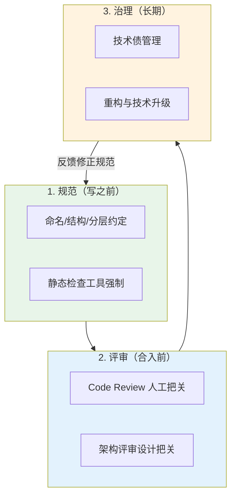
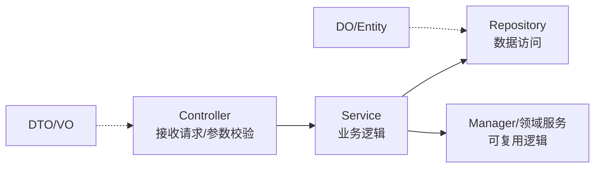
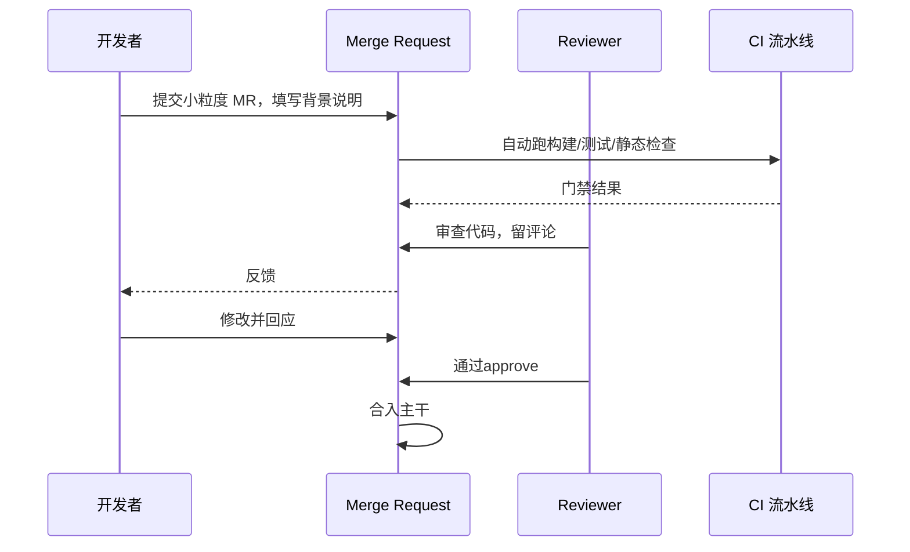

# 代码规范与评审

> 定位：代码规范与评审不是「挑刺」和「走流程」，而是把个人经验沉淀成团队能力、把缺陷拦在合入之前。这一篇讲清规范怎么落地、Code Review 怎么做才不流于形式、技术债和重构怎么管理，让你从「写代码的人」走向「对代码质量负责的人」。

## 一、为什么需要它

先看几个真实场景：

- 项目交接时，接手人面对一个 3000 行的 Service，方法命名 `a1()`、`getData2()`，没人看懂，改一行就崩。
- 线上出一个 NPE，根因是某次提交里一个没判空的调用，Code Review 时大家都在看「功能对不对」，没人注意。
- 同一个团队里，A 写的代码用 4 空格，B 用 Tab；A 用 LocalDateTime，B 用 Date；合并时冲突不断。

这些问题的本质，是**代码作为团队资产却缺乏治理**。代码不是写完就结束，它要被别人读、被修改、被维护很多年。统计学上有个广为引用的结论：缺陷在编码阶段修复的成本，是上线后修复的几十倍。Code Review 和静态分析的价值，就是把缺陷拦在「最便宜」的阶段。

规范与评审要解决三件事：

1. **可读性**：代码是写给人看的，规范让任何人都能快速理解。
2. **一致性**：统一风格，降低协作成本和合并冲突。
3. **质量兜底**：用流程和工具，把明显的错误在无测试阶段就挡住。

## 二、核心原理：规范、评审、治理三位一体

代码质量治理有三根支柱，缺一不可：

- **规范**是「事前约定 + 工具强制」，让错误的代码根本写不出来（或写出来了无法通过构建）。
- **评审**是「事中把关」，用人的判断力发现工具发现不了的设计、逻辑、业务问题。
- **治理**是「事后偿还」，用技术债管理和重构，防止系统随时间腐化。

三者形成闭环：治理中发现的问题反馈到规范，规范随团队成长演进。

### 2.1 代码规范：命名、结构、分层

规范的第一层是编码约定，核心是「让代码自解释」。

**命名**：好的命名让注释变得多余。

- 类名用名词（`OrderService`），方法名用动词（`createOrder`），布尔方法用 `is`/`has` 开头。
- 变量名体现业务含义，`daysSinceLastLogin` 优于 `d`。
- 常量全大写下划线分隔，包名全小写。

**结构**：单个类/方法保持单一职责。经验阈值：

- 方法长度超过 50 行就该考虑拆分。
- 类的字段超过 7±2 个，可能是职责太多。
- 嵌套层级不超过 3 层，超过就用卫语句（guard clause）或提取方法。

**分层**：典型的后端分层是 `Controller → Service → Repository/DAO`，配合 `DTO/VO/DO` 对象隔离。

分层的价值是**隔离变化**：Web 层换框架不影响业务层，数据库换实现不影响 Service。最常见的分层违规是「Controller 写业务、Service 直接返回 DO、跨层调用」，评审时要重点看。

### 2.2 静态代码分析工具

规范靠人自觉遵守会打折，必须靠工具强制：

| 工具 | 定位 | 特点 |
|---|---|---|
| Checkstyle | 代码风格检查 | 检查命名、缩进、 import、行数等格式问题，规则可配 |
| PMD / SpotBugs | 潜在缺陷扫描 | 找空指针、未关闭资源、死代码等 bug 模式 |
| SonarQube | 持续质量平台 | 汇总代码异味、复杂度、重复率、测试覆盖率，出质量门禁 |
| 阿里巴巴 Java 开发手册 | 规约文档 + 插件 | 国内团队 widely 采用，P3C 插件集成 IDE 与 Sonar |

**SonarQube 的质量门禁（Quality Gate）** 是落地关键：设好阈值（如「新增代码覆盖率 ≥ 80%、严重问题数 = 0、重复率 < 3%」），MR/PR 合入前必须通过，让规范变成「硬约束」而不是「建议」。

落地建议：

- 工具规则要**团队共识后裁剪**，别一上来全开几百条规则，否则开发疲于应付告警，最后集体忽略。
- 接入 CI，在流水线里卡点；本地 IDE 装插件实时提示。
- 对存量代码设「基线」，只卡增量，避免一接入就爆出上万问题。

### 2.3 Code Review：价值与落地

Code Review 不是「找茬」，它的价值有四个：

1. **发现缺陷**：别人更容易看出你的盲点。
2. **知识共享**： reviewer 了解改动，作者阐述思路，双向学习。
3. **统一标准**：把规范落实到具体代码。
4. **设计把关**：在代码层面再次审视方案是否合理。

**落地流程**：

**Review Checklist（重点看什么）**：

- 正确性：逻辑是否符合需求，边界条件、并发、异常处理是否到位。
- 安全性：有没有注入、越权、敏感信息泄露（结合前几篇安全内容）。
- 设计：是否符合分层，是否过度设计，是否引入了不必要的依赖。
- 可维护性：命名、注释、重复代码、方法长度。
- 测试：有没有对应测试，测试是否覆盖核心路径。

**心态**：

- 作者：把 reviewer 当队友而非监工，写清 MR 背景，小步提交。
- Reviewer：对事不对人，用提问代替指责（「这里并发下会怎样？」而非「你这写错了」）。
- 达成共识：不是谁对谁错，而是找到更好的方案。

### 2.4 架构评审

不是所有改动都适合代码级 Review。涉及**跨模块、影响面大、技术选型**的改动，要做架构评审（ADR / 设计文档 + 评审会），在写代码前就对齐方案，避免「代码写了一周，方向错了推翻重来」。架构评审关注：方案是否满足需求、是否过度设计、扩展性/可用性/成本权衡、是否有更简单的方案。

### 2.5 技术债与重构时机

技术债是「为了短期速度妥协而欠下的未来成本」。它不是全然的坏事——关键是**可识别、可管理**。

- **识别**：用 Sonar 的债务清单、代码注释里的 `TODO/FIXME`、团队痛感收集。
- **管理**：建技术债看板，记录「债务描述 / 影响 / 偿还优先级」，每个迭代固定比例（如 20%）时间偿还。
- **重构时机**：
  - 好时机：加新功能前（先让代码好改）、刚修完 bug（趁理解上下文）、有测试保护时。
  - 坏时机：临上线前大改、没有测试覆盖、纯「看不顺眼」的重构。

一句原则：**重构要有测试和明确收益支撑，不为重构而重构**。

## 三、关键机制与参数

一套可落地的质量治理配置示例（以 Sonar + CI 为例）：

| 门禁项 | 建议阈值 | 说明 |
|---|---|---|
| 新增代码覆盖率 | ≥ 80% | 只卡增量，避免历史包袱 |
| 严重/阻断级问题 | 0 | Blocker/Critical 必须清零 |
| 代码重复率 | < 3% | 过高说明缺抽象 |
| 圈复杂度 | 单方法 < 10 | 过高难维护、难测试 |
| 安全漏洞 | 0 高危 | 结合安全扫描 |

MR 规模建议：**单个 MR 不超过 400 行改动**（不含自动生成代码）。研究表明，超过这个量级，reviewer 的缺陷发现率显著下降。大改动要拆成多个小 MR。

这里补充一个容易被忽视的点：**规范的「可执行性」比「完备性」更重要**。一份 200 条但没人遵守的规范，价值远低于 20 条被工具强制执行的规范。所以制定规范时，先问自己「这条能不能自动化检查」——能的交给工具，不能的才写进文档并靠评审落实。比如「缩进 4 空格」可以交给 Checkstyle，但「Service 层不应依赖 Web 层」这种架构约定，工具查不了，就要靠架构守护工具（如 ArchUnit，后面架构篇会讲）或评审把关。把规范分成「机器可查」和「人来判断」两类，分别用不同手段保障，是规范落地的关键。

## 四、生产坑点与排查

### 坑点 1：接入静态扫描后告警太多，团队集体忽略

**现象**：Sonar 一接入报出上万问题，开发麻木，门禁形同虚设。
**原因**：对存量代码全量开启所有规则，没有基线和裁剪。
**解法**：
- 设「质量基线」，只卡新增改动（new code period）。
- 团队讨论裁剪规则，关掉噪音大、价值低的规则。
- 分批偿还存量问题，按模块逐步清零。

### 坑点 2：Code Review 变成「走过场」

**现象**：MR 提上去没人看，或 reviewer 秒点 approve，出问题后没人负责。
**原因**：没有明确的 review 责任人、时限和质量要求；MR 太大难 review。
**解法**：
- 设 CODEOWNERS，按模块指定 reviewer。
- 控制 MR 大小，填背景说明。
- 把 review 质量纳入团队指标，鼓励有实质评论。

### 坑点 3：核心模块没有测试，重构一改就出故障

**现象**：想重构老代码，但没人敢动，一动就崩。
**原因**：缺乏测试保护，重构无法验证行为不变。
**解法**：
- 重构前先补「 characterization test（特征测试）」，锁定当前行为。
- 用「绞杀者模式」逐步替换，而非一次性大改写。
- 每次小步重构 + 全量测试，确保绿色。

### 坑点 4：规范文档写在 Confluence 里，没人看

**现象**：团队有一份详尽的编码规范文档，但实际代码风格五花八门。
**原因**：规范靠「人自觉」，没有工具强制。
**解法**：把能自动化的规则写进 Checkstyle/Sonar 配置，让不符合规范的代码构建失败；文档只保留「工具无法强制」的约定（如分层、命名语义）。

## 五、调优 / 选型 / 最佳实践

1. **工具选型**：Checkstyle 管格式，SpotBugs/PMD 管缺陷，SonarQube 做平台汇总 + 门禁，阿里 P3C 作为规约补充。
2. **门禁策略**：只卡增量、阈值合理、规则团队共识。
3. **Review 文化**：小 MR、明背景、对事不对人、有实质评论。
4. **评审分层**：日常改动走 Code Review，重大方案走架构评审。
5. **技术债**：看板化管理，固定比例时间偿还，重构有测试支撑。
6. **持续改进**：定期回顾规范是否合用， tooling 是否过时。

最后聊一点软性但关键的东西：**规范与评审的推行方式决定成败**。很多团队由架构师单方面「颁布」规范，要求所有人遵守，结果遭遇抵触，因为开发觉得这是「上面的规矩」，跟自己没关系。更有效的做法是让团队共同参与规范的制定——把「为什么要有这条规则」讲清楚，让大家在 cumpl 中理解收益，规范才从「要我遵守」变成「我要遵守」。评审文化同理：它是团队共同质量的防线，不是某个人对另一个人的审判。当所有人都把 Review 当成互相学习、共同成长的机会，规范与评审才会真正落地，而不是流于形式。

## 六、面试高频问法

> 这一节按「能讲透」的标准写：每题先给一句能直接背的结论，再展开机制、对比与生产坑。建议先自己答一遍，再对照补全。

**Q1：Code Review 的价值是什么？怎么落地才不流于形式？**

**一句话结论**：Code Review 的价值是发现缺陷、知识共享、统一标准、设计把关；落地靠小粒度 MR + CI 门禁 + CODEOWNERS + Checklist + 对事不对人的文化。

展开四大价值：

1. **发现缺陷**：别人更容易看出你的盲点。
2. **知识共享**：reviewer 了解改动，作者阐述思路，双向学习。
3. **统一标准**：把规范落实到具体代码。
4. **设计把关**：在代码层面再次审视方案是否合理。

**落地要点**：开发者提交小粒度 MR 并写清背景 → CI 自动跑构建/测试/静态检查 → 按 CODEOWNERS 指定 reviewer → 对照 Checklist（正确性、安全性、设计、可维护性、测试）留评论 → 修改回应 → approve 合入。

加分点：把"缺陷在编码阶段修复的成本是上线后的几十倍"这个数据点讲出来，并说明 Review 的价值就是把缺陷拦在"最便宜"的阶段——用成本模型论证流程必要性，比空谈"提升质量"有说服力得多。

**Q2：Code Review 应该重点看什么？（Checklist）**

**一句话结论**：五个维度——正确性、安全性、设计、可维护性、测试；其中安全性和并发/边界条件是最容易被"功能对不对"掩盖的盲区。

展开：

- **正确性**：逻辑是否符合需求，边界条件、并发、异常处理是否到位。一个没判空的调用导致线上 NPE，往往就是 Review 时只看了主流程。
- **安全性**：有没有注入、越权、敏感信息泄露（结合前面安全篇的内容）。
- **设计**：是否符合分层，是否过度设计，是否引入不必要的依赖。
- **可维护性**：命名、注释、重复代码、方法长度。
- **测试**：有没有对应测试，测试是否覆盖核心路径和边界。

加分点：强调"Review 不是只看功能对不对"——这正是很多团队的通病：功能看完了就 approve，没人注意异常分支和并发问题。用提问代替指责（"这里并发下会怎样？"而非"你这写错了"），对事不对人，才能形成真正的讨论氛围。

**Q3：代码质量治理的三根支柱是什么？**

**一句话结论**：规范（事前强制）+ 评审（事中把关）+ 治理（事后偿还），三位一体形成闭环。

展开：

| 支柱 | 时机 | 手段 | 目的 |
|---|---|---|---|
| 规范 | 写之前 | 命名/结构约定 + 静态检查工具强制 | 让错误代码写不出来或构建不过 |
| 评审 | 合入前 | Code Review 人工 + 架构评审设计 | 发现工具发现不了的设计/逻辑/业务问题 |
| 治理 | 长期 | 技术债管理 + 重构升级 | 防止系统随时间腐化 |

**闭环**：治理中发现的问题反馈修正规范，规范随团队成长演进。

加分点：能说清三者解决的是不同层面的问题——工具能查格式和明显缺陷，但查不出"这段业务逻辑语义对不对、这个方案是否过度设计"，所以人工评审不可替代；而再好的规范也挡不住系统随时间腐化，所以要有治理。这个分层论证是满分答法。

**Q4：Checkstyle、PMD/SpotBugs、SonarQube、阿里 P3C 分别管什么？**

**一句话结论**：Checkstyle 管代码风格，PMD/SpotBugs 管潜在缺陷，SonarQube 做平台汇总 + 质量门禁，阿里 P3C 是规约文档 + 插件补充。

展开：

- **Checkstyle**：检查命名、缩进、import、行数等格式问题，规则可配。
- **PMD / SpotBugs**：找空指针、未关闭资源、死代码等 bug 模式，属于潜在缺陷扫描。
- **SonarQube**：持续质量平台，汇总代码异味、复杂度、重复率、测试覆盖率，出质量门禁。
- **阿里巴巴 Java 开发手册 / P3C 插件**：国内团队广泛采用，规约文档 + IDE/Sonar 插件。

加分点：要点出"工具要团队共识后裁剪，别一上来全开几百条规则——否则开发疲于应付告警，最后集体忽略"。接入 CI 做卡点、本地 IDE 实时提示、对存量代码设基线只卡增量，这三步是工具真正落地的关键，比单纯罗列工具名更有价值。

**Q5：SonarQube 的 Quality Gate（质量门禁）怎么用？**

**一句话结论**：设好阈值（新增覆盖率 ≥80%、严重问题 = 0、重复率 <3%），CI 中卡点，MR 合入前必须通过；只卡新增代码，避免存量问题阻塞。

展开一套典型阈值：

| 门禁项 | 建议阈值 | 说明 |
|---|---|---|
| 新增代码覆盖率 | ≥ 80% | 只卡增量，避免历史包袱 |
| 严重/阻断级问题 | 0 | Blocker/Critical 必须清零 |
| 代码重复率 | < 3% | 过高说明缺抽象 |
| 圈复杂度 | 单方法 < 10 | 过高难维护、难测试 |
| 安全漏洞 | 0 高危 | 结合安全扫描 |

**落地关键**：设置 new code period（只卡新增改动），团队裁剪规则，分批偿还存量。

加分点：强调"门禁只卡增量"是能否落地的关键——一接入就对全量代码报出上万问题，团队会瞬间麻木、门禁形同虚设。这背后是一个普适原则：**可执行性比完备性更重要**。

**Q6：为什么说规范的"可执行性"比"完备性"更重要？**

**一句话结论**：200 条没人遵守的规范，价值远低于 20 条被工具强制执行的规范；制定规范先问"这条能不能自动化检查"。

展开——把规范分成两类：

- **机器可查的**：交给工具。如"缩进 4 空格"交给 Checkstyle，"方法长度 < 50 行"交给 Sonar，"新增覆盖率 ≥ 80%"交给门禁。这类规范让不符合的代码**构建失败**。
- **人来判断的**：写进文档并靠评审落实。如"Service 层不应依赖 Web 层"这种架构约定工具查不了，要靠 ArchUnit 这类架构守护工具或评审把关（见架构文档篇）。

加分点：这道题体现的是治理思维——规范不是写出来就完事，要有**执行载体**。能主动联系到 ArchUnit 把架构约定变成 CI 测试，说明你把"规范落地"这件事想透了，而不是停留在"写文档 + 培训"的层面。

**Q7：什么是技术债？怎么管理？**

**一句话结论**：技术债是为短期速度妥协而欠下的未来维护成本；它不是全然的坏事，关键是可识别、可管理——用看板记录、分优先级、固定比例偿还。

展开：

- **识别**：Sonar 债务清单、代码里的 `TODO/FIXME`、团队痛感收集。
- **管理**：建技术债看板，记录"债务描述 / 影响模块 / 偿还成本 / 优先级"；每个迭代固定比例时间（如 20%）偿还。
- **排序**：按"影响 × 紧急度"评估，明确负责人。

加分点：要说清技术债的辩证看待——"不是所有债都要立刻还，也不是所有债都是坏事"。为了赶工期、验证市场而适度负债是合理商业决策，可怕的是"债隐形、没人认领、越积越多直到系统难以维护"。能讲出这层权衡，说明你理解工程与业务的平衡。

**Q8：什么时候该重构？什么时候不该？**

**一句话结论**：加新功能前、刚修完 bug、有测试保护时是好时机；临上线大改、无测试覆盖、纯"看不顺眼"是坏时机。重构要有明确收益和测试支撑。

展开：

| 时机 | 判断 |
|---|---|
| ✅ 加新功能前 | 先让代码好改，降低本次改动成本 |
| ✅ 刚修完 bug | 趁理解上下文还热乎，顺手改善 |
| ✅ 有测试保护时 | 能验证行为不变，重构安全 |
| ❌ 临上线前 | 风险最高，改动可能引入新问题 |
| ❌ 没有测试覆盖 | 无法验证，等于蒙眼改 |
| ❌ 纯审美驱动 | 无收益，浪费且可能引入 bug |

加分点：一句原则收尾——"重构要有测试和明确收益支撑，不为重构而重构"。再补充应对无测试老代码的办法：先补特征测试（characterization test）锁定当前行为，用绞杀者模式逐步替换，每次小步重构 + 全量测试保持绿灯。

**Q9：接入静态扫描后告警太多、Code Review 走过场，怎么解决？**

**一句话结论**：前者靠"设基线只卡增量 + 裁剪规则 + 分批偿还"，后者靠"CODEOWNERS + 控制 MR 大小 + review 质量纳入指标"。

两个生产坑拆解：

1. **告警太多团队忽略**：根因是对存量全量开启所有规则、没有基线。解法：设质量基线只卡新增改动；团队讨论关掉噪音大、价值低的规则；按模块分批清零存量。
2. **Review 走过场**：MR 提上去没人看，或秒点 approve。根因是没有明确责任人、时限和质量要求，且 MR 太大难 review。解法：设 CODEOWNERS 按模块指定 reviewer；控制 MR 大小（建议单个 MR 不超过 400 行，超过后缺陷发现率显著下降）；填背景说明；把 review 质量纳入团队指标。

加分点：能给出"单个 MR 不超过 400 行"这个具体数字，并说明其依据（超过这个量级 reviewer 的缺陷发现率显著下降），体现你是带着数据和研究结论在治理，而不是凭感觉。

**Q10：核心模块没测试、不敢重构怎么办？**

**一句话结论**：先补特征测试锁定当前行为，再用绞杀者模式逐步替换，每次小步重构 + 全量测试保持绿灯。

展开：

- **现象与根因**：想重构老代码但没人敢动，一动就崩——根因是缺乏测试保护，重构无法验证"行为不变"。
- **解法三步**：
  - 重构前先补 **characterization test（特征测试）**，把当前实际行为（哪怕是 bug）锁下来作为基线；
  - 用**绞杀者模式**逐步替换，新旧实现并行、逐块迁移，而非一次性大改写；
  - 每次小步重构后跑全量测试，确保绿灯。

加分点：点出"特征测试和普通测试的区别——它记录的是'现状是什么'，而不是'应该是什么'，目的就是给重构上保险"。这个细节说明你真的做过遗留系统改造，而不是纸上谈兵。

**Q11：代码分层的价值是什么？常见分层违规有哪些？**

**一句话结论**：分层的核心价值是**隔离变化**——Web 层换框架不影响业务层，数据库换实现不影响 Service；常见违规是 Controller 写业务、Service 直接返回 DO、跨层调用、循环依赖。

展开：

- **典型分层**：`Controller（接收请求/参数校验）→ Service（业务逻辑）→ Repository（数据访问）`，配合 `DTO/VO/DO` 对象隔离。
- **对象隔离**：DTO 接收入参、VO 返回出参、DO 对应数据库实体，各层之间不混用——这既隔离变化，也防止直接把 DO（含密码哈希等）吐给前端（见安全篇）。
- **常见违规**：Controller 写业务逻辑；Service 直接返回 DO；跨层调用（Controller 直接调 Repository）；Service 之间循环依赖。

加分点：能说清"为什么要 DTO/VO/DO 隔离"的双重价值——技术上隔离变化、安全上防止敏感字段泄露。再提一句"这类架构约定工具查不了，要靠 ArchUnit 或评审把关"，把分层和架构守护串起来。

## 小结

- 代码质量治理 = 规范（事前强制）+ 评审（事中把关）+ 治理（事后偿还），三位一体。
- 规范靠工具强制才有效：Checkstyle 管格式，Sonar 管质量门禁，只卡增量。
- Code Review 要小 MR、明背景、对事不对人；重大改动走架构评审。
- 技术债可管理不可怕：看板记录 + 固定比例偿还；重构要有测试和收益支撑。
- 分层用 Controller-Service-Repository + DTO/VO/DO 隔离变化，评审重点查跨层和职责混乱。
