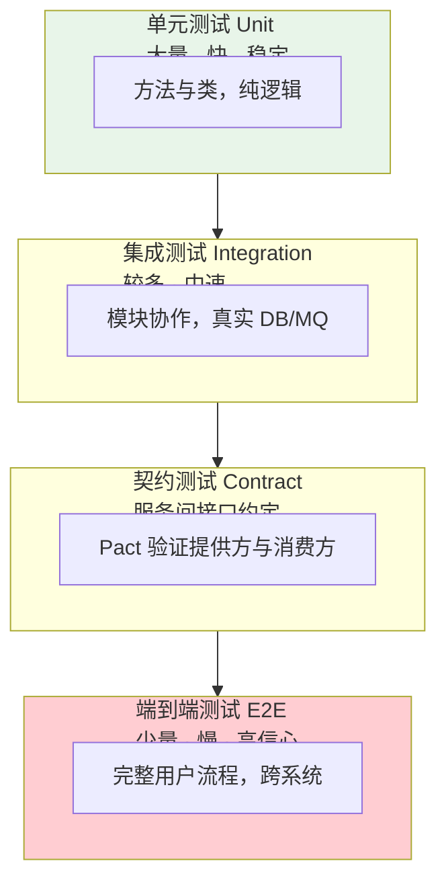
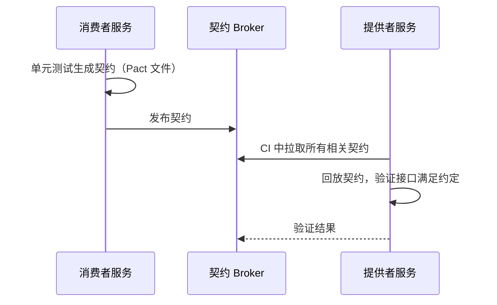

# 测试体系

> 定位：测试不是 QA 的专属，而是工程师保障交付质量的工程手段。这一篇用测试金字塔串起单元、集成、契约、端到端四类测试，讲清每层的职责、工具选型、覆盖率的正确打开方式，以及 TDD 与 Mock 的度在哪里。

## 一、为什么需要它

很多团队对测试的态度是两个极端：要么「测试是 QA 的事，我只管写功能」，要么「覆盖率不到 100% 不许合入」。结果要么线上质量差，要么为了凑覆盖率写一堆没意义的测试。

问题的根源是**没分清测试的类型和目的**。不同层次的测试，解决不同的问题、有不同的成本和速度：

- 单元测试快、便宜、定位精确，但验证不了组件间的协作。
- 端到端测试贴近用户，但慢、脆、难定位。
- 契约测试解决微服务间的「接口悄悄变了」问题。

一个健康的测试体系，是在**速度、成本、信心**之间做组合，而不是单一追求某个指标。测试金字塔就是这套组合的骨架。

## 二、核心原理：测试金字塔

测试金字塔描述了不同层次测试的数量关系：底层单元测试最多，越往上越少，形成金字塔。



**为什么是金字塔而不是倒金字塔（冰淇淋蛋筒）**：

- 越底层的测试**运行越快**（毫秒级 vs 分钟级）、**越稳定**（不依赖外部）、**定位问题越精确**（失败直接指向某个方法）。
- 越上层的测试越接近真实用户场景，但**维护成本高、执行慢、容易 flaky（不稳定）**。

所以策略是：**大量快而稳的单元测试打底，少量端到端测试守住核心流程**。如果反过来（大量 E2E、几乎没有单测），会得到「跑一次测试半小时、还经常莫名失败」的痛苦局面。

### 2.1 单元测试：JUnit + Mockito

单元测试针对**最小的可测试单元**（一个方法/类），不依赖外部资源（DB、网络、文件系统）。

- **JUnit 5**：主流测试框架，`@Test`、`@BeforeEach`、`@ParameterizedTest`、`Assertions` 等。
- **Mockito**：Mock 依赖，隔离被测对象。核心注解 `@Mock`、`@InjectMocks`，方法 `when(...).thenReturn(...)`、`verify(...)`。

```java
@ExtendWith(MockitoExtension.class)
class OrderServiceTest {
    @Mock PaymentClient paymentClient;   // Mock 外部依赖
    @InjectMocks OrderService orderService;

    @Test
    void 支付失败时应取消订单() {
        when(paymentClient.pay(any())).thenThrow(new RuntimeException("支付失败"));
        // 执行被测逻辑
        assertThrows(PaymentException.class, () -> orderService.createOrder(...));
        verify(orderRepo).cancel(any());  // 验证副作用
    }
}
```

写好单测的关键：

- **AAA 结构**：Arrange（准备）→ Act（执行）→ Assert（断言），一眼看懂。
- **一个测试只测一件事**，失败原因清晰。
- **断言行为而非实现**：测「结果对不对」，别测「内部调用了几次某私有方法」（脆弱）。

### 2.2 集成测试：Testcontainers

集成测试验证**多个组件协作**：Service + 真实数据库、缓存、消息队列。它与单测的区别是「用真实依赖而非 Mock」。

过去集成测试的痛点是「依赖本地装好 MySQL/Redis，环境不一致」。**Testcontainers** 用 Docker 在测试时自动起一个真实的中间件容器，用完即毁：

```java
@Testcontainers
class UserRepoIntegrationTest {
    @Container
    static MySQLContainer<?> mysql = new MySQLContainer<>("mysql:8.0");

    @Test
    void 保存后能查询到() {
        // 用 mysql.getJdbcUrl() 连接真实数据库执行测试
    }
}
```

价值：**环境即代码**，测试自包含、可重复、CI 友好，彻底解决「在我机器上是好的」问题。适合测 SQL 正确性、事务、Repositories。

### 2.3 契约测试：Pact

微服务架构下，消费者和提供者由不同团队维护。提供者改了接口字段，消费者可能到上线才炸。**契约测试**把「接口约定」变成可自动验证的契约：

- **消费者驱动**：消费者定义「我期望提供者返回什么」（Pact 文件）。
- **提供者验证**：CI 中让提供者回放契约，确认自己满足所有消费者的期望。
- 任一方的破坏性变更都会在合入前被拦下。



适合服务间调用密集的微服务场景。相比 E2E，契约测试更快、更稳定、定位更准。

### 2.4 端到端测试（E2E）

E2E 从用户视角验证完整流程（如「注册 → 登录 → 下单 → 支付」），覆盖真实浏览器、前端、后端、数据库。工具如 Selenium、Playwright、Cypress。

- 优点：最贴近真实用户，能发现跨系统协作问题。
- 缺点：慢、易 flaky（元素加载时序、网络抖动）、失败难定位。
- 原则：**只覆盖最核心的少数黄金流程**（happy path），不要试图用 E2E 覆盖所有分支——那是单元测试的职责。

### 2.5 测试覆盖率的正确打开方式

覆盖率（行覆盖、分支覆盖）是「代码有没有被执行到」的度量，**不是「测试好不好」的度量**。

**误区**：

- **100% 覆盖率 ≠ 没有 bug**：覆盖率只说明代码被执行了，不说明断言充分。你可能执行了一个方法却什么都没断言。
- **为了覆盖率而测试**：给 getter/setter、简单 POJO 写无意义测试，凑数字。
- **唯覆盖率论**：设客观指标作为门禁的唯一标准，导致团队造假。

**正确用法**：

- 把覆盖率当作**发现盲区的工具**：哪些关键分支没覆盖到？补测试。
- 关注**核心业务模块**的覆盖率（如 80%+），而非全局平均值。
- 结合 **mutation testing（变异测试）**：故意改坏代码（如把 `>` 改成 `>=`），看测试能否发现，检验测试质量。工具如 PIT。

### 2.6 Mock 的度

Mock 让单元测试隔离外部依赖，但过度 Mock 会让测试「自欺欺人」：

- **该 Mock**：外部服务、第三方 API、慢资源（DB 在纯单测中可 Mock）、时间/随机数等不确定性。
- **不该 Mock**：被测对象自身的逻辑、简单值对象、数据结构。
- **警惕**：如果测试里 Mock 了所有协作者，只测了一个空壳，那测试没有验证真实协作——这时该用集成测试。

判断标准：**Mock 是为了隔离不可控因素，而不是为了让测试「容易通过」**。如果为了通过而 Mock 掉本该验证的行为，测试就失去了意义。

### 2.7 TDD 浅析

TDD（测试驱动开发）的循环是 **Red → Green → Refactor**：

1. **Red**：先写一个失败的测试，定义期望行为。
2. **Green**：写最少代码让测试通过。
3. **Refactor**：重构代码，保持测试通过。

价值：强迫你先想清楚「要什么」、产出天然可测试的设计、测试即文档。

现实：TDD 有学习成本，不是所有场景都适合（探索性代码、UI、一次性脚本）。务实做法是**在核心业务逻辑上实践 TDD，其余场景「测试先行或后补」皆可**——关键是要有测试，而非纠结顺序。

## 三、关键机制与参数

| 测试类型 | 工具 | 速度 | 稳定性 | 验证目标 |
|---|---|---|---|---|
| 单元测试 | JUnit5 + Mockito | 毫秒级 | 高 | 方法/类逻辑 |
| 集成测试 | Testcontainers + JUnit5 | 秒级 | 中 | 组件协作、DB/MQ |
| 契约测试 | Pact | 秒级 | 高 | 服务间接口 |
| E2E | Playwright/Selenium | 分钟级 | 低 | 完整用户流程 |

CI 中的测试分层执行策略：


让开发者提交后秒级拿到单测反馈，慢测试放到后续阶段，是保持开发效率的关键。

关于测试数据，再补充一点实践原则。测试最忌讳「共享可变状态」——多个测试共用一个数据库、互相污染数据，导致「单独跑通过、一起跑失败」，而且顺序一变结果就变。正确做法是**每个测试 isolated（隔离）**：用 `@Transactional` 让单测跑完自动回滚，或用 Testcontainers 每个测试类起独立容器，或每个测试用唯一前缀的数据并在 finally 里清理。E2E 测试尤其要靠「独立账号 + 独立数据集」避免并发跑时互相干扰。测试的可重复性，是团队信任测试结果的前提。

## 四、生产坑点与排查

### 坑点 1：测试依赖本地环境，CI 上跑不起来

**现象**：测试在本地通过，CI 上报「连接 localhost:3306 失败」。
**原因**：测试硬编码了本地 DB/Redis 地址，环境不一致。
**解法**：用 Testcontainers 起真实容器，或测试配置与代码分离；测试不依赖任何外部固定地址。

### 坑点 2：E2E 测试大量 flaky，团队不再信任

**现象**：同样的测试时好时坏，失败重试又通过，最后大家忽略红灯。
**原因**：E2E 覆盖了过多分支、依赖时序和网络、没有 properly wait。
**解法**：E2E 只保留核心 happy path；用显式等待替代固定 sleep；隔离测试数据；把分支验证下沉到单测/集成测试。

### 坑点 3：覆盖率达标但线上 bug 不断

**现象**：覆盖率 90%，却频繁出逻辑 bug。
**原因**：为凑覆盖率写了大量「执行但不验证」的测试，断言薄弱。
**解法**：引入变异测试检验测试有效性；Code Review 时看断言是否覆盖核心分支和边界；关注关键模块的有效覆盖而非全局数字。

### 坑点 4：Mock 过度，测试通过但集成后出问题

**现象**：所有单测通过，但服务联调时接口对不上、行为不一致。
**原因**：单测 Mock 掉了真实协作者，没验证真实交互；缺少集成/契约测试。
**解法**：明确各层职责——单测测逻辑，集成测协作，契约测接口；对关键交互用真实依赖或契约测试覆盖。

## 五、调优 / 选型 / 最佳实践

1. **金字塔结构**：大量单测 + 适量集成/契约 + 少量 E2E。
2. **工具链**：JUnit5 + Mockito（单测）、Testcontainers（集成）、Pact（契约）、Playwright（E2E）。
3. **CI 分层**：快测试前置秒级反馈，慢测试后置；失败快速定位。
4. **覆盖率**：作发现盲区用，核心模块 80%+，配合变异测试；不唯数字论。
5. **Mock 适度**：隔离不可控因素，不 Mock 被测逻辑本身。
6. **测试即文档**：好名字 + AAA 结构，让测试说明行为预期。

## 六、面试高频问法

> 这一节按「能讲透」的标准写：每题先给一句能直接背的结论，再展开机制、对比与生产坑。建议先自己答一遍，再对照补全。

**Q1：什么是测试金字塔？为什么要这样分层？**

**一句话结论**：底层大量快而稳的单元测试打底，越往上测试越少；越底层越快、越稳定、定位越准，上层贴近用户但慢且脆，避免"倒金字塔（冰淇淋蛋筒）"。

展开四层：

| 层次 | 数量 | 速度 | 稳定性 | 验证目标 |
|---|---|---|---|---|
| 单元测试 | 大量 | 毫秒级 | 高 | 方法/类纯逻辑 |
| 集成测试 | 较多 | 秒级 | 中 | 组件协作、真实 DB/MQ |
| 契约测试 | 适量 | 秒级 | 高 | 服务间接口约定 |
| E2E 测试 | 少量 | 分钟级 | 低 | 完整用户流程 |

**为什么是金字塔**：底层测试运行快、不依赖外部、失败直接指向某个方法；E2E 贴近真实用户但慢、易 flaky、失败难定位。策略是"大量单测打底 + 少量 E2E 守核心流程"。

加分点：能描述反面案例——"大量 E2E、几乎没有单测，会变成跑一次测试半小时、还经常莫名失败的痛苦局面"。用后果论证结构，比单纯背定义更有说服力。

**Q2：单元测试怎么写？JUnit 5 + Mockito 的要点是什么？**

**一句话结论**：单元测试针对最小可测单元、不依赖外部资源；用 JUnit 5 写测试、Mockito Mock 依赖，遵循 AAA 结构和"一个测试只测一件事"。

展开：

- **工具**：JUnit 5 的 `@Test`、`@BeforeEach`、`@ParameterizedTest`、`Assertions`；Mockito 的 `@Mock`、`@InjectMocks`、`when(...).thenReturn(...)`、`verify(...)`。

```java
@ExtendWith(MockitoExtension.class)
class OrderServiceTest {
    @Mock PaymentClient paymentClient;
    @InjectMocks OrderService orderService;

    @Test
    void 支付失败时应取消订单() {
        when(paymentClient.pay(any())).thenThrow(new RuntimeException("支付失败"));
        assertThrows(PaymentException.class, () -> orderService.createOrder(...));
        verify(orderRepo).cancel(any());  // 验证副作用
    }
}
```

- **写好单测三原则**：① AAA 结构（Arrange 准备 → Act 执行 → Assert 断言），一眼看懂；② 一个测试只测一件事，失败原因清晰；③ **断言行为而非实现**——测"结果对不对"，别测"内部调用了几次某私有方法"（脆弱）。

加分点：强调"断言行为而非实现"是区分好测试和坏测试的关键——测实现细节的测试，代码一重构就全红，反而阻碍重构。再提"测试即文档"：好的测试名（如"支付失败时应取消订单"）本身就在说明行为预期。

**Q3：单元测试和集成测试的区别？Testcontainers 解决了什么？**

**一句话结论**：单测测最小单元、Mock 外部依赖；集成测组件协作、用真实依赖；Testcontainers 用 Docker 在测试时自动起真实中间件，实现"环境即代码"。

展开：

- **核心区别**：单测用 Mock 隔离外部（DB、网络、文件），快且稳；集成测试用**真实依赖**验证 Service + DB、缓存、MQ 的协作，能发现单测发现不了的 SQL 错误、事务问题。
- **过去集成测试的痛点**：依赖本地装好 MySQL/Redis，环境不一致，"在我机器上是好的"。
- **Testcontainers 的解法**：

```java
@Testcontainers
class UserRepoIntegrationTest {
    @Container
    static MySQLContainer<?> mysql = new MySQLContainer<>("mysql:8.0");
    @Test
    void 保存后能查询到() { /* 用 mysql.getJdbcUrl() 连真实库 */ }
}
```

Docker 在测试时自动起容器、用完即毁，环境自包含、可重复、CI 友好。

加分点：用"环境即代码"这个概念概括 Testcontainers 的价值——它把"环境配置"变成代码里可 version control 的一部分，彻底解决环境漂移问题。这是现代集成测试的最佳实践，面试官很认可。

**Q4：什么是契约测试？解决什么问题？**

**一句话结论**：契约测试把"服务间接口约定"变成可自动验证的契约，消费者驱动定义、提供者 CI 回放；解决微服务间"接口悄悄变了、到上线才炸"的问题。

展开：

- **背景**：微服务下消费者和提供者由不同团队维护，提供者改了接口字段，消费者可能到上线才炸，E2E 又慢又脆。
- **机制（消费者驱动）**：
  - 消费者在单元测试中定义"我期望提供者返回什么"，生成 Pact 文件（契约）；
  - 契约发布到 Broker；
  - 提供者在 CI 中拉取所有相关契约并回放，确认自己满足所有消费者的期望。
- **优势**：任一方的破坏性变更在合入前被拦下；比 E2E 更快、更稳定、定位更准。

加分点：能说清契约测试和 E2E 的取舍——"契约测试验证的是接口协议层面的约定，不验证完整业务流程；它和 E2E 是互补而非替代"。再点出它特别适合"服务间调用密集"的微服务场景，体现选型判断力。

**Q5：E2E 测试的定位是什么？为什么只覆盖核心流程？**

**一句话结论**：E2E 从用户视角验证完整流程、最贴近真实，但慢且易 flaky；原则是只覆盖最核心的少数黄金流程（happy path），分支验证下沉到单测/集成测试。

展开：

- **工具**：Selenium、Playwright、Cypress，覆盖真实浏览器、前端、后端、数据库。
- **优点**：最贴近真实用户，能发现跨系统协作问题。
- **缺点**：慢（分钟级）、易 flaky（元素加载时序、网络抖动）、失败难定位。
- **原则**：只覆盖"注册 → 登录 → 下单 → 支付"这类核心黄金流程；试图用 E2E 覆盖所有分支是典型的反模式——那是单元测试的职责。

加分点：点出 flaky 的根因和治理——"用显式等待替代固定 `sleep`、隔离测试数据、把分支验证下沉"，并强调"当团队开始忽略红灯时，E2E 就失去了价值，宁可少而稳，不要多而脆"。这是很实在的测试治理经验。

**Q6：测试覆盖率的意义和误区？什么是变异测试？**

**一句话结论**：覆盖率度量"代码有没有被执行到"，不是"测试好不好"；100% ≠ 无 bug；用变异测试检验测试有效性，关注核心模块而非全局数字。

展开误区：

- **100% 覆盖率 ≠ 没有 bug**：覆盖率只说明代码被执行了，不说明断言充分——你可能执行了一个方法却什么都没断言。
- **为覆盖率而测试**：给 getter/setter、简单 POJO 写无意义测试凑数字。
- **唯覆盖率论**：把它当门禁唯一标准，导致团队造假。

**正确用法**：

- 当作**发现盲区的工具**：哪些关键分支没覆盖？补测试。
- 关注**核心业务模块**的覆盖率（如 80%+），而非全局平均值。
- 结合**变异测试（mutation testing）**：故意改坏代码（如把 `>` 改成 `>=`），看测试能否发现，检验测试质量。工具如 PIT。

加分点：变异测试是很好的加分点——它回答了"谁来测试测试"这个问题。能说出"覆盖率是必要不充分条件，变异分数才更接近测试有效性"，说明你对测试质量的理解超出大多数人。

**Q7：Mock 的"度"怎么把握？**

**一句话结论**：Mock 是为了隔离不可控因素，不是为了让测试容易通过；该 Mock 外部服务和不确定性，不该 Mock 被测逻辑本身，关键交互要用集成/契约测试验证。

展开：

- **该 Mock**：外部服务、第三方 API、慢资源（纯单测中的 DB）、时间/随机数等不确定性。
- **不该 Mock**：被测对象自身的逻辑、简单值对象、数据结构。
- **警惕过度 Mock**：如果测试里 Mock 了所有协作者，只测了一个空壳，那测试没验证真实协作——这时该用集成测试。

加分点：一句话判断标准——"Mock 是为了隔离不可控因素，而不是为了让测试'容易通过'。如果为了通过而 Mock 掉本该验证的行为，测试就失去了意义"。能讲出这个"动机层面"的判断，比列举该不该 Mock 的清单更有深度。

**Q8：TDD 的 Red-Green-Refactor 是什么？**

**一句话结论**：先写失败测试定义行为（Red）→ 写最少代码让它通过（Green）→ 重构并保持绿灯（Refactor）；价值是迫使你想清需求、产出天然可测的设计、测试即文档。

展开三步：

1. **Red**：先写一个失败的测试，明确期望行为——这一步强迫你想清楚"到底要什么"。
2. **Green**：写最少代码让测试通过，不追求完美。
3. **Refactor**：在测试保护下重构代码，保持绿灯。

**现实取舍**：TDD 有学习成本，不是所有场景都适合（探索性代码、UI、一次性脚本）。务实做法是**在核心业务逻辑上实践 TDD，其余场景"测试先行或后补"皆可**——关键是要有测试，而非纠结顺序。

加分点：能辩证看待 TDD——"它是强约束下的设计工具，不是宗教信仰"。既讲价值（先想清楚、天然可测），又承认局限（探索性场景不适用），体现务实而非教条的工程观。

**Q9：CI 中测试应该怎么分层执行？**

**一句话结论**：快测试前置秒级反馈（单测 + 静态检查），慢测试后置（集成 + 契约 → 部署预发 → E2E 冒烟），让开发者提交后快速知道结果。

展开分层流水线：

```text
提交代码
  → 快速反馈层：单测 + 静态检查（秒级）
  → 通过 → 集成层：集成测试 + 契约测试（分钟级）
  → 通过 → 部署预发
  → E2E 冒烟测试（核心流程）
```

关键：把单测和静态检查放在最前面，秒级给出反馈；集成/契约测试次之；E2E 放到部署预发之后。任何一层失败即中断，快速定位。

加分点：能点出"分层执行的本质是**反馈速度与信心的权衡**"——越早的层跑得越快但覆盖越窄，越晚的层信心越足但越慢。把快而稳的防线前置，是保持开发效率与交付信心的关键，这也是 CI/CD 的核心设计思想。

**Q10：测试数据为什么要隔离？怎么隔离？**

**一句话结论**：测试最忌共享可变状态——多个测试共用一个库互相污染，导致"单独跑通过、一起跑失败"；做法是每个测试隔离，保证可重复性。

展开：

- **问题**：多个测试共用一个数据库、互相污染数据，导致"单独跑通过、一起跑失败"，且顺序一变结果就变，团队逐渐不信任测试结果。
- **隔离手段**：
  - 用 `@Transactional` 让单测跑完自动回滚；
  - 用 Testcontainers 每个测试类起独立容器；
  - 每个测试用唯一前缀的数据并在 finally 里清理；
  - E2E 用"独立账号 + 独立数据集"避免并发跑时互相干扰。

加分点：一句总结——"测试的可重复性，是团队信任测试结果的前提"。一旦测试变得不可重复（时好时坏），团队就开始忽略红灯，整个测试体系就名存实亡了。能把技术实践上升到"信任"这个工程文化层面，很有高度。

**Q11：覆盖率达标但线上 bug 不断、E2E 大量 flaky，怎么排查治理？**

**一句话结论**：前者是"执行但不验证"的弱断言测试，靠变异测试和 Review 断言质量解决；后者是 E2E 覆盖过多分支、依赖时序，靠精简核心流程 + 显式等待 + 隔离数据解决。

两个生产坑拆解：

1. **覆盖率 90% 却频繁出逻辑 bug**：根因是为凑覆盖率写了大量"执行但不验证"的测试，断言薄弱。解法：引入变异测试检验有效性；Code Review 时看断言是否覆盖核心分支和边界；关注关键模块的有效覆盖而非全局数字。
2. **E2E 大量 flaky 团队不再信任**：根因是覆盖了过多分支、依赖时序和网络、没有正确等待。解法：只保留核心 happy path；用显式等待替代固定 sleep；隔离测试数据；把分支验证下沉到单测/集成测试。

加分点：把两个现象统一到一个根因——"测试没有反映真实质量信号"。无论是弱断言还是 flaky，本质都是测试失去了"信号价值"。治理方向一致：让测试快速、稳定、断言有力，团队才会信任它并据此决策。

## 小结

- 测试金字塔：大量快稳单测打底，少量 E2E 守核心流程，避免倒金字塔。
- 分层工具：JUnit5+Mockito（单测）、Testcontainers（集成）、Pact（契约）、Playwright（E2E）。
- 覆盖率是发现盲区的工具，不是质量指标；配合变异测试，别唯数字论。
- Mock 用于隔离不可控因素，过度 Mock 会让测试自欺欺人，关键交互要用真实依赖验证。
- TDD 的 Red-Green-Refactor 有价值但非银弹；务实做法是核心业务逻辑实践，关键是要有测试。
