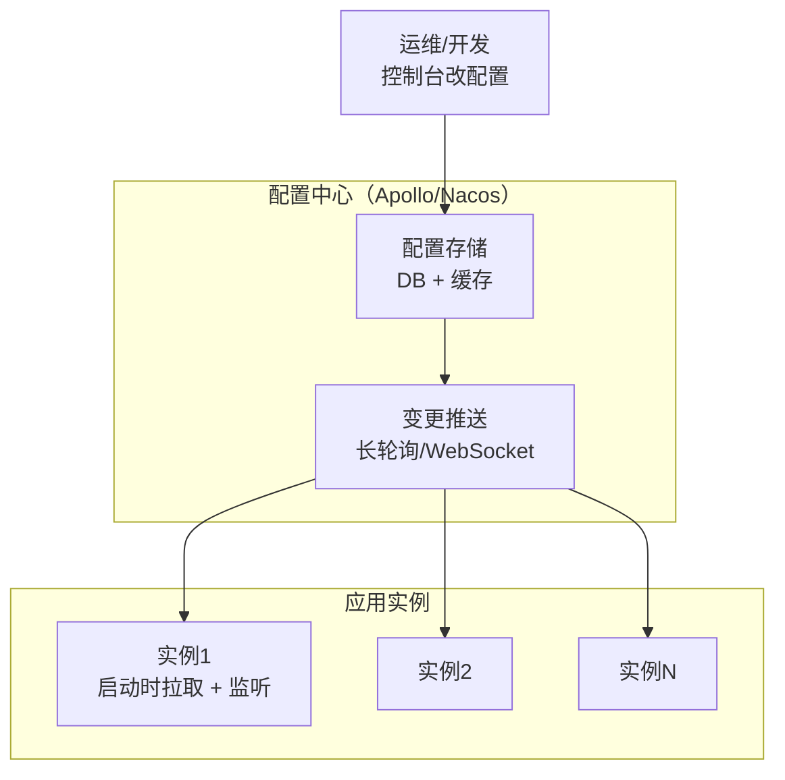
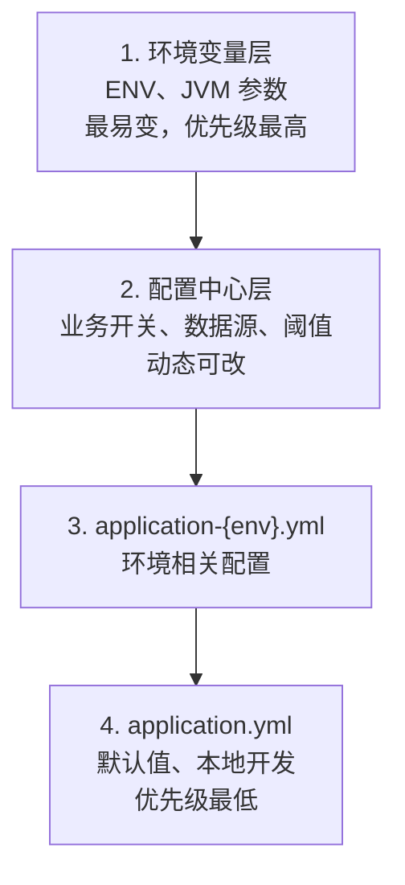
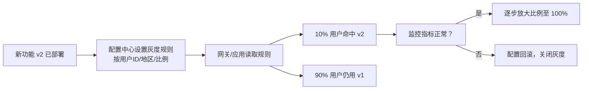

# 配置管理与环境治理

> 定位：配置与代码分离是现代应用的铁律。这一篇讲清配置中心（Apollo/Nacos）的核心机制、配置分层、敏感配置加密、多环境治理，以及配置如何支撑灰度发布和 Feature Flag，让你的应用能在不重新打包的前提下安全、可控地变更行为。

## 一、为什么需要它

先看几个让人头皮发麻的场景：

- 改一个数据库地址，要改配置文件、重新打包、重启服务，半夜发版改出事故。
- 测试环境的配置写死在代码里，上线时忘了改，连到了测试库。
- 数据库密码明文写在 `application.yml` 里，还提交了 Git，整个仓库都能看到。
- 想对新用户灰度一个新功能，只能再发一版代码。

这些问题的共同根源是：**配置和代码耦合、配置散落各处、变更不可控**。配置管理的目标就是让配置从代码里剥离出来，集中管理、动态生效、安全可控、环境隔离。

## 二、核心原理：配置中心与配置分层

配置中心把配置从应用包里搬到独立的中心化服务，应用启动时拉取、运行时监听变更。



核心机制：

- **拉取 + 推送结合**：应用启动时全量拉取配置；运行时通过**长轮询**（客户端挂起请求，配置变了立刻返回）或 WebSocket 感知变更，实现秒级生效。
- **本地缓存 + 容灾**：配置会落一份到本地文件，配置中心挂了应用还能用上次的配置启动，不至于全崩。
- **灰度/分组**：按 namespace、group、dataId 等维度组织配置，支持按应用、环境、集群隔离。

### 2.1 Apollo 与 Nacos 对比

| 维度 | Apollo（携程） | Nacos（阿里） |
|---|---|---|
| 定位 | 纯配置中心 | 配置中心 + 注册中心二合一 |
| 配置模型 | appId + cluster + namespace，多维治理完善 | namespace + group + dataId |
| 变更推送 | 长轮询，秒级 | 长轮询，秒级 |
| 权限/审计 | 完善（细粒度权限、发布审计、回滚） | 较完善 |
| 灰度发布 | 原生支持灰度、回滚 | 支持 |
| 生态 | 偏配置治理，配合 Spring Cloud | 兼具服务发现，Spring Cloud Alibaba 常用 |

选型建议：只需要专业配置治理、重视权限与审计 → **Apollo**；想要配置 + 注册中心一体化、用 Spring Cloud Alibaba 体系 → **Nacos**。

### 2.2 配置分层

配置不是一锅粥，合理的分层能让「哪些该变、哪些不该变」一目了然：



Spring Boot 的 `ConfigData` 优先级大致是：**命令行参数 > 环境变量 > 配置中心 > application-{profile}.yml > application.yml**（高优先级覆盖低优先级，具体以版本为准）。理解优先级很关键——否则会出现「配置中心改了没生效，被本地文件覆盖了」的诡异现象。

**配置分层原则**：

- 不变的默认值放 `application.yml`。
- 环境差异（DB 地址、开关）放配置中心或 `application-{env}.yml`。
- 敏感信息放配置中心并加密，绝不入 Git。
- 部署环境差异用环境变量注入（如容器里的 `ENV=prod`）。

### 2.3 敏感配置加密

数据库密码、API Key、密钥等敏感配置，明文存储是大忌。几种方案：

- **配置中心加密**：Apollo/Nacos 支持对 value 加密存储，应用启动时解密。密钥单独管理。
- **Jasypt**：Spring Boot 常用，`ENC(加密串)` 形式，启动时用密钥解密。注意密钥不能和配置放一起（否则形同虚设），应通过环境变量注入。
- **KMS / Vault**：专业密钥管理服务，应用运行时动态获取凭据，甚至支持凭据轮换。生产高安全场景首选。
- **环境变量注入**：容器编排（K8s Secret）把敏感配置注入环境变量，不入代码仓库。

核心原则：**密钥和密文分离**，且密钥通过独立的、最小权限的渠道分发。

### 2.4 多环境治理

环境治理是配置管理的经典痛点。典型环境：

| 环境 | 用途 | 特点 |
|---|---|---|
| dev | 开发自测 | 频繁变更，可用 Mock 依赖 |
| test | 测试/集成 | 数据可重置，稳定 |
| staging（预发） | 上线前验证 | 配置尽量贴近生产，用生产脱敏数据 |
| prod | 生产 | 严格管控，变更需审批 |

关键实践：

- **环境隔离**：每个环境独立的配置 namespace / dataId，物理或逻辑隔离，避免串环境。
- **配置即代码的一部分**：配置纳入版本管理和审计，谁改了什么可追溯。
- **环境一致性**：用容器化保证各环境运行时一致，差异只在配置层；避免「预发和生产环境不一致导致上线翻车」。

### 2.5 灰度发布与金丝雀发布的配置支撑

配置中心是实现灰度发布的天然抓手：



应用通过配置中心读取「灰度策略」（如按 userId 取模、按白名单、按比例），决定请求走新逻辑还是旧逻辑。好处是**无需重新部署**，改配置即可调整流量比例，出问题秒级回滚。

### 2.6 Feature Flag（功能开关）

Feature Flag 是灰度思想的延伸：把功能发布与代码部署解耦。代码先上线但开关关闭，需要时打开开关启用功能。

类型：

- **发布开关（Release Toggle）**：未完成的功能隐藏，做完再开。
- **实验开关（Experiment Toggle）**：A/B 测试，不同用户看到不同版本。
- **运维开关（Ops Toggle）**：降级开关，如「关闭推荐服务」，出问题时一键降级。

实践要点：

- 开关要有**明确的生命周期**，定期清理不再用的 Flag，否则代码里堆积成迷宫。
- 开关配置放配置中心，支持动态切换。
- 命名清晰，记录负责人和清理计划。

多环境治理还有一个高频陷阱值得点出：**配置漂移**。各环境本应「代码一致、仅配置不同」，但现实中经常出现「预发改了个配置忘了同步生产」「prod 有个历史遗留的特殊配置没人知道」。防止漂移的办法：一是让各环境的配置项结构保持一致（同样的 Key，只是 Value 不同），缺失的 Key 在启动时就报错而不是静默用默认值；二是定期做配置 diff 审计，找出环境间的异常差异；三是所有配置变更走同一套审批流程，杜绝「私下改生产」。环境一致性不是一次性的工作，而是需要持续治理的状态。

## 三、关键机制与参数

| 项 | 建议 |
|---|---|
| 配置优先级 | 命令行 > 环境变量 > 配置中心 > profile 文件 > 默认文件 |
| 变更推送 | 长轮询，秒级生效；配本地缓存容灾 |
| 敏感配置 | 加密存储 + 密钥分离 + KMS |
| 环境隔离 | 独立 namespace/dataId，禁止跨环境写 |
| 灰度比例 | 从小比例（1%-5%）逐步放大，配监控 |
| Feature Flag | 有生命周期，定期清理 |

Spring Boot 集成配置中心的典型依赖与注解（以 Nacos 为例，具体以版本为准）：

```yaml
spring:
  cloud:
    nacos:
      config:
        server-addr: ${NACOS_ADDR}
        namespace: ${ENV_NAMESPACE}   # 环境隔离
```

```java
@RefreshScope   // 配置变更时刷新 Bean
@RestController
public class ConfigController {
    @Value("${feature.new-checkout.enabled:false}")
    private boolean newCheckoutEnabled;
}
```

## 四、生产坑点与排查

### 坑点 1：改了配置中心，应用没生效

**现象**：控制台改了配置，应用行为没变。
**原因**：① 本地 `application.yml` 配置了同名项，优先级更高覆盖了中心配置；② Bean 没加 `@RefreshScope`，还是旧值；③ 配置的 dataId/namespace 写错，根本没连到那份配置。
**解法**：按优先级排查同名项；动态刷新的 Bean 加 `@RefreshScope`；核对 dataId/namespace/group；看应用启动日志确认拉取了哪份配置。

### 坑点 2：配置中心宕机，应用全部启动失败

**现象**：配置中心故障，所有服务重启时起不来。
**原因**：应用强依赖配置中心，启动时必须拉到配置才能起，没有本地缓存兜底。
**解法**：开启配置中心的本地缓存（Apollo/Nacos 都会落本地文件），配置中心不可用时降级用本地缓存；核心配置在应用包里保留一份默认值。

### 坑点 3：数据库密码明文入 Git，安全审计报警

**现象**：安全扫描发现代码仓库里有明文密码。
**原因**：配置写死在 `application.yml` 提交了 Git。
**解法**：敏感配置迁到配置中心/KMS 并加密；`.gitignore` 排除本地配置文件；用环境变量注入密钥；已泄露的凭据立即轮换。

### 坑点 4：Feature Flag 长期不清理，代码里开关成灾

**现象**：代码里堆了几十个开关，没人知道哪些还有效，逻辑分支复杂到无法维护。
**原因**：开关没有生命周期管理和清理机制。
**解法**：每个 Flag 登记负责人和清理时间；功能全量后及时移除开关和旧分支；定期审计，把「常开/常关」的僵尸开关清掉。

## 五、调优 / 选型 / 最佳实践

1. **选型**：纯配置治理选 Apollo，配置+注册一体化选 Nacos。
2. **分层**：默认值 → profile → 配置中心 → 环境变量，按优先级组织，避免同名冲突。
3. **敏感配置**：加密 + 密钥分离 + KMS，绝不入 Git。
4. **环境**：独立 namespace 隔离，容器化保证一致性，预发贴近生产。
5. **动态能力**：用配置中心支撑灰度与 Feature Flag，改配置不发版，出问题秒回滚。
6. **治理**：配置纳入审计，Flag 有生命周期定期清理。

补充一个常被问到的细节：**「动态生效」的边界**。很多人以为改了配置中心，所有配置都能热更新，其实不然。只有被框架感知的配置（如加了 `@RefreshScope` 的 Bean、`@ConfigurationProperties` 对象、或框架自己监听的 Key）才会动态刷新；普通的 `@Value` 注入在启动时就固定了，配置改了不会变。数据源连接池这类资源更是「改了配置也得重建连接池」——它不会因为配置变了就自动重连新库。所以要区分「哪些配置能真正热更」，对不能热更的（如数据源、线程池大小）要有「改后重启」的预案，别在控制台改完就以为万事大吉。这也是为什么生产环境对这类核心配置的修改要建立审批和重启流程。

## 六、面试高频问法

> 这一节按「能讲透」的标准写：每题先给一句能直接背的结论，再展开机制、对比与生产坑。建议先自己答一遍，再对照补全。

**Q1：为什么要配置与代码分离？配置中心解决了什么？**

**一句话结论**：改配置不用重新打包部署；配置中心把配置从应用包里搬到独立服务，集中管理、动态生效、环境隔离、变更可审计，并配本地缓存容灾。

展开"不分离"的痛点：改一个数据库地址要改配置、重新打包、重启服务，半夜发版改出事故；测试环境配置写死在代码里，上线忘改连到测试库；数据库密码明文写进 `application.yml` 还提交 Git；想灰度新功能只能再发一版代码。

配置中心的机制：

- **拉取 + 推送结合**：应用启动时全量拉取；运行时通过**长轮询**（客户端挂起请求，配置变了立即返回）或 WebSocket 感知变更，秒级生效。
- **本地缓存 + 容灾**：配置落一份本地文件，配置中心挂了还能用上次配置启动，不至于全崩。
- **灰度/分组**：按 namespace、group、dataId 等维度组织，支持按应用、环境、集群隔离。

加分点：用一句话概括价值——"配置中心让行为变更从'重新部署'变成'改一个配置'，并且可追溯、可回滚"。再点出容灾的关键："配置中心本身不能成为新的单点，所以必须有本地缓存兜底"。

**Q2：Apollo 和 Nacos 怎么选？**

**一句话结论**：Apollo 是纯配置中心、治理（权限/审计/灰度）更专业；Nacos 是配置中心 + 注册中心二合一；要专业配置治理选 Apollo，要配置 + 服务发现一体化、用 Spring Cloud Alibaba 选 Nacos。

展开对比：

| 维度 | Apollo（携程） | Nacos（阿里） |
|---|---|---|
| 定位 | 纯配置中心 | 配置中心 + 注册中心二合一 |
| 配置模型 | appId + cluster + namespace，多维治理完善 | namespace + group + dataId |
| 变更推送 | 长轮询，秒级 | 长轮询，秒级 |
| 权限/审计 | 完善（细粒度权限、发布审计、回滚） | 较完善 |
| 灰度发布 | 原生支持灰度、回滚 | 支持 |
| 生态 | 偏配置治理，配合 Spring Cloud | 兼具服务发现，Spring Cloud Alibaba 常用 |

加分点：选型不要只看功能表，要讲决策依据——"如果团队已经用 Nacos 做注册中心，就没必要再引入 Apollo，直接用 Nacos 的配置能力，减少组件数量和运维成本；如果对权限审计、灰度回滚有强需求，且项目不依赖注册中心，Apollo 更专业"。体现"够用就好、避免组件膨胀"的架构观。

**Q3：配置中心"拉取 + 长轮询推送"的机制是怎样的？为什么不用纯推送？**

**一句话结论**：启动时全量拉取保证基线，运行时长轮询感知变更实现秒级生效；长轮询兼顾实时性与连接稳定性，比纯推送更易于服务端实现和运维。

展开：

- **启动拉取**：应用启动时从配置中心拉全量配置，作为运行基线。
- **长轮询**：客户端发起请求后**挂起**，配置不变就一直等（通常 30 秒超时），一旦有变更立即返回新配置；客户端拿到后重新发起下一次长轮询。相比短轮询（频繁空请求）更高效，相比 WebSocket 长连接对服务端压力更可控。
- **本地缓存**：每次拉取的配置落本地文件，配置中心不可用时降级读本地缓存，保证可用性。

加分点：能说出"长轮询的本质是用'挂起的 HTTP 请求'模拟推送，避免了维护大量长连接的复杂度"——理解机制背后的工程取舍，而不是只背"长轮询秒级生效"。再补一句"服务端要控制挂起超时和连接数，否则大量客户端挂起会耗尽线程资源"，体现对实现细节的思考。

**Q4：Spring Boot 配置优先级是怎样的？为什么重要？**

**一句话结论**：大致是命令行参数 > 环境变量 > 配置中心 > `application-{profile}.yml` > `application.yml`（高优先级覆盖低优先级，具体以版本为准）；理解优先级才能解释"改了配置没生效"。

展开分层（从高到低）：

1. **命令行参数**：如 `--server.port=8081`，最高优先级，常用于临时覆盖。
2. **环境变量**：容器/K8s 注入，如 `ENV=prod`。
3. **配置中心**：业务开关、数据源、阈值，动态可改。
4. **`application-{env}.yml`**：环境相关配置。
5. **`application.yml`**：默认值、本地开发，优先级最低。

**配置分层原则**：不变的默认值放 `application.yml`；环境差异放配置中心或 profile 文件；敏感信息放配置中心并加密，绝不入 Git；部署环境差异用环境变量注入。

加分点：能点出最常见的故障——"配置中心改了没生效，多半是本地 `application.yml` 有同名项且优先级更高，或者 Bean 没加 `@RefreshScope`"。把优先级知识和生产排障结合起来，是这题的实战价值所在。

**Q5：敏感配置怎么管理？**

**一句话结论**：配置中心加密 / Jasypt `ENC()` / KMS / K8s Secret 四类方案；核心原则是**密钥与密文分离**，密钥通过独立、最小权限的渠道分发，绝不入 Git。

展开四类方案：

- **配置中心加密**：Apollo/Nacos 支持对 value 加密存储，应用启动时解密，密钥单独管理。
- **Jasypt**：Spring Boot 常用，`ENC(加密串)` 形式，启动时用密钥解密。注意密钥不能和配置放一起（否则形同虚设），应通过环境变量注入。
- **KMS / Vault**：专业密钥管理服务，运行时动态获取凭据，支持凭据轮换，高安全场景首选。
- **环境变量注入**：K8s Secret 把敏感配置注入环境变量，不入代码仓库。

加分点：最关键的原则是"**密钥和密文分离**"——如果把加密密钥和密文放同一个配置文件里，等于把锁和钥匙放一起，毫无意义。再补"已泄露的凭据必须立即轮换，而不是仅仅从 Git 里删掉（历史记录仍在）"，这是很多人忽略的应急步骤。

**Q6：多环境治理怎么做？什么是配置漂移？**

**一句话结论**：用 dev/test/staging/prod 分层、各环境独立 namespace 隔离、容器化保证运行时一致；配置漂移指各环境配置悄悄不一致，要靠结构一致 + diff 审计 + 统一审批来防。

展开：

| 环境 | 用途 | 特点 |
|---|---|---|
| dev | 开发自测 | 频繁变更，可用 Mock 依赖 |
| test | 测试/集成 | 数据可重置，稳定 |
| staging（预发） | 上线前验证 | 配置贴近生产，用生产脱敏数据 |
| prod | 生产 | 严格管控，变更需审批 |

**配置漂移**：各环境本应"代码一致、仅配置不同"，但现实中常出现"预发改了配置忘了同步生产""prod 有历史遗留的特殊配置没人知道"。

**防止漂移三招**：① 各环境配置项结构一致（同样 Key、不同 Value），缺失 Key 启动时报错而非静默用默认值；② 定期做配置 diff 审计；③ 所有变更走同一审批流程，杜绝私下改生产。

加分点：强调"环境一致性不是一次性工作，而是需要持续治理的状态"。再点出"预发必须贴近生产"的价值——很多"预发正常、上线翻车"就是环境差异导致的，这是很实在的生产经验。

**Q7：配置中心如何支撑灰度发布？**

**一句话结论**：应用读取配置中心的灰度规则（按 userId 取模、白名单、比例）决定走新/旧逻辑，改配置即可调整流量比例，无需重新部署，出问题秒级回滚。

展开流程：

1. 新功能 v2 已部署，但通过配置中心设置灰度规则（如 10% 用户命中）。
2. 网关/应用读取规则，按 userId 取模或白名单决定请求走 v1 还是 v2。
3. 监控核心指标（错误率、延迟、业务转化）。
4. 指标正常则逐步放大比例（10% → 50% → 100%）；异常则改配置关闭灰度，秒级回滚。

加分点：点出灰度与配置中心结合的本质——"把'发布'与'部署'解耦：代码先部署，流量通过配置逐步导入"。再补"灰度规则本身也要纳入审计和权限管控，否则有人误改比例就是一次事故"，体现治理视角。

**Q8：什么是 Feature Flag？要注意什么？**

**一句话结论**：Feature Flag（功能开关）把功能发布与代码部署解耦——代码先上线但开关关闭，需要时打开；类型有发布开关、实验开关、运维开关，关键是要有生命周期并定期清理。

展开三类：

- **发布开关（Release Toggle）**：未完成的功能先隐藏，做完再开。
- **实验开关（Experiment Toggle）**：A/B 测试，不同用户看到不同版本。
- **运维开关（Ops Toggle）**：降级开关，如"关闭推荐服务"，出问题时一键降级。

**实践要点**：开关配置放配置中心支持动态切换；命名清晰、记录负责人和清理计划；**有明确生命周期，定期清理不再用的 Flag**，否则代码里堆积成迷宫。

加分点：强调"僵尸开关"的危害——"功能全量后如果不移除开关和旧分支，代码里会堆几十个没人知道是否有效的开关，分支复杂到无法维护"。能提出"每个 Flag 登记负责人和清理时间，定期审计清掉常开/常关的僵尸开关"这种具体治理手段，是加分项。

**Q9：改了配置中心，应用却没生效，怎么排查？**

**一句话结论**：三大常见原因——本地同名配置优先级更高覆盖了中心、Bean 没加 `@RefreshScope`、dataId/namespace 写错根本没连到那份配置。

展开排查清单：

1. **同名覆盖**：按优先级排查本地 `application.yml` 或环境变量是否有同名项，高优先级会覆盖配置中心。
2. **没加刷新注解**：普通 `@Value` 注入在启动时就固定了，动态刷新的 Bean 要加 `@RefreshScope`（或使用 `@ConfigurationProperties`）。
3. **连错配置**：核对 dataId / namespace / group 是否写对，看启动日志确认拉取了哪份配置。
4. **没感知变更**：确认客户端长轮询是否正常、配置是否真的发布（有些平台改了要点击"发布"才生效）。

加分点：引出"动态生效的边界"——"不是所有配置都能热更新，数据源连接池这类资源改了配置也得重建连接，不会因为配置变了自动重连新库"。所以对核心配置要有"改后重启"预案和审批流程，别在控制台改完就以为万事大吉。

**Q10：配置中心宕机应用全起不来、数据库密码明文入 Git，怎么防？**

**一句话结论**：前者靠本地缓存兜底 + 应用包保留核心默认值；后者靠敏感配置外置加密 + `.gitignore` + 环境变量注入，泄露后立即轮换。

两个生产坑：

1. **配置中心宕机全崩**：根因是应用强依赖配置中心，启动时必须拉到配置才能起。解法：开启本地缓存（Apollo/Nacos 都会落本地文件），配置中心不可用时降级读本地缓存；核心配置在应用包保留一份默认值。
2. **密码明文入 Git**：根因是配置写死在 `application.yml` 并提交了。解法：敏感配置迁到配置中心/KMS 并加密；`.gitignore` 排除本地配置文件；用环境变量注入密钥；**已泄露凭据立即轮换**（删 Git 文件不够，历史记录里还在）。

加分点：强调"可用性设计"的通用原则——"任何被强依赖的集中式组件都要考虑它挂了怎么办"，配置中心、注册中心、网关都适用。把配置中心的容灾上升到架构层面的高可用思维，是加分项。

**Q11：配置的"动态生效"边界是什么？哪些配置不能热更？**

**一句话结论**：只有被框架感知的配置才能热更（`@RefreshScope` Bean、`@ConfigurationProperties`、框架自己监听的 Key）；普通 `@Value` 启动时固定，数据源/线程池这类资源改了也得重建，不能热更。

展开：

- **能热更的**：加了 `@RefreshScope` 的 Bean、`@ConfigurationProperties` 绑定的对象、框架自身监听的 Key（如日志级别）。
- **不能热更的**：
  - 普通 `@Value` 注入——启动时就固定，配置改了不变；
  - 数据源连接池——改了数据库地址得重建连接池，不会自动重连；
  - 线程池大小——需要重建线程池才生效。
- **应对**：区分哪些配置真正能热更，对不能热更的（数据源、线程池）建立"改后重启"的预案和审批流程。

加分点：能说出"`@RefreshScope` 的原理是给 Bean 创建代理，配置变更时销毁并重建 Bean，下次访问时重新注入新值"——理解原理就能明白为什么它只对这些场景有效、以及为什么重建有代价。这比单纯记"加注解就能热更"深入得多。

## 小结

- 配置与代码分离是铁律；配置中心靠拉取+长轮询推送实现动态生效，本地缓存容灾。
- 配置分层要懂优先级，避免同名覆盖；敏感配置加密且密钥分离，绝不入 Git。
- 多环境用独立 namespace 隔离，容器化保一致性，预发贴近生产。
- 灰度与 Feature Flag 让「发布」与「部署」解耦，改配置不发版、秒回滚。
- 配置纳入审计，Flag 有生命周期定期清理，防止开关成灾。
