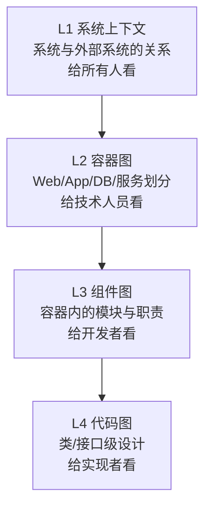
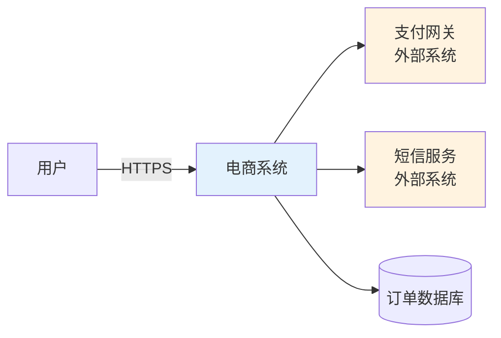
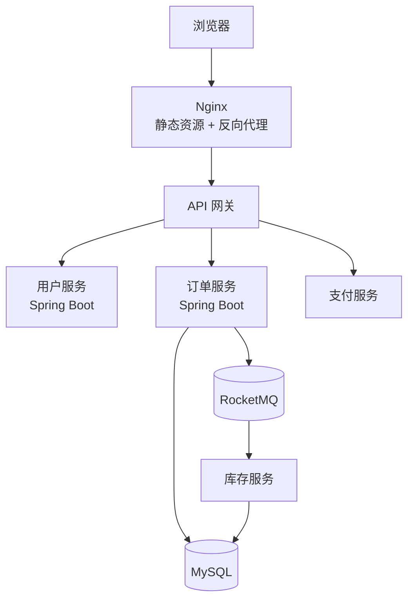
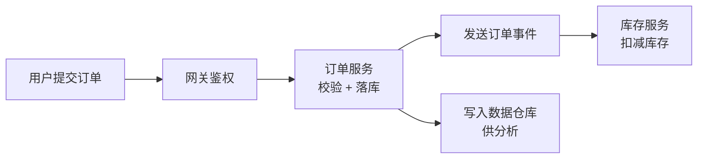
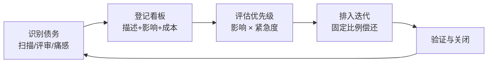

# 架构文档与技术风险

> 定位：架构文档不是「写给别人看的八股」，而是团队对系统达成共识、管理复杂性、传承决策理由的工具。这一篇讲清 C4 模型、Mermaid 画架构图、ADR 决策记录、技术债看板与 ArchUnit 架构守护，让你的架构「看得见、讲得清、守得住」。

## 一、为什么需要它

- 新人入职，问「这个系统整体是怎么设计的」，老人只能对着代码现讲，讲一遍忘一遍。
- 一个关键决策（「为什么用消息队列而不是直接调用」）半年后没人记得，新人觉得设计不合理想推翻，结果踩进当年的坑。
- 系统越改越乱，模块之间互相调用、层级混乱，却没人及时发现，直到重构时才发现积重难返。
- 架构评审会上，大家对着口头描述讨论，每个人脑子里的图都不一样，鸡同鸭讲。

这些问题的本质是**架构是隐性的、口口相传的，没有被显式记录和守护**。架构文档的价值在于：

1. **对齐认知**：让团队对系统有一致的理解。
2. **传承决策**：记录「为什么这么设计」，避免重复踩坑。
3. **管理风险**：把技术债、风险显式化、可追踪。
4. **守护边界**：用工具防止架构腐化。

## 二、核心原理：C4 模型与架构可视化

架构文档的核心难题是「该画到什么粒度」。画得太粗（一个方框写「系统」）没用，太细（画到每个类）记不住。**C4 模型**提供了四个递进的抽象层级，恰好解决这个问题。



| 层级 | 视角 | 受众 | 关注点 |
|---|---|---|---|
| L1 上下文 | 系统作为整体，与用户和外部系统的交互 | 所有人（含非技术） | 系统边界、外部依赖 |
| L2 容器 | 系统拆成哪些「容器」（应用、服务、DB、队列） | 开发、运维、架构 | 技术选型、部署单元 |
| L3 组件 | 某个容器内部的主要模块 | 开发者 | 职责划分、模块协作 |
| L4 代码 | 类、接口、方法级 | 具体实现者 | 设计细节 |

**实践建议**：不要一上来就画全四层。大多数团队把 **L1 和 L2 画清楚**就能解决 80% 的沟通问题；L3 按需画核心模块，L4 一般交给代码本身（代码即文档）。

### 2.1 用 Mermaid 画架构图

Mermaid 用代码生成图，优点是**可版本控制、可 diff、改图像改代码**，避免了「图片过期、没人维护」的问题。

L1 系统上下文图示例：



这张图一眼说明：电商系统有哪些外部依赖（支付、短信）、数据存哪里。非技术人员也看得懂。

L2 容器图示例：



L2 图回答了「系统由哪些服务组成、怎么通信、数据落在哪」，是技术人员最常用的一张图。

### 2.2 数据流图（DFD）

架构图描述「静态结构」，数据流图描述「数据怎么流动」。画清数据从哪来、经过哪些处理、落到哪里，对理解业务链路和排查数据问题特别有用，也是安全建模（如识别敏感数据流经路径）的基础。



关键要素：数据源/终点、处理过程、数据存储、数据流。画的时候标注清楚敏感数据（如手机号、支付信息）流经哪些节点，便于做安全与合规审查。

### 2.3 ADR：架构决策记录

架构图记录「是什么」，**ADR（Architecture Decision Record）** 记录「为什么」。每个重要决策写一份短文档，包含：

- **标题**：决策编号 + 名称（如 `ADR-001 使用 RocketMQ 作为订单事件总线`）。
- **状态**：提议 / 已接受 / 已废弃 / 被替代。
- **背景**：当时面临的问题和约束。
- **决策**：选择了什么方案。
- **理由**：为什么选它，考虑过哪些备选。
- **后果**：正面和负面影响（包括引入的新问题）。

```markdown
# ADR-001：订单事件使用 RocketMQ

- 状态：已接受
- 背景：订单创建后需通知库存、积分等多个下游，直接调用导致强耦合与可用性问题。
- 决策：引入 RocketMQ 做事件总线，订单服务发布事件，下游订阅。
- 理由：相比 Kafka 更轻量、事务消息支持本地事务一致性；团队有运维经验。
- 备选：Kafka（功能强但运维复杂）、直接 RPC（耦合高，否决）。
- 后果：解耦，但引入最终一致性与消息堆积监控的运维成本；需保证消费幂等。
```

ADR 的价值在于**半年后新人能看懂「当时为什么这么定」，不会轻率推翻**。它是轻量、高性价比的架构治理实践，建议每个团队都用。

### 2.4 风险清单与技术债看板

架构文档还要管理「已知的不好」。两个工具：

- **风险清单（Risk Register）**：记录可能影响目标的风险——技术风险（如「单点故障」）、外部风险（如「依赖的第三方服务不稳定」）。每项含：描述、影响、概率、应对方案、负责人。
- **技术债看板**：把技术债可视化，像任务一样管理。每项含：债务描述、影响模块、偿还成本、优先级、状态（待处理/处理中/已偿还）。



关键是让技术债**可见、可量化、可追踪**，而不是停留在「大家都知道但没人管」的状态。

### 2.5 架构守护：ArchUnit

文档会过期，代码会腐化。怎么防止「分层被破坏、约定被违反」？**ArchUnit** 用测试代码来守护架构规则——把架构约束写成单元测试，在 CI 里持续检查。

```java
// 约束：Service 层不能依赖 Controller 层
@AnalyzeClasses(packages = "com.example")
class ArchitectureTest {
    @ArchTest
    static final ArchRule layer_rule =
        noClasses().that().resideInAPackage("..service..")
            .should().dependOnClassesThat().resideInAPackage("..controller..");

    @ArchTest
    static final ArchRule no_field_injection =
        noClasses().should().accessFieldWhere(...);  // 示例：禁止字段注入
}
```

价值：架构规则从「文档里的约定」变成「CI 里会失败的测试」，任何违反都会让构建变红，从根源上防止架构腐化。常见守护规则：分层依赖方向、包循环依赖、命名规范、禁止某层直接使用某技术。

### 2.6 知识沉淀与团队交接

架构文档的终极目标是**知识沉淀**，让知识不随人员流动而流失。

- **单一信息源**：文档集中存放（Wiki / 仓库 docs 目录），避免散落在个人笔记和聊天记录里。
- **文档即代码**：Markdown + Git 管理，和代码一起 review、一起版本化。
- **轻量化**：不追求大而全，优先写「高价值、易过期」的部分（决策、约束、图），细节交给代码。
- **交接机制**：新人通过 L1/L2 图 + ADR 快速建立全局认知，用 checklist 确认关键知识点已传递。

## 三、关键机制与参数

| 工具/方法 | 解决什么 | 落地要点 |
|---|---|---|
| C4 模型 | 文档该画多细 | 优先画 L1/L2，L3 按需，L4 交给代码 |
| Mermaid | 图的可维护性 | 用代码画图，纳入版本控制 |
| ADR | 记录决策「为什么」 | 一决策一文档，状态可追踪 |
| 风险清单 | 显式管理风险 | 定期 review，有负责人 |
| 技术债看板 | 债务可视化 | 量化+排期，固定比例偿还 |
| ArchUnit | 防止架构腐化 | 规则写成测试，CI 卡点 |

一个务实的文档清单（团队最小集）：

1. 一张 L1 上下文图 + 一张 L2 容器图。
2. 一份核心技术选型的 ADR。
3. 一份风险与技术债看板。
4. 一组 ArchUnit 守护测试。

## 四、生产坑点与排查

### 坑点 1：架构文档写完就过期，变成「没人信的摆设」

**现象**：Wiki 里的架构图是两年前画的，和现在系统完全不符，没人看也没人维护。
**原因**：文档与代码脱节，改了代码不更新图；文档太重，维护成本高。
**解法**：
- 用 Mermaid 把图写进代码仓库，随代码一起 review 更新。
- 文档轻量化，只保留高价值、相对稳定的内容；细节不写死，避免频繁失效。
- 把「更新架构文档」纳入架构改动的完成标准（DoD）。

### 坑点 2：架构约定没人遵守，分层逐渐腐化

**现象**：代码里 Controller 直接调 Repository，Service 之间循环依赖，越改越乱。
**原因**：约定只在文档里，靠人自觉，没有强制手段。
**解法**：用 ArchUnit 把关键分层规则写成测试，CI 中卡点，违反即构建失败；定期 review 规则是否需要调整。

### 坑点 3：关键决策没有记录，新人反复推翻

**现象**：新人觉得某设计「不合理」，推翻后线上出问题，老人说「当初就是这么踩过坑才改的」。
**原因**：决策理由只存在于当时讨论者的记忆里，没有 ADR。
**解法**：重要决策强制写 ADR，记录背景、备选、理由、后果；推翻决策前先读历史 ADR，理解当时的约束。

### 坑点 4：技术债没人认领，越积越多

**现象**：大家知道代码有问题，但都忙于业务，债越欠越多直到系统难以维护。
**原因**：技术债隐形、没排期、没人负责。
**解法**：建技术债看板可视化；每个迭代固定比例（如 20%）时间偿还；按「影响 × 紧急度」排序，明确负责人。

## 五、调优 / 选型 / 最佳实践

1. **文档**：C4 分层，优先 L1/L2，Mermaid 画图纳入版本控制，轻量化高价值。
2. **决策**：重要决策写 ADR，记录「为什么」，可追溯、可演进。
3. **风险**：风险清单 + 技术债看板显式管理，量化排期。
4. **守护**：ArchUnit 把架构规则变成 CI 测试，防腐化。
5. **传承**：文档即代码、单一信息源、交接 checklist，知识不随人走。
6. **持续**：文档随代码更新纳入 DoD，定期 review 有效性。

最后强调一个心态问题：架构文档和技术风险管理，最怕的是「要么不写，要么写成百科全书」。前者让团队没有共同语言，后者让文档成为没人维护的负担。真正有效的是「刚刚好」的文档——**能回答『系统长什么样、为什么这么设计、有哪些已知风险』这三个问题，就够了**。每次架构评审或重大改动后花半小时更新几张图、补一份 ADR，长期坚持的收益远超一次性写一份几百页然后束之高阁的文档。把它当成团队日常工程习惯的一部分，而不是额外的行政任务，这件事才能持续做下去。

## 六、面试高频问法

> 这一节按「能讲透」的标准写：每题先给一句能直接背的结论，再展开机制、对比与生产坑。建议先自己答一遍，再对照补全。

**Q1：为什么需要架构文档？它的价值是什么？**

**一句话结论**：架构文档不是"写给别人看的八股"，而是团队对齐认知、传承决策、管理风险、守护边界的工具，让架构从隐性、口口相传变成显式、可治理。

展开四个价值：

1. **对齐认知**：让团队对系统有一致的理解——否则架构评审时每个人脑子里的图都不一样，鸡同鸭讲。
2. **传承决策**：记录"为什么这么设计"，避免半年后新人觉得不合理想推翻，结果踩进当年的坑。
3. **管理风险**：把技术债、风险显式化、可追踪。
4. **守护边界**：用工具防止架构腐化（如 ArchUnit）。

典型痛点：新人问"系统整体怎么设计的"，老人只能对着代码现讲，讲一遍忘一遍；关键决策的理由只存在于当时讨论者的记忆里。

加分点：把架构文档的价值归结为"管理复杂性"——软件工程的核心难题就是复杂性，而文档和可视化是让隐性知识显性化、降低认知负载的手段。能上升到这个高度，说明你理解文档不是行政任务而是工程必需。

**Q2：什么是 C4 模型？四个层次分别是什么？**

**一句话结论**：C4 是四个递进的抽象层级——L1 系统上下文、L2 容器、L3 组件、L4 代码，由粗到细面向不同受众；实践中优先画清 L1/L2 就能解决 80% 的沟通问题。

展开四层：

| 层级 | 视角 | 受众 | 关注点 |
|---|---|---|---|
| L1 上下文 | 系统整体与外部系统/用户的交互 | 所有人（含非技术） | 系统边界、外部依赖 |
| L2 容器 | 系统拆成哪些应用/服务/DB/队列 | 开发、运维、架构 | 技术选型、部署单元 |
| L3 组件 | 某个容器内部的主要模块 | 开发者 | 职责划分、模块协作 |
| L4 代码 | 类、接口、方法级 | 具体实现者 | 设计细节 |

**实践建议**：不要一上来画全四层。L1/L2 画清楚解决大部分沟通；L3 按需画核心模块；L4 一般交给代码本身（代码即文档）。

加分点：强调"画到什么粒度"是架构文档的核心难题——太粗（一个方框写"系统"）没用，太细（画到每个类）记不住还难维护。C4 的价值就是提供了这个"分辨率阶梯"，让不同受众各取所需。

**Q3：为什么用 Mermaid 画架构图？**

**一句话结论**：Mermaid 用代码生成图，可版本控制、可 diff、改图像改代码，避免了"图片过期、没人维护"的问题。

展开：

- **传统图片的痛点**：用 Visio/draw.io 画的图是二进制文件，无法 diff、无法 code review，代码改了图没更新，很快变成"没人信的摆设"。
- **Mermaid 的优势**：图用文本描述（如 `flowchart TB` + 节点定义），存进 Markdown 纳入 Git；改代码时同一个 PR 里改图，随代码一起 review；有变更历史可追溯。
- **典型场景**：L1 上下文图、L2 容器图、数据流图都能用 Mermaid 表达，非技术人员也看得懂。

加分点：把 Mermaid 的价值归结为"**文档即代码**"实践的一部分——图和配置、代码一样纳入版本控制，才能保持不过期。再补一句"文档轻量化，只保留高价值、相对稳定的内容；细节不写死，避免频繁失效"，体现对文档维护成本的清醒认识。

**Q4：数据流图（DFD）和架构图有什么区别？有什么用？**

**一句话结论**：架构图描述"静态结构"（系统由什么组成），数据流图描述"数据怎么流动"（从哪来、经过哪些处理、落到哪里）；后者对理解业务链路和安全建模特别有用。

展开：

- **DFD 四要素**：数据源/终点、处理过程、数据存储、数据流。
- **用途**：
  - 理解业务链路：数据从哪来、经过哪些服务处理、最终落到哪；
  - 排查数据问题：定位数据在哪一环丢失或出错；
  - 安全建模：标注敏感数据（手机号、支付信息）流经哪些节点，便于合规与威胁建模。

加分点：能点出 DFD 在安全领域的价值——"识别敏感数据的流经路径是做数据合规（如个人信息保护）和威胁建模的基础"。把架构可视化和安全治理联系起来，体现知识的融会贯通。

**Q5：什么是 ADR？写它有什么用？包含哪些内容？**

**一句话结论**：ADR（架构决策记录）记录"为什么这么设计"——包含标题、状态、背景、决策、理由、后果；让半年后的新人能理解决策、避免轻率推翻、传承经验。

展开一份 ADR 的结构：

- **标题**：决策编号 + 名称，如 `ADR-001 使用 RocketMQ 作为订单事件总线`。
- **状态**：提议 / 已接受 / 已废弃 / 被替代。
- **背景**：当时面临的问题和约束。
- **决策**：选择了什么方案。
- **理由**：为什么选它，考虑过哪些备选。
- **后果**：正面和负面影响（包括引入的新问题）。

示例要点："相比 Kafka 更轻量、事务消息支持本地事务一致性；备选 Kafka（运维复杂）、直接 RPC（耦合高，否决）；后果是解耦但引入最终一致性和消费幂等的成本。"

加分点：强调"**后果**"这一项最容易被忽略但最有价值——它诚实记录了决策的代价和新引入的问题，让后来者知道"这个方案不是银弹，它的成本是什么"。能认识到"每个架构决策都是取舍"是成熟架构师的标志。

**Q6：风险清单和技术债看板分别管什么？**

**一句话结论**：风险清单管理"可能影响目标的不确定事件"（技术风险、外部风险），技术债看板管理"已知的不好"（债务可视化、量化排期）；两者都让隐性问题显式化、可追踪。

展开：

- **风险清单（Risk Register）**：记录技术风险（如单点故障）、外部风险（如第三方服务不稳定）。每项含：描述、影响、概率、应对方案、负责人；定期 review。
- **技术债看板**：把技术债像任务一样管理。每项含：债务描述、影响模块、偿还成本、优先级、状态（待处理/处理中/已偿还）。
- **闭环流程**：识别债务（扫描/评审/痛感）→ 登记看板 → 评估优先级（影响 × 紧急度）→ 排入迭代（固定比例偿还）→ 验证关闭。

加分点：强调"关键是让技术债**可见、可量化、可追踪**，而不是停留在'大家都知道但没人管'的状态"。再补"每个迭代固定比例（如 20%）时间偿还"这个具体做法，体现治理的可操作性而非口号。

**Q7：ArchUnit 如何解决架构腐化？**

**一句话结论**：ArchUnit 把架构约束（分层依赖方向、禁循环依赖等）写成单元测试，在 CI 中执行，违反即构建失败；让约定从"文档里的文字"变成"会失败的测试"。

展开：

```java
@AnalyzeClasses(packages = "com.example")
class ArchitectureTest {
    @ArchTest
    static final ArchRule layer_rule =
        noClasses().that().resideInAPackage("..service..")
            .should().dependOnClassesThat().resideInAPackage("..controller..");
}
```

- **价值**：文档会过期、人会忘记，但测试不会——任何违反架构规则的代码改动都会让 CI 变红，从根源上防止腐化。
- **常见守护规则**：分层依赖方向、包循环依赖、命名规范、禁止某层直接使用某技术（如 Controller 不能直接访问 Repository）。

加分点：点出 ArchUnit 和 Code Review 的分工——"能自动化的规则（分层依赖）交给 ArchUnit，需要人的判断的设计问题交给架构评审"。这是 Q6（规范可执行性）思想在架构层的延续，体现一致的治理思路。

**Q8：架构文档写完就过期，变成没人信的摆设，怎么办？**

**一句话结论**：文档即代码（Markdown + Git）、Mermaid 画图随代码 review 更新、轻量化只保留高价值内容、把更新文档纳入架构改动的完成标准（DoD）。

展开根因与解法：

- **根因**：文档与代码脱节，改了代码不更新图；文档太重、维护成本高。
- **解法**：
  - 用 Mermaid 把图写进代码仓库，随代码一起 review 更新；
  - 轻量化，只保留高价值、相对稳定的内容，细节不写死；
  - 把"更新架构文档"纳入架构改动的 DoD（Definition of Done）——改了架构必须同步更新文档才算完成。

加分点：强调"文档过期的根本原因是维护成本高于收益"。所以解法不是"要求大家勤更新"（靠自觉不可靠），而是**降低维护成本**（文档即代码、轻量化）+ **纳入流程强制**（DoD）。从机制而非态度上解决问题，是成熟工程观的体现。

**Q9：关键决策没记录、架构约定没人遵守，分别怎么办？**

**一句话结论**：前者靠重要决策强制写 ADR、推翻前先读历史；后者靠 ArchUnit 把规则写成 CI 测试，违反即失败。

两个生产坑：

1. **决策没记录，新人反复推翻**：新人觉得某设计"不合理"，推翻后线上出问题，老人说"当初就是这么踩过坑才改的"。根因是决策理由只在记忆里。解法：重要决策强制写 ADR，记录背景、备选、理由、后果；推翻决策前先读历史 ADR。
2. **约定没人遵守，分层腐化**：Controller 直接调 Repository、Service 循环依赖，越改越乱。根因是约定只在文档里靠自觉。解法：用 ArchUnit 把关键规则写成测试，CI 卡点，违反即失败；定期 review 规则是否需调整。

加分点：把两个坑统一到一个原则——"**靠人自觉的东西终将失效，必须转化为可执行的机制**"。ADR 把决策变成可查阅的记录，ArchUnit 把约定变成会失败的测试。这个提炼让答案从"两个零散技巧"上升为"一套治理哲学"。

**Q10：架构文档如何做知识沉淀和团队交接？**

**一句话结论**：单一信息源 + 文档即代码 + 轻量化 + 交接 checklist，让知识不随人员流动而流失。

展开：

- **单一信息源**：文档集中存放（Wiki / 仓库 docs 目录），避免散落在个人笔记和聊天记录里。
- **文档即代码**：Markdown + Git 管理，和代码一起 review、一起版本化。
- **轻量化**：不追求大而全，优先写"高价值、易过期"的部分（决策、约束、图），细节交给代码。
- **交接机制**：新人通过 L1/L2 图 + ADR 快速建立全局认知，用 checklist 确认关键知识点已传递。

加分点：点出"知识沉淀的终极目标是让团队能力不依赖个人"——人员会流动，但沉淀下来的文档、ADR、守护测试会成为组织资产。这就是从"写代码的人"走向"对系统负责的人"的关键转变。

**Q11：架构文档该写多少？"刚刚好"的标准是什么？**

**一句话结论**：能回答"系统长什么样、为什么这么设计、有哪些已知风险"这三个问题就够；最小文档集是 L1+L2 图、核心选型 ADR、风险/技术债看板、一组 ArchUnit 测试。

展开一个务实的最小文档集：

1. 一张 L1 上下文图 + 一张 L2 容器图（系统长什么样）。
2. 一份核心技术选型的 ADR（为什么这么设计）。
3. 一份风险与技术债看板（有哪些已知风险）。
4. 一组 ArchUnit 守护测试（约束如何被守住）。

加分点：能点出两个极端的危害——"要么不写，团队没有共同语言；要么写成百科全书，文档成为没人维护的负担"。真正有效的是"刚刚好"的文档。再补一句"每次架构评审或重大改动后花半小时更新几张图、补一份 ADR，长期坚持的收益远超一次性写几百页然后束之高阁"——体现持续改进、轻量迭代的工程习惯。

## 小结

- C4 模型四层抽象，优先画清 L1 上下文和 L2 容器图，Mermaid 让图可版本化、不过期。
- ADR 记录决策的「为什么」，让后人理解设计、避免重复踩坑。
- 风险清单 + 技术债看板把「隐性问题」显式化、可追踪、可排期。
- ArchUnit 把架构规则变成 CI 测试，防止分层腐化，约定不再靠自觉。
- 文档即代码、单一信息源、交接 checklist，让知识沉淀为团队资产而非个人记忆。
