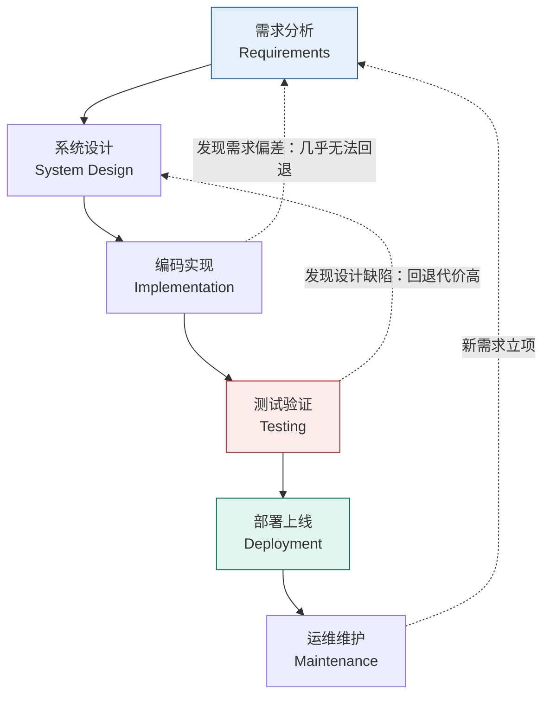
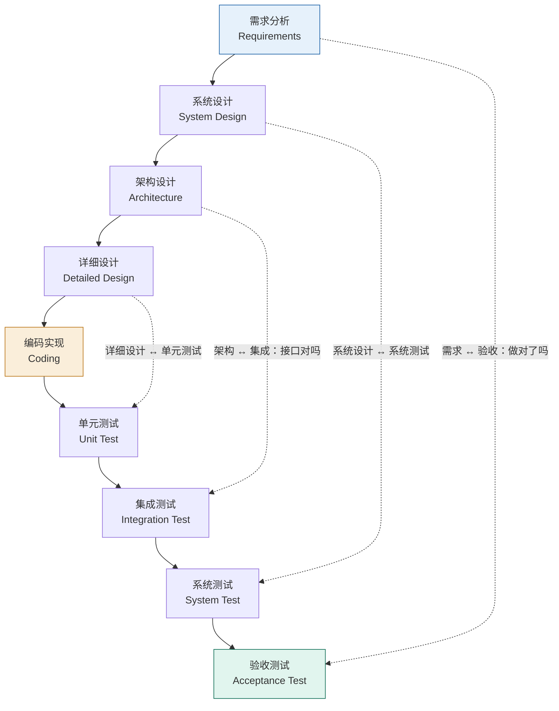
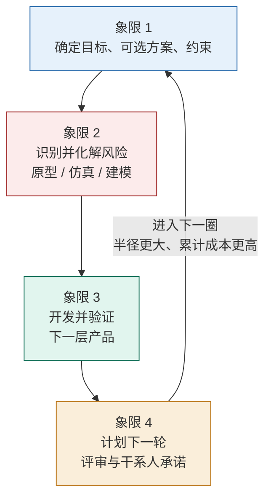
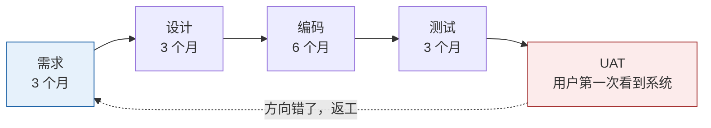
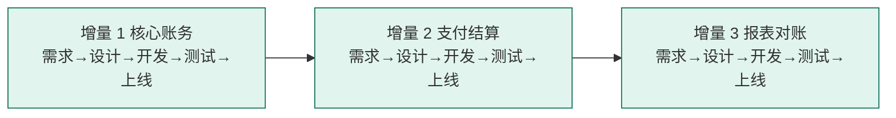
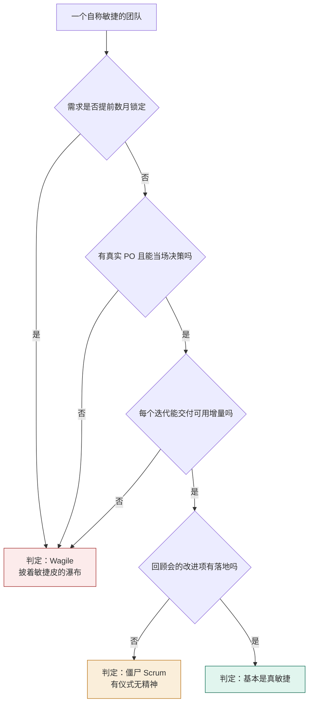

# 瀑布与重型流程

> 定位：上一篇建立了方法论全景，这一篇专门拆「预测型」这一支。互联网出身的工程师常把瀑布等同于「落后、僵化」，这会带来两个后果：进不了银行、医疗、军工、汽车电子的项目；也看不出自己团队其实是「披着敏捷皮的瀑布」。这篇讲清瀑布为什么失败、V 模型与螺旋各自解决什么、以及重型流程为什么在特定行业至今不可替代。

## 一、为什么今天还要讲瀑布

某城商行核心系统改造的启动会，甲方科技部、乙方外包、监理方三方到场，合同九位数，工期 18 个月。乙方项目经理第一页 PPT 就是瀑布图：需求 3 个月、概要设计 3 个月、详细设计 2 个月、编码 6 个月、测试 3 个月、上线 1 个月。会议室里没人觉得奇怪——在这个场景里，瀑布不是「落后的方法论」，而是**合同、审计、监管三方共同要求的工作方式**：合同按里程碑付款，每个里程碑要交付物签字；监理要按阶段出报告；监管要问「这条需求的设计文档在哪、测试用例在哪、谁签的字」。只会敏捷的人，在这里一句话都插不上。

再看另一个场景。某电商团队两周一个 Sprint，站会、评审、回顾一个不落。但需求是年初定好的年度规划，拆成 26 个 Sprint 排期；每个 Sprint 必须交付全部计划功能，交不出就加班；迭代中不许插需求，新需求「排到下季度」。这不是敏捷，是**把瀑布切成了 26 段**，业内叫 Wagile 或僵尸 Scrum。

两个场景说明：不懂瀑布，你在两类项目上都会失手——一类是必须用瀑布的，一类是假装不用瀑布的。所以这篇有三个目标：讲清三个模型的真实定义与历史；讲清瀑布的失败机理；给一套识别伪敏捷的检查表。

## 二、瀑布模型：一个被误读五十年的模型

### 2.1 先纠正历史

几乎所有人都被告知：瀑布是 Winston Royce 在 1970 年论文《Managing the Development of Large Software Systems》里提出的经典模型。这只对了一半。

Royce 确实画了那个「逐级下落」的流程图，但他在**同一篇论文的第二页**就明确说：纯线性流程是 **"risky and invites failure"**（有风险，注定导致失败）。理由是：只走一遍的流程，会在测试阶段第一次集成各部件，此时接口问题集中爆发，项目遭受「百分之百的返工冲击」。因此他给出改进版——每个阶段向下走时**带反馈回路**，并且主张**先做「做两次」的计划**：第一版当原型交给用户试用，按反馈再做第二版。

> 也就是说，瀑布的原始提出者本人是**反对**纯线性瀑布的。真正被业界大规模采纳的「纯瀑布」，是 1970-80 年代美国国防部软件采购标准（如 DOD-STD-2167）固化下来的，因为线性流程便于按阶段验收和付款。

这个史实在面试里说出来是明显加分点——它证明你读过原文，而不是背二手概念。

### 2.2 六个阶段

图里最关键的不是六个框，而是**两条虚线**。瀑布名义上「线性、不回头」，现实中任何瀑布项目都会回头——只是代价极贵，所以团队宁可带着缺陷往下走。这就是瀑布真正的病灶：**它假设回退罕见，而回退其实是常态，只是被压抑了**。

| 阶段 | 交付物 | 阶段门禁 |
|---|---|---|
| 需求分析 | 需求规格说明书 SRS、追溯矩阵初稿 | 需求评审通过、甲方签字基线化 |
| 系统设计 | 概要设计 HLD、接口文档 | 设计评审通过 |
| 编码实现 | 详细设计 LLD、源码、单测报告 | 代码评审、覆盖率达标 |
| 测试验证 | 测试计划/用例/缺陷报告/测试报告 | 缺陷收敛、准出评审 |
| 部署上线 | 部署方案、回滚方案、上线 checklist | 上线评审 CAB |
| 运维维护 | 运维手册、变更记录 | 无（持续） |

### 2.3 瀑布真正的三条纪律

很多人以为瀑布就是「按顺序做」，这是看浅了。瀑布能成为重型流程的代表，靠的是三条纪律，缺一条就退化成「没有流程」：

**阶段门禁（Phase Gate）**：每个阶段结束必须过正式评审，评审有**否决权**。价值是强制暴露问题，代价是容易走过场——大部分失败的瀑布项目，都是评审开 40 分钟就签字走人。

**基线与变更控制（CCB）**：需求评审通过后冻结成基线，之后任何变更提交变更控制委员会评估「工期加多少、成本加多少、影响哪些模块」，批准才执行。保证范围可控，代价是变更周期以周计。

**文档即证据**：每个阶段产出必须落成可归档、可审计的文档。监管要的从来不是「你怎么工作的」，而是**证据**。

> 一句话：瀑布不是「顺序」，是「门禁 + 基线 + 证据」。理解这点，你才知道为什么「敏捷但补文档」在合规行业往往比纯瀑布更贵——三条纪律被拆散了，要额外花力气重新拼。

### 2.4 优缺点

| 维度 | 表现 | 原因 |
|---|---|---|
| 计划性 | 强 | 启动时就能给出较准的范围/工期/成本 |
| 可审计性 | 强 | 每阶段有签字文档，责任链清晰 |
| 合同友好 | 强 | 天然适配固定范围固定价（FFP） |
| 大团队协作 | 较强 | 阶段边界清晰，几百人可按阶段组织 |
| 需求适应性 | 极差 | 变更走 CCB，周期以周计 |
| 反馈速度 | 极差 | 用户到 UAT 才第一次见到能点的系统 |
| 风险暴露 | 极晚 | 集成风险堆到测试阶段集中爆发 |
| 价值交付 | 极晚 | 上线才产生价值，前期全是成本 |

注意：前四行是瀑布的真优势，后四行是真劣势，**不在同一维度**。瀑布用「可控性」换「适应性」，是明确的 trade-off，不是单纯的「落后」。

## 三、V 模型：把测试左移二十年的对称结构

### 3.1 它是什么

V 模型常被说成「瀑布的变种」，不够准确。更准确的定位是：**瀑布 + 测试的对称映射**。

它有两支源流：德国支是 1992 年德国联邦国防部发布的 V-Modell（国防采购标准，后演进为 V-Modell XT）；美国支是 NASA 等机构使用的 VEE 模型，强调「分解—集成」的对称性。共同点是：**左侧分解，右侧集成，水平轴是时间，垂直轴是抽象层次**。

从上往下走完左半边，再从下往上走完右半边，轨迹是一个 V 字。四条虚线是灵魂：**每个开发阶段对应一个测试阶段**。

| 左侧开发阶段 | 右侧测试阶段 | 验证的问题 | 视角 |
|---|---|---|---|
| 需求分析 | 验收测试 | 做的是用户要的东西吗 | 用户/业务 |
| 系统设计 | 系统测试 | 整个系统满足规格吗 | 系统 |
| 架构设计 | 集成测试 | 模块之间的接口对吗 | 组件边界 |
| 详细设计 | 单元测试 | 每个单元的行为对吗 | 代码 |

### 3.2 真正的贡献：测试计划前置

V 模型最有价值的一句话是：**测试计划不是编码完成后写的，是在左侧对应阶段就写好的**。做需求分析时同步写验收用例，做详细设计时同步写单元用例。

这也是一把尺子：**如果一条需求你写不出可验证的验收条件，说明这条需求本身是模糊的**，应该打回去重写。

这就是**测试左移**的思想源头。注意时间线：V 模型在 1990 年代就系统化了这个思想，敏捷社区大规模提「测试左移」要到 2010 年代。所以「只有敏捷讲测试左移」是个误解。

### 3.3 验证与确认

V 模型带出一对必须分清的术语：

| 术语 | 英文提问 | 判断依据 | 例子 |
|---|---|---|---|
| **验证** Verification | Are we building the product **right**? | 是否符合**规格说明** | 规格说超时 3 秒重试，代码确实 3 秒重试 |
| **确认** Validation | Are we building the **right** product? | 是否满足**用户真实需求** | 用户其实要「不要超时」，重试反而放大雪崩 |

记忆方法：**Verification 对着文档，Validation 对着人**。一个系统可以「验证全过、确认全错」——所有代码都符合规格，但规格本身就是错的。这正是瀑布最大的风险来源：规格错了，要到验收甚至上线才发现。

## 四、螺旋模型：把风险当第一驱动力

Barry Boehm 于 1986 年提出（1988 年在 IEEE Computer 正式发表《A Spiral Model of Software Development and Enhancement》）。他也是 COCOMO 成本估算模型的作者，属软件工程经济学派。每一圈包含四个象限：

两个几何量必须讲清：**半径 = 累计成本**，每转一圈投入更多、产品更完整；**角度 = 进度**，转满 360° 完成一圈。所以那张从中心向外扩展的螺旋线，本质是「成本—进度」二维图。

它和迭代开发的区别是核心考点：

| 维度 | 迭代开发 | 螺旋模型 |
|---|---|---|
| 每圈目的 | 交付一个可用增量 | 消除当前最大风险 |
| 是否一定产出可交付软件 | 是 | **不一定**，可能只产原型或调研报告 |
| 驱动力 | 价值优先 | **风险优先** |
| 适用规模 | 中小型 | 大型，Boehm 说通常 >50 人年 |
| 前置条件 | 需求可切分 | 有能做风险评估的专家 |

一句话：**迭代是「为交付而循环」，螺旋是「为降低不确定性而循环」**。螺旋每圈问的第一个问题不是「这轮交付什么功能」，而是「现在最大的风险是什么，这轮怎么打掉」。举例：卫星地面控制系统第一圈不做任何业务功能，只做「轨道计算精度仿真」，因为最大风险是算法精度；第二圈做「遥测吞吐压测原型」；第三圈才做真功能。**先用最便宜的方式验证最贵的假设**。

为什么用得少？需要风险评估专家；管理成本高（每圈重做目标/方案/约束确认）；不适合小项目（3 人月项目用螺旋，管理开销吃掉一半工期）；对甲方不友好（前几圈可能一个功能都没有，很难解释钱花在哪）。所以现实中**思想被广泛借用（风险驱动、原型先行、分轮投入），完整形式只在国防、航天等超大型高风险项目里出现**。

## 五、瀑布为什么会失败：三个「后置」

瀑布的失败不是偶然，是结构性的。

### 5.1 反馈后置

软件需求有很大一部分是**隐性需求——用户说不出来，看到就知道不对**。这不是用户不专业，是认知的固有特性：你无法让用户描述他没见过的交互。他能说「我要一个审批流」，但说不清「节点能不能跳过」「驳回是回上一级还是发起人」「加签要不要通知原审批人」。这些只有看到一个能点的原型，他才会说「不对，这里应该是这样」。

瀑布把「第一次看到系统」安排在项目末期。此时需求已签字、架构已定型、预算花掉 80%，形成死局：**用户不满意，但改不起，只能捏着鼻子验收，上线后靠运维期打补丁**。很多「成功交付」的政企项目就是这个状态——验收通过，用户不用。典型案例如某政务审批系统，14 个月瀑布，第 13 个月 UAT，用户点开第一屏就说「这不是我们要的，我们要的是『一件事一次办』，不是按部门串行」。返工 5 个月，项目从盈利变亏损。根因不是技术，就是**用户在 13 个月后才有机会说这句话**。

### 5.2 风险后置

瀑布把「集成」安排在测试阶段，而集成恰恰是风险最高的环节。一个 20 人团队、10 个模块、6 个月编码期的项目，意味着前 6 个月各自独立开发，第 7 个月第一次拼起来，然后发现：A 模块以为订单状态是枚举、B 模块以为是字符串；接口文档写「返回 list」实际有人返回 null；两个模块对「库存扣减时机」理解相反；字段长度不够，中文名存不下。

这些问题的修复成本，在集成时发现是「改代码 + 改文档 + 重测」，每天集成则是「改一行」。这就是持续集成存在的根本理由——**把集成风险从「一次大爆炸」摊平成「每天的小摩擦」**。瀑布项目最常见的延期原因不是编码慢，而是测试阶段发现的问题比预期多三倍，测试期被压缩，然后带病上线。

### 5.3 价值后置

瀑布项目在最后一个月之前**产生不了任何业务价值**。前 17 个月全是成本，第 18 个月才回本。这意味着：项目第 12 个月被砍，前面投资归零；市场窗口在第 10 个月，项目赶不上，做了也没用；竞品第 8 个月上线类似功能，你的 18 个月方案已过时。敏捷的「每两周交付可用增量」，本质是把价值曲线从「末期陡升」改成「线性上升」——**任何时候被砍，都已经交付了一部分价值**。这是从投资视角看敏捷最大的优势，和技术无关。

### 5.4 成本曲线

| 缺陷发现阶段 | 相对修复成本 | 典型修复动作 |
|---|---|---|
| 需求评审 | 1 | 改一句话 |
| 设计评审 | 3-6 | 改设计文档 + 通知相关方 |
| 编码阶段 | 10 | 改代码 + 改单测 |
| 集成/系统测试 | 15-40 | 改多个模块 + 回归测试 |
| 上线后 | 30-1000 | 紧急发版 + 数据修复 + 客诉 + 声誉 |

这张表解释了为什么「测试左移」是所有方法论的共识：**越早发现问题越便宜**。区别只在于瀑布靠阶段评审左移，敏捷靠短反馈环左移。

## 六、瀑布在强合规行业的不可替代性

### 6.1 到底哪些行业

| 行业 | 主要标准 | 为什么必须重流程 |
|---|---|---|
| 民用航空 | DO-178C、DO-254、ARP4754A | 按 DAL A-E 分级，最高级要求 MC/DC 覆盖率和需求到代码双向追溯 |
| 医疗器械 | IEC 62304、FDA 510(k)/PMA、NMPA 注册 | 软件安全分级 A/B/C，生命周期过程必须文档化可审计 |
| 汽车电子 | ISO 26262、ASPICE、ISO 21434 | ASIL A-D 分级，ASPICE 的过程参考模型本身基于 V 模型 |
| 轨道交通 | EN 50126/50128/50129 | SIL 1-4 安全完整性等级，独立第三方评估 |
| 军工 | GJB 5000A/B、GJB 438B | 军检、定型要求全套技术文件 |
| 核电 | IEC 60880、IEC 61513 | 核安全许可，安全级仪控软件须 V&V |
| 银行核心 | 监管规章、等保 2.0、外部审计 | 没有法规强制瀑布，是审计倒逼重文档 |

最后一行要特别注意：银行核心**没有任何法规规定必须用瀑布**，但银行项目几乎都是瀑布形态。因为审计要问三个问题——这个变更谁提的、谁批的、谁测的、谁上线的（职责分离 SoD）；上线的东西和测的东西是同一个吗（版本一致性）；出问题能不能追溯到具体需求和代码（可追溯性）。纯敏捷团队也能回答，但需要额外工具把 Jira、Git commit、测试用例、发布单打通；而瀑布的**副产品**——评审记录、签字文档、测试报告——天然就是答案。所以银行选瀑布，本质是**选了「合规证据获取成本最低」的那条路**。

### 6.2 核心论点：要的不是瀑布，是可追溯性

> 强合规行业真正需要的不是「瀑布」这个流程形式，而是**可追溯性**和**证据链**。瀑布/V 模型被选中，是因为它们天然产出这条链，而不是因为它们「更科学」。

可追溯性的标准形态是**需求追溯矩阵（RTM）**：

| 需求 ID | 需求 | 设计章节 | 代码提交 | 测试用例 | 结果 | 签字 |
|---|---|---|---|---|---|---|
| REQ-001 | 支持三级审批 | HLD-3.2 | approval@a1b2c3 | TC-101~108 | 通过 | 张工 |
| REQ-002 | 超时自动升级 | HLD-3.4 | approval@d4e5f6 | TC-201~203 | 通过 | 张工 |

监管抽查时随机指一条需求，你要能在 5 分钟内把整行填出来。所以正确的表述是：**瀑布不是被合规「选中」的，是被合规「倒推」出来的**。理解了这点，你才知道怎么改良——不是推翻瀑布，而是**保留证据链，改良交付节奏**。

### 6.3 现实主流解法：增量瀑布

大多数强合规项目实际用的不是纯瀑布，而是**增量瀑布**：

每个增量内部仍是完整瀑布（有门禁、有签字、有 RTM），但整体上每 3-4 个月就有一次上线。这样既满足「每步有证据」，又把反馈周期从 18 个月压到 3 个月。我认为这是在合规约束下的**最优务实解**，也是「敏捷 + 合规」最现实的融合方式。它不纯粹，但有效。

## 七、怎么落地：如果不得不用瀑布

项目已经定了瀑布（合同签了、监理进场了），能做哪些改良？按性价比排序：

1. **原型前置。** 需求阶段就做高保真原型（Figma 或可点击 HTML），拉真实用户点。能把「反馈后置」缓解一大半，成本极低，是瀑布项目里 ROI 最高的一招。
2. **需求基线分两级。** 拆成「必须冻结的核心需求」和「允许编码期微调的弹性清单」。核心走 CCB，弹性由产品与开发负责人双签即可。
3. **测试左移。** 需求阶段写验收用例，设计阶段写集成用例——这就是 V 模型的做法。
4. **编码期坚持每日构建 + 自动化回归。** 瀑布不等于不 CI。很多集成灾难，就是因为编码 6 个月没做过一次全量构建。
5. **拆增量。** 即使合同要求 18 个月交付，内部也要拆成 4-5 个可上线增量，第一个优先做「打通主流程的最小闭环」。
6. **门禁要真做。** 评审只是签字，不如不评审。至少在需求和设计两个门禁上设「必须解决项」，不解决不放行。
7. **建风险登记册。** 列清风险描述、影响、概率、缓解措施、责任人、状态，每两周 review。成本很低，但能把「风险后置」变成「风险可视」。

## 八、常见坑与反模式

### 8.1 伪敏捷识别表

这是本篇最实用的部分。以下 10 个信号，命中 3 个以上基本可判定伪敏捷：

| # | 信号 | 说明什么 |
|---|---|---|
| 1 | 需求年初定死，拆成 26 个 Sprint 排期 | 这是把瀑布切段 |
| 2 | 迭代内不许变更，新需求「排到下季度」 | 「拥抱变化」变成「排队变化」 |
| 3 | 每个 Sprint 必须交付计划内全部功能，交不出问责 | Sprint 变成交付承诺，失去学习属性 |
| 4 | 没有真 PO，PO 只是需求传话筒 | 需求决策权不在团队身边，反馈环断裂 |
| 5 | 回顾会照开，改进项从不落地 | 典型僵尸 Scrum |
| 6 | 用故事点考核个人或团队产出 | 相对估算工具变成 KPI，必然点数通胀 |
| 7 | 一个 Sprint 内部仍走「需求→设计→开发→测试」串行 | 这是迷你瀑布，Sprint 内没有协作 |
| 8 | 演示会变成「给领导汇报」，不是「拿真实用户反馈」 | 反馈环指向了错误的人 |
| 9 | 没有自动化测试和 CI，靠手工回归 | 「可工作软件」无法低成本验证，迭代必然退化为瀑布 |
| 10 | 架构初期一次定死，之后不许改 | 没有演进式架构，敏捷只是表面 |

面试被问「怎么判断团队是不是真敏捷」，直接说三个结构性判据：**需求能不能变、有没有真 PO、迭代能不能交付可用增量**。这三点是结构性的，仪式层面的东西都能伪装。

### 8.2 瀑布的三个经典翻车

**需求镀金（Gold Plating）**：需求阶段为了「显得专业」，把文档写到 300 页，塞进大量用户没提的功能设想。原因是用「写更多」填补「想不清」。解法：每条需求必须有明确验收条件和使用者，写不出使用者的直接删。

**大爆炸集成（Big Bang Integration）**：编码 6 个月，第一次集成 200 个编译错误、50 个接口不匹配。解法：编码第一天就搭 CI，保证「主干永远可编译、可启动」。

**测试期挤压**：计划测试 3 个月，实际只剩 3 周，因为前面每阶段都超期。解法：给测试阶段留 30% 硬缓冲且不允许挪用；必须挪用说明项目已失控，该走变更流程而不是压缩测试。

还有一个隐蔽的坑：**「文档即交付」**。团队把「文档写完」等同于「工作完成」——详细设计 200 页、代码质量一塌糊涂；测试报告全绿、线上天天故障。根因是瀑布的考核锚点是交付物，而交付物是文档；当文档成为目标，代码质量就失去度量。解法是在瀑布框架内也引入代码质量门禁（静态扫描、覆盖率、评审通过率）。**文档是证据，不是成果；能跑的代码才是成果。**

## 九、适用场景与选型

| 维度 | 倾向瀑布 | 倾向敏捷 |
|---|---|---|
| 需求稳定性 | 可提前完整定义且不会变 | 需探索、持续演进 |
| 合规强度 | 有第三方审计/认证/定型 | 相对宽松 |
| 客户参与度 | 低，只在里程碑出现 | 高，能每周参与并决策 |
| 合同类型 | 固定范围固定价 FFP | 时间材料 T&M 或按价值付费 |
| 系统耦合 | 软硬件强耦合，改硬件极贵 | 纯软件、可独立部署 |
| 项目风险 | 极高，失败后果严重 | 常规 |

三种混合模式：

| 模式 | 结构 | 典型场景 | 代价 |
|---|---|---|---|
| 增量瀑布 | 整体分 3-5 个增量，每个内部走完整瀑布 | 银行核心、大型政企 | 增量间接口要提前设计 |
| 敏捷 + 瀑布门禁 | 迭代开发，里程碑处补合规工件 | 医疗软件、汽车电子 | 工件是「补」的，容易失真 |
| V 模型 + 迭代 | 左侧迭代澄清需求，右侧严格按 V 对应测试 | 嵌入式、安全关键 | 需要成熟系统工程能力 |

反向思考——这几种情况用敏捷是自找麻烦：需求由外部标准定义（做符合国标的接口，没有探索空间）；一次性交付无后续迭代（数据迁移工具）；客户「不可对话」（To G 项目需求由招标文件锁定）；团队几百人跨多供应商；失败后果不可承受（医疗设备宁可慢不能错）。

**务实建议**：不要追求纯粹。现实中 90% 的项目是混合的，能交付、能合规、团队不崩溃，就是好方法论。

## 十、面试高频问法

**Q1：瀑布有哪几个阶段？核心问题是什么？**

**一句话结论**：六阶段——需求分析、系统设计、编码实现、测试验证、部署上线、运维维护；核心问题是「反馈后置、风险后置、价值后置」。

展开：阶段名谁都会背，关键要说出它不是简单顺序，而是「门禁 + 基线 + 证据」三条纪律。三个后置分别展开：用户到 UAT 才第一次见到系统；集成风险堆到测试集中爆发；上线前不产生业务价值。

加分点：补一句「Royce 1970 年原始论文其实反对纯线性瀑布，他主张带反馈回路和做两版」，立刻区分「读过原文」和「背概念」。

**Q2：瀑布为什么容易失败？**

**一句话结论**：因为它假设「需求能一次问清、回退罕见、集成一次性」，而现实是三点全部相反。

展开：从隐性需求讲起——用户看到才知道不要，所以需求必然变；瀑布把变更挡在 CCB 后，变更不会消失，只会变成验收时的扯皮；集成风险推迟到末期一次爆发；价值曲线末期陡升，中途被砍就归零。

加分点：给出 Boehm 成本曲线量级（需求 1、上线后 30-1000），说明「这就是测试左移的经济学依据」。

**Q3：V 模型和瀑布有什么区别？**

**一句话结论**：V 模型是「瀑布 + 测试的对称映射」，左侧每个开发阶段对应右侧一个测试阶段，核心贡献是测试计划在左侧就写好。

展开：画 V 字，说出四组对应（需求↔验收、系统设计↔系统测试、架构↔集成、详细设计↔单元测试）。强调它不是新流程，而是给瀑布补上验证维度。

加分点：说清现实来源是德国 V-Modell（1992 国防采购）和 NASA 的 VEE 模型；再补「测试左移的思想源头在 V 模型，比敏捷社区早二十年」。

**Q4：验证和确认有什么区别？**

**一句话结论**：验证是「是否正确地构建了产品」（符合规格），确认是「是否构建了正确的产品」（满足真实需求）。

展开：Verification 对着文档，Validation 对着人。举例：规格说超时重试 3 次，代码确实重试——验证通过；但用户要的是「不要超时」，重试放大雪崩——确认失败。系统可以验证全过、确认全错。

加分点：指出这正是瀑布最大风险——规格本身错了，要到验收甚至上线才发现；也是 V 模型左右两侧分别对应 V&V 的原因。

**Q5：螺旋模型的核心思想？为什么用得少？**

**一句话结论**：核心是「风险驱动 + 分轮投入」，每圈先化解当前最大风险再决定开发什么；用得少是因为只适合超大型高风险项目，且需要专业风险评估能力。

展开：讲四象限（定目标→风险分析→开发验证→计划下一轮），半径代表累计成本、角度代表进度。强调它与迭代的本质区别：迭代为交付，螺旋为消除不确定性，每圈不一定产出可交付软件。

加分点：说出 Boehm 自己给的适用规模（large-scale，通常 >50 人年），以及「思想被广泛借用、完整形式很少使用」的现实判断。

**Q6：为什么互联网公司基本不用瀑布？**

**一句话结论**：因为互联网需求在探索中、竞争窗口短、架构支持频繁发布——瀑布的三个前提（需求稳定、时间充裕、一次性交付）全部不成立。

展开：需求不稳定（看到才知道要什么，竞品还在变）；时间窗口紧（18 个月交付等于自杀）；架构支持（微服务、CI/CD、灰度让两周交付在技术上可行）。再加一条经济账：互联网是试错经济，做错的成本要低才能多试。

加分点：补一句「不是互联网更先进，是约束条件不同——把互联网的敏捷搬到银行核心，一样出事」。

**Q7：银行、医疗为什么还在用瀑布？**

**一句话结论**：因为它们要的不是瀑布，而是可追溯的证据链；瀑布的副产品（评审记录、签字文档、RTM）正好是合规要的证据，获取成本最低。

展开：列标准——医疗 IEC 62304、汽车 ISO 26262/ASPICE、航空 DO-178C、轨交 EN 50128。说明监管抽查的实际形态：随机指一条需求，5 分钟内拿出「需求→设计→代码→用例→结果→签字人」完整链条。

加分点：指出「银行没有法规强制瀑布，是审计的职责分离和可追溯要求倒逼的」；再给解法「增量瀑布」——保留证据链，把 18 个月反馈周期压到 3-4 个月。

**Q8：什么是伪敏捷？怎么识别？**

**一句话结论**：伪敏捷是「做了敏捷的仪式，没有敏捷的机制」——需求照样提前锁死、迭代照样是交付承诺、反馈照样指向领导而不是用户。

展开：三个结构性判据：需求能不能在迭代中变？有没有能当场决策的真 PO？每个迭代能不能交付真正可用的增量？三个都是「否」就是 Wagile。表象信号：故事点当 KPI、回顾会改进项不落地、Sprint 内部串行走完需求到测试。

加分点：区分「Wagile」（瀑布切段）和「僵尸 Scrum」（有仪式无精神）两种亚型，并说明根因通常是「组织没授权」而不是「团队不会做」。

**Q9：如果让你在强合规项目里引入敏捷，怎么做？**

**一句话结论**：不动证据链，只改交付节奏——用「增量瀑布」或「迭代 + 合规工件自动生成」，把反馈周期压短，同时保证每条需求可追溯。

展开：四步。① 先建 RTM，让需求、设计、代码、用例有唯一 ID 并能自动关联（打通 Jira/Git/测试管理）；② 拆成 3-4 个月的增量，每个增量内部仍走完整门禁；③ 把集中评审改成持续评审 + 里程碑确认；④ 测试用例编写前置到需求阶段。

加分点：强调「合规要的是证据，不是流程形式」——只要能自动产出证据，形式可以变；反之如果证据靠人工补，敏捷收益会被文档成本吃光。

**Q10：增量瀑布是什么？解决了什么问题？**

**一句话结论**：整体拆成多个增量，每个增量内部走完整瀑布，在保留门禁和证据链的同时，把「一次 18 个月交付」变成「每 3-4 个月一次上线」。

展开：每个增量都有自己的需求、设计、开发、测试、上线和签字。它解决了「价值后置」和「反馈后置」，但**没有解决**单个增量内部反馈仍慢的问题——所以第一个增量要选「能打通主流程的最小闭环」。

加分点：指出这是强合规行业最现实的融合方案，比「敏捷 + 补文档」更稳，因为证据是流程自然产出的，不是事后补的；它也是回答「你怎么看『瀑布已死』」的最佳落点——死的只是「把瀑布当默认选项」，作为特定约束下的最优解它活得很好。

## 小结

- 瀑布的真实定义是「门禁 + 基线 + 证据」三条纪律，不是「按顺序做」；Royce 本人反对纯线性瀑布，纯瀑布是采购标准固化的产物。
- 瀑布的失败是结构性的，来自三个后置：反馈后置、风险后置、价值后置。
- V 模型的灵魂是「每个开发阶段对应一个测试阶段」，核心贡献是测试计划前置，并带出 Verification（符合规格）与 Validation（满足需求）这对概念。
- 螺旋模型是风险驱动的迭代，每圈先打掉最大风险，半径代表成本、角度代表进度；适合超大型高风险项目，完整形式少见但思想被广泛借用。
- 强合规行业要的不是瀑布，是可追溯的证据链；瀑布被选中是因为它的副产品正好是证据。
- 现实最优解是增量瀑布：保留门禁与 RTM，把交付拆成 3-4 个月的增量。
- 伪敏捷的三个结构性判据：需求能不能变、有没有真 PO、迭代能不能交付可用增量。
- 方法论没有优劣，只有约束匹配。用瀑布不可耻，不知道为什么用瀑布才可耻。
