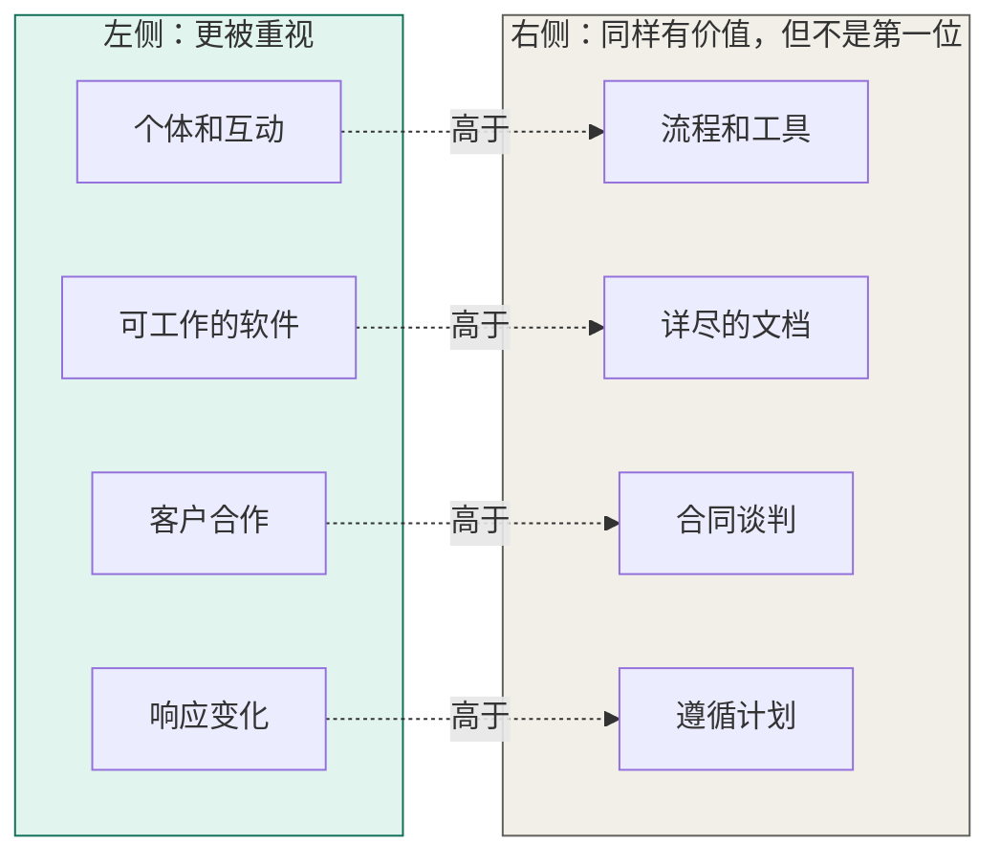
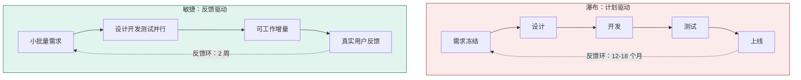
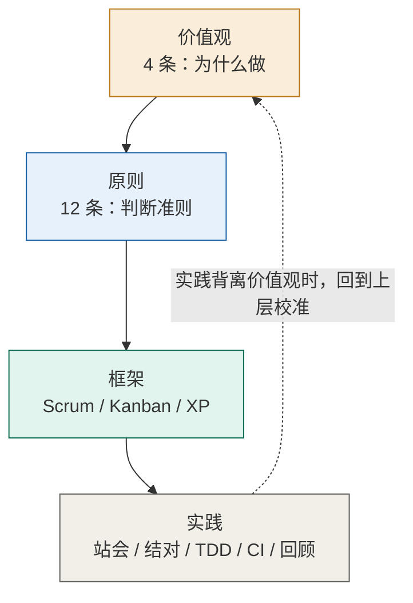
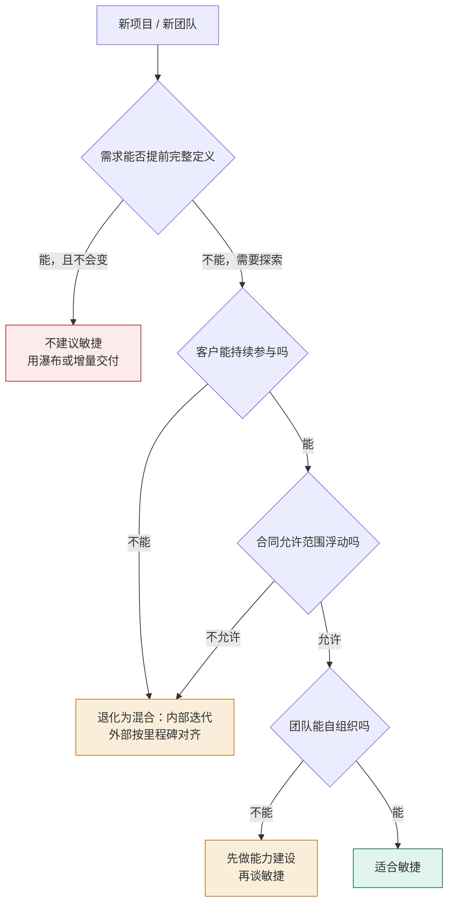

# 敏捷开发核心

> 定位：上一篇讲透了瀑布的失败机理，这一篇讲它的对立面。但「敏捷」是中文技术圈被误用最严重的词之一——它经常被当成「不写文档」「不加班的借口」「快速交付的话术」。这一篇回到 2001 年的原始文本，把四条价值观和十二条原则讲准，然后回答三个真正难的问题：敏捷到底解决什么、它需要什么前提、什么情况下不该用。

## 一、为什么需要敏捷：一次滑雪场里的会议

2001 年 2 月 11 日到 13 日，美国犹他州 Snowbird 滑雪场，17 个人开了一次会。

这 17 个人互相是竞争对手：Kent Beck 代表极限编程（XP），Ken Schwaber 和 Jeff Sutherland 代表 Scrum，Alistair Cockburn 代表 Crystal，Arie van Bennekum 代表 DSDM，还有 Martin Fowler、Robert C. Martin、Ward Cunningham、Ron Jeffries、Dave Thomas 等人。他们各自的方法论在细节上吵得不可开交。

但他们有一个共同敌人：**1990 年代盛行的重型流程**。以 RUP（Rational 统一过程）和 CMM（能力成熟度模型）为代表，那套东西的特征是——厚达几百页的过程文档、十几个角色、几十个工件、严格的阶段划分。它看起来很专业，但在实际项目里经常变成「文档生产流水线」：团队花 60% 的时间写文档、开会、走流程，真正写代码和拿反馈的时间被挤压。

三天的会开完，他们发布了一份不到 200 词的文件：《敏捷软件开发宣言》（Manifesto for Agile Software Development）。17 个人全部签名。

> 这份宣言的历史意义不在于提出了什么新方法，而在于**把「什么更重要」这件事说清楚了**。它没有定义流程、没有规定角色、没有要求任何仪式——它只声明了四条价值排序。Scrum、XP、Kanban 都是在这四条排序之下长出来的具体做法。

理解这一点很重要：**敏捷不是一种方法，是一套价值观**。你可以用 Scrum 但不敏捷，也可以用最土的方式却很敏捷。

## 二、四条价值观：原文比译文重要

### 2.1 原文

> We are uncovering better ways of developing software by doing it and helping others do it. Through this work we have come to value:
>
> **Individuals and interactions** over processes and tools
> **Working software** over comprehensive documentation
> **Customer collaboration** over contract negotiation
> **Responding to change** over following a plan
>
> That is, while there is value in the items on the right, we value the items on the left more.

中文通常译作：

> 我们正在通过亲身实践以及帮助他人实践，揭示更好的软件开发方法。通过这项工作，我们认为：
>
> **个体和互动** 高于 流程和工具
> **可工作的软件** 高于 详尽的文档
> **客户合作** 高于 合同谈判
> **响应变化** 高于 遵循计划
>
> 也就是说，尽管右项有其价值，我们更重视左项的价值。

### 2.2 最后一句是灵魂，也是最常被漏掉的一句

**"while there is value in the items on the right, we value the items on the left more."**

这句话说了两件事：

1. 右边的东西**有价值**——流程、工具、文档、合同、计划，一样都不能少。
2. 但左边的**更被重视**——当两者冲突时，优先左边。

所以「敏捷 = 不要文档」是对原文的直接篡改。原文说的是 "comprehensive documentation"（**详尽的**文档）不是 "documentation"（文档）。关键词是 comprehensive。

同理，「敏捷 = 不要计划」也是误读。原文说的是 "following a plan"（**遵循**计划），不是 "planning"（做计划）。敏捷反对的是「计划错了还硬走」，不是「不做计划」。

这张图要看的不是「左边对、右边错」，而是**箭头的方向**：右边是被保留的底座，左边是在冲突时的优先级。把「高于」读成「取代」，是所有伪敏捷的理论起点。

### 2.3 逐条解读

| 价值观 | 真实含义 | 常见误读 |
|---|---|---|
| 个体和互动高于流程和工具 | 流程和工具是支撑，不是目的。工具再先进，团队不沟通也没用 | 「不要流程」——错，是「流程服务于人」 |
| 可工作的软件高于详尽的文档 | 文档要「够用」，不是「详尽」。文档的价值在于帮助交付，不在于完备 | 「不要文档」——错，合规行业仍需 RTM、接口契约、ADR |
| 客户合作高于合同谈判 | 合同是底线，合作是日常。固定价合同把双方变成对手，持续合作把双方变成同盟 | 「不要合同」——错，合同照签，但别把合同当交付方式 |
| 响应变化高于遵循计划 | 计划是对未来的假设，不是对过去的承诺。变化带来的是机会不是麻烦 | 「不要计划」——错，敏捷的计划比瀑布更多、更频繁 |

第三条值得多说一句。固定范围固定价（FFP）合同的本质是**把风险全部转移给乙方**，于是乙方的理性策略变成「用最低成本交付合同字面要求的东西」——这恰好是「验收通过、用户不用」的根源。敏捷主张的合作模式是：甲方深度参与、范围可协商、按价值付费。这不是道德优越，是**让双方的利益方向一致**。

## 三、十二条原则：挑六条讲透

十二条原则全文较长，这里不逐条罗列，只讲最容易被忽略、也最能区分「真懂」和「背过」的六条。

**原则 2：欢迎变化，即使是在开发后期。敏捷流程利用变化为客户创造竞争优势。**

这是十二条里最激进的一条，也是和瀑布的变更控制（CCB）正面冲突的一条。瀑布的逻辑是「变化是威胁，要控制」；敏捷的逻辑是「变化是信息，要利用」——客户改需求，说明他更懂自己的业务了，这是好事。

现实中的边界：这条原则不等于「无脑接受任何变更」。它隐含的前提是「变更的成本足够低」——而成本低是靠工程能力（自动化测试、CI、模块化）换来的。没有这些，欢迎变化就是欢迎灾难。

**原则 7：可工作的软件是进度的主要度量。**

这句话在反对什么？反对三种常见的「假进度」：文档完成百分比、代码行数、故事点完成量。这三种都能被伪造，只有「能跑起来、能演示、能用」无法伪造。

架构师特别要注意这条：如果你的团队汇报「设计完成 80%」，那不是进度，那是感觉。

**原则 8：敏捷流程倡导可持续开发。发起人、开发者和用户应该能够无限期保持恒定节奏。**

这是明确反对加班的条款。「恒定节奏」（constant pace）意味着：不靠冲刺式的加班来交付，因为加班会降低质量、积累技术债、最终降低速度。

很多公司把「敏捷」当成「压缩工期的工具」，让团队每个 Sprint 都加班——这直接违反原则 8，而且经济学上必然失败：短期产出上升，长期产出下降，中间还要付缺陷和离职的代价。

**原则 9：持续关注技术卓越和良好设计，能增强敏捷性。**

这条最容易被「业务优先」的团队忽略。它的逻辑是：**敏捷性来自可修改性，可修改性来自良好设计**。一个没有测试、没有分层、到处硬编码的系统，改一个需求要两周——它名义上在跑 Scrum，实际上完全不具备「响应变化」的能力。

所以「敏捷不需要架构」是彻底的误解。恰恰相反，敏捷对架构的要求更高：需要**演进式架构**（architecture that emerges）和**架构跑道**（architecture runway，SAFe 里的概念，指提前把后续几个迭代需要的基础设施铺好）。

**原则 10：简单——最大化不必要工作量的艺术，是根本的。**

原文 "maximizing the amount of work not done"，这句话很反直觉：不是「做更多」，而是「少做没必要的」。对应到实践就是 YAGNI（You Aren't Gonna Need It）——不要为「将来可能需要」的功能提前设计。

这条和架构师的直觉冲突最大：架构师天然喜欢「预留扩展点」。但过度预留就是复杂度负债。判断标准是：**这个扩展点有没有明确的、近期的使用场景？** 没有就是投机。

**原则 11：最好的架构、需求和设计，来自自组织团队。**

注意它说的是 "emerge from"（涌现自），不是「由架构师制定」。这条常被误读成「不需要架构师」。

更准确的解读是：**架构决策应该由最接近问题的人做出，而不是由远离代码的人单方面下达**。架构师的角色从「决策者」变成「教练 + 守门人」——设定技术愿景、评审关键决策、守住非功能底线，但具体方案让团队在约束内自己长出来。

为什么涌现的架构更好？因为只有写代码的人知道真实的约束（性能数据、第三方接口的坑、团队能力），而这些人不在「象牙塔架构」的输入里。

其余六条（1 尽早持续交付、3 频繁交付、4 业务与开发每天协作、5 围绕有动力的个体、6 面对面沟通、12 定期反思）相对直白，不展开。只提醒一句：原则 6「面对面沟通是最有效的方式」在分布式团队时代有争议——它的精神是「高带宽沟通」，视频、共享文档、结对编程都是它的现代形态，不必教条。

## 四、敏捷与瀑布的本质区别

很多人以为区别是「有没有文档」「迭代长短」。这些都是表象。真正的区别在五个维度：

| 维度 | 瀑布 | 敏捷 |
|---|---|---|
| 对不确定性的态度 | 消除（前期调研清楚） | 管理（用小步试错收敛） |
| 反馈环长度 | 12-18 个月 | 2 周 |
| 批量大小 | 大批量（一次交付全部） | 小批量（每次交付一点） |
| 计划的角色 | 承诺（计划就是合同） | 假设（计划用来被修正） |
| 控制方式 | 过程控制（阶段门禁） | 结果控制（可工作软件） |
| 组织方式 | 职能分工（分析/开发/测试） | 跨职能自组织团队 |

**一句话：瀑布是「计划驱动」，敏捷是「反馈驱动」。**

这个区别有一个硬核的经济学基础，来自 Donald Reinertsen 的产品开发流理论：**批量越大，在制品（WIP）越多，反馈越慢，变异越晚被发现，浪费越多**。用排队论讲：队列长度增加，等待时间非线性上升；用信息论讲：反馈延迟越长，信息衰减越严重。

所以敏捷有效不是因为「价值观高尚」，是因为**小批量 + 短反馈在数学上就是更优的策略**——前提是「切换成本足够低」，这就是为什么工程能力（CI/CD、自动化测试、模块化）是敏捷的地基。

## 五、敏捷的四个前提

敏捷不是万能药，它是一组**有前提条件的策略**。四个前提缺一个，敏捷就会变形：

| 前提 | 具体含义 | 缺失后会变成 |
|---|---|---|
| **需求可演进** | 客户接受「边做边明确」，而不是「一次说清」 | 迭代变成小瀑布，每个 Sprint 走完整串行流程 |
| **客户可参与** | 有真实的 Product Owner，能当场决策优先级 | 团队自己猜需求，做出来的东西没人要 |
| **团队能自组织** | 有授权、有跨职能能力（能端到端交付） | 等指令、等排期，站会变成汇报会 |
| **技术上能小步交付** | CI/CD、自动化测试、可独立部署、灰度能力 | 「可工作软件」变成「可演示的 PPT」，迭代失去意义 |

第四条最容易被低估。很多团队学 Scrum 学得很像，但每次发布要两周手工回归、要停机窗口、要十几个部门审批——那么「每两周交付一个可用增量」在物理上就不可能，Sprint 只能变成「每两周开一次会」。

**结论：敏捷的落地顺序应该是「先补工程能力，再上框架」，而不是反过来。** 没有 CI 的 Scrum，是把瀑布的节奏换了个名字。

## 六、从价值观到实践：三层映射

这张图是判断「团队是不是真敏捷」的工具：**看实践有没有服务于价值观**。如果站会开成了汇报会（服务于管理而不是团队协作），说明实践已经和价值观脱节，应该回到上层校准，而不是继续加仪式。

落地三条建议：

1. **先做可视化，再谈框架。** 从 Kanban 起步往往比 Scrum 容易——不需要改角色、不需要新会议，先把工作流画出来、限制在制品，就能立刻看到瓶颈。
2. **一次只改一个。** 回顾会（原则 12）的作用就是选出「下个迭代改哪一件事」，一次改五件事等于一件都没改。
3. **用数据说话，不用口号。** 度量周期时间、部署频率、缺陷逃逸率，用趋势判断改进是否有效。

## 七、六个常见误解

**误解 1：敏捷 = 快。**

敏捷不缩短总工期，它缩短的是**发现错误的时间**。一个 6 个月的项目，瀑布可能第 5 个月才发现方向错了，敏捷可能第 2 周就发现——省下的是「做错的东西」，不是「做对的东西的时间」。

如果需求本来就清晰、方案本来就正确，敏捷和瀑布的总工期差不多，甚至因为仪式开销略慢。敏捷的收益在**不确定性高**的场景才显现。

**误解 2：敏捷 = 没文档。**

原文说的是「可工作的软件高于**详尽的**文档」。敏捷要的是「恰到好处的文档」（just enough documentation）：接口契约、架构决策记录（ADR）、运维手册、关键的业务规则——这些必须写。不需要的是「为了评审而写、写完没人看」的文档。

**误解 3：敏捷 = 没计划。**

敏捷的计划比瀑布更多：产品路线图（roadmap）、发布计划（release plan）、迭代计划（sprint plan）、每日计划（daily plan）。区别是**粒度更细、周期更短、允许修正**。

艾森豪威尔那句话很贴切："Plans are nothing; planning is everything."（计划本身没有价值，做计划的过程才有价值。）

**误解 4：敏捷 = 不需要架构。**

见原则 9 和原则 11 的解读。敏捷需要的是**演进式架构**：先定非功能底线（性能、安全、可观测性）和关键边界（模块划分、数据归属），细节让它在迭代中长出来。完全没有前期设计的敏捷，6 个月后一定变成大泥球，然后「敏捷」就成了技术债的替罪羊。

**误解 5：敏捷 = Scrum。**

Scrum 只是最流行的一个框架，而且是最「重」的一个（三个角色、五个事件、三个工件）。Kanban 更轻，XP 更偏工程实践，Lean 更偏消除浪费。选哪个取决于问题，不是取决于流行度。

**误解 6：敏捷 = 每个迭代都要冲刺、都要加班。**

原则 8 明确说「恒定节奏、无限期保持」。把敏捷当加班理由的团队，通常是在用「迭代」掩盖「估算不准 + 范围失控」，加班只是把问题推给下一轮。

## 八、度量：为什么故事点不能当 KPI

### 8.1 故事点是什么

故事点（story point）是**相对估算**单位：团队选一个基准故事（比如「一个简单查询页 = 2 点」），其他故事相对它估。它衡量的是「复杂度 + 工作量 + 不确定性」的综合体，不是工时。

三个必须知道的属性：

1. **团队私有。** A 团队的 5 点和 B 团队的 5 点没有可比性，因为基准故事不同。
2. **会漂移。** 团队能力提升后，同样的活可能从 5 点变 3 点，这不代表工作量变了。
3. **不可换算工时。** 「1 点 = 4 小时」这种换算一旦公开，故事点立刻退化成工时，相对估算的优势全失。

### 8.2 为什么不能当 KPI

经济学上有个 Goodhart 定律：**当一个指标变成目标，它就不再是一个好指标。**

用故事点考核会精确触发三种博弈：

- **点数通胀**：同样的活，这次估 8 点，下次估 13 点，因为「估高了显得产出多」。
- **拆分游戏**：把一个 8 点的故事拆成 3 个 5 点的故事，总点数从 8 变 15。
- **估算谈判**：估算不再是技术判断，变成和经理的讨价还价。

结果是指标失真，团队信任受损，而真正的产出没有任何提升。

### 8.3 该度量什么

| 类型 | 指标 | 说明 |
|---|---|---|
| 交付效能（DORA 四指标） | 部署频率 | 多久能上一次生产 |
| | 变更前置时间 | 从提交到上线的时长 |
| | 变更失败率 | 上线导致故障的比例 |
| | 恢复时间 MTTR | 故障到恢复的时长 |
| 流动效率 | 周期时间（cycle time） | 从开始做到做完的时长 |
| | 吞吐量（throughput） | 单位时间完成的需求数 |
| | 流动效率 | 有效工作时间 / 总时长 |
| 质量 | 缺陷逃逸率 | 上线后才发现缺陷的比例 |
| | 生产事故数 | 按严重级别统计 |

三条原则：**度量系统，不度量个人**；**看趋势，不看单点**；**指标用于改进，不用于考核**。

## 九、什么情况不该用敏捷

这一节是这篇最重要的部分，因为中文技术圈很少认真讨论「不该用」。

具体清单：

1. **需求可完整定义且稳定。** 比如实现一个国标接口、做一个数据迁移工具——需求就是标准文档，没有探索空间，迭代只会增加协调成本。
2. **客户无法参与。** To G 项目需求由招标文件锁定；内部平台没有明确用户；乙方拿不到甲方决策人。没有反馈源，敏捷的反馈环就断了。
3. **固定范围固定价合同，且甲方不接受范围浮动。** 敏捷的前提是「范围可协商、按价值排序」。如果合同锁死范围和价格，团队只能用「迭代」包装瀑布，反而更累。
4. **团队没有自组织能力。** 全是新人、或组织文化是强层级（每个决定都要上报），自组织团队无从谈起。这时候硬上 Scrum，只会得到「等指令的团队 + 一堆形式化的会」。
5. **强合规且没有能力把合规工件嵌入迭代。** 如果每个 Sprint 都要人工补 RTM、补评审记录、补签字，那敏捷的收益会被文档成本吃光。要么先把工件自动化，要么老老实实用增量瀑布。
6. **一次性项目、无后续迭代。** 「持续交付」的前提是「持续」。做完就交付、交付就结束的项目，迭代没有意义。
7. **软硬件强耦合，无法小步交付。** 硬件改一版要 6 个月，「可工作软件」这个前提不成立。

最后补一句理论支撑：Fred Brooks 在 1986 年的《No Silver Bullet》里区分了**本质复杂度**（业务本身的复杂）和**偶然复杂度**（工具和流程带来的复杂）。敏捷能大幅降低偶然复杂度带来的浪费，但**无法消除本质复杂度**。指望敏捷让复杂业务变简单，是把方法论当成了魔法。

## 十、面试高频问法

**Q1：敏捷宣言的四条价值观是什么？**

**一句话结论**：个体和互动高于流程和工具、可工作的软件高于详尽的文档、客户合作高于合同谈判、响应变化高于遵循计划——并且「右项也有价值，只是左项更被重视」。

展开：能背出英文原文最好。重点讲最后一句 "while there is value in the items on the right, we value the items on the left more"——它不是二选一，是加权排序。

加分点：指出中文「高于」常被误读成「取代」，于是有了「敏捷不要文档、不要计划」的谣言；原文的关键词是 comprehensive documentation（详尽的文档）和 following a plan（遵循计划），不是 document 和 planning。

**Q2：敏捷的 12 条原则里，你认为最重要的是哪条？**

**一句话结论**：原则 7「可工作的软件是进度的主要度量」——它定义了敏捷的验收标准，也否定了所有「假进度」。

展开：文档完成度、代码行数、故事点完成量都可以伪造，只有「能跑、能演示、能用」无法伪造。这条原则把「进度」从主观汇报变成客观事实。

加分点：再补原则 8（恒定节奏，反对加班）和原则 9（技术卓越增强敏捷性）——前者戳穿「敏捷=加班」，后者戳穿「敏捷=不要架构」。

**Q3：敏捷和瀑布的本质区别是什么？**

**一句话结论**：不是「有没有文档」或「迭代长短」，而是「计划驱动」还是「反馈驱动」——本质区别是对不确定性的态度和反馈环的长度。

展开：五个维度对比——对不确定性的态度（消除 vs 管理）、反馈环（12-18 个月 vs 2 周）、批量大小（大批量 vs 小批量）、计划的角色（承诺 vs 假设）、控制方式（过程控制 vs 结果控制）。

加分点：给出经济学解释——Reinertsen 的产品开发流理论：批量越大、在制品越多、反馈越慢、变异越晚被发现、浪费越多；敏捷有效是因为小批量 + 短反馈在数学上更优，前提是切换成本足够低。

**Q4：敏捷的适用前提是什么？**

**一句话结论**：四个前提——需求可演进、客户可参与、团队能自组织、技术上能小步交付；缺一个就会变形。

展开：逐个说清「缺失后的退化形态」：需求不可变 → 迭代变小瀑布；客户不参与 → 团队猜需求；团队不自组织 → 等指令；技术不能小步交付 → 「可工作软件」变成 PPT。

加分点：强调第四条最容易被忽略——没有 CI/CD 和自动化测试，「每两周交付可用增量」在物理上不可能，Sprint 只能退化成「每两周开一次会」。所以落地顺序是「先补工程能力，再上框架」。

**Q5：常见的敏捷误解有哪些？**

**一句话结论**：敏捷≠快、敏捷≠没文档、敏捷≠没计划、敏捷≠不要架构、敏捷≠Scrum、敏捷≠加班。

展开：每个误解给一句纠正——敏捷缩短的是「发现错误的时间」不是总工期；文档要「恰到好处」；敏捷的计划更多更频繁；演进式架构 + 架构跑道是必需的；Scrum 只是最重的一个框架；原则 8 明确要求恒定节奏。

加分点：指出这些误解的共同根源是「把价值观读成了二选一」，以及「用敏捷的话术掩盖范围失控」。

**Q6：为什么故事点不能当 KPI？**

**一句话结论**：故事点是团队私有的相对估算单位，一旦当 KPI 就触发 Goodhart 定律——指标变成目标就不再是好指标。

展开：三种博弈——点数通胀（同样的活越估越高）、拆分游戏（一个 8 点拆成三个 5 点）、估算谈判（技术判断变成讨价还价）。结果是数据失真、信任受损、产出不变。

加分点：给出替代方案——DORA 四指标（部署频率、变更前置时间、变更失败率、MTTR）+ 周期时间 + 缺陷逃逸率；原则是「度量系统不度量个人、看趋势不看单点、用于改进不用于考核」。

**Q7：什么情况下不该用敏捷？**

**一句话结论**：需求稳定可完整定义、客户无法参与、固定范围固定价且不接受浮动、团队无自组织能力、合规工件无法自动化、一次性项目、软硬件强耦合——这些情况用敏捷是自找麻烦。

展开：每一条对应一个前提的缺失。特别说明「固定价合同」这条：敏捷的前提是范围可协商，合同锁死范围时，团队只能用迭代包装瀑布，反而更累。

加分点：引用 Brooks 的《No Silver Bullet》——敏捷降低的是偶然复杂度的浪费，无法消除本质复杂度；把方法论当魔法是最大的误解。

**Q8：敏捷不需要架构吗？**

**一句话结论**：恰恰相反，敏捷对架构要求更高——需要演进式架构和架构跑道，因为「响应变化」的能力来自「可修改性」。

展开：原则 9 说「持续关注技术卓越和良好设计能增强敏捷性」；原则 11 说「最好的架构涌现自自组织团队」，是「涌现」不是「不要」。架构师的角色从决策者变成教练 + 守门人：定非功能底线和关键边界，细节让团队长出来。

加分点：指出没有前期设计的敏捷，6 个月后必然是大泥球，然后「敏捷」成了技术债的替罪羊；反过来，过度设计（为不存在的需求预留扩展点）也是复杂度负债，判断标准是「有没有明确的近期使用场景」。

**Q9：敏捷团队该怎么度量？**

**一句话结论**：度量交付效能和流动效率，不度量个人产出；看趋势不看单点，用于改进不用于考核。

展开：四类指标——DORA 四指标（部署频率、变更前置时间、变更失败率、MTTR）、流动指标（周期时间、吞吐量、流动效率）、质量指标（缺陷逃逸率、生产事故数）。故事点只用于团队内部估算，不对外汇报。

加分点：说明为什么「度量个人」必然失败——软件开发是协作产出，个人指标会激励局部最优（比如多写代码少评审），损害系统整体效率。

**Q10：你们团队是怎么落地敏捷的？效果如何？**

**一句话结论**：结合真实经历讲——起点是什么问题、试过什么、哪些有效哪些无效、最后稳定在什么形态。

展开：好的回答有具体的转折。比如「我们先上 Scrum，发现站会流于形式、Sprint 经常交付不了，复盘发现根因是没有自动化测试，回归要三天；后来先补 CI 和自动化回归，再改成 Kanban + 两周发布节奏，周期时间从 21 天降到 9 天」。

加分点：这题没有标准答案，考的是「你有没有真实思考过」。能说出「我们试过 X 但失败了，因为 Y」比背十条原则强一百倍；能给出量化前后对比，直接拉满。

**Q11：敏捷和 DevOps 是什么关系？**

**一句话结论**：敏捷解决「怎么把需求变成可工作的软件」，DevOps 解决「怎么把软件安全快速地送到用户手上」——前者管开发侧，后者管交付侧，合起来才是端到端的快速反馈。

展开：敏捷的「每两周交付可用增量」如果没有 CI/CD、自动化部署、灰度发布、可观测性支撑，就只是「每两周演示一次」。所以原则 9（技术卓越）和 DevOps 是一脉相承的。

加分点：指出「敏捷 + DevOps」共同服务于同一个目标——缩短反馈环；DORA 四指标既是 DevOps 的度量，也是敏捷交付效能的度量，两者在度量层面是打通的。

## 小结

- 敏捷不是方法，是价值观。2001 年 17 人在 Snowbird 发布的宣言只有四条价值排序，Scrum/XP/Kanban 都是它下面的具体做法。
- 四条价值观的关键在最后一句：「右项也有价值，只是左项更被重视」。把「高于」读成「取代」，是所有伪敏捷的理论起点。
- 十二条原则里最该记住的是：原则 2（欢迎变化）、7（可工作软件是进度）、8（恒定节奏，反对加班）、9（技术卓越）、10（简单）、11（架构涌现自自组织团队）。
- 敏捷与瀑布的本质区别是「反馈驱动 vs 计划驱动」，经济学基础是小批量降低在制品、缩短反馈、减少浪费。
- 敏捷有四个前提：需求可演进、客户可参与、团队能自组织、技术上能小步交付。缺一个就变形，尤其第四条决定了落地顺序——先补工程能力，再上框架。
- 六个误解：敏捷≠快、≠没文档、≠没计划、≠不要架构、≠Scrum、≠加班。
- 故事点是团队私有的相对估算，当 KPI 必然触发 Goodhart 定律；该度量 DORA 四指标、周期时间、缺陷逃逸率，度量系统而非个人。
- 敏捷不是万能药：需求稳定、客户缺位、固定价合同、团队无自组织能力、合规无法自动化、一次性项目、软硬件强耦合——这些情况不该用敏捷。它降低的是偶然复杂度，消除不了本质复杂度。
