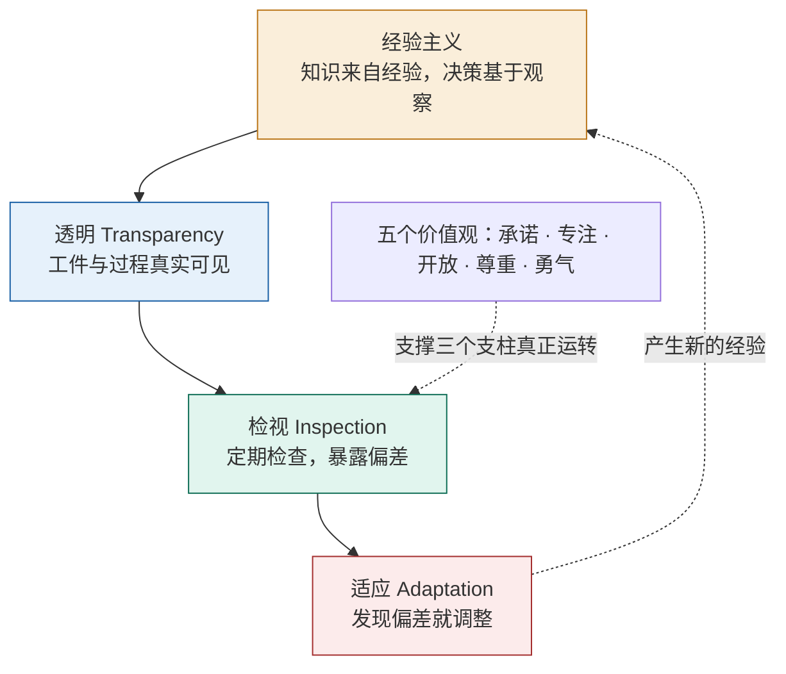
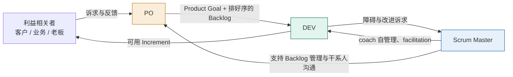
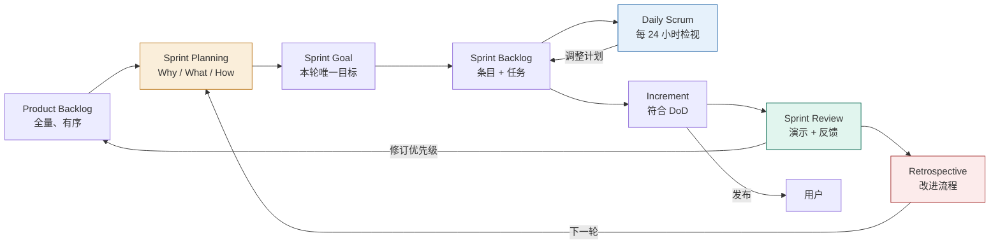
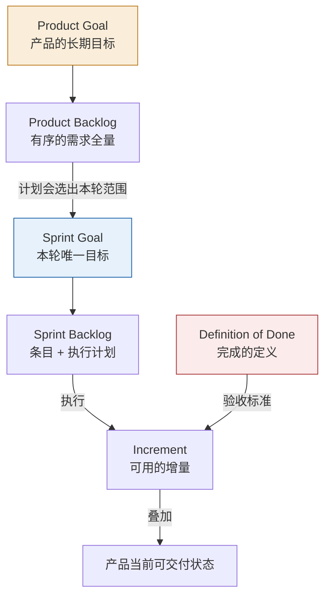
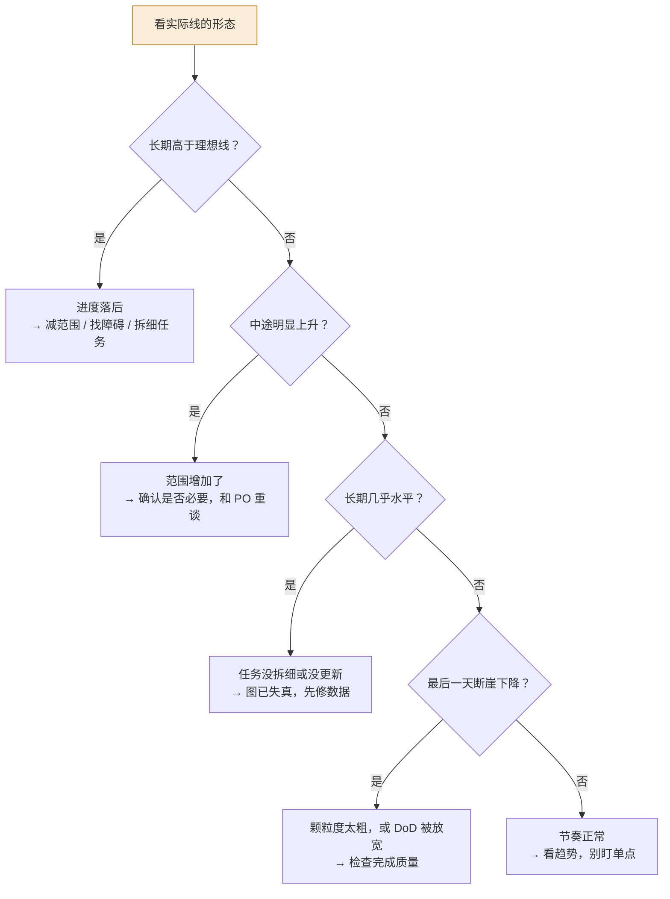

# Scrum 框架实战

> 定位：Scrum 是当下最流行的敏捷框架，也是最容易被做成「仪式表演」的框架。这一篇按 Scrum Guide 2020 的准确表述，讲清三角色、五事件、三工件各自「为什么存在」，再讲真实团队怎么落地、会在哪里走样。看完你应该能判断：你们团队的 Scrum 是「形似」还是「神似」。

## 一、为什么需要 Scrum：复杂问题没有「一次想清楚」的解法

先看一个真实场景。一个 8 人团队做供应链系统，需求文档 200 页、设计 4 个月、开发 5 个月，上线前两周联调才发现「采购单审批」理解错了——业务方要「按金额分级」，团队做了「按部门逐级」。返工 6 周。

这不是技术能力问题，是**反馈太晚**。所有关键假设都憋到最后才验证，一旦错了，代价按月计。

Scrum Guide 2020 的开篇定义是：

> Scrum 是一个轻量的框架，帮助人们、团队和组织通过适应性的解决方案，为复杂问题创造价值。

三个词要抓住：

- **轻量（lightweight）**：只规定「必须有什么」，不规定「具体怎么做」。它要求有 Daily Scrum，但不规定你问哪三个问题。
- **适应性（adaptive）**：方案不是一次设计出来的，是在短周期里试出来、调出来的。
- **复杂问题（complex）**：这是 Scrum 的适用边界。Cynefin 框架把问题分为简单、繁杂、复杂、混乱四类，Scrum 是为「复杂」这一格设计的——因果关系只能事后看清，必须靠「试探—观察—调整」。

反过来说：**如果问题是「简单」或「繁杂」的（需求稳定、路径清晰），Scrum 反而增加开销**，用瀑布或看板更合适。

### Scrum 是框架，不是方法论

方法论告诉你每一步怎么做；框架只给骨架，血肉要团队自己长。Scrum 规定必须有三个角色、五个事件、三个工件，但不规定用什么工具、故事怎么拆、估算用什么单位、DoD 包含哪些条目。这些「填空」的部分，才是团队真正要设计的——也是同样叫 Scrum 的团队效果差十倍的原因。

## 二、底层逻辑：经验主义、三大支柱、五个价值观

### 2.1 经验主义：知识来自经验

Scrum 的哲学基础是**经验主义（empiricism）**：知识来自经验，决策基于观察到的事实。这与「先完整分析、完整设计，再执行」的预测型思维相反——后者在重复性高、变化小的领域有效，在软件这种需求和技术都在变的领域，预测准确率很低。

经验主义要跑起来，需要三个支柱同时成立：

| 支柱 | 含义 | 在 Scrum 里靠什么实现 |
|---|---|---|
| **透明 Transparency** | 过程和工件对「对结果负责的人」可见 | 三工件公开、DoD 统一、站会同步 |
| **检视 Inspection** | 定期检查工件和朝目标的进展，及时发现偏差 | 五个事件就是五个固定检视点 |
| **适应 Adaptation** | 发现偏差就调整，不调整的检视是浪费 | 站会调计划、评审会调 Backlog、回顾会调流程 |

三者是**链式**的：不透明 → 检视看到的是假象 → 适应必然错。

最常见的例子：有人觉得「代码写完 = 完成」，有人觉得「上线 = 完成」。这种不透明会让燃尽图很漂亮，但评审会演示不出来。所以 Scrum 强制要求 **DoD**——它不是形式主义，是「透明」的技术前提。

看图时注意两点：一是「透明→检视→适应」单向依赖，前一环不成立后面全是空转；二是价值观不是装饰，它决定这三环能不能在压力下维持——没有「勇气」，团队不敢在站会说「做不完」，透明立刻就破了。

### 2.2 五个价值观：每条都对应具体行为

Scrum Guide 2020 明确了五个价值观。它们不是墙上的标语，每一条都能翻译成可观察的行为：

| 价值观 | 具体行为 | 缺失时的症状 |
|---|---|---|
| **承诺 Commitment** | 对 Sprint Goal 负责，说到做到 | 「尽力而为」成为口头禅，目标达不成无人复盘 |
| **专注 Focus** | Sprint 内不被无关需求打断 | 一人同时跟三个项目，每件都做一半 |
| **开放 Openness** | 敢说「我卡住了」「这个估错了」 | 问题捂到 Sprint 末才爆 |
| **尊重 Respect** | 承认 PO 有排序权，工程师有技术判断权 | PO 和开发互相指责「不懂业务/不懂技术」 |
| **勇气 Courage** | 敢说「这个 Sprint 做不完」，敢对不合理需求说不 | 全盘接活，然后集体加班 |

这五条和三大支柱配套：**开放**支撑透明，**勇气**支撑检视，**承诺 + 专注**支撑适应，**尊重**让这一切可持续。

接下来三节分别拆开角色、事件、工件。先建立一个直觉：**角色负责「谁决定」，工件负责「决定什么」，事件负责「什么时候检视和调整」**。

## 三、三角色：一个自管理、跨职能的 Scrum Team

Scrum Guide 2020 做了一个重要调整：不再把开发者叫「开发团队（Development Team）」这个子团队，而是统一为 **Scrum Team**，内部有三个 accountability：Product Owner、Scrum Master、Developers。**Team 内部没有子团队、没有层级。**

两个关键词：

- **自管理（self-managing）**：团队自己决定「谁做什么、什么时候做、怎么做」。
- **跨职能（cross-functional）**：团队具备每个 Sprint 交付价值所需的全部技能，不依赖外部。

规模建议 **10 人或更少**。原因很朴素：n 个人的沟通链路是 n(n-1)/2，10 个人是 45 条，20 个人是 190 条。人一多，协调成本指数上升，小团队反而快。

### 3.1 Product Owner：管「做什么、为什么」

PO 对**产品价值最大化**负责。具体职责（Guide 原文要点）：

- 开发并明确沟通 **Product Goal**（产品目标）；
- 创建并清晰沟通 Product Backlog 条目；
- 对 Backlog 条目**排序**；
- 确保 Backlog **透明、可见、被理解**。

两个要点必须强调：

1. **PO 是一个人，不是委员会。** 委员会做排序，结果是「都很重要」，等于没排序；PO 必须有权把老板的话翻译成排序，而不是原样转发。
2. **PO 管「做什么」，不管「怎么做」。** PO 说「这个 Sprint 要支持批量导入」，但不说「用线程池还是消息队列」。

一句话：PO 是「价值的守门人」，核心动作是**排序**和**说不**。

### 3.2 Scrum Master：管「协作方式、移除障碍」

Guide 2020 把 SM 定义为「**真正的领导者**（true leaders），服务 Scrum Team 和更大组织」。

服务对象分三层：

| 服务对象 | 具体做什么 |
|---|---|
| **服务 Team** | coach 团队做到自管理和跨职能；帮团队聚焦高价值；**移除障碍**；确保五个事件发生、积极、有产出、守时 |
| **服务 PO** | 帮 PO 找到有效管理 Backlog 的方法；帮团队理解清晰简洁的条目；帮 PO 建立大计划 |
| **服务组织** | 领导、培训、coach 组织采纳 Scrum；清除团队与利益相关者之间的障碍；帮大家理解经验主义 |

SM 的边界要划清：

- **不是项目经理**：不派活、不催进度、不写周报。进度是团队对 Sprint Goal 负责。
- **不是会议记录员**：SM 保障会议有效，不是记录谁说了什么。
- **不是「保姆」**：SM 的成功标准是「团队没有 SM 也能跑」，而不是「团队离不开我」。

SM 最硬的一项职责是**移除障碍**。站会上听到「测试环境挂了三天没人修」，SM 要去推动修，而不是记在本子上。

### 3.3 Developers：管「怎么做」

Developers 是「承诺在每个 Sprint 交付可用 Increment 的人」。具体责任：

- 创建 Sprint 的执行计划（Sprint Backlog）；
- 通过遵守 DoD 来保证质量；
- 每天根据朝 Sprint Goal 的进展调整计划；
- 作为专业人士**相互问责**。

注意最后一条：问责是「相互的」，不是「上级对下级」。团队内部互相 review、互相提醒，而不是等 SM 来查。

### 3.4 三者关系

三者是**平级**的：缺 PO 会做出一堆没人要的功能，缺 SM 会让事件退化成形式，缺 Developers 的主动性则团队退化成「外包」。

## 四、五事件：Sprint 是容器，四个会各有各的检视对象

### 4.0 Sprint：一切的容器

Sprint 是固定长度（**1 个月以内**，最常见 2 周）的迭代周期，是其他四个事件的容器。

规则：

- 每个 Sprint 结束必须产出**符合 DoD 的可用 Increment**。
- Sprint 期间**不能做危及 Sprint Goal 的变更**；范围可以随着认知加深，由 PO 和团队澄清、重谈。
- Sprint 可以取消，但**只有 PO 有权取消**，且极少发生。

为什么必须固定长度？一是**降低协调成本**，跨团队对齐、发布窗口都能围绕固定节奏排；二是**强制小批量**，时间盒逼团队把大目标切小；三是**制造紧迫感**，没有截止日期的工作会无限膨胀。

### 4.1 Sprint Planning：定义「这一轮为什么值得做」

**目的**：定义 Sprint 的价值目标、可完成的范围、以及如何完成。

会议围绕三个话题（Guide 2020 明确为 Why / What / How）：

| 话题 | 回答什么 | 产出 |
|---|---|---|
| **Why** | 这个 Sprint 为什么有价值 | **Sprint Goal**（一句话目标） |
| **What** | 能完成哪些 Backlog 条目 | 选入 Sprint Backlog 的条目 |
| **How** | 怎么拆、怎么分工 | 拆到「一天以内」的任务 |

时长：1 个月 Sprint 上限 **8 小时**；更短的 Sprint 通常更短，2 周一般按比例压到 4 小时左右。

**为什么存在**：把「被动接活」变成「主动承诺」。团队参与选择范围和定义目标，才会对结果有主人翁感；如果 PO 会前定死清单、会上只做宣布，这个会就白开了。

Sprint Goal 的质量决定这个 Sprint 的质量。好的 Sprint Goal 是**结果导向**的，比如「让新用户可以自助完成开户，不需要人工审核」；坏的 Sprint Goal 是**任务罗列**，比如「完成用户模块 5 个接口」。

### 4.2 Daily Scrum：24 小时的检视循环

**目的**：检视朝 Sprint Goal 的进展，必要时调整 Sprint Backlog。

规则：

- **15 分钟**，每天同一时间、同一地点。
- 参与者是 **Developers**；PO 和 SM 如果在做相关工作可以参加，但不是必须。
- 内容不是固定的「三个问题」，而是**任何能帮团队检视进展的方法**。经典三问（昨天做了什么、今天做什么、有什么障碍）只是最常用的一种。

三个容易忽略的细节：

1. **站会是给 Developers 自己开的，不是给领导汇报的。** 一旦有「旁听 + 点评」，团队就会开始表演。
2. **不在站会上解决问题。** 发现某个问题需要深入讨论，会后拉相关人开小会，别让 15 分钟变成 45 分钟。
3. **站会之后可以随时调整计划。** Guide 明确说「Daily Scrum 不是 Developers 唯一可以调整计划的时间」。

**为什么存在**：它创造了最短的检视周期——24 小时。没有它，团队可能一周后才发现「我们做的方向和 Sprint Goal 偏了」。

### 4.3 Sprint Review：检视「做出来的东西对不对」

**目的**：检视 Sprint 的成果，确定未来的适应。

这是最容易被开成「演示会」的事件。Guide 2020 明确说它是**工作会话（working session）**，不是单向汇报。典型流程：

1. PO 说明哪些条目完成、哪些没完成，并对照 Product Goal 讲进展；
2. Developers 演示**符合 DoD** 的增量并回答提问；
3. 利益相关者给反馈；
4. 一起看「下一步做什么」，当场修订 Product Backlog。

时长：1 个月 Sprint 上限 **4 小时**。

两条铁律：

- **只演示符合 DoD 的东西。** 没完成的条目回到 Product Backlog 重新排序，不演示「半成品」——一旦演示半成品，「完成」的标准就会被稀释。
- **必须请真实的利益相关者。** 只请内部人互相看，反馈就是「挺好的」，这个会就失去了意义。

**为什么存在**：Sprint 内部团队只能自己检视，但「做的东西有没有价值」必须由外部来判。评审会是唯一的「外部校准点」。

### 4.4 Sprint Retrospective：检视「我们怎么工作」

**目的**：规划提高质量和有效性的方法。

检视范围（Guide 明确列出）：**个人、交互、流程、工具、DoD**。

时长：1 个月 Sprint 上限 **3 小时**。

产出：**1-3 个可执行的改进项**，最好直接进入下一个 Sprint Backlog。改进项要满足：

- **具体**：不是「加强沟通」，而是「需求评审必须产出验收标准，PO 在开发前确认」；
- **有人负责**：每条改进项有 owner；
- **可验证**：下个回顾会第一件事就是验收上轮改进项。

**为什么存在**：五个事件里，只有回顾会在检视「流程本身」。计划会、站会、评审会都在检视「产品和进度」，只有回顾会在问「我们这样干活的方式，能不能更好」。没有它，团队会年复一年地重复同样的错误。

### 4.5 五事件总览

| 事件 | 目的 | 输入 | 输出 | 时长上限（1 个月 Sprint） |
|---|---|---|---|---|
| **Sprint Planning** | 定义目标、范围、做法 | Product Backlog、Product Goal | Sprint Goal + Sprint Backlog | 8 小时 |
| **Daily Scrum** | 检视每日进展，调整计划 | Sprint Backlog、昨日进展 | 更新后的 Sprint Backlog | 15 分钟 |
| **Sprint Review** | 检视成果，校准方向 | 符合 DoD 的 Increment | 修订后的 Product Backlog | 4 小时 |
| **Sprint Retrospective** | 改进工作方式 | 上轮数据、上轮改进项 | 1-3 个改进项 | 3 小时 |
| **Sprint** | 容器，产出可用增量 | Product Backlog | Increment | ≤ 1 个月 |

顺着箭头读：Backlog 在计划会上切出本轮范围；站会每天小调整；Sprint 末产出增量，评审会从外部拿反馈、改 Backlog；回顾会改流程，然后进入下一轮。**Review 改「做什么」，Retrospective 改「怎么做」**。

## 五、三工件与 DoD：让「进展」可被信任

Scrum Guide 2020 的一个精巧设计：**每个工件配一个 commitment（承诺）**，让工件有目标感，而不只是一张清单。

| 工件 | 回答什么问题 | 配套 commitment | 谁负责 |
|---|---|---|---|
| **Product Backlog** | 产品要做什么（全量、有序） | **Product Goal** | PO |
| **Sprint Backlog** | 这个 Sprint 做什么、怎么做 | **Sprint Goal** | Developers |
| **Increment** | 做出了什么可用的东西 | **Definition of Done** | Developers |

### 5.1 Product Backlog

- **唯一的工作来源**：所有需求、缺陷、技术改进都进这里，不走私下渠道。
- **永不完整，持续涌现**：它不是「需求冻结文档」，是一份活的、按价值排序的清单。
- **有序（ordered）**：不是「高中低」三档，而是严格的 1、2、3……顺序。因为资源永远不够，必须知道「下一个做什么」。
- **渐进明细**：越靠前的条目越细，越靠后的越粗（一个 epic 一句话），避免提前把半年后的需求写细。

### 5.2 Sprint Backlog

Sprint Backlog 由三部分组成：**Sprint Goal**（为什么）、选中的 **Product Backlog 条目**（做什么）、**执行计划**（怎么做，通常拆成任务）。它由 **Developers 拥有**，每天更新，是「团队对当前 Sprint 的实时快照」，不是「承诺给老板的甘特图」。范围可以和 PO 重谈，但 Sprint Goal 不能轻易动。

### 5.3 Increment

- 每个 Increment 都是「迈向 Product Goal 的坚实一步」，必须是**可用的**（usable）。
- 一个 Sprint 可以产生多个 Increment（比如每天合并一次可用代码）。
- Increment 是**叠加**的：所有历史 Increment 加起来，就是产品当前的状态。
- 关键：**Increment 不等于「上线」**。它是「符合 DoD 的可用状态」，是否发布由业务决定（可能攒几个 Increment 一起发）。

### 5.4 Definition of Done：透明的技术前提

**定义**：团队对「完成」的正式描述，用来评估 Increment 是否满足产品质量要求。

规则：

- 组织有统一 DoD → 团队**至少遵守**，可以更严；
- 组织没有 → **团队自己创建**；
- 多个团队做一个产品 → **必须共享同一个 DoD**（否则「集成」时会发现各自的标准对不上）。

一个分层 DoD 的例子：

| 层级 | 条目 |
|---|---|
| **代码** | 合并到主干、通过 code review、静态检查无阻断项 |
| **测试** | 单元测试覆盖核心路径、集成测试通过、无 P0/P1 缺陷 |
| **文档** | 接口文档、变更说明已更新 |
| **部署** | CI 通过、已部署到预发环境、可回滚 |
| **验收** | PO 按验收标准确认通过 |

DoD 把「完成」从**主观感觉**变成**客观清单**。没有它，燃尽图上的「完成」不可信——有人算写完代码、有人算测完、有人算上线，一条线混了三种口径。

**注意区分 DoD 和 DoR**：DoR（Definition of Ready）是「条目进入 Sprint 前要满足什么」，**Scrum Guide 里没有 DoR**，它是社区实践；DoD 才是官方的。面试能说清这个区别是加分项。

## 六、用户故事、故事点、燃尽图：三个最常被误用的工具

这三样**不在 Scrum Guide 里**，但几乎所有 Scrum 团队都在用。它们有用，但误用率极高。

### 6.1 用户故事

标准格式：

> 作为一个**角色**，我想要**目标**，以便**价值**。

例：「作为一个采购员，我想要批量导入供应商报价，以便在比价时不用一个个手输。」

**3C 模型**：

- **Card（卡片）**：只写简要，不写细节——细节写多了就没人读了；
- **Conversation（对话）**：真正的需求在 PO 和团队的对话中产生；
- **Confirmation（确认）**：验收标准，明确「怎样算做对了」。

**INVEST 原则**（判断一个故事好不好）：

| 字母 | 含义 | 反例 |
|---|---|---|
| **I**ndependent | 独立，可单独交付 | 「必须先做 A 才能做 B」的强耦合 |
| **N**egotiable | 可协商，不是合同 | 「一个像素都不能改」的规格书 |
| **V**aluable | 对用户或业务有价值 | 「重构 DAO 层」（这是任务，不是故事） |
| **E**stimable | 团队能估算 | 「优化系统性能」（无边界） |
| **S**mall | 一个 Sprint 内能完成 | 「做一个电商后台」 |
| **T**estable | 可验证 | 「提升用户体验」 |

最常见的错误：**把技术任务写成用户故事**。「实现 Redis 缓存层」不是用户故事，因为它没有「谁受益、受益什么」。可以改写成「作为用户，我希望商品详情页在 200ms 内打开，以便浏览更流畅」——这才有验收标准。

### 6.2 故事点

**故事点是相对估算单位，不是时间。**

常用斐波那契数列：1、2、3、5、8、13、21。为什么不等差？因为人对「小数字」的区分度高，对「大数字」的区分度低——你能分清 3 和 5，但分不清 13 和 14。

为什么用相对而不是人天：

1. **人对相对大小判断更准**：「这个比那个大一倍」比「这个要 13.5 小时」可靠得多。
2. **避免「估算 = 承诺」**：说「5 个点」，比说「3 天」更容易在发现复杂后调整。
3. **抹平个体差异**：不同人干活速度不同，但「相对大小」的判断容易达成共识。

**Planning Poker**：每人同时出牌，避免「资深工程师先说 8，其他人跟着说 8」的锚定效应；出牌分歧大的条目重点讨论——分歧往往意味着理解不一致，而不是估算不准。

**Velocity（速度）**：一个 Sprint 完成的故事点总和。

- 用途：**团队内部预测**「下个 Sprint 大概能装多少」。
- 禁止用途：**跨团队比较**（不同团队的「5 分」不是一回事）、**个人考核**（会直接导致点数通胀）。
- 前 3 个 Sprint 的 Velocity 不可信，样本太少。

**参考故事**：团队先挑一个中等复杂度的故事定为「3 分」，之后所有估算都跟它比。这比抽象讨论「5 分是多复杂」有效得多。

### 6.3 燃尽图

横轴是 Sprint 天数，纵轴是剩余工作量（故事点或任务数）。理想线从总量直线降到 0，实际线每天更新。

**燃尽图不是「必须直线下降」的考核图，它是诊断工具。** 读图要看形态：

燃尽图的**局限**：它只画「剩余量」，看不出「总量变了」。范围一增加，曲线上升，看起来像「团队退步」，其实是需求变多。

**燃起图（Burnup）** 补了这个短板：同时画「已完成」和「总范围」两条线，范围蔓延一目了然。想看清「是团队慢还是需求多」，用燃起图。

## 七、怎么落地：从「形似」到「神似」

### 7.1 启动期（前 1-2 个 Sprint）

| 动作 | 要点 |
|---|---|
| **定 PO** | 一个人，有决策权，能对老板说「这个不做」 |
| **写 DoD** | 第一版可以朴素（合并 + 单测 + 评审），但要写下来、全员认可 |
| **建初始 Backlog** | 按价值排序，顶部 2-3 个 Sprint 的量做细，其余保持粗 |
| **选 Sprint 长度** | 默认 2 周；别一上来用 1 周，事件开销占比太高 |
| **定第一个 Sprint 目标** | 目标是「跑通闭环」，不是「交付最多功能」 |

第一个 Sprint 最重要的产出不是功能，是**团队对「这套流程怎么跑」形成共识**。

### 7.2 运行期

- **计划会超时** → Backlog 没准备好，或条目太大，回去补。
- **站会**：站着开、轮值主持、聚焦 Sprint Goal；问题会后开小会。
- **评审会**：请真实干系人；只演示符合 DoD 的；当场改 Backlog。
- **回顾会**：先验收上轮改进项，再谈新的；改进项不超过 3 个。
- **每周看一次数据**：Velocity 趋势、Sprint Goal 达成率、Sprint 内新增需求比例。

### 7.3 成熟期

- **度量转向结果**：不只看做了多少点，更看上线后缺陷率、用户采纳率、Cycle Time。
- **补工程实践**：没有 CI、自动化测试、Feature Flag，Sprint 末很难真正交付——这是「Scrum 很规范但质量很差」的根因。
- **跨团队协调**：多团队做一个产品时，用 Scrum of Scrums 或规模化框架。

## 八、常见坑与反模式

| # | 反模式 | 现象 | 根因 | 解法 |
|---|---|---|---|---|
| 1 | **站会变汇报** | SM 逐个问、领导旁听点评、开 40 分钟 | 把站会当成「进度同步给管理者」 | 由 Developers 轮流主持；管理者旁听不发言；问题会后开小会 |
| 2 | **SM 变项目经理** | 派活、催进度、写周报、追着人要状态 | 组织仍按「项目经理」考核 SM | 明确 SM 的产出是「团队能力提升」，不是「进度」；去移除障碍而不是催活 |
| 3 | **PO 变传声筒** | 老板说什么就记什么，从不排序、从不删 | PO 没有决策权 | 授权 PO 一人排序；建立「进 Backlog 不等于会做」的共识 |
| 4 | **回顾会走形式** | 每次都是「沟通不畅，下次改进」，无 owner、无跟踪 | 改进项太虚、没人负责 | 1-3 个具体改进项进 Sprint Backlog；下轮先验收 |
| 5 | **Sprint 变「小瀑布」** | 前 5 天设计、中间 3 天开发、最后 2 天测试，末期集成爆炸 | 按「阶段」而不是按「故事」组织工作 | 每个故事纵向切片（含测试和部署）；DoD 包含「可部署」；每日集成 |
| 6 | **范围蔓延** | Sprint 中途不断加需求，Sprint Goal 名存实亡 | 没有「Sprint 内范围纪律」 | 新需求进 Product Backlog 排序；范围可谈但 Sprint Goal 不动；记录「Sprint 内插入率」 |
| 7 | **DoD 虚设** | 「完成」= 代码写完，测试和上线算下一步 | DoD 没写下来，或写了不执行 | DoD 显式化并纳入评审；未达 DoD 的条目回 Backlog |
| 8 | **故事点当 KPI** | 按点数考核个人，点数疯狂通胀 | 把估算工具当绩效工具 | 点数只用于团队级预测；考核看结果指标 |

**这八个坑里，最要命的是「站会变汇报」和「Sprint 变小瀑布」**：前者让团队开始表演，后者让每个 Sprint 末都在救火、增量永远「差一点」才能交付。两者的共同解药都是「让工作按故事纵向流动，让问题尽早暴露」。

## 九、适用场景与选型

### 9.1 什么时候适合 Scrum

| 适合 | 不适合 |
|---|---|
| 产品型团队，需求需要探索和排序 | 工作持续流入、无法成批（运维/支持 → Kanban） |
| 有明确的 PO，且能被授权 | 找不到能拍板的人（PO 形同虚设） |
| 能凑出跨职能小队（前端 + 后端 + 测试） | 团队按职能竖井组织，无法跨职能 |
| 2-4 周能交付可用增量 | 交付周期天然很长（如硬件 + 软件联调） |
| 需求变化快，需要频繁校准 | 需求极度稳定、强合规（瀑布更省成本） |

### 9.2 Scrum vs Kanban（简述）

| 维度 | Scrum | Kanban |
|---|---|---|
| 节奏 | 固定 Sprint | 持续流动 |
| 角色 | PO / SM / Developers | 不规定角色 |
| 变更 | Sprint 内受限 | 随时可插入（受 WIP 限制） |
| 度量 | Velocity、Sprint Goal 达成率 | Cycle Time、Throughput、CFD |
| 适合 | 产品开发 | 运维、支持、持续交付 |

详细的对比和选型见 Kanban 一篇。

### 9.3 变体

Scrum 的常见变体：**Scrumban**（Sprint 节奏 + WIP 限制，适合从 Scrum 转向流动）、**LeSS**（多团队一个 Backlog）、**SAFe**（PI + ART）、**Scrum@Scale**（Scrum of Scrums 递归扩展）。

## 十、面试高频问法

**Q1：Scrum 的三大支柱是什么？为什么是这三个？**

**一句话结论**：透明、检视、适应，三者是链式依赖——不透明则检视无效，不检视则无从适应。

展开：透明要求工件和过程对结果负责的人可见，前提是 DoD 统一；检视靠五个固定事件；适应是检视后的必然动作，不调整的检视是浪费。三者构成经验主义的闭环。

加分点：指出「透明是最容易被忽略的一环」——很多团队站会开得很热闹，但「完成」的口径不一致，看到的进度是假的，后面的检视和适应全建立在假数据上。

**Q2：PO、SM、Developers 的职责边界怎么划？PO 和 SM 能一个人兼吗？**

**一句话结论**：PO 管「做什么、为什么」，SM 管「协作机制」，Developers 管「怎么做」；PO 和 SM 原则上不应由一人兼。

展开：PO 对价值最大化负责，核心动作是排序和说不；SM 是服务型领导者，负责让机制有效运转、移除障碍；Developers 负责交付符合 DoD 的增量。三者平级，无上下级。

加分点：说清「为什么不能兼」——PO 要决定「做什么」，SM 要保障「团队自管理」，一人兼会变成「自己给自己派活、自己监督自己」，自管理和制衡都失效。小团队实在要兼，也要明确「现在戴的是哪顶帽子」。

**Q3：五个事件分别解决什么问题？为什么 Sprint 是容器？**

**一句话结论**：计划会定目标，站会做日检视，评审会做外部校准，回顾会改流程，Sprint 把它们装进一个固定节奏里。

展开：计划会出 Sprint Goal 和 Sprint Backlog；站会 15 分钟对齐进展、暴露障碍；评审会演示增量、修订 Backlog；回顾会产出 1-3 个改进项。Sprint 是容器，意味着其他四个事件必须在 Sprint 内发生，且服务于「产出可用增量」这个共同目的。

加分点：强调「Review 改产品，Retro 改流程」——两个会的输出流向不同，很多团队把两者混成一个「总结会」。

**Q4：站会为什么是 15 分钟？站会不该做什么？**

**一句话结论**：15 分钟是「同步」的时间盒，不是「解决问题」的时间盒；站会不该变成汇报会、不该在会上解决技术细节。

展开：站会是让 Developers 对齐朝 Sprint Goal 的进展、暴露障碍。15 分钟强制只说关键信息，细节会后拉小会。

加分点：给出判断标准——「如果站会上说话的对象是领导而不是队友，就已经变味了」；再补一句「站会不是唯一的调整时机，Developers 随时可以调计划」。

**Q5：Sprint Review 和 Sprint Retrospective 有什么区别？**

**一句话结论**：Review 检视「产品做得对不对」，Retro 检视「我们干活的方式好不好」。

展开：Review 有外部干系人，产出是修订后的 Backlog；Retro 只有团队，产出是 1-3 个改进项。前者对外校准价值，后者对内改进效能。

加分点：指出 Review 是「工作会话」不是「演示会」——要当场讨论下一步、当场改 Backlog，否则就退化成「给领导表演」。

**Q6：什么是 DoD？没有 DoD 会怎样？**

**一句话结论**：DoD 是团队对「完成」的正式描述，是「透明」的技术前提；没有它，「完成了 80%」就是自欺欺人。

展开：DoD 用来评估 Increment 是否完成。组织有标准就至少遵守，没有就团队自己建；多团队做同一产品必须共享同一 DoD。典型条目：合并主干、通过评审、单测通过、部署预发、PO 验收。

加分点：区分 DoD 和 DoR——DoR 是社区实践，Scrum Guide 里没有；DoD 是官方三工件的 commitment 之一。

**Q7：用户故事和传统需求文档有什么区别？INVEST 是什么？**

**一句话结论**：用户故事是「对话的占位符」，强调角色、价值、可协商；需求文档是「规格说明书」，强调完整、精确、可签署。

展开：用户故事格式「作为…我想要…以便…」，3C（Card / Conversation / Confirmation）；INVEST 六条判断标准：独立、可协商、有价值、可估算、小、可测试。

加分点：指出最常见的误用——把技术任务写成用户故事（「实现缓存层」没有「谁受益」），以及故事太大不拆（epic 要拆到 Sprint 内能完成）。

**Q8：故事点为什么不用人天？能跨团队比较吗？**

**一句话结论**：故事点是相对估算，规避了「绝对时间估不准」和「估算被当承诺」两个问题；不能跨团队比较。

展开：人对相对大小判断更准；斐波那契反映「越大越不准」；Planning Poker 避免锚定。Velocity 只用于团队内部预测，跨团队比较无意义，当 KPI 会导致点数通胀。

加分点：提「参考故事」的做法——先定一个 3 分的基准故事，其他都跟它比，比抽象讨论有效得多。

**Q9：Sprint 中途能加需求吗？**

**一句话结论**：范围可以和 PO 澄清、重谈，但**不能做危及 Sprint Goal 的变更**；新需求优先进 Product Backlog 排序。

展开：Guide 明确「Sprint 期间不能做降低 Sprint Goal 质量的变更；随着认知加深，范围可以由 PO 和团队重谈」。实操上等量替换可以，净增范围要谨慎。

加分点：建议度量「Sprint 内插入率」——如果长期超过 20%，说明 Sprint 承诺形同虚设，要么是 PO 没守住，要么是组织没给团队保护。

**Q10：燃尽图一直不降，或者中途突然上升，说明什么？**

**一句话结论**：一直不降多半是「进度落后或数据失真」，突然上升通常是「范围增加了」，不是团队退步。

展开：长期高于理想线 → 减范围、找障碍、拆细任务；突然上升 → 范围变更，要确认必要性；长期水平 → 任务没拆细或没更新；最后一天断崖 → 颗粒度太粗或 DoD 被放宽。

加分点：指出燃尽图的局限（看不出范围变化），推荐燃起图（burnup）——同时画已完成和总范围，范围蔓延一目了然。

**Q11：Scrum Master 是不是项目经理？**

**一句话结论**：不是。项目经理对「进度和交付」负责，SM 对「团队协作机制有效」负责；前者管结果，后者管能力。

展开：SM 不派活、不催进度、不写周报；他的工作是保障五个事件有效、移除障碍、coach 团队自管理、推动组织理解 Scrum。成功标准是「团队没有 SM 也能跑」。

加分点：说清现实困境——很多组织嘴上叫 SM，考核还是按「项目按时交付」，于是 SM 自然退化成项目经理。这是组织问题，不是个人问题。

## 小结

- Scrum 是为**复杂问题**设计的轻量框架，哲学基础是经验主义，靠**透明—检视—适应**三支柱运转，靠五个价值观在压力下维持。
- **三角色**：PO 管「做什么/为什么」（排序 + 说不），SM 管「协作机制」（服务 + 移除障碍），Developers 管「怎么做」（交付 + 质量）。三者平级，Team 内无子团队。
- **五事件**：计划会定 Sprint Goal，站会做 24 小时检视，评审会做外部校准，回顾会改流程，Sprint 是容器。时长上限和产出要记准。
- **三工件**：Product Backlog（承诺是 Product Goal）、Sprint Backlog（承诺是 Sprint Goal）、Increment（承诺是 DoD）。DoD 是「透明」的技术前提。
- **工具别误用**：用户故事是对话占位符不是规格书，故事点是相对估算不是工时，燃尽图是诊断工具不是考核图。
- **落地关键**：前两个 Sprint 跑通闭环比多交付功能重要；成熟期要补工程实践（CI/自动化测试），否则「Scrum 很规范但交付不了」。
- **八大反模式**：站会变汇报、SM 变 PM、PO 变传声筒、回顾走形式、Sprint 变小瀑布、范围蔓延、DoD 虚设、点数当 KPI。
