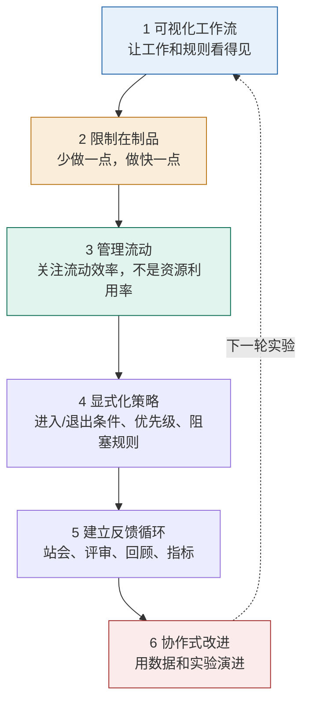
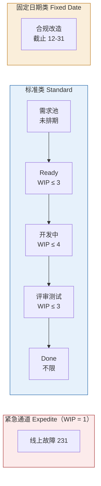
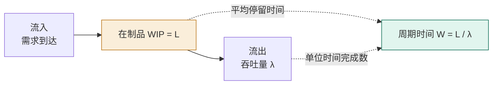
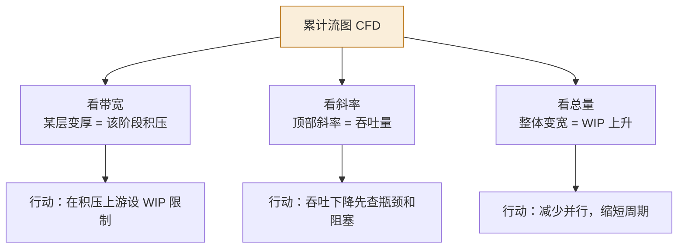
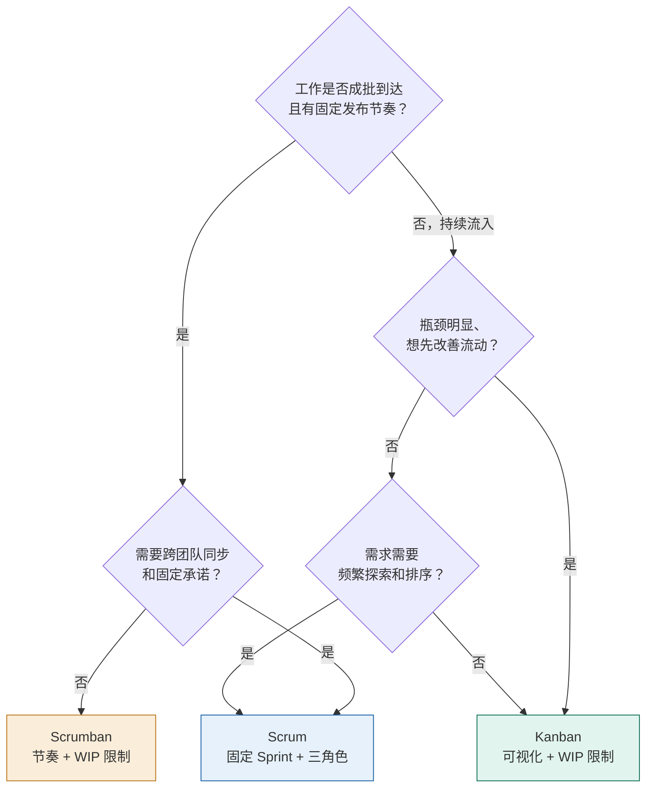

# Kanban 看板方法

> 定位：Kanban 不是「一块任务板」，而是一套「可视化流程 + 限制在制品 + 管理流动」的方法。它比 Scrum 更轻、更适配持续流入的工作，也是 DevOps 和运维团队的事实标准。这一篇讲清六大实践、利特尔法则、流动指标，以及 Scrum 和 Kanban 到底怎么选。

## 一、为什么需要 Kanban：有些工作根本「攒不成一批」

一个 6 人运维团队，每天收到 15-30 个请求——线上故障、变更发布、权限申请、小需求。团队试过 Scrum：Sprint 计划会刚开完，P1 故障插进来；Sprint 评审时一半条目没动；PO 崩溃，团队委屈，最后结论是「Scrum 不适合我们」。

真相是：**不是敏捷不适合，是「批量迭代」不适合持续流入的工作**。这类工作有四个特点：

- **到达不可预测**：故障不会按 Sprint 的节奏来。
- **单件大小差异大**：改配置 10 分钟，迁移数据库 3 天。
- **响应时限不同**：P1 要 30 分钟内响应，咨询可以等一周。
- **价值在流动，不在批次**：客户关心「我的事多久能好」，不关心「这个 Sprint 交付了几个点」。

Kanban 就是为这类工作设计的。

### 三个概念别混

- **看板卡（kanban card）**：一张任务卡。
- **看板工具（kanban board）**：可视化工具，Trello、Jira、飞书都能画。
- **看板方法（Kanban Method）**：一套管理流动的方法，有原则、实践、指标。

很多团队说「我们在用看板」，其实只是「挂了一块板」——只做了可视化，没做 WIP 限制、没定策略、没看流动数据。那不叫 Kanban，叫「任务墙」。

### 来源

丰田的「看板」是拉动式生产的补货信号：下游消耗了，才向上游发信号补货，避免过量生产。David J. Anderson 在 2000 年代把它引入 IT（微软、Corbis 等），2010 年出版《Kanban》，形成今天的方法体系。

## 二、底层逻辑：从「管人」转向「管流动」

传统项目管理关注**资源利用率**：每个人都要 100% 忙，闲下来就是浪费。
Kanban 关注**流动效率**：工作从进入到完成有多快。

为什么「人人 100% 忙」反而慢？排队论的解释是：系统利用率越接近 100%，平均排队时间越趋于无穷。直观类比：高速公路车流量到 80% 就开始堵，到 100% 就是停车场。软件开发同理——每个人都满负荷，任何一点波动（一个人请假、一个线上故障）都会让整条队列堵死。

所以 Kanban 的核心动作不是「让每个人更忙」，而是：让工作可见、限制同时在做的事、让瓶颈暴露、缩短从开始到交付的时间。

### 2.1 四条变更管理原则

Kanban 强调「演化」而不是「革命」：

1. **从你现在的做法开始**：不推翻现有流程，先可视化它。
2. **同意追求渐进式、演化式变革**：小步改，别搞大爆炸重构。
3. **最初尊重现有角色、职责和头衔**：不改组织架构，先改工作流。
4. **鼓励各层级展现领导行为**：改进不只靠管理层，任何人都可以发起实验。

这四条解释了为什么 Kanban 落地阻力小：它不要求你先改组、先设 PO/SM，而是「先看清现状，再一点点改」。

### 2.2 六大实践

这是 Kanban 的核心，必须记准：

| # | 实践 | 做什么 |
|---|---|---|
| 1 | **可视化工作流** | 把工作项和流程状态画出来，让隐性工作显性化 |
| 2 | **限制在制品（WIP）** | 每列设上限，满了就停 |
| 3 | **管理流动** | 关注流动效率、瓶颈、阻塞，而不是资源利用率 |
| 4 | **显式化策略** | 写清进入/退出条件、优先级规则、阻塞处理、SLA |
| 5 | **建立反馈循环** | 站会、评审、回顾、指标，定期检视 |
| 6 | **协作式改进、实验式演进** | 用数据和实验推动改进，而不是拍脑袋 |

看图注意：六大实践不是「六个步骤」，而是**同时存在、互相支撑**的。没有可视化，WIP 限制无处可设；没有显式策略，WIP 限制会变成「看谁好说话就插队」；没有反馈循环，改进无从谈起。很多人只做了第 1 条就宣称「上了看板」，这是最常见的失败。

## 三、可视化：看板到底长什么样

### 3.1 三个元素

- **列（Column）** = 流程状态
- **卡片（Card）** = 工作项
- **泳道（Swimlane）** = 工作类别

### 3.2 列怎么画

关键原则：**列对应「真实的交接点」，不是「角色」**。

- 坏的画法：`前端 → 后端 → 测试`。这是角色，工作会在列之间来回跳，责任也说不清。
- 好的画法：`待排期 → 就绪 → 开发中 → 评审 → 验证 → 完成`。这是状态，工作单向流动。

列数建议 **3-7 列**。太少看不出瓶颈，太多管理成本高、卡片频繁挪动。

### 3.3 服务类别（Classes of Service）

不是所有工作都该排同一个队。Kanban 常用四类：

| 类别 | 特点 | 策略 |
|---|---|---|
| **Expedite 紧急** | 必须立刻做，如 P1 故障 | 单独泳道，WIP = 1，插一个必须挤一个 |
| **Fixed Date 固定日期** | 有硬截止，如合规改造 | 提前排期，单独跟踪 |
| **Standard 标准** | 常规需求，按优先级排 | 走主流程，FIFO + 优先级 |
| **Intangible 无形** | 技术债、重构、文档 | 显式预留容量，否则永远排不上 |

「无形类」最容易被忽略：不写进看板，就永远「没时间做」，最后变成架构腐化。

### 3.4 卡片上放什么

标题、ID、类型、负责人、**进入当前列的时间**（算 Cycle Time 用）、阻塞标记、截止日、关联链接。

「进入时间」比「截止日」更重要——没有它，你算不出周期时间，也就无法用数据改进。

### 3.5 显式化策略

这是最容易被跳过、但最影响公平性的一步。至少要写清：

- 每列的**进入条件**和**退出条件**（相当于每列一个 DoR/DoD）
- 每列的 **WIP 上限**
- 什么算**阻塞**，阻塞了找谁
- 优先级规则（谁可以插队、插队要挤掉谁）
- 各类工作的 **SLA/SLE**

这张图展示三个要点：主流程按状态分列、每列有 WIP 上限、紧急和固定日期工作走独立泳道。注意 Expedite 只放 1 个——它抢的是整条流程的容量，不能变成常态。

### 3.6 列设计示例

| 列 | 进入条件 | 退出条件 | WIP 上限 |
|---|---|---|---|
| 需求池 | 有人提出 | 被排期选中 | 不限 |
| Ready | 已排序、有验收标准 | 有负责人且开始动工 | 3 |
| 开发中 | 已认领 | 代码合并、自测通过 | 4 |
| 评审/测试 | 提测 | 评审通过、测试通过 | 3 |
| Done | 符合 DoD | — | 不限 |

## 四、限制 WIP：最反直觉、也最有效的一条

### 4.1 为什么限制在制品能加快交付

直觉是「多开几个任务，总有一个先完成」。实际相反：

1. **上下文切换成本**：人在多个任务间切换，每次都要重新加载上下文，有效产出下降。
2. **等待被放大**：同时开 10 个任务，每个都在等「轮到我」，平均等待变长。
3. **瓶颈被掩盖**：上游拼命开工，下游堆成山，但因为「大家都很忙」，没人觉得有问题。
4. **反馈被延迟**：批量大，问题发现得晚，返工成本高。

WIP 限制的作用：**当一列满了，上游必须停下来**——去帮下游、去解决瓶颈，而不是继续堆。它把「个人效率」逼成「团队效率」。

### 4.2 利特尔法则

这是 Kanban 的数学基础。

> 在一个稳定系统里：**平均在制品数 = 平均吞吐量 × 平均周期时间**

即 `L = λ × W`：

- `L`：平均 WIP（同时在做的数量）
- `λ`：平均吞吐量（单位时间完成数）
- `W`：平均 Cycle Time（从开始到完成的时间）

变形得到最有用的一条：**平均周期时间 = 平均 WIP ÷ 平均吞吐量**（`W = L / λ`）。

边界怎么划，指标就叫什么：系统边界从「客户提出」算到「交付」，算出来的是 Lead Time；从「开始做」算到「完成」，算出来的是 Cycle Time。法则本身对任何一段流程都成立。

算个例子：团队平均 WIP = 12，每周完成 4 个 → 平均 Cycle Time = 12 / 4 = 3 周。
把 WIP 限制到 6，吞吐不变 → Cycle Time = 6 / 4 = 1.5 周。

**WIP 减半，交付时间减半，吞吐不变。** 这就是「少做一点，反而更快」的量化解释，也是 WIP 限制最硬的理论依据。

三个边界必须说清，否则会滥用：

- 只适用于**稳态系统**的长期平均，单个工作项不适用。
- WIP 降到低于瓶颈产能，**吞吐会下降**——WIP 不是越低越好，目标是「让瓶颈满负荷，但上游不堆积」。
- 它描述平均关系，不保证每一件的交付时间，承诺要看分布（见第五节）。

### 4.3 WIP 上限怎么定

| 步骤 | 做法 |
|---|---|
| 1 测量 | 数现状：每列平均有多少张卡在「进行中」 |
| 2 初始值 | 全局 ≈ 团队人数 × 1.5；单列 ≈ 该阶段人数 + 1 |
| 3 砍一刀 | 在现状基础上砍 30%-50%，逼出瓶颈 |
| 4 观察 | 看 Cycle Time、阻塞时长、队列长度 |
| 5 调整 | 每 2-4 周回顾一次，逐步收敛 |

几条实操建议：

- **按列设，不按人设**。WIP 是流程约束，不是「每人最多 2 个任务」的配额。
- **满了不是加 WIP，而是找瓶颈**。WIP 长期满且 Cycle Time 变长，说明瓶颈在下游。
- **紧急通道单独设 1**，并且「插一个必须挤一个」，否则紧急会变成常态。
- **先宽后严**。一上来卡太死会激起抵触，先让团队感受到「流动变快」的好处，再收紧。

### 4.4 一个真实的调参过程

某支付团队的「需求交付」看板，6 个人，起步数据：开发中 12 张、评审 6 张、测试 2 张，总 WIP 20，每周完成 5 个 → 按利特尔法则平均 Cycle Time ≈ 4 周；流动效率只有 12%，大部分时间在等评审和等测试。

- **第一步**：把总 WIP 压到 12（开发 8、评审 3、测试 1）。第一周吞吐掉到 3 个（大家不习惯停下来），第二周回到 5 个，Cycle Time 降到约 2.4 周。
- **第二步**：瓶颈浮出来了——评审只有 1 个兼职的人。改成两人轮值 + 每天固定 1 小时评审窗口，评审不再积压，吞吐升到 6 个/周，Cycle Time 进一步降到约 2 周。
- **第三步**：把「等待评审」单独画成一列，而不是藏在「开发中」里。团队第一次直观看到：60% 的时间在排队，流动效率从 12% 提到 25%。

关键不是这几个数字，而是顺序：**先限 WIP 暴露瓶颈，再解决瓶颈，最后把隐性等待显式化**。顺序反了（先买工具、先调组织架构）通常都会失败。

## 五、流动指标：用数据说话

### 5.1 四个基础指标

| 指标 | 定义 | 用途 | 常见误用 |
|---|---|---|---|
| **Lead Time 前置时间** | 从「客户提出/承诺」到「交付」 | 对客户承诺、端到端体验 | 起点定义不清，团队各算各的 |
| **Cycle Time 周期时间** | 从「开始做」到「完成」 | 团队内部效率、预测 | 和 Lead Time 混用 |
| **Throughput 吞吐量** | 单位时间完成的工作项数 | 容量规划、利特尔法则 | 只追数量不看价值 |
| **WIP 在制品** | 同时在做的数量 | 流动控制 | 按人分配 |

Lead Time 和 Cycle Time 的差别就是**排队时间**。客户感知的是 Lead Time，团队能控制的主要是 Cycle Time 和 WIP。

### 5.2 流动效率

`Flow Efficiency = 活跃时间 / Lead Time`

知识工作的典型值只有 **5%-25%**——也就是说，一件工作 80%-95% 的时间在排队等待。这个数字第一次算出来会很震撼，它说明：**优化「干活更快」的收益，往往远小于优化「等待更少」**。

### 5.3 看分布，不看平均

平均 Cycle Time 3 天，听起来很好。但如果有 10% 的工作要 15 天，你对客户的承诺就会经常翻车。

正确做法：

- 看 **50 / 85 / 95 分位**，不只看平均值。
- 对客户承诺用 **85 分位**（或按 SLE）。
- 用散点图看每个工作项的 Cycle Time，识别长尾。

**SLE（Service Level Expectation，服务水平期望）**：比如「标准类工作项，85% 在 8 天内完成」。它比「平均 5 天」更可承诺，因为它是概率语言，天然包含了波动。

### 5.4 累计流图 CFD

CFD 把每列的累计数量画成堆叠面积图。读三件事：

- **带宽厚度**：某一层变厚 = 该阶段积压。
- **顶部斜率**：斜率 = 吞吐量，变平说明产出下降。
- **整体宽度**：变宽 = WIP 上升。

CFD 的最大价值是「一眼看出瓶颈在哪一段」，比盯单点数字直观得多。

## 六、Kanban 在 DevOps / 运维的落地

### 6.1 四类工作分泳道

| 泳道 | 内容 | 策略 |
|---|---|---|
| **事故** | P1/P2 故障 | Expedite，WIP = 1 |
| **变更** | 发布、配置变更 | 限制并行变更数 |
| **服务请求** | 权限、咨询、工单 | 标准类，按 SLA |
| **项目** | 平台建设、迁移 | 固定日期/标准，预留容量 |

### 6.2 关键实践

- **限制并行变更数**：变更失败率和并行度正相关。很多团队把「同时在跑的变更」限制在 2-3 个，失败率明显下降。
- **预留中断容量**：on-call 团队至少留 20% 容量给突发，否则计划内工作永远被挤压。
- **阻塞显式化**：卡上打 `blocked` 标记并写原因，站会只看阻塞项，不做逐条汇报。
- **自动化回流**：CI/CD 状态自动更新卡片（构建失败标红、部署成功自动移到「待验证」），减少手工维护。
- **和 DORA 四指标对齐**：部署频率、变更前置时间、变更失败率、恢复时间——它们本质就是流动指标在交付链上的投影。

### 6.3 反馈节奏（Cadences）

Kanban 没有 Sprint，但需要自己的节奏：

- **每日站会**：看板前同步，聚焦阻塞和流动。
- **补货会（Replenishment）**：定期从 Backlog 拉新工作进「就绪」。
- **服务交付评审**：看 SLA、Cycle Time 分布。
- **运营评审**：看吞吐、WIP、瓶颈。
- **风险评审**：看阻塞、依赖、延期风险。
- **策略评审**：看流程规则是否还适用。

不需要全部照搬，但「只有站会、没有回顾和策略评审」的团队，会慢慢退化成「任务墙」。

## 七、Scrum vs Kanban：怎么选

### 7.1 对比

| 维度 | Scrum | Kanban |
|---|---|---|
| **节奏** | 固定 Sprint（1-4 周） | 持续流动，无固定迭代 |
| **角色** | PO / SM / Developers | 不规定角色 |
| **变更** | Sprint 内受限 | 随时可插入，受 WIP 限制 |
| **估算** | 故事点 + Velocity | 可选，按件数或大小分类 |
| **度量** | Velocity、Sprint Goal 达成率 | Cycle Time、Throughput、CFD |
| **会议** | 五个固定事件 | 按需设反馈循环 |
| **适合** | 产品开发、需要固定节奏对齐 | 运维、支持、持续交付、多项目并行 |

### 7.2 决策树

### 7.3 Scrumban

Scrumban 是两者的混合：保留 Sprint 的**计划和回顾节奏**（解决「没有长期目标」的问题），执行层用 **WIP 限制和流动指标**（解决「Sprint 内插不进急事」的问题）。

适合三类团队：

- 从 Scrum 过渡到 Kanban，不想一次改太猛。
- 需要固定节奏对齐，但工作经常被插入。
- 想保留回顾机制，又想要流动数据。

## 八、常见坑

| # | 坑 | 现象 | 解法 |
|---|---|---|---|
| 1 | **只可视化不限 WIP** | 板很漂亮，问题照旧 | 每列设上限，满了就停 |
| 2 | **WIP 按人设** | 变成「每人任务配额」 | 按列设，流程级约束 |
| 3 | **列画太细** | 卡片在列间来回挪，管理成本高 | 列对应真实交接点，3-7 列 |
| 4 | **没有显式策略** | 能不能进 Done 全靠感觉 | 写清进入/退出条件 |
| 5 | **只看平均值** | 平均 3 天，95 分位 15 天 | 看分布和分位数 |
| 6 | **紧急通道滥用** | 所有事都 Expedite | 严格 WIP=1，插一个挤一个 |
| 7 | **没有反馈循环** | 看板只是墙，不改进 | 站会 + 定期回顾 + 指标 |
| 8 | **把看板当分派工具** | 只用来派任务 | 用它管流动和改进 |

展开两个最关键的：

**坑 1：可视化是「必要不充分」条件。** 只把工作画出来、不限制 WIP，团队还是会同时开一堆任务，瓶颈还是看不见。判断标准很直接：**每列有没有数字上限，满了会不会真的停下来**。如果答案是「不会」，那就只是任务墙。

**坑 6：紧急通道是压力阀，不是快车道。** 如果 30% 的工作都走 Expedite，等于没有优先级，主流程会被彻底冲垮。健康状态是 Expedite 占比低于 10%，且每次插入都能说清「挤掉了什么」。

## 九、适用场景与落地路径

### 9.1 适合 / 不适合

| 适合 | 不适合 |
|---|---|
| 工作持续流入、无法成批 | 需要固定节奏对齐多方发布 |
| 运维、支持、on-call | 需求需要深度探索和长周期规划 |
| 多项目、多类型工作并行 | 团队需要强承诺和 Sprint 目标 |
| 流程瓶颈明显，想先改善流动 | 组织要求「角色齐全」的敏捷形式 |
| 团队不想大改现有流程 | 没有可视化意愿，只想「上个工具」 |

### 9.2 五步落地

1. **可视化现状**：按「工作现在实际怎么流」画，不按「应该怎么流」画。
2. **加 WIP 限制**：从最堵的一列开始，砍 30%-50%。
3. **显式化策略**：写进入/退出条件、优先级、阻塞规则。
4. **建反馈循环**：每日站会 + 每两周回顾 + 每月看流动指标。
5. **做实验**：每次只改一个变量（WIP 上限、批量大小、列定义），用数据判断效果。

### 9.3 起步先测三个数

当前 WIP、平均 Cycle Time、每周吞吐量。有了这三个，就能用利特尔法则反推「要缩短交付时间，WIP 该压到多少」；也能在改进后判断「是真的变快了，还是只是感觉变快了」。

## 十、面试高频问法

**Q1：看板的六大实践是什么？**

**一句话结论**：可视化工作流、限制 WIP、管理流动、显式化策略、建立反馈循环、协作式改进与实验式演进。

展开：六条不是六个步骤，而是同时存在、互相支撑的。可视化是基础，WIP 限制是核心动作，管理流动是目标，显式策略保证公平，反馈循环让问题暴露，协作改进让流程持续演化。

加分点：补一句「很多团队只做了第一条就宣称上了看板」——没有 WIP 限制和策略，看板就退化成任务墙。

**Q2：为什么要限制 WIP？背后的原理是什么？**

**一句话结论**：限制 WIP 能减少上下文切换、暴露瓶颈、缩短等待，从而在不增加人手的情况下缩短交付时间。

展开：四个机制——减少切换成本、避免等待放大、让瓶颈显性化、促成小批量快反馈。WIP 满了，上游必须停下来帮下游，这把「个人效率」变成「团队效率」。

加分点：用利特尔法则量化——吞吐不变时，WIP 减半，Cycle Time 减半；同时提醒「WIP 低于瓶颈产能会导致吞吐下降」，不是越低越好。

**Q3：利特尔法则是什么？怎么用它做容量规划？**

**一句话结论**：`L = λ × W`，即平均 WIP = 平均吞吐量 × 平均周期时间；变形 `W = L / λ` 可直接预测交付时间。

展开：举例，WIP 12、每周完成 4 个 → Cycle Time 3 周；WIP 压到 6 → 1.5 周。做规划时，先测现有吞吐，再定目标 Cycle Time，反推允许的 WIP。

加分点：说清适用边界——稳态系统的长期平均，单件不适用；WIP 低于瓶颈产能会掉吞吐；它不给分布，承诺要看 85/95 分位。

**Q4：Cycle Time 和 Lead Time 有什么区别？**

**一句话结论**：Lead Time 从「客户提出/承诺」算起，Cycle Time 从「开始做」算起；两者之差就是排队时间。

展开：客户感知的是 Lead Time，团队能控制的是 Cycle Time 和 WIP。很多团队优化了半天 Cycle Time，但 Lead Time 没降，因为瓶颈在「排队等排期」。

加分点：强调「定义必须团队内统一」——起点算「提出」还是「承诺」，会让数字差一倍；对外承诺用 Lead Time，对内改进用 Cycle Time。

**Q5：Kanban 和 Scrum 有什么区别？怎么选？**

**一句话结论**：Scrum 是「固定节奏的批量交付」，Kanban 是「持续流动的按件交付」；工作能成批、需要固定承诺选 Scrum，工作持续流入选 Kanban。

展开：对比节奏、角色、变更、度量、会议五个维度。Scrum 有 Sprint 目标、Velocity、三角色；Kanban 无固定迭代、不规定角色、看 Cycle Time 和 CFD。

加分点：给出判断依据——「故障会不会按 Sprint 来？」不会，就用 Kanban；再补一句「两者可以混成 Scrumban」。

**Q6：什么是 Scrumban？适合什么场景？**

**一句话结论**：Scrumban 保留 Sprint 的计划和回顾节奏，执行层用 WIP 限制和流动指标，是 Scrum 与 Kanban 的混合。

展开：它解决两个痛点——纯 Scrum 插不进急事，纯 Kanban 缺长期目标和固定复盘。适合「需要节奏但对变化敏感」的团队，以及从 Scrum 向 Kanban 过渡的团队。

加分点：指出 Scrumban 不是官方框架，没有统一标准，落地时要明确「哪些保留、哪些放弃」，否则容易变成「两头不靠」。

**Q7：WIP 上限怎么定？定多少合适？**

**一句话结论**：先测现状，再砍 30%-50%；初始可按「团队人数 × 1.5」设全局上限、按「该阶段人数 + 1」设单列上限，然后按数据调整。

展开：WIP 按列设、不按人设；满了不是加 WIP，而是找瓶颈；紧急通道单独设 1；先宽后严，别一上来卡死。

加分点：说清「WIP 上限是实验参数，不是一次性拍定的制度」——每 2-4 周回顾一次，看 Cycle Time 和阻塞时长再调。

**Q8：累计流图（CFD）怎么看？能发现什么？**

**一句话结论**：看三层——带宽厚度看积压、顶部斜率看吞吐、整体宽度看 WIP。

展开：某层突然变厚 = 该阶段成瓶颈；顶部斜率变平 = 吞吐下降；整体变宽 = WIP 上升、周期变长。CFD 的价值是「一眼定位瓶颈区段」。

加分点：提醒 CFD 的局限——它不显示单件时长和分布，要和 Cycle Time 散点图配合看。

**Q9：看板需要估算吗？**

**一句话结论**：不是必须。Kanban 更常用「按件计数 + 大小分类」，预测靠历史 Cycle Time 分布，而不是故事点。

展开：估算的目的是预测。如果已有稳定的 Cycle Time 数据，可以直接用「85% 的工作在 X 天内完成」来承诺，比估算更准。需要排期时，用 S/M/L 分类或按件数即可。

加分点：指出「Kanban 的预测单位是件和时间，不是点」——硬套故事点会让团队把注意力放在「填点数」而不是「缩短流动」。

**Q10：看板有角色吗？需要 Scrum Master 吗？**

**一句话结论**：Kanban 不规定角色，但需要有人对「流动」负责；可以复用现有角色，不必新设。

展开：常见的隐式角色包括 flow manager（看流动数据、推动改进）、补货负责人（决定下一批做什么）、回顾主持者。SM 的能力在 Kanban 里同样有用，只是头衔不一定叫 SM。

加分点：强调「不规定角色」不等于「没人负责」——没有人为流动负责，看板很快会退化成任务墙。

**Q11：运维团队怎么落地看板？**

**一句话结论**：按工作类型分泳道、给事故开 Expedite 通道、限制并行变更、预留中断容量，并用 DORA 指标对齐。

展开：四类工作——事故、变更、服务请求、项目；事故 WIP=1 且插一个挤一个；变更限制并行数；on-call 预留约 20% 容量；CI/CD 状态自动回流到卡片。

加分点：把 Kanban 的 Cycle Time 和 DORA 的「变更前置时间」对上，说明两套语言其实是一回事。

**Q12：看板落地最常见的失败原因是什么？**

**一句话结论**：只可视化、不限 WIP——板画得很漂亮，但工作方式一点没变。

展开：其次是没定显式策略（插队靠人情）、没有反馈循环（不回顾、不看数据）、紧急通道滥用（所有事都优先）。这四条本质都是「只学了形式，没学约束」。

加分点：给出自检问题——「每列有上限吗？满了会停吗？上周的 Cycle Time 是多少？」三个问题答不上来，就说明还停在任务墙阶段。

## 小结

- Kanban 是「可视化 + 限制 WIP + 管理流动」的方法，适合持续流入、无法成批的工作；它不等于一块任务板。
- **六大实践**：可视化、限制 WIP、管理流动、显式化策略、建立反馈循环、协作式改进与实验式演进。六条同时成立才有效。
- **利特尔法则** `L = λ × W`：吞吐不变时，WIP 减半，周期时间减半；但 WIP 低于瓶颈产能会掉吞吐，它不是越低越好。
- **流动指标**看四个：Lead Time、Cycle Time、Throughput、WIP；看分布（85/95 分位）而不是平均值，用 SLE 做承诺。
- **Scrum vs Kanban**：成批、要固定承诺选 Scrum；持续流入、要流动效率选 Kanban；两者可混成 Scrumban。
- **落地顺序**：先可视化现状 → 加 WIP 限制 → 显式化策略 → 建反馈循环 → 用数据做实验；最常见的失败是停在第一步。
