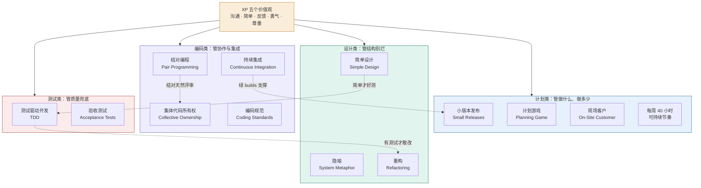
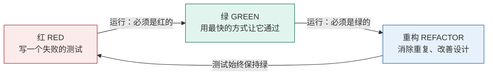
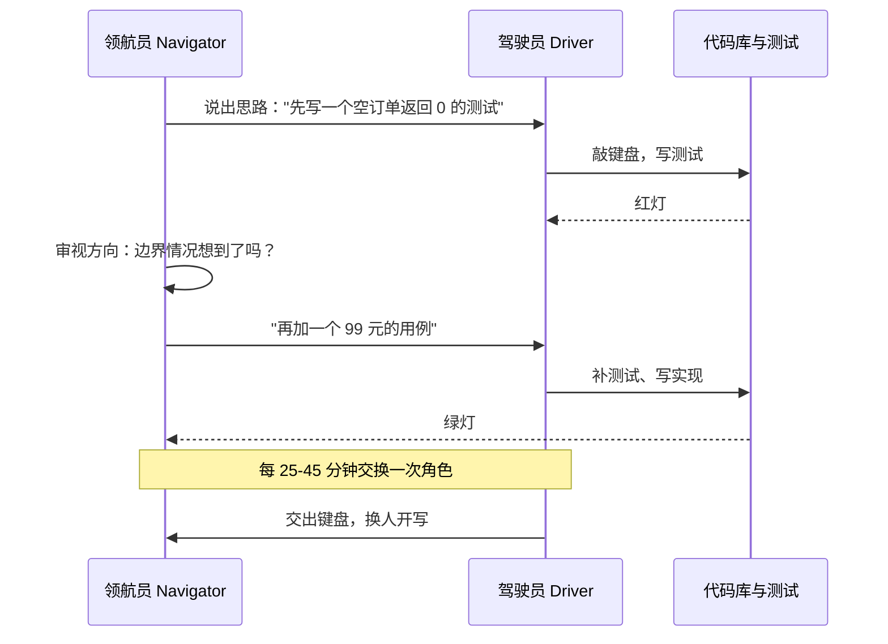
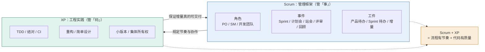

# XP 极限编程：把工程实践做到极致

> 定位：Scrum 告诉你「谁在什么时候开什么会」，却不告诉你「代码该怎么写才不烂」。XP（Extreme Programming，极限编程）补的正是这一块——结对、TDD、CI、重构、小版本发布，一整套把质量焊死在开发过程里的工程纪律。这篇讲清 XP 的五个价值观、12 个实践、TDD 的红-绿-重构循环、结对编程为什么真的有效，以及它和 Scrum 到底是什么关系。

## 一、为什么需要 XP

先看一个很常见的场景：团队「敏捷转型」两年了，站会天天开，看板贴得花花绿绿，Sprint 评审一次不落。但代码库的真实状态是：

- 改一个字段，牵动六个模块，谁也不敢动核心类；
- 上线前一周进入「封版修 bug」模式，测试同学通宵点点点；
- 主干长期不可发布，集成要等到迭代最后一天，一合就炸；
- 唯一的架构文档是三年前画的，早就和代码对不上了。

问题出在哪？**因为 Scrum 只治理「流程」，不治理「代码」。** Scrum 规定了角色、事件、工件，解决了「优先级怎么排、进度怎么透明、团队怎么自组织」，但对「要不要写单元测试」「要不要结对」「主干能不能一直可发布」一个字都没说。流程跑得很顺，工程底子却是烂的——这就是「僵尸 Scrum」。

XP 的出发点完全不同。Kent Beck 的逻辑是一串「如果」：

- 如果代码评审有价值，那就**每时每刻**评审 → 结对编程；
- 如果测试有价值，那就**先写测试**再写代码 → TDD；
- 如果集成有价值，那就**一天集成十几次** → 持续集成；
- 如果短迭代有价值，那就**一周发一版** → 小版本发布；
- 如果简单设计有价值，那就**只做今天需要的设计** → 简单设计。

把「已知有益的事」的强度拉到极限，这就是「Extreme（极限）」这个词的真正含义——不是「极端激进」，而是「把好的实践做到极致」。这也是 1999 年 Kent Beck 在《Extreme Programming Explained》里给出的命名解释。

XP 不是纸上谈兵。它诞生于 1996 年 Kent Beck 参与的 Chrysler C3 薪酬系统项目，后来在大量团队中被验证和打磨。今天你听到的 TDD、结对、CI、用户故事、重构，几乎都能追溯到 XP。

## 二、五个价值观：XP 的地基

XP 第一版（1999）给了四个价值观，第二版（2004）增加了第五个「尊重」。这五个词不是口号，而是所有实践的**判断依据**——当你不确定某个做法对不对时，回来问这五个问题。

| 价值观 | 含义 | 在实践中的体现 | 反例（背离它） |
|---|---|---|---|
| **沟通 Communication** | 信息要在人之间真实流动，而不是沉在文档里 | 结对、站会、现场客户、集体代码所有权、隐喻 | 需求靠一份 80 页文档传递，没人读 |
| **简单 Simplicity** | 只做当前真正需要的设计，不为想象中的未来预留 | 简单设计、重构、YAGNI | 为一个还没立项的业务预留三层扩展点 |
| **反馈 Feedback** | 反馈要快、要短、要具体 | 单元测试（秒级）、CI（分钟级）、迭代评审（周级）、生产监控（秒级） | 半年后用户才第一次看到产品 |
| **勇气 Courage** | 敢重构、敢删代码、敢承认设计错了、敢说「这周做不完」 | 重构、集体所有权、小版本发布 | 明知设计烂却不敢动，只能不断打补丁 |
| **尊重 Respect** | 每个人都值得被认真对待，贡献被看见 | 结对轮换、可持续节奏（每周 40 小时） | 用「勇气」当借口否定别人的代码 |

这五个价值观**互相支撑**，缺一个就塌：**简单**让**反馈**变快（东西少，测得快改得快）；**反馈**给**勇气**底气（有测试兜底才敢重构）；**勇气**支撑重构和删代码，否则简单设计无从谈起；**沟通**保证方向不偏；**尊重**让这一切可持续（否则结对变成互相挑刺）。

> 一个容易被忽略的点：XP 里「每周 40 小时」不是福利条款，而是**质量条款**。疲劳的人写不出好代码，加班赶出来的进度会在下个迭代以 bug 的形式还回去。Kent Beck 把它列为实践，是因为「可持续的节奏」是前面四个价值观能长期成立的物理前提。

## 三、12 个实践全景

XP 最经典的表述是「12 个实践」，按活动类型可以分成四组。先看全景图——这张图你要看的是「实践之间的咬合关系」，它们不是 12 个孤立技巧，而是一台机器的 12 个齿轮。



图里那几条虚线是关键：TDD 给重构兜底，结对让集体所有权不至于失控，CI 让「一周一版」成为可能，简单设计让测试写起来不痛苦。**抽掉任何一个，其他几个都会变形。**

逐个说清「为什么」：

| 实践 | 一句话说明 | 解决什么问题 |
|---|---|---|
| **计划游戏** | 客户按业务价值定优先级，开发按成本估算，双方共同决定这轮做什么 | 避免「老板拍脑袋定死范围和工期」 |
| **小版本发布** | 每次发布只包含少量功能，几周甚至几天一版 | 缩短反馈周期，降低单次发布风险 |
| **现场客户** | 客户（或业务方代表）就在团队里，随时答疑 | 需求歧义当天澄清，而不是等评审会 |
| **每周 40 小时** | 不靠加班换进度 | 保证代码质量和长期可持续 |
| **简单设计** | 只实现当前测试要求的功能，不提前抽象 | 防止过度设计和「架构宇航员」 |
| **隐喻** | 用一个统一的比喻描述系统，让全员有共同心智模型 | 降低沟通成本（如「这个系统是一个流水线」） |
| **重构** | 不改变外部行为的前提下持续改善内部结构 | 对抗代码腐化，让设计随需求演进 |
| **结对编程** | 两人一台机器，一个写一个想，频繁轮换 | 实时评审 + 知识传递 |
| **集体代码所有权** | 任何人都有权修改任何一段代码 | 消除「这块只有老王能改」的瓶颈 |
| **编码规范** | 团队统一命名、格式、注释约定 | 减少无意义的风格争论，让集体所有权可行 |
| **持续集成** | 频繁合并到主干，每次合并都跑完整构建和测试 | 避免「集成地狱」 |
| **TDD** | 先写失败的测试，再写代码让它通过，再重构 | 设计出可测的代码，同时获得回归保护 |
| **验收测试** | 用业务语言写的端到端测试，由客户确认 | 保证「做完了」等于「客户要的」 |

> 补充一个准确性问题：网上流传的「XP 13 个实践」「XP 14 个实践」都不算错。第一版是上述 12 个；第二版《XP Explained, 2nd Edition》把实践重组为 **13 个主要实践**（坐在一起、完整团队、信息辐射器、充满精力地工作、结对编程、故事、周循环、季循环、松弛、十分钟构建、持续集成、测试先行、增量设计）和 **11 个辅助实践**（真实客户参与、增量部署、团队连续性、缩小团队、根因分析、共享代码、代码与测试、单一代码库、每日部署、协商范围合同、按使用付费）。面试时说清「第一版 12 个、第二版重新分组」比背数字更显功底。

## 四、TDD：红-绿-重构

TDD（Test-Driven Development，测试驱动开发）是 XP 里最有争议、也最被误解的实践。它的核心不是「测试」，而是「**用测试来驱动设计**」——你先写调用代码的测试，就等于先站在调用方角度设计了一遍 API。

### 4.1 三定律

Robert C. Martin（Uncle Bob）把 TDD 的纪律总结成三条不可违反的定律：

1. **不允许写任何产品代码，除非是为了让一个失败的单元测试通过。**
2. **不允许写多于一个的失败单元测试**（编译不过也算失败）。
3. **不允许写多于「刚好让当前失败测试通过」的产品代码。**

这三条听起来很极端，但每一条都在治一个病：第一条治「先写实现再补测试」（那样测试永远测的是实现细节）；第二条治「一次性写十个测试然后慢慢填」（那样你会失去节奏，也失去设计反馈）；第三条治「顺手多写点」（多余的代码没有测试覆盖，就是负债）。

### 4.2 循环



三个状态各自的纪律：

| 阶段 | 目标 | 时间尺度 | 关键纪律 |
|---|---|---|---|
| **红** | 写一个**必然失败**的测试，明确「我要什么行为」 | 1-5 分钟 | 一定要运行，亲眼看它失败（否则你不知道测试是否真的在测东西） |
| **绿** | 用**最笨最快**的方式让它通过，允许「作弊」 | 1-10 分钟 | 不追求优雅，硬编码 `return 90` 都可以，先拿到绿灯 |
| **重构** | 在测试保护下消除重复、改善命名和结构 | 1-10 分钟 | 每改一小步就跑一次测试，保持常绿 |

「绿」阶段允许作弊，是很多人接受不了的一点。但它的价值在于：**先让行为正确，再让结构正确**，两件事不要同时做。同时做，你会既不知道是行为错了还是结构错了。

### 4.3 Java 示例：三轮循环写出一个折扣计算器

需求：订单满 100 减 10，满 200 减 30。用 JUnit 5。

**第一轮：红**

```java
class DiscountCalculatorTest {

    @Test
    void 空订单不打折() {
        DiscountCalculator calc = new DiscountCalculator();
        assertEquals(0, calc.discountFor(0));
    }
}
```

运行 → 编译失败（类不存在）→ 这也算「红」。写最小实现：

```java
public class DiscountCalculator {
    public int discountFor(int amount) {
        return 0;
    }
}
```

绿了。重构：没什么可重构的，进入下一轮。

**第二轮：红**

```java
@Test
void 满100减10() {
    assertEquals(10, calc.discountFor(100));
}

@Test
void 未满100不减() {
    assertEquals(0, calc.discountFor(99));
}
```

绿（最笨的写法）：

```java
public int discountFor(int amount) {
    if (amount >= 100) {
        return 10;
    }
    return 0;
}
```

重构：把魔数提出来。

```java
private static final int THRESHOLD_1 = 100;
private static final int DISCOUNT_1 = 10;
```

**第三轮：红**

```java
@Test
void 满200减30() {
    assertEquals(30, calc.discountFor(200));
}
```

绿（继续堆 if）：

```java
public int discountFor(int amount) {
    if (amount >= 200) return 30;
    if (amount >= 100) return 10;
    return 0;
}
```

**重构（这一步才是重点）**：现在出现了明显的「阈值 + 折扣」重复结构。在测试全绿的保护下，把它抽成规则列表：

```java
public class DiscountCalculator {

    private record Rule(int threshold, int discount) {}

    // 按阈值从高到低排列，命中第一条即返回
    private static final List<Rule> RULES = List.of(
            new Rule(200, 30),
            new Rule(100, 10)
    );

    public int discountFor(int amount) {
        return RULES.stream()
                .filter(r -> amount >= r.threshold())
                .findFirst()
                .map(Rule::discount)
                .orElse(0);
    }
}
```

跑测试，全绿。这时候如果再加「满 500 减 80」，只需要往 `RULES` 里加一行，不用改逻辑——**这就是 TDD 带来的设计收益：结构是被测试一步步「逼」出来的，而不是一开始拍脑袋设计出来的。**

> 注意这里的顺序：如果一上来就设计「规则引擎 + 策略模式 + 配置化」，那就是过度设计。TDD 的价值恰恰是**延迟决策**——等第三次重复出现时再抽象，这时候你对问题的理解是真实的。

### 4.4 TDD 到底在测什么

这是最容易被误解的一点。TDD 的测试**不是**「验证代码对不对」的验收工具，而是：

1. **设计工具**：逼你想清楚「这个方法怎么被调用」，从而得到可测、低耦合的接口。难以测试的代码，通常是耦合过重的代码。
2. **回归网**：重构时的安全带。没有测试，重构就是赌博。
3. **活文档**：测试名就是需求说明，`满200减30()` 比任何注释都清楚。
4. **进度度量**：红灯数量 = 待实现的行为清单。

反过来，**TDD 不保证**：不保证没有 bug（测试也有盲区）、不保证架构合理（局部设计好不等于全局架构好）、不保证覆盖所有边界（你没想到的边界它测不到）。

### 4.5 什么不适合 TDD

TDD 不是万能药，以下场景要务实：

| 场景 | 为什么不适合 | 替代做法 |
|---|---|---|
| UI 布局、样式 | 断言像素没意义，维护成本极高 | 截图对比测试、人工验收 |
| 与外部系统集成（支付、短信） | 依赖不可控 | 契约测试 + 沙箱环境 + 少量集成测试 |
| 探索性原型 / Spike | 代码马上就要扔掉 | 先写通再删，别浪费时间 |
| 算法研究、性能调优 | 目标是「跑多快」不是「行为对不对」 | 基准测试（JMH） |
| 遗留系统无测试 | 一改就炸，无从下手 | 先补 characterization test（描述现状的测试）再逐步重构 |

还有一个现实问题：**TDD 有学习曲线**。新手前两周效率会明显下降，这也是很多团队推行失败的原因——熬不过那个坎就放弃了。

## 五、结对编程：为什么两个人写代码反而更快

「两个人干一个人的活，不是浪费一半人力吗？」这是结对编程最常见的质疑。要回答它，得先看清结对到底在干什么。

### 5.1 两个角色



- **驾驶员（Driver）**：手在键盘上，负责「怎么实现」，关注语法、API、当前这一行。
- **领航员（Navigator）**：手不在键盘上，负责「往哪走」，关注整体设计、边界条件、遗漏的测试、与需求的偏差。

关键在**角色分离**：一个人不可能同时思考「这行代码怎么写」和「这个设计对不对」。结对把这两种注意力分给两个人，等于给代码配了双核 CPU。

### 5.2 为什么有效：六个具体机制

不是「人多力量大」这种空话，而是有明确机制：

1. **实时评审**：缺陷在产生的**下一秒**被发现，而不是三天后的 Code Review 上。缺陷发现得越晚，修复成本越高——Boehm 在 1981 年的研究中给出的量级是：需求阶段 1 倍、编码阶段数倍、上线后可达百倍（具体倍数随项目差异很大，但「越晚越贵」这个趋势无争议）。
2. **强制表达**：要把想法说出口，就必须先想清楚。「我觉得这里应该加个缓存」——说出来的瞬间你就会自己发现「等等，数据一致性怎么办」。**口头表达是最好的设计评审。**
3. **知识传递**：新人跟老手结对一周，学到的比看一个月文档多。而且知识是双向的——老手也会从新人那里听到「为什么我们要这么写」的追问，从而发现祖传代码里的历史包袱。
4. **减少上下文切换**：结对时两人共享一个上下文，被打断后恢复成本更低。
5. **抗拖延与心流**：有人等着你，你不太可能刷手机。
6. **减少返工**：方向错了，领航员当场就能喊停。一个人闷头写两小时才发现方案不对，这才是真浪费。

### 5.3 成本证据与争议

学术上最常被引用的是 Williams 等人 2000 年在犹他大学的受控实验，以及 Cockburn & Williams 2000 年的《The Costs and Benefits of Pair Programming》，结论大致是：**结对完成任务的时间约多 15%，但缺陷率下降约 15%**，而且在设计质量、知识共享、团队信心上评分更高。后续一些研究观察到更大的缺陷下降幅度，也有研究认为收益高度依赖任务复杂度——简单任务结对确实亏，复杂设计任务结对收益明显。

所以务实的结论是：

- **结对不是 100% 时间**。难的设计、核心逻辑、易错模块结对；改配置、写样板代码、修简单 bug 单人。
- **成本要算总账**：多花 15% 编码时间，省下的是返工、线上事故、新人上手期、Code Review 时间，总账往往是正的。
- **不是所有人都适合**。强势的人容易变成「一个人写、一个人看手机」，内向的人可能全程不说话，需要教练介入和强制轮换。

### 5.4 三种结对模式

| 模式 | 做法 | 适合 |
|---|---|---|
| **Driver-Navigator** | 一人写一人审，定时轮换 | 通用，最经典 |
| **Ping-Pong** | A 写一个失败测试，B 写实现让它通过，然后交换 | 和 TDD 天然契合，节奏感强 |
| **Strong-style** | 「想法必须经过别人的手才能进电脑」——想写代码的人必须把键盘交给别人，口述让对方敲 | 知识传递、打破「我的代码」心态，Llewellyn Falco 提出 |

Strong-style 听起来别扭，但它治的正是「结对变成一个人独裁」的病：必须口述让别人敲，你才会被迫把思路讲清楚，也会发现很多「我以为想清楚了」的地方其实没想清楚。

## 六、XP 和 Scrum：不是竞争，是两层

这是面试最爱问、也最容易答错的一题。很多人以为 XP 和 Scrum 是「两种敏捷，二选一」，实际它们是**两个不同层面的东西**，而且经常组合使用。



对比表：

| 维度 | Scrum | XP |
|---|---|---|
| **本质** | 管理框架（谁、何时、做什么） | 工程方法论（代码怎么写） |
| **是否规定技术实践** | 完全不规定 | 核心就是技术实践 |
| **迭代长度** | 1-4 周，常见 2 周 | 1-2 周，更短 |
| **角色** | PO / Scrum Master / 开发团队，职责清晰 | 客户、开发者、教练（Coach），较松散 |
| **需求形式** | Product Backlog（可含多种条目） | 用户故事 + 现场客户随时澄清 |
| **对变更的态度** | Sprint 内范围锁定，下个 Sprint 再调整 | 更欢迎变更，计划游戏可随时重排 |
| **会议** | 五个固定事件 | 计划游戏、站会（可选），无强制仪式 |
| **度量** | 速率（Velocity）、燃尽图 | 速率 + 测试覆盖 + 构建状态 + 缺陷率 |
| **不做什么** | 不管 TDD、不管结对、不管 CI | 不管角色定义、不管 Sprint 会议 |
| **失败典型** | 僵尸 Scrum：仪式齐全，代码稀烂 | 实践难落地：结对没人愿意，TDD 学不会 |

一句话总结：**Scrum 保证「在正确的节奏上做正确的事」，XP 保证「做出来的东西是能维护的」。** 前者是「项目管理的敏捷」，后者是「工程技术的敏捷」。

现实中最常见的组合就是「Scrum 的壳 + XP 的核」：用 Scrum 的角色和会议管节奏，用 XP 的 TDD、结对、CI、重构保证每个 Sprint 的增量是**真的可交付**（而不是「能跑但不敢上线」）。很多团队说「我们用 Scrum」，但真正让它们活下来的是 XP 那套东西。

## 七、怎么落地：渐进路线

XP 最大的坑是「一次全上」。12 个实践同时推行，团队三周就崩了。务实的引入顺序（按「投入产出比」排序）：

| 阶段 | 引入实践 | 理由 | 观察指标 |
|---|---|---|---|
| **第 1 步** | 持续集成 | 投入最小、收益最直接，先把「主干可构建」这条底线立住 | 主干红灯时长、构建频率 |
| **第 2 步** | 自动化测试 + TDD（先在新代码上用） | 没有测试，后面所有实践都没有安全网 | 新代码覆盖率、缺陷逃逸率 |
| **第 3 步** | 重构（配合 IDE 和测试） | 有了测试才敢重构 | 圈复杂度、重复率趋势 |
| **第 4 步** | 小版本发布 + 主干开发 | 缩短反馈周期，倒逼 CI 和测试 | 发布频率、前置时间 |
| **第 5 步** | 结对编程（先挑核心模块试点） | 成本最高、争议最大，放后面 | 缺陷率、知识分布、结对满意度 |
| **第 6 步** | 集体代码所有权 + 编码规范 | 依赖前面的测试和结对，否则会失控 | 修改热点分布、Bus Factor |
| **第 7 步** | 现场客户 / 验收测试 | 组织问题，最难，但不做则需求必偏 | 需求返工率 |

几条落地经验：

1. **不要追求 100%**。TDD 覆盖核心逻辑，不覆盖 UI 和胶水代码；结对覆盖复杂模块，不覆盖改配置。
2. **先立规矩再放开**。集体所有权的前提是「有测试 + 有规范 + 有 CI」，三者缺一就变成「谁都能改，谁都不负责」。
3. **用数据说话**。推行 TDD 时，拿「上线后缺陷数」「回归测试耗时」做前后对比，比讲道理有用。
4. **教练很重要**。XP 有大量隐性技巧（怎么拆小步、怎么轮换、怎么让测试可读），没人带很容易走形。

## 八、常见坑与反模式

| 现象 | 原因 | 解法 |
|---|---|---|
| **TDD 变成「先写实现，再补测试」** | 团队把 TDD 理解成「要有测试」 | 严格执行三定律：测试必须先跑红；Code Review 时看提交顺序 |
| **测试覆盖率 90%，但线上照样炸** | 测的是 getter/setter 和实现细节，没测行为 | 用「变异测试」检验测试有效性；断言业务结果而非内部调用 |
| **结对变成「一个人写，一个人刷手机」** | 没有明确角色、没有轮换、没有教练 | 定时器强制 25-45 分钟轮换；用 Ping-Pong 模式；领航员必须口述 |
| **全员 100% 结对，两周后集体疲劳** | 把结对当教条 | 按任务难度分配，留出独处时间；尊重个体差异 |
| **CI 天天红，大家习惯了** | 红灯没有成本，破窗效应 | 红灯即停（stop the line），修复优先于新功能；把主干红灯当 P0 |
| **重构变成「重写」** | 没有小步走、没有测试保护 | 每次重构只改一个维度（改名 / 提方法 / 移类），每步跑测试 |
| **集体代码所有权后没人对质量负责** | 缺少规范和评审机制 | 配合编码规范 + 结对 + CI，所有权是「权利」也是「责任」 |
| **用户故事变成技术任务** | 没有现场客户，开发自己猜需求 | 每个故事必须有「谁、要什么、为什么」；验收标准由业务方确认 |
| **XP 名存实亡：还是三个月发一版** | 组织流程没跟上（发布审批、运维能力） | 先解决部署流水线，否则小版本发布是空话 |

再补一个更隐蔽的坑：**用「勇气」压人**——「你这个设计太烂了，重构掉」不是勇气，是缺乏尊重。勇气是对自己的代码，尊重是对别人的代码。

## 九、适用场景与选型

XP 不是「所有团队都该用」，它有一组相当硬的前提：

| 维度 | 适合 XP | 不适合 XP |
|---|---|---|
| **需求特征** | 需求模糊、变化快、需要探索 | 需求完全固定、范围锁死 |
| **团队能力** | 有一定技术底子，愿意学 | 全员初级且无培养投入 |
| **团队规模** | 3-12 人，能高频沟通 | 几十人跨部门，沟通成本爆炸 |
| **客户参与** | 业务方能深度参与、随时答疑 | 客户只在验收时出现 |
| **合同模式** | 内部产品、人力投入型 | 固定价固定范围的外包合同 |
| **代码基础** | 新项目或可改造的系统 | 无测试的巨型遗留系统（需先补测试） |
| **组织文化** | 容忍失败、鼓励改进 | 加班文化、出问题先追责 |

**选型建议**：

1. **想解决「代码烂、上线慌」** → 优先上 CI + TDD + 重构，这是 XP 里性价比最高的三件套，不需要组织变革。
2. **想解决「知识集中在少数人」** → 上结对 + 集体代码所有权，但要先有测试和规范。
3. **想解决「需求老做偏」** → 上现场客户 + 验收测试 + 用户故事，这是组织问题，不是技术问题。
4. **已经在用 Scrum 但效果差** → 大概率不是 Scrum 的问题，是缺 XP 的工程实践；团队很小（3-5 人）时，TDD + CI + 一周一版就能拿到 XP 80% 的收益。

## 十、面试高频问法

**Q1：XP 的五个价值观是什么？为什么是这五个？**

**一句话结论**：沟通、简单、反馈、勇气、尊重，它们是所有实践的判断依据，不是口号。

展开：沟通保证方向不偏，简单让反馈变快，反馈给勇气底气（有测试才敢改），勇气支撑重构和删代码，尊重让高强度协作可持续。前四个是 1999 年第一版提出的，尊重是 2004 年第二版加入的。

加分点：能举出「价值观冲突时怎么取舍」的例子——「勇气要求重构，但尊重要求不在别人没准备好时推翻他的设计」，说明它们不是并列教条而是有张力的。

**Q2：XP 有哪些核心实践？**

**一句话结论**：经典 12 个，分四组——计划（计划游戏、小版本、现场客户、40 小时）、设计（简单设计、隐喻、重构）、编码（结对、集体所有权、编码规范、CI）、测试（TDD、验收测试）。

展开：这 12 个不是并列的技巧，而是一台机器——TDD 给重构兜底，结对让集体所有权可控，CI 让一周一版可行，简单设计让测试好写。抽掉任何一个，其他几个都会变形。

加分点：说出第二版重组为 13 个主要实践 + 11 个辅助实践，并强调「实践之间互相支撑」（比如没有 TDD 的重构是赌博）。

**Q3：讲讲 TDD 的红-绿-重构。**

**一句话结论**：先写一个必然失败的测试（红），用最笨的方式让它通过（绿），在测试保护下消除重复改善设计（重构），循环往复，每轮几分钟。

展开：红阶段必须亲眼看它失败，否则不知道测试是否有效；绿阶段允许硬编码作弊，先保证行为正确；重构阶段每改一小步跑一次测试，保持常绿。

加分点：强调 TDD 是**设计工具**而不只是测试工具——「先写调用方的测试」等于先设计 API，难测的代码往往是耦合重的代码。

**Q4：TDD 三定律是什么？**

**一句话结论**：不写产品代码除非为了让失败测试通过；一次只写一个失败测试；只写刚好让测试通过的产品代码。

展开：三条合起来强制你「小步走」——每次只解决一个明确的行为，红→绿→重构，几分钟一轮。跳过任何一条，TDD 就退化成「事后补测试」。

加分点：解释每条治什么病——第一条治「先实现后补测试」，第二条治「批量写测试失去节奏」，第三条治「顺手多写导致无测试覆盖的代码」。

**Q5：结对编程为什么有效？两个人不是浪费吗？**

**一句话结论**：它不是「两个人干一个人的活」，而是把「实现」和「审视」两种注意力分给两个人，换来实时评审、强制思考、知识传递和更少的返工。

展开：Driver 关注「怎么写」，Navigator 关注「往哪走」；六个机制——实时评审、强制表达、知识传递、减少上下文切换、抗拖延、减少返工。

加分点：给出成本数据（Williams/Cockburn：约多 15% 时间、少约 15% 缺陷），并说明「不是 100% 时间结对，按任务复杂度分配」；提 Strong-style 和 Ping-Pong 模式。

**Q6：XP 和 Scrum 有什么区别？能一起用吗？**

**一句话结论**：Scrum 是管理框架（管角色、会议、工件），XP 是工程方法论（管 TDD、结对、CI、重构），两者在不同层面，最佳实践是组合使用。

展开：Scrum 完全不管技术实践，所以「只有 Scrum 没有 XP」很容易变成僵尸 Scrum——仪式齐全但代码稀烂；XP 不管项目治理，所以「只有 XP 没有 Scrum」容易失去优先级和节奏。

加分点：说「Scrum 保证做正确的事，XP 保证把事做对」，并给出「Scrum 的壳 + XP 的核」这个常见组合。

**Q7：TDD 会不会拖慢开发速度？**

**一句话结论**：短期慢（前两周学习曲线 + 每行代码多写测试），中长期快（返工少、回归快、敢重构），但收益取决于任务类型。

展开：编码阶段可能多花 15-30% 时间，但省下的是调试时间、回归测试时间、线上事故处理时间。简单 CRUD 收益低，复杂业务逻辑和核心领域模型收益高。

加分点：承认 TDD 有适用边界（UI、探索性原型、遗留系统不适合），并说明「先在新代码上用、逐步扩大」的务实策略。

**Q8：什么代码不适合写单元测试？**

**一句话结论**：UI 布局、外部系统集成、一次性原型、纯性能调优代码，这些要么断言没意义，要么依赖不可控，要么马上就扔。

展开：判断标准是「这个测试能不能稳定地验证行为」——断言像素会天天挂，依赖真实支付会天天超时，原型代码下周就删。

加分点：给出替代方案——UI 用截图对比，集成用契约测试 + 沙箱，遗留系统先写 characterization test（描述现状的测试）再重构；强调「不适合单测 ≠ 不测试」。

**Q9：集体代码所有权会不会导致没人负责？**

**一句话结论**：会——如果只有「所有权」没有「配套机制」。它必须建立在测试、编码规范、CI 和结对之上。

展开：集体所有权的前提是「改坏了能被发现」（测试 + CI）和「改了符合规范」（规范 + 评审）。缺了这些，就变成「谁都能改，谁都不负责」。

加分点：说「所有权是权利也是责任」，并提到 Bus Factor（巴士系数）——集体所有权真正解决的是「核心开发者离职/休假项目就停摆」的风险。

**Q10：XP 为什么叫「极限」？**

**一句话结论**：不是「激进」，而是把已被证明有益的做法做到极致——评审有益就时刻评审（结对），测试有益就先写测试（TDD），集成有益就一天集成十次（CI）。

展开：「Extreme」修饰的是实践强度，不是风险偏好。XP 反而比瀑布更保守——它把风险切成无数小块，每块都有测试和反馈兜底。

加分点：能追溯到 Kent Beck 1999 年《Extreme Programming Explained》的原始解释，以及 1996 年 Chrysler C3 项目的起源。

**Q11：XP 里的「隐喻（Metaphor）」是什么？现在还用吗？**

**一句话结论**：用一个统一的比喻描述系统整体，让全员有共同心智模型（如「这个系统是一条装配线」），降低沟通成本。

展开：它是 12 个实践里最「虚」的一个，实践中常被「领域语言 / 统一术语表 / 架构图」替代。第二版 XP 已经淡化了隐喻，改用「增量设计」等更具体的实践。

加分点：诚实地说「这个实践在现代团队里落地最少，但它的内核——统一语言——被 DDD 的 Ubiquitous Language 继承并发扬了」，说明你能把方法论串起来。

**Q12：远程团队怎么做结对编程？**

**一句话结论**：工具上不难（Live Share / Code With Me / Tuple + 语音），难的是节奏和纪律。

展开：必须开摄像头、定时轮换、指定「主机」避免抢键盘；Ping-Pong 在远程更好用，因为交接点明确。

加分点：指出远程结对的隐性成本（时区、网络、非语言信息丢失），建议核心设计同步结对、其余异步 + 录屏。

## 小结

- XP 的本质是「把有益的工程实践做到极致」，命名来自 Kent Beck 1999 年的书，起源于 1996 年 Chrysler C3 项目。
- 五个价值观（沟通、简单、反馈、勇气、尊重）是所有实践的判断依据，互相支撑，缺一不可。
- 经典 12 个实践分四组：计划、设计、编码、测试；它们是一台机器的齿轮，抽掉一个其他会变形。
- TDD 的核心是「用测试驱动设计」，红-绿-重构每轮几分钟；三定律的本质是「不许跳过任何一步」。
- 结对编程有效的原因是「实现」与「审视」的注意力分离，代价约多 15% 时间、收益约少 15% 缺陷，不该 100% 时间使用。
- XP 管「码」，Scrum 管「事」；两者不在一个层面，最佳实践是「Scrum 的壳 + XP 的核」。
- 落地顺序：CI → 测试/TDD → 重构 → 小版本 → 结对 → 集体所有权 → 现场客户，别一次全上。
- 最大的坑是把 XP 当教条：覆盖率崇拜、全员强制结对、只做仪式不做实践，都会让 XP 变形。
