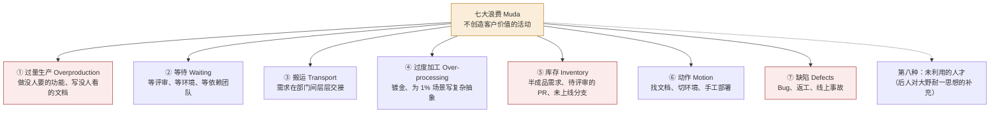
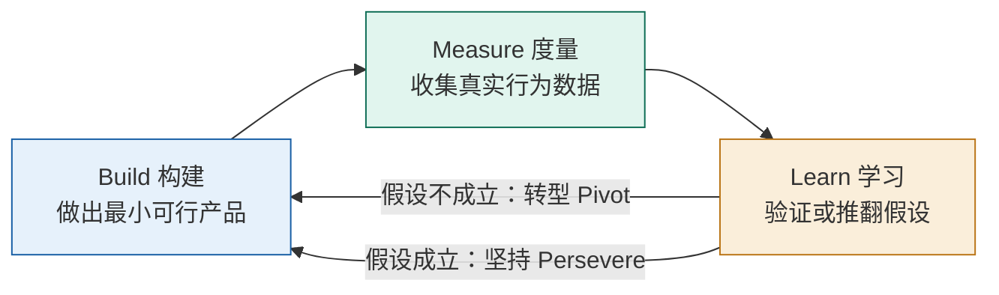
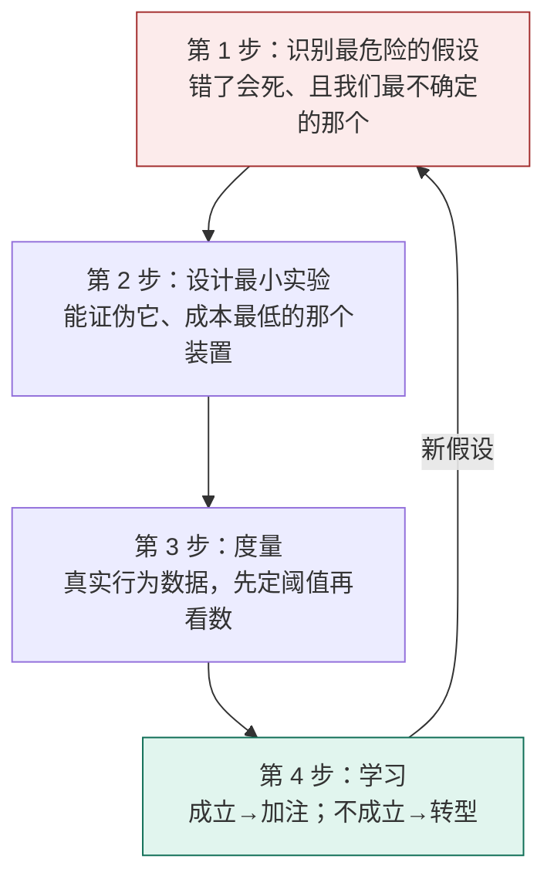
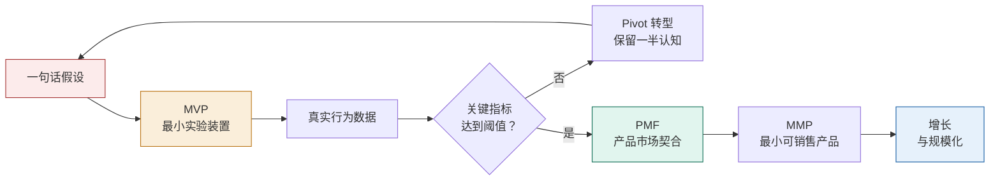

# 精益与 MVP：用最小成本验证最大的假设

> 定位：技术团队最贵的错误，不是代码写错了，而是「花了九个月，做出来一个没人要的东西」。精益（Lean）和 MVP（Minimum Viable Product，最小可行产品）就是治这个病的：先用最小成本验证「这件事值不值得做」，再决定投入多少。这篇讲清精益思想的来源与七大浪费、精益创业的 Build-Measure-Learn 循环，并重点讲透 MVP——它到底是什么、不是什么、怎么做、怎么度量、什么时候该转型。

## 一、为什么需要它

**场景 A**：团队憋了九个月，做了个「业界领先的智能推荐中台」，上线后日活不到三位数。复盘发现，立项时没人验证过「用户会不会用推荐」，所有人都在讨论「用协同过滤还是深度模型」。

**场景 B**：老板说「先做个 MVP 试试」，团队两周做了个功能砍半、bug 一堆、只跑通一条主流程的版本。用户试一次就再没回来，团队得出「这个方向不行」。

场景 A 是**没验证假设就重投入**，场景 B 是**把 MVP 理解成「功能残缺的半成品」**。两者缺的是同一个东西：**把「做产品」当成「做实验」的思维方式**——在资源有限、不确定性极高时，先用最小代价搞清楚「该不该做」，再讨论「怎么做好」。

> 一句话：MVP 不是「少做点功能」，而是「用最小的实验装置，回答一个最贵的问题」。

## 二、精益思想：从丰田车间到软件团队

### 2.1 源头：丰田生产系统（TPS）

精益不是软件行业发明的，它来自制造业。二战后的丰田资金少、市场小，没法像福特那样靠「大批量生产 + 大规模库存」摊薄成本，大野耐一（Taiichi Ohno）由此发展出**丰田生产系统（Toyota Production System，TPS）**。TPS 有两大支柱：

| 支柱 | 英文 | 含义 | 反面 |
|---|---|---|---|
| **准时化** | Just-in-Time（JIT） | 只在需要的时候、按需要的数量、生产需要的产品；上游按下游的「拉动信号」补货 | 提前大批量生产，堆在仓库里 |
| **自働化** | Jidoka | 异常发生时设备自动停机，不让缺陷流到下一道工序 | 带病生产，最后集中返工 |

顺带说一个你天天在用的东西：**看板（Kanban）** 就源自丰田——卡片作为「补货信号」，货架卖空了就送回上游。今天软件团队墙上的那块板，血缘在这儿。

1990 年 Womack 等人在《改变世界的机器》里把丰田的做法命名为「Lean Production」；1996 年《精益思想》进一步提炼出**精益五原则**：定义价值（由客户定义）→ 识别价值流 → 让价值流动 → 由下游拉动 → 追求完美（Kaizen）。

### 2.2 七大浪费：精益的核心诊断工具

大野耐一把「不创造价值的活动」叫**浪费（Muda）**，并归纳为七类（英文首字母缩写常记作 **TIMWOOD**）。这套分类放到软件研发里，惊人地贴切——下面这张图你先看「七种浪费分别对应研发里的什么」。

对照表（这张表建议收藏，做流程诊断时逐条打勾）：

| 浪费 | 制造业含义 | 软件研发中的典型表现 | 怎么消 |
|---|---|---|---|
| **过量生产** | 生产超过订单量 | 做了一堆没人用的功能；写了没人读的详细设计文档；提前优化没瓶颈的性能 | 按价值排序，只做验证过的需求；文档「够用即止」 |
| **等待** | 人等机器、等物料 | 等 Code Review、等测试环境、等运维审批、等外部团队接口 | 缩短评审 SLA、环境自助化、并行化依赖 |
| **搬运** | 物料在车间来回搬 | 需求在「产品→设计→开发→测试→运维」间反复转手，每次转手都丢信息 | 跨职能团队、端到端负责、减少交接点 |
| **过度加工** | 超出客户要求的精度 | 镀金（gold plating）、为假想需求做抽象层、过度设计、形式化的评审流程 | YAGNI、简单设计、按风险分级评审 |
| **库存** | 半成品和原料堆积 | 已评审未开发的需求、已开发未上线的功能、待合并的分支、待测的包 | 限制在制品（WIP）、小批量、持续交付 |
| **动作** | 工人走动、找工具 | 找文档、切分支、手工部署、在多个系统间复制粘贴 | 自动化、信息辐射器、一键环境 |
| **缺陷** | 不良品与返工 | Bug 修复、返工重做、线上事故处理 | 内建质量（TDD、CI、评审）、根因分析 |

### 2.3 精益在研发流程里的三个抓手

1. **价值流映射（Value Stream Mapping）**：挑一个典型需求，标出它从「提出」到「用户用上」的每一段时间。典型发现是：总周期 30 天，真正被处理的时间不到 3 天，其余 27 天都在排队。**优化排队，比优化编码速度收益大得多。**
2. **限制在制品（WIP Limit）**：每人同时干 5 件事，等于 5 件事都慢。看板的核心不是「可视化」，而是「限制同时进行的数量」，逼团队做完再开新的。
3. **减小批量**：大需求拆小、大 PR 拆小、大版本拆小。批量越小，反馈越快，出问题时爆炸半径越小——这是敏捷、持续交付、MVP 共同的底层逻辑。

## 三、精益创业：把创业变成实验

### 3.1 从丰田到硅谷

2011 年，Eric Ries 出版《精益创业》（The Lean Startup），把精益思想搬到「极端不确定性」的创业场景。思想源头有两个：**丰田的精益生产**（消除浪费、小批量、拉动）和 **Steve Blank 的客户开发**（2005 年《四步创业法》提出「先走出办公室找客户，再写代码」）。

Ries 的核心命题是：**创业公司不是「大公司的缩小版」，而是一个在极端不确定性下寻找「可重复、可规模化商业模式」的临时组织。** 它最该做的不是「执行计划」而是「做实验」——因为计划的前提（我们知道用户要什么）根本不成立。

由此引出最核心的概念：**经证实的认知（Validated Learning）**。注意「经证实」：不是「我们觉得用户会喜欢」，而是「我们用真实用户的行为数据证明了用户会喜欢」。团队每做一个功能，都该能回答「我们因此学到了什么」，而不是「完成了多少工作量」。

### 3.2 Build-Measure-Learn：最容易搞反的循环

这个循环看起来平平无奇，但 90% 的团队把它跑反了。正确用法是：**规划时逆时针想**（我要学到什么 → 用什么指标能证明 → 需要造什么最小的东西才能产出这个数据），**执行时顺时针跑**（造 → 测 → 学 → 下一轮）。错误用法是「顺时针规划」：先定功能、再找指标、最后从数据里「学点什么」——这时候学习变成了给既定方案找理由，循环就空转了。

Ries 还有一句关键提醒：**循环的速度，比每一轮的质量更重要。** 一个月转一圈、每圈都学到东西，远胜于半年转一圈、做得完美但方向错了。

### 3.3 两个必须先验证的假设

任何新业务，剥到最里面都只有两个假设：

| 假设 | 问题 | 验证方式 | 失败的后果 |
|---|---|---|---|
| **价值假设**（Value Hypothesis） | 用户真的有这个需求吗？用了之后会持续用吗？ | 留存曲线、使用频次、付费转化 | 做出来没人用 |
| **增长假设**（Growth Hypothesis） | 新用户从哪来？会自传播吗？ | 获客成本（CAC）、病毒系数（K 因子）、渠道转化率 | 有人用但长不大 |

**先验证价值假设，再验证增长假设。** 顺序反了就是灾难：一个没人要的产品，投放越多亏得越快。这也是很多「烧钱换增长」的公司死掉的根本原因——价值假设从来没被验证过。

### 3.4 创新核算（Innovation Accounting）

传统财务核算管的是「已确定的业务」，但新业务初期收入接近零，财务指标毫无意义。Ries 提出三步：**建立基线**（用 MVP 拿到第一组真实数据，哪怕很难看）→ **调优引擎**（每个循环让关键指标改善一点）→ **转型或坚持**（若干循环后指标仍不涨，就该换方向，而不是继续加人加班）。它让「我们到底有没有进展」变成一个可讨论的问题，而不是「老板觉得有进展」。

## 四、MVP：讲透这个被用烂的词

### 4.1 定义与由来

**MVP（Minimum Viable Product，最小可行产品）** 这个术语最早由 Frank Robinson 在 2001 年提出，后来被 Eric Ries 普及。Ries 的定义是：

> 「MVP 是这样一个产品版本：它能让我们用**最少的投入**，收集到关于客户的**最大量的经证实的认知**。」

把这个定义拆开，三个词各有讲究：

| 词 | 常见误解 | 真正含义 |
|---|---|---|
| **Minimum** | 功能最少 | **投入最少**——包括时间、人力、钱，也包括「不必要的功能」这种投入 |
| **Viable** | 能跑就行 | **能完成一次完整的价值闭环**：用户能从头到尾解决他的问题，哪怕很粗糙 |
| **Product** | 一个原型 | **真实产品**：真实用户、真实场景、真实行为数据（不是演示、不是问卷） |

所以 MVP 的准确定位是：**一个实验装置**。它的产出不是「一个产品」，而是「一组能支持决策的认知」。

### 4.2 目的：验证假设，不是省钱

这是最需要掰扯清楚的一点。很多团队做 MVP 的动机是「预算不够，先做点凑合的」，这是**省钱思维**，必然做出场景 B 那种半成品；正确的动机是**验证思维**。

| 维度 | 省钱思维（错） | 验证思维（对） |
|---|---|---|
| 出发点 | 「钱不够，砍功能」 | 「有个假设很贵，先花小钱验一下」 |
| 砍什么 | 「看起来不重要的功能」 | 「不影响验证假设的一切」 |
| 成功标准 | 「在预算内做完了」 | 「拿到了能支持决策的数据」 |
| 失败的标志 | 超预算 | 实验设计得无法证伪 |
| 典型产物 | 功能残缺的半成品 | 一个能回答问题的完整闭环 |

一句话区分：**省钱思维问「怎么少花钱」，验证思维问「怎么少花冤枉钱」。**

### 4.3 怎么做：四步法

**第 1 步：识别最危险的假设。** 不是「最重要的假设」，而是「**错了会死、且我们最不确定**」的那个。用「风险 × 不确定性」排序：

| | 我们很确定 | 我们很不确定 |
|---|---|---|
| **错了会死** | 先放着（已知风险，按常规做） | **① 最优先验证** |
| **错了不致命** | 最后再说 | ② 有空再验证 |

例如做「AI 简历优化」，假设有：用户愿意付费、改写质量够好、用户愿意上传简历、获客成本低于 50 元。最危险的是「用户愿意上传简历」——简历含隐私，不敢传则后面全白搭；而「AI 质量」用手工跑几十份简历就能验证，成本极低。

**第 2 步：设计最小实验。** 合格的实验必须**能证伪**（结果能明确判断真假）、**成本低**（通常两周内）、**有真实行为**（不是问「你会用吗」，而是看「你有没有用」）。假设要写成可验证的句式：

> 我们相信 **[目标用户]** 存在 **[某个具体问题]**，如果提供 **[某个方案]**，他们会 **[某个可观测的行为]**。我们用 **[某个指标]** 在 **[时间窗]** 内验证，达到 **[阈值]** 就继续投入，否则放弃。

**第 3 步：度量。** 关键纪律：**先定阈值，再看数据**。否则人一定会给任何结果找到合理解释（确认偏误）。

**第 4 步：学习。** 结论只有两种：加注或转型。**最没用的结论是「数据还不错，再看看」**——那说明实验设计失败了。

### 4.4 MVP 的形态谱系

MVP 不等于「写一个粗糙的 App」。按成本从低到高，常见的 MVP 形态有：

| 形态 | 做法 | 验证什么 | 成本 |
|---|---|---|---|
| **纸原型 / 可点击原型** | 用 Figma 画出流程，让用户「假装」操作 | 交互是否可理解、流程是否顺畅 | 小时级 |
| **假门（Fake Door / Landing Page）** | 做一个介绍页 + 注册按钮，点击后告知「即将上线」 | 需求是否真实存在（点击率） | 1-3 天 |
| **演示视频** | 不写产品，只做一段演示效果的视频 | 价值主张是否有吸引力 | 1-2 周 |
| **人工服务（Concierge）** | 后台全人工，用户以为有系统 | 需求是否成立、服务流程是否可行 | 1-2 周 |
| **伪装后台（Wizard of Oz）** | 前端是真产品，后端是人手工操作 | 同上，但用户体验更接近真实产品 | 2-4 周 |
| **单功能产品** | 只做最核心的一个功能，做扎实 | 核心价值是否被认可 | 2-6 周 |
| **预售 / 众筹** | 收钱或收定金 | 付费意愿（最硬的指标） | 1-4 周 |

选择标准只有一个：**哪种形态能以最低成本证伪最危险的假设。** 如果最危险的是「愿不愿意付钱」，纸原型再精美也没用，得做预售；如果最危险的是「能不能看懂交互」，预售也没用，得做原型。

### 4.5 三个真实案例

**案例 1：Dropbox——用一段视频验证「同步需求」**

2007 年，Drew Houston 想做文件同步工具。最大的风险是「同步」很难用语言讲清楚，而且网盘市场已经很挤。他没有先写分布式存储系统，而是做了个**三分钟演示视频**，展示「文件拖进去，另一台电脑上立刻出现」，发到 Hacker News 和 Digg。

结果：等待名单从 5,000 人一夜涨到 75,000 人——在产品还不存在的时候，就验证了「人们确实想要无痛的文件同步」。

> 来源：Eric Ries《The Lean Startup》案例，以及 Dropbox 创始人公开访谈。

**案例 2：Zappos——去鞋店拍照卖鞋**

1999 年，Nick Swinmurn 想验证「人们愿不愿意在网上买鞋」。他没有建仓库、没有进货，而是**去本地鞋店给鞋拍照挂到网站上；有人下单，他再去鞋店按零售价买下来邮寄给客户**。

这个模式不赚钱也不可规模化，但精确验证了核心假设：用户愿意在网上买鞋，且愿意等几天收货。验证通过后，才值得建仓库、谈品牌、做物流。Zappos 后来在 2009 年被亚马逊收购。

> 来源：《The Lean Startup》案例；Zappos 早期历史见创始人 Tony Hsieh 的公开访谈。

**案例 3：Buffer——一个按钮验证付费意愿**

2010 年，Joel Gascoigne 想做「社交媒体定时发布」工具。他先做了一个两页的落地页：一页讲价值主张，一页列三个价格方案。点任何方案，都弹出「这个功能还没做好，留个邮箱，上线通知你」。很短时间内他就收到了足够多的注册意向——**用户不仅表达了兴趣，还点了「价格」**，这比问卷强一百倍。

> 来源：Buffer 官方博客与创始人访谈（Joel Gascoigne 多次公开讲述）。

三个案例的共同点：**都是「假产品」**；**都在验证最危险的假设**；**都拿到了真实行为数据**（注册、下单、点击价格）；**都知道这不是最终形态**。

### 4.6 MVP vs 原型 vs PoC vs 试点

这四个词经常被混用，但目的完全不同：

| | 目的 | 面向谁 | 能不能用 | 产出 | 典型周期 |
|---|---|---|---|---|---|
| **MVP** | 验证商业假设（有人要吗、会付钱吗） | 真实目标用户 | **能用**（哪怕很粗糙） | 经证实的认知 + 行为数据 | 2-8 周 |
| **原型（Prototype）** | 验证交互 / 视觉 / 概念 | 团队、少量用户 | 通常不能用 | 设计反馈 | 天级 |
| **PoC（Proof of Concept）** | 验证技术可行性 | 技术人员 | 不能用 | 技术结论（能不能做） | 天到周级 |
| **试点（Pilot）** | 验证在真实环境能否稳定运行 | 受限的真实用户 | 能用 | 运行数据 + 推广依据 | 1-3 个月 |

一句话区分：**PoC 回答「能不能做」，原型回答「长什么样」，MVP 回答「该不该做」，试点回答「能不能铺开」。**

### 4.7 四个必须纠正的误区

**误区一：MVP = 功能残缺的半成品。** 错在「残缺」。MVP 可以功能很少，但**价值闭环必须完整**：Zappos 的流程是「浏览→下单→收货」，一步不少，只是后台是人工的。如果断在「下单后不知道什么时候发货」，那就是半成品。判断标准：**用户能不能独立完成一次完整的价值获取？**

**误区二：MVP = 不写代码的原型。** 不完全对。MVP **可以**是原型、视频、落地页，但判定标准不是「写没写代码」，而是「**有没有拿到真实用户的行为数据**」。没人点的落地页是失败的实验；能收集真实订单的人工服务，哪怕零代码，也是标准的 MVP。

**误区三：MVP 一旦上线就不迭代了。** MVP 是循环的起点，不是终点。路径是 MVP → 数据 → 学习 → 改进后的 MVP → 再数据……直到找到 PMF。上线即完工，是把实验当成了产品。

**误区四：MVP 就是「先上线再说，质量以后补」。** 最危险的一条。MVP 砍的是**功能范围**，不是**质量底线**：功能少但稳定用户能原谅，功能多但天天崩用户不会再来。涉及支付、隐私、数据安全的部分必须达标——**Viable 里包含「可信」**。

### 4.8 一个必须点明的同名不同义

搜索「MVP 架构」会看到大量 Android 文章讲 Model-View-Presenter（和 MVC、MVVM 并列的代码组织方式），**这跟本篇的最小可行产品（Minimum Viable Product）完全是两回事**，只是三个字母撞车——本板块讲的一律是后者。

## 五、度量：虚荣指标 vs 可执行指标

MVP 跑起来之后，最容易被做假的地方就是「度量」。

| 虚荣指标（Vanity Metrics） | 可执行指标（Actionable Metrics） |
|---|---|
| 累计注册用户数 | 周活跃率、次日/7 日/30 日留存 |
| 页面浏览量（PV） | 漏斗各步转化率 |
| App 下载量 | 激活率（下载后完成核心动作的比例） |
| 媒体报道数、微博转发量 | 付费转化率、客单价 |
| 总营收（不看成本） | CAC、LTV、LTV/CAC |
| 「新增用户创新高」 | 同群组（cohort）留存曲线是否在变好 |

好指标有三个属性（Ries 的总结）：**可执行**（变化能指导行动，如果「PV 涨了」你不知道该做什么，它就没用）、**可访问**（团队自己能拿到数据）、**可审计**（来源可追溯，不是手工填的 Excel）。

判断土办法：**问「这个数字翻倍，我们会改变什么决策？」** 答不上来就是虚荣。另一个工具是**同期群分析（Cohort Analysis）**：别看「总用户数」，要看「3 月注册的用户在第 1、2、4、8 周的留存」。每批新用户留存都在变好，才是真的进步；总量涨但每批留存跌，只是往漏水的桶里灌水。

## 六、转型（Pivot）与坚持

「转型」是精益创业里最被误解的词。**Pivot 不是「放弃」，也不是「换一个完全不相干的方向」，而是「保留一半、改变一半」**——保留已验证的认知（团队、技术、用户关系、部分洞察），改变被证伪的假设。Eric Ries 归纳了十种类型：

| 转型类型 | 含义 | 例子 |
|---|---|---|
| **Zoom-in / Zoom-out** | 一个功能放大成整个产品，或整个产品缩成别人的一个功能 | 内部工具变独立 SaaS；独立 App 变平台模块 |
| **客户细分** | 同样的产品，换一类用户 | 从大企业转向中小企业 |
| **客户需求** | 同样的用户，解决另一个问题 | 发现用户真正痛的不是 A 而是 B |
| **平台** | 应用变平台，或平台变应用 | 工具开放 API 变成生态 |
| **商业模式 / 价值获取** | 换收入结构或收费点 | 买断制转订阅制；向买方收费转向卖方收费 |
| **增长引擎 / 渠道** | 换增长方式或触达方式 | 付费投放转病毒传播；地推转线上自助 |
| **技术** | 用完全不同的技术实现同一价值 | 换一套底层架构或算法 |

**什么时候转型？** 依据不是「感觉不行了」，而是创新核算的数据：**投入若干完整循环后，关键指标仍在基线附近、且每轮改进幅度在收窄**——这说明不是执行不够好，而是假设有问题。**什么时候坚持？** 指标在持续改善，哪怕绝对值还低，这时需要耐心而不是换方向。**最糟的是「既不转型也不坚持」**——不做实验、不看数据、靠惯性往前推。

## 七、从 MVP 到规模化：演进路径

MVP 只是第一段路。完整的路径长这样：

几个关键节点：

- **PMF（Product-Market Fit，产品市场契合）**：用户开始「离不开」产品，留存曲线走平、自然增长出现，这是从「实验」转向「投入」的分水岭。
- **MMP（Minimum Marketable Product，最小可销售产品）**：功能足够完整、可以正式卖给主流客户的版本（Ash Maurya 等在《Running Lean》中讨论过）。MVP 面向早期尝鲜者，MMP 面向主流市场，差别在**可靠性、完整体验和可支持性**。
- **规模化**：这时才该考虑架构扩展、团队扩张、渠道投放。**在 PMF 之前做规模化，是把钱烧在验证过的错误上。**

## 八、怎么在团队里落地

精益和 MVP 不是「产品经理的方法论」，技术团队同样要参与：

1. **立项必须有一句话假设**（用 4.3 的模板），没有假设的需求不许排期。
2. **列出假设清单，按「风险 × 不确定性」排序**，只验证最危险的那一个。
3. **实验成本上限写进计划**（比如「两周、两人」），超了就停，重新设计。
4. **先定成功阈值，再看数据**，阈值写进文档，避免事后解释。
5. **明确「这是实验」**：实验性功能的代码可以糙，但必须可下线（用 Feature Flag 隔离），别污染主流程。

**落地反模式**：MVP 变成「永久版」（上线后没人迭代，技术债吞噬产品）、MVP 是技术团队的独角戏（假设是技术人自己编的）。

## 九、适用场景与选型

MVP 不是万能药。有些场景做 MVP 是**不负责任**的：

| 场景 | 该不该做 MVP | 理由 |
|---|---|---|
| 互联网新产品、新业务探索 | **强烈建议** | 不确定性最高，试错成本最低 |
| 内部工具、流程系统 | **建议** | 用户明确、范围可控，可先人工跑通再系统化 |
| To B 定制项目（合同已签） | **谨慎** | 范围是合同约定的，应理解为「分期交付」而非「验证假设」 |
| 核心交易/支付链路、金融核心 | **不适合** | 涉及资金安全与合规，不能用「粗糙版本」试 |
| 医疗、航空、工控等安全关键系统 | **不适合** | 失败代价是人身安全，必须完整验证 |
| 平台/基础设施（数据库、中间件） | **不适合** | 「可用」标准极高，MVP 思维会导致灾难 |

**务实建议**：

1. **MVP 的核心是「验证假设」，不是「少做功能」**。需求已经很确定时（比如「用户要能导出 Excel」），直接做就行，不用搞实验。
2. **粒度可以是「一个功能」而不是「一个产品」**。大公司里最有价值的用法是「新功能先小流量灰度，用数据决定是否全量」。
3. **先有度量能力，再做 MVP**。埋点、漏斗、留存都拿不到数据的团队，MVP 只能靠感觉判断，等于白做。

## 十、面试高频问法

**Q1：什么是 MVP？它和「功能残缺的半成品」有什么区别？**

**一句话结论**：MVP 是用最少投入获取最多经证实认知的产品版本，价值闭环完整但功能可以很少；半成品是价值闭环断裂的残次品。

展开：三个词拆开——Minimum 是投入最少，Viable 是能完成一次完整价值闭环，Product 是真实用户真实场景。判断标准是「用户能不能独立完成一次完整的价值获取」。

加分点：举 Zappos 的例子——没有仓库没有库存，但「浏览→下单→收货」闭环完整，所以它是 MVP 而不是半成品。

**Q2：MVP 的目的是什么？是为了省钱吗？**

**一句话结论**：不是省钱，是「少花冤枉钱」——用最小成本验证最危险的假设，避免在错误方向上重投入。

展开：省钱思维砍「看起来不重要的功能」，验证思维砍「不影响验证假设的一切」；前者标准是「预算内做完」，后者是「拿到能支持决策的数据」。

加分点：说清「MVP 的产出不是产品，是认知」，以及「一个无法证伪的实验，比不做实验更糟」。

**Q3：怎么识别「最危险的假设」？**

**一句话结论**：用「错了会不会死 × 我们有多不确定」两个维度排序，落在「会死且不确定」象限的就是最危险的假设。

展开：新业务通常只有两个假设——价值假设（有人要吗）和增长假设（能长大吗），先验证价值假设，再往下拆具体假设。

加分点：说明「最危险」不等于「最重要」——AI 简历产品里，最危险的是「用户敢不敢上传简历」，而不是「模型准不准」，因为后者能低成本手工验证。

**Q4：Build-Measure-Learn 循环怎么跑？最容易犯什么错？**

**一句话结论**：规划时逆时针（想学什么→用什么指标→造什么），执行时顺时针（造→测→学），最常见的错误是把它跑成「先定功能，再找指标，最后解释数据」。

展开：循环速度比单轮质量更重要；每轮必须产出一个明确结论（加注或转型），「再看看」等于实验失败。

加分点：提「经证实的认知」这个概念——判断标准是真实用户行为数据，不是团队的主观感受或问卷。

**Q5：虚荣指标和可执行指标怎么区分？**

**一句话结论**：可执行指标能指导行动、可访问、可审计；虚荣指标只能让汇报好看。

展开：累计注册数、PV、下载量是典型虚荣指标；留存曲线、漏斗转化率、CAC/LTV 是可执行指标。土办法是问「这个数字翻倍，我们会改变什么决策」。

加分点：提同期群分析（cohort）——看每批新用户的留存是否在变好，而不是看总量；再提「先定阈值再看数据」避免事后解释。

**Q6：MVP、原型、PoC、试点有什么区别？**

**一句话结论**：PoC 回答「能不能做」，原型回答「长什么样」，MVP 回答「该不该做」，试点回答「能不能铺开」。

展开：四者在面向对象、是否可用、产出物上完全不同；MVP 的独特之处是「面向真实用户、必须能用、产出行为数据」。

加分点：说明顺序不是强制的——技术风险高的项目先做 PoC，交互复杂的先做原型，但「该不该做」这个问题只能靠 MVP 回答。

**Q7：精益七大浪费在软件研发里怎么体现？**

**一句话结论**：过量生产=做没人要的功能，等待=等评审等环境，搬运=部门间交接，过度加工=镀金，库存=半成品需求和未上线分支，动作=找文档手工部署，缺陷=bug 和返工。

展开：软件里最隐蔽的是「库存」——写完但迟迟不上线的功能，会计上是资产，精益眼里是会腐烂的库存。

加分点：说「优化排队比优化编码速度收益更大」，并举价值流图的例子（30 天周期里真正处理不到 3 天）；再提限制 WIP、减小批量两个抓手。

**Q8：什么时候该 Pivot，什么时候该坚持？**

**一句话结论**：看创新核算的数据——投入多个完整循环后关键指标仍在基线附近、且改进幅度收窄，就该转型；指标在持续改善则坚持。

展开：Pivot 不是放弃，是「保留一半、改变一半」——保留验证过的认知（团队、技术、用户关系），改变被证伪的假设。十种类型里最常见的是客户细分、客户需求和 Zoom-in/Zoom-out。

加分点：指出最糟的状态是「既不转型也不坚持」——不做实验、不看数据、靠惯性推进；并强调转型决策要基于数据而非情绪。

**Q9：大公司/To B 业务怎么做 MVP？**

**一句话结论**：把 MVP 的粒度从「一个产品」降到「一个功能」或「一个客户」，用灰度、邀请制、人工服务控制暴露面。

展开：大公司做全新产品线风险高，更适合「内部创业 + 小流量灰度」；To B 可以用「灯塔客户」共创，用 3-5 个客户验证价值假设，再产品化。

加分点：提醒合规和品牌风险——金融、医疗等场景不能拿「粗糙版本」试；B 端合同项目里的 MVP 应理解为「分期交付的最小里程碑」。

**Q10：举一个你熟悉的 MVP 案例，说明它验证了什么假设。**

**一句话结论**：Dropbox 用三分钟演示视频验证「人们想要无痛的文件同步」，等待名单从 5,000 涨到 75,000，而产品当时还没写完。

展开：讲清「最危险的假设是什么」（需求是否真实存在、是否足够强）、「最小实验是什么」（视频而不是完整产品）、「拿到了什么数据」（真实注册行为，不是问卷）、「结论是什么」（加注，继续开发）。

加分点：再补一个反例——如果 Dropbox 先花两年做完分布式存储再上线，而需求不成立，损失的就是两年；这就是 MVP 的价值。也可以提 Buffer 的「点价格按钮」验证付费意愿。

**Q11：MVP 上线后数据不好，是不是就该放弃？**

**一句话结论**：不一定——先分清是「假设错了」还是「实验设计错了」，前者该转型，后者该重做实验。

展开：常见设计错误是目标用户选错、渠道错、指标错、样本太小。

加分点：一次实验失败不等于方向失败，要看多个循环的趋势。

## 小结

- 精益来自丰田 TPS：JIT（准时化）+ 自働化（异常停机），核心是消除浪费、持续改进；精益五原则是定义价值、识别价值流、流动、拉动、追求完美。
- 七大浪费（TIMWOOD）在软件里全部成立，最隐蔽也最致命的是「库存」——写完却迟迟不交付的功能。
- 精益创业（Eric Ries，2011）把创业当实验，核心是「经证实的认知」，工具是 Build-Measure-Learn 循环 + 创新核算。
- MVP 是「用最少投入获取最多经证实的认知」的产品版本：Minimum 是投入最少，Viable 是价值闭环完整，Product 是真实用户真实数据。
- MVP 的目的是验证假设而不是省钱；做法是「识别最危险假设 → 设计最小实验 → 先定阈值再度量 → 学习（加注或转型）」。
- 形态可以是视频、落地页、人工服务、单功能产品；判断标准是「有没有拿到真实行为数据」，不是「写没写代码」。
- 度量用可执行指标（留存、转化、CAC/LTV），不用虚荣指标；Pivot 是「保留一半、改变一半」，看多个循环的趋势。
- MVP 砍功能不砍质量；医疗、金融核心、安全关键系统不适合用 MVP 思维。
- 别把产品 MVP（Minimum Viable Product）和 UI 架构 MVP（Model-View-Presenter）搞混，只是缩写撞车。
