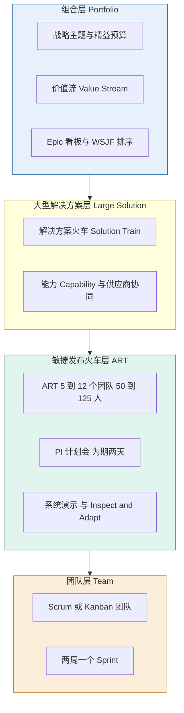
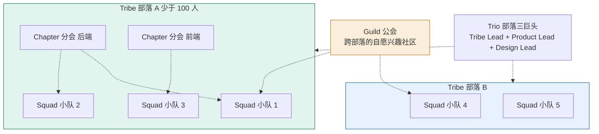
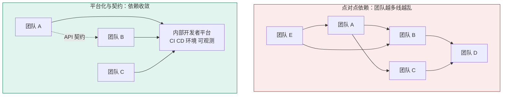

# 规模化敏捷

> 定位：一个团队用 Scrum 跑得很顺，不代表十个团队能一起跑顺。这一篇讲「规模化」到底难在哪、SAFe / LeSS / Spotify 模型 / Nexus 各自怎么解、代价是什么，以及一个反直觉的结论——**大多数组织的规模化问题，根因在架构和组织结构，不在流程框架**。上框架之前，先看清这一点。

## 一、为什么需要规模化敏捷

先说一个几乎所有中大型公司都经历过的场景。

三个团队的时候，Scrum 跑得挺好：两周一个 Sprint，站会十五分钟，评审会上产品经理点头，回顾会改两个小问题。团队有节奏，交付可预期，大家觉得自己「敏捷了」。

团队涨到十二个，事情开始变味：

- 每个团队都有自己的 Sprint 节奏，但**联调永远对不上**——A 团队第 3 天要的接口，B 团队排在第 9 天。
- 需求评审要开三轮：产品、架构、还有「那个团队」的代表。一个跨团队的需求，光对齐就要两周。
- 每个团队的 CI 都是绿的，一合并到集成分支就炸。谁的问题？没人认。
- 季度末要发一个大版本，所有人停下来做「集成冲刺」，两周里不写新功能，只修集成问题。
- 架构越来越糊：三个团队各自封装了一套「通用」工具类，第四个团队开始复制粘贴。

这就是规模化的真实痛点。它不是「Scrum 不够用」，而是**协调成本随团队数量超线性增长**。

数学很残酷。团队之间两两沟通的通道数是 $n(n-1)/2$：

| 团队数 | 沟通通道数 | 现实感受 |
|---|---|---|
| 3 | 3 | 喊一嗓子就行 |
| 8 | 28 | 需要固定的同步会 |
| 15 | 105 | 同步会开不完，必须分层 |
| 30 | 435 | 靠开会已经不可能，只能靠架构解耦 |

而**价值产出大致是线性的**（加一倍人，产出不会加一倍，布鲁克斯定律早就说过）。协调成本超线性、产出线性，两条线一定会在某个点交叉——过了这个点，加人越多越慢。

所以规模化敏捷要解决的核心问题只有一个：**怎么把协调成本压下去**。

所有框架，本质上只给了两条路：

1. **加协调机制**：定义更多的会、更多的角色、更多的同步点，把混乱装进流程里。SAFe 走这条路。
2. **减依赖**：让团队之间本来就不需要协调，靠架构边界、平台、契约把耦合切断。LeSS 和 Team Topologies 走这条路。

记住这个二分法，后面看每个框架就能一眼看出它的取舍。

## 二、规模化的三个真问题：依赖、对齐、集成

很多文章把规模化讲成「流程怎么排」，但真正让人痛苦的是下面三件事。它们互相纠缠，但根因不同，解法也不同。

| 问题 | 典型表现 | 根因 | 解法方向 |
|---|---|---|---|
| **依赖** | A 团队等 B 团队的接口；一个需求卡在三个团队的排期上 | 架构耦合 + 按组件而非按价值流切团队 | 架构解耦、API 契约、平台化 |
| **对齐** | 各团队目标不一致，重复造轮子；季度末才发现方向偏了 | 缺产品级目标；预算按项目而非按价值流 | 单一产品 Backlog、组合管理、统一 OKR |
| **集成** | 各自 CI 绿，合并就炸；集成问题攒到版本末期 | 集成太晚、环境不一致、DoD 不统一 | 持续集成、统一 DoD、集成团队 |

### 2.1 依赖：最贵的那种浪费

依赖的代价不是「等几天」，而是**排队**。一个团队等另一个团队两周，这两周里它的人力是沉没的；而被等的团队可能只是「排期排满了」。排队论里有个结论：**利用率接近 100% 的系统，等待时间趋于无穷**。多团队协作里，每个团队都排到 95% 利用率，跨团队交付的周期就会爆炸。

这就是为什么「大家都很忙，但东西就是出不来」。

### 2.2 对齐：没有共同目标的团队，越努力越偏

三个团队各自优化自己的 KPI，合起来可能是一场灾难。典型例子：A 团队为了「减少接口调用」做了本地缓存，B 团队为了「实时性」要求强一致——两个团队都很努力，系统却互相打架。

对齐不是靠开会喊口号，靠的是**结构**：一个产品一个 Backlog、一个负责人、一套共同的验收标准。这也是 LeSS 和 SAFe 都强调「一个 Product Owner」的原因。

### 2.3 集成：晚集成就等于没集成

持续集成的价值在于「每天都知道系统是不是好的」。一旦变成「两周合并一次」，集成问题就会攒成一座山，而修山的时间不可预测——这是版本延期最主要的来源。

### 2.4 别忘了康威定律

> 系统的架构，会复制组织的沟通结构。

这句话反过来也成立：**你想让系统怎么解耦，就得先让团队怎么解耦**。如果团队按「前端组/后端组/DBA 组/运维组」切，那系统必然长成四层大泥球；如果团队按「订单域/库存域/支付域」切，服务边界自然清晰。

所以规模化敏捷从来不只是流程问题，它是**组织设计 + 架构设计**的问题。只改流程不改组织和架构，等于给骨折的人换衣服。

## 三、SAFe：最流行，也最被争议

SAFe（Scaled Agile Framework）由 Dean Leffingwell 在 2011 年提出，是目前大型企业采用最广的规模化框架。它的特点可以用一句话概括：**把「敏捷」包装成一套管理层能看懂、能排期、能审计的体系**。

### 3.1 它长什么样

SAFe 用「层」来组织规模。以最常见的配置为例（不同版本的层级命名略有差异，比如「Program 层」在较新版本中也被称作 ART 层，具体以官方最新版本为准）：

看图要抓三个关键点：

- **越往上越「计划」**：组合层管钱和战略，团队层管两周的活。SAFe 的野心是把「年度预算」和「两周迭代」接起来。
- **ART 是核心发明**：一个 ART 就是「一个长期存在、围绕同一条价值流、5-12 个团队的组织」，人数 50-125。它比「项目组」稳定，比「部门」灵活。
- **PI 是核心仪式**：PI（Program Increment）是一个 8-12 周的时间盒，通常由 4 个两周 Sprint 加 1 个创新与计划 Sprint 组成。PI 计划会（PI Planning）是这个时间盒的起点，全体成员两天面对面，把接下来 8-12 周的目标、依赖、风险全部摊开。

### 3.2 几个必须搞清的概念

**PI Planning 的产出**不是「一张甘特图」，而是四样东西：

1. **PI 目标**：每个团队写下本 PI 要达成的业务目标（不是「做完 20 个故事」，而是「让下单转化率可归因」）。
2. **Program Board**：一张跨团队的依赖与里程碑图，把「谁等谁」可视化。
3. **风险板（ROAM）**：Resolved / Owned / Accepted / Mitigated，四类处理方式。
4. **信心投票**：每个团队用手指数 1-5 表示「达成 PI 目标的信心」，低于 3 就要当场调整计划。

**WSJF（Weighted Shortest Job First，加权最短作业优先）** 是 SAFe 的排序方法：

$$\text{WSJF} = \frac{\text{延迟成本 CoD}}{\text{作业时长}}$$

其中延迟成本 = 业务价值 + 时间紧迫性 + 风险降低与机会使能。这个公式的直觉是：**先做「拖一天损失大、做起来又快」的事**。它比「拍脑袋定优先级」强，但也很容易被滥用——打分变成政治博弈，人人都把自己的需求打满分。

**精益投资组合管理（LPM）** 是 SAFe 里最被低估的部分。它要解决的是「预算按项目走、团队被反复拆散」这个老大难：改成按价值流给长期预算，用参与式预算（participatory budgeting）决定投多少，用 Epic 看板管理大颗粒需求。

> 说句公道话：SAFe 里真正有价值的东西，很多不在「敏捷」部分，而在**组合管理**部分。大部分企业上 SAFe，实际解决的是「预算怎么分、大需求怎么排」，而不是「团队怎么自组织」。

### 3.3 为什么大企业爱它

- **现成的词汇表和日程表**。跨部门沟通最怕「各说各话」，SAFe 提供了一套共同语言（ART、PI、Epic、Capability、Feature、Story），沟通成本立刻下降。
- **把管理层关心的事纳进来了**。Scrum 只管团队，不管预算、不管架构治理、不管供应商；SAFe 全管，所以高层觉得「这个能落地」，而且 PI 目标、Program Board、I&A 改进项都可审计。
- **生态成熟**。认证、培训、咨询、工具，一整套都有。

### 3.4 它被批评什么

必须客观列出，因为这些批评在真实项目里经常应验：

| 批评 | 具体表现 |
|---|---|
| **太重** | 每 8-12 周两天全员 PI Planning，加上 SoS、PO Sync、系统演示、I&A，一个 PI 里光「协调仪式」就吃掉大量工时 |
| **伪敏捷** | 顶层还是年度预算和项目制，底层是 Sprint，中间用 PI 把瀑布切成三个月一段——本质是「三个月一次的瀑布」 |
| **角色膨胀** | RTE、SPC、STE、Epic Owner、Solution Manager……管理层级借着敏捷的名义复活了 |
| **自上而下** | 团队对「做什么」几乎没有话语权，PI 目标往往是上面拆下来的。这跟敏捷宣言的「自组织」是背离的 |
| **认证生意** | 培训与认证成为目标本身，出现「考了证但没跑过一个 PI」的 SPC |
| **只在软件团队生效** | 硬件、合规、采购、法务不按 PI 节奏走，ART 边界一到就被打回原形 |

批评者里有代表性的声音：Ron Jeffries 曾直言 SAFe 是「把敏捷做坏的一套配方」；也有人调侃「SAFe 是给管理层的一份安心剂」。这些是批评，不是定论，但它们指向同一个真问题：**SAFe 优化的是「可预测性」和「可管理性」，不是「适应性」**。

### 3.5 一个公允的结论

SAFe 不是「升级版 Scrum」，它是另一种东西：**用计划换协调**。

- 当你确实有 50 个以上团队、软硬件混合、多家供应商、强合规要求时，一套显式的协调机制是有价值的——总比每个月开一次「跨部门协调大会」强。
- 但当你的团队只有 6 个、架构本来就松耦合时，上 SAFe 就是给自己加了一层官僚。**很多组织上完 SAFe 反而更慢**，因为新增的仪式成本超过了它省下的协调成本。

判断标准很简单：**你省下的协调成本，能不能覆盖新增的仪式成本？** 算不清就别上。

## 四、LeSS：另一种哲学——「去规模化」

LeSS（Large-Scale Scrum）由 Craig Larman 和 Bas Vodde 提出，它的出发点和 SAFe 完全相反。

SAFe 的思路是「团队多了，加角色、加层、加仪式」。
LeSS 的思路是「团队多了，**什么都不加**」。

LeSS 有一句口号：**scale by descaling**（通过「去规模化」来实现规模化）。加团队的时候，不加新的角色、不加新的流程、不加新的层级，只是让多个团队共享同一套 Scrum。

### 4.1 规则极简，但很硬

LeSS 的核心规则可以浓缩成几条：

| 规则 | 含义 | 为什么这么定 |
|---|---|---|
| **一个 Product Owner** | 所有团队共用一个 PO，一个 Product Backlog | 保证优先级只有一份，避免「各团队各排各的」 |
| **一个产品 Backlog** | 需求只有一处，团队自己认领 | 消除「需求分发」这个中间层 |
| **一个 Definition of Done** | 所有团队用同一个「完成」标准，且必须是「集成后可用」 | 防止「我的部分做完了」这种局部完成 |
| **所有团队同一个 Sprint** | 同一个起止时间，同一个 Sprint 评审 | 保证每个 Sprint 末都有整体可交付增量 |
| **Feature Team 而非 Component Team** | 每个团队都能端到端交付一个用户可见的功能 | 这是减依赖的根本手段 |
| **整体回顾（Overall Retrospective）** | 除了团队回顾，还有跨团队回顾，专门解决系统性问题 | 团队回顾解决不了「组织和架构」的问题 |

规模上分两档：**LeSS** 适用于 2-8 个团队（最多约 8 个团队、每个 3-9 人）；**LeSS Huge** 适用于 8 个以上团队，会引入「需求领域（Requirement Area）」和「领域 Product Owner」，但整体结构仍然是「一个产品、一个总 PO」。

Sprint Planning 拆成两段：**Part 1** 全体一起，由 PO 讲清 Sprint 目标、团队自己认领需求；**Part 2** 各团队分开细化自己的任务。这个设计很妙——它把「对齐」和「细化」分开，前者必须一起做，后者可以并行。

### 4.2 LeSS 的理论根基

LeSS 的原则来自系统思考、排队论、精益和经验过程控制：**局部优化不等于全局优化**，减少在制品和批量才能压缩等待，复杂问题只能靠「透明—检视—调整」应对。所以它特别反对两件事：**组件团队**（制造依赖）和**团队级局部度量**（制造局部优化）。

### 4.3 LeSS 的问题

LeSS 的规则少，但对组织的要求极高：

- 它要求 PO 真的有权、真的懂业务、真的能拒绝需求。现实中很多 PO 只是「需求传声筒」。
- 它要求团队真的是 feature team，能从前端做到数据库。这要求人有较宽的能力面，也要求架构支持。
- 它要求组织真的敢改结构——把组件团队打散重组，这在很多公司是政治雷区。
- 它对「组合管理、预算、跨产品协同」几乎不给指导。你有 200 个团队、5 条产品线，LeSS 帮不了你。
- LeSS Huge 到了 8 个团队以上，Area PO 的结构也开始变复杂，「简单」的优势被稀释。

所以现实里 LeSS 的采用率远低于 SAFe。不是因为它不好，而是因为**它要求组织先变成「能做到 LeSS 的样子」，而大多数组织做不到**。

### 4.4 SAFe vs LeSS：一张表看清

| 维度 | SAFe | LeSS |
|---|---|---|
| 核心思路 | 加协调机制 | 减依赖，不加层 |
| 团队自主性 | 较低，目标自上而下拆 | 较高，团队自己认领 |
| 组织改动 | 可在现有结构上叠加 | 必须真改结构 |
| 组合管理 | 有完整方案（LPM） | 几乎不涉及 |
| 上手成本 | 高（培训、认证、仪式） | 中（规则少，但难做到） |
| 适合 | 大企业、强合规、多供应商 | 单一产品、团队能力成熟 |
| 主要风险 | 官僚化、伪敏捷 | 落不了地、半途而废 |

## 五、Spotify 模型：被误读最深的组织设计

如果说 SAFe 是「流程框架」，Spotify 模型更像「组织设计参考」。它在 2012 年由 Henrik Kniberg 和 Anders Ivarsson 在一份白皮书里描述，随后被全球无数公司奉为模板。

### 5.1 结构：Squad / Tribe / Chapter / Guild

四个概念，各管一件事：

| 单元 | 规模 | 职责 | 类比 |
|---|---|---|---|
| **Squad 小队** | 6-12 人 | 跨职能、端到端负责一个长期使命，像「迷你创业公司」 | 一个全栈小公司 |
| **Tribe 部落** | 少于 100 人 | 若干相关 Squad 的集合，共享业务领域 | 一个事业部 |
| **Chapter 分会** | 部落内同工种 | 统一技术标准、人员成长、绩效沟通 | 职能线的「虚线」 |
| **Guild 公会** | 跨部落，自愿 | 兴趣社区，知识分享 | 公司内的技术社区 |

还有一个常被忽略的 **Trio**：Tribe Lead（管人和交付）、Product Lead（管做什么）、Design Lead（管体验），三个人共同对部落负责。这个设计是为了避免「产品说了算」或「技术说了算」的单一视角。

### 5.2 它的核心思想其实只有一句

> **Loosely coupled, tightly aligned**——松耦合，强对齐。

- **松耦合**：Squad 之间尽量少依赖，能自己决定就自己决定。
- **强对齐**：所有 Squad 对「公司要去哪」有共同理解，不需要层层下达。

这句话比任何组织结构图都重要。**组织结构只是实现这句话的一种手段**，而且是一种有时效性的手段。

### 5.3 一个必须说清的事实：Spotify 自己也不推荐照抄

这是很多介绍文章避而不谈的：

- 那份 2012 年的白皮书，本质是**对当时 Spotify 状态的一次「快照」**，不是一份「推荐模型」。作者自己说过，他们只是在描述「我们碰巧长成这样」。
- Spotify 后来多次公开表示，外界把这份文档当成了固定模板，是一种误读；组织本身一直在调整，Squad 的边界、Chapter 的职责都变过。
- 2020 年前后，有研究者（如 Jeremiah Lee 的《Spotify's Failed #SquadGoals》）通过访谈指出：外界传颂的很多细节，在 Spotify 内部并不成立——比如 Chapter Lead 并不是真正的直线经理，Guild 的实际影响力很弱，Squad 的「完全自主」也有大量例外。

所以正确的态度是：**把它当成「组织设计的思路库」，不是「实施蓝图」**。

值得借鉴的是这几条思路，而不是那张图：

1. **按使命而不是按项目组织团队**：项目结束团队就散，是巨大的浪费。
2. **小队端到端负责**：从需求到上线到运维，一个队伍全包，减少交接。
3. **弱矩阵的专业社区**：技术标准靠 Chapter/Guild 横向拉齐，而不是靠「架构评审委员会」。
4. **自主权换对齐**：给自主权的前提是「目标足够清晰」。

不值得照抄的是：具体的人数、具体的角色名、具体的汇报关系。那些是 Spotify 在特定阶段、特定业务下的产物。

## 六、Nexus：Scrum.org 的答案

Nexus 是 Ken Schwaber（Scrum 创始人之一）和 Scrum.org 提出的规模化框架，知名度比 SAFe 低很多，但设计上更「克制」。

### 6.1 结构

- **3-9 个 Scrum Team** 共同开发一个产品。
- **一个 Product Owner、一个 Product Backlog、一个 Definition of Done**（注意：DoD 必须是「集成后可用」，不是「单团队完成」）。
- 多了一个 **Nexus Integration Team（NIT，集成团队）**，由 PO、Scrum Master 和技术负责人组成，专门负责「集成」和「移除跨团队障碍」。

### 6.2 事件

在标准 Scrum 事件之外，Nexus 加了几个「跨团队」版本：

| 事件 | 作用 |
|---|---|
| **Nexus Sprint Planning** | 各团队先各自细化，再一起对齐依赖，形成 Nexus Sprint Backlog |
| **Nexus Daily Scrum** | 各团队代表同步，重点是「今天有哪些跨团队依赖需要解决」 |
| **Nexus Sprint Review** | 评审「集成后的整体增量」，不是各团队分别演示 |
| **Nexus Sprint Retrospective** | 先各团队回顾，再一起做跨团队回顾 |
| **Refinement** | 跨团队一起细化 Backlog，提前暴露依赖 |

### 6.3 关键点：NIT 不是架构组

这是最容易搞错的地方。NIT 的职责是「让集成持续发生」，不是「做架构决策」，也不是「管理层」。它更像一个**服务型的集成保障小组**：提供集成环境、推动契约测试、协调接口变更、在跨团队障碍卡住时出面解决。

如果 NIT 变成了「架构评审委员会」，Nexus 就退化成了「带审批的 Scrum」。

### 6.4 客观评价

优点：

- **规则少**，学习成本低，跟 Scrum 一脉相承。
- **聚焦集成**，这是规模化最真实的痛点。
- 不引入庞大的角色体系，管理层级不会膨胀。

缺点：

- **只解决集成，不解决组合管理**。预算怎么分、大需求怎么排、多产品线怎么协同，Nexus 不管。
- **影响力小**，生态、培训、工具远不如 SAFe，落地时缺少外部支持。
- 对「团队能力」的要求和 LeSS 类似——如果团队做不了端到端，NIT 会被压垮。

## 七、跨团队依赖：规模化的真正战场

前面四个框架，本质上都在处理依赖。但依赖有四类解法，而且**顺序不能反**。

左边是大多数组织的真实状态：n 个团队，接近 n² 条依赖线，每条线都要开会协调。右边是解耦后的状态：依赖收敛到「平台」和「契约」两个稳定接口，团队之间的直接耦合大幅减少。

四种解法，按优先级排：

### 7.1 消除依赖：靠架构和组织边界

- **模块边界 = 团队边界**。一个团队负责一个能独立部署的服务/模块，改它不需要别人同意。
- **API 契约先行**。接口定义（OpenAPI / Protobuf / 事件 Schema）先定，双方并行开发，用契约测试保证不破。
- **平台化**。把「每个团队都要做一遍」的事（CI/CD、环境、日志、监控、鉴权、配置）收进平台，团队自助使用。这是投入产出比最高的一招。

### 7.2 减少依赖：控制同时在飞的东西

- **组合层限流**。同时在做的 Epic 越少，依赖越少。SAFe 的 Epic 看板、LeSS 的「一个 Backlog」，本质都是限流。
- **减少团队数**。听起来反直觉，但「两个团队合并成一个」经常比「加一套协调机制」更有效。
- **按价值流切团队**，而不是按技术分层切。

### 7.3 缓冲依赖：让等待不致命

- **排期留缓冲**。跨团队交付的估算，加 30%-50% 缓冲不是保守，是诚实。
- **Feature Flag**。功能没齐也能上线，把「集成」从「大爆炸」变成「渐进」。
- **契约测试 + 消费者驱动契约**。让「接口变了会不会炸」在提交时就知道。

### 7.4 协调依赖：最后才用的手段

- Scrum of Scrums（SoS）：各团队代表定期同步。
- 依赖看板 / Program Board：把「谁等谁」可视化。
- 定期跨团队同步会。

**顺序很重要**：先解耦，再限流，再缓冲，最后才协调。大多数组织反了——依赖一大堆，然后开无数同步会，用会议来「管理」本可以通过架构消除的耦合。这就是所谓的「协调税」。

### 7.5 用 Team Topologies 的语言重新描述

如果你想找一套比 SAFe 更「底层」的组织设计语言，推荐 Team Topologies（Matthew Skelton & Manuel Pais）。它只定义四种团队类型和三种交互模式：

| 团队类型 | 职责 |
|---|---|
| **Stream-aligned（价值流团队）** | 端到端负责一条业务流，是主力 |
| **Platform（平台团队）** | 提供自助服务，降低认知负荷 |
| **Enabling（赋能团队）** | 短期进入其他团队，帮其补齐能力 |
| **Complicated-subsystem（复杂子系统团队）** | 负责需要深度专业知识的模块（如算法、编解码） |

| 交互模式 | 含义 |
|---|---|
| **Collaboration（协作）** | 两个团队短期深度合作，成本高，不宜长期 |
| **X-as-a-Service（服务化）** | 一方提供、一方使用，边界清晰，是目标状态 |
| **Facilitating（赋能）** | 一方帮另一方成长，完成后退出 |

这套语言的好处是：它不告诉你「开什么会」，而是告诉你「团队边界该怎么画、交互该怎么收敛」——**比任何规模化框架都更接近问题的本质**。

## 八、怎么落地：不要一上来就选框架

按这个顺序走，能避开 80% 的坑：

| 步骤 | 做什么 | 关键判断 |
|---|---|---|
| **1. 量化问题** | 测交付周期、集成频率、跨团队依赖数、缺陷逃逸率 | 没有基线，改进就无法证明有效，只能靠「感觉变好了」交差 |
| **2. 做好单团队** | 每个 Sprint 产出可发布增量；回顾改进项下个 Sprint 真的落地 | 单团队跑不顺，上规模化只会把混乱放大 10 倍 |
| **3. 投架构与平台** | 拆服务、定契约、建内部开发者平台 | 平台 6-18 个月见效，但是复利；流程是止痛药，平台是治病 |
| **4. 按需取用框架** | 只拿需要的部分：只要 PI Planning，不拿角色体系和认证 | 框架是工具箱，不是宗教 |
| **5. 度量系统** | flow metrics + DORA 四指标 + 团队健康度 | 绝不用故事点或人天跨团队比较，那会把协作变成竞争 |

### 规模与建议对照

| 团队规模 | 建议 | 理由 |
|---|---|---|
| 1-2 个团队 | 不需要任何规模化框架 | 直接沟通成本最低 |
| 3-8 个团队 | Scrum of Scrums / Nexus / LeSS 思路 | 需要轻量同步机制，不需要重流程 |
| 8-30 个团队 | SAFe Essential 或自建协调机制 + 平台 | 需要组合层对齐和跨团队节奏 |
| 30 个团队以上 | 组合管理 + 价值流 + 平台工程 + 组织设计 | 流程已不够，必须动结构和架构 |

## 九、常见坑与反模式

### 坑 1：把 SAFe 当项目管理工具用

**现象**：上了 SAFe，但只用了 PI Planning——每个 PI 开头开两天会，把任务分下去，然后照旧按项目管。ART 没有稳定团队，PI 结束团队就散。
**原因**：只学了仪式，没学「稳定团队 + 长期价值流」的内核。
**解法**：ART 必须是**长期存在**的组织，不是临时项目组。团队稳定是 SAFe 有效的前提，也是它最容易被破坏的前提。

### 坑 2：只改流程，不动架构

**现象**：开了无数同步会、依赖看板贴满墙，交付周期还是三个月。
**原因**：依赖是架构造成的，会议只能「管理」依赖，不能「消除」依赖。
**解法**：先做依赖热力图，找出 Top 10 依赖，逐条问「能不能靠改接口/拆服务/平台化消掉」。

### 坑 3：成立「敏捷 PMO」

**现象**：为了推敏捷，成立了一个「敏捷转型办公室」，负责制定流程、检查合规、收集报表。
**原因**：用官僚手段推反官僚的变革。
**解法**：转型团队应该是**赋能型**的（教练、培训、试点），不是**管控型**的。人越少越好，18 个月后应该解散。

### 坑 4：跨团队比较 velocity

**现象**：管理层拿各团队的「速度」排名，快的表扬，慢的问责。
**原因**：把「估算单位」当成了「产出单位」。
**解法**：故事点只用于团队内部预测，绝不跨团队比较。跨团队只看**交付的业务结果**和**flow metrics**。

### 坑 5：照抄 Spotify 组织图

**现象**：画了一张 Squad/Tribe/Chapter 的图，改了组织架构和 title，业务照旧。
**原因**：抄了形，没抄神。Spotify 模型的核心是「松耦合强对齐」，不是那张图。
**解法**：先问「我们的团队能不能端到端负责一个使命」，再谈组织单元怎么叫。

### 坑 6：忽略硬件、合规、供应商的现实

**现象**：软件团队按两周迭代，硬件三个月一出，采购半年一签，法务评审四周。ART 的节奏一到边界就碎。
**原因**：把「软件敏捷」的假设套到了整个价值链上。
**解法**：承认约束，做「分层节奏」——软件快跑，硬件和合规按自己的节奏，用接口和缓冲解耦。

## 十、适用场景与选型

### 10.1 一张决策表

| 你的处境 | 建议 | 关键动作 |
|---|---|---|
| 3-8 个团队，单一产品，团队能力成熟 | LeSS 思路或 Nexus | 一个 Backlog、feature team、统一 DoD、跨团队回顾 |
| 10-50 个团队，多产品线，强合规 | SAFe Essential + LPM | 稳定 ART、PI 节奏、Epic 看板、精益预算 |
| 组织想「试点」但不想大改 | 自建轻量协调 | SoS + 依赖看板 + 季度对齐会，别急着上框架 |
| 依赖极重、架构耦合 | 先做架构解耦和平台 | 拆服务、定契约、建 IDP，流程往后放 |
| 团队能力弱、单团队 Scrum 都没跑顺 | 先练基本功 | 先把「每个 Sprint 可发布」做到，再谈规模化 |
| 硬件 + 软件 + 供应商混合 | 分层节奏 | 软件 ART + 硬件里程碑 + 供应商合同节点，用缓冲连接 |

### 10.2 什么时候不该上规模化框架

这一节比「什么时候该上」更重要：

1. **团队数少于 5 个**。直接沟通就够了，任何框架都是负担。
2. **单团队 Scrum 还没跑顺**。规模化会放大混乱，不会修复混乱。
3. **组织结构和文化没准备好**。如果部门墙比天高、预算按项目走、领导要「看到每个人在忙」，上什么框架都会变形。
4. **架构是一坨耦合**。依赖不消除，框架只能让依赖「更有序地」拖慢你。
5. **你只是想要一个「我们也在敏捷」的说法**。为了对外宣传上框架，最后一定是「僵尸敏捷」——仪式齐全，交付不变。
6. **没有耐心**。规模化转型以「年」为单位，指望三个月见效的，通常三个月后就开始骂「敏捷没用」。

## 十一、面试高频问法

> 这类问题在「技术经理 / 架构师 / 技术负责人」岗位特别常见。答题的关键不是背框架，而是**展示你判断过代价**。

**Q1：什么是规模化敏捷？为什么单团队敏捷容易，多团队就难？**

**一句话结论**：规模化敏捷是「让多个团队围绕一个产品协同交付」的方法体系；难的根本原因是协调成本随团队数超线性增长，而产出线性增长。

展开：团队间沟通通道是 n(n-1)/2，8 个团队 28 条，30 个团队 435 条。协调成本超线性、产出线性，必然交叉。再加上康威定律——架构会复制组织沟通结构，所以团队一多，系统也跟着耦合。

加分点：点出「两条路」——加协调机制（SAFe）或减依赖（LeSS / 平台化 / Team Topologies），并说明后者的投入产出比通常更高。

**Q2：SAFe 的核心概念有哪些？**

**一句话结论**：ART（敏捷发布火车，5-12 个团队、50-125 人）、PI（8-12 周的时间盒）、PI Planning（两天全员对齐，产出 PI 目标和 Program Board）、精益投资组合管理（按价值流给预算、Epic 看板、WSJF 排序）。

加分点：说清 WSJF = 延迟成本 / 作业时长，延迟成本 = 业务价值 + 时间紧迫性 + 风险降低；再说一句「SAFe 真正有价值的部分往往是组合管理，不是团队层的仪式」。

**Q3：SAFe 有什么问题？为什么很多组织上了反而更慢？**

**一句话结论**：SAFe 优化的是可预测性和可管理性，不是适应性；它用「加仪式」换「减协调」，当仪式成本超过协调收益时，整体就变慢。

展开：具体问题包括仪式过重（每 PI 两天全员 Planning）、伪敏捷（顶层年度预算 + 底层 Sprint，中间切成三个月一段）、角色膨胀（RTE/SPC/STE）、团队自主性低、认证生意化。

加分点：给一个判断标准——「省下的协调成本能否覆盖新增的仪式成本」，并承认它在 50+ 团队、强合规、多供应商场景下确实有价值。

**Q4：LeSS 和 SAFe 的本质区别是什么？**

**一句话结论**：SAFe 是「加层加角色加仪式」，LeSS 是「什么都不加，靠一个 Backlog、一个 PO、一个 DoD 和 feature team 来减依赖」。

展开：LeSS 的口号是 scale by descaling；规则少但很硬（一个 PO、一个 Backlog、统一 DoD、所有团队同一 Sprint、feature team、整体回顾）；对组织成熟度要求极高，几乎不给组合管理指导。

加分点：说「LeSS 不是更轻的 SAFe，它是另一种哲学——它要求组织先变成能做到 LeSS 的样子」。

**Q5：Spotify 模型是什么？可以直接抄吗？**

**一句话结论**：Squad（6-12 人端到端小队）/ Tribe（<100 人）/ Chapter（同工种分会）/ Guild（跨部落社区），核心思想是「松耦合、强对齐」；不能直接抄，Spotify 自己都说那是快照不是模板。

展开：2012 年白皮书是描述当时状态；Spotify 后续多次澄清被误读；有研究（Jeremiah Lee）指出很多细节在内部并不成立。可借鉴的是「按使命组织、端到端负责、弱矩阵专业社区、自主权换对齐」，不可抄的是具体人数和汇报关系。

加分点：能说出「组织结构是手段，松耦合强对齐才是目的」，这一句就能区分「看过文章」和「想过」。

**Q6：Nexus 是什么？NIT 是架构委员会吗？**

**一句话结论**：Nexus 是 Scrum.org 的规模化框架，3-9 个 Scrum 团队 + 一个 Nexus Integration Team，共用一个 PO、一个 Backlog、一个集成级 DoD。

展开：加了 Nexus Sprint Planning / Daily / Review / Retrospective 和 Refinement 的跨团队版本；NIT 由 PO、SM、技术负责人组成，职责是保障集成和移除跨团队障碍。

加分点：明确指出 NIT 不是架构评审委员会也不是管理层——一旦变成审批机构，Nexus 就退化成「带审批的 Scrum」。

**Q7：多团队依赖怎么管？**

**一句话结论**：按「消除 → 减少 → 缓冲 → 协调」的顺序，先改架构和组织边界，最后才开会。

展开：消除靠模块边界=团队边界、API 契约、平台化；减少靠组合层限流、减少同时在飞的 Epic、按价值流切团队；缓冲靠排期留 30%-50%、Feature Flag、契约测试；协调靠 SoS、依赖看板、定期同步。

加分点：说「大多数组织顺序反了，用会议管理本可以靠架构消除的耦合」，并提一句「协调税」这个概念。

**Q8：什么时候不该上规模化框架？**

**一句话结论**：团队少于 5 个、单团队 Scrum 没跑顺、组织文化没准备、架构耦合严重、只想对外有个说法、没有 1-2 年耐心——这六种情况都别上。

加分点：补一句「框架是工具箱不是宗教，可以只取 PI Planning 不取角色体系」，展示务实态度。

**Q9：规模化之后怎么度量？**

**一句话结论**：度量系统而不是人——用 flow metrics（周期时间、吞吐量、在制品）看流动，用 DORA 四指标看交付能力，用团队健康度看可持续性；绝不用故事点跨团队比较。

加分点：强调「跨团队比较 velocity 会立刻把协作变成竞争」，这是最常见的度量反模式。

**Q10：如果让你给一个 20 个团队的组织做敏捷转型，你的第一步是什么？**

**一句话结论**：不是选框架，是测基线 + 找瓶颈。

展开：先测交付周期、集成频率、跨团队依赖数、缺陷逃逸率；画价值流图找最大等待点；如果是架构耦合，先解耦和建平台；如果是对齐问题，先建组合层节奏；最后才决定要不要框架、要哪一部分。

加分点：给出时间预期（平台 6-18 个月、转型以年计），并说「先做两个试点团队，成功再推广」，这比「全面铺开」务实得多。

## 小结

- 规模化的核心矛盾：**协调成本超线性增长，产出线性增长**。解法只有两条——加协调机制，或减依赖。
- 三个真问题：**依赖、对齐、集成**。依赖最贵，因为它在制造排队。
- **SAFe**：用计划换协调。强在组合管理和共同语言，弱在重、伪敏捷、角色膨胀。适合 50+ 团队、强合规、多供应商。
- **LeSS**：scale by descaling。一个 PO、一个 Backlog、一个 DoD、feature team、同一 Sprint。规则少但对组织要求极高。
- **Spotify 模型**：Squad/Tribe/Chapter/Guild，核心是「松耦合强对齐」。是思路库不是模板，Spotify 自己都澄清过被误读。
- **Nexus**：3-9 团队 + NIT，聚焦集成，轻量但不覆盖组合管理。
- 依赖解法有优先级：**消除 > 减少 > 缓冲 > 协调**。大多数组织顺序反了。
- 落地顺序：测基线 → 做好单团队 → 投架构和平台 → 按需取用框架 → 度量系统不度量人。
- 六种情况别上框架：团队太少、基本功没练好、文化没准备、架构太耦合、只想有个说法、没有耐心。
- 一句话：**先看依赖，再看规模，最后才看框架。**
