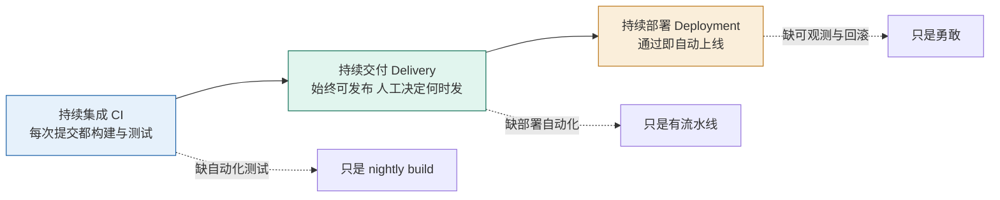
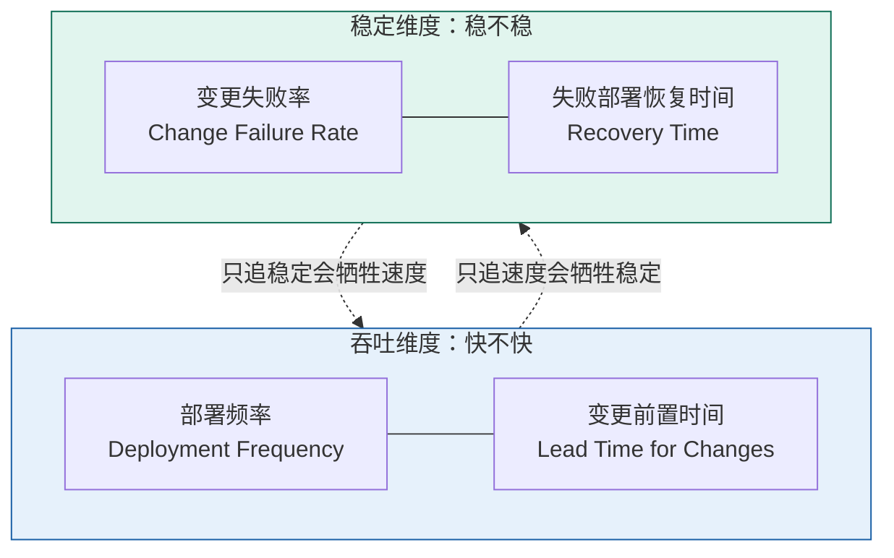

# DevOps与持续交付

> 定位：DevOps 是过去十五年最被滥用、也最被误解的词之一。有人以为它是「一套工具链」，有人以为它是「一个叫 DevOps 的团队」，还有人以为「上了 Kubernetes 就是 DevOps」。这一篇讲清它的起源、CALMS 框架、持续交付与持续部署的真实差别、部署流水线怎么设计、DORA 四指标怎么读，以及为什么**绝大多数 DevOps 转型失败，不是因为工具不行，而是因为责任没有重新分配**。

## 一、起源：一堵墙

故事要从一个组织现象讲起。

传统软件公司里，开发团队和运维团队的 KPI 是**互相冲突**的：

- 开发的考核是「按时上线新功能」。所以他们希望变更越多越快越好。
- 运维的考核是「系统稳定、不出故障」。所以他们希望变更越少越好。

同一个变更，在开发眼里是「价值」，在运维眼里是「风险」。于是出现了一个经典场景：

1. 开发写完代码，打个包，写一份《部署手册》，扔给运维。
2. 运维照着手册配环境，发现少了个依赖、端口对不上、配置文件是开发本机的路径。
3. 打回重来。来回三次，两周过去。
4. 上线当晚全员加班，出问题互相甩锅：「你给的包有问题」「你环境配错了」。

这就是所谓 **「混乱之墙」（wall of confusion）**。墙的两边各有各的合理性，但系统的整体效率被这堵墙吃掉了。

更糟的是「**甩锅结构**」：开发者不需要为线上故障负责，运维不需要为交付速度负责。**没有人对「从提交代码到用户用上」这个完整流程负责**。所有等待、返工、故障，都掉进了两个部门之间的缝里。

### 1.1 DevOps 这个词怎么来的

- 2008 年前后，Andrew Clay Shafer 和 Patrick Debois 在敏捷社区里讨论「Agile Infrastructure」（敏捷基础设施）——既然开发可以敏捷，基础设施为什么不能？
- 2009 年，Patrick Debois 在比利时根特组织了第一届 **DevOpsDays**，「DevOps」这个词从此传开。
- 之后三本书奠定了它的理论体系：《The Phoenix Project》（用小说讲清价值流）、《The DevOps Handbook》（实践手册）、《Accelerate》（用数据证明哪些实践真的有效）。

注意一个细节：**DevOps 从一开始就不是技术方案，而是一场「关于责任怎么分」的运动**。技术只是让它变得可行的条件——虚拟化、云、容器、IaC 让「环境」从「手工配置的机器」变成了「可以版本化的代码」，这才让开发和运维的职责有可能合并。

### 1.2 思想源流

DevOps 不是凭空长出来的，它至少吸收了四股思想：

| 来源 | 贡献 |
|---|---|
| **精益生产**（丰田） | 价值流、消除浪费、减少批量、拉动式生产 |
| **约束理论**（Goldratt） | 系统产出由瓶颈决定，优化非瓶颈毫无意义 |
| **敏捷** | 小批量、快速反馈、自组织团队 |
| **高可靠性组织（HRO）** | 无责复盘、对失败的敬畏、持续学习 |

这四股思想解释了 DevOps 为什么强调「端到端」而不是「局部优化」——**局部最优加起来不等于全局最优**，这是精益和约束理论最核心的洞见。

## 二、CALMS：五个字母，一张体检表

业界常用 **CALMS** 来概括 DevOps 的五个维度。它由 Damon Edwards、John Willis 等人在 2012 年前后总结提出，后来成为最通用的框架。

| 维度 | 核心含义 | 反例（说明你没做到） |
|---|---|---|
| **C — Culture 文化** | 共担责任、无责复盘、心理安全 | 一出故障先找「谁干的」 |
| **A — Automation 自动化** | 构建、测试、部署、环境、配置全部自动化 | 发布靠一份 20 步的手工 checklist |
| **L — Lean 精益** | 小批量、限流、消除等待、价值流视角 | 一个版本憋 3 个月，一次上 200 个变更 |
| **M — Measurement 度量** | 度量端到端，而不是局部；用数据驱动改进 | 只统计「代码行数」「故事点」 |
| **S — Sharing 分享** | 知识、工具、责任共享，打破部门墙 | 运维有一套自己的脚本，开发不知道 |

### 2.1 五个维度不是并列的

很多人把 CALMS 当成五个独立的「成熟度项」，一个个打分。这是误读。

它们的关系是：**Culture 是地基，Automation 是杠杆，Lean 是方向，Measurement 是眼睛，Sharing 是黏合剂**。

- 没有 Culture，自动化会被用来「监控员工」，度量会被用来「排名问责」。
- 没有 Automation，精益就是空谈——手工流程没法小批量。
- 没有 Lean 的方向，自动化会把「浪费」也自动化掉（比如自动生成一堆没人看的报表）。
- 没有 Measurement，你无法知道改进有没有效。
- 没有 Sharing，每个团队都会重复造轮子。

一个常见的失败模式是：**只做 A（自动化），不做 C（文化）**。结果是把「手工的低效」变成了「自动化的低效」，而且更快地制造故障。

## 三、CI / 持续交付 / 持续部署：三个词必须分清

这三个词经常被混用，但它们的门槛完全不同。

| 概念 | 英文 | 定义 | 关键前提 |
|---|---|---|---|
| **持续集成** | Continuous Integration, CI | 每个开发者频繁（至少每天）把代码合并到主干，每次合并都触发构建和自动化测试 | 主干开发、小批量提交、构建要快 |
| **持续交付** | Continuous Delivery, CD | 每个通过流水线的版本**都处于可发布状态**，但「什么时候发」是业务决策，可以手动点一下 | CI + 自动化测试 + 部署自动化 + 可回滚 |
| **持续部署** | Continuous Deployment, CD | 每个通过流水线的版本**自动**进入生产，不需要人工点击 | 持续交付 + 强可观测 + 灰度 + 高测试覆盖 |

三者的关系是层层包含：**CI ⊂ 持续交付 ⊂ 持续部署**。

图里下面那条虚线是重点：**每一层都有「看起来像但实际不是」的假货**。

### 3.1 CI 的硬要求，别自我欺骗

CI 不是「我们有 Jenkins」，CI 是一组纪律：

1. **主干开发（trunk-based）**。分支活过一天就是在积累集成债务。长期分支 + 定期合并 = 集成地狱。
2. **小批量**。一次提交改 3000 行，CI 给你反馈也没用——你不知道是哪一行坏的。
3. **每次提交都跑**。不是每晚跑一次。晚上跑的叫「夜间构建」，不叫 CI。
4. **失败立即修**。主干红了，所有人停下手上的活先修。主干长期红 = 没有 CI。
5. **构建要快**。单元测试阶段最好 10 分钟内出结果，否则开发者会去干别的，反馈就断了。

业界有个说法叫 **「持续集成剧场」（CI theater）**：流水线配得很漂亮，徽章全绿，但分支活三周、测试只跑冒烟、失败就重跑一次。这比没有 CI 更危险，因为它给了你虚假的安全感。

### 3.2 持续交付 vs 持续部署：差的不是工具，是承受力

很多人以为从「交付」到「部署」只差一个「自动执行」的勾。其实差的是**组织对失败的承受能力**：

| 问题 | 持续交付的答案 | 持续部署的答案 |
|---|---|---|
| 出问题了怎么办 | 人工判断，先不发 | 自动回滚，5 分钟内恢复 |
| 谁批准发布 | 产品/业务负责人 | 流水线（策略即批准） |
| 需要多强的测试 | 关键路径覆盖 | 高覆盖 + 契约测试 + 生产验证 |
| 需要多强的观测 | 有监控 | SLI/SLO + 自动回滚判据 |
| 组织信任度 | 中 | 高 |

所以「我们要不要做持续部署」不是技术问题，是**风险治理问题**。多数公司停在持续交付是合理的——发布是业务决策，保留人工闸门没有错。关键是：**这个闸门后面必须是「随时能发」，而不是「发之前还要准备三天」**。

判断你有没有真正做到持续交付，有个很土但很准的测试：**随机挑一个工作日，问「现在能不能发」。如果答案是「不能，要等 XX 准备好」，那就不是持续交付。**

## 四、部署流水线：把「发布」变成一条自动化的传送带

部署流水线（deployment pipeline）是持续交付的核心工件。它的本质是：**把「从提交到上线」的每一步都变成可重复、可观测、失败即停的自动化阶段**。

看这张图要抓四个设计原则：

### 4.1 一次构建，多处部署

**制品（artifact）只构建一次**，同一个镜像从测试环境一路 promote 到生产。绝对不要在预发环境「重新打一个包」——那样你验证的就不是上线的那个东西。

这也是「不可变制品」的意义：镜像带内容摘要（digest），任何环境部署的都是同一个字节序列。**「环境不一致」这个经典借口就此消失**。

### 4.2 快速反馈：前 10 分钟要给 80% 的信号

流水线的价值在于「尽早失败」。所以阶段顺序要按「**失败概率 × 执行成本**」排：

- 编译错误、单元测试失败，几秒到几分钟就能发现，必须放最前面。
- 端到端测试慢且脆，放后面。
- 性能测试、安全扫描可以并行或异步跑，不必阻塞主流程（但要能阻断发布）。

一条 40 分钟的流水线，开发者不会等。他们会去开会、去改别的代码，等回来发现红了，上下文已经丢了。**流水线时长直接决定 CI 的死活**。

### 4.3 每个阶段都有明确的「门」

| 阶段 | 目标 | 失败处理 |
|---|---|---|
| 构建 | 代码能编译、依赖能拉取 | 立即失败，通知提交者 |
| 单元测试 | 逻辑正确 | 立即失败，主干红灯 |
| 静态扫描 | 无高危漏洞、无硬编码密钥 | 高危阻断，中低危记录 |
| 集成/契约测试 | 服务之间能对上 | 阻断，通知双方团队 |
| 端到端 | 关键用户路径可用 | 阻断，标记 flaky 单独处理 |
| 预发验证 | 环境与生产一致 | 阻断 |
| 金丝雀 | 真实流量下指标正常 | 自动回滚 |

「门」的关键不是「有多少检查」，而是**失败时会不会真的停下来**。一个「失败了但大家选择忽略」的检查，比没有检查更有害——它训练团队忽略红灯。

### 4.4 发布策略：把「大爆炸」拆成「小步试探」

| 策略 | 做法 | 回滚速度 | 资源成本 | 适用 |
|---|---|---|---|---|
| **滚动发布** | 逐批替换实例 | 中（再滚一次） | 低 | 无状态服务，默认选择 |
| **蓝绿部署** | 两套环境，切流量 | 快（切回去） | 高（双倍资源） | 关键服务、需要秒级回滚 |
| **金丝雀发布** | 先给 1%-5% 流量，观察再放量 | 快（切回） | 低 | 大多数在线服务 |
| **Feature Flag** | 代码已上线，功能按开关灰度 | 极快（关开关） | 低 | 功能级灰度、A/B 测试 |

Feature Flag 值得单独说：它把「部署（deploy）」和「发布（release）」解耦了。代码可以先上，功能后开。这样即使功能没做完，也不会阻塞其他变更上线——**这是小批量交付的关键使能技术**。

代价是：开关会越积越多，形成「开关债」。必须定期清理，否则代码里全是 `if (flag)` 的分支，没人敢删。

### 4.5 流水线即代码

流水线定义必须进版本库（`Jenkinsfile`、`.gitlab-ci.yml`、GitHub Actions workflow）。理由和 IaC 一样：**可评审、可追溯、可复用、可回滚**。

在界面上点出来的流水线，是「雪花服务器」的翻版——没人知道它为什么这么配，也没人敢改。

## 五、DORA 四指标：衡量 DevOps 能力的黄金标准

DevOps 最大的难题是「怎么证明它有用」。DORA（DevOps Research and Assessment）通过多年的大样本研究，给出了四个**同时衡量速度与稳定性**的指标。这套指标来自《Accelerate》一书的研究，也是目前业界最公认的度量体系。

### 5.1 四个指标的定义

| 指标 | 英文 | 定义 | 衡量什么 |
|---|---|---|---|
| **部署频率** | Deployment Frequency | 多久部署一次到生产 | 吞吐（速度） |
| **变更前置时间** | Lead Time for Changes | 从代码提交到进入生产的时间 | 吞吐（速度） |
| **变更失败率** | Change Failure Rate | 导致服务降级、回滚或需热修的部署占比 | 稳定性 |
| **失败部署恢复时间** | Failed Deployment Recovery Time | 从失败部署到服务恢复的时间 | 稳定性 |

注意第三个和第四个的区别：**变更失败率衡量「你多久搞坏一次」，恢复时间衡量「搞坏了多快能好」**。前者是预防能力，后者是韧性。

这张图要传达的核心是：**四个指标必须一起看**。

- 只看部署频率，团队会为了数字把不成熟的版本推上去，变更失败率飙升。
- 只看变更失败率，团队会不敢发布，前置时间变长。
- **真正的高绩效是「又快又稳」**——这也是 DORA 研究最反直觉的结论：速度和稳定性**不是取舍关系，而是正相关**。做得好的组织，部署频率高，同时变更失败率低。

为什么？因为高频小批量发布，每次变更的影响面小、问题容易定位、回滚容易。而「三个月发一次大版本」看似「稳定」，实际上每次都是一次高风险的大爆炸。

### 5.2 分级数据

DORA 每年发布《Accelerate State of DevOps Report》，把组织分成 Elite / High / Medium / Low 四档。以下是近年报告中较通用的一组分级口径（**具体数值每年会微调，以官方最新报告为准**）：

| 指标 | Elite | High | Medium | Low |
|---|---|---|---|---|
| **部署频率** | 按需，一天多次 | 每天一次到每周一次 | 每周一次到每月一次 | 每月一次到每半年一次 |
| **变更前置时间** | 少于一天 | 一天到一周 | 一周到一个月 | 一个月到六个月 |
| **变更失败率** | 约 5% | 约 10% | 约 15% | 约 64% |
| **失败部署恢复时间** | 少于一小时 | 少于一天 | 少于一周 | 一周到一个月 |

几个值得注意的点：

1. **Elite 和 Low 的差距是数量级的**，不是「好一点」。部署频率差两个数量级以上，恢复时间差几十倍。
2. **变更失败率 5% 已经很好**。不要追求 0——追求 0 意味着你不敢发。DORA 的研究里，Elite 的失败率并不是最低的那一档「几乎为 0」，而是 5% 左右，配合极快的恢复。
3. **2024 年的报告新增了「返工率」（rework rate）** 作为补充指标，用来衡量「有多少工作是因为返工而做的」，并开始分析 AI 采用对交付的影响。指标体在演进，别把某一年的表当成永恒真理。

### 5.3 怎么用这四个指标（以及怎么用错）

**正确用法**：

- **看趋势，不看绝对值**。你的组织从「每月一次」到「每周一次」，就是巨大进步，不必跟 Google 比。
- **做基线，找瓶颈**。四个指标里最差的那个，往往指向瓶颈所在。
- **按团队/服务看分布**，而不是看平均值。平均值会掩盖长尾。
- **和业务指标关联**。前置时间下降，是否带来了更快的需求验证？

**错误用法（非常常见）**：

- **拿来考核个人**。一旦和绩效挂钩，数据立刻失真：部署频率可以通过「拆小发布」刷，前置时间可以通过「改统计口径」刷。
- **跨团队排名**。团队的业务性质不同（一个改前端文案，一个改核心账务），排名毫无意义。
- **只追一个指标**。只追部署频率，必然牺牲稳定性。
- **把 DORA 当 KPI 分解**。它是**结果指标**，不是**过程指标**。你不能「要求」团队提高部署频率，你只能改变导致部署频率低的原因（批量太大、测试太慢、审批太多）。

> 一句话：**DORA 是体检报告，不是考试成绩。**

## 六、基础设施即代码（IaC）

DevOps 能成立的技术前提之一，是「环境」变成了代码。

### 6.1 从「宠物」到「牛」

传统运维把服务器当宠物：起了名字，精心喂养，病了治病，死了难过。IaC 把服务器当牛：编号，标准化，坏了就换一头。

这个转变的意义在于：**环境变得可复制、可销毁、可版本化**。于是「测试环境和生产不一样」这个问题从根上消失了——因为它们是用同一份代码创建的。

### 6.2 声明式 vs 命令式

| 类型 | 做法 | 例子 | 特点 |
|---|---|---|---|
| **命令式** | 描述「怎么做」：先装 A，再改 B 文件，然后重启 C | Shell 脚本、Ansible 任务 | 灵活，但不可重复执行（幂等性靠人保证） |
| **声明式** | 描述「要什么」：我要 3 个 2 核 4G 的实例，带这个安全组 | Terraform、Kubernetes YAML、CloudFormation | 幂等，系统自己收敛到目标状态 |

声明式的关键是**幂等 + 收敛**：你描述终态，工具负责算出差异并补齐。这也是 GitOps 的基础。

### 6.3 工具地图

| 工具 | 定位 | 典型场景 |
|---|---|---|
| **Terraform / OpenTofu** | 多云资源编排，声明式，有 state | 云上基础设施（VPC、实例、数据库） |
| **Pulumi** | 用通用语言（TS/Python/Go）写 IaC | 需要编程逻辑的复杂编排 |
| **CloudFormation** | AWS 原生 | 纯 AWS 环境 |
| **Ansible** | 配置管理，偏命令式 | 虚拟机配置、批量运维 |
| **Helm / Kustomize** | Kubernetes 应用打包与定制 | K8s 部署 |
| **Argo CD / Flux** | GitOps 持续部署 | 集群状态与 Git 同步 |

### 6.4 IaC 的三个真坑

1. **State 文件是命门**。Terraform 的 state 记录了「代码」与「现实」的映射。state 丢了或损坏，你就不知道哪些资源是「自己的」。必须放远端（S3 + 锁），绝不能进 Git（可能含敏感信息），也绝不能多人本地各存一份。
2. **配置漂移（drift）**。有人手动在控制台改了一个安全组，代码里没有。下次 apply 会把它改回去，或者更糟——你不知道它已经不一致了。必须定期 `plan` 检测漂移。
3. **销毁比创建危险**。`terraform destroy` 一条命令能删掉整个环境。生产环境必须有 `prevent_destroy`、审批、以及「先 plan 再 apply」的强制流程。

### 6.5 GitOps：把「部署」也变成 Git 操作

GitOps 的四条原则：

1. **声明式**：系统的期望状态全部写成声明。
2. **版本化**：状态存在 Git 里，有历史、可审计、可回滚。
3. **自动拉取**：集群内的 agent（如 Argo CD）主动拉取 Git 状态，而不是外部推送。
4. **持续调和**：agent 不断对比「期望」与「实际」，有差异就自动修正。

好处是**「Git 就是唯一事实来源」**：谁改了什么、什么时候改的、为什么改，全在提交历史里。回滚就是 revert 一个 commit。

代价是：密钥管理变复杂（不能明文进 Git）、多环境配置管理需要额外设计（Kustomize overlay / Helm values）、以及「Git 权限 = 生产权限」——必须把仓库权限当生产权限来管。

## 七、SRE 与 DevOps：什么关系

很多人把 SRE 当成「DevOps 的另一种叫法」，其实不是。

Google 的 Ben Treynor Sloss 有一句被引用最多的话：

> **SRE is what happens when you ask a software engineer to design an operations team.**
> （SRE 就是「你让一个软件工程师去设计运维团队」时会发生的事。）

也就是说：**DevOps 是一种理念（philosophy），SRE 是这种理念的一种具体实现（implementation）**，而且是用「软件工程」的方式实现。

| 维度 | DevOps | SRE |
|---|---|---|
| 本质 | 文化与实践的集合 | 有明确角色、流程、工具的工程学科 |
| 关注点 | 打破 Dev/Ops 的墙，端到端负责 | 用工程手段保证可靠性 |
| 核心工具 | CI/CD、IaC、监控 | SLI/SLO、错误预算、toil 预算、无责复盘 |
| 组织形态 | 不规定 | 通常有独立 SRE 团队（或嵌入式） |
| 关系 | 理念 | 实现 |

### 7.1 三个必须懂的 SRE 概念

**SLI / SLO / SLA**

- **SLI（Indicator）**：实际测量的指标，如「请求成功率」「P99 延迟」。
- **SLO（Objective）**：内部目标，如「99.9% 的请求在 300ms 内成功」。
- **SLA（Agreement）**：对外合同承诺，通常比 SLO 松，因为违反要赔钱。

顺序是：SLI 是「测什么」，SLO 是「目标多少」，SLA 是「对外承诺多少」。**SLO 应该严于 SLA**，留出缓冲。

**错误预算（Error Budget）**

$$\text{错误预算} = 1 - \text{SLO}$$

如果 SLO 是 99.9%，那么每月允许 0.1% 的不可用，约 43 分钟。这个预算的用法非常巧妙：

- 预算没用完 → 可以大胆发布新功能。
- 预算用完了 → **冻结发布**，团队转去修稳定性、还技术债。

这是**用数学解决「开发要快 vs 运维要稳」这个政治冲突**的机制。它把「能不能发」从「谁嗓门大」变成「预算还剩多少」。

**Toil（苦役）**

SRE 有个经验法则：**toil 不应超过 50% 的工作时间**。toil 指那些「手工的、重复的、可自动化的、没有长期价值的」工作——手动重启、手动扩容、手动改配置。超过 50%，说明自动化投入不足，团队会被日常运维淹没，没时间做工程改进。

### 7.2 无责复盘（Blameless Postmortem）

出故障后复盘，目标不是「找出谁干的」，而是「找出系统为什么允许这件事发生」。

- 问「为什么」，连问五层（5 Whys），直到触达流程或设计缺陷。
- 假设「人是可靠的，出错是因为系统让人容易出错」。
- 产出是**改进行动项**，不是**处分决定**。

这一条是 DevOps 文化里最难做到、也最关键的一条。**一旦复盘变成追责，所有人都会开始隐藏信息**，你就再也看不到真相了。

## 八、文化 vs 工具：DevOps 最容易被搞反的地方

### 8.1 「买工具」不等于「做 DevOps」

一个典型的失败路径：

1. 老板说「我们要做 DevOps」。
2. 采购了一套工具链：Jenkins + GitLab + Kubernetes + Prometheus + Argo CD。
3. 成立了「DevOps 团队」，负责维护这套工具。
4. 开发依然写代码扔给运维，只是现在扔的是「流水线」。
5. 一年后，工具很先进，交付周期没变。

问题出在第 3 步：**成立一个「DevOps 团队」，等于在开发和运维之间又砌了一堵墙**，只是这堵墙现在叫「平台团队」。

DevOps 的本意是「**你构建，你运行**」（you build it, you run it）——开发者对自己写的服务负责到底，包括 on-call。工具只是让这件事变得可行的手段。

### 8.2 真正的标志是什么

不看口号，看这几个具体事实：

| 信号 | 说明 |
|---|---|
| 开发者参与 on-call | 自己写的服务自己值班，才会在写代码时考虑可运维性 |
| 开发者能自助创建环境 | 不需要提工单等运维，环境是平台自助提供的 |
| 发布不需要审批工单 | 流水线通过就能发，审批被「策略即代码」替代 |
| 故障复盘不追责 | 复盘文档里出现的是系统缺陷，不是「某某疏忽」 |
| 变更小且频繁 | 一天多次小变更，而不是一季度一次大版本 |
| 监控是开发写的 | 开发者定义 SLI，而不是运维事后加 |

反过来，这些是「假 DevOps」的信号：

- 「DevOps 团队」负责所有部署，开发提交工单。
- 发布需要走「变更管理委员会」。
- 监控只看 CPU 和内存，不看业务指标。
- 一出事就开会追责。

### 8.3 平台工程：DevOps 的下一站

近几年的趋势是 **平台工程（Platform Engineering）** 和 **内部开发者平台（IDP）**。它的逻辑是：

> DevOps 说「开发者应该自己运维」，但让每个团队都从零搭一套 CI/CD、监控、日志、密钥管理，是巨大的重复劳动，也超出了大多数业务团队的能力范围。

所以正确的做法不是「把运维职责推给开发」，而是**建一个平台，把「运维能力」变成自助服务**。开发者点一下就能创建环境、发布、看监控，而不需要理解底层细节。

这本质上还是 DevOps 的精神（端到端负责 + 自助），只是把「能力」产品化了。用 Team Topologies 的话说，就是「平台团队以 X-as-a-Service 的方式服务价值流团队」。

## 九、常见坑与反模式

### 坑 1：把 CI 做成「夜间构建」

**现象**：流水线每天凌晨跑一次，白天提交的代码要等第二天才知道坏没坏。
**原因**：构建太慢，或者测试环境只有一套、要排队。
**解法**：拆分流水线——提交级只跑「编译 + 单元测试 + 静态扫描」（目标 10 分钟内），全量回归放到合并后或夜间。**反馈必须发生在开发者还在上下文里的时候**。

### 坑 2：测试 flaky，大家学会「重跑一次」

**现象**：同一条用例时好时坏，团队习惯了点「Retry」，红灯不再被认真对待。
**原因**：E2E 测试依赖真实环境、共享数据、异步等待。
**解法**：flaky 用例必须**隔离并修复**，不能容忍。原则是「**红灯即真**」——如果一条用例不可信，就删掉它，而不是留着当噪音。同时把测试金字塔做对：单元测试占大头，E2E 只覆盖关键路径。

### 坑 3：流水线 40 分钟，没人等

**现象**：开发者提交后就去开别的会，两小时后回来看结果，发现红了，已经忘了改了什么。
**原因**：阶段没有并行、没有缓存、E2E 太重。
**解法**：依赖缓存、构建缓存、测试分片并行、把非阻塞检查（安全扫描、性能）挪到旁路。目标是「**10 分钟内给出 80% 的信号**」。

### 坑 4：环境靠人配，配置漂移

**现象**：预发环境能跑，生产跑不了；或者上周还好，这周突然不行，没人改过代码。
**原因**：环境是手工配的，有人偷偷改过；配置散落在各台机器上。
**解法**：环境全部 IaC 化，配置进 Git，定期做 drift 检测。**「重启一下就好了」是环境不可复现的症状**。

### 坑 5：数据库变更让回滚变成不可能

**现象**：应用能回滚，但数据库 schema 已经改了，回滚后代码报错。
**原因**：DDL 和应用发布绑在一起做。
**解法**：用 **expand-contract（扩展-收缩）模式**：先加新字段（兼容旧代码）→ 双写/迁移数据 → 切换读 → 删除旧字段。每一步都可独立回滚。**永远不要做「破坏性变更 + 应用发布」的原子操作**。

### 坑 6：只做 CI 不做 CD，发布还是手工 20 步

**现象**：构建测试都自动化了，但上线还是要人工登录服务器、传包、改配置、重启。
**原因**：部署脚本没人维护，或者「生产太重要不敢自动化」。
**解法**：先把部署脚本化（哪怕还是人工触发），再逐步自动化。**「不敢自动化」通常是因为「没有回滚方案」**——先把回滚做出来，恐惧就会下降。

### 坑 7：成立 DevOps 团队当门卫

**现象**：所有部署都要经过 DevOps 团队，他们成了新的瓶颈和审批方。
**原因**：把 DevOps 理解成「一个岗位」，而不是「一种责任分配」。
**解法**：DevOps 团队应该是**平台团队**——提供自助能力，而不是替别人执行。衡量它的指标是「开发者自助完成部署的比例」，不是「部署了多少次」。

### 坑 8：用 DORA 指标做绩效考核

**现象**：指标好看，实际交付没变；或者团队开始「优化数字」。
**原因**：把结果指标当成了考核指标（Goodhart 定律：一旦指标成为目标，它就不再是好指标）。
**解法**：只用于**诊断和改进**，不用于排名和奖惩。看趋势、看分布、看瓶颈。

## 十、落地路线：从哪开始

### 10.1 五步走

| 阶段 | 目标 | 关键动作 | 度量 |
|---|---|---|---|
| **1. 看清现状** | 知道自己在哪 | 画价值流图（从需求提出到上线），标出每段等待时间 | 端到端前置时间、等待占比 |
| **2. 建基线** | 有可比的数据 | 采集 DORA 四指标，至少一个月 | 四个指标的当前值 |
| **3. 找瓶颈** | 知道先改哪 | 价值流图 + DORA，找最大等待点 | 瓶颈环节的排队时间 |
| **4. 小步改进** | 一次只改一件事 | 先做 CI（快反馈）→ 再做部署自动化 → 再做 IaC → 再做灰度 | 每次改进前后对比 |
| **5. 平台化** | 让能力可复用 | 建 IDP，把 CI/CD、环境、监控、密钥变成自助服务 | 自助率、新服务上线时间 |

### 10.2 几个务实建议

1. **别一上来就搞 Kubernetes**。如果团队还在手工部署单体应用，先把「一键部署 + 一键回滚」做出来，收益远大于上 K8s。
2. **先修反馈速度，再修部署速度**。CI 慢的话，后面的自动化都是在「更快地制造不确定性」。
3. **从一个团队、一个服务试点**。选一个「痛但不太关键」的服务，跑通了再推广。
4. **把「回滚」当一等公民**。能回滚才敢高频发布，敢高频发布才能小批量，小批量才容易定位问题——这是个正循环。
5. **文化要靠机制落地**，不是靠口号：on-call 轮值、无责复盘模板、错误预算冻结规则，都是「把文化写进流程」。

## 十一、面试高频问法

> 这类问题在「后端 / 架构 / SRE / 技术负责人」岗位都会问。答题关键是**分清概念、给出数字、讲清代价**。

**Q1：DevOps 到底是什么？**

**一句话结论**：DevOps 是一套「让开发对交付和运行端到端负责」的文化、实践与工具的组合，核心是打破 Dev 与 Ops 的责任墙，不是一套工具链。

展开：起源是开发要快、运维要稳的 KPI 冲突，形成「混乱之墙」；CALMS 五个维度（文化、自动化、精益、度量、分享）；技术前提是云、容器、IaC 让环境可代码化。

加分点：说一句「成立一个 DevOps 团队，往往是在砌一堵新墙」，这个反直觉的观点很能体现理解深度。

**Q2：CI、持续交付、持续部署有什么区别？**

**一句话结论**：CI 是「每次提交都集成并验证」；持续交付是「每个版本都处于可发布状态，但发布由人决定」；持续部署是「通过流水线就自动上线」。

展开：三者层层包含。CI 的硬要求是主干开发、小批量、每次提交都跑、失败立即修。从交付到部署，差的不是工具，是「对失败的承受能力」——需要强测试、强观测、自动回滚。

加分点：给出「随机挑一天问能不能发」这个土办法来判断是否真的做到了持续交付。

**Q3：DORA 四指标是什么？**

**一句话结论**：部署频率、变更前置时间（吞吐）；变更失败率、失败部署恢复时间（稳定）。

加分点：给出分级数值（Elite：一天多次 / 少于一天 / 约 5% / 少于一小时；Low：每月到每半年一次 / 一个月到六个月 / 约 64% / 一周到一个月），并强调「四个必须一起看，速度和稳定性是正相关不是取舍」。

**Q4：为什么说速度和稳定性不矛盾？**

**一句话结论**：小批量高频发布，每次变更影响面小、问题易定位、回滚容易，所以既快又稳；大版本一次性上线，风险集中、定位困难，反而又慢又不稳。

加分点：引用 DORA 的研究结论——高绩效组织的部署频率和变更失败率同时更优；再说「变更失败率不该追求 0，5% 配合快速恢复才是健康状态」。

**Q5：一条好的部署流水线应该长什么样？**

**一句话结论**：提交 → 构建 → 单元测试 → 静态扫描 → 制品 → 集成/契约测试 → 预发 → 金丝雀 → 验证 → 全量，失败即停、制品不可变、前 10 分钟给出 80% 的信号。

加分点：强调「一次构建多处部署」（同一个镜像从测试 promote 到生产）、「每个阶段都有会真正阻断的门」、「流水线即代码」。

**Q6：蓝绿、金丝雀、滚动、Feature Flag 怎么选？**

**一句话结论**：默认滚动；要秒级回滚且资源够就蓝绿；要按真实流量渐进验证就金丝雀；要「部署与发布解耦」就 Feature Flag。

加分点：指出 Feature Flag 的代价——开关会积累成「开关债」，必须定期清理；并说明 Feature Flag 是小批量交付的关键使能技术。

**Q7：什么是 IaC？为什么重要？**

**一句话结论**：用代码描述基础设施的期望状态，做到可复制、可版本化、可评审、可回滚；核心价值是消除「环境不一致」和「雪花服务器」。

加分点：讲清声明式 vs 命令式、幂等与收敛、state 文件是命门（要远端 + 锁 + 不进 Git）、配置漂移要定期检测；再提 GitOps 四原则。

**Q8：SRE 和 DevOps 是什么关系？**

**一句话结论**：DevOps 是理念，SRE 是它的一种工程化实现——用软件工程的方式做运维。

加分点：给出 Ben Treynor 那句定义；讲清 SLI/SLO/SLA 的层次（SLO 应严于 SLA）、错误预算怎么用（用完冻结发布，用数学解决政治冲突）、toil 不超过 50%、无责复盘。

**Q9：错误预算是什么？怎么用？**

**一句话结论**：错误预算 = 1 − SLO，是「允许出错的额度」；没用完可以大胆发布，用完了就冻结发布、转去还技术债。

加分点：举例 SLO 99.9% ≈ 每月 43 分钟；说明它把「能不能发」从「谁嗓门大」变成「预算剩多少」，是 Dev 与 Ops 冲突的制度化解法。

**Q10：为什么很多公司做了 DevOps 但交付没变快？**

**一句话结论**：因为他们只做了「工具」，没做「责任分配」和「流程改变」——买工具不改变谁负责、谁审批、批量多大。

展开：典型失败路径是买工具链 + 成立 DevOps 团队当门卫；真正的标志是开发者 on-call、能自助建环境、发布不需工单、复盘不追责、变更小而频繁。

加分点：说「自动化会把低效也自动化掉」，只做 A（Automation）不做 C（Culture），只会更快地制造故障。

**Q11：怎么落地 DevOps？第一步做什么？**

**一句话结论**：先画价值流图 + 建 DORA 基线，找最大等待点，然后一次只改一件事。

展开：顺序建议是 CI（快反馈）→ 部署自动化 → IaC → 灰度与可观测 → 平台化。别一上来就上 Kubernetes。

加分点：强调「先修反馈速度，再修部署速度」，以及「把回滚当一等公民」——能回滚才敢高频发，敢高频发才能小批量，小批量才容易定位问题。

**Q12：数据库变更怎么做到可回滚？**

**一句话结论**：用 expand-contract 模式，把一次破坏性变更拆成「加新 → 双写/迁移 → 切读 → 删旧」四步，每步都可独立回滚。

加分点：指出「DDL 和应用发布绑在一起做原子操作」是回滚失效的头号原因；再说一句「永远不要在一个发布里同时改 schema 和改代码语义」。

## 小结

- DevOps 的起点是「开发要快、运维要稳」的 KPI 冲突，本质是**责任分配问题**，不是工具问题。
- **CALMS**：Culture 是地基，Automation 是杠杆，Lean 是方向，Measurement 是眼睛，Sharing 是黏合剂。只做 A 不做 C，是把低效自动化。
- **CI ⊂ 持续交付 ⊂ 持续部署**。从交付到部署，差的是「对失败的承受能力」，不是工具。
- 流水线四原则：**一次构建多处部署、快速反馈、每阶段有真门、发布策略渐进**。制品不可变是消除「环境不一致」的根本手段。
- **DORA 四指标**：部署频率、变更前置时间、变更失败率、失败部署恢复时间。Elite 是「一天多次 / 少于一天 / 约 5% / 少于一小时」，Low 差两个数量级。
- **速度与稳定正相关**：小批量高频发布既快又稳。变更失败率不必追求 0。
- **IaC** 的核心是声明式 + 幂等 + 版本化；state 是命门，漂移要检测，GitOps 让 Git 成为唯一事实来源。
- **SRE 是 DevOps 的工程化实现**：SLI/SLO/SLA、错误预算、toil ≤ 50%、无责复盘。
- 落地顺序：画价值流 → 建 DORA 基线 → 找瓶颈 → 小步改 → 平台化。**先修反馈，再修部署，把回滚当一等公民。**
- 一句话：**DevOps 不是买来的，是「谁负责」重新分出来的。**
