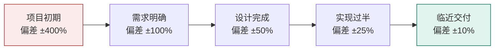
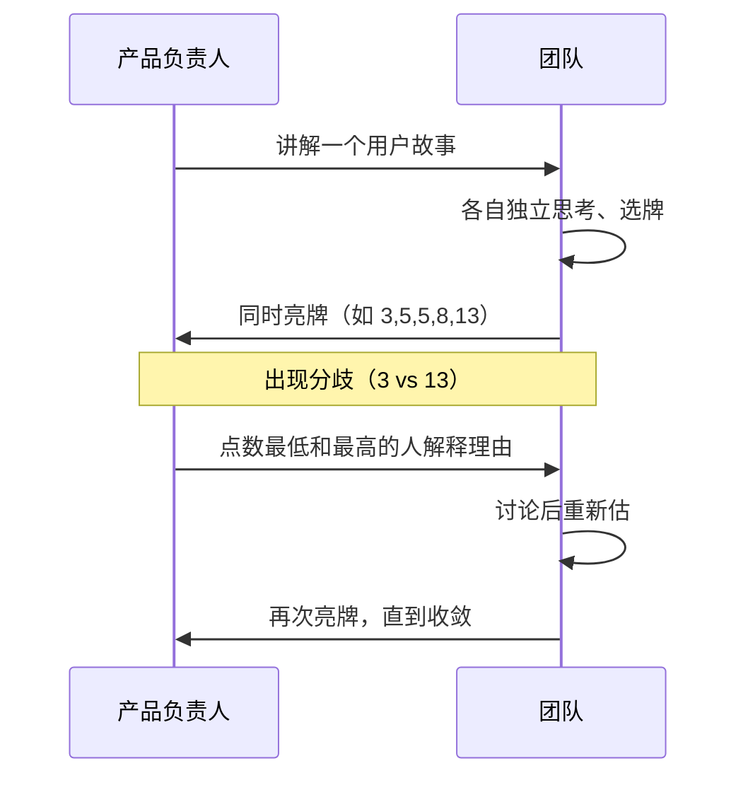
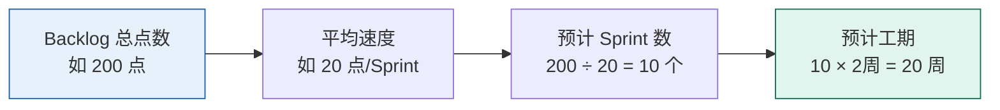
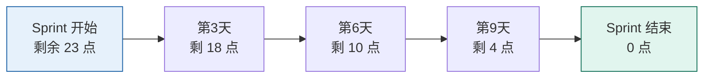
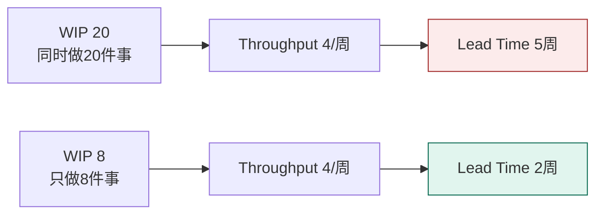

# 估算与敏捷度量

> 定位：估算是团队最头疼、也最容易做歪的事——估不准被骂、估准了被压、故事点被当成 KPI。这一篇讲清「为什么估不准」「故事点到底是什么」「怎么用速度做计划」「哪些度量有用、哪些是毒药」。搞懂这些，你才不会在迭代会上被数字绑架。

## 一、为什么软件估算这么难

先说个反直觉的事实：**软件估算天然不准，而且越大的东西越不准**。这不是能力问题，是本质问题：

1. **需求本身在变**：你估的是「现在理解的需求」，但需求会演进。
2. **未知的未知**：总有些「做到一半才发现」的技术坑（第三方接口有 bug、老代码比想象烂）。
3. **人的因素**：谁做、状态如何、被打断多少次，都影响实际耗时。
4. **估算的自我实现**：如果估了 5 天，团队往往会「用满 5 天」（帕金森定律）。

**不确定性锥（Cone of Uncertainty）** 说明了这个规律：项目越早期，估算的偏差范围越大；随着信息增多，范围收窄。

**结论**：不要追求「精确估算」，那是不可能的。要做的是「承认不确定性，用短迭代不断修正」。敏捷的「每 2 周交付」本质就是用「频繁的小估算」替代「一次性的大估算」。

## 二、故事点 vs 人天：两种估算单位

这是最容易吵架的话题。先讲清区别：

| 维度 | 人天（绝对估算） | 故事点（相对估算） |
|---|---|---|
| 单位 | 天/小时 | 无量纲的「点」 |
| 基准 | 绝对时间 | 相对于「基准故事」 |
| 关注 | 多久做完 | 多大/多复杂/多少不确定性 |
| 稳定性 | 受个人能力影响大 | 相对稳定（团队共识） |
| 用途 | 对外承诺 | 内部排期 |

### 2.1 为什么敏捷推荐「故事点」

**故事点估的是「相对大小」，不是「绝对时间」**。团队先选一个「基准故事」（比如「一个简单的查询接口 = 2 点」），其他故事和它比：「这个比基准复杂 3 倍，6 点」。

好处：

- **避开「人天」的陷阱**：说「3 天」会被追问「为什么不是 2 天」，说「5 点」没人能反驳（它是团队共识的相对值）。
- **不受个人差异影响**：新人做 5 点的故事要 10 天，老手要 3 天，但「5 点」对团队是稳定的。
- **鼓励整体思考**：估的是「这件事多复杂」，不是「我多快能做完」。

### 2.2 故事点包含什么

一个故事点通常综合了三个因素（不是单纯「工作量」）：

- **复杂度**：逻辑多绕、涉及多少模块
- **工作量**：要做多少事
- **不确定性/风险**：有多少未知

所以「一个简单的功能但技术方案没定」可能点数很高——因为不确定性大。

### 2.3 故事点最大的坑：当成 KPI

**千万不要用「每人每周完成多少故事点」考核绩效**。一旦这么做：

- 团队会把故事点「注水」（简单的事也估 8 点）
- 团队会挑「点数高但好做」的任务
- 故事点失去「相对估算」的意义，变成「数字游戏」

> 故事点是**团队内部的估算工具**，不是**对外的绩效指标**。这条红线，无数团队踩过。

## 三、Planning Poker（计划扑克）

估算是「团队共识」，不是「某个人拍板」。Planning Poker 是最常用的共识估算方法：

**流程**：

1. PO 讲一个故事，回答疑问
2. 每个人独立选一张牌（常用斐波那契：1,2,3,5,8,13,21），不讨论
3. 同时亮牌
4. 如果分歧大（如 3 和 13），让「最小」和「最大」的人各说理由——往往能发现「有人漏了某个复杂度」
5. 讨论后重估，直到收敛（不要求完全一致，接近即可）

**为什么用斐波那契数列**：数字间隔越来越大（1,2,3,5,8,13），反映了「越大越不准」的现实——你没法区分「20 点」和「21 点」，但能区分「3 点」和「8 点」。

## 四、速度（Velocity）与计划

### 4.1 什么是速度

**速度 = 团队在一个 Sprint 内完成的「故事点总和」**。比如一个 Sprint 完成了 5 个故事（3+5+8+2+5=23 点），速度就是 23。

速度的用途：**预测未来**。如果团队过去 3 个 Sprint 速度是 20、22、21，那下个 Sprint 大概能做 20 点左右——据此决定「这个 Sprint 装多少故事」。

### 4.2 用速度做发布计划

**注意**：

- 速度是「团队级」的，不是「个人级」的——别拿个人速度考核
- 速度会波动（受人员变动、需求变化影响），用「移动平均」更稳
- 新团队前 2-3 个 Sprint 速度不稳定，别急着用它承诺

### 4.3 燃尽图（Burn-down Chart）

燃尽图展示「剩余工作量随时间的变化」：

- **理想线**：从总点数直线下降到 0
- **实际线**：团队的实际情况
- **用途**：一眼看出「进度是否健康」——实际线长期在理想线上方，说明有风险

**燃尽图的坑**：它只反映「剩余量」，不反映「价值」。如果团队每天完成一堆「低价值但好估」的任务，燃尽图很好看，但产品没进展。所以燃尽图要配合「增量演示」看。

## 五、流动指标：比速度更本质的度量

故事点和速度是「Scrum 视角」的度量。如果团队用 Kanban，或者想看「交付效率」的本质，更该关注**流动指标**：

| 指标 | 定义 | 说明 |
|---|---|---|
| **Lead Time（前置时间）** | 从「需求提出」到「交付上线」的总时间 | 用户视角的「等了多久」 |
| **Cycle Time（周期时间）** | 从「开始做」到「完成」的时间 | 团队视角的「做了多久」 |
| **Throughput（吞吐量）** | 单位时间完成的工作项数 | 团队的「产出速率」 |
| **WIP（在制品）** | 同时在进行的工作项数 | 越多越容易堵 |

**利特尔法则（Little's Law）** 把它们串起来：

> **平均 Lead Time = 平均 WIP ÷ 平均 Throughput**

这个公式极其有用：**想缩短交付时间，要么减少在制品（WIP），要么提高吞吐量**。而「减少 WIP」往往比「提高吞吐」更容易——这就是 Kanban 强调「限制 WIP」的原因。

举例：团队同时在做 20 个需求（WIP=20），每周完成 4 个（Throughput=4），那平均每个需求要等 5 周（20÷4）。如果限制 WIP 到 8，同样的吞吐，Lead Time 降到 2 周——**什么都没做快，只是「少开几条战线」，交付就快了**。

## 六、哪些度量有用，哪些是毒药

度量是把双刃剑——**你度量什么，团队就优化什么**（古德哈特定律）。用错了度量，会逼团队做「数字好看但没价值」的事。

### 6.1 有用的度量（关注「结果」和「流动」）

| 度量 | 为什么有用 |
|---|---|
| 交付频率 | 反映「多快能把价值送到用户手里」 |
| Lead Time / Cycle Time | 反映「交付效率」，用户能感知 |
| 变更失败率 | 反映「质量」，不是只看快 |
| 恢复时间（MTTR） | 反映「稳定性」 |
| 缺陷逃逸率 | 反映「质量把关」 |

这五个就是 **DORA 四指标 + 缺陷逃逸**，是业界公认的「健康度量」。

### 6.2 毒药度量（关注「产出数量」，会逼团队造假）

| 度量 | 为什么是毒药 |
|---|---|
| 代码行数 | 逼团队写冗余代码 |
| 故事点/人/周 | 逼团队注水点数、挑肥拣瘦 |
| 提交次数 | 逼团队频繁无意义提交 |
| Bug 数量（当 KPI） | 逼团队不报 bug 或拆细 bug |
| 加班时长 | 逼团队「表演加班」 |
| 100% 测试覆盖率 | 逼团队写无意义的测试凑数 |

**判断标准**：一个度量如果「能被轻易造假」或「优化它会损害真实目标」，就是毒药。

## 七、估算的常见坑

### 坑点 1：追求「精确」

**现象**：花大量时间争论「这个到底是 5 点还是 8 点」。
**后果**：浪费时间，而且「精确」本身是幻觉。
**解法**：接受「估算就是范围」，用斐波那契的大间隔，别纠结 1 点的差异。

### 坑点 2：把故事点当绩效

**现象**：用「每人每周完成多少点」考核。
**后果**：点数注水、团队内卷、估算失真。
**解法**：故事点只用于团队内部排期，绩效看「交付的业务价值」和「DORA 指标」。

### 坑点 3：用速度做「承诺」而非「预测」

**现象**：老板说「你上季度速度 20，这季度必须 25」。
**后果**：团队被迫注水或加班，速度失去意义。
**解法**：速度是「预测工具」不是「承诺指标」；要提高速度，靠「减少干扰、优化流程」，不是靠「压指标」。

### 坑点 4：只估「开发」，不估「测试/联调/上线」

**现象**：估了 3 天开发，结果测试联调又花了 3 天。
**后果**：整体延期。
**解法**：估算要包含「完成定义（DoD）」里的所有环节——开发、测试、文档、部署。

### 坑点 5：新人直接套用老团队的速度

**现象**：新团队用「参考团队的速度」做计划。
**后果**：完全不准。
**解法**：每个团队的速度是自己的，要跑 2-3 个 Sprint 才有参考价值。

## 八、面试高频问法

> 这题考的是「你懂不懂敏捷度量的本质」，不是「你会不会算」。

**Q1：为什么软件估算总是不准？**

**一句话结论**：因为需求会变、有未知风险、人的状态波动，且「不确定性锥」决定了越早期偏差越大——估算天然是「范围」不是「精确值」。

加分点：说"承认不准，用短迭代不断修正，比追求一次性精确更务实；敏捷的频繁小估算就是在对抗这个不确定性"。

**Q2：故事点和人天有什么区别？为什么用故事点？**

**一句话结论**：人天是「绝对时间」，受个人能力影响；故事点是「相对大小」，是团队共识的无量纲单位——避开「为什么不是 2 天」的追问，也不受个人差异影响。

加分点：说"故事点综合了复杂度、工作量、不确定性三个因素，不是单纯「多久做完」"。

**Q3：什么是 Planning Poker？**

**一句话结论**：团队用扑克牌做「共识估算」——每人独立选牌、同时亮牌、分歧大时讨论再估，直到收敛。

加分点：说"用斐波那契数列（1,2,3,5,8,13）是因为「越大越不准」，大间隔反映了估算的真实精度"。

**Q4：什么是速度（Velocity）？怎么用？**

**一句话结论**：团队一个 Sprint 完成的故事点总和，用来「预测」下个 Sprint 能做多少、以及「推算」发布计划。

加分点：强调"速度是「预测工具」不是「承诺指标」，更不能当个人绩效——否则团队会注水"。

**Q5：燃尽图怎么看？有什么局限？**

**一句话结论**：看「剩余工作量」随时间下降的曲线，实际线长期在理想线上方说明有风险；但它只反映「量」不反映「价值」。

加分点：说"燃尽图好看但产品没进展是可能的——团队在做「低价值好估」的任务；要配合增量演示看真实价值"。

**Q6：Lead Time 和 Cycle Time 有什么区别？**

**一句话结论**：Lead Time 是「从需求提出到上线」的总时间（用户视角），Cycle Time 是「从开始做到完成」的时间（团队视角）。

加分点：说"用户关心 Lead Time（我等了多久），团队优化 Cycle Time；两者差距大说明「排队等待」时间长，要减少 WIP"。

**Q7：什么是利特尔法则？有什么用？**

**一句话结论**：平均 Lead Time = 平均 WIP ÷ 平均 Throughput——想缩短交付时间，要么减少在制品，要么提高吞吐。

加分点：说"减少 WIP 往往比提高吞吐更容易见效——「少开几条战线」，交付自然快，这是 Kanban 限 WIP 的理论依据"。

**Q8：哪些度量是有害的？**

**一句话结论**：代码行数、故事点/人、Bug 数当 KPI、加班时长、100% 覆盖率——这些「能造假」或「优化它损害真实目标」的度量都是毒药。

加分点：说"判断标准是古德哈特定律——「当一个指标成为目标，它就不再是好指标」；要用「结果指标」（DORA）而非「产出指标」"。

**Q9：DORA 四指标是什么？**

**一句话结论**：部署频率、变更前置时间、变更失败率、恢复时间——衡量 DevOps/交付能力的黄金指标，关注「快」和「稳」的平衡。

加分点：说"只追求部署频率会导致「瞎发布」，四个指标要一起看——又快又稳才是真能力"。

**Q10：怎么提高团队的交付速度？**

**一句话结论**：不是「压指标」或「加班」，而是「减少 WIP、消除等待、优化流程、减少干扰」——从流动效率入手。

加分点：说"用价值流图（Value Stream Mapping）找瓶颈，用利特尔法则算优化空间；「让团队更忙」往往让交付更慢（WIP 太高）"。

## 小结

- 软件估算天然不准，不确定性锥说明「越早期偏差越大」；用短迭代修正，别追求精确。
- 故事点是「相对大小」（含复杂度/工作量/不确定性），人天是「绝对时间」；推荐故事点。
- Planning Poker 做共识估算，斐波那契间隔反映「越大越不准」。
- 速度用于「预测」不是「承诺」，更不能当个人绩效。
- 燃尽图看剩余量，但要配合增量演示看价值。
- 流动指标更本质：Lead Time、Cycle Time、Throughput、WIP；利特尔法则（Lead Time = WIP ÷ Throughput）是优化依据。
- 有用度量看「结果」（DORA 四指标），毒药度量看「产出数量」（代码行数、故事点/人）。
- 提高交付速度靠「减少 WIP、消除等待」，不是靠压指标和加班。
