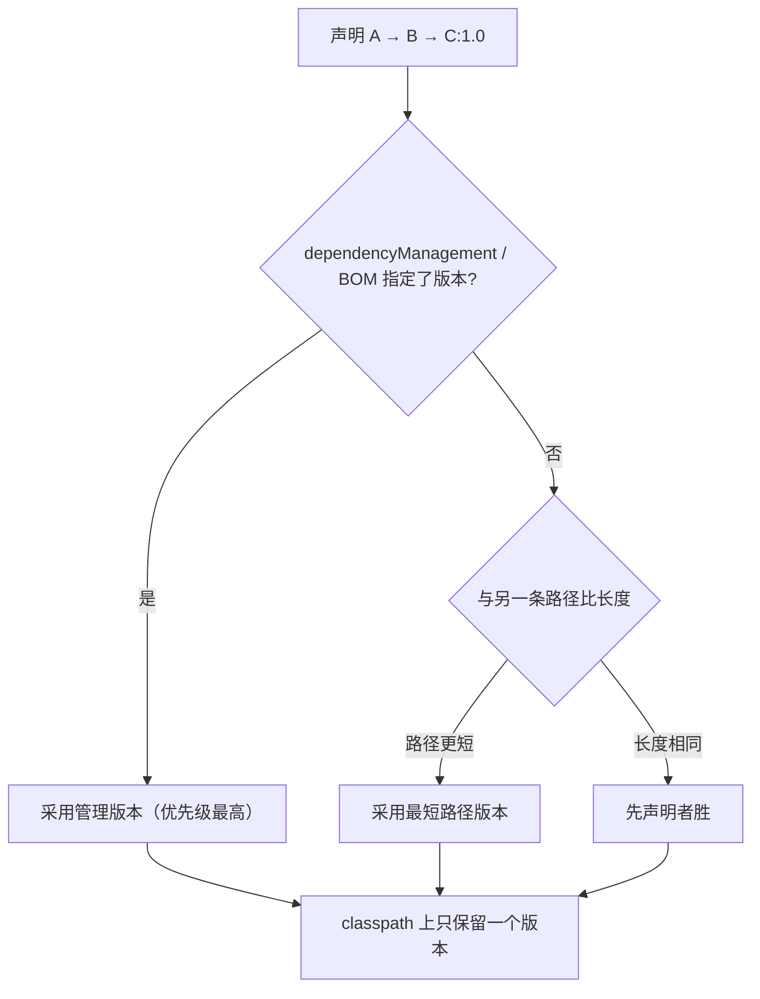

# 构建与依赖治理：Maven、Gradle 与依赖冲突

> 定位：Java 工程师每天跑几十次构建，却很少有人能说清「为什么这个版本被选中」「为什么本地能跑、CI 报 `NoSuchMethodError`」「为什么构建要 8 分钟」。依赖冲突和构建不可重现是团队里最隐蔽的效率黑洞——它不报错，只是偶尔在某个环境炸一次。这篇把 Maven 的依赖调解、BOM、scope、多模块 reactor 和 Gradle 的配置模型、配置缓存、版本目录讲透，最后给一套能落地的依赖治理规范。

> **版本提示（2026-11）**：Maven 3.9.x、Gradle 9.x 为当前主线；Gradle 9 强化了配置缓存与 Kotlin DSL，Maven 4 仍在演进中，命令与坐标模型不变。

## 一、为什么需要构建与依赖治理

先把问题摆出来，看看你中过几条：

- 本地 `mvn test` 全绿，上了 CI 或生产报 `NoSuchMethodError`、`ClassNotFoundException`、`LinkageError`。
- 同一个项目，两个人构建出来的 jar 不一样，排查线上问题时无法复现。
- 想升一个 Spring 版本，结果 `mvn dependency:tree` 打出 300 行，不知道哪个传递依赖把版本拽回去了。
- 构建从 2 分钟涨到 10 分钟，一半时间花在下载依赖和重复编译。
- 某个三方包被投毒/被改名，团队半个月后才发现。

这些问题的根因只有两个：**依赖图不受控**、**构建过程不确定**。前者靠「声明 + 校验」，后者靠「缓存 + 锁定 + 可重现」。

## 二、核心原理

### 2.1 Maven：坐标、依赖调解与生命周期

**坐标（GAV）**：`groupId:artifactId:version`（加 `packaging`、`classifier` 才完整）。仓库查找顺序是：本地仓库 → `settings.xml` 里配置的私服/镜像 → 中央仓库。

**依赖调解（最容易考、最容易错）**：

1. **路径最短优先**：A→B→C(1.0) 与 A→D(2.0)，选 D 的 2.0。
2. **路径长度相同，先声明优先**：都在第二层，就看 `pom.xml` 里谁写在前面。
3. **依赖管理（`dependencyManagement`）优先级最高**：父 POM 或 import 的 BOM 里锁定的版本，会覆盖传递依赖的版本。

> 记住一句话：**Maven 不做「版本升级择优」，只做「路径仲裁」**。所以「为什么我的 2.0 被降成 1.0」的答案，八成是路径更短的那个赢了。



**scope 的语义**（决定打包与运行期可见性）：

| scope | 编译期 | 测试期 | 运行期 | 打包进产物 | 典型用途 |
|---|---|---|---|---|---|
| `compile`（默认） | 是 | 是 | 是 | 是 | 常规依赖 |
| `provided` | 是 | 是 | 否 | 否 | Servlet API、Lombok（编译期）、由容器提供的包 |
| `runtime` | 否 | 是 | 是 | 是 | JDBC 驱动、日志实现 |
| `test` | 否 | 是 | 否 | 否 | JUnit、Mockito |
| `system` | 是 | 是 | 是 | 否 | 本地 jar（**不推荐**，路径不可移植） |

`optional=true` 只影响**传递**：下游不会自动继承，必须自己声明。这是「给 SDK 瘦身」的关键开关。

**生命周期与插件**：`validate → compile → test → package → verify → install → deploy`。每个阶段绑定插件目标（如 `maven-surefire-plugin:test`）。构建慢通常不是编译慢，而是插件在跑：打包 shade、生成 javadoc、跑集成测试、上传制品。

**多模块（reactor）**：父工程聚合子模块，Maven 按**模块间依赖关系**排构建顺序，而不是按声明顺序。循环依赖会直接失败——这是好事，它逼你把模块边界理清。

**BOM（Bill of Materials）**：一个只含 `dependencyManagement` 的 POM，用 `scope=import` 引入后，整组依赖的版本由它统一。Spring Boot 的 `spring-boot-dependencies` 就是典型 BOM。

### 2.2 Gradle：配置模型与性能三件套

**依赖配置（configuration）**是 Gradle 的核心概念，比 Maven 的 scope 更细：

| 配置 | 编译可见 | 运行可见 | 传递给下游 | 对应 Maven |
|---|---|---|---|---|
| `implementation` | 是 | 是 | 否 | 接近 `compile`，但不暴露 API |
| `api`（仅 java-library 插件） | 是 | 是 | 是 | `compile` |
| `compileOnly` | 是 | 否 | 否 | `provided` |
| `runtimeOnly` | 否 | 是 | 是 | `runtime` |
| `testImplementation` | 否 | 测试 | 否 | `test` |

`api` 与 `implementation` 的区分是 Gradle 相对 Maven 的实质优势：**它能表达「这个依赖是不是我的公开 API」**，从而减少下游的编译期耦合。

**Gradle 为什么快**：

1. **增量构建**：任务输入输出做快照，未变则跳过（`UP-TO-DATE`）。
2. **构建缓存（build cache）**：任务输出可复用，甚至跨机器共享。
3. **守护进程（daemon）**：JVM 与类加载预热常驻。
4. **配置缓存（configuration cache）**：把配置阶段结果缓存下来，第二次直接跳过配置——Gradle 9 已把它作为推荐默认能力。
5. **并行与按需**：`--parallel`、`--configure-on-demand`。

代价是**配置缓存对插件有要求**：用了 `Project` 对象、`afterEvaluate`、自定义 `buildSrc` 里的可变全局状态，都会让配置缓存失效。这就是「Gradle 升级后构建报配置缓存不兼容」的根因。

**版本目录（version catalog）**：`gradle/libs.versions.toml` 集中声明版本，配合 `platform()` 引入 BOM，等价于 Maven 的 `dependencyManagement`，但可读性和 IDE 补全更好。

### 2.3 依赖冲突的本质：classpath 上只能有一个版本

JVM 的类加载是「第一个找到的赢」。当两个版本的同名类同时存在：

- 方法签名不兼容 → `NoSuchMethodError` / `NoSuchFieldError`；
- 类结构不兼容 → `LinkageError` / `IncompatibleClassChangeError`；
- 接口/实现不匹配 → `AbstractMethodError`；
- 资源文件（`META-INF/services`）被覆盖 → SPI 悄悄失效（Jackson、SLF4J binding 常见）。

所以「依赖冲突」不是版本号不同就报错，而是**只有真正用到不兼容的那部分才炸**——这也是它难排查的原因。

## 三、关键机制与参数

### 3.1 排查依赖图

```bash
# Maven：看完整树（含冲突与仲裁结果），定位是谁把版本拽下来的
mvn dependency:tree -Dverbose -Dincludes=com.fasterxml.jackson.core:jackson-databind
mvn dependency:analyze            # 找出「声明了但没用」「用了但没声明」
mvn help:effective-pom            # 看父 POM/BOM 合并后的真实生效配置

# Gradle：按配置看依赖，找冲突版本与最终选择
./gradlew dependencies --configuration runtimeClasspath
./gradlew dependencyInsight --dependency jackson-databind --configuration runtimeClasspath
```

`dependency:tree -Dverbose` 会打印 `omitted for conflict` 与 `omitted for duplicate`，这是**唯一能解释「为什么不是我要的版本」**的输出。

### 3.2 锁定版本

- **Maven**：`dependencyManagement` 统一版本 + 父 POM 继承；需要强制时用 `maven-enforcer-plugin` 的 `dependencyConvergence`（要求整棵树同版本）或 `bannedDependencies`（禁某些 GAV）。
- **Gradle**：`platform(SpringBootBOM)` / `enforcedPlatform(...)`（后者强制覆盖，适合统一团队基线）；`resolutionStrategy.force` 用于临时止血。
- **可重现**：Maven 用 `versions:lock-snapshots` 或直接禁 SNAPSHOT；Gradle 用 `dependencyLocking` 生成 `gradle.lockfile`，CI 用 `--write-locks` 校验。

### 3.3 构建可重现（Reproducible Build）

三件事必须做：

1. **固定 JDK**：Gradle 用 `javaToolchain`，Maven 用 `maven-toolchains-plugin`，避免「本机 21、CI 17」。
2. **固定时间戳与顺序**：`project.build.outputTimestamp`（Maven）、`preserveFileTimestamps=false` + `reproducibleFileOrder=true`（Gradle）。
3. **固定插件版本**：Maven 插件必须写 `version`（不写会取最新，构建结果随时间漂移）；Gradle 插件用 `plugins {}` + 版本目录。

### 3.4 私服与供应链

- 私服（Nexus/Artifactory）做**代理 + 缓存 + 准入**：禁止外网直连、禁止 SNAPSHOT 进生产、保留审计日志。
- 生产依赖只从受信仓库解析，`settings.xml` 用 `<mirrorOf>*</mirrorOf>` 收敛。
- 依赖投毒的两个典型手法：**typosquatting**（`spring-boot-stater-web` 少个 r）、**依赖混淆**（内部包名被公网抢注）。对策：内部组名用不可猜测的前缀、私服只允许白名单、对新引入依赖做 review。

## 四、生产坑点与排查

### 坑点 1：本地能跑、线上 `NoSuchMethodError`

**现象**：升级某个库后，测试通过，运行时报 `java.lang.NoSuchMethodError: com.xxx.Foo.bar()`。

**原因**：编译时用的是 A 版本的 API，运行 classpath 里被传递依赖拽成 B 版本（或被 `provided` 排除）。

**排查**：`mvn dependency:tree -Dverbose` 找出实际生效版本；对比报错方法在哪个版本存在；确认是不是 `provided` 漏声明。

**解法**：在 `dependencyManagement` 里锁死版本；或用 `dependency:analyze` 找出「用了但没声明」的隐式依赖，显式声明。

### 坑点 2：`dependency:tree` 看不到冲突

**现象**：树里只有一行，看起来没有重复。

**原因**：默认输出会折叠重复项，且 `-Dverbose` 在某些 Maven 版本下对 Gradle 转过来的 POM 不显示 `omitted`。

**解法**：`-Dverbose` + `-Dincludes` 精确过滤；或直接看 `effective-pom`；Gradle 用 `dependencyInsight` 而不是 `dependencies`。

### 坑点 3：`META-INF/services` 被覆盖导致 SPI 失效

**现象**：加了某个依赖后，JSON 序列化/日志实现「莫名其妙」不工作。

**原因**：多个 jar 带同名 `META-INF/services/...`，打包（shade/fat jar）时后者覆盖前者。

**解法**：shade 插件配 `ServicesResourceTransformer`；或改用 `META-INF/services` 合并的打包插件；排查时 `jar tf` 看产物里该文件内容。

### 坑点 4：SNAPSHOT 依赖让构建随机失败

**现象**：同样的代码，今天能构建，明天拉不到依赖或行为变了。

**原因**：SNAPSHOT 每天覆盖发布，本地仓库缓存了旧包，`-U` 才更新。

**解法**：生产/CI 禁止 SNAPSHOT；内部联调用 `-U` 并在私服上开「唯一快照」；用 `dependencyLocking` 固定。

### 坑点 5：Gradle 配置缓存失效

**现象**：升级 Gradle 后，`--configuration-cache` 报 `invocation of 'Task.project' at execution time is unsupported`。

**原因**：插件或脚本在任务执行阶段访问了 `project`，破坏配置缓存的可序列化假设。

**解法**：把配置期逻辑挪到 `build.gradle.kts` 顶层；用 `Provider`/`Property` 惰性取值；定位到具体插件后升级或替换；过渡期可 `--no-configuration-cache`，但别长期关。

### 坑点 6：构建慢，其实是插件在跑

**现象**：`mvn package` 8 分钟，编译只占 30 秒。

**原因**：shade 重打包、javadoc、surefire 重复启动 JVM、`install` 顺带跑集成测试。

**解法**：`-DskipTests` 只用于本地快速验证（CI 必须跑）；`maven-surefire-plugin` 配 `forkCount`、`reuseForks`；把 javadoc/source 挪到发布流水线；Gradle 用 `--profile` 找耗时任务。

## 五、调优与最佳实践

### 5.1 Maven vs Gradle 怎么选

| 维度 | Maven | Gradle |
|---|---|---|
| 模型 | 固定生命周期、约定优于配置 | 任务图、可编程 |
| 可读性 | XML 冗长但直观 | Kotlin DSL 灵活，学习曲线陡 |
| 构建速度 | 中等 | 增量+缓存后明显更快（大项目差距更大） |
| 生态 | 插件最全，企业默认 | Android 事实标准，后端增长快 |
| 治理难度 | 低（结构统一） | 中（脚本自由度大，容易各写各的） |
| 适合 | 团队多、规范优先、老项目 | 单体大仓库、需要极致构建速度、Kotlin 团队 |

> 选型建议：**已有 Maven 且没被构建速度卡住，就别迁**。迁移成本不在改脚本，而在插件行为差异与 CI 缓存重建。

### 5.2 团队依赖治理清单

- [ ] 全公司统一一个 BOM（Spring Boot BOM + 自研 BOM），业务工程只声明、不写版本
- [ ] 禁止 `LATEST`/`RELEASE`/动态版本（Gradle 的 `1.+`），CI 加校验
- [ ] 生产禁 SNAPSHOT，联调环境用唯一快照
- [ ] 用 enforcer 的 `dependencyConvergence` + `bannedDependencies`
- [ ] 插件版本全部显式写死，`outputTimestamp` 固定
- [ ] CI 缓存 `~/.m2` / `~/.gradle`，但**缓存键包含 lockfile 哈希**
- [ ] 新依赖引入走 review：看维护活跃度、许可证、漏洞（SCA 扫描）
- [ ] 私服收敛来源，禁直连公网；内部包组名不可猜测
- [ ] 每月跑一次 `dependency:analyze` + 漏洞扫描，清未使用依赖

## 六、面试高频问法

**Q1：Maven 的依赖冲突是怎么解决的？**
一句话结论：按「路径最短优先、同长度先声明优先」仲裁，`dependencyManagement` 可强制覆盖。
展开：冲突不是报错，而是 classpath 上只留一个版本；仲裁结果可能不是你想要的，所以要用 `dependency:tree -Dverbose` 看 `omitted for conflict`。
加分点：能说出「Maven 不做版本择优，只做路径仲裁」，以及 `dependencyManagement` 优先级高于传递依赖。

**Q2：`provided` 和 `compile` 的区别？什么时候必须用 provided？**
一句话结论：`provided` 编译可见、运行与打包都不可见，用于「运行环境会提供」的包。
展开：Servlet API、Lombok（编译期注解处理）、由容器提供的驱动。用错会导致「本地跑得通、容器里 `ClassNotFoundException`」。
加分点：提到 `provided` 的依赖不会传递，且 `system` scope 因路径不可移植应避免。

**Q3：BOM 是什么？为什么 Spring Boot 项目不用写版本？**
一句话结论：BOM 是只含 `dependencyManagement` 的 POM，import 后统一整组依赖版本。
展开：`spring-boot-dependencies` 锁定了 Spring 全家桶与常用三方库的兼容版本；`spring-boot-starter-parent` 在父 POM 里已经 import 了它。
加分点：能区分「BOM 管版本」与「starter 管依赖集合」，并知道自研 BOM 应用 `import` scope 而非继承。

**Q4：多模块项目构建顺序由什么决定？出现循环依赖怎么办？**
一句话结论：由模块间依赖关系决定（reactor 拓扑排序），循环依赖直接失败。
展开：Maven 会先构建被依赖模块；`-pl -am` 可只构建某模块及其依赖。循环依赖说明边界错了，解法是抽公共模块/下沉接口/事件解耦，而不是 `-Dskip` 糊过去。
加分点：提到「模块依赖应单向」，以及用 `mvn -pl :order-service -am package` 做局部构建。

**Q5：Gradle 比 Maven 快在哪？为什么有时反而更慢？**
一句话结论：增量构建、build cache、daemon、配置缓存四件套；慢通常卡在配置阶段或缓存失效。
展开：`--profile` 看耗时；配置缓存不兼容插件时会退化；首次构建没有缓存，比 Maven 慢很正常。
加分点：能说出「配置缓存要求任务不访问 Project 对象」，以及 `dependencyLocking` 对可重现的作用。

**Q6：怎么保证「同一份代码构建出同一个产物」？**
一句话结论：固定 JDK、固定插件版本、固定时间戳与文件顺序。
展开：toolchain 锁 JDK；Maven 插件写 version + `project.build.outputTimestamp`；Gradle 关 `preserveFileTimestamps`、开 `reproducibleFileOrder`。产物哈希一致才算可重现。
加分点：提到「可重现构建」是供应链安全的基础，能对比两次构建的 SHA-256。

**Q7：线上报 `NoSuchMethodError`，怎么快速定位？**
一句话结论：先确认运行期实际生效的版本，再对比方法签名。
展开：`dependency:tree -Dverbose` 或 `dependencyInsight` 找版本；`javap -classpath` 验证类里有没有该方法；检查 `provided` 漏声明、shade relocation 是否把包名改了。
加分点：能区分 `NoSuchMethodError`（版本/签名）与 `ClassNotFoundException`（缺失/加载器隔离）。

**Q8：依赖投毒怎么防？**
一句话结论：来源收敛 + 版本锁定 + 准入扫描，三道闸。
展开：私服只代理受信仓库、禁直连；内部包名用不可猜测前缀防依赖混淆；SCA 扫描 + 新依赖 review；CI 校验 lockfile 未被篡改。
加分点：能说出 typosquatting 与 dependency confusion 两种手法的区别。

## 小结

- Maven 只做路径仲裁（最短优先、先声明优先），`dependencyManagement` 优先级最高。
- scope 决定编译/运行/打包可见性，`provided` 用错就是线上 `ClassNotFoundException`。
- Gradle 的优势在配置模型 + 增量 + 缓存 + 配置缓存，代价是脚本自由度带来的治理成本。
- 依赖冲突的本质是 classpath 只能有一个版本，只有用到不兼容部分才炸。
- 可重现构建 = 固定 JDK + 固定插件版本 + 固定时间戳与顺序。
- 治理清单的核心：统一 BOM、禁动态版本/SNAPSHOT、enforcer 校验、私服收敛、lockfile 入仓。
