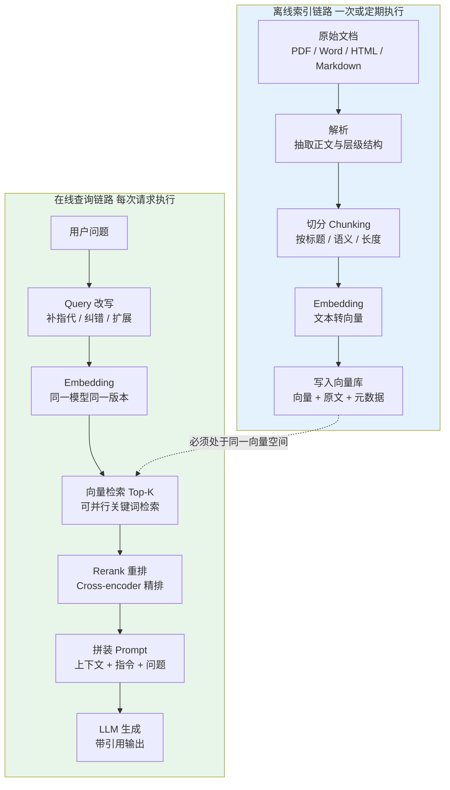
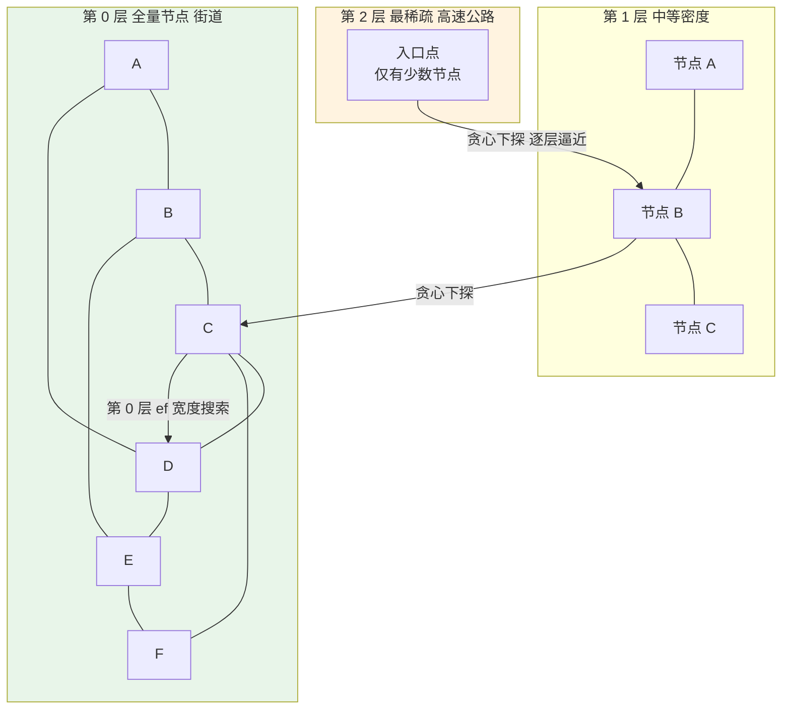
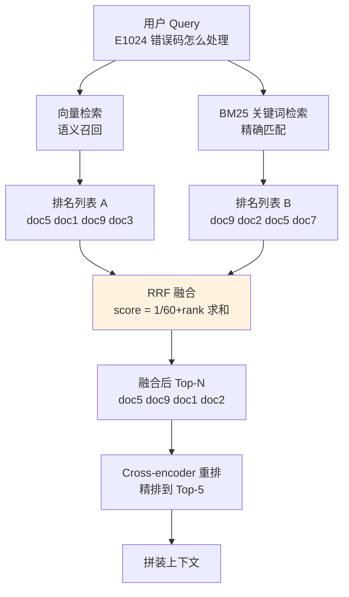

# RAG 检索增强生成

> 定位：RAG（Retrieval-Augmented Generation，检索增强生成）是把「企业私有知识」接进大模型的工程主路径。它解决的不是「模型聪不聪明」，而是「模型知不知道你公司的事、说的东西有没有依据」。这篇从 LLM 的三个硬伤讲起，把离线索引、在线检索两条链路拆到底层，讲透切分、Embedding、HNSW、混合检索、RRF、Rerank、幻觉治理，最后给出 Spring AI / LangChain4j 的落地骨架和生产坑点。

## 一、为什么需要 RAG

你接了个需求：给客服系统做一个「能回答产品手册问题」的问答机器人。第一反应是直接调大模型，把问题丢过去。上线第一天就出事了：

- 用户问「2.3 版本新增的批量导出怎么开」，模型答得头头是道，但**功能名是编的**——你的产品根本没这个功能。
- 用户问「上个月发布的价格调整政策」，模型说「知识截止到 2024 年，无法回答」。
- 用户问「设备报 E1024 怎么办」，模型给了一套通用排查流程，**跟内部工单规范完全不一样**。

这三个现象对应 LLM 的三个硬伤，也是 RAG 存在的全部理由：

| 硬伤 | 本质 | 表现 |
|---|---|---|
| **知识截止（Knowledge Cutoff）** | 训练数据有时间边界，权重里没有「之后」的事 | 问新政策、新版本、新价格，答不出或瞎答 |
| **幻觉（Hallucination）** | 模型是「下一个 token 的概率预测器」，不是事实数据库；不知道时会顺着语言惯性编 | 编造不存在的接口、法条、参数、引用 |
| **不懂私有数据** | 训练语料是公开互联网，企业内部文档、代码、工单从没进过权重 | 对内部流程、产品细节、客户合同一无所知 |

关键认知：**幻觉不是 bug，是工作方式决定的**。模型的目标是生成「看起来合理的文本」而非「真实的文本」，没有依据时它就会编一个最像样的。你无法用「请诚实回答」根治——**只能给它依据**。

### RAG 的本质：把「闭卷考试」改成「开卷考试」

模型权重里存的是「通识」（学生脑子里的知识），RAG 在回答前先去资料库把相关段落找出来塞进 prompt，让模型「看着材料答题」。

- **闭卷**：只给问题 → 靠记忆答 → 记不清就编。
- **开卷**：给问题 + 材料 → 做阅读理解 → 答案有出处，可核对。

三个直接收益：**知识可更新**（改文档即改答案）、**可溯源**（标注来源章节，用户能核对）、**权限可控**（检索时按身份过滤）。

### RAG vs 微调 vs 长上下文

选型第一问，面试必考。三者不互斥，但解决不同问题。

| 维度 | RAG | 微调（Fine-tuning / SFT） | 长上下文（Long Context） |
|---|---|---|---|
| **解决什么** | 缺知识、要溯源、知识频繁变 | 缺「行为模式」：语气、格式、领域推理风格 | 单次任务材料多（如分析一份 200 页合同） |
| **知识更新** | 改文档即可，分钟级 | 要重新训练，小时到天级 | 每次都要重新塞，实时 |
| **成本结构** | 向量库 + 检索算力，一次性索引 + 每次检索 | 训练成本高（GPU 小时），推理成本不变 | 输入 token 费用线性增长，长上下文单价更高 |
| **延迟** | +50~300ms（检索 + 重排） | 无额外延迟 | 首 token 延迟显著上升（注意力计算） |
| **幻觉治理** | 强（有原文可引用） | 弱（还是靠权重记忆） | 中（材料在上下文里，但模型可能忽略中间部分） |
| **典型场景** | 企业知识库、客服、文档问答 | 固定风格的写作、特定格式抽取、领域术语对齐 | 单文档深度分析、代码库一次性理解 |

三个判断：

- **「知识」用 RAG，「风格/能力」用微调**。学会「用我们公司的口吻写邮件」是微调；知道「2026 年报销标准」是 RAG。搞反了就是白花钱。
- **长上下文不能替代 RAG**。10 万份文档塞不进 200K 上下文，费用爆炸，且模型对长文本中间部分的召回会下降（「lost in the middle」）。它只适合「一次性、材料确定」的任务。
- **RAG + 微调可叠加**：微调教模型「怎么用检索到的材料答题」（严格引用、学会拒答），RAG 提供材料。先做 RAG，prompt 调不动了再考虑微调。

> 一句话选型：**知识会变 → RAG；行为要变 → 微调；材料就这一份且不多 → 长上下文。** 90% 的企业场景，第一步都该是 RAG。

## 二、RAG 的整体链路

RAG 不是一个组件，是**两条链路**：离线建索引和在线查询。很多人只盯着「检索」，其实**离线链路的质量决定了在线效果的上限**——垃圾进，垃圾出。



这张图要看两点：

1. **两条链路通过「向量空间」耦合**。离线用什么 Embedding 模型、版本、维度，在线就必须完全一致。这条虚线是整个系统最脆弱的契约——换模型不重建索引，检索结果会变成噪声（见坑点 4）。
2. **在线链路有 6 个可优化环节**，不是只有检索。Query 改写能救回 20%~30% 的口语化提问；Rerank 能把 Top-50 的精度提升一档；Prompt 拼装决定模型会不会忽略材料。

### 离线链路逐步拆解

**① 文档解析（Parsing）**

这一步最脏最累，也最容易被低估。真实文档形态：扫描版 PDF、带合并单元格的 Word 表格、双栏论文、带页眉页脚的合同、图片里的文字。

| 格式 | 难点 | 常用方案 |
|---|---|---|
| PDF（文本层） | 分栏、页眉页脚、表格错位 | PDFBox、PDFPlumber；按坐标聚类还原阅读顺序 |
| PDF（扫描件） | 没有文本层 | OCR：Tesseract、PaddleOCR，或云厂商文档智能服务 |
| Word | 样式丢失、表格嵌套 | Apache POI（`XWPFDocument`）、docx4j |
| HTML | 导航栏/广告干扰 | Jsoup + 正文抽取算法 |
| Excel | 多 sheet、合并单元格 | POI（`XSSFWorkbook`），按行转成「字段: 值」文本 |

工程要点：**解析时要把结构信息带出来**。标题层级、表格行列关系、列表序号——这些在切分时是宝贵的边界信号。解析成一大坨纯文本，后面只能按字数硬切，效果差一大截。

**② 切分（Chunking）**——下一节专门讲，这是 RAG 效果的第一杀手。

**③ Embedding**

把每个 chunk 过一遍 Embedding 模型，得到一个定长向量（常见 768 / 1024 / 1536 / 3072 维）。要点：

- **离线在线必须同模型同版本同维度**，否则向量不可比。
- **归一化**：多数模型输出未归一化，用余弦相似度前要 L2 归一化；归一化后余弦相似度等价于内积，检索更快。
- **批量与限流**：Embedding API 通常按 token 计费且有 QPS 限制，离线索引要分批 + 重试 + 断点续传。

**④ 写入向量库**

每条记录至少存四样东西：`id`、`vector`、`text`（原文，用于拼 prompt 和展示引用）、`metadata`（来源、页码、章节、租户 ID、权限标签、模型版本）。metadata 不是可选项——**权限过滤、增量更新、引用溯源全靠它**。

### 在线链路逐步拆解

**① Query 改写（Query Transformation）**

原始提问往往不能直接检索：指代不明（「它的保修期多久」，「它」要靠多轮历史补全）、口语化（「那个导出功能咋用啊」和文档里的「批量数据导出操作指南」字面差很远）、过于简短（「E1024」单个错误码检索不到上下文）。

常用手段：**指代消解**（用 LLM 把「它」替换成具体实体）、**多查询扩展**（一个问题生成 3~4 个角度的问法分别检索再合并）、**HyDE**（让 LLM 先「编」一个假答案，用假答案去检索——假答案的用词更接近文档用词，低资源领域很有效）。

**② 检索**：向量检索 + 可选的关键词检索，见第六节混合检索。

**③ Rerank**：见第七节。

**④ Prompt 拼装**：这是幻觉治理的主战场，见第八节。

**⑤ 生成**：流式输出、带引用、拒答判断。

## 三、切分策略：RAG 效果的第一杀手

我见过的 RAG 效果差，**一半以上是切分问题**，而不是模型或向量库的问题。切分决定「检索的最小单元」，单元切错了，后面再好的模型也救不回来。

### 为什么必须切分

1. **Embedding 有输入上限**（常见 512 / 8192 token），整篇塞不进去。
2. **向量是「一个点代表一段语义」**。5000 字压成一个向量，语义被平均掉，检索时既不像 A 也不像 B。
3. **上下文预算**。检索结果要拼进 prompt，塞太多既贵又会让模型忽略中间内容。

### 四种切分策略

| 策略 | 做法 | 优点 | 缺点 |
|---|---|---|---|
| **固定长度** | 按 token/字符数硬切，如每 500 token 一刀 | 实现最简单、chunk 大小均匀 | 会把句子、表格、代码块拦腰截断 |
| **递归字符切分** | 按「段落 → 句子 → 字符」的优先级递归尝试，尽量在自然边界断开 | 通用性好，是大多数框架的默认 | 不理解语义，遇到无标点的长文本退化为硬切 |
| **按结构切分** | 按 Markdown 标题、HTML 标签、Word 大纲级别切 | 保留文档逻辑结构，chunk 语义完整 | 依赖解析质量；章节长度不均 |
| **语义切分** | 计算相邻句子的 Embedding 相似度，在「语义断崖」处切 | 语义完整性最好 | 成本高（要先 Embedding 一遍）、阈值难调 |

**实践建议：结构优先 + 递归兜底**。先按标题层级切出「节」，太长再用递归字符切分按段落切，最后才硬切。既保住「一章讲一件事」的语义完整性，又控制单 chunk 长度。

### chunk size 与 overlap 的权衡

这是最常被问的参数题。

**chunk size**（常见 256~512 token）：太小（< 128）语义不完整，因果被切到两个 chunk，且 chunk 数量暴涨；太大（> 1024）一个 chunk 混多个主题，向量被平均、检索精度下降。**经验值：中文技术文档 300~500 token**（约 200~350 汉字）；FAQ 型可更小（150~250），论述型可更大（600~800）。

**overlap**（常见 10%~20%）：切分点落在句子中间时，那句话在两个 chunk 里都不完整，overlap 让相邻 chunk 共享尾巴，保证跨界信息至少在一处完整。代价是存储和索引成本按比例上升（20% overlap 约增 25% 索引量），且可能召回重复 chunk 浪费预算。**经验值 10%~15%**；切分越细、逻辑越紧密（法律条款、操作步骤）应越大。

> 反直觉：**overlap 不是越大越好**。到 50% 等于每个 chunk 一半是重复内容，检索结果高度冗余，Rerank 还得去重。

### 进阶：父子分块（Parent-Child / Small-to-Big）

这是工业界很有效的一个技巧，解决「检索要小、生成要大」的矛盾：

- **用小的子块（如 200 token）做 Embedding 和检索**——小块的向量更聚焦，召回更准。
- **命中后返回它所属的父块（如 1000 token）给 LLM**——父块上下文完整，模型答得更全。

LangChain 的 `ParentDocumentRetriever`、LlamaIndex 的 `SentenceWindowNodeParser` 都是这个思路。代价是存储要维护两层映射。

### 表格和代码怎么切

这是坑点 1 的根源：

- **表格**：绝不按字符切。整表作为一个 chunk，或按行切但**每行都带上表头**（「产品 | 价格 | 保修期 → A 型号 | 999 | 2 年」）。否则检索到「999 | 2 年」，模型不知道 999 是什么。
- **代码**：按函数/类边界切，带文件路径和类名作 metadata。硬切会把一个方法切成两半。

## 四、向量检索与 HNSW

### Embedding 模型选择

| 类型 | 代表 | 特点 |
|---|---|---|
| **闭源 API** | OpenAI `text-embedding-3-small/large`、Cohere Embed、各家云厂商 | 开箱即用、多语言好、按量计费、数据出境需评估 |
| **开源可自部署** | BGE 系列（BAAI）、GTE、M3E、Jina Embeddings | 数据不出内网、可微调、要自己扛 GPU |
| **多语言/中文优化** | BGE-M3、Conan、Qwen Embedding | 中文语义和长文本表现好，具体以官方评测为准 |

选型看四点：**语言覆盖**、**维度**（越高表达力越强，但存储和检索越贵）、**最大输入长度**、**能否私有化部署**（数据合规时是硬约束）。

一个常被忽略的点：**公开榜单只能做初筛**。业务语料（满是型号、错误码、内部缩写的工单）和榜单分布完全不同，**要拿 200~500 条真实问答算 Recall@K 和 MRR**，用数据选。

### 相似度度量

| 度量 | 公式直觉 | 适用 |
|---|---|---|
| **余弦相似度** | 看两个向量的夹角，忽略长度 | 文本 Embedding 的默认选择，对文本长度不敏感 |
| **内积（IP）** | 夹角 + 长度 | 向量已 L2 归一化时等价于余弦，计算更快；推荐系统常用 |
| **欧氏距离（L2）** | 空间直线距离 | 图像、聚类场景；对向量长度敏感 |

统一做法：**入库前 L2 归一化，再用内积检索**——既保留余弦的语义性质，又省一次开方。归一化必须离线在线一致，否则度量失真。

### HNSW 索引原理

这是向量检索的核心数据结构，面试高频。HNSW = **Hierarchical Navigable Small World**，分层可导航小世界图。

直觉：百万级向量里暴力找最近邻要算 100 万次，太慢。NSW 的思路是建「近邻图」，每个点连若干邻居，查询从入口点沿「离目标更近」的边走，像通过朋友的朋友找人。HNSW 在其上加「分层」：**上层稀疏像高速公路，下层稠密像街道**，先走高速接近目标区域，再下街道精细查找。



这张图要看三件事：

1. **越上层节点越少**。节点的层数是随机分配的，服从指数衰减分布（`level = floor(-ln(uniform(0,1)) * mL)`，`mL = 1/ln(M)`）。大约 1/M 的节点会出现在第 1 层，1/M² 出现在第 2 层。所以上层天然稀疏，跳得远。
2. **每一层内部都是一张近邻图**，边是双向的（插入时建立双向连接）。
3. **查询是「自顶向下 + 逐层贪心」**：从顶层入口点开始，在当前层找「比当前点更近的邻居」就移过去，直到局部最优；然后下到下一层，以刚才的位置为起点继续；到第 0 层时，用 `ef` 宽度的候选堆做 beam search，返回 Top-K。

**插入过程**（理解这个才能理解参数）：

1. 随机分配层数 `L`（指数分布，`mL = 1/ln(M)`）。
2. 从顶层开始，贪心找到离新节点最近的入口。
3. 从 `min(L, 当前层)` 往下，每层用 `efConstruction` 宽度的候选集找最近的 `M` 个邻居，建立双向连接。
4. 若某节点连接数超过上限（第 0 层通常 `2M`），用启发式裁剪——保留「方向分散」的邻居而非最近的 M 个，这是 HNSW 论文的关键设计，保证图的连通性和可导航性。

**三个核心参数**：

| 参数 | 含义 | 典型值 | 影响 |
|---|---|---|---|
| `M` | 每个节点在每层的最大连接数 | 16~64（默认常 16 或 32） | 越大召回越高、内存越大（内存约 `M × 2 × 4 bytes × 节点数` 的图结构开销）、插入越慢 |
| `efConstruction` | 建索引时的候选集宽度 | 100~200 | 越大索引质量越高、建索引越慢。**建完就固定，不影响查询** |
| `efSearch` | 查询时的候选集宽度 | 50~200，必须 ≥ topK | 越大召回越高、延迟越高。**唯一可以在查询时动态调的参数** |

**关键认知**：HNSW 是**近似**最近邻（ANN），不保证 100% 召回。`efSearch` 就是「召回率 vs 延迟」的旋钮。实践中先设 `efSearch = 2 × topK`，用离线评测看 Recall@10，不够就往上加，直到满足业务要求（一般 0.95 以上就够）。

**HNSW 的代价**：全内存。图结构和向量都要在内存里，1 亿条 768 维 float32 向量光向量本身就约 300GB。这就是为什么大规模场景要用「量化 + 磁盘索引」的组合（如 IVF-PQ、DiskANN），或者用支持 mmap 的库（如 Qdrant、Milvus 的部分索引类型）。

> 补充：除 HNSW 外还有 IVF（聚类后只搜最近 nprobe 个簇，省内存）、PQ（向量分段量化，内存压到 1/10~1/30，精度有损）、Flat（暴力精确，10 万条内够用，也是评测召回率的基准）。

## 五、向量库选型

| 产品 | 类型 | 规模 | 运维复杂度 | 成本 | 适合场景 |
|---|---|---|---|---|---|
| **pgvector** | PostgreSQL 扩展 | 百万~千万级 | 低（复用现有 PG） | 低 | 已有 PG、数据量中等、想少引入一个组件 |
| **Elasticsearch / OpenSearch** | 搜索引擎 + 向量字段 | 千万~亿级 | 中（团队通常已有） | 中 | 已有 ES、需要向量 + BM25 混合检索一体 |
| **Milvus** | 专用向量库（分布式） | 亿~十亿级 | 高（依赖 etcd/MinIO/Pulsar 等） | 中高 | 超大规模、需要多种索引、独立团队维护 |
| **Qdrant** | 专用向量库（Rust） | 千万~亿级 | 中（单机可跑，集群需配置） | 中 | 过滤条件复杂、需要高性能 payload 索引 |
| **Weaviate** | 专用向量库 | 千万~亿级 | 中 | 中 | 内置多模态模块、GraphQL 接口 |
| **Redis（RediSearch）** | 内存数据库 + 向量 | 百万~千万 | 低（通常已有） | 高（全内存） | 低延迟、数据量不大、已有 Redis |

选型按顺序问四个问题：**① 数据量**（< 500 万 pgvector/ES 足够，别上专用库；> 5000 万再考虑 Milvus/Qdrant）；**② 团队能不能运维分布式系统**（Milvus 集群要维护 etcd、对象存储、消息队列，没人扛就别上）；**③ 要不要混合检索**（BM25 + 向量一体，ES 最省事）；**④ 过滤条件多不多**（带 metadata 过滤的检索，Qdrant 的 payload 索引和 pgvector 的 B-tree 组合索引差别很大，要压测）。

> 默认建议：**90% 的企业 RAG，pgvector 或 ES 就够了**。专用向量库是为「亿级 + 高并发 + 专门团队」准备的，中小规模上 Milvus 集群是典型的过度设计。

## 六、混合检索与 RRF 融合

### 为什么纯向量检索不够

向量检索擅长「语义相似」，但在两类查询上会翻车：

1. **专有名词、型号、错误码**：「E1024」「XG-2000A」「GB/T 12345」——这些词的 Embedding 在训练语料里几乎没出现过，向量是随机的，语义检索完全失效。
2. **精确匹配需求**：「第三章第 5 条」「订单号 20260115001」——用户要的就是字面命中，语义近似反而是噪声。

反过来，BM25（关键词检索）擅长精确匹配和稀有词，但不理解同义：「怎么退货」和「退款流程」字面零重叠，BM25 召回不到。

**结论：两者互补，必须混合。**

### BM25 一句话原理

BM25 是 TF-IDF 的改进版，三要素：**TF 饱和**（词出现 10 次和 100 次得分差距不大，避免堆砌）、**IDF 加权**（越稀有的词权重越高，「E1024」比「的」重要得多）、**文档长度归一化**（长文档天然词多要惩罚，参数 `b` 通常 0.75，`k1` 通常 1.2~2.0）。

### RRF：倒数排名融合

向量分数是余弦相似度（0~1），BM25 分数是无上界实数，**量纲不同，不能直接相加**。RRF（Reciprocal Rank Fusion）的解法是**只用排名，不用分数**：

```
RRF_score(d) = Σ over 每个检索器 i:  1 / (k + rank_i(d))
```

`rank_i(d)` 是文档 d 在第 i 个检索器里的名次（从 1 开始），`k` 是平滑常数，**通常取 60**（RRF 原论文经验值）。`k=60` 的作用是防止第 1 名和第 2 名差距过大（1/1=1 vs 1/2=0.5，差一倍），让多路意见平滑融合。



这张图的关键是**融合发生在「排名」层面而非「分数」层面**。`doc5` 在向量里第 1、BM25 里第 3，两边都不差，RRF 后综合第一；`doc9` 在 BM25 里第 1（精确命中 E1024）、向量里第 3，也进前列。**两边都认可的被顶上来，只有一边认可的会被压下去**——这正是我们要的。

RRF 的优点：**无需归一化**（无视不同量纲）、**鲁棒**（某个检索器给出离谱分数也不影响，只看名次）。缺点是**丢弃了分数信息**（0.95 和 0.55 只差一个名次）。

工程实现：两路各召回 50~100 条，RRF 融合后取 Top 20~30 再进 Rerank。**召回要宽，精排要严**。

## 七、Rerank：为什么召回后还要重排

### Bi-encoder 与 Cross-encoder 的本质区别

- **Bi-encoder（双塔）**：Query 和 Document **分别**过模型得到两个向量再算相似度。文档向量可离线算好，查询只算 Query，**O(1) 次模型调用**。但两段文本编码时**互相看不见**，交互信息丢失，精度有限。
- **Cross-encoder（交叉编码器）**：把 `[Query, Document]` **拼在一起**送进模型做完整注意力交互，直接输出相关性分数。精度高得多，但**每个候选都要跑一次前向**，O(N) 次调用，慢。

这就是为什么分工：**Bi-encoder 负责「从百万里捞出 50 个」，Cross-encoder 负责「从 50 个里挑出 5 个」**。前者要快，后者要准。

### 效果有多明显

在真实业务里，Rerank 通常是**投入产出比最高的一步**：Top-50 经 Cross-encoder 重排后，Top-5 准确率常有 15%~30% 的相对提升（因数据和模型而异，务必自测）。它能捕捉「问的是 A 的 B 属性」这种细粒度关系，双塔只能捕捉「整体像不像」。

常用模型：BGE-Reranker（开源可自部署）、Cohere Rerank（API）、Jina Reranker。选型同样要用业务数据评测。

### 工程注意

- **候选数量**：20~50 是甜点。太少没得挑，太多延迟线性上升（O(N) 前向）。
- **超时降级**：Rerank 超时（如 300ms）要能降级为「直接用向量检索顺序」，不能拖死整个请求。
- **批处理**：N 个候选打包成 batch 送 GPU，比逐个调用快一个数量级。

## 八、幻觉治理：让模型「只说材料里有的话」

RAG 把幻觉从「凭空编」降级为「看错材料」，但**不能消除**：模型仍可能硬答材料里没有的内容、把 A 文档的数字安到 B 上、用先验知识答。四道防线：

### 防线 1：Prompt 约束

```
你是企业知识库助手。请严格依据下面【参考资料】回答用户问题。

规则：
1. 只能使用【参考资料】中的信息，不得使用你的先验知识补充。
2. 如果参考资料不足以回答问题，必须回答「根据现有资料无法回答」，并说明缺少什么信息。
3. 每个结论后用 [编号] 标注来源，编号对应参考资料序号。
4. 不要编造资料中不存在的数字、日期、人名、接口名。
```

要点：**只依据材料 + 明确拒答话术 + 强制引用**三件套。光说「不要幻觉」没用，要给出「不能答时该说什么」的具体话术。

### 防线 2：引用溯源

要求模型输出 `[1] [2]` 这样的引用标记，后端把编号映射回 `metadata` 里的文档名、页码、原文片段。前端可以做成可点击的角标。

价值不只是「让用户核对」——**强制引用本身就是约束**：模型要标引用，就得真在材料里找到依据，凭空编的内容标不出引用。这是低成本的「自检」机制。

### 防线 3：拒答机制

三层拒答：**检索层**（Top-1 相似度低于阈值如 0.5，直接判定「无相关内容」，不进 LLM，省钱且避免硬编）、**模型层**（prompt 里的拒答话术）、**后处理层**（检查输出是否含「无法回答」关键词）。

### 防线 4：答案校验（可选，高风险场景）

「LLM-as-a-judge」：拿「问题 + 材料 + 答案」再问一次模型「答案是否完全被材料支撑？有没有材料外的信息？」。成本翻倍，医疗、法律、金融值得。

> 幻觉治理的优先级：**检索质量 > Prompt 约束 > 引用 > 拒答 > 校验**。检索召回的都是垃圾，后面全白搭。永远先优化切分和检索，别指望 prompt 兜底。

## 九、Java 落地：Spring AI 与 LangChain4j

两个框架的差异：

| 框架 | 风格 | 优势 |
|---|---|---|
| **Spring AI** | Spring 生态原生，`ChatClient` + Advisor 链 | 和 Spring Boot 无缝集成，配置化，企业项目迁移成本低 |
| **LangChain4j** | 对齐 LangChain 概念，`AiServices` 声明式接口 | 抽象层次高，RAG/Agent 组件齐全，AI Service 用接口 + 注解写起来很爽 |

### Spring AI 骨架

**① 配置向量库**（以 pgvector 为例，API 以你使用的版本为准）：

```java
@Configuration
class RagConfig {

    @Bean
    VectorStore vectorStore(JdbcTemplate jdbcTemplate, EmbeddingModel embeddingModel) {
        return PgVectorStore.builder(jdbcTemplate, embeddingModel)
                .dimensions(1536)                                  // 必须与模型输出维度一致
                .distanceType(PgVectorStore.PgDistanceType.COSINE_DISTANCE)
                .indexType(PgVectorStore.PgIndexType.HNSW)
                .initializeSchema(true)
                .build();
    }
}
```

**② 离线索引**：

```java
@Service
class IngestService {

    private final VectorStore vectorStore;

    IngestService(VectorStore vectorStore) {
        this.vectorStore = vectorStore;
    }

    /** 解析 -> 切分 -> 向量化 -> 入库，一步到位 */
    void ingest(Resource resource, String tenantId) {
        // TikaDocumentReader 内部用 Apache Tika，能处理 PDF/Word/HTML 等
        List<Document> raw = new TikaDocumentReader(resource).get();

        // 按 token 切分，chunk 500，保留分隔符避免切断句子
        TokenTextSplitter splitter = TokenTextSplitter.builder()
                .withChunkSize(500)
                .withMinChunkSizeChars(100)
                .withKeepSeparator(true)
                .build();
        List<Document> chunks = splitter.apply(raw);

        // metadata 是权限过滤和溯源的基础，必须写全
        chunks.forEach(doc -> {
            doc.getMetadata().put("source", resource.getFilename());
            doc.getMetadata().put("tenant", tenantId);
            doc.getMetadata().put("embeddingModel", "text-embedding-3-small");
        });

        vectorStore.add(chunks);   // 内部批量调用 EmbeddingModel 并写入
    }
}
```

**③ 在线问答（用 Advisor 自动完成检索 + 拼 prompt）**：

```java
@Configuration
class ChatConfig {

    @Bean
    ChatClient chatClient(ChatClient.Builder builder, VectorStore vectorStore) {
        return builder
                .defaultSystem("""
                        你是企业知识库助手，只能依据检索到的资料回答。
                        资料不足时必须回答「根据现有资料无法回答」。
                        """)
                .defaultAdvisors(
                        QuestionAnswerAdvisor.builder(vectorStore)
                                .searchRequest(SearchRequest.builder()
                                        .topK(6)
                                        .similarityThreshold(0.6)
                                        .build())
                                .build())
                .build();
    }
}

@Service
class QaService {
    private final ChatClient chatClient;

    QaService(ChatClient chatClient) { this.chatClient = chatClient; }

    String ask(String question) {
        return chatClient.prompt()
                .user(question)
                .call()
                .content();
    }
}
```

`QuestionAnswerAdvisor` 做的事：拦截请求 → 用问题检索 Top-K → 拼上下文塞进 prompt → 放行。**框架省掉的是「拼 prompt」这段易错的胶水代码**，检索策略和切分质量还得自己负责。

### LangChain4j 骨架

```java
// 1. 组装入库管道：切分 + 向量化 + 存储，一条链搞定
EmbeddingStoreIngestor ingestor = EmbeddingStoreIngestor.builder()
        .documentSplitter(DocumentSplitters.recursive(500, 80))  // 500 token, overlap 80
        .embeddingModel(embeddingModel)
        .embeddingStore(embeddingStore)
        .build();

ingestor.ingest(Document.from(manualText));

// 2. 声明式 AI Service：用接口 + 注解，不用手写 prompt 拼装
interface Assistant {
    @SystemMessage("""
            你是企业知识库助手。只依据检索到的内容回答；
            资料不足时明确说「根据现有资料无法回答」。
            """)
    String chat(@UserMessage String question);
}

Assistant assistant = AiServices.builder(Assistant.class)
        .chatModel(chatModel)
        .retrievalAugmentor(DefaultRetrievalAugmentor.builder()
                .queryTransformer(new CompressingQueryTransformer(chatModel))  // 多轮指代消解
                .contentRetriever(EmbeddingStoreContentRetriever.builder()
                        .embeddingStore(embeddingStore)
                        .embeddingModel(embeddingModel)
                        .maxResults(30)      // 先宽召回
                        .minScore(0.5)
                        .build())
                .contentAggregator(new ReRankingContentAggregator(scoringModel, 5, 0.6))  // 再精排到 5
                .build())
        .build();
```

LangChain4j 的 `RetrievalAugmentor` 把「Query 转换 → 检索 → 聚合重排 → 注入」抽象成可插拔管道：`CompressingQueryTransformer` 自动做多轮指代消解，`ReRankingContentAggregator` 接 Cross-encoder 精排。**这套抽象比手写 if-else 清晰得多**，是它相对 Spring AI 的主要优势。

## 十、生产坑点与排查

### 坑点 1：切分把表格切碎，答案数字张冠李戴

**现象**：问「A 型号的保修期」答成了 B 型号。排查发现检索到的 chunk 是表格中间几行，没有表头。

**原因**：表格被解析成纯文本后按字符硬切，表头在第一块、数据行在第二块。检索到「999 | 2 年」，模型不知道这是哪个型号。

**解法**：表格整体不切，或按行切时**每行冗余拼上表头**；解析阶段用能识别表格结构的库（PDFPlumber table 提取、POI 表格 API）；给表格 chunk 加 `type=table` 的 metadata，检索时针对性加权。

### 坑点 2：召回不准，答非所问

**现象**：召回 5 个 chunk 字面都相关，却没一个真正回答问题。问「怎么重置密码」，召回的是「密码强度要求」「密码有效期」。

**原因**：① chunk 太大混了多个主题，向量被平均；② 纯向量检索，专有名词没命中；③ 没 Rerank，Top-5 混进了「语义相近但答非所问」的内容。

**解法**：按顺序排查——chunk 降到 300~500 token → 加 BM25 混合检索 + RRF → 加 Cross-encoder Rerank。**建离线评测集**（200 条真实问题 + 标准答案 chunk），每次改动跑 Recall@5，用数字判断。

### 坑点 3：上下文超长，模型「忘了」中间的内容

**现象**：Top-10、每个 chunk 1000 token，拼起来 1 万 token。模型只用了第一个和最后一个 chunk，中间的被忽略，token 费用还飙升。

**原因**：上下文太长时模型对中间部分注意力衰减（lost in the middle）；无关 chunk 稀释了有效信息。

**解法**：**召回宽、喂进去窄**。Top-50 召回 → Rerank → 只喂 Top-5；对 chunk 去重（overlap 导致的重复）；给每个 chunk 加序号和来源标注；必要时做上下文压缩（先用 LLM 抽取与问题相关的句子）。

### 坑点 4：换了 Embedding 模型版本，索引整体失效

**现象**：把 `text-embedding-3-small` 换成新版，或从 BGE-base 换 BGE-large，没重建索引。检索结果莫名其妙，相似度普遍偏低。

**原因**：**不同模型（甚至同模型不同版本）的向量空间完全不同**。旧索引向量和新 query 向量不在一个空间，算出的相似度是噪声。维度不同会直接报错，维度相同则更隐蔽——不报错，但结果是错的。

**解法**：① metadata 记录 `embeddingModel` 和 `version`；② 换模型必须**全量重建**（双写过渡：新索引建好、评测通过再切流量）；③ 检索时校验 query 向量版本与索引一致，不一致直接报错而非静默降级。

### 坑点 5：文档更新了，索引还是旧的

**现象**：手册改了价格，用户问价格，答的还是三个月前的。

**原因**：离线索引是一次性任务，没有增量更新机制。

**解法**：建「文档变更 → 重新切分 → 删旧 chunk → 写新 chunk」的增量管道。用 `docId + chunkIndex` 作主键，更新时先按 `docId` 删旧再插；或用内容 hash 判断是否真变了，省掉无谓的 Embedding 调用。定期全量对账。

### 坑点 6：权限越界，A 部门的人查到了 B 部门的文档

**现象**：多租户 SaaS，客户 A 的问答里出现了客户 B 的合同条款。

**原因**：向量检索是全局的，没按租户/权限过滤；或过滤加在了「检索后」而不是「检索时」。

**解法**：**过滤必须下推到向量检索内部**（pgvector 用 `WHERE tenant_id = ?` 配合索引，Qdrant 用 payload filter）。先取 Top-K 再在应用层过滤是错的——既慢，又把名额浪费在无权文档上。metadata 必须有 `tenant`、`acl`。这是**安全红线**，要做专项测试。

## 十一、落地实践清单

**离线索引**：解析保留标题层级/表格结构/页码并写入 metadata；chunk 300~500 token、overlap 10%~15%，结构优先 + 递归兜底；表格整块或每行带表头，代码按函数边界；metadata 必含 `source`、`page`、`tenant`、`acl`、`embeddingModel`、`version`；向量 L2 归一化且离线在线一致；增量更新 + 全量对账。

**在线检索**：多轮指代消解必做；向量 Top-50 + BM25 Top-50 → RRF → Top-20；Cross-encoder 精排到 Top-5 且带超时降级；权限过滤下推；Top-1 相似度低于阈值直接拒答。

**生成与治理**：Prompt 三件套；输出带 `[n]` 引用可溯源；全链路埋点（改写后 query、召回列表、rerank 分数、prompt token 数、答案）；200+ 真实问题的离线评测集，每次改动跑 Recall@5 与准确率；badcase 回流。

**成本与性能**：Embedding 结果缓存；检索与 Rerank 并行化控 P99；语义缓存（阈值要严）。

## 面试高频问法

**Q1：什么是 RAG？为什么需要它？**

**一句话结论**：RAG 是「先检索资料、再让 LLM 基于资料回答」的架构，解决知识截止、幻觉、不懂私有数据三大问题。

展开：模型知识冻结在训练时刻，企业内部文档从未进入权重，没依据时它会顺着语言惯性编造。RAG 把「闭卷」改成「开卷」——检索相关段落塞进 prompt，模型做阅读理解而非回忆，于是知识可实时更新、答案可溯源、权限可控制。

加分点：说「幻觉不是 bug 是特性——模型的目标是生成合理文本而非真实文本，只能给它依据，不能靠 prompt 根治」。

**Q2：RAG 和微调怎么选？**

**一句话结论**：知识用 RAG，行为和风格用微调，两者可叠加。

展开：RAG 解决「不知道事实」，改文档即生效、可溯源、成本低；微调解决「不会某种行为」，如固定话术、输出格式、领域推理风格，但知识更新要重训、无法溯源。长上下文只适合「一次性、材料确定」的任务。

加分点：说「先做 RAG 把 prompt 调到极限；调不动了（总不肯拒答、引用格式总错）再微调教行为」。

**Q3：RAG 的完整链路是怎样的？**

**一句话结论**：两条链路——离线「解析→切分→Embedding→入库」，在线「改写→检索→重排→拼 prompt→生成」。

展开：离线质量决定上限，在线有 6 个可优化环节。两条链路通过「向量空间」耦合，Embedding 模型版本必须严格一致。

加分点：说「很多人只优化检索，其实切分是第一杀手，一半以上的效果问题出在切分」。

**Q4：chunk size 和 overlap 怎么定？为什么要 overlap？**

**一句话结论**：中文技术文档 300~500 token、overlap 10%~15%；overlap 防止切分点切断句子导致信息不完整。

展开：太小语义不完整（因果被切开），太大语义被平均、精度下降。overlap 让相邻 chunk 共享尾巴，保证跨界信息至少在一处完整；但过大（50%）会造成索引膨胀和召回冗余。

加分点：说「进阶做法是父子分块——小块检索保精度，命中后返回父块保上下文完整」。

**Q5：相似度度量有哪些？为什么常用余弦？**

**一句话结论**：余弦、内积、欧氏三种；文本 Embedding 常用余弦，因为只看方向不看长度，对文本长短不敏感。

展开：余弦衡量夹角，内积受夹角和模长双重影响，欧氏是空间距离。工程统一做法是入库前 L2 归一化再用内积检索——等价于余弦但少一次开方。

加分点：说「归一化必须离线在线一致，否则度量失真，这是很隐蔽的 bug」。

**Q6：讲讲 HNSW 的原理。**

**一句话结论**：分层可导航小世界图，上层稀疏当「高速公路」快速逼近，下层稠密精细查找，用贪心 + beam search 做近似最近邻。

展开：节点层数按指数衰减随机分配；查询从顶层入口贪心下探，每层走到局部最优再下一层，第 0 层用 `ef` 宽度搜索返回 Top-K。三参数：`M`（每层连接数，影响召回和内存）、`efConstruction`（建索引宽度，建完固定）、`efSearch`（查询宽度，唯一可动态调）。

加分点：说「HNSW 是近似算法，`efSearch` 是召回率与延迟的旋钮，先设 2×topK 再用 Recall@10 往上调；代价是全内存，亿级要配量化或磁盘索引」。

**Q7：为什么需要混合检索？RRF 是什么？**

**一句话结论**：纯向量对专有名词和精确匹配失效，纯关键词不懂同义，所以要向量 + BM25 混合；RRF 用名次倒数融合，绕开分数不可比的问题。

展开：向量对「E1024」「XG-2000A」这类训练语料没有的词，向量是随机的；BM25 对「退货 vs 退款」召回不到。RRF 公式 `Σ 1/(k + rank)`，`k` 通常 60，只看排名不看分数，无需归一化且对异常分数鲁棒。

加分点：说「RRF 的代价是丢弃分数信息——0.95 和 0.55 只差一个名次；分数可比时加权求和可能更好，但 RRF 更省心」。

**Q8：Rerank 是什么？为什么召回后还要重排？**

**一句话结论**：Rerank 用 Cross-encoder 把 query 和文档拼在一起做完整注意力交互，精度远高于双塔，但慢，所以只精排少量候选。

展开：Bi-encoder 分别编码，文档向量可预计算，快但丢失交互信息；Cross-encoder 联合编码，能捕捉「问的是 A 的 B 属性」，但每个候选都要跑一次前向，O(N)。分工是「双塔从百万捞 50，交叉编码器从 50 挑 5」。

加分点：说「Rerank 投入产出比最高，Top-5 准确率常有 15%~30% 相对提升；但要设超时降级，挂了不能拖死请求」。

**Q9：怎么治理 RAG 的幻觉？**

**一句话结论**：四道防线——检索质量、Prompt 约束、引用溯源、拒答，优先级从高到低。

展开：Prompt 三件套是「只依据材料 + 明确拒答话术 + 强制引用」；引用不只是给用户看，更是让模型「编不出引用」的自检；拒答分三层（检索阈值、模型话术、后处理校验）。高风险场景可加 LLM-as-a-judge。

加分点：说「永远先优化检索——召回垃圾，prompt 再严也没用，这是治理幻觉的第一性原则」。

**Q10：RAG 生产环境最常见的坑有哪些？**

**一句话结论**：切碎表格、召回不准、上下文超长、换 Embedding 不重建索引、权限越界。

展开：表格整块或每行带表头；召回不准按「chunk 大小 → 混合检索 → Rerank」排查；上下文要「宽召回窄喂入」；换模型必须全量重建（同维度时更隐蔽）；权限过滤必须下推到检索层。

加分点：说「这些坑的共同点是都不报错，只会让效果悄悄变差——必须有离线评测集和埋点，靠数字发现」。

**Q11：怎么评估一个 RAG 系统的好坏？**

**一句话结论**：分两层——检索层看 Recall@K / MRR / NDCG，生成层看答案准确率、忠实度、引用正确率。

展开：检索层用「问题 → 标准答案所在 chunk」的标注集算 Recall@5；生成层用 LLM-as-a-judge 评忠实度和相关性。RAGAS 这类框架有成套指标，但要结合业务校准。

加分点：说「离线评测集是命根子，没有它所有优化都是盲调；多轮场景还必须做 Query 改写，否则『它的保修期』检索不到东西」。

## 小结

- RAG 解决 LLM 三个硬伤：知识截止、幻觉、不懂私有数据；本质是把「闭卷考试」改成「开卷考试」。
- 选型口诀：知识用 RAG、行为用微调、单份材料用长上下文；90% 的企业场景第一步都是 RAG。
- 两条链路：离线「解析→切分→Embedding→入库」，在线「改写→检索→重排→拼 prompt→生成」，通过向量空间耦合。
- 切分是第一杀手：300~500 token、overlap 10%~15%，结构优先 + 递归兜底，表格整块或每行带表头。
- HNSW 分层图：上层稀疏快速逼近、下层稠密精细查找；`M` / `efConstruction` / `efSearch` 分别管内存、建索引质量、查询召回。
- 混合检索必做：向量管语义、BM25 管精确，RRF 用名次倒数融合（`k=60`）绕开量纲问题；Rerank 用 Cross-encoder 从 50 精排到 5。
- 幻觉治理四道防线：检索质量 > Prompt 约束 > 引用溯源 > 拒答，顺序不能反。
- 最隐蔽的坑都不报错：切碎表格、换模型不重建、权限没下推——只能靠离线评测集和埋点发现。
