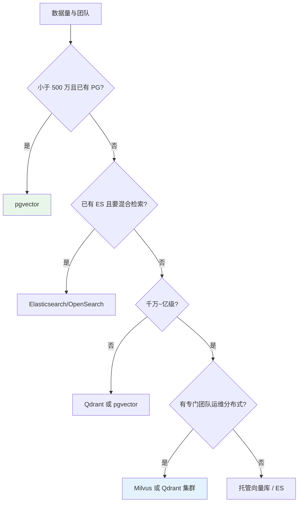
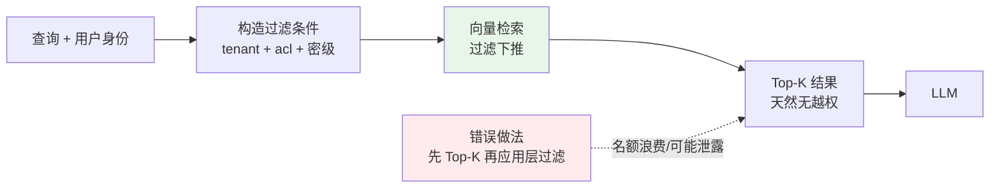
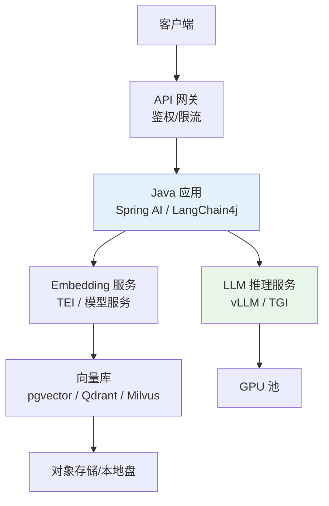

# 向量数据库与模型部署

> 定位：RAG 的 Demo 用 FAISS 或内存数组就能跑，但生产要回答四个问题：百万/亿级向量怎么在 100ms 内召回、租户和权限怎么过滤、Embedding 换模型怎么无感迁移、GPU 显存怎么估算才不 OOM。这篇不讲「向量是什么」，而是讲向量库选型、ANN 索引参数、多租户过滤、增量更新，以及 vLLM/TGI/Ollama/TEI 的部署与容量规划。

前置篇目：[RAG 检索增强生成](01-RAG检索增强生成.md) 讲切分与 HNSW 基础，[RAG 进阶](04-RAG进阶-混合检索重排与评估.md) 讲混合检索与评估；这篇聚焦选型、隔离、迁移和部署。

## 一、为什么需要它

一个典型的翻车过程：

1. POC 阶段用 FAISS + 本地文件，10 万条数据，效果很好。
2. 上线后数据涨到 500 万，单机内存吃紧，查询 P99 从 30ms 涨到 800ms。
3. 多租户共用一张表，某次检索忘了加 `tenant_id`，客户 A 看到了客户 B 的合同。
4. 把 Embedding 从 BGE-base 换成 BGE-large，维度从 768 变 1024，旧索引直接报错；同维度换模型更隐蔽，检索结果全是噪声。
5. 自建 LLM 推理，7B 模型单卡能跑，但并发一高就 OOM，排查发现是 `max-model-len` 和 KV Cache 没算清楚。

这些问题分别对应：**索引与容量、权限过滤、模型版本契约、GPU 显存规划**。向量库和模型部署不是「装个软件」，而是容量、隔离、版本和成本的系统工程。

## 二、核心原理

### 2.1 向量检索的三个基础约定

- **Embedding 模型版本必须离线在线一致**。不同模型（甚至同模型不同版本）的向量空间不同，混用等于拿噪声做检索。
- **维度决定存储和计算**。768/1024/1536/3072 维，float32 每维 4 字节；1 亿条 1024 维向量光原始数据约 400GB，必须靠量化或磁盘索引。
- **距离度量要匹配训练方式**。文本 Embedding 常用余弦；入库前 L2 归一化后，余弦等价于内积，计算更快。归一化必须离线在线一致。

### 2.2 ANN 索引：HNSW、IVF、PQ

精确最近邻（Flat）要扫全量，百万级就慢；ANN 用近似换速度。

| 索引 | 原理 | 关键参数 | 优点 | 代价 |
|---|---|---|---|---|
| **HNSW** | 分层近邻图，上层稀疏快速逼近，下层精细搜索 | `M`、`efConstruction`、`efSearch` | 召回高、延迟低 | 全内存，图结构占内存 |
| **IVF** | 先聚类，查询只搜最近 `nprobe` 个簇 | `nlist`、`nprobe` | 内存较低、实现简单 | 召回受聚类质量影响 |
| **PQ** | 向量分段量化，用码本压缩 | `m`、`nbits` | 内存可压到 1/10~1/30 | 有损，召回下降 |
| **IVF-PQ** | 聚类 + 量化组合 | `nlist`、`nprobe`、`m` | 大规模性价比高 | 参数多，调优复杂 |
| **DiskANN** | 图索引 + SSD，内存放少量缓存 | `R`、`L` | 亿级成本低 | 依赖高速磁盘，延迟略高 |

**HNSW 参数直觉**：

- `M`：每个节点每层最大连接数，越大召回越高、内存越大、插入越慢。常用 16~64。
- `efConstruction`：建索引时的候选宽度，越大索引质量越高、建得越慢，建完固定。
- `efSearch`：查询候选宽度，必须 ≥ topK；这是**唯一能在查询时动态调的召回/延迟旋钮**。先设 `2 × topK`，用 Recall@10 往上调。

**没有万能参数**。同一个索引，在不同数据分布、不同过滤条件下表现不同；要用业务数据做离线评测，不能照抄默认值。

### 2.3 向量库选型

| 产品 | 定位 | 规模 | 运维 | 适合 | 不适合 |
|---|---|---|---|---|---|
| **pgvector** | PostgreSQL 扩展 | 百万~千万 | 低 | 已有 PG、想少引入组件 | 亿级、超高并发 |
| **Elasticsearch/OpenSearch** | 搜索 + 向量 | 千万~亿 | 中 | 已有 ES、要 BM25+向量混合 | 纯向量极致性能 |
| **Milvus** | 专用分布式向量库 | 亿~十亿 | 高 | 超大规模、多索引 | 小团队、数据量不大 |
| **Qdrant** | 专用向量库（Rust） | 千万~亿 | 中 | 复杂 payload 过滤、高性能 | 需要极简运维 |
| **Weaviate** | 专用向量库 | 千万~亿 | 中 | 内置多模态、GraphQL | 团队不熟悉其生态 |
| **Redis（RediSearch）** | 内存数据库 + 向量 | 百万~千万 | 低 | 低延迟、已有 Redis | 大数据量（全内存贵） |
| **FAISS** | 向量检索库，不是数据库 | 单机百万~亿 | 低（嵌入应用） | 离线/嵌入式、研究 | 需要持久化、多租户、在线扩缩容 |



读图要点：**先看数据量和团队运维能力，再看是否需要混合检索和复杂过滤**。90% 的企业 RAG，pgvector 或 ES 足够；上 Milvus 集群通常是过度设计。

### 2.4 多租户与权限过滤

隔离方案从强到弱：

| 方案 | 隔离性 | 成本 | 适合 |
|---|---|---|---|
| **每租户独立实例/库** | 最强 | 最高 | 强合规、租户很少且大 |
| **每租户 collection/schema** | 强 | 中高 | 租户数量可控 |
| **共享 collection + tenant_id 过滤** | 中 | 低 | SaaS 多租户主流 |
| **共享 collection + ACL 标签过滤** | 中 | 低 | 文档级权限 |

**过滤必须下推到向量检索内部**（pre-filter），不能先取 Top-K 再在应用层过滤：

- 先取 Top-K 再过滤，会把名额浪费在无权文档上，返回结果可能不足 K 条。
- 过滤条件要能利用 payload 索引（Qdrant）或 B-tree/组合索引（pgvector），否则会退化成全量扫描。
- 多条件过滤（租户 + 部门 + 密级 + 时间）要压测，索引不是万能的。



读图要点：**权限是检索的一部分，不是检索后的补丁**。多租户是安全红线，要做专项越权测试。

### 2.5 增量更新与重建

**增量更新**的最小设计：

- 主键用 `docId + chunkIndex + version` 或内容哈希，保证幂等。
- 文档变更时先按 `docId` 删除旧记录，再写入新记录；删除和写入要在一个批任务里完成，避免中间态。
- metadata 记录 `docVersion`、`embeddingModel`、`updatedAt`，检索时可按版本过滤。
- 大量删除会产生 tombstone/碎片，定期 compaction 或重建索引。

**模型迁移**（换 Embedding）不能原地改：

1. 新建一个 collection/索引，用新模型全量重算。
2. 双写过渡：新文档同时写新旧索引，旧文档后台回填。
3. 用同一批评估问题对比新旧索引的 Recall@K 和答案质量。
4. 通过后切别名/流量，旧索引保留一段时间再删。

**同维度换模型最危险**：不报错，但向量空间已经变了，检索结果悄悄变差。metadata 必须记录模型名和版本，检索时校验。

### 2.6 Embedding 模型选型

| 类型 | 代表 | 特点 |
|---|---|---|
| **开源可自部署** | BGE 系列、GTE、M3E、Jina Embeddings | 数据不出内网、可微调、要自己扛 GPU |
| **闭源 API** | OpenAI `text-embedding-3-small/large`、Cohere Embed | 开箱即用、多语言好、按量计费 |
| **多语言/中文** | BGE-M3、Qwen Embedding 等 | 中文和长文本表现好，以官方评测为准 |
| **领域微调** | 基于开源模型在业务语料上微调 | 领域术语/缩写召回更好，需要标注和训练 |

选型看五点：语言覆盖、维度（存储/计算成本）、最大输入长度、能否私有化、业务数据上的 Recall@K。**公开榜单只能初筛**，一定要用 200~500 条真实问答自测；领域微调通常最后做，先把切分和混合检索做好。

### 2.7 模型部署：vLLM、TGI、Ollama、TEI



读图要点：**Embedding 服务和 LLM 服务分开部署、分开扩缩容**；向量库是有状态服务，扩缩容和备份策略与无状态应用不同。

| 方案 | 定位 | 优点 | 局限 |
|---|---|---|---|
| **vLLM** | 生产级 LLM 推理 | PagedAttention、连续批处理、OpenAI 兼容 API | 需要 GPU，参数多 |
| **TGI** | Hugging Face 推理服务 | 部署简单、支持多种模型 | 生态绑定 HF，定制性略弱 |
| **Ollama** | 本地开发/小规模 | 一条命令跑模型，体验好 | 生产并发、可观测性弱 |
| **TEI** | 文本 Embedding 推理 | 专为 Embedding/Rerank 优化，吞吐高 | 只做 Embedding/Rerank |
| **TensorRT-LLM** | 极致性能 | 延迟/吞吐好 | 编译复杂、模型适配成本高 |

**批处理与流式**：连续批处理（continuous batching）让新请求动态加入正在运行的 batch，显著提升 GPU 利用率；流式输出降低用户感知的 TTFT，但不改变总生成时间。生产要同时看吞吐（tokens/s）和 TTFT，不能只看一个。

**GPU 显存估算**（粗略但够用）：

```
显存 ≈ 模型权重 + KV Cache + 激活/临时缓冲 + 框架开销
权重 = 参数量 × 每参数字节数（FP16=2, INT8=1, INT4≈0.5）
KV Cache = 2 × 层数 × KV 头数 × head_dim × 序列长度 × 并发数 × 字节数
```

7B 模型 FP16 权重约 14GB；如果 32 层、32 个 KV 头、head_dim 128、序列 8192、并发 16，KV Cache 约 `2 × 32 × 32 × 128 × 8192 × 16 × 2` 字节，约 64GB——这就是为什么 7B 模型也可能在多并发长上下文下 OOM。GQA（分组查询注意力）会减少 KV 头数，是降低 KV Cache 的关键。

**量化**：FP16 是基线；INT8/INT4（GPTQ/AWQ 等）能显著降显存、提吞吐，但有精度损失。量化后必须用业务评估集回归，不能只看困惑度。

### 2.8 成本与容量规划

- **向量库**：内存/磁盘按「向量数 × 维度 × 每维字节 × 索引放大系数」估算；HNSW 图结构额外占用，PQ 可大幅压缩。
- **GPU**：按峰值 QPS × 平均输出 token 估算 tokens/s，再留 30%~50% 余量；批处理能提升吞吐，但会增加尾延迟。
- **存储**：原文、metadata、多版本索引、备份都要算；模型迁移期间新旧索引双份存储。
- **成本优化顺序**：提高 GPU 利用率（批处理/连续批处理）→ 量化/小模型 → 缓存 → 降副本 → 冷热分层。

## 三、关键机制与代码

### 3.1 Spring AI：VectorStore 与过滤

```java
@Configuration
class VectorConfig {

    @Bean
    VectorStore vectorStore(QdrantClient client, EmbeddingModel model) {
        return QdrantVectorStore.builder(client, model)
                .collectionName("kb_chunks")
                .initializeSchema(true)       // 生产建议由迁移脚本建表
                .build();
    }
}

@Service
class SearchService {
    private final VectorStore vectorStore;

    List<Document> search(String query, String tenantId, List<String> groups) {
        var filter = new FilterExpressionBuilder()
                .eq("tenantId", tenantId)
                .in("acl", groups.toArray())
                .build();
        return vectorStore.similaritySearch(SearchRequest.builder()
                .query(query).topK(10).filterExpression(filter).build());
    }
}
```

**过滤表达式要下推**，不要在 Java 里 `stream().filter()`；不同向量库支持的表达式能力不同，复杂过滤要先压测。

### 3.2 LangChain4j 0.3x：EmbeddingStore + 动态过滤

```java
EmbeddingStore<TextSegment> store = QdrantEmbeddingStore.builder()
        .host("qdrant.internal").port(6334)
        .collectionName("kb_chunks")
        .build();

ContentRetriever retriever = EmbeddingStoreContentRetriever.builder()
        .embeddingStore(store)
        .embeddingModel(embeddingModel)
        .maxResults(10)
        .minScore(0.5)
        .dynamicFilter(query -> MetadataFilterBuilder
                .metadataKey("tenantId").isEqualTo(currentTenant()))
        .build();
```

### 3.3 索引配置与部署命令

Qdrant 建 collection（HNSW + 余弦）：

```json
PUT /collections/kb_chunks
{
  "vectors": { "size": 1024, "distance": "Cosine" },
  "hnsw_config": { "m": 32, "ef_construct": 200 },
  "optimizers_config": { "default_segment_number": 4 }
}
```

vLLM 启动（参数以版本和模型为准）：

```bash
vllm serve Qwen/Qwen2.5-7B-Instruct \
  --max-model-len 8192 \
  --gpu-memory-utilization 0.90 \
  --max-num-seqs 64 \
  --port 8000
```

TEI 部署 Embedding 服务：

```bash
text-embeddings-inference \
  --model-id BAAI/bge-m3 \
  --port 8080 \
  --max-batch-tokens 16384
```

Ollama 只建议本地开发/小规模：

```bash
ollama serve
ollama run qwen2.5:7b
```

### 3.4 增量更新

```java
@Service
class IndexService {
    private final VectorStore vectorStore;

    /** 文档变更：先按 docId 删除旧版本，再写入新版本 */
    void reindex(String docId, String version, List<Document> chunks) {
        // 不同向量库删除 API 不同；这里表达语义：按 metadata 过滤删除
        vectorStore.delete(new FilterExpressionBuilder().eq("docId", docId).build());

        chunks.forEach(d -> {
            d.getMetadata().put("docId", docId);
            d.getMetadata().put("docVersion", version);
            d.getMetadata().put("embeddingModel", "bge-m3");
            // 幂等主键：同一文档同一块重复写入不会产生重复
            d.getMetadata().put("chunkKey", docId + "#" + d.getMetadata().get("chunkIndex"));
        });
        vectorStore.add(chunks);
    }
}
```

生产上还要加：内容哈希判断是否真变了、批量写入限流、失败重试、删除/写入的对账任务，以及模型迁移时的双写。

## 四、生产坑点与排查

### 坑点 1：先取 Top-K 再在应用层过滤

**现象**：多租户检索结果经常不足 K 条；或者某租户偶尔看到别人的文档。
**原因**：向量库返回全局 Top-K，应用层再 `filter(tenantId)`；名额被无权文档占用，极端情况下漏掉有权文档。
**解法**：过滤条件下推到检索（`filterExpression`/payload filter）；建 tenant/acl 的 payload 索引；做越权专项测试；监控「过滤后结果数」。

### 坑点 2：每租户一个 collection，元数据爆炸

**现象**：租户数上千后，collection 创建/删除变慢，运维困难，资源碎片严重。
**原因**：把「隔离」简单等同于「一个租户一个 collection」。
**解法**：租户数量可控且差异大时用 collection；SaaS 大规模用共享 collection + `tenant_id` + 分区键；中间方案是按租户分库/分 schema，按实际规模和合规要求选。

### 坑点 3：换 Embedding 模型没重建索引

**现象**：换了模型，检索结果突然变差；维度相同则不报错，更难发现。
**原因**：旧向量和新 query 向量不在同一空间；metadata 没记录模型版本。
**解法**：新 collection 全量重建 + 双写过渡 + 离线评估通过再切；metadata 记录 `embeddingModel` 和 `version`；检索时校验版本，不一致直接报错而不是静默降级。

### 坑点 4：HNSW 全内存，数据涨了就 OOM

**现象**：数据从百万涨到千万，向量库内存持续上涨，最后 OOM 或频繁 swap。
**原因**：HNSW 图结构和原始向量都在内存；没有预估容量，也没有量化/磁盘索引方案。
**解法**：按「向量数 × 维度 × 4B × 放大系数」预估内存；大规模用 PQ/IVF-PQ/DiskANN；设置副本和分片；监控内存和查询延迟，提前扩容。

### 坑点 5：GPU 显存估算只看模型权重

**现象**：7B 模型单卡能加载，但并发一高或上下文一长就 OOM。
**原因**：只算了权重（约 14GB FP16），没算 KV Cache、激活和框架开销；`max-model-len` 和 `max-num-seqs` 设得太大。
**解法**：按公式估算 KV Cache；用 GQA 模型；限制 `max-model-len`、`max-num-seqs` 和 `gpu-memory-utilization`；压测找并发拐点；量化降显存后回归质量。

### 坑点 6：增量更新产生大量 tombstone/碎片

**现象**：文档频繁更新后，查询越来越慢，磁盘占用远高于实际数据量。
**原因**：只做逻辑删除，没有 compaction；每次更新都插入新向量，旧向量残留。
**解法**：按 docId 物理删除或定期 compaction；用内容哈希跳过未变更文档；控制更新频率，批量合并；监控 segment 数、删除比例和查询延迟。

## 五、选型 / 容量 / 最佳实践

| 维度 | 选择 | 说明 |
|---|---|---|
| 数据量 < 500 万 | pgvector 或 ES | 别上专用集群 |
| 需要 BM25+向量 | Elasticsearch/OpenSearch | 一套系统做混合检索 |
| 千万~亿级 | Qdrant/Milvus | 看团队运维能力 |
| 复杂过滤 | Qdrant/pgvector | 压测 payload/组合索引 |
| 强租户隔离 | 独立库/collection | 成本换隔离 |
| 本地开发 | FAISS/Ollama | 不要直接上生产 |
| 生产 LLM | vLLM/TGI | 连续批处理、可观测 |
| Embedding 服务 | TEI | 与 LLM 分开扩缩容 |

**容量估算清单**：

- 向量数 = 文档数 × 平均 chunk 数；chunk 数会随切分策略变化。
- 原始向量内存 = 向量数 × 维度 × 4B；HNSW 再乘索引放大系数（通常 1.5~3，按实测）。
- 原文和 metadata 按文档体积另算；多版本索引要双份。
- GPU 按 `tokens/s` 和并发估算，权重 + KV Cache + 20%~30% 余量。

**什么时候不该用**：

- 数据量小、单机够用，不要上 Milvus 集群；运维成本远大于收益。
- 团队没有分布式存储/消息队列运维能力，优先托管服务或 pgvector/ES。
- 不要用 FAISS 直接做多租户在线服务，它没有账号、权限、持久化和扩缩容。
- 不要为了省显存盲目上 INT4，先用评估集确认质量损失可接受。

## 六、面试高频问法

**Q1：向量数据库怎么选？**
**一句话结论**：先看数据量、团队运维能力、是否需要混合检索和复杂过滤；500 万以内 pgvector/ES 足够，千万级以上再考虑 Qdrant/Milvus。

展开：pgvector 复用 PG、运维低；ES 适合向量 + BM25 一体；Milvus 适合超大规模但依赖 etcd/对象存储等组件；Qdrant 过滤强；Redis 快但全内存贵；FAISS 是库不是数据库。

加分点：说「90% 的企业 RAG 不需要专用向量集群，上 Milvus 前先算运维成本」。

**Q2：HNSW、IVF、PQ 分别怎么选？**
**一句话结论**：HNSW 召回高延迟低但全内存；IVF 省内存靠聚类；PQ 压缩率高但有损；大规模常用 IVF-PQ 或 DiskANN。

展开：HNSW 的 `M` 管内存和召回、`efConstruction` 管建索引质量、`efSearch` 管查询召回；IVF 的 `nlist/nprobe` 决定搜索簇数；PQ 把向量分段量化，内存可降一个数量级但精度下降。

加分点：说「参数没有万能值，要用业务数据算 Recall@K 和 P99，再决定 efSearch/nprobe」。

**Q3：多租户过滤为什么不能先检索后过滤？**
**一句话结论**：先取 Top-K 再过滤会浪费名额、返回不足 K 条，甚至让无权文档进入候选；过滤必须下推到向量检索。

展开：向量库返回的是全局最近邻，应用层过滤发生在名额分配之后；正确做法是 `tenant_id`/ACL 条件下推，并建 payload 索引。还要做越权测试，防止某条路径漏加过滤。

加分点：说「多租户是安全红线，宁可牺牲一点召回，也不能让越权文档进入上下文」。

**Q4：换 Embedding 模型怎么做到无感迁移？**
**一句话结论**：新 collection 全量重算 + 双写过渡 + 离线评估 + 切别名，旧索引保留一段时间；不能原地改。

展开：不同模型向量空间不同，同维度换模型更隐蔽；metadata 记录模型版本，检索校验；迁移期间新旧索引双份存储，成本要提前算。

加分点：说「同维度不报错是最危险的，必须有评估集和版本校验，不能靠感觉」。

**Q5：文档更新后索引怎么增量更新？**
**一句话结论**：按 docId 删除旧记录再写新记录，主键幂等，内容哈希跳过未变更，定期 compaction 清理碎片。

展开：更新要和父子块映射、metadata 版本一起原子处理；大量删除会产生 tombstone，影响查询和磁盘；要有对账任务，防止删除/写入失败导致脏数据。

加分点：说「增量更新最难的不是写，是删干净和可对账」。

**Q6：vLLM、TGI、Ollama 怎么选？**
**一句话结论**：生产用 vLLM/TGI，看重连续批处理和吞吐；Ollama 适合本地开发和小规模；Embedding 用 TEI。

展开：vLLM 的 PagedAttention 和连续批处理能显著提升 GPU 利用率，提供 OpenAI 兼容 API；TGI 部署简单；Ollama 一条命令跑模型但生产可观测性和并发弱；TEI 专做 Embedding/Rerank。

加分点：说「流式只改善 TTFT，不改变总生成时间；生产要同时看吞吐和尾延迟」。

**Q7：GPU 显存怎么估算？为什么 7B 模型也会 OOM？**
**一句话结论**：显存 = 权重 + KV Cache + 激活/框架开销；7B FP16 权重约 14GB，但长上下文高并发下 KV Cache 可能几十 GB。

展开：权重按参数量 × 每参数字节数；KV Cache 按 `2 × 层数 × KV 头数 × head_dim × 序列长度 × 并发 × 字节` 估算；GQA 减少 KV 头数。`max-model-len`、`max-num-seqs`、`gpu-memory-utilization` 都会影响峰值。

加分点：说「先压测算并发拐点，再决定量化和副本数，不要拍脑袋」。

**Q8：量化能省多少？有什么代价？**
**一句话结论**：FP16 到 INT8 约省一半权重显存，INT4 约省 3/4；代价是精度损失和部分算子兼容问题，必须用业务评估集回归。

展开：GPTQ/AWQ 等训练后量化方法能在较小精度损失下压缩；量化对长上下文、复杂推理的影响可能更明显；Embedding 模型量化要单独评估召回。

加分点：说「量化不是免费的，省下的显存要换来吞吐/成本收益，质量回归不过关就不能上」。

## 小结

- 向量库选型先看数据量、运维能力、混合检索和过滤需求；中小规模 pgvector/ES 足够，别过度设计。
- HNSW 召回好但全内存；IVF 省内存；PQ 压缩有损；大规模用 IVF-PQ/DiskANN，参数要用业务数据调。
- 多租户过滤必须下推，先 Top-K 后过滤既浪费名额又有越权风险；这是安全红线。
- 换 Embedding 必须新索引全量重建 + 双写 + 评估 + 切流量；同维度换模型不报错，最危险。
- 增量更新要幂等、可删除、可对账，定期 compaction；父子块和 metadata 版本要同步。
- 模型部署生产用 vLLM/TGI，Embedding 用 TEI，Ollama 只适合开发；显存要算权重 + KV Cache，不能只看模型大小。

## 参考资料

- Malkov, Yashunin：Efficient and Robust Approximate Nearest Neighbor Search Using Hierarchical Navigable Small World Graphs（HNSW 论文）
- Milvus 官方文档：Index Types、Partition、Multi-tenancy
- Qdrant 官方文档：HNSW Config、Payload Index、Filtering
- pgvector README：HNSW/IVF 索引与距离操作符
- vLLM 官方文档：PagedAttention、Continuous Batching、OpenAI-Compatible Server
- Spring AI Reference：VectorStore 与 Metadata Filter
