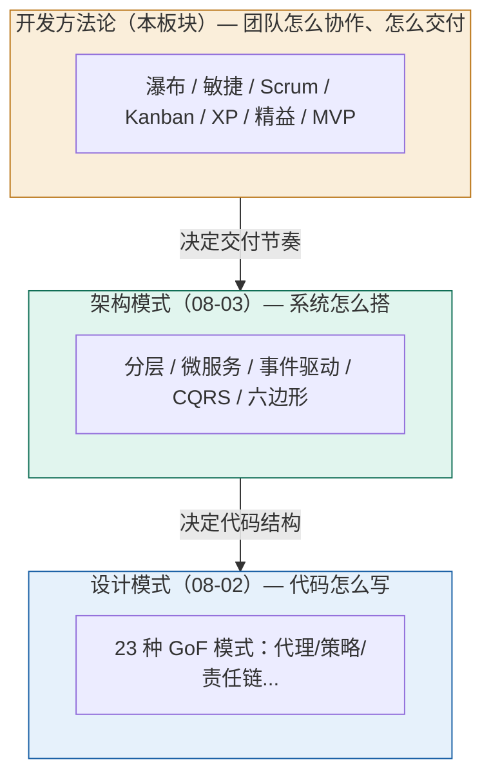
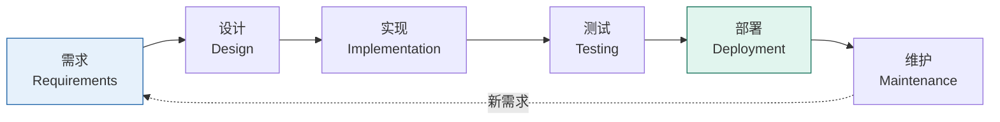
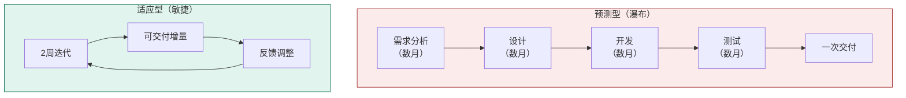
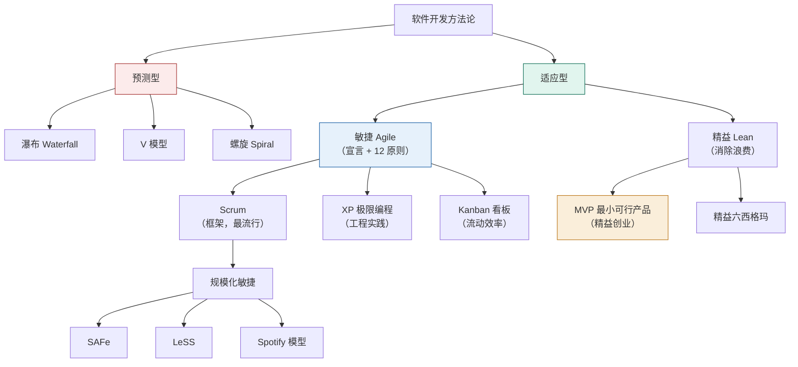
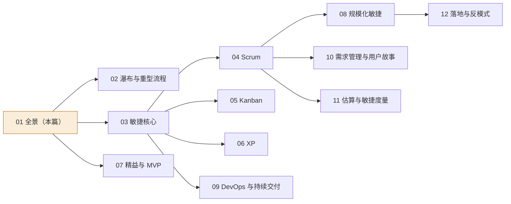

# 软件开发生命周期与模式全景

> 定位：前面 13 个板块讲的是「代码怎么写、系统怎么搭」，这一篇开始讲「软件是怎么被开发出来的」——从需求到上线，团队用什么流程、什么节奏、什么协作方式。这是架构师最容易忽略、却最影响落地成败的一层。先建立全景认知，再逐个深入。

## 一、为什么架构师必须懂开发方法论

很多技术人有个误解：架构师就是「画架构图、选技术栈、写核心代码」的人。但真实工作里，架构师至少一半的精力花在**推动方案落地**上——而落地不是靠图画得漂亮，是靠：

- 需求怎么拆成可交付的小块（而不是一个巨无霸版本憋半年）
- 团队按什么节奏迭代、怎么保证每轮都有可用的产出
- 质量怎么在过程中保证（而不是最后测试阶段集中爆炸）
- 多团队协作时，接口和依赖怎么对齐
- 上线怎么做到低风险（灰度、回滚、Feature Flag）

这些全都是**开发方法论**要解决的问题。不懂方法论的架构师，方案再优雅也可能死在「推不动、落不了地、交付不了」。

> 一个扎心的现实：技术方案失败，很少是因为技术本身不行，更多是因为「交付节奏错了」「需求理解偏了」「团队协作乱了」。方法论就是治这些病的。

## 二、三个层面别搞混

在展开之前，必须先厘清三个容易混淆的「模式」——它们解决的是完全不同层面的问题：

- **开发方法论**（本板块）：管「人」和「流程」——团队怎么组织、需求怎么流动、版本怎么发布。
- **架构模式**：管「系统结构」——服务怎么拆、数据怎么流、模块怎么分层。
- **设计模式**：管「代码」——类怎么设计、对象怎么协作。

三者是「自上而下」的：方法论决定交付节奏，架构模式适配这个节奏，设计模式支撑架构落地。**一个用 Scrum 两周迭代的团队，和一个用瀑布半年一版的团队，架构选择会完全不同**（前者要求可独立部署的小服务，后者可以接受大单体）。

## 三、软件开发生命周期（SDLC）

SDLC（Software Development Life Cycle）是「软件从生到死」的完整过程，通常包含六个阶段：

关键不在于「有哪几个阶段」（这是常识），而在于**这些阶段怎么排列、每次走多远**——这就引出了不同的「生命周期模型」：

| 模型 | 阶段排列方式 | 交付节奏 | 典型场景 |
|---|---|---|---|
| **瀑布** | 严格线性，一个阶段做完才进下一个 | 一次交付，周期长 | 需求稳定、合规要求高 |
| **迭代** | 分多轮，每轮都走完整流程 | 每轮一个可交付版本 | 需求会演进 |
| **增量** | 分多块，每块加一部分功能 | 逐步叠加功能 | 功能可切分 |
| **敏捷** | 短迭代 + 持续反馈 + 拥抱变化 | 2-4 周一个增量 | 需求变化快 |
| **螺旋** | 迭代 + 每轮做风险分析 | 风险驱动 | 大型高风险项目 |

**最容易混淆的是「迭代」和「增量」**：迭代是「反复打磨同一块，越做越完善」（像画素描，先勾轮廓再细化）；增量是「每次加一块新功能」（像拼图，一块块拼上去）。敏捷通常是「迭代 + 增量」的结合——每轮既完善又新增。

## 四、两大流派：预测型 vs 适应型

所有方法论，本质可以归为两大流派：

### 4.1 预测型（Predictive）—— 瀑布为代表

**核心假设**：需求可以在开始前被完整、准确地定义；变化是例外，要严格控制。

**做法**：先花大量时间做需求分析和设计，形成详尽文档，然后按计划一步步实现。变更要走「变更控制流程」。

**优点**：计划性强、文档完整、责任清晰、适合审计。

**缺点**：需求一变就返工；反馈来得晚（用户到项目末期才看到成品）；风险后置（问题在测试阶段才暴露）。

**适合**：需求高度稳定（如军工、航天、医疗设备、银行核心系统）、合同制交付（固定范围固定价）、强合规审计要求。

### 4.2 适应型（Adaptive）—— 敏捷为代表

**核心假设**：需求必然会变，与其预测不如快速适应；通过短周期交付 + 持续反馈来降低风险。

**做法**：把大目标拆成小增量，每个短周期（2-4 周）交付一个「可用的」版本，根据反馈调整下一步。

**优点**：反馈快、风险早暴露、能拥抱变化、客户满意度高。

**缺点**：需要客户深度参与、对团队能力要求高、文档相对轻、不适合「范围锁死」的合同。

**适合**：需求变化快的互联网产品、创新业务、需要快速验证的场景。

左边瀑布：反馈在最后才来，如果方向错了，返工成本极高。右边敏捷：每 2 周就有反馈，方向错了能及时纠正。

## 五、方法论全景地图

把所有主流方法论放在一张图上，看清它们的「血缘关系」：

这张图的关系要理清：

- **瀑布**是「预测型」的代表，V 模型、螺旋是它的变种。
- **敏捷**不是「一种方法」，而是一套**价值观和原则**（敏捷宣言）。Scrum、XP、Kanban 是落地敏捷的**具体框架/实践**。
- **精益**来自制造业（丰田），核心是「消除浪费、持续改进」，MVP 是精益思想在产品开发上的应用。
- **规模化敏捷**（SAFe/LeSS/Spotify）解决的是「一个团队敏捷容易，几十个团队怎么协同」。

## 六、各方法论一句话速览

| 方法论 | 一句话 | 适合谁 |
|---|---|---|
| **瀑布** | 按阶段线性推进，一次交付 | 需求稳定、强合规 |
| **V 模型** | 瀑布的变种，每个开发阶段对应一个测试阶段 | 嵌入式、安全关键系统 |
| **螺旋** | 迭代 + 每轮风险分析 | 大型高风险项目 |
| **敏捷** | 短迭代、持续反馈、拥抱变化（价值观层） | 需求变化快的产品 |
| **Scrum** | 三角色五事件三工件，2-4 周一个 Sprint | 大多数产品团队 |
| **Kanban** | 可视化流程 + 限制在制品，追求流动效率 | 运维、支持、持续交付 |
| **XP** | 工程实践拉满：结对、TDD、CI、重构 | 技术驱动团队 |
| **精益 / MVP** | 消除浪费，用最小可行产品快速验证假设 | 创业、新业务探索 |
| **SAFe** | 大规模敏捷框架，多团队协同（PI、ART） | 大型企业 |
| **LeSS** | 大规模 Scrum，保持简单 | 多团队产品 |
| **Spotify 模型** | Squad/Tribe/Chapter/Guild 组织模型 | 组织设计参考 |
| **DevOps** | 开发运维一体化，持续交付 | 所有需要快速交付的团队 |

## 七、怎么选：一张决策表

方法论没有「最好」，只有「最合适」。选型看四个维度：

| 维度 | 偏预测型（瀑布） | 偏适应型（敏捷） |
|---|---|---|
| **需求稳定性** | 稳定、可提前定义 | 变化快、需要探索 |
| **交付模式** | 固定范围固定价合同 | 持续交付、按价值付费 |
| **合规要求** | 强审计、强文档（医疗/军工） | 相对宽松 |
| **团队与客户** | 客户难参与、团队分布 | 客户能深度参与、团队自组织 |

**务实建议**：

1. **大多数互联网产品用敏捷（Scrum 或 Kanban）**——需求变化快，需要快速反馈。
2. **强合规行业（医疗、军工、金融核心）用瀑布或混合**——审计要求文档完整、过程可追溯。
3. **运维/支持类团队用 Kanban**——工作是持续流入的，不是一批批的。
4. **创业/新业务用精益 + MVP**——先验证假设，别闷头做半年。
5. **别教条**：现实里大量团队是「混合模式」（如「敏捷开发 + 瀑布式合规文档」），能用、有效就行。

## 八、常见误区（先打个预防针）

后面每篇都会展开，这里先列最典型的几个：

1. **「敏捷 = 快」**：错。敏捷是「快速反馈、快速调整」，不是「压缩工期」。把 3 个月的活压成 2 周，那叫加班，不叫敏捷。
2. **「敏捷 = 没文档、没设计」**：错。敏捷宣言说「工作的软件高于详尽的文档」，不是「不要文档」。该有的设计文档、接口契约一样不能少。
3. **「站会 = 汇报进度」**：错。站会是团队同步、识别障碍，不是给领导汇报。
4. **「MVP = 功能残缺的半成品」**：错。MVP 是「能验证核心假设的最小完整产品」，是「最小可用」，不是「最烂可用」。
5. **「上了 Scrum 就是敏捷」**：错。只学仪式（站会、回顾会）不学精神（自组织、持续改进），就是「僵尸 Scrum」。

## 九、这个板块怎么读

建议顺序：

- **想快速上手**：01 → 03（敏捷核心）→ 04（Scrum）→ 10（用户故事）→ 11（估算度量）
- **想系统理解**：按 01-12 顺序读
- **只想解决具体问题**：直接跳到对应篇（如「MVP 怎么做」看 07，「多团队怎么协同」看 08）

## 十、三种模型的混合用法

现实项目很少「纯瀑布」或「纯敏捷」，常见的是按风险分层混合：

| 部分 | 适合模型 | 原因 |
|---|---|---|
| 合规/安全评审、对外承诺 | 阶段门（瀑布式） | 需要留痕、可审计、不可反复 |
| 需求不确定的产品探索 | 迭代/敏捷 | 需要快速反馈、允许试错 |
| 技术攻坚/架构验证 | 时间盒 spike + 阶段评审 | 先降低不确定性，再决定投入 |
| 交付与运维 | 持续交付/DevOps | 小步发布、快速回滚 |

**混合的关键是「边界清晰」**：哪部分走阶段门、哪部分走迭代，要写进项目章程，否则会变成「审批时瀑布、交付时敏捷」的双重负担。

**选择模型时的三个提问**：需求能不能提前冻结？失败的成本有多高？组织能不能接受「边做边改」？答案决定了你该用阶段门还是迭代，而不是「哪种更先进」。

**阶段门与迭代怎么接**：阶段门管「要不要继续投入」，迭代管「怎么把东西做出来」。做法是把阶段门放在「重大投入节点」（立项、对外承诺、上线），中间过程用迭代推进；评审材料用迭代产出的演示与数据，而不是重新写一份汇报。

> 一句话判断：**不确定性高、失败便宜 → 迭代；不确定性低、失败昂贵 → 阶段门**。多数项目两者都有，所以需要混合，而不是二选一。

> 补充：混合模型要防止「双轨制」——同一件事既要阶段门审批、又要迭代演示，团队会被两份材料拖垮。正确做法是**一次产出、两处复用**：迭代演示的数据直接作为阶段门评审材料。

> 最后提醒：模型选择不是一次性决定。项目从探索进入交付、从交付进入合规审计，适合的流程会变；**每个阶段门都应该重新问一遍「现在的流程还匹配当前风险吗」**。

> 再补一句：流程的价值在「减少等待与返工」，不在「多几份文档」。评审时只问两个问题——这个阶段门挡住了什么风险？迭代演示让谁更早看到了结果？答不上来，流程就该简化。

> 一句话：流程服务目标，不服务流程本身。

## 十一、面试高频问法

> 架构师面试经常问「你们团队怎么协作/怎么保证交付」，这考的就是方法论。答案要具体，别说「我们用敏捷」就完事。

**Q1：敏捷和瀑布有什么区别？**

**一句话结论**：瀑布是「先规划后执行、一次交付」，敏捷是「小步快跑、持续反馈、拥抱变化」——本质区别是「对变化的态度」和「反馈的时机」。

展开：

| 维度 | 瀑布 | 敏捷 |
|---|---|---|
| 需求 | 前期固定 | 持续演进 |
| 交付 | 一次（项目末期） | 每 2-4 周 |
| 反馈 | 晚 | 早且频繁 |
| 变化 | 严格控制 | 拥抱 |
| 文档 | 重 | 够用即可 |
| 风险 | 后置 | 前置 |

加分点：说"没有绝对的优劣——瀑布适合需求稳定、强合规的场景（如军工），敏捷适合需求变化快的产品；很多团队是混合的"。

**Q2：Scrum 的三角色五事件三工件是什么？**

**一句话结论**：三角色（PO/SM/开发团队）、五事件（Sprint/计划会/站会/评审会/回顾会）、三工件（产品待办/Sprint 待办/增量）。

加分点：能讲清每个角色的职责边界（PO 管「做什么」、SM 管「怎么协作」、团队管「怎么做」），以及每个事件的产出（计划会出 Sprint 目标、评审会出反馈、回顾会出改进项）。

**Q3：MVP 是什么？和「半成品」有什么区别？**

**一句话结论**：MVP（Minimum Viable Product，最小可行产品）是「用最小成本验证核心假设的最小完整产品」，是「最小可用」，不是「功能残缺」。

加分点：强调 MVP 的目的是「验证假设、获取反馈」，不是「省钱省事」；它的判断标准是「能不能验证核心价值主张」，不是「功能有多少」。

**Q4：什么情况下不该用敏捷？**

**一句话结论**：需求高度稳定、强合规审计、客户无法参与、团队规模过小或过大的极端情况，敏捷反而低效。

加分点：说"敏捷依赖「客户深度参与 + 团队自组织 + 需求可演进」三个前提，缺一个就会变形；不要为了「政治正确」硬上敏捷"。

**Q5：你们团队用什么开发模式？为什么？**

**一句话结论**：结合团队实际讲——需求特点、团队规模、交付节奏、遇到的痛点，以及为什么选了这个模式、效果如何。

加分点：这题没有标准答案，考的是「你有没有真实思考过」；能说出「我们试过 Scrum 但发现站会流于形式，改成了 Kanban」这种真实经历，比背概念强一百倍。

**Q6：迭代开发和增量开发有什么区别？**

**一句话结论**：迭代是「反复打磨同一块，越做越完善」，增量是「每次加一块新功能」；敏捷通常是「迭代 + 增量」的结合。

展开：

- **迭代（Iterative）**：像画素描，先勾轮廓再细化——每次都在「完善已有的东西」。
- **增量（Incremental）**：像拼图，一块块拼上去——每次都在「新增功能」。
- **敏捷**：每个 Sprint 既完善已有功能（迭代），又新增功能（增量）。

加分点：说"很多人把「迭代」和「增量」混为一谈——「每个 Sprint 都有产出」是增量，「每个 Sprint 都在打磨」是迭代；敏捷要两者兼备"。

**Q7：Scrum、Kanban、XP 是什么关系？怎么选？**

**一句话结论**：它们都是「落地敏捷」的具体框架/实践——Scrum 偏管理（角色/事件/工件）、Kanban 偏流动（可视化/限 WIP）、XP 偏工程（结对/TDD/CI）；常组合使用。

展开：

| 框架 | 侧重 | 适合 |
|---|---|---|
| Scrum | 管理框架（节奏、角色、工件） | 产品团队、有明确迭代 |
| Kanban | 流动效率（可视化、限 WIP） | 运维/支持、持续交付 |
| XP | 工程实践（结对、TDD、CI、重构） | 技术驱动、质量要求高 |

加分点：说"三者不是互斥的——很多团队「用 Scrum 管节奏 + 用 XP 的工程实践保质量 + 用 Kanban 看流动」，取长补短"。

**Q8：DevOps 和敏捷是什么关系？**

**一句话结论**：敏捷管「开发侧怎么快速响应变化」，DevOps 管「从开发到运维的整条交付链路」——敏捷是「做对的事」，DevOps 是「把事快速、稳定地交付出去」。

展开：

- **敏捷**：解决「需求到代码」的效率和适应性。
- **DevOps**：解决「代码到生产」的效率和稳定性（CI/CD、自动化、监控）。
- **关系**：敏捷常常「只到开发」，DevOps 补上了「开发之后」的环节，两者合起来才是端到端的快速交付。

加分点：说"只做敏捷不做 DevOps，会出现「开发很快但上线很慢」——代码写完了卡在部署；DevOps 是敏捷的「最后一公里」"。

**Q9：敏捷转型为什么容易失败？**

**一句话结论**：三个错位——只学仪式不学精神（僵尸 Scrum）、只改团队不改组织（上面还是瀑布）、把敏捷当控制工具（用敏捷加强管控）。

加分点：说"敏捷转型是「组织变革」不是「团队换流程」；如果考核、预算、审批还是瀑布式的，团队再敏捷也跑不起来"。

**Q10：架构师在敏捷团队里应该扮演什么角色？**

**一句话结论**：不是「画完图就撤」，而是「演进式设计、技术决策共创、守护架构防腐化、跨团队对齐、技术债管理」。

展开：

- **演进式设计**：先做「刚好够用」的设计，随需求演进，但守住不可逆决策。
- **共创**：提供选项和权衡，让团队参与决策，而不是直接下命令。
- **守护**：定义架构约束、用自动化检查防腐化。
- **对齐**：跨团队对齐接口和依赖。
- **技术债**：让债可见、可评估、定期还。

加分点：说"敏捷不是「不要架构」，是「演进式架构」；架构师的价值在「让团队跑得快还不翻车」——这比画一张完美的图难得多"。

## 小结

- 开发方法论管「团队怎么协作、需求怎么流动、版本怎么交付」，是架构师落地能力的核心。
- 三个层面别混：方法论（人/流程）> 架构模式（系统结构）> 设计模式（代码）。
- 两大流派：预测型（瀑布，需求稳定）vs 适应型（敏捷，需求多变）。
- 敏捷是价值观，Scrum/Kanban/XP 是落地框架；精益/MVP 是精益思想的应用；SAFe/LeSS/Spotify 解决规模化。
- 选型看「需求稳定性、交付模式、合规要求、团队客户」四个维度，没有最好只有最合适。
- 五大误区：敏捷≠快、敏捷≠没文档、站会≠汇报、MVP≠半成品、Scrum≠敏捷。
