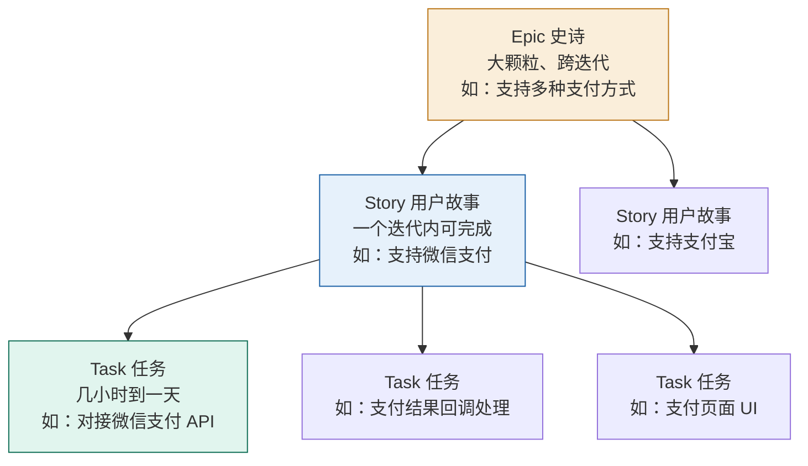
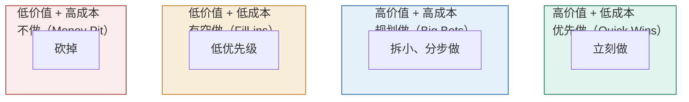
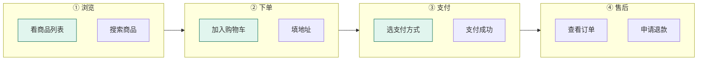

# 需求管理与用户故事

> 定位：敏捷里最容易做歪的一环就是需求——把「需求文档」换了个名字叫「用户故事」，然后继续写成一堆功能清单。这一篇讲清用户故事的本质、怎么写才算合格、怎么拆、怎么排优先级、怎么用故事地图看全貌。需求管不好，后面所有的迭代、估算、交付都是空中楼阁。

## 一、为什么需求管理是敏捷的地基

一个残酷的事实：**大部分项目失败，不是技术做不出来，而是做出来的东西没人要**。原因往往出在需求环节：

- 需求是「拍脑袋」定的，没验证过用户是否真的需要
- 需求写成「功能清单」（要一个导出按钮），丢了「为什么」（用户想解决什么问题）
- 需求颗粒度太大（「做一个订单系统」），一个 Sprint 做不完，估算不准
- 需求没有验收标准，做完了一扯皮「这不是我要的」

敏捷的需求管理，核心不是「写文档」，而是**把「用户价值」拆成「可交付、可验证的小块」**，让每个迭代都能交付真实价值、拿到真实反馈。

> 一句话：需求管理的目标，是让团队「做对的事」，而不是「把事做对」。方向错了，做得再快也是浪费。

## 二、需求的三层结构：Epic → Story → Task

敏捷需求不是扁平的清单，而是分层的：



| 层级 | 颗粒度 | 谁负责 | 作用 |
|---|---|---|---|
| **Epic（史诗）** | 大，跨多个迭代 | PO | 表达一个大目标，作为路线图 |
| **Story（用户故事）** | 一个迭代内能完成 | PO + 团队 | 交付单元，估算和排期的基础 |
| **Task（任务）** | 几小时到一天 | 开发 | 技术实现步骤，Sprint 内拆 |

**常见错误**：把 Epic 直接丢进 Sprint——「做一个订单系统」这种，一个迭代根本做不完，估算没法做，进度没法跟。必须先拆成 Story。

## 三、用户故事：不是「功能描述」，是「价值表达」

### 3.1 标准格式

一个合格的用户故事，用「角色-动作-价值」三段式：

```
作为 <某个角色>，
我想要 <做某个操作>，
以便 <获得某个价值/解决某个问题>。
```

例子：

> **作为**一个经常网购的用户，
> **我想要**在结算时保存常用的收货地址，
> **以便**下次下单不用重复填写。

注意最后一段「以便」——这是**价值**，是最容易被省略、却最重要的一段。没有它，故事就退化成了功能清单（「做一个地址簿」），团队不知道为什么做、做到什么程度算够。

### 3.2 INVEST 原则：判断一个故事好不好

一个高质量的用户故事，满足 **INVEST** 六个标准：

| 字母 | 含义 | 反面例子 |
|---|---|---|
| **I**ndependent 独立 | 故事之间尽量不依赖，可独立开发和交付 | 「先做 A，A 做完才能做 B」 |
| **N**egotiable 可协商 | 细节可以讨论，不是合同条款 | 需求文档精确到按钮颜色 |
| **V**aluable 有价值 | 对用户或业务有明确价值 | 「重构 DAO 层」（技术任务不是用户故事） |
| **E**stimable 可估算 | 团队能估算工作量 | 「做一个智能推荐系统」（太大、太模糊） |
| **S**mall 小 | 一个迭代内能完成 | 「做一个电商平台」 |
| **T**estable 可测试 | 有明确的验收标准 | 「系统要快」（多快算快？） |

**最常违反的是 S（太大）和 T（不可测）**。故事太大 → 拆；不可测 → 补验收标准。

### 3.3 验收标准（Acceptance Criteria）

验收标准是「这个故事做到什么程度算完成」的明确约定，通常用 **Given-When-Then**（假设-当-那么）格式：

```
故事：用户保存收货地址

验收标准：
1. Given 用户在结算页，When 点击「保存地址」并填写完整，Then 地址保存成功并出现在地址列表
2. Given 用户填写时漏了手机号，When 点击保存，Then 提示「手机号必填」且不保存
3. Given 用户已有 10 个地址，When 再添加，Then 提示「最多保存 10 个地址」
```

验收标准的好处：

- **对齐期望**：开发和测试、PO 对「做完」的理解一致，避免「这不是我要的」
- **可测试**：每条标准都能写成测试用例
- **边界清晰**：异常情况、边界条件都被覆盖

> 很多团队的「用户故事」只有一句话，没有验收标准，结果做完一评审全是问题。**验收标准不是可选项，是用户故事的一部分**。

## 四、怎么拆故事：五种实用方法

故事太大（不满足 S）时，要拆。拆法有讲究——**按价值拆，不是按技术层拆**。

### 4.1 按工作流步骤拆

一个完整流程，拆成几个步骤，每个步骤一个故事。

> 「用户下单」→ 拆成「浏览商品」「加入购物车」「填写地址」「选择支付」「提交订单」

### 4.2 按业务规则拆

先做简单规则，复杂规则后续迭代。

> 「优惠券」→ 先做「满减券」，再做「折扣券」，再做「叠加规则」

### 4.3 按数据类型/变体拆

先支持一种，再扩展。

> 「支持支付」→ 先「微信支付」，再「支付宝」，再「银行卡」

### 4.4 按操作（CRUD）拆

先做核心操作，再做辅助操作。

> 「地址管理」→ 先「新增 + 查看」，再「编辑 + 删除」

### 4.5 按「快乐路径 vs 异常路径」拆

先做正常流程（Happy Path），再做异常处理。

> 「支付」→ 先做「支付成功」，再做「支付失败重试」「超时处理」「退款」

**反例（错误拆法）**：按技术层拆——「前端故事」「后端故事」「数据库故事」。这种拆法每个故事都「不能独立交付价值」，必须三个一起做完才有用，违反了 Independent 原则。

## 五、优先级：MoSCoW 与价值排序

需求永远比资源多，必须排优先级。常用方法：

### 5.1 MoSCoW 方法

| 级别 | 含义 | 占比建议 |
|---|---|---|
| **M**ust have | 必须有，没有就不能上线 | ~60% |
| **S**hould have | 应该有，重要但可延期 | ~20% |
| **C**ould have | 可以有，锦上添花 | ~20% |
| **W**on't have | 本次不做（明确排除） | — |

MoSCoW 的价值在于「明确说不做什么」——`Won't have` 和 `Must have` 一样重要，它防止范围蔓延。

### 5.2 价值 vs 成本矩阵

把故事按「价值」和「成本」两个维度摆放，优先做「高价值低成本」的：



### 5.3 价值排序的原则

- **按「用户价值」排，不是按「技术难度」排**：先做用户最需要的，哪怕技术简单
- **先做「能验证假设」的**：不确定的需求，先做小的验证，别一上来就做完整版
- **考虑依赖**：有依赖的排前面，但别让「基础设施」无限前置（那是瀑布思维）

## 六、用户故事地图（Story Mapping）

一堆故事平铺在 Backlog 里，容易「只见树木不见森林」——团队不知道整体产品长什么样、先做哪条线。**用户故事地图**把故事按「用户旅程」二维排列：

- **横轴**：用户使用产品的步骤（从左到右）
- **纵轴**：每个步骤的细节，从上到下（上面是必须的，下面是可选的）



**怎么用**：横向的一条「贯穿线」（如「看商品→加购物车→填地址→选支付→支付成功」）就是一个 **MVP**——能跑通完整流程的最小版本。然后纵向往下一层层加（搜索、退款、优惠券……），每次迭代切一条横线出来。

故事地图的最大价值：**让团队看到「完整用户旅程」和「当前迭代在整体中的位置」**，避免「做了一堆功能，但用户走不通完整流程」。

## 七、需求管理的常见坑

### 坑点 1：故事只有「做什么」，没有「为什么」

**现象**：Backlog 里全是「加一个导出按钮」「支持 Excel 导入」，团队不知道为什么做。
**后果**：实现时无法权衡（该做到什么程度）、无法创新（可能有更好的解法）。
**解法**：每个故事必须有「以便……」那段价值描述；技术任务要关联到它服务的用户故事。

### 坑点 2：故事太大，一个 Sprint 做不完

**现象**：「做订单系统」塞进一个 Sprint，结果做了一半，进度没法跟。
**后果**：估算失准、Sprint 目标达不成、团队挫败。
**解法**：用 INVEST 的 S 检查，超过一个迭代就拆；拆完还要能独立交付价值。

### 坑点 3：没有验收标准，做完扯皮

**现象**：故事一句话，做完评审时 PO 说「这不是我要的」。
**后果**：返工、信任受损。
**解法**：每个故事配 Given-When-Then 验收标准；开发和测试基于 AC 写用例。

### 坑点 4：Backlog 变成「需求垃圾桶」

**现象**：所有想到的需求都往 Backlog 塞，几千条，从不清理。
**后果**：优先级混乱、没人看得懂、真正重要的被淹没。
**解法**：定期梳理（Backlog Refinement），删掉过时的、合并重复的、拆开太大的；保持 Top 20 条清晰可执行。

### 坑点 5：PO 变成「需求传声筒」

**现象**：PO 只是把业务方的话原样转给团队，不做取舍、不排优先级。
**后果**：团队被需求淹没、方向不清。
**解法**：PO 的核心职责是「决定做什么、不做什么」，要有决策权，也要对业务价值负责。

## 八、验收标准怎么写：Given-When-Then 与边界表

「做完」扯皮的根源是验收标准写成了「实现 XX 功能」。可验收的标准必须能**判定真假**。

### 9.1 Given-When-Then

```text
Given 用户已登录且购物车有 2 件商品
When  用户点击「提交订单」且库存充足
Then  生成 1 个待支付订单，金额 = 商品金额 + 运费，库存预占 2 件
```

三条写作要求：

1. **Given 写状态**，不写操作步骤；
2. **When 只写一个动作**，多个动作拆多条；
3. **Then 写可观察结果**，包含数据变化与用户可见反馈。

### 9.2 边界表（比 GWT 更容易漏）

| 维度 | 正常 | 边界 | 异常 |
|---|---|---|---|
| 数量 | 1 件 | 0 件 / 库存最后 1 件 | 超卖、并发扣减 |
| 金额 | 100 元 | 0 元 / 最大限额 | 重复支付、退款中 |
| 状态 | 待支付 → 已支付 | 已取消再支付 | 支付回调重复 |
| 权限 | 本人操作 | 跨租户 / 越权 | token 过期 |
| 时间 | 正常时段 | 大促峰值 | 超时未支付关单 |

**做法**：每个故事至少写 1 条正常 + 2 条边界/异常。边界由开发、测试、PO 一起过一遍——**边界表是三方对齐的最小成本**。

## 九、Backlog 治理：排序、切片与「准备就绪」

Backlog 不是「需求列表」，是**按价值排序、随时可开工的队列**。它有两个常见病：太长（几百条没人看）、太糙（临到 Sprint 才拆）。

### 10.1 排序：别用「重要紧急」

| 排序依据 | 怎么判断 | 适合 |
|---|---|---|
| 用户价值 | 影响多少用户、影响多深 | C 端产品 |
| 收入/合规 | 是否直接带来收入或规避处罚 | B 端、金融 |
| 风险降低 | 是否消除已知故障/安全隐患 | 稳定性治理 |
| 学习价值 | 能否验证一个关键假设 | 新产品探索 |

**实操**：每个 Sprint 只维护「前 2 个 Sprint 的候选」精排，后面的保持粗粒度。**长 Backlog 只需要分层，不需要每条都精排**。

### 10.2 切片：纵向切开，不要横向切

- ❌ 横向切：先做「所有页面的前端」，再做「所有页面的后端」——两周内没有可用东西；
- ✅ 纵向切：先做「一个页面的前后端 + 数据 + 上线」，再复制到其他页面。

纵向切片的判断标准：**这个切片能不能独立上线、产生用户价值**。

### 10.3 准备就绪（DoR）

一个故事进 Sprint 前要满足：

- [ ] 有明确的用户价值与验收标准
- [ ] 已拆分到团队可在一周内完成
- [ ] 依赖已确认（接口、数据、权限、第三方）
- [ ] 有设计稿/接口约定（至少草图）
- [ ] 团队估过点，无重大 unknown

DoR 不是流程负担，它防的是「Sprint 第一天还在问需求」。

## 十、一个完整的需求拆解示例

**原始需求**：「做一个客户投诉工单系统，支持客户提交、客服处理、主管审批、超时提醒。」

| 层级 | 拆解结果 | 说明 |
|---|---|---|
| Epic | 投诉工单闭环 | 一个完整业务能力 |
| Story 1 | 客户提交投诉并生成工单 | 纵向切片：表单 + 接口 + 落库 + 提交成功页 |
| Story 2 | 客服认领并回复工单 | 含工单列表、认领、回复、状态流转 |
| Story 3 | 主管审批退款类工单 | 含审批入口、通过/驳回、通知 |
| Story 4 | 超时未处理自动提醒 | 定时扫描 + 站内信/邮件 |
| Task | 建表、接口、页面、单测、埋点 | 每 Story 下 5–8 个任务 |

验收标准（Story 1 摘录）：

```text
Given 客户已登录且选择投诉类型
When  提交内容非空且包含订单号
Then  生成工单号、状态为「待处理」、客户收到提交成功提示
And   后台可在 1 分钟内查到该工单
```

**拆解的三条经验**：

1. 先切「能独立上线的最小闭环」，再补管理能力（审批、统计）；
2. 提醒/通知类需求单独成故事，它依赖主流程但可以后置；
3. 每个故事都写「不做什么」，防止范围悄悄扩大。

**需求评审的三个提问**：这个切片上线后谁会用？不用它会怎样？如果只做一半，用户能感知到什么？——答不上来，说明价值没写清，不是排期问题。

## 十一、故事质量自检六条

- [ ] 能一句话说清「谁、要什么、为什么」
- [ ] 有可判定的验收标准（含边界）
- [ ] 能在一个 Sprint 内完成（否则继续拆）
- [ ] 依赖已确认，不依赖「到时候再说」
- [ ] 有明确的「不做」范围
- [ ] 团队估过点，且没有人说「这个我还不懂」

六条里只要有两条不满足，就不要拉进 Sprint——**进去也会以「需求变更」的形式出来**。

## 十二、面试高频问法

> 这题考的是「你会不会管需求」，不是「你背不背得出 INVEST」。

**Q1：什么是用户故事？和需求文档有什么区别？**

**一句话结论**：用户故事是「从用户视角描述价值的小块需求」，强调「谁、要什么、为什么」；需求文档是「完整的功能规格」，强调「做什么、怎么做」。

展开：

| 维度 | 用户故事 | 需求文档 |
|---|---|---|
| 视角 | 用户价值 | 系统功能 |
| 颗粒度 | 小（一个迭代） | 大（整个系统） |
| 详细度 | 够用即可，细节靠沟通 | 详尽 |
| 变化 | 欢迎调整 | 变更走流程 |

加分点：说"用户故事不是「简化的需求文档」，它是「对话的占位符」——故事本身只是一句话，真正的需求在 PO 和团队的沟通里"。

**Q2：INVEST 原则是什么？**

**一句话结论**：判断用户故事质量的六个标准——Independent（独立）、Negotiable（可协商）、Valuable（有价值）、Estimable（可估算）、Small（小）、Testable（可测试）。

加分点：说"最常违反的是 S 和 T——故事太大做不完、没有验收标准没法测；这两个是需求评审的重点检查项"。

**Q3：怎么拆一个大的用户故事？**

**一句话结论**：按「价值」拆，不按「技术层」拆——按工作流步骤、业务规则、数据类型、CRUD 操作、快乐路径/异常路径拆。

加分点：强调"反例是按技术层拆（前端故事、后端故事），那样每个故事都不能独立交付价值，违反了 Independent 原则"。

**Q4：验收标准怎么写？**

**一句话结论**：用 Given-When-Then（假设-当-那么）格式，覆盖正常路径和异常/边界情况，每条都可测试。

加分点：说"验收标准是用户故事的一部分，不是可选项——没有 AC 的故事，做完一定扯皮"。

**Q5：怎么给需求排优先级？**

**一句话结论**：用 MoSCoW（必须有/应该有/可以有/不做）或价值-成本矩阵，按用户价值排，先做高价值低成本的。

加分点：说"MoSCoW 里最重要的是 Won't have——明确「不做什么」和「做什么」一样重要，能防止范围蔓延"。

**Q6：什么是用户故事地图？解决什么问题？**

**一句话结论**：把故事按「用户旅程」二维排列（横轴步骤、纵轴细节），解决「只见树木不见森林」——让团队看到完整流程和当前迭代的位置。

加分点：说"故事地图横着切一条线就是一个 MVP——能跑通完整流程的最小版本，这比一堆孤立的功能更有价值"。

**Q7：技术任务算用户故事吗？**

**一句话结论**：严格说不是——用户故事必须对用户/业务有价值，纯技术任务（如「重构 DAO」）不是用户故事，但可以作为「技术故事」或「使能故事」存在，要关联到它服务的业务价值。

加分点：说"技术债、基础设施这类「使能故事」是必要的，但要控制比例（一般不超过 20%），别让团队一直在「修地基」而没交付价值"。

**Q8：Backlog 怎么管理？**

**一句话结论**：持续梳理（Refinement）——定期删过时的、合并重复的、拆太大的、重排优先级，保持 Top 部分清晰可执行。

加分点：说"Backlog 不是「需求垃圾桶」，几千条从不清理的 Backlog 等于没有 Backlog；好的 Backlog 是「动态的、精炼的」"。

**Q9：需求变更怎么处理？**

**一句话结论**：敏捷欢迎变更，但不是「随时插队」——变更进 Backlog，由 PO 评估价值、重排优先级，下个迭代或替换当前迭代的低优先级项。

加分点：说"敏捷的「拥抱变化」不是「没有计划」，而是「计划是动态调整的」；关键是让变更「可见、可评估、可取舍」，而不是偷偷插队"。

**Q10：怎么做需求评审？**

**一句话结论**：评审「价值是否清晰、故事是否够小、验收标准是否明确、优先级是否合理」，不是评审「技术方案」。

加分点：说"需求评审最常见的失败是「变成了技术方案讨论会」——那是设计评审的事；需求评审只回答「做不做、做到什么程度」"。

## 小结

- 需求管理是敏捷地基：做对的事，比把事做对更重要。
- 需求分三层：Epic（大目标）→ Story（迭代内可交付）→ Task（技术步骤）。
- 用户故事三段式：作为谁、要什么、以便获得什么价值——「以便」那段最重要。
- INVEST 判断质量，最常违反 S（太大）和 T（不可测）。
- 验收标准用 Given-When-Then，覆盖正常和异常，是故事的一部分。
- 拆故事按价值拆（工作流/规则/类型/CRUD/异常），不按技术层拆。
- 优先级用 MoSCoW 或价值-成本矩阵，明确「不做什么」和「做什么」一样重要。
- 故事地图按用户旅程二维排列，横切一条线就是一个 MVP。
- 五个坑：无价值描述、故事太大、无验收标准、Backlog 变垃圾桶、PO 变传声筒。
