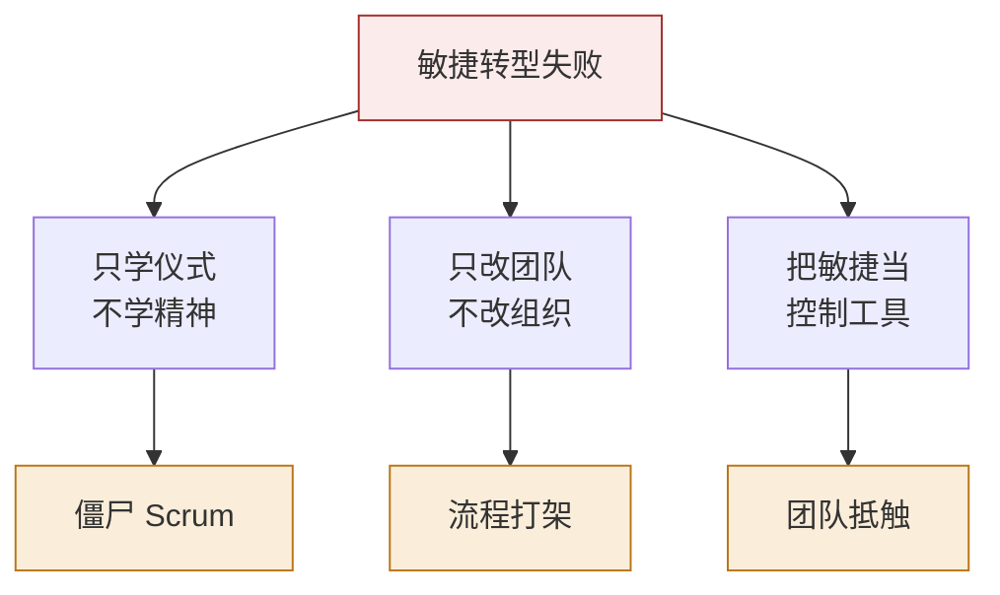
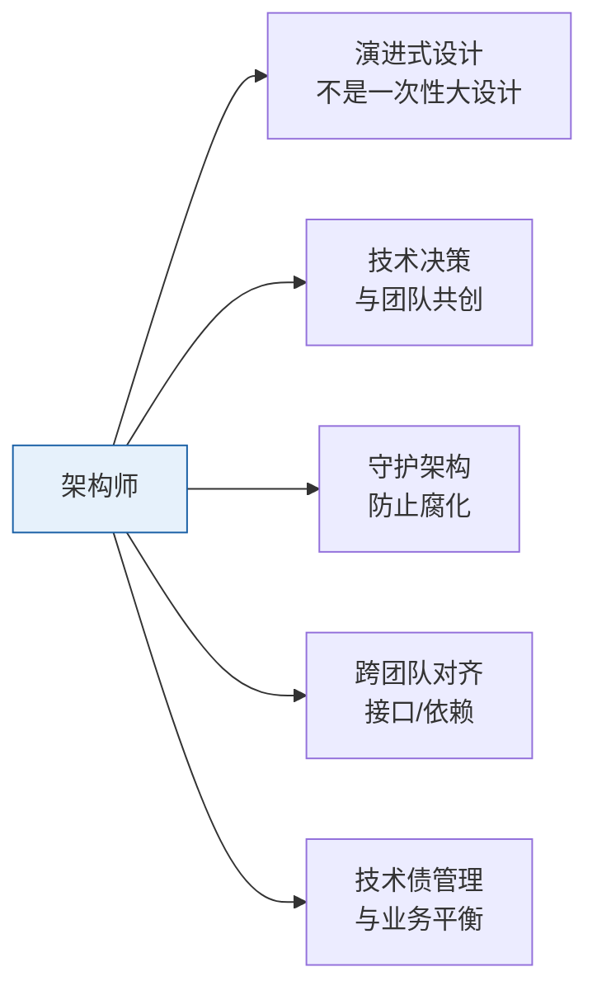
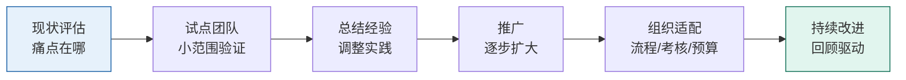
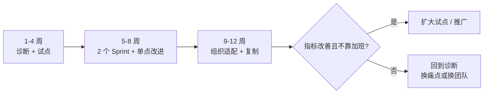

# 敏捷落地与反模式

> 定位：敏捷的概念不难，难的是「落地」——大量团队名义上敏捷、实际上瀑布，站会变汇报、回顾会走形式、故事点变 KPI。这一篇讲清「敏捷为什么会做歪」「常见反模式长什么样」「怎么真正落地」，以及架构师在敏捷团队里到底该扮演什么角色。

## 一、为什么「敏捷转型」大多失败

先看一组现实：业界大量「敏捷转型」最后变成了「更累的瀑布」——仪式全有，效果全无。原因通常不在「敏捷本身」，而在三个错位：

1. **只学仪式，不学精神**：站会、看板、回顾会都照做了，但「自组织、持续改进、拥抱变化」的精神没进来。这叫「僵尸 Scrum」。
2. **组织没变，只变团队**：团队敏捷了，但上面的「年度预算、季度 KPI、审批流程」还是瀑布的——团队想快速交付，被流程卡死。
3. **把敏捷当「管理工具」**：管理层用敏捷来「更好地控制团队」（更多报表、更多汇报），而不是「让团队更好地交付价值」——方向反了。

> 敏捷转型本质是「组织变革」，不是「团队换个流程」。只改团队不改组织，注定失败。

## 二、十大反模式（对号入座）

### 反模式 1：站会变「汇报会」

**表现**：每个人对着「领导」说「我昨天做了什么、今天做什么」，领导追问进度、点评。
**问题**：站会的目的不是「汇报」，是「团队同步 + 识别障碍」。变成汇报后，团队只说「好消息」，障碍被藏起来。
**正确做法**：站会站着开、15 分钟、团队内部对齐（PO/SM 可参加但不主导）、重点说「有什么障碍需要帮助」。

### 反模式 2：回顾会走形式

**表现**：每次回顾会都是「挺好的，没什么问题」，或者提了问题但从不跟进。
**问题**：回顾会是敏捷「持续改进」的核心引擎，走形式等于放弃了改进。
**正确做法**：回顾会要产出「可执行的改进项」（1-2 个，有负责人、有截止时间），下个 Sprint 检查是否落实。

### 反模式 3：故事点当 KPI

**表现**：「你这个 Sprint 才完成 8 点，别人完成 13 点」。
**问题**：故事点是团队估算工具，一旦考核，必然注水、挑肥拣瘦。
**正确做法**：故事点只用于团队排期；绩效看「交付的业务价值」和「DORA 指标」。

### 反模式 4：PO 缺位或越位

**表现**：要么 PO 从不出现（需求靠「传话」），要么 PO 天天盯着团队「催进度」。
**问题**：PO 的核心职责是「决定做什么、不做什么、优先级」，缺位则方向不清，越位则团队失去自主。
**正确做法**：PO 深度参与需求梳理和评审，但不干预「团队怎么做」。

### 反模式 5：SM 变「项目经理」

**表现**：SM 天天催进度、分配任务、写周报。
**问题**：SM 是「服务式领导」——移除障碍、保障流程，不是「派活的人」。
**正确做法**：SM 关注「团队协作是否顺畅、障碍是否被清除」，不碰「任务分配」。

### 反模式 6：Sprint 被随意打断

**表现**：Sprint 进行到一半，老板插一个「紧急需求」，团队被迫放下手头工作。
**问题**：Sprint 是「保护团队专注」的机制，随意打断等于没有 Sprint。
**正确做法**：紧急需求走「紧急通道」（有明确标准、有代价评估），或进下个 Sprint；打断要「可见、有代价」。

### 反模式 7：只做「迭代」，不做「增量」

**表现**：每个 Sprint 都在「做」，但从不「交付可用的东西」——代码写了一堆，但用户用不上。
**问题**：敏捷的核心是「每个迭代交付可用增量」，不是「每个迭代都忙」。
**正确做法**：每个 Sprint 结束必须有「可演示、可上线」的增量；做不完就砍范围，不是延期。

### 反模式 8：没有「完成的定义」（DoD）

**表现**：故事「做完了」但没测试、没文档、没部署，下一轮又返工。
**问题**：没有统一的「完成标准」，每个人对「完成」理解不同。
**正确做法**：团队共同定义 DoD（如「代码评审通过 + 单测覆盖 + 部署到测试环境 + 验收标准通过」）。

### 反模式 9：用「敏捷」压工期

**表现**：「我们用敏捷，所以要 2 周交付」（实际需要 2 个月）。
**问题**：敏捷是「快速反馈」，不是「压缩工期」；把 2 个月的活压成 2 周，只会做出「半成品」或「加班到崩」。
**正确做法**：范围可变、时间固定——2 周交付「能交付的部分」，剩下的下个迭代。

### 反模式 10：度量驱动「表演」

**表现**：为了「部署频率」好看，天天部署无意义的变更；为了「故事点」，把任务拆得极细。
**问题**：古德哈特定律——指标变目标就失真。
**正确做法**：度量「结果」（用户价值、DORA），不度量「表演」。

## 三、架构师在敏捷团队里该做什么

这是本板块和整个知识库的连接点——**架构师不是「画完图就撤」的角色**，在敏捷团队里，架构师的价值体现在：

### 3.1 演进式设计，不是「大设计 upfront」

瀑布时代，架构师在项目初期做「完整设计」。敏捷时代，需求会变，架构也要「演进」——先做「刚好够用」的设计，随着需求明确逐步细化。这叫 **Emergent Design（涌现式设计）**。

但「演进」不等于「不设计」。架构师要做的是：

- **守住「不可逆决策」**：有些决策后期改成本极高（如数据库选型、服务拆分边界），要提前想清楚
- **留好「扩展点」**：为未来的变化预留接口，但不提前实现
- **持续重构**：每个迭代留一点时间还技术债

### 3.2 技术决策与团队共创

敏捷强调「团队自组织」，但「技术决策」不能纯民主——架构师要：

- **提供选项和权衡**，而不是「直接下命令」
- **让团队参与决策**（他们更懂细节），但架构师对「架构一致性」负责
- **用 ADR（架构决策记录）** 记录「为什么这么选」，方便后人追溯

### 3.3 守护架构，防止腐化

敏捷的「快速交付」容易导致「架构腐化」——为了赶进度，到处是「临时方案」，最后变成「大泥球」。架构师的职责是：

- **定义架构约束**（如「服务之间不能共享数据库」），并用自动化检查（ArchUnit）守护
- **识别架构腐化信号**（循环依赖、上帝类、重复代码），推动重构
- **在「速度」和「质量」之间做平衡**，而不是一味妥协

### 3.4 跨团队对齐

规模化敏捷里，架构师常常是「跨团队的技术协调人」——对齐接口契约、识别依赖、解决集成问题。这是「架构师」和「Tech Lead」的重要区别：Tech Lead 管一个团队，架构师管「团队之间」。

### 3.5 技术债管理与业务平衡

技术债不可避免，架构师要做的是「让技术债可见、可管理」：

- **记录技术债**（不是「心里知道」，而是「写进 Backlog」）
- **评估影响**（这个债会导致什么问题、什么时候爆）
- **和业务方沟通**（「不还这个债，下季度加功能会慢 30%」）
- **定期偿还**（每个迭代留 10-20% 容量还债）

## 四、敏捷落地的路径

### 4.1 从瀑布到敏捷的转型

**关键原则**：

- **从痛点出发**，不要「为了敏捷而敏捷」——先问「我们现在的痛点是什么」，再看哪个实践能解决
- **小范围试点**，别一上来全公司推广
- **组织适配**：团队的流程变了，上面的考核、预算、审批也要跟着变，否则「团队敏捷、组织瀑布」
- **持续改进**：敏捷转型不是「项目」，是「持续的过程」

### 4.2 不同规模的适配

| 团队规模 | 建议 |
|---|---|
| 1 个团队（<10 人） | Scrum 或 Kanban，别搞复杂框架 |
| 3-5 个团队 | Scrum + 跨团队同步（Scrum of Scrums） |
| 10+ 团队 | 考虑 SAFe/LeSS，但要警惕「重」 |
| 运维/支持团队 | Kanban 更合适（工作持续流入） |

### 4.3 远程/分布式团队

敏捷的很多实践（站会、结对、白板）是为「坐在一起」设计的。远程团队要调整：

- 站会用视频（开摄像头），异步补充文字
- 用在线看板（Jira/Trello）替代物理白板
- 结对编程用「远程结对」工具（VS Code Live Share、Tuple）
- 更强调「文档化」（因为不能「转头问」）

## 五、怎么判断敏捷「做得好不好」

不要看「仪式有没有做」，看「结果」：

| 维度 | 好的信号 | 坏的信号 |
|---|---|---|
| 交付 | 每个 Sprint 都有可用增量 | 长期「在做但没上线」 |
| 反馈 | 用户/业务方定期看演示并给反馈 | 做完才第一次给用户看 |
| 质量 | 缺陷逃逸率低、变更失败率低 | 上线就出事、天天救火 |
| 团队 | 自组织、主动改进 | 等指令、回顾会走过场 |
| 节奏 | 可持续（不长期加班） | 靠加班「冲刺」 |
| 度量 | 看 DORA、看用户价值 | 看故事点、看代码行数 |

**一句话**：好的敏捷是「团队越做越顺、交付越来越稳」，不是「仪式越来越全」。

## 六、反模式自检表与干预话术

知道反模式不等于能改。真正的难点是「怎么开口、对谁开口、改完怎么验证」。下面这张表把每个反模式配上一句诊断、一句对关键角色说的话、一个动作和一个验证信号。

| 反模式 | 一句话诊断 | 对谁说、说什么 | 动作 | 验证信号 |
|---|---|---|---|---|
| 站会变汇报 | 站会的主语是「领导」而不是「团队」 | 对管理者：「站会我来主持，您旁听，障碍我们会后单独找您」 | 改问三问：昨天推进了什么/今天推进什么/哪里卡住 | 站会时长 ≤15min，障碍项每周有闭环 |
| 回顾走形式 | 提了问题没人跟进 | 对团队：「这次只定 1 个改进项，下个 Sprint 复盘它」 | 改进项进 Backlog，指定负责人与验收标准 | 上个 Sprint 改进项完成率 ≥70% |
| 故事点当 KPI | 估算变成考核 | 对管理者：「故事点用于排期，考核会让人注水」 | 绩效改看交付价值与 DORA | 估算偏差收敛，不再出现「挑小故事」 |
| PO 缺位/越位 | 需求靠传话，或 PO 盯工时 | 对 PO：「你决定做什么，团队决定怎么做」 | PO 每周固定需求梳理，Sprint 内不插单 | 需求变更走 Backlog，团队不再等指令 |
| SM 变 PM | SM 在派活和催进度 | 对 SM：「你的产出是团队协作顺畅，不是任务分配」 | SM 建障碍清单，主持回顾，不碰排期 | 障碍平均清除时间下降 |
| Sprint 被打断 | 插单没有代价 | 对提需求方：「插单可以，我们砍掉哪个承诺？」 | 建紧急通道：标准、审批人、代价记录 | 每 Sprint 插单 ≤1 且有书面取舍 |
| 只迭代不增量 | 演示会没有可用的东西 | 对团队：「Sprint 结束要能演示、能上线」 | 按垂直切片拆故事，做不完砍范围 | 每 Sprint 有可演示增量 |
| 没有 DoD | 「完成」各说各话 | 对团队：「我们把完成写下来，贴在看板上」 | 共同定义 DoD，纳入评审清单 | 返工率下降，上线回滚减少 |
| 用敏捷压工期 | 时间固定、范围也固定 | 对业务方：「时间固定就范围可变，二选一」 | 明确「必须有的最小范围」 | 交付不再靠长期加班 |
| 度量驱动表演 | 指标好看但用户没感知 | 对管理层：「我们看结果指标，不看动作指标」 | 换成 DORA + 用户价值指标 | 指标与业务结果相关性可解释 |

**话术的三个原则**：

1. **对事不对人**：说「这个流程让障碍被藏起来」，不说「你们都在撒谎」。
2. **给对方留台阶**：先承认「汇报式站会是很多团队的自然演化」，再提替代方案。
3. **每次只改一个**：同时改十个反模式，团队会直接躺平。

## 七、90 天落地计划：从试点到组织适配

敏捷转型最常见的失败是「第一个月轰轰烈烈，第三个月回到原样」。把 90 天拆成三段，每段有明确产出和退出条件。

| 阶段 | 时间 | 关键动作 | 产出 | 退出条件 |
|---|---|---|---|---|
| 诊断与试点 | 第 1–4 周 | 选 1 个痛点最痛、领导最支持的团队；测基线（交付周期、变更失败率、加班时长） | 痛点清单、基线数据、试点章程 | 团队认可「先解决这 2 个痛点」 |
| 实践与调优 | 第 5–8 周 | 跑 2 个 Sprint；每次回顾只改 1 项；同步修 DoD 与需求梳理 | 2 个可演示增量、改进项记录 | 增量可演示、改进项有闭环 |
| 组织适配与推广 | 第 9–12 周 | 改考核口径、预算方式、审批路径；向第二个团队复制 | 组织适配清单、推广方案 | 试点团队指标改善且未靠加班 |

**试点团队的三个选择标准**：

- **痛点真实**：交付慢、返工多、跨团队扯皮，团队自己有感受；
- **领导支持**：直属领导愿意改考核与审批，而不只是「支持敏捷」；
- **边界清晰**：依赖少、能独立交付一个完整切片，否则会被外部流程卡死。

**组织适配清单**（不改这些，团队敏捷不起来）：

- [ ] 考核：从「工时/故事点」改为「交付结果 + 质量」
- [ ] 预算：从「年度一次性审批」改为「按季度/按价值增量」
- [ ] 审批：能识别的低风险变更走自主发布
- [ ] 需求：PO 有真实的优先级决定权，不是「传话人」
- [ ] 度量：DORA 四指标有基线、每月复盘

## 八、两个改造案例（示例，可用于面试表达）

> 以下是典型场景的示例，数字为示意。面试时请替换成你项目里的真实数字与约束。

### 案例 1：僵尸 Scrum → 交付周期减半

- **背景**：20 人团队，名义 Scrum 两年，站会 40 分钟、回顾会「挺好的」、季度上线一次；业务方抱怨「提了需求三个月没动静」。
- **诊断**：站会向部门经理汇报；回顾会没有改进项；Sprint 内插单平均每周 3 次；DoD 只有「代码写完」。
- **动作**：站会改团队主持、经经理旁听；回顾会每次只定 1 个改进项并进 Backlog；建插单规则（需砍掉等量承诺）；DoD 增加「测试通过 + 可演示」。
- **结果**：8 周后交付周期从 11 周降到 5 周，插单从每周 3 次降到 0.5 次，线上回滚从每月 2 次降到 0。
- **复盘**：真正起作用的是「插单有代价」，不是站会形式；重来会先改插单规则，再动仪式。

### 案例 2：Sprint 被打断 → 紧急通道

- **背景**：B 端产品团队，销售承诺的「紧急需求」随时插队，Sprint 完成率长期 40%。
- **诊断**：没有紧急需求标准，所有需求都自称紧急；插单不记录代价，团队只能加班。
- **动作**：定义紧急三条标准（合规/资损/核心客户停机）；插单必须由产品总监签字并写明「砍掉哪个故事」；每月统计插单来源。
- **结果**：Sprint 完成率从 40% 升到 85%，加班时长下降 30%；销售开始提前一个 Sprint 提需求。
- **复盘**：紧急通道的关键不是「审批」，是「让代价可见」；数据一公开，插单自然减少。

## 九、一页纸自检清单（团队现状打分）

把下面 12 条打印出来，团队一起打分（0 = 完全没有，1 = 有形式，2 = 真在执行）。**低于 12 分先别谈「敏捷转型」，先修最痛的 2 条。**

- [ ] 每个 Sprint 结束有可演示、可上线的增量（不是「代码写完了」）
- [ ] 站会 ≤15 分钟，由团队主持，重点说障碍
- [ ] 回顾会每次产出 1–2 个有负责人、有截止时间的改进项
- [ ] 上个 Sprint 的改进项有验收结论
- [ ] 有书面 DoD，且评审时逐条检查
- [ ] 故事点只用于排期，不与绩效挂钩
- [ ] PO 对优先级有决定权，Sprint 内不随意插单
- [ ] 插单有标准、有审批、有「砍掉什么」的记录
- [ ] 每个迭代留 10–20% 容量还技术债
- [ ] 度量看 DORA 与用户价值，不看代码行数/工时
- [ ] 加班不是常态（连续两周加班即预警）
- [ ] 团队能自己决定「怎么做」，不需要等指令

> 用法：每月打一次分，把分数趋势贴在看板上。分数不重要，**连续两个月不涨才是问题**。

## 十、面试高频问法

> 这题考的是「你有没有真实落地经验」，不是「你背不背得出反模式」。

**Q1：什么是「僵尸 Scrum」？**

**一句话结论**：只做 Scrum 的仪式（站会、回顾会、看板），却没有 Scrum 的精神（自组织、持续改进、拥抱变化）——形式在、灵魂没了。

加分点：说"僵尸 Scrum 的典型症状是「站会变汇报、回顾会走形式、故事点当 KPI」，本质是「用敏捷的壳装瀑布的魂」"。

**Q2：为什么很多敏捷转型失败？**

**一句话结论**：三个错位——只学仪式不学精神、只改团队不改组织、把敏捷当控制工具。

加分点：说"敏捷转型是「组织变革」不是「团队换流程」；上面还是瀑布式考核和审批，团队再敏捷也跑不起来"。

**Q3：站会应该怎么开？**

**一句话结论**：15 分钟、站着开、团队内部对齐、重点说「障碍」——不是向领导汇报进度。

加分点：说"站会变汇报是最高频的反模式；一旦变成汇报，团队只报喜不报忧，障碍被藏起来，站会就失去了意义"。

**Q4：回顾会怎么才不走过场？**

**一句话结论**：每次产出 1-2 个「可执行的改进项」（有负责人、有截止时间），下个 Sprint 检查落实。

加分点：说"回顾会的价值是「持续改进」，如果提了问题不跟进，团队就会觉得「提了也没用」，最后变成「挺好的，没问题」"。

**Q5：架构师在敏捷团队里做什么？**

**一句话结论**：演进式设计、技术决策共创、守护架构防腐化、跨团队对齐、技术债管理——不是「画完图就撤」。

加分点：说"敏捷不是「不要架构」，是「演进式架构」——守住不可逆决策、留好扩展点、持续重构；架构师的价值在「让团队跑得快还不翻车」"。

**Q6：敏捷怎么处理「紧急需求」？**

**一句话结论**：走「紧急通道」（有明确标准、有代价评估），或进下个 Sprint；不能随意打断当前 Sprint。

加分点：说"Sprint 是「保护专注」的机制；紧急需求要「可见、有代价」——打断当前 Sprint 意味着放弃某些承诺，这个代价要让提需求的人知道"。

**Q7：怎么判断一个团队敏捷做得好不好？**

**一句话结论**：看结果不看仪式——每个 Sprint 有可用增量、反馈及时、质量稳定、团队自组织、节奏可持续。

加分点：说"好的敏捷是「越做越顺」，不是「仪式越来越全」；用 DORA 指标和用户价值衡量，别用故事点"。

**Q8：技术债在敏捷里怎么管？**

**一句话结论**：让技术债「可见」（写进 Backlog）、「可评估」（影响是什么）、「定期还」（每迭代留 10-20% 容量）。

加分点：说"技术债不是「要不要还」，是「什么时候还、还多少」；架构师要能把「不还债的代价」翻译成业务语言（「下季度加功能会慢 30%」）"。

**Q9：小团队适合什么敏捷框架？**

**一句话结论**：1 个团队用 Scrum 或 Kanban 就够，别上 SAFe 这种重框架；运维/支持类用 Kanban 更合适。

加分点：说"框架要匹配团队规模和业务特点——小团队上重框架是「杀鸡用牛刀」，反而拖慢；「简单有效」比「完整规范」重要"。

**Q10：你怎么推动团队改进？**

**一句话结论**：从「痛点」出发，小步试点，用数据说话，让团队自己看到改进的效果——而不是「自上而下强推」。

加分点：说"改进最大的阻力是「习惯」和「怕麻烦」；用「试点 + 对比数据」让人看到「改了确实更好」，比讲道理有效得多"。

## 小结

- 敏捷转型失败多因三个错位：只学仪式不学精神、只改团队不改组织、把敏捷当控制工具。
- 十大反模式：站会变汇报、回顾走形式、故事点当 KPI、PO 缺位/越位、SM 变 PM、Sprint 被打断、只迭代不增量、没有 DoD、用敏捷压工期、度量驱动表演。
- 架构师在敏捷里做「演进式设计、技术决策共创、守护架构、跨团队对齐、技术债管理」——不是画完图就撤。
- 落地路径：从痛点出发、小范围试点、组织适配、持续改进。
- 判断好坏看「结果」（增量、反馈、质量、自组织、可持续），不看「仪式」。
- 小团队别上重框架；远程团队要调整实践（视频站会、在线看板、远程结对）。
