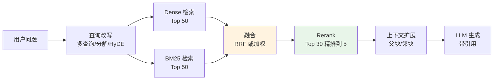
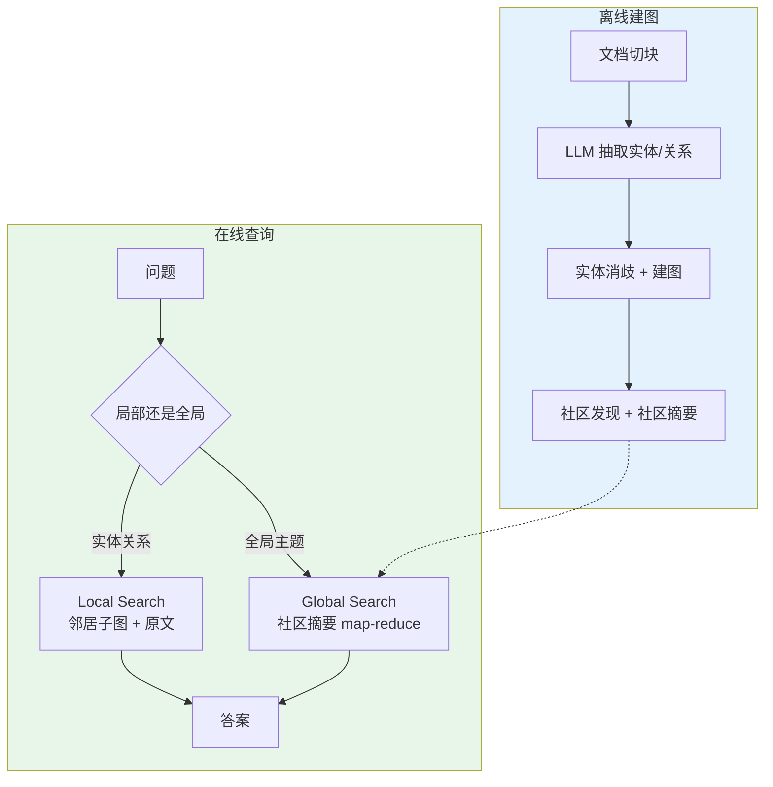
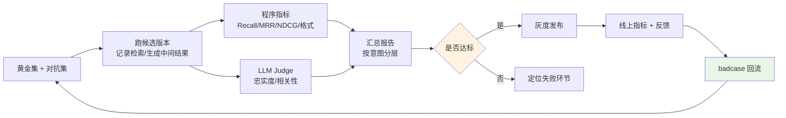
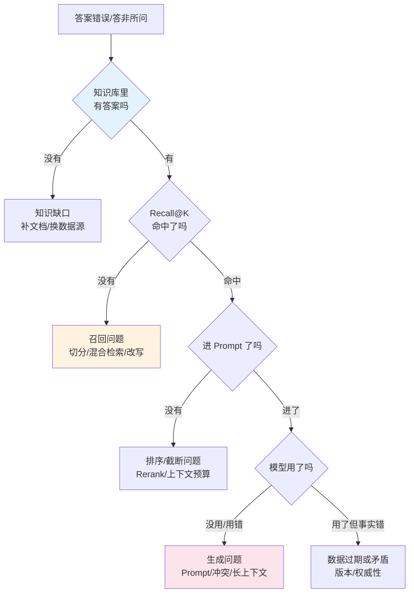

# RAG 进阶：混合检索、重排与评估

> 定位：基础 RAG 能跑通「文档进、答案出」，但一上生产就会遇到三个问题：错误码、型号、合同条款搜不到；Top-5 看起来都相关，答案却是错的；改了一版切分或 Prompt，不知道效果变好还是变差。这篇在 [RAG 检索增强生成](01-RAG检索增强生成.md) 之上，讲混合检索与融合、查询改写、Rerank、父子块、GraphRAG，以及一套能落地的评估与失败归因方法。

## 一、为什么基础 RAG 不够

三个典型线上问题：

1. **精确匹配失效**。用户问「E1024 怎么处理」「XG-2000A 的保修期」，纯向量检索把「E1024」编码成一个训练语料里几乎没出现过的随机向量，召回的是泛泛的「错误处理」文档。
2. **多跳问题断链**。「A 产品的供应商在哪个国家，该国对这类设备的进口要求是什么」需要先查 A 的供应商，再查该国的进口政策。单次检索只能捞到其中一半。
3. **没有度量，优化靠玄学**。改 chunk 大小、换 Embedding、加 Rerank，每次都觉得「好像好一点」，但无法证明；上线后质量退化也只能等客诉。

基础篇解决「有没有检索」，进阶篇解决「检索得准不准、答得对不对、怎么证明」。核心思路是：**召回要宽、融合要稳、精排要准、评估要闭环**。

## 二、核心原理

### 2.1 混合检索与融合

向量检索擅长语义相似，BM25 擅长精确匹配和稀有词，两者互补。进阶做法通常有三路：

| 检索器 | 擅长 | 短板 |
|---|---|---|
| **Dense 向量** | 同义改写、口语化、跨语言 | 专有名词、错误码、数字、精确短语 |
| **BM25** | 关键词、型号、条款号、稀有词 | 不懂同义，短查询容易漂 |
| **Learned Sparse（如 SPLADE）** | 介于两者之间，可学习词权重 | 需要模型和额外索引，成本更高 |

**融合发生在排名层，不是分数层**。两种主流方式：

- **RRF（Reciprocal Rank Fusion）**：`score(d) = Σ 1 / (k + rank_i(d))`，`k` 通常 60。只看名次，不看分数，天然规避「余弦 0~1、BM25 无上界」的量纲问题，对某一路的异常分数也鲁棒。代价是丢弃分数信息。
- **加权融合**：先对各路分数做 min-max 或 z-score 归一化，再 `α * dense + (1-α) * bm25`。可以保留分数强度，但α要调，且对异常值敏感；不同查询类型的最优α可能不同。

工程细节：

- 两路各召回 50~100 条，融合后取 Top 20~30 进 Rerank；**召回宽、精排严**。
- 按 `docId + chunkId` 去重，保留最高分和来源，避免同一段内容占满名额。
- 过滤条件（租户、权限、时间）必须下推到每一路检索，不能融合后再过滤。



读图要点：**改写、召回、融合、精排、扩展是五个独立可调环节**；线上出问题要能定位到具体环节，而不是笼统说「RAG 效果不好」。

### 2.2 查询改写

用户问题和文档表述往往不在一个语言空间。常见四类改写：

| 方法 | 做法 | 适合 | 代价/风险 |
|---|---|---|---|
| **多查询（Multi-Query）** | LLM 生成 3~4 个不同问法，分别检索后融合 | 口语化、同义表达多 | 多一次 LLM + N 次检索；可能扩大主题 |
| **HyDE** | 让 LLM 先写一个「假答案」，用假答案的向量去检索 | 低资源领域、 query 与文档用词差异大 | 假答案可能编造实体；不适合精确查询 |
| **问题分解** | 把多跳问题拆成子问题，逐个检索再综合 | 对比、因果、多实体关系 | 串行延迟高；子问题拆错会放大错误 |
| **Step-back** | 先问一个更抽象的背景问题，再回到原问题 | 问题过细、缺少上下文 | 可能引入无关背景 |

**改写不是越多越好**。精确查询（订单号、错误码、法条编号）不需要 HyDE，改写反而会把数字改丢；延迟敏感场景要限制改写轮数。最稳妥的做法是：**先判断 query 类型**（精确/语义/多跳），再选择改写策略。

### 2.3 Rerank：从「像」到「相关」

Bi-encoder 把 query 和 doc 分别编码，快但看不到彼此；Cross-encoder 把 `[query, doc]` 拼在一起做完整注意力，能判断「问的是 A 的 B 属性」，精度高但每个候选都要跑一次前向。

| 方案 | 代表 | 精度 | 成本 | 适用 |
|---|---|---|---|---|
| **Cross-encoder** | BGE-reranker、Cohere Rerank、Jina Reranker | 高 | 中，O(N) 前向 | 主力精排 |
| **LLM rerank** | 逐条打分或列表排序 | 最高 | 很高，token 计费 | 高价值、小候选集 |
| **规则/启发式** | 关键词命中、时间衰减、来源权重 | 低 | 极低 | 预处理或兜底 |

工程要点：

- **候选 20~50 个是甜点**。太少没得挑，太多延迟线性上升。
- **批处理**：N 个候选打包送 GPU，比逐条调用快一个数量级。
- **超时降级**：Rerank 设 200~300ms 超时，超时直接用融合顺序，不能拖死整个请求。
- **分数阈值**：Rerank 分数低于阈值时拒答，比让 LLM 硬答更安全。
- **语言和领域**：中文/多语言场景要选对应模型，英文 reranker 直接用在中文上效果会掉。

> 反直觉：**Rerank 救不了召回缺失**。候选集里根本没有答案，再强的 Cross-encoder 也只能在垃圾里挑相对不垃圾的。先看 Recall@K，再谈精排。

### 2.4 父子块与上下文扩展

「检索要小、生成要大」是 RAG 的固有矛盾。父子块（Parent-Child / Small-to-Big）用小块做向量、命中后返回父块：

- 子块 150~250 token，语义聚焦，向量更准；
- 父块 800~1200 token，上下文完整，LLM 答得更全；
- 存储维护 `childId -> parentId` 映射，检索命中子块后按父块去重、按父块拼上下文。

其他扩展手段：

- **Sentence Window**：命中一句话，向前后各扩 N 句。
- **邻块扩展**：命中 chunk 后带上前后各一个 chunk，缓解切分断裂。
- **Metadata 扩展**：把文档标题、章节路径、表格表头拼进上下文，帮助模型理解片段位置。

代价是 **token 变多、重复变多、延迟变高**。要按父块去重、控制总预算，并保证文档更新时父子映射同步更新。

### 2.5 GraphRAG：什么时候值得建图

GraphRAG 先从文档中抽取实体和关系，构建知识图谱，再做社区发现和社区摘要；查询时支持：

- **Local Search**：从问题中的实体出发，取邻居子图和相关文本，适合「A 和 B 有什么关系」。
- **Global Search**：对社区摘要做 map-reduce，适合「这批文档的主要风险主题是什么」这类全局问题。



读图要点：**GraphRAG 的成本主要在建图和社区摘要**，不是查询。它适合多跳关系、全局归纳、合规风险分析；不适合简单 FAQ、精确查询、更新极快的文档。

三个现实约束：

- **抽取成本**：每个 chunk 都要过 LLM 抽实体关系，文档量大时成本可观。
- **实体消歧**：「苹果公司」和「Apple」是不是一个实体，直接决定图的质量。
- **维护成本**：文档更新要增量改图，社区摘要也要重算；图不是建完就一劳永逸。

> 选型建议：**先用混合检索 + Rerank 把效果榨干，确认瓶颈是「关系推理」而不是「召回」，再考虑 GraphRAG**。多数企业知识库不需要图。

### 2.6 评估体系

评估分两层，不能混在一起看。

**检索层指标**：

| 指标 | 含义 | 适用 |
|---|---|---|
| **Recall@K** | 前 K 个结果里包含多少比例的相关文档 | 最直观，先保证「答案在候选里」 |
| **MRR** | 第一个相关结果排名的倒数均值 | 关注「第一个正确答案多快出现」 |
| **NDCG@K** | 考虑分级相关性和位置折损 | 多级相关性、排序质量 |
| **Hit@K** | 前 K 是否至少命中一个相关文档 | 快速粗看 |

**生成层指标**：

| 指标 | 含义 | 怎么测 |
|---|---|---|
| **忠实度（Faithfulness）** | 答案的事实断言是否能被检索内容支撑 | LLM 判断 + 人工抽检 |
| **答案相关性** | 是否回答了用户问题 | LLM 或人工评分 |
| **答案正确性** | 与标准答案是否一致 | 黄金集 + 人工/LLM |
| **引用正确率** | 标注的引用是否真的支撑结论 | 规则校验 + 抽检 |
| **格式合规率** | JSON/Schema/字段是否合法 | 程序校验 |

**黄金集怎么建**：从真实日志和工单里抽 100~300 条问题，按意图分层（精确查询、语义问答、多跳、不可回答、对抗），为每条标注「相关 chunk ID + 参考答案」。要覆盖不可回答问题——否则模型会学会「什么都答」。黄金集要版本化、留出 holdout，定期用新 badcase 扩充。

**LLM-as-Judge 的偏差**：位置偏置（偏爱第一个）、长度偏置（偏爱长答案）、自我偏好（偏爱同家模型）、宽松偏置（倾向于给高分）。缓解办法：随机顺序、成对比较、给评分 rubric、用参考答案、裁判模型与被测模型不同家、人工校准一部分样本。



读图要点：**评估是闭环，不是一次性跑分**；线上反馈要能变成新的测试用例，否则评估集会逐渐脱离真实分布。

### 2.7 失败归因

答案错了，先别改 Prompt，按链路二分：



读图要点：**先确认答案在不在库里，再看召没召回到，再看进没进上下文，最后才怪模型**。大多数「模型胡说」其实是检索或数据问题。

## 三、Java 落地

### 3.1 RRF 与加权融合

```java
import java.util.*;

public final class Fusion {
    /** RRF：只使用排名，规避不同检索器分数量纲不一致 */
    public static List<String> rrf(List<List<String>> rankedLists, int k, int topN) {
        Map<String, Double> score = new HashMap<>();
        for (List<String> list : rankedLists) {
            for (int i = 0; i < list.size(); i++) {
                score.merge(list.get(i), 1.0 / (k + i + 1), Double::sum);
            }
        }
        return score.entrySet().stream()
                .sorted(Map.Entry.<String, Double>comparingByValue().reversed())
                .limit(topN)
                .map(Map.Entry::getKey)
                .toList();
    }
}
```

加权融合的思路相同，只是把 `1/(k+rank)` 换成「各路先 min-max 归一化，再 `alpha * dense + (1-alpha) * bm25`」；`alpha` 要离线调，且不同 query 类型的最优值可能不同。

### 3.2 Spring AI：混合检索 + Rerank

Spring AI 1.x 的 `VectorStore` 负责向量检索（LangChain4j 0.3x 对应 `EmbeddingStore`）；BM25 侧可以用 Elasticsearch/OpenSearch 的查询接口，最后在应用层融合：

```java
@Service
class HybridRetriever {

    private final VectorStore vectorStore;
    private final ElasticsearchOperations es;      // 用于 BM25
    private final RerankClient rerankClient;

    List<Document> retrieve(String query, String tenantId) {
        // 1. 向量召回：过滤条件下推
        var filter = new FilterExpressionBuilder().eq("tenantId", tenantId).build();
        var vectorHits = vectorStore.similaritySearch(
                SearchRequest.builder().query(query).topK(50)
                        .filterExpression(filter).build());

        // 2. BM25 召回：同样带租户过滤
        var bm25Hits = es.search(Query.of(q -> q
                .bool(b -> b.must(m -> m.match(t -> t.field("text").query(query)))
                        .filter(f -> f.term(t -> t.field("tenantId").value(tenantId)))),
                Document.class).getSearchHits();

        // 3. 应用层 RRF 融合
        List<String> fused = Fusion.rrf(List.of(
                vectorHits.stream().map(Document::getId).toList(),
                bm25Hits.stream().map(h -> h.getId()).toList()), 60, 30);

        // 4. 精排，超时降级为融合顺序
        return rerankClient.rerank(query, fused, 5)
                .orElseGet(() -> takeByIds(fused, vectorHits, bm25Hits, 5));
    }
}
```

Rerank 客户端的关键是**超时和降级**：

```java
Optional<List<Document>> rerank(String query, List<String> ids, int topN) {
    try {
        return Optional.of(restClient.post()
                .uri("/rerank")
                .body(Map.of("query", query, "documents", ids, "top_n", topN))
                .retrieve()
                .body(new ParameterizedTypeReference<>() {}));
    } catch (ResourceAccessException e) {       // 超时/连接失败
        return Optional.empty();
    }
}
```

### 3.3 查询改写与评估

```java
// 多查询改写：要求模型输出 JSON 数组，失败时退回原问题
String prompt = """
        你是查询改写助手。把用户问题改写成 3 个语义等价、用词不同的检索问法。
        只输出 JSON 数组，不要解释。问题：%s
        """.formatted(question);

List<String> queries = chatClient.prompt().user(prompt)
        .call().entity(new ParameterizedTypeReference<List<String>>() {});
```

评估指标可以直接在测试里算：

```java
public final class RetrievalMetrics {

    public static double recallAtK(List<String> retrieved, Set<String> relevant, int k) {
        long hit = retrieved.stream().limit(k).filter(relevant::contains).count();
        return relevant.isEmpty() ? 0 : (double) hit / relevant.size();
    }

    public static double mrr(List<String> retrieved, Set<String> relevant) {
        for (int i = 0; i < retrieved.size(); i++) {
            if (relevant.contains(retrieved.get(i))) return 1.0 / (i + 1);
        }
        return 0;
    }
}
```

NDCG@K 在此基础上多两件事：每条文档带分级相关性（如 0/1/2），以及按 `log2(位置+1)` 做位置折损；用 DCG 除以理想排序的 IDCG。实际项目里直接调用评测库更稳妥，但一定要自己算一遍 Recall@K 和 MRR，确保标注语义没搞错。

### 3.4 父子块与增量更新

父子块的最小实现是两张表：`chunk(id, parent_id, text, vector, metadata)` 和 `parent(id, text, doc_id, version)`。检索命中 child 后按 parent 去重，取 parent 文本进上下文。文档更新时按 `doc_id` 删除旧 child/parent，再写入新版本；**父子映射和向量必须在同一事务/同一批任务里更新**，否则会出现「子块是新的、父块是旧的」。

## 四、生产坑点与排查

### 坑点 1：把 BM25 和余弦分数直接相加

**现象**：融合后 BM25 结果几乎霸榜，向量召回被淹没；或者换个查询又反过来。
**原因**：BM25 分数无上界、受文档长度和词频影响，余弦是 0~1，直接相加等于给 BM25 加权。
**解法**：用 RRF 只看名次；或先按路 min-max/z-score 归一化再加权，α 用离线评估调，按 query 类型分桶。

### 坑点 2：候选集太窄，Rerank 无米下锅

**现象**：加了 Rerank 后 Top-5 仍然答错，检查发现正确答案压根没进候选。
**原因**：向量 Top-5 直接送 Rerank；召回阶段就丢了答案。
**解法**：先看 Recall@50；扩大召回（BM25、多查询、降低相似度阈值），融合后取 20~30 再精排。**先保召回，再保精度**。

### 坑点 3：查询改写把意图改丢

**现象**：用户问「E1024 怎么办」，多查询生成了「设备故障怎么处理」，精确错误码被泛化；HyDE 编了一个不存在的错误码，召回完全跑偏。
**原因**：改写模型不知道哪些 token 是不可替换的实体；所有 query 都套同一套改写策略。
**解法**：先做实体/错误码识别，命中原样保留；精确查询跳过 HyDE；多查询限制数量和主题漂移；改写结果要记录，方便归因。

### 坑点 4：父子块映射过期，上下文张冠李戴

**现象**：文档更新后，检索命中的子块内容正确，但拼进 Prompt 的父块还是旧版本，答案用了旧价格。
**原因**：只更新了子块向量，没有同步父块；或者删除旧数据时只删了 child。
**解法**：父子块按 `doc_id + version` 原子更新；检索时校验 parent 版本；定期做全量对账；更新管道要有「删旧 + 写新 + 校验」三步。

### 坑点 5：评估集泄漏或过拟合

**现象**：离线分数很高，上线效果差；或者每次调参都涨，但线上没变化。
**原因**：测试问题就是切分时用过的文档原文；同一批数据反复调参，等于在测试集上训练；LLM Judge 偏爱长答案。
**解法**：黄金集留 holdout，调参只用 dev 集；问题要改写自真实提问，不要直接抄文档；引入不可回答和对抗样本；Judge 用 rubric、随机顺序、人工校准。
### 坑点 6：GraphRAG 成本失控

**现象**：为了「更智能」上了 GraphRAG，建图阶段 LLM 账单翻几倍，实体消歧一塌糊涂，查询还不如混合检索。
**原因**：没有确认瓶颈是关系推理；全量文档都抽实体；没有实体对齐和增量更新机制。
**解法**：先做混合检索 + Rerank 基线；只对高价值文档建图；实体消歧用规则 + 向量聚类 + 人工抽检；图与向量混合使用，不要用图替代召回。
## 五、调优 / 选型 / 评估表

| 环节 | 关键旋钮 | 主要指标 | 成本/延迟 | 什么时候不该用 |
|---|---|---|---|---|
| 混合检索 | 各路 TopK、融合方式、α | Recall@50、MRR | +20~80ms | 数据量极小、纯语义问答 |
| 查询改写 | 变体数、HyDE 开关、分解深度 | Recall@K、意图保持率 | +0.3~2s | 精确查询、强延迟约束 |
| Rerank | 候选数、模型、超时 | NDCG@5、Top-5 准确率 | +50~300ms | 候选里没答案、预算极低 |
| 父子块 | 子块/父块大小、扩展窗口 | 答案完整率、token/请求 | +token 成本 | 文档极短、上下文已足够 |
| GraphRAG | 抽取模型、社区粒度、搜索模式 | 多跳准确率、全局覆盖 | 建图成本高 | 简单 FAQ、频繁更新 |
| 评估 | 黄金集规模、Judge 模型 | 分层指标 | 离线成本 | 没有真实问题、无法标注 |
**延迟预算示例**（在线问答 P95 目标 3s）：改写 300ms + 双路召回 150ms + 融合 10ms + Rerank 250ms + 生成 2s，留 300ms 余量。每个环节都要有超时和降级，不能串行等死。

**评估节奏**：每次改切分/Embedding/融合/ Prompt 都跑全量离线评估；上线走灰度，看点击、追问率、转人工率、负反馈率、P95 延迟和单请求成本；badcase 每周回流黄金集。

## 六、面试高频问法

**Q1：为什么需要混合检索？RRF 和加权融合怎么选？**
**一句话结论**：向量懂语义但怕专有名词，BM25 懂精确匹配但不懂同义；RRF 用名次融合、无需归一化、鲁棒，加权融合保留分数强度但需要调参。

展开：RRF 公式 `Σ 1/(k + rank)`，`k` 通常 60，只看排名，某一路给出离谱分数也不影响；代价是丢弃分数信息。加权融合要先 min-max/z-score，α 按业务调，适合分数可比且愿意调参的场景。

加分点：说「两路各召回 50~100，融合后取 20~30 再精排；过滤条件必须下推到每一路」。

**Q2：HyDE 是什么？什么时候不该用？**
**一句话结论**：HyDE 让 LLM 先写一个假答案，用假答案的向量检索，弥补 query 与文档的用词差异；精确查询和多跳事实查询不该用。

展开：假答案的用词更接近文档，低资源领域召回提升明显；但假答案可能编造实体、数字、型号，导致检索跑偏。它多一次 LLM 调用，延迟和成本都上升。

加分点：说「先做 query 类型判断，错误码/订单号原样保留；HyDE 适合概念性、解释性问题」。

**Q3：Rerank 为什么有效？候选数怎么定？**
**一句话结论**：Cross-encoder 把 query 和 doc 拼在一起做完整注意力，能判断细粒度相关性；候选 20~50 是甜点，太少没得挑，太多延迟线性上升。

展开：Bi-encoder 分别编码，文档向量可预计算，快但丢失交互信息；Cross-encoder 精度高但 O(N) 前向。工程上要批处理、设超时降级、按语言选模型。

加分点：说「Rerank 救不了召回缺失，先看 Recall@K；候选里没答案，精排只能挑相对不垃圾的」。

**Q4：父子块解决什么问题？代价是什么？**
**一句话结论**：小块做向量检索保精度，命中后返回父块给 LLM 保上下文完整；代价是存储映射、token 变多和更新一致性。

展开：子块 150~250 token，父块 800~1200 token；还要按父块去重，避免多个子块命中同一父块导致上下文重复。文档更新时父子映射要原子更新，否则会出现新旧混用。

加分点：说「还有 sentence window 和邻块扩展，本质都是用小粒度检索、大粒度生成」。

**Q5：GraphRAG 适合什么场景？为什么不建议一上来就上？**
**一句话结论**：适合多跳关系、全局归纳、合规风险分析；建图和社区摘要成本高、实体消歧难、更新维护重，简单 FAQ 和精确查询不值得。

展开：Local Search 从实体邻居子图回答关系问题，Global Search 对社区摘要做 map-reduce 回答全局主题。成本主要在建图，不是查询；实体消歧直接决定图质量。

加分点：说「先用混合检索 + Rerank 建基线，确认瓶颈是关系推理而不是召回，再评估 GraphRAG」。

**Q6：RAG 评估看哪些指标？怎么建黄金集？**
**一句话结论**：检索层看 Recall@K/MRR/NDCG，生成层看忠实度/相关性/正确性/引用正确率；黄金集从真实问题抽样、分层覆盖、带相关 chunk 标注。

展开：黄金集要包含精确查询、语义问答、多跳、不可回答、对抗样本；要版本化、留 holdout；badcase 定期回流。不可回答问题很重要，否则模型会学会硬答。

加分点：说「离线指标和线上指标要一起看——离线涨了线上不一定涨，可能评估集分布和真实流量不一致」。

**Q7：LLM-as-Judge 有什么偏差？怎么缓解？**
**一句话结论**：位置偏置、长度偏置、自我偏好、宽松偏置；用随机顺序、成对比较、评分 rubric、参考答案、异家裁判和人工校准缓解。

展开：LLM 打分不稳定，同一答案换个顺序分数就变；长答案容易得高分。Judge 适合做趋势和粗筛，不适合做最终法律/医疗结论。高风险场景必须人工复核。

加分点：说「裁判模型最好和被测模型不同家，且要用一批人工标注样本校准一致率」。

**Q8：线上 RAG 答错了，你怎么定位是哪个环节的问题？**
**一句话结论**：先看知识库有没有答案，再看 Recall@K 有没有召回，再看有没有进 Prompt，最后才看生成；按「知识缺口 → 召回 → 排序/截断 → 生成 → 数据过期」逐层排除。

展开：知识缺口补文档；召回问题调切分、混合检索、改写；排序问题调 Rerank 和上下文预算；生成问题调 Prompt、去冲突、缩短上下文；数据问题做版本和权威性治理。

加分点：说「把改写后的 query、召回列表、融合分数、Rerank 分数、最终 Prompt、答案全链路埋点，否则只能猜」。

## 小结

- 进阶 RAG 的五个可调环节：查询改写、混合召回、融合、Rerank、上下文扩展；出问题要能定位到具体环节。
- 混合检索必做：向量管语义、BM25 管精确；RRF 用名次融合最省心，加权融合要归一化和调参。
- 查询改写要分类型：精确查询保留实体，语义/多跳再用 HyDE、多查询、分解；改写可能把意图改丢。
- Rerank 先保召回再保精度，候选 20~50、批处理、超时降级、分数阈值拒答。
- 评估分检索层和生成层，黄金集要分层、含不可回答问题、留 holdout，badcase 要回流。
- 失败归因顺序：知识缺口 → 召回 → 排序/截断 → 生成 → 数据过期，别一上来就改 Prompt。
