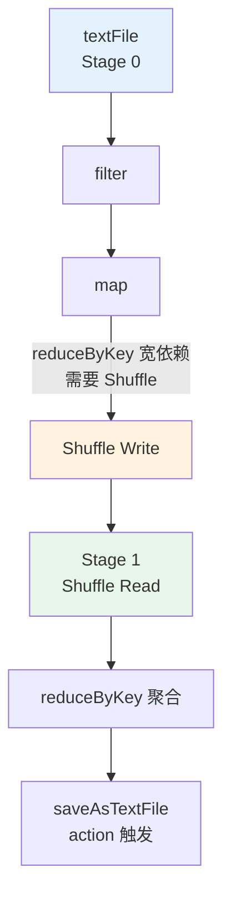
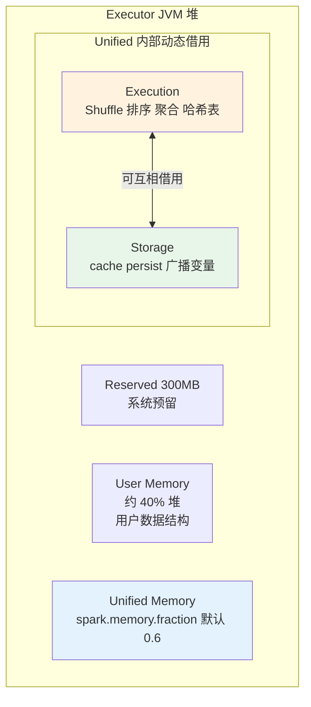
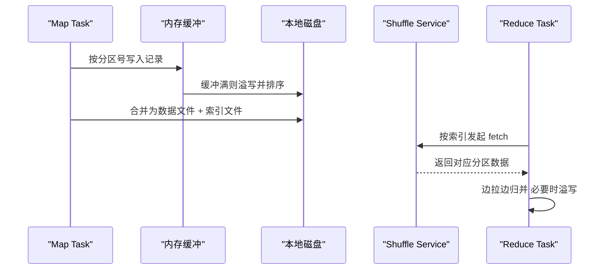
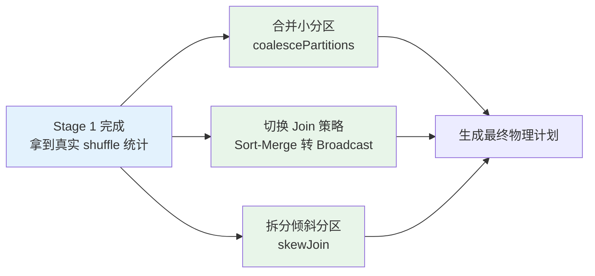

# Spark 核心原理与调优

> 定位：Spark 作业「能跑」和「跑得好」之间隔着一条鸿沟——同一个 SQL，有人跑 20 分钟，有人跑 4 小时；有人 OOM 重启三次，有人稳定跑一年。这篇把 RDD 血缘、Stage 划分、统一内存模型、Shuffle 与 AQE 拆开，给出资源参数的计算公式、数据倾斜的六种解法和 6 个生产坑点，让你能看懂 Spark UI 并知道该动哪个参数。

## 一、为什么需要它

接手一个 Spark 作业，最常见的三类故障：

1. **OOM**：`java.lang.OutOfMemoryError: Java heap space` 或 `Container killed by YARN for exceeding memory limits`，任务反复重试。
2. **Shuffle 失败**：`FetchFailedException`、`Metadata file not found`，重试几次后作业失败，日志里一堆 executor 丢失。
3. **长尾**：199 个 task 十分钟跑完，最后一个跑了 5 小时，Spark UI 上那个 task 的 Shuffle Read 是别人的几十倍。

这三类问题的根因分别是：**内存模型没算对**、**Shuffle 服务与磁盘/网络不稳**、**数据倾斜**。它们的共同点是——**光看 SQL 看不出来，必须看懂执行计划、Stage、Task 指标**。

你不需要读 Spark 全部源码，但必须能回答：

- 一个 action 触发后，DAG 是怎么切成 Stage 的？哪里会发生 Shuffle？
- Execution 与 Storage 内存怎么抢？`spark.memory.fraction` 改了会发生什么？
- AQE 在运行时改了哪三件事？为什么开了它任务数会变？
- 一个 executor 该配几个核、多少内存？并行度怎么算？

本篇讲运行时与调优（以 Spark 3.5 为准），SQL 语法与数仓分层见 [Hive 与 Spark SQL 数仓开发](03-Hive与Spark-SQL数仓开发.md)。

## 二、核心原理

### 2.1 RDD：血缘、惰性求值与不可变

RDD（Resilient Distributed Dataset）是 Spark 的最小抽象：**不可变、可分区、可并行计算**的数据集合，并且**记住自己是怎么从源头算出来的**（血缘 lineage）。

```scala
// 逻辑上：read → filter → map → reduceByKey 四步，但此时一行代码都没执行
val rdd = sc.textFile("hdfs:///logs/2026-11-23")
  .filter(_.contains("ERROR"))
  .map(line => (extractCode(line), 1))
  .reduceByKey(_ + _)
```

三个关键性质：

- **惰性求值**：`map`/`filter` 只是记录「要做什么」，只有 `count`/`collect`/`saveAsTextFile` 这类 action 才真正触发计算。好处是引擎能看到完整链路再做优化。
- **不可变**：RDD 不能修改，每次转换生成新 RDD。这让血缘可以精确重算——某个分区丢了，从源头重算该分区即可。
- **血缘容错**：不靠副本，靠重算。代价是血缘太长时重算很慢，于是有了 `checkpoint`（截断血缘）与 `cache`（物化中间结果）。

> 记住一句话：**Spark 的容错是「重算」而不是「复制」**。这也解释了为什么宽依赖（需要 Shuffle）失败代价高——重算要连上游一起重跑。

### 2.2 宽窄依赖与 Stage 划分



读图要点：**Stage 的边界就是 Shuffle**。窄依赖（`map`/`filter`/`union`）可以在同一个 Stage 内流水线执行，不需要落盘；宽依赖（`reduceByKey`/`groupByKey`/`join` 未广播）必须把数据按 key 重新分发，于是切开 Stage，前一个 Stage 先写完 Shuffle 文件，后一个才能读。

| 依赖 | 例子 | 是否 Shuffle | 失败重算范围 |
|---|---|---|---|
| 窄依赖 | map、filter、flatMap、union | 否 | 只重算丢失的分区 |
| 宽依赖 | groupByKey、reduceByKey、join、distinct | 是 | 要重算上游 Stage |

这也解释了两个常见优化：**能用 `reduceByKey` 就不用 `groupByKey`**（前者 map 端先局部聚合，shuffle 数据量小得多）；**能广播就不用 shuffle join**（把小表复制到每个 executor，避免宽依赖）。

### 2.3 统一内存模型：Execution 与 Storage 抢一块地

Spark 1.6 之后用统一内存管理（Unified Memory Manager），堆内大致分三块：



读图要点：**Execution 和 Storage 共用一块内存，可以动态借用**。Execution 需要时可以驱逐 Storage 的缓存块（cache 只是「尽量保留」）；反过来 Storage 不能驱逐正在用的 Execution 内存。这解释了「加了 cache 反而 OOM」和「cache 的数据莫名被清掉」两个经典现象。

关键参数：

| 参数 | 默认 | 作用 |
|---|---|---|
| `spark.memory.fraction` | 0.6 | 堆中用于 Unified 的比例，剩余给 user memory |
| `spark.memory.storageFraction` | 0.5 | Storage 的保底比例，Execution 只能驱逐超出部分 |
| `spark.executor.memoryOverhead` | max(384MB, 10%) | 堆外内存（Netty、NIO、字符串），容器 OOM 常在这里 |

**Off-heap 与堆外**：Tungsten 的二进制格式、Shuffle 缓冲、Netty 直接内存都吃 `memoryOverhead`。所以「堆没满但容器被杀」几乎都是 overhead 不够。

### 2.4 Shuffle：Spark 最贵的操作

Spark 3.x 默认 **Sort Shuffle**（`SortShuffleManager`）；更早的 Hash Shuffle 会为每个 reduce 生成一个文件，分区数一多就句柄爆炸，已被淘汰，仅剩「分区数小于 `bypassMergeThreshold` 时跳过排序」的 bypass 轻量变体。Sort Shuffle 流程是：

1. **Map 端**：按分区号写入内存缓冲，缓冲满则溢写（spill）到磁盘并排序；最后把所有溢写文件合并成一个数据文件 + 一个索引文件。
2. **Reduce 端**：根据索引文件，通过 Netty 从各 map 端**拉取**属于自己的分区数据，边拉边合并（merge），必要时溢写磁盘。
3. **可选**：开启 **External Shuffle Service（ESS）** 后，map 端的数据由 NodeManager 的辅助进程托管，executor 退出后数据仍可被拉取——这是动态资源回收的前提。



读图要点：**map 端先落盘、reduce 端再拉取**，中间隔着一次磁盘写与一次网络传输；数据文件按「分区号连续」组织，索引文件记录每个分区的偏移量，reduce 才能只取自己那一份。

| 参数 | 默认 | 说明 |
|---|---|---|
| `spark.shuffle.compress` | true | Shuffle 数据压缩，通常用 lz4/snappy |
| `spark.shuffle.file.buffer` | 32KB | map 端写缓冲 |
| `spark.reducer.maxSizeInFlight` | 48MB | reduce 端单次拉取上限，过大易 OOM |
| `spark.shuffle.io.maxRetries` | 3 | 拉取失败重试次数，网络抖动可调大 |
| `spark.shuffle.sort.bypassMergeThreshold` | 200 | 分区数小于它时走 bypass，省一次排序 |
| `spark.shuffle.service.enabled` | false | 启用 ESS，动态资源场景必须开 |

Shuffle 是磁盘、网络、序列化三者的叠加开销，也是 Spark 作业最常出问题的地方。**减少 Shuffle 数据量**（提前过滤、局部聚合、广播小表）永远比调 Shuffle 参数更有效。

### 2.5 AQE：运行时再优化一次

Spark 3.0 引入自适应查询执行（AQE），在 **Shuffle 完成后**拿到真实的分区大小统计，再调整后续计划：



读图要点：**AQE 把「编译期猜」变成「运行期看」**，三件事最有价值——把小分区合并（解决 `shuffle.partitions=200` 拍脑袋导致的碎任务）、把 Sort-Merge Join 改成 Broadcast Join（小表统计被低估时救场）、把超大倾斜分区拆成多个子任务。

关键配置（Spark 3.2+ 默认已开启 AQE 主体）：

| 参数 | 默认 | 说明 |
|---|---|---|
| `spark.sql.adaptive.enabled` | true（3.2+） | AQE 总开关 |
| `spark.sql.adaptive.coalescePartitions.enabled` | true | 合并小分区 |
| `spark.sql.adaptive.advisoryPartitionSizeInBytes` | 64MB | 目标分区大小 |
| `spark.sql.adaptive.skewJoin.enabled` | true | 倾斜 Join 自动拆分 |
| `spark.sql.adaptive.skewJoin.skewedPartitionFactor` | 5 | 超过中位数 5 倍视为倾斜 |

### 2.6 缓存与 Checkpoint

| 机制 | 存哪 | 血缘 | 用途 |
|---|---|---|---|
| `cache()` / `persist()` | 内存 + 磁盘（按 StorageLevel） | 保留 | 多轮复用同一份数据 |
| `checkpoint()` | 可靠存储（HDFS/S3） | **截断** | 血缘太长、迭代计算、流式状态 |

`cache` 是「加速」，`checkpoint` 是「保命」：前者可能被驱逐，后者把结果写到可靠存储并把血缘砍断。迭代型算法（如多次 join 同一份宽表、机器学习多轮迭代）两者常常一起用：先 cache 加速，再 checkpoint 防止血缘爆炸。

## 三、关键机制与参数

### 3.1 资源参数怎么算

先算「集群能给多少」，再算「并行度要多少」：

```
executor 数 = min(集群总核数 / executor-cores, 集群总内存 / executor-memory)
总并行度 = executor 数 × executor-cores × (2 ~ 3)
spark.sql.shuffle.partitions ≈ 总并行度（再交给 AQE 合并）
```

举例（量级参考，不是标准答案）：集群 10 台 × 16 核 64GB，按 `--executor-cores 4 --executor-memory 16g` 配置大约是 20~30 个 executor；总并行度 80~120，`shuffle.partitions` 设 200 左右再由 AQE 合并成 64MB 左右的分区。

| 参数 | 建议 | 说明 |
|---|---|---|
| `spark.executor.cores` | 2~5 | 核太多会让单 executor 的 GC 停顿影响更多 task |
| `spark.executor.memory` | 8g~32g | 超过 32g 要考虑 G1 与 GC 停顿 |
| `spark.executor.memoryOverhead` | 10%~20% | 堆外与 native 内存，容器被杀先查它 |
| `spark.driver.memory` | 2g~8g | `collect` 大结果、广播大变量时才需要大 |
| `spark.sql.shuffle.partitions` | 总并行度的 1~2 倍 | 配合 AQE，不要迷信固定 200 |
| `spark.default.parallelism` | 总并行度的 2~3 倍 | RDD API 用，SQL 走 shuffle.partitions |
| `spark.dynamicAllocation.enabled` | true + ESS | 按负载伸缩 executor |

### 3.2 Java API：一个带调优配置的作业

```java
import org.apache.spark.SparkConf;
import org.apache.spark.api.java.JavaPairRDD;
import org.apache.spark.api.java.JavaRDD;
import org.apache.spark.api.java.JavaSparkContext;
import scala.Tuple2;

SparkConf conf = new SparkConf()
        .setAppName("error-code-topn")
        .set("spark.sql.adaptive.enabled", "true")
        .set("spark.sql.adaptive.coalescePartitions.enabled", "true")
        .set("spark.sql.shuffle.partitions", "200")
        .set("spark.serializer", "org.apache.spark.serializer.KryoSerializer")
        .set("spark.executor.memoryOverhead", "2g");

try (JavaSparkContext sc = new JavaSparkContext(conf)) {
    JavaRDD<String> lines = sc.textFile("hdfs:///logs/2026-11-23");

    JavaPairRDD<String, Integer> counts = lines
            .filter(line -> line.contains("ERROR"))
            .mapToPair(line -> new Tuple2<>(extractCode(line), 1))
            .reduceByKey(Integer::sum)          // map 端先局部聚合，减少 shuffle
            .mapToPair(Tuple2::swap)
            .sortByKey(false)                   // 按次数降序
            .mapToPair(Tuple2::swap);

    List<Tuple2<String, Integer>> top = counts.take(20);  // action 在此触发
    top.forEach(t -> System.out.println(t._1 + " -> " + t._2));

    counts.saveAsTextFile("hdfs:///tmp/error-code-topn");
}
```

这段代码的调优点：`reduceByKey` 而不是 `groupByKey`；`take(20)` 先看结果再决定是否全量写出；`KryoSerializer` 比 Java 序列化更紧凑；`memoryOverhead` 显式给足，避免容器 OOM。

### 3.3 数据倾斜的六种解法

| 解法 | 做法 | 适用 | 代价 |
|---|---|---|---|
| **1 过滤脏 key** | 空值/默认值单独处理或加随机后缀 | 倾斜来自 null、`-1`、`unknown` | 几乎为零 |
| **2 广播小表** | 小表 broadcast 掉 shuffle | 一侧是维表且足够小 | 内存 |
| **3 加盐两阶段** | 热点 key 加随机前缀，局部聚合后再合并 | 单 key 数据量巨大 | 多一轮作业 |
| **4 拆分单独处理** | 热点 key 单独跑，其余正常跑，最后 union | 热点 key 明确且少 | 维护两套逻辑 |
| **5 重分区 / 自定义 Partitioner** | 按数据量而非 hash 分区 | 分区不均但 key 分布可估 | 需采样 |
| **6 AQE 倾斜 Join** | 开 `skewJoin.enabled`，自动拆大分区 | Spark 3.x，Join 场景 | 只能缓解 |

选择顺序：**先看倾斜 key 是什么（1），再想能不能不 shuffle（2），然后才是加盐（3）与拆分（4）**。很多人一上来就加盐，结果单 key 1TB 时加盐也没有用——因为盐只是把同一个 key 打散，逻辑上仍要处理同样多的数据。

## 四、生产坑点与排查

### 坑点 1：容器被杀，日志只有 `Container killed`

**现象**：YARN 报 `Container killed by YARN for exceeding memory limits. 20.5 GB of 20 GB physical memory used`，堆 dump 里却是正常的。
**原因**：超出的是 **off-heap + overhead**（Netty 直接内存、Shuffle 缓冲、Python worker），而不是 JVM 堆。
**解法**：调大 `spark.executor.memoryOverhead`（10%~20%）；减少 `maxSizeInFlight`；查 `Native Memory Tracking`；K8s 上还要看 Pod 的 limit 是否低于 request + overhead。

### 坑点 2：`FetchFailedException` 连环失败

**现象**：reduce 阶段大量 `FetchFailedException`，重试后 executor 被标记丢失，作业失败。
**原因**：map 端 executor 被回收（动态资源没开 ESS），或磁盘写满导致 Shuffle 文件丢失，或网络抖动。
**解法**：开启 External Shuffle Service；`spark.shuffle.io.maxRetries` 与 `maxRetries` 调大；检查 executor 日志的 `DiskBlockManager` 报错；磁盘水位告警；必要时降低单 executor 的 Shuffle 数据量。

### 坑点 3：开了 cache 反而更慢或 OOM

**现象**：为了复用中间结果加了 `persist()`，结果 GC 时间暴涨，甚至 OOM。
**原因**：缓存的数据挤占 Execution 内存，Shuffle 时频繁 spill；或者缓存了不需要复用的数据；序列化级别选错（`MEMORY_ONLY` 存 Java 对象，膨胀数倍）。
**解法**：只缓存「被多次使用的、体积可控的」数据；优先 `MEMORY_AND_DISK_SER`；用 `StorageLevel` 显式指定；缓存后看 Spark UI 的 Storage 页确认实际占用与命中率。

### 坑点 4：任务数几千个，每个跑几秒

**现象**：一个 Stage 有 5000 个 task，每个处理几 MB，调度开销比计算还大。
**原因**：`spark.sql.shuffle.partitions` 沿用了默认 200 却被上游放大，或分区键基数极高，或小文件导致输入分片过多。
**解法**：开启 AQE 的 `coalescePartitions`；按「目标分区 64MB~128MB」反推 partitions；输入侧合并小文件；`repartition` 按数据量而不是拍脑袋。

### 坑点 5：动态资源导致 Shuffle 数据丢失

**现象**：开了 `dynamicAllocation` 后，高峰期一过 executor 被回收，正在跑的 reduce 报 fetch 失败。
**原因**：没开 ESS，Shuffle 文件随 executor 一起被删；或者 `shuffleTracking` 没配好。
**解法**：YARN 上开 `spark.shuffle.service.enabled=true` 并部署 ESS；K8s 上开 `spark.dynamicAllocation.shuffleTracking.enabled=true`；或给 executor 设置合理的 `idleTimeout`。

### 坑点 6：GC 停顿吃掉一半时间

**现象**：Spark UI 里 task 的 GC Time 占比超过 20%，Executor 频繁 Full GC。
**原因**：堆太大又用 Parallel GC；大量短命对象（字符串拼接、装箱）；缓存与 Execution 争抢导致频繁驱逐。
**解法**：JDK 11+ 用 G1（或大堆用 ZGC）；减少对象创建（用 `Dataset` 的 Tungsten 编码、避免 UDF 里装箱）；控制单 executor 堆在 32g 以内；`spark.memory.fraction` 适度调大但别挤爆 user memory。

## 五、调优、选型与最佳实践

### 5.1 调优优先级

| 优先级 | 动作 | 典型收益 |
|---|---|---|
| 1 | 减少数据量（分区裁剪、提前过滤、列裁剪） | 数量级 |
| 2 | 消除倾斜（定位热点、加盐、广播） | 数量级 |
| 3 | 减少 Shuffle（广播、预聚合、`reduceByKey`） | 显著 |
| 4 | 开 AQE + 合理并行度 | 明显 |
| 5 | 内存与 GC 参数 | 中等 |
| 6 | 换引擎/换存储（湖表、列存） | 视场景 |

顺序不能反：**先改数据与逻辑，再调参数**。参数调优的天花板很低，逻辑问题（扫全表、笛卡尔积、单 key 倾斜）不解决，调什么都白搭。

### 5.2 Spark on YARN 与 Spark on K8s

| 维度 | YARN | Kubernetes |
|---|---|---|
| 资源隔离 | Container（内存/vCore） | Pod（request/limit，cgroup） |
| 弹性 | 动态分配 + ESS | 动态分配 + shuffle tracking |
| 镜像与环境 | 依赖节点预装 | 容器镜像，依赖自带 |
| 多租户 | 队列（Capacity/Fair） | Namespace + ResourceQuota |
| 运维成本 | Hadoop 团队熟悉 | 云原生栈，需要 K8s 能力 |
| 适合 | 已有 Hadoop 集群 | 新建平台、云上、混合负载 |

K8s 上最容易踩的两个坑：**没有配置 Shuffle 跟踪导致动态资源丢数据**；**镜像里的依赖与集群版本不一致**（Scala 版本、Hadoop 客户端）。提交示例：

```bash
spark-submit --master k8s://https://k8s-api:6443 \
  --deploy-mode cluster \
  --name dw-daily \
  --conf spark.kubernetes.container.image=registry/dw-jobs:1.0.0 \
  --conf spark.kubernetes.authenticate.serviceAccountName=spark \
  --conf spark.dynamicAllocation.enabled=true \
  --conf spark.dynamicAllocation.shuffleTracking.enabled=true \
  --conf spark.executor.instances=10 \
  local:///opt/jobs/dw-daily.jar --dt 2026-11-23
```

### 5.3 什么场景不该用 Spark

- **毫秒级/秒级点查**：Spark 启动就要几秒，接口层用 OLAP/KV。
- **数据量很小**：几百万行、单机 pandas/DuckDB 就够，Spark 的调度开销占比过高。
- **超低延迟流处理**：Spark Structured Streaming 是微批，毫秒级用 Flink。
- **频繁行级更新**：Spark 面向不可变数据集，改用湖表 + 主键更新或 OLTP 库。

## 六、面试高频问法

**Q1：RDD 是什么？为什么说它是「弹性」的？**

**一句话结论**：RDD 是不可变、可分区、可并行计算的分布式数据集，**弹性**体现在「分区丢失可基于血缘重算」而不是靠副本。

展开：RDD 记录血缘（从哪个源头经过哪些转换得来），某个分区所在节点挂了，Spark 从上游重算该分区；血缘太长时用 checkpoint 截断。惰性求值让转换只记录不执行，action 才触发。

加分点：点出「重算容错的代价是宽依赖失败要连上游一起重跑」，所以 Shuffle 阶段最脆弱，也解释了为什么 checkpoint 在迭代计算里重要。

**Q2：窄依赖和宽依赖的区别？Stage 是怎么划分的？**

**一句话结论**：窄依赖是「一个父分区只对应一个子分区」（map/filter），可以流水线执行；宽依赖要按 key 重新分发（groupByKey/join），必须 Shuffle；**Stage 的边界就是宽依赖**。

展开：DAG 从 action 反向推导，遇到宽依赖就切一个 Stage；前一个 Stage 先写 Shuffle 文件，后一个再拉取。窄依赖失败只重算丢的分区，宽依赖失败要重算整个上游 Stage。

加分点：顺手说出「`reduceByKey` 是宽依赖但 map 端有局部聚合，`groupByKey` 没有——所以能用前者就别用后者」。

**Q3：Spark 的内存模型是怎样的？cache 和 shuffle 会抢内存吗？**

**一句话结论**：堆内分 Reserved、User Memory、Unified Memory 三块，Unified 里 Execution 与 Storage **动态借用**；Execution 可以驱逐 Storage 的缓存，反向不行。

展开：`spark.memory.fraction`（默认 0.6）决定 Unified 占比，`spark.memory.storageFraction`（默认 0.5）是 Storage 保底。Executor 容器被杀通常是堆外 `memoryOverhead` 不够，不是堆。

加分点：解释「cache 后任务变慢」——缓存挤占 Execution，Shuffle 频繁 spill，命中率又不高，净收益为负。

**Q4：Sort Shuffle 的流程是什么？为什么要有 External Shuffle Service？**

**一句话结论**：map 端按分区写缓冲、溢写排序、合并成「数据文件 + 索引文件」，reduce 端按索引拉取并归并；**ESS 让 Shuffle 文件脱离 executor 生命周期**，从而支持动态资源回收。

展开：Sort Shuffle 避免了每个 reduce 一个文件的句柄爆炸；bypass 模式在分区数少时跳过排序。ESS 由 NodeManager 托管，executor 退出后文件仍在，reduce 还能拉取。

加分点：指出「开启动态资源但没开 ESS，是 `FetchFailedException` 的经典成因」。

**Q5：AQE 解决了什么问题？它改了什么？**

**一句话结论**：AQE 在 Shuffle 后拿到真实统计，做三件事：**合并小分区、切换 Join 策略、拆分倾斜分区**，把「编译期猜」变成「运行期看」。

展开：`coalescePartitions` 把碎分区合并到约 64MB；统计低估时把 Sort-Merge Join 转 Broadcast；`skewJoin` 按中位数倍数识别并拆大分区。Spark 3.2+ 默认开启主体功能。

加分点：说明「AQE 不能解决单 key 数据量本身就巨大的问题，它只能把大分区拆开并行处理，逻辑上的数据量没变」。

**Q6：executor 数量、核数、内存怎么配？并行度怎么算？**

**一句话结论**：先按集群资源算 executor 数，再按「总核数 × 2~3」算并行度，最后让 AQE 按 64MB 目标合并分区；核数 2~5、堆 8g~32g 是常见区间（量级参考）。

展开：executor 太多会让每个 executor 分到的内存变小、GC 变频繁；核太多会让单次 GC 影响更多 task；`shuffle.partitions` 固定 200 是最常见的反模式。

加分点：补充「`memoryOverhead` 要给到 10%~20%，容器被杀优先查它而不是堆」。

**Q7：数据倾斜怎么定位？六种解法分别什么时候用？**

**一句话结论**：看 Spark UI 的 task Shuffle Read 分布定位热点 key；解法按「过滤脏 key → 广播小表 → 加盐两阶段 → 拆分热点 → 自定义分区 → AQE」的顺序选。

展开：空值先单独处理；维表小就广播；单 key 巨大就加盐或拆分单独跑；分区不均可用采样后自定义分区；Spark 3 可开 `skewJoin` 自动拆。

加分点：强调「倾斜是数据分布问题，调 `shuffle.partitions` 只能把长尾摊薄一点，不能消除单 key 的绝对数据量」。

**Q8：cache 和 checkpoint 的区别？什么时候用哪个？**

**一句话结论**：`cache` 把数据放内存/磁盘加速复用、**保留血缘**；`checkpoint` 把数据写到可靠存储并**截断血缘**。加速用 cache，保命用 checkpoint，迭代计算常常两者都用。

展开：cache 可能被驱逐，且 `MEMORY_ONLY` 存 Java 对象会膨胀；checkpoint 有写 HDFS 的开销，但恢复时不用重算。Structured Streaming 的 checkpoint 还保存 offset 与状态。

加分点：说出「血缘过长会导致 driver 端 DAG 过大、失败重算极慢，checkpoint 是治理血缘的手段」。

**Q9：Spark on YARN 和 on K8s 怎么选？**

**一句话结论**：已有 Hadoop 集群、团队熟悉 YARN，就继续 YARN；新建平台、云上、需要镜像化与强隔离，选 K8s。核心差异在**资源抽象（Container vs Pod）与 Shuffle 生命周期管理**。

展开：K8s 用 Pod request/limit，依赖打进镜像，弹性靠动态分配 + shuffle tracking；YARN 用队列做多租户，ESS 成熟。K8s 的坑多在镜像依赖版本与 Shuffle 跟踪。

加分点：提醒「迁移到 K8s 不是换个 master URL，存储访问（HDFS 客户端、Kerberos）和日志采集都要重新打通」。

**Q10：一个 Spark 作业跑得慢，你的排查顺序是什么？**

**一句话结论**：先看 **Spark UI 的 Stage/Task 指标**（倾斜、spill、GC、shuffle 量），再分四类定位：数据量、倾斜、Shuffle、资源，最后才动参数。

展开：看 Stage 的 duration 与 input size → 看 task 的 max/median 比值（倾斜）→ 看 spill 与 GC time（内存）→ 看 shuffle read/write（是否可避免）→ 看 executor 利用率（资源是否闲置）。每次都只改一个变量并对比。

加分点：强调「先看执行计划与统计信息，再谈调参——很多慢任务是一个没必要的全表扫描或笛卡尔积」。

## 小结

- RDD 的容错靠血缘重算，宽依赖（Shuffle）是 Stage 边界，也是失败代价最高的地方。
- 统一内存里 Execution 与 Storage 动态借用，Execution 可驱逐缓存；容器被杀优先查 `memoryOverhead`。
- Sort Shuffle 写「数据 + 索引」文件，ESS 让 Shuffle 文件脱离 executor 生命周期，是动态资源的前提。
- AQE 在运行时合并小分区、切换 Join、拆倾斜分区，但不能消除单 key 的绝对数据量。
- 调优顺序：减少数据量 → 消除倾斜 → 减少 Shuffle → AQE 与并行度 → 内存与 GC。
- 资源参数按「集群核数/内存 → executor 数 → 总并行度 → shuffle 分区」推导，不要迷信默认 200。

## 参考资料

- Apache Spark 官方文档：RDD Programming Guide、Tuning Guide（Memory Management、Shuffle Behavior）
- Apache Spark 官方文档：Spark SQL Adaptive Query Execution、Job Scheduling
- Apache Spark 官方文档：Running Spark on Kubernetes、Running on YARN
- 源码类：`org.apache.spark.memory.UnifiedMemoryManager`、`org.apache.spark.shuffle.sort.SortShuffleManager`
- 源码类：`org.apache.spark.sql.execution.adaptive.AdaptiveSparkPlanExec`
- 《Spark: The Definitive Guide》第 15、16 章（Shuffle、内存与调优）
