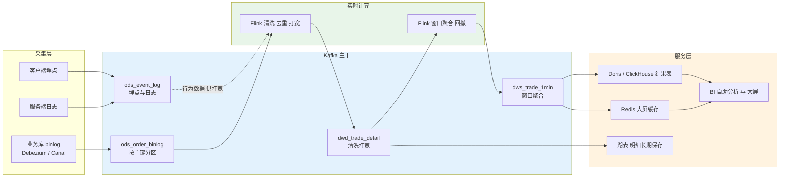
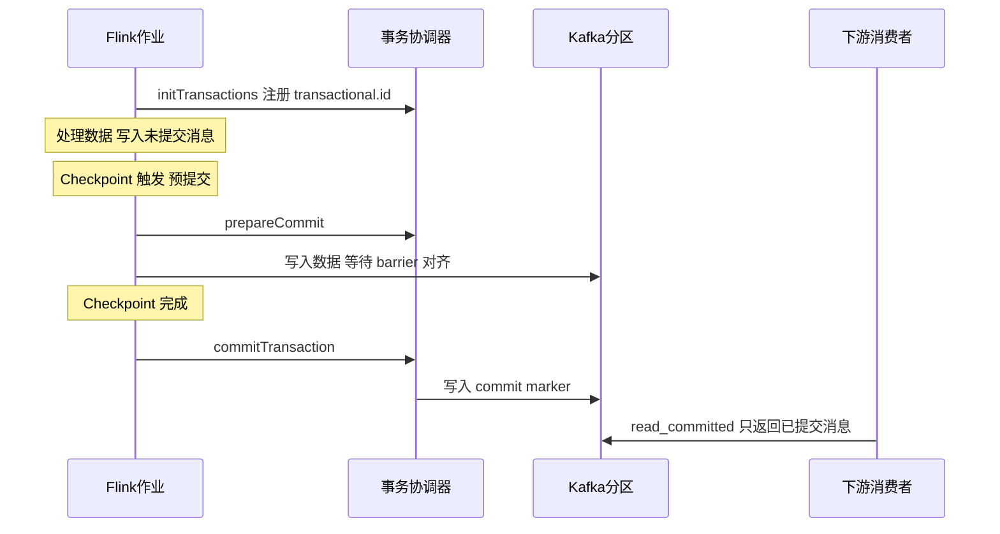
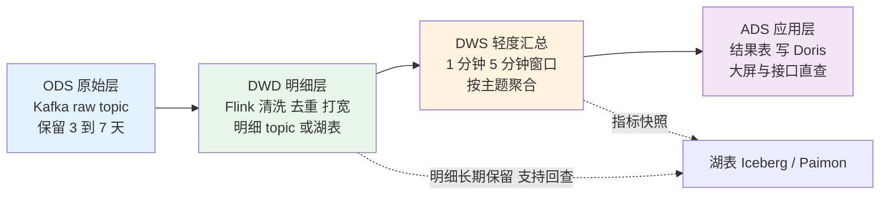

# Kafka 与实时数仓链路

> 定位：当大屏上 12:00 的 GMV 和次日离线报表差 2%、运营在群里 @ 你，或者消费者 LAG 涨到三千万却没人收到告警时，问题往往不在 SQL，而在「Kafka 怎么被放进数仓」。这篇不讲 Kafka 的基础架构（[Kafka 架构与原理](../07-缓存与中间件/05-Kafka架构与原理.md) 已经讲透），只讲它在实时数仓中的角色：分区怎么决定并行度、幂等与事务怎么拼出端到端 Exactly-Once、CDC 与 Schema Registry 怎么接、ODS/DWD/DWS/ADS 怎么落到 topic 上，以及延迟、乱序、重复、回撤这四类语义问题怎么收口。

## 一、为什么需要它

一个典型的上线过程是这样的：业务要「实时大屏」，团队已有 Kafka（原本只用来解耦订单和库存），于是顺手把订单 CDC 丢进去，Flink 消费后写 Doris，BI 直连。上线第一周就遇到四件事：

1. **GMV 偶尔翻倍**。Flink 作业重启后从上一个 checkpoint 重放，Doris 写入不是幂等的，重复数据进了结果表。
2. **数字会往回跳**。Flink SQL 的聚合会发出撤回流（`-U` 旧值、`+U` 新值），大屏只做了「累加」，于是金额先涨后跌。
3. **扩了消费者还是追不上积压**。topic 只有 6 个分区，消费者加到 12 个，多出来的 6 个一直空闲。
4. **上游加了个字段，整条链路挂了**。Avro schema 变更不兼容，消费者反序列化直接抛异常。

这四件事指向同一个事实：**Kafka 在实时数仓里不是「消息队列」，而是可重放的分层日志**——它同时承担 ODS 落地、层间总线、故障重算源头三个角色。把它当管道用，语义问题就会一路漏到报表上。

三个必须先建立的认知：**Kafka 只保证分区内有序**，跨分区、跨表没有全局顺序，需要顺序的场景顺序键必须同时是分区键；**保留时长决定可重算的范围**，Kappa 的前提是消息还躺在 Kafka 里，一旦过期删除，重算只能回到湖上的历史；**端到端 Exactly-Once 是全链路属性**，Kafka 事务只保证「读 Kafka—算—写 Kafka」这一段，写到 OLAP、湖表、Redis 的语义要各自补。

## 二、核心原理

### 2.1 端到端链路：Kafka 站在哪一环



读图要点：**每一层之间的边界都是 topic 或表，而不是函数调用**——这让每段都能独立重放、独立扩并行度、独立排障。代价是每一段都要处理乱序与重复，所以「层」不是目录结构，而是「可独立重算的物化点」。各段延迟量级参考（不含峰值抖动）：采集 100ms 级、broker 落盘 10ms 级、计算 10ms 到秒级、结果可见 1s 到分钟级（受 checkpoint 间隔影响）、查询 100ms 到秒级。**任何一段承诺不了，端到端就承诺不了**。Flink 侧的状态、水位线与两阶段提交见 [Flink 流式计算与状态管理](05-Flink流式计算与状态管理.md)。

### 2.2 分区、副本与 ISR：两个决定上限的旋钮

基础机制见 [Kafka 架构与原理](../07-缓存与中间件/05-Kafka架构与原理.md)，这里只留实时数仓必须用到的结论：

| 概念 | 在数仓链路里的实际含义 | 常见误用 |
|---|---|---|
| **分区数** | 下游并行度的**硬上限**；也是顺序的边界 | 以为加消费者就能提升吞吐，忽略分区数 |
| **分区键** | 决定同一业务实体的消息是否有序 | 用随机 key 求均匀，结果同一订单乱序 |
| **副本数** | 单 broker 故障时数据不丢 | 副本 3 但 `min.insync.replicas=1`，等于没保护 |
| **ISR** | 与 leader 保持同步的副本集合，是「可靠写入」的判定范围 | 只看 `UnderReplicatedPartitions`，不看 ISR 抖动频率 |
| **保留策略** | 决定能重放多久，直接影响重算能力 | 所有 topic 统一 7 天，ODS 想重算时已过期 |

两个不可逆点要提前想清楚：

- **分区只能增不能减**。扩容后，`hash(key) % 分区数` 的映射会变，同一订单的历史消息和新消息可能落到不同分区，**顺序保证被打破**。所以扩分区要选低峰、并接受一段时间的乱序窗口，或改用「按业务维度固定分区 + 分区内再排序」。
- **分区数决定 Flink 并行度上限**。Flink 的 Kafka source 一个分区最多一个并发读，source 并行度超过分区数就是浪费 slot。

### 2.3 从「至少一次」到端到端 Exactly-Once

**第一层：幂等生产者。** broker 为每个 `(PID, 分区)` 维护最近 5 个 batch 的序列号，重复的 sequence 直接丢弃。PID 由 broker 分配、随生产者会话变化，所以**幂等只覆盖「同一会话、同一分区」**，生产者重启后就失效。

**第二层：事务。** 生产者配置 `transactional.id`，通过事务协调器（Transaction Coordinator）把「多条消息 + 消费位点」打包成一次原子提交，位点写入内部 topic `__transaction_state`。消费者用 `isolation.level=read_committed` 时，只能读到已提交事务的数据，未提交部分被 LSO（Last Stable Offset）挡住。

**第三层：端到端。** 只有 sink 也参与同一个事务，或 sink 自身幂等，端到端才成立。Flink 的做法是把 Kafka 事务与 checkpoint 绑定：checkpoint 时预提交（pre-commit），checkpoint 完成后才真正提交；失败恢复时回滚未提交事务。



读图要点：**事务提交发生在 checkpoint 成功之后**，所以「结果可见」至少滞后一个 checkpoint 间隔。把 checkpoint 从 5 分钟调到 30 秒能显著降低可见延迟，代价是更多小文件和更频繁的提交开销——这是实时数仓里最常见的延迟与稳定性权衡。

还要注意事务的两个超时：生产者侧 `transaction.timeout.ms`（默认 60s）必须小于 broker 侧 `transaction.max.timeout.ms`（默认 15 分钟），否则 broker 会主动 abort；作业长时间无数据写入时，事务也可能因超时被回滚，表现为「重启后一段时间数据丢失」。

### 2.4 数据怎么进 Kafka：Connect、Schema Registry、Debezium

三种采集方式的选择：

| 方式 | 原理 | 优点 | 代价 | 适用 |
|---|---|---|---|---|
| **业务双写** | 应用写完库再发消息 | 简单、可控 | 不一致风险（写库成功发消息失败）、侵入业务 | 非核心埋点 |
| **日志采集** | Filebeat/Flume 读文件 | 不侵入、吞吐高 | 只能拿到文本、语义弱 | 访问日志、埋点 |
| **CDC** | 读 binlog/redo 日志 | 全量与增量统一、含 before/after、低侵入 | 运维复杂、需处理快照与 DDL | 业务库入仓（主流） |

**Kafka Connect** 是把「搬数据」标准化的框架：Connector 描述「从哪到哪」，Task 是并行执行单元，offset 与状态存在内部 topic。它的价值在于**声明式配置 + 社区连接器**，不需要为每个数据源写一个 Java 服务。常用组件：

- **Debezium**：基于日志的 CDC，支持 MySQL/PostgreSQL/Oracle 等。首次启动做一致性快照（锁表或最小锁），之后持续读日志；支持通过 signal 表触发**增量快照**，避免大表全量时长时间锁表。消息里 `op`（c/u/d/r）、`before`/`after`、`source.ts_ms`（**事件时间优先用它，而不是处理时间**）、`source.lsn`/`gtid`（去重与断点）决定了后续怎么用；删除事件默认还会跟一条 value 为 null 的 tombstone，用于让 compacted topic 清理该 key，下游要能处理空 value。
- **Schema Registry**：集中管理 Avro/Protobuf/JSON Schema，生产者按 ID 注册 schema，消费者按 ID 拉取。核心是**兼容性策略**：`BACKWARD`（新 schema 可读旧数据，可删字段、可加带默认值的字段）、`FORWARD`、`FULL`、`NONE`。生产环境至少用 `BACKWARD` 或 `FULL`，否则一次字段改名就能打挂所有消费者。
- **SMT（Single Message Transform）**：在 Connect 内部做轻量字段增删改，比如把 `op` 字段映射成统一的 `cdc_op`。复杂逻辑不要塞进 SMT，放 Flink 里做。

### 2.5 分层在实时链路里的映射

传统离线数仓的 ODS/DWD/DWS/ADS 是「库 + 表 + 目录」，实时链路里则变成「topic + 作业 + 结果表」的组合：



读图要点：**ODS 不放湖、DWD 才落湖**是常见做法——原始 CDC 消息体积大、保留短，重算靠 Kafka 重放；DWD 明细落湖后既能长期回查，也能给离线链路复用同一份数据，减少实时与离线两套口径。

各层的职责与取舍：

| 层 | 载体 | 关键动作 | 保留 | 常见错误 |
|---|---|---|---|---|
| ODS | Kafka topic | 原样落地、按主键分区 | 3~7 天 | 直接在这层做聚合，丢失明细 |
| DWD | Kafka topic + 湖表 | 清洗、去重、维表打宽、统一字段与时间语义 | 湖表长期 | 打宽时关联非唯一维表导致行数膨胀 |
| DWS | Kafka topic 或 OLAP | 窗口聚合、按主题/维度汇总 | 数周 | 用处理时间开窗，结果不可重放 |
| ADS | OLAP 结果表 / Redis | 指标计算、面向查询的宽表 | 按业务 | 每次查询现算，把 OLAP 当计算引擎 |

### 2.6 四个语义难题：延迟、乱序、重复、回撤

| 难题 | 典型现象 | 根因 | 收口手段 |
|---|---|---|---|
| **延迟** | 大屏比实际晚 3 分钟 | checkpoint 间隔长、sink 批量提交、查询层缓存 | 缩短 checkpoint、sink 微批 + 定期 flush、结果表按分钟分区 |
| **乱序** | 同一订单「支付」先于「下单」被处理 | 多分区无序、多表 join、重试 | 按业务主键分区、事件时间 + 水位线、允许迟到窗口 |
| **重复** | 重启后 GMV 变高 | at-least-once + 重放、sink 非幂等 | 主键 upsert、幂等键、事务 sink、去重状态 |
| **回撤** | 数字先涨后跌 | Flink SQL 聚合输出 `-U`/`+U` | 下游按主键更新、展示层做平滑、避免中间层再累加 |

**回撤流**最容易被低估。Flink SQL 里 `GROUP BY` 的输出不是「只增」的，而是 changelog：`+I` 插入、`-U` 撤回旧值、`+U` 更新新值、`-D` 删除。下游如果用一个只会 `INSERT` 的 sink，就会得到重复累加的结果；如果下游是 Doris 主键模型或支持 upsert 的 Kafka topic，才能正确表达。设计时要先问一句：**这份结果是「只追加的事实」还是「会变化的状态」**。

## 三、关键机制与配置

### 3.1 Java 生产者：事务 + 幂等

```java
public final class ExactlyOnceForwarder implements AutoCloseable {
    private final KafkaConsumer<String, String> consumer;
    private final KafkaProducer<String, String> producer;

    public ExactlyOnceForwarder(String brokers) {
        Properties cp = new Properties();
        cp.put(ConsumerConfig.BOOTSTRAP_SERVERS_CONFIG, brokers);
        cp.put(ConsumerConfig.GROUP_ID_CONFIG, "dwd-trade");
        cp.put(ConsumerConfig.ENABLE_AUTO_COMMIT_CONFIG, "false");
        cp.put(ConsumerConfig.ISOLATION_LEVEL_CONFIG, "read_committed");
        cp.put(ConsumerConfig.KEY_DESERIALIZER_CLASS_CONFIG, StringDeserializer.class.getName());
        cp.put(ConsumerConfig.VALUE_DESERIALIZER_CLASS_CONFIG, StringDeserializer.class.getName());
        this.consumer = new KafkaConsumer<>(cp);

        Properties pp = new Properties();
        pp.put(ProducerConfig.BOOTSTRAP_SERVERS_CONFIG, brokers);
        pp.put(ProducerConfig.KEY_SERIALIZER_CLASS_CONFIG, StringSerializer.class.getName());
        pp.put(ProducerConfig.VALUE_SERIALIZER_CLASS_CONFIG, StringSerializer.class.getName());
        pp.put(ProducerConfig.ENABLE_IDEMPOTENCE_CONFIG, "true");   // 幂等 默认已开
        pp.put(ProducerConfig.ACKS_CONFIG, "all");
        pp.put(ProducerConfig.MAX_IN_FLIGHT_REQUESTS_PER_CONNECTION, "5");
        pp.put(ProducerConfig.TRANSACTIONAL_ID_CONFIG, "dwd-trade-tx-1");
        this.producer = new KafkaProducer<>(pp);
        this.producer.initTransactions();
        this.consumer.subscribe(List.of("ods_order_binlog"));
    }

    public void run() {
        while (true) {
            ConsumerRecords<String, String> records = consumer.poll(Duration.ofMillis(500));
            if (records.isEmpty()) {
                continue;
            }
            producer.beginTransaction();
            try {
                for (ConsumerRecord<String, String> r : records) {
                    producer.send(new ProducerRecord<>("dwd_trade_detail",
                            r.key(), TradeTransformer.toDwd(r.value())));
                }
                // 位点与输出消息同属一个事务 要么都生效 要么都回滚
                producer.sendOffsetsToTransaction(
                        currentOffsets(records), consumer.groupMetadata());
                producer.commitTransaction();
            } catch (Exception ex) {
                producer.abortTransaction();
                throw new IllegalStateException("事务回滚 从头重放", ex);
            }
        }
    }

    private Map<TopicPartition, OffsetAndMetadata> currentOffsets(
            ConsumerRecords<String, String> records) {
        Map<TopicPartition, OffsetAndMetadata> offsets = new HashMap<>();
        for (TopicPartition tp : records.partitions()) {
            var list = records.records(tp);
            offsets.put(tp, new OffsetAndMetadata(list.get(list.size() - 1).offset() + 1));
        }
        return offsets;
    }

    @Override
    public void close() {
        consumer.close();
        producer.close();
    }
}
```

四个细节决定了这段代码在生产能不能用：`transactional.id` 必须**每个实例唯一且稳定**（重复会触发 fencing，旧实例被踢出）；`max.in.flight.requests.per.connection` 不能超过 5（否则幂等失效风险由 broker 拒绝）；`sendOffsetsToTransaction` 的位点必须是「下一条要读的位置」；`abortTransaction` 后要重建消费者状态或直接退出重启，不要在循环里硬扛。

### 3.2 Java 消费者：批量写 OLAP + 手动提交

```java
public class KafkaToDoris {

    public void run(String brokers, String jdbcUrl) throws Exception {
        Properties p = new Properties();
        p.put(ConsumerConfig.BOOTSTRAP_SERVERS_CONFIG, brokers);
        p.put(ConsumerConfig.GROUP_ID_CONFIG, "dws-trade-1min");
        p.put(ConsumerConfig.ENABLE_AUTO_COMMIT_CONFIG, "false");
        p.put(ConsumerConfig.MAX_POLL_RECORDS_CONFIG, "1000");
        p.put(ConsumerConfig.KEY_DESERIALIZER_CLASS_CONFIG, StringDeserializer.class.getName());
        p.put(ConsumerConfig.VALUE_DESERIALIZER_CLASS_CONFIG, StringDeserializer.class.getName());
        // Doris 主键模型 相同 key 覆盖 所以重放天然幂等
        String sql = "INSERT INTO dws_trade_1min(window_start, channel, gmv, order_cnt) "
                   + "VALUES(?,?,?,?)";
        try (KafkaConsumer<String, String> consumer = new KafkaConsumer<>(p);
             Connection conn = DriverManager.getConnection(jdbcUrl);
             PreparedStatement ps = conn.prepareStatement(sql)) {
            consumer.subscribe(List.of("dws_trade_1min"));
            conn.setAutoCommit(false);
            while (true) {
                ConsumerRecords<String, String> records = consumer.poll(Duration.ofMillis(500));
                if (records.isEmpty()) {
                    continue;
                }
                for (ConsumerRecord<String, String> r : records) {
                    Metric m = JsonCodec.parse(r.value(), Metric.class);
                    ps.setTimestamp(1, Timestamp.valueOf(m.windowStart()));
                    ps.setString(2, m.channel());
                    ps.setBigDecimal(3, m.gmv());
                    ps.setLong(4, m.orderCount());
                    ps.addBatch();
                }
                ps.executeBatch();
                conn.commit();          // 先落库
                consumer.commitSync();  // 再提交位点 崩溃时最多重复 由主键去重
            }
        }
    }
}
```

### 3.3 Topic 设计与保留策略

| topic 类型 | `cleanup.policy` | 保留 | 分区键 | 说明 |
|---|---|---|---|---|
| ODS 日志型 | `delete` | 3~7 天 | 业务主键（订单号/用户 ID） | 只为重放，过期即删 |
| 维表快照型 | `compact` | 长期 | 维表主键 | 保留每个 key 的最新值 |
| 结果型 | `compact,delete` | 7~30 天 | 指标主键 | 既保留最新值，也防止无限增长 |

关于 compaction 的三个事实：**它不是即时清理**，而是在 segment 滚动后由 cleaner 后台合并；**tombstone 也有保留期**（`delete.retention.ms`，默认 24h），期间消费者仍可能读到 null value；**compacted topic 不保证消息顺序被保留成「业务顺序」**，只保证每个 key 保留最后一条。

小文件不只出现在 HDFS：实时链路写 OLAP 时每个微批产生一个 part/rowset，写湖表时每个 checkpoint 产生一批文件。判断标准不是「文件数量」而是「单文件是否达到目标大小」——OLAP 侧靠攒批与后台 merge，湖表侧靠定期 `rewrite_data_files` / `compact`（细节见 [数据湖与湖仓一体](08-数据湖与湖仓一体.md)）。Kafka 自身的小文件则是「分区数 × segment 数 × 副本数」，靠 `segment.bytes`、topic 数量与分层存储控制。

### 3.4 监控与积压治理

必备指标：

| 指标 | 含义 | 告警建议 |
|---|---|---|
| `records-lag-max` / 消费组总 lag | 积压条数 | 按「可接受延迟 × 峰值 TPS」折算阈值 |
| `records-consumed-rate` | 消费速率 | 与生产速率对比看趋势 |
| `UnderReplicatedPartitions` | 副本不足分区数 | 大于 0 持续 1 分钟即告警 |

排查路径可以固化成四步：**判断 lag 是持续上涨还是脉冲 → 看下游是否变慢 → 短期靠批量化与扩消费者（不超过分区数）→ 长期扩分区或拆 topic**。盲目加消费者超过分区数，只会多出一批空闲实例，还会加剧 rebalance；兜底手段是把非核心消息转死信，保住核心链路 SLA。

## 四、生产坑点与排查

### 坑点 1：扩消费者追不上积压，因为分区数封顶

**现象**：LAG 持续上涨，消费者实例从 6 个扩到 20 个，只有 6 个在消费，其余空闲，积压不降。
**原因**：消费组内一个分区只能被一个消费者消费，并行度上限等于分区数；同时实例变多、rebalance 更频繁，短暂停顿反而拉低吞吐。
**解法**：先确认分区数，再决定是扩分区（注意顺序语义）还是提升单条处理效率（批量、异步 IO、减少同步调用）。生产建议在建模初期就按「峰值吞吐 ÷ 单分区吞吐」留 1.5 倍余量。

### 坑点 2：扩分区后同一订单的事件乱序

**现象**：扩容分区后，个别订单出现「先退款后支付」，状态机报非法流转。
**原因**：`hash(key) % 分区数` 在分区数变化后映射改变，同一 key 的历史消息在新旧分区之间失去顺序。
**解法**：扩分区后对受影响时间段做重放与修正；对强顺序要求的实体，改用「分区号由业务维度固定计算」的方案，或在 Flink 侧按主键做状态排序与幂等合并，不依赖跨分区顺序。

### 坑点 3：配了幂等生产者却没生效

**现象**：以为开了幂等就不会重复，结果 broker 侧仍出现重复消息；日志里有 `ConfigException` 但被忽略。
**原因**：`enable.idempotence=true` 要求 `acks=all`、`retries>0`、`max.in.flight<=5`，显式冲突配置会让客户端直接拒绝启动；另外幂等只在单会话单分区有效，重启后 PID 变化。
**解法**：不要手动覆盖冲突参数；需要跨会话、跨分区的「不重」，只能上事务或下游幂等。上线前用「杀掉生产者再重启」的方式验证是否真的不重复。

### 坑点 4：事务超时导致数据「凭空消失」

**现象**：作业低峰期长时间无数据，恢复后一段时间的数据没进结果表，也没有报错。
**原因**：`transaction.timeout.ms` 到期，协调器 abort 了未提交事务；或作业被新实例以相同 `transactional.id` fencing。
**解法**：让事务超时与 checkpoint 间隔匹配（超时 > checkpoint 间隔的 2~3 倍），低峰期也定期发送心跳或空批次推进事务；`transactional.id` 按实例唯一，滚动发布时避免新旧实例同 ID 并存。

### 坑点 5：EOS 只做了一半，OLAP 里仍有重复

**现象**：Flink 开了 checkpoint 和 Kafka 事务，Kafka 侧无重复，但 Doris 结果表金额偏高。
**原因**：两阶段提交只覆盖「Flink → Kafka」，写 Doris 的 sink 是普通批量插入，checkpoint 失败重放时重复写入；或者结果表没有主键，无法覆盖。
**解法**：端到端逐段确认语义——Kafka sink 用事务，OLAP sink 用主键模型/唯一键 + upsert，Redis 用幂等写；不能做到事务的段落，必须做到「可去重」，并在指标上接受 at-least-once。

## 五、调优与选型

### 5.1 参数清单

| 侧 | 参数 | 建议 | 说明 |
|---|---|---|---|
| 生产者 | `acks` | `all` | 配合 `min.insync.replicas=2` |
| 生产者 | `enable.idempotence` | `true` | 3.0 起默认开启，不要关 |
| 消费者 | `max.poll.records` | 200~1000 | 控制单批处理时长，避免超 `max.poll.interval.ms` |
| 消费者 | `enable.auto.commit` | `false` | 手动提交才能控制语义 |
| Broker | `num.partitions` | 按吞吐估算 | 变更不可逆，初期留余量 |
| Broker | `min.insync.replicas` | 2 | 与 `acks=all` 配合 |
| Broker | `log.retention.hours` | 按重算窗口 | ODS 至少覆盖「最坏故障恢复时长」 |

### 5.2 什么时候不该用 Kafka 做实时数仓

- **数据量很小、延迟要求是分钟级**：定时任务拉增量写 OLAP 就够，多一套 Kafka 只是多一个故障点。
- **需求是 T+1 报表**：Kafka 的保留成本与运维成本换不来任何收益，直接离线数仓。
- **需要强事务与复杂查询**：Kafka 不是数据库，不要试图在 topic 上做多表 join 与即席查询，那是 OLAP 与湖表的职责。
- **团队没有 7×24 运维能力**：Kafka 的磁盘、ISR、分区均衡、版本升级都需要人盯；托管服务是更现实的选择。
- **消息体积极大（图片、大 JSON）**：Kafka 适合 KB 级消息，大对象应存对象存储、消息里只放引用。

## 六、面试高频问法

**Q1：Kafka 在实时数仓里到底承担什么角色？和普通 MQ 用法有什么不同？**

**一句话结论**：它是**可重放的分层日志**，同时是 ODS 落地载体、层间总线和故障重算源头；普通 MQ 只关心「送到」，数仓链路还要求「能重放、能定序、能定语义」。

展开：数仓链路把每层物化成 topic 或表，任何一段都能独立重放；因此必须规划分区键、保留时长、压缩与 compaction 策略。保留时长直接决定重算窗口，compaction 决定维表快照能否恢复。

加分点：点出「Kafka 不是数据库」——多表 join、即席查询、强事务都应交给 OLAP 或湖表。

**Q2：Kafka 怎么做到端到端 Exactly-Once？**

**一句话结论**：幂等生产者解决单会话单分区重复，事务把多条消息与消费位点原子提交，端到端还要求 sink 参与事务或自身幂等；Flink 用「checkpoint + 两阶段提交」把三者串起来。

展开：`transactional.id` → 协调器 → `__transaction_state` → commit marker；消费者 `read_committed` 通过 LSO 过滤未提交数据；checkpoint 完成才真正提交，恢复时回滚未提交事务。

加分点：指出端到端 EOS 的边界——写 OLAP 通常做不到事务，只能用主键 upsert 实现「效果上的不重」，并且结果可见延迟至少一个 checkpoint。

**Q3：为什么 Kafka 只保证分区内有序？怎么保证同一订单有序？**

**一句话结论**：顺序只在单分区内由 offset 保证；要按订单有序，必须让同一订单的消息进同一分区，即用订单号做 key，并接受扩分区会破坏映射的代价。

展开：多分区是为了并行，天然放弃全局顺序；跨表、跨 topic 更没有全局序，只能靠事件时间 + 水位线在计算层重建顺序。重试也可能造成乱序，幂等生产者通过 sequence 保证单分区内不重不漏但仍按序。

加分点：提出「顺序键 = 分区键」的设计原则，并说明扩容时的迁移方案（低峰扩容 + 重放修正 + 业务侧兜底状态机）。

**Q4：CDC 方案怎么选？Debezium 的全量快照会不会锁表？**

**一句话结论**：业务库入仓优先 CDC；Debezium 默认一致性快照会加较轻的锁（MySQL 上是全局读锁的短持有时段或最小锁模式），大表应使用**增量快照**避免长时间影响线上。

展开：日志采集只能拿到文本、语义弱；双写有一致性风险；CDC 能拿到 before/after 与事务边界，适合做 DWD 明细。增量快照通过 signal 表分块读取，可断点续传。

加分点：说明 `op`、`source.ts_ms`、tombstone 三个字段的用途，以及 DDL 变更会被当成特殊事件、需要下游兼容。

**Q5：Schema Registry 的兼容性策略怎么选？**

**一句话结论**：默认用 `BACKWARD`（新 schema 能读旧数据），多团队共用 topic 时用 `FULL`；`NONE` 只适合实验环境，生产等于放弃保护。

展开：`BACKWARD` 允许删字段、允许加带默认值的字段；`FORWARD` 允许消费者先升级；`FULL` 两者都满足，约束最强。Avro 的默认值语义是兼容性的关键，Protobuf 则要看字段编号是否复用。

加分点：补充「兼容性只保证能解析，不保证语义正确」——字段含义变更（单位从元改成万元）不会被任何策略拦住，必须靠数据契约与评审。

**Q6：实时链路里 ODS/DWD/DWS/ADS 怎么落？**

**一句话结论**：ODS 留 Kafka raw topic（短保留、可重放），DWD 清洗打宽后落 topic 与湖表，DWS 做窗口聚合，ADS 写 OLAP 结果表；层与层之间用 topic/表隔离，保证可独立重算。

展开：ODS 不做业务加工；DWD 统一字段、时间语义与去重键；DWS 用事件时间开窗；ADS 面向查询做宽表与预聚合。湖表承担明细长期保存与离线复用。

加分点：强调「层是物化点，不是目录」，并说明 ODS 保留时长要覆盖最坏恢复窗口。

**Q7：数据延迟大，从哪几段查？**

**一句话结论**：按「采集 → broker 落盘 → 计算 → sink 提交 → 查询可见」分段埋点，先定位是哪一段贡献了主要延迟，再针对性优化。

展开：采集看 CDC 是否积压；broker 看 lag 与 ISR；计算看 checkpoint 间隔、反压、GC；sink 看批量大小与 flush 间隔；查询层看缓存与物化视图是否命中。

加分点：指出 checkpoint 间隔是最常被忽略的延迟来源，因为它同时决定事务提交与结果可见。

**Q8：Flink 的撤回流是什么？为什么大屏数字会回跳？**

**一句话结论**：Flink SQL 聚合输出 changelog（`+I/-U/+U/-D`），下游若按「只增」处理会重复累加；按主键 upsert 才能正确表达「值被修正」。

展开：窗口聚合在水位线推进、迟到数据到达时会修正结果，必然产生撤回；大屏若直接展示求和值，就会看到回跳。常见做法是结果表存「窗口 + 维度」主键的最终值，展示层做平滑。

加分点：区分「事实流」与「状态流」——事实只追加，状态会变化，设计 sink 前先判断属于哪类。

## 小结

- Kafka 在实时数仓里是可重放日志：ODS 载体、层间总线、重算源头，三者缺一不可。
- 分区数决定并行度上限且不可逆，扩分区会破坏 key 到分区的映射，顺序要求必须提前设计。
- 幂等只覆盖单会话单分区，事务覆盖「读 Kafka—算—写 Kafka」，端到端还要 sink 幂等或事务。
- CDC + Schema Registry + Connect 把采集标准化，兼容性策略是防上游变更的第一道闸。
- 延迟、乱序、重复、回撤是四类语义问题，分别对应 checkpoint、事件时间、幂等键、changelog 处理。

## 参考资料

- Apache Kafka 官方文档：Design、Producer Configs、Transactions、Log Compaction、Kafka Connect
- Apache Kafka KIP-405：Tiered Storage（分层存储设计文档）
- Apache Flink 官方文档：Kafka Connector、Checkpointing、End-to-End Exactly-Once
- Debezium 官方文档：Architecture、Incremental Snapshots、MySQL Connector
- Confluent Schema Registry 文档：Schema Compatibility 章节
- 论文：Kafka: a Distributed Messaging System for Log Processing（LinkedIn，2011）
