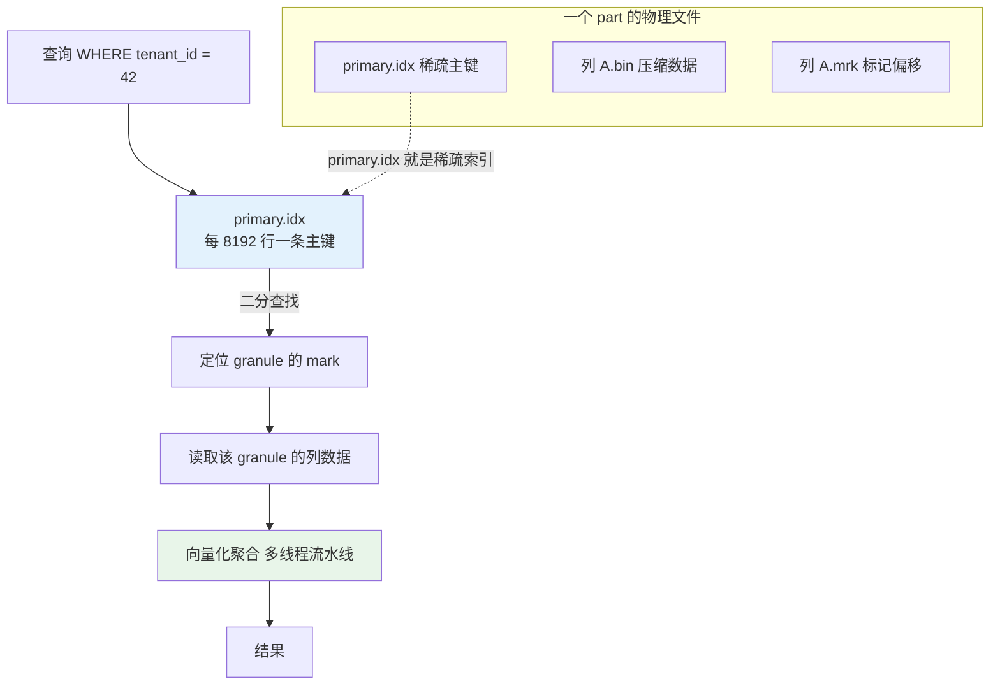
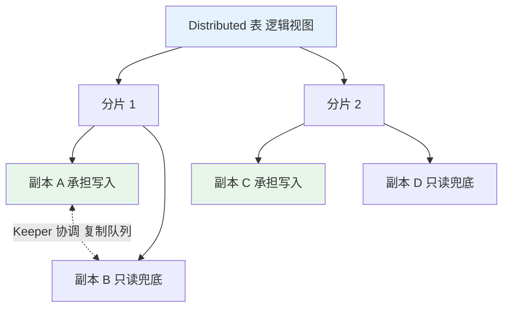
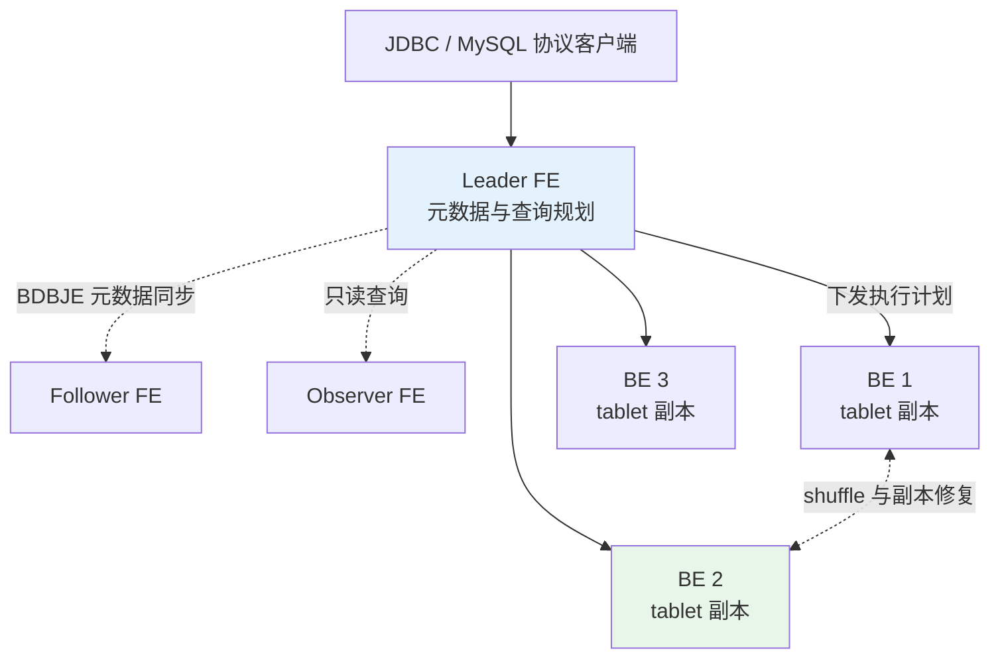
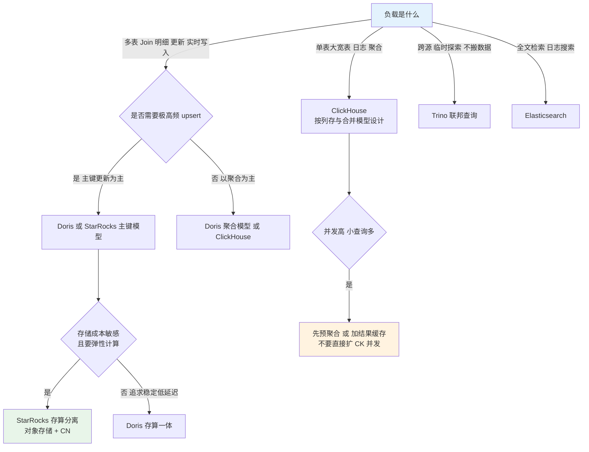

# OLAP 引擎选型：ClickHouse、Doris、StarRocks

> 定位：当 BI 要「按租户、渠道、小时下钻到明细」，大屏要「秒级刷新不抖动」，运营还要「临时查个数」时，MySQL 的索引已经完全帮不上忙。这篇把 ClickHouse、Doris、StarRocks 三套主流 OLAP 拆到引擎与数据模型层，给出场景分类、选型决策树、对比表和「什么时候不该用」，并附 Java 侧 JDBC 接入与生产坑点，读完能对一次 OLAP 选型负责。

## 一、为什么需要它

一个常见的翻车路径：团队做行为分析，看到 ClickHouse 压测单表聚合很快，直接选型。上线三个月后三个需求同时压过来：

- **用户标签要更新**：ClickHouse 的 `ALTER TABLE ... UPDATE` 是异步 mutation，会重写整个 part，高频点更新直接打爆磁盘 IO。
- **报表要 join 用户表和商品表**：大表 join 需要右表进内存，稍不注意就是内存超限。
- **大屏要 200 QPS 的小查询**：每次扫描上百万行，并发一上来查询排队，P99 从 200ms 涨到 5s。

这不是 ClickHouse 不好，而是**把「扫描型引擎」用在了「更新 + Join + 高并发点查」的场景**。反过来，用 Doris 做单表几十亿行的日志聚合，也可能比 ClickHouse 慢一截，因为它的存储格式与执行路径不是为「极限扫描」优化的。

所以选型的第一原则是：**先给负载分类，再选引擎，最后才比参数**。OLAP 没有银弹，只有匹配。

三类根本性差异先记住：

1. **存算形态**：ClickHouse 与 Doris 默认存算一体（本地盘），StarRocks 3.x 支持存算分离（对象存储 + 本地缓存），Trino 则完全不存数据。
2. **数据模型**：ClickHouse 以「追加 + 后台合并」为核心，更新是例外；Doris/StarRocks 提供主键模型，把 upsert 做成一等公民。
3. **Join 能力**：ClickHouse 的 Join 是「能跑」级别，Doris/StarRocks 是 MPP shuffle join，复杂多表关联更接近数仓体验。

## 二、核心原理

### 2.1 先把场景分类：四类 OLAP 负载

| 负载类型 | 特征 | 关键指标 | 典型 SQL | 优先候选 |
|---|---|---|---|---|
| **明细查询** | 按主键/条件取少量行，可能下钻 | 低延迟、高并发 | `WHERE order_id = ?` 或带索引的前缀过滤 | Doris/StarRocks 主键模型、ES、HBase |
| **聚合报表** | 大范围扫描 + 分组聚合 | 扫描吞吐、CPU 效率 | `GROUP BY 渠道, 小时` 扫数十亿行 | ClickHouse、Doris/StarRocks |
| **实时大屏** | 固定指标、秒级刷新、中等并发 | 稳定性、P99、预聚合 | 分钟级结果表直接查 | 预聚合结果表 + 任意 OLAP |
| **Ad-hoc 探索** | 查询形态不可预知、常跨源 | 灵活度、Join 能力、容错 | 临时 join 多张表 | Trino、Doris/StarRocks |

分类的意义在于：**同一套集群很难同时把四类都做好**。生产上常见做法是「明细层放湖/Doris，聚合层放 ClickHouse，探索层放 Trino」，而不是指望一个引擎全包。OLAP 在实时链路里的位置与上游 Kafka 的角色，见 [Kafka 与实时数仓链路](06-Kafka与实时数仓链路.md)；分层建模本身见 [Hive 与 Spark SQL 数仓开发](03-Hive与Spark-SQL数仓开发.md)。

### 2.2 ClickHouse：为「扫描」而生的 MergeTree

ClickHouse 快的根源不是某一个黑科技，而是四个设计叠加：**列存 + 稀疏索引 + 向量化执行 + 后台合并**。

**（1）MergeTree 家族与 part 结构。** 每次批量写入生成一个不可变的 part，后台线程按分区持续 merge 成大 part。查询时按分区裁剪、按主键索引定位 granule（默认 8192 行一组），再按列读取压缩块。这个模型决定了：**写入要批量**（小批产生海量 part）、**更新代价高**（只能重写 part）。

| 引擎 | 语义 | 典型用途 |
|---|---|---|
| `MergeTree` | 纯追加，不去重 | 日志、埋点、事实明细 |
| `ReplacingMergeTree` | 同排序键保留版本最大的一条，**查询期不保证唯一** | 去重近似、维表快照 |
| `SummingMergeTree` | 同排序键的数值列后台求和 | 预聚合指标 |
| `AggregatingMergeTree` | 存聚合函数中间状态，配合 `-State`/`-Merge` | 物化视图精确聚合 |
| `CollapsingMergeTree` | 用符号列抵消，需严格成对写入 | 可撤销的状态变更 |



读图要点：**稀疏索引不定位到行，只定位到 8192 行的 granule**——所以主键（`ORDER BY`）的选择直接决定能跳过多少数据。把高基数的过滤列放在排序键前部，比事后加索引有效得多。

**（2）向量化执行。** 数据按列连续存放，算子一次处理一个 block（数万行），配合 SIMD 与多线程流水线，CPU 缓存命中率高。代价是**不适合逐行处理**：`LIMIT 1` 的点查、逐条 `UPDATE` 都会绕过它的优势。

**（3）副本与分片。** 本地表用 `ReplicatedMergeTree`，副本间通过 ClickHouse Keeper（ZooKeeper 协议）协调；`Distributed` 表是逻辑视图，写入时按分片键路由，查询时下发到各分片再汇总。



读图要点：**分片决定容量与并行度，副本决定可用性**；`Distributed` 表本身不存数据，写入放大、跨分片 join 都要靠它承担。分片键选不好会出现「一个分片热、其他分片闲」。

**（4）物化视图。** ClickHouse 的 MV 本质是**插入触发器**：源表有新 block 时，把变换结果写入目标表。它不会自动回填历史，`POPULATE` 也只覆盖创建时刻已有数据且期间写入可能丢。所以正确姿势是「先建目标表与 MV，再灌历史（或单独补数）」。

**（5）不擅长什么。** 高频点更新（mutation 异步重写 part）、唯一约束（`ReplacingMergeTree` 只是最终去重，查询要 `FINAL` 或 `argMax`）、复杂多表 Join（大表 join 依赖内存与广播，容易 OOM）、高并发小查询（每次都要走完整扫描路径）。这些是设计取舍，不是 bug。

### 2.3 Doris：FE/BE 分离的 MPP 数仓

Doris 的定位是「能扛实时写入、能做多表 Join、能更新」的 MPP 数据库，更接近传统数仓的使用体验。

**架构**：FE 负责元数据、解析、规划、调度，通过 BDBJE 做元数据高可用（Leader/Follower/Observer）；BE 负责存储 tablet 与执行算子。查询走 MPP：按分桶把数据打散到多 BE 并行扫描，shuffle 后聚合。



读图要点：**FE 不是单点**（1 Leader + 奇数个 Follower），但元数据写入仍集中在 Leader；**BE 的 tablet 是数据分布与副本的最小单位**，分桶数决定并行度上限，副本数决定可用性。

**数据模型**是 Doris 选型的核心：

| 模型 | 语义 | 更新方式 | 适用 |
|---|---|---|---|
| `Duplicate` | 纯追加，不去重 | 无 | 原始日志、无需去重的事实 |
| `Aggregate` | 同 key 的 value 列按聚合函数合并 | 后台 compaction | 预聚合报表 |
| `Unique` | 同 key 只保留一行（merge-on-write） | 写入时合并，支持部分列更新 | 维表、状态表、明细 upsert |
| `Primary Key` | Unique 的强化版，支持更高效的点查与更新 | 写入时合并 | 高频更新的明细 |

`Unique` 模型在 Doris 2.x 默认 merge-on-write：写入时就把同 key 的旧行标记删除，查询无需额外合并，代价是写入放大。**这也是它比 ClickHouse 更适合「实时明细层」的原因**。

索引方面，Doris 有前缀索引（前 36 字节的稀疏索引）、ZoneMap（min/max 跳读）、Bitmap（低基数等值）、倒排索引（文本与多条件）。分区（Range/List）做数据生命周期管理，分桶（Hash）做并行度与数据分布。

物化视图在 Doris 2.x 是**异步物化视图**：按调度刷新，查询时可透明改写。它适合「重聚合、低频更新」的指标，不适合秒级强一致场景。

### 2.4 StarRocks：CBO 与存算分离

StarRocks 与 Doris 同源思路（FE + BE 的 MPP），差异主要在优化器与部署形态：

- **CBO（基于代价的优化器）**：依赖统计信息（行数、NDV、直方图）估算每个计划的代价，选 Join 顺序与 Join 方式。它比规则优化更能处理多表关联，但**统计信息不准时会选错计划**——这是 StarRocks 最常见的性能事故来源。
- **全面向量化 + Pipeline 执行**：算子按批处理，调度以 pipeline 为单位，减少线程阻塞。
- **存算分离（3.x shared-data 模式）**：数据放对象存储，BE 换成无状态 CN（Compute Node），本地盘只做缓存。优势是计算弹性、存储成本低；代价是冷查询要回源对象存储，延迟高于本地盘，需要缓存预热与合理的数据分布。
- **湖仓分析**：可直接建外部表查 Iceberg/Hudi/Paimon，配合 CBO 做湖上查询，减少数据搬迁。

**主键模型**与 Doris Unique 类似，支持部分列更新与条件更新，适合「维表宽、只更新少数字段」的场景。

### 2.5 与 Trino、Elasticsearch 的定位差异

| 引擎 | 是否存数据 | 核心优势 | 核心短板 | 一句话定位 |
|---|---|---|---|---|
| **ClickHouse** | 是 | 单表大宽表扫描聚合极快、压缩比高 | 更新弱、Join 弱、并发小查询弱 | 扫描型列存，指标与日志分析 |
| **Doris** | 是 | 实时写入 + 主键更新 + 多表 Join 均衡 | 极限单表扫描不如 CK，运维组件多 | 实时数仓服务层 |
| **StarRocks** | 是（可存算分离） | CBO、湖仓查询、弹性计算 | 统计信息维护成本、冷查延迟 | 湖上加速 + 实时数仓 |
| **Trino** | 否 | 跨源联邦、即席探索、不搬数据 | 大 Shuffle 易 OOM、无存储优化 | 查询网关，不是存储 |
| **Elasticsearch** | 是 | 全文检索、倒排、日志检索 | 聚合精度与内存成本、不适合大宽表聚合 | 搜索与日志检索 |

记法：**Trino 是窗口，ClickHouse 是扫描仪，Doris/StarRocks 是带仓库的收银台，ES 是检索台**。它们经常同时出现在一个架构里，各管一段。

## 三、关键机制与接入

### 3.1 建表：分区、排序键、分桶怎么定

ClickHouse 侧，`ORDER BY` 是稀疏主键，`PARTITION BY` 控制生命周期：

```sql
CREATE TABLE dw.dws_trade_minute_local ON CLUSTER ck_cluster
(
    tenant_id  UInt32,
    dt         Date,
    minute     DateTime,
    channel    LowCardinality(String),
    gmv        Decimal(18, 2),
    order_cnt  UInt64
)
ENGINE = ReplicatedMergeTree(
    '/clickhouse/tables/{shard}/dws_trade_minute', '{replica}')
PARTITION BY toYYYYMM(dt)                 -- 按月分区 避免分区过多
ORDER BY (tenant_id, dt, minute, channel) -- 高频过滤列靠前
TTL dt + INTERVAL 180 DAY
SETTINGS index_granularity = 8192;

CREATE TABLE dw.dws_trade_minute ON CLUSTER ck_cluster
AS dw.dws_trade_minute_local
ENGINE = Distributed('ck_cluster', 'dw', 'dws_trade_minute_local',
                     cityHash64(tenant_id));
```

Doris 侧，`AGGREGATE KEY` + 分桶：

```sql
CREATE TABLE dw.dws_trade_minute (
    dt        DATE        NOT NULL,
    minute    DATETIME    NOT NULL,
    tenant_id INT         NOT NULL,
    channel   VARCHAR(32) NOT NULL,
    gmv       DECIMAL(18, 2) SUM,
    order_cnt BIGINT         SUM
)
AGGREGATE KEY(dt, minute, tenant_id, channel)
PARTITION BY RANGE(dt) (
    FROM ("2026-01-01") TO ("2027-01-01") INTERVAL 1 MONTH
)
DISTRIBUTED BY HASH(tenant_id) BUCKETS 32
PROPERTIES (
    "replication_num" = "3",
    "compression" = "ZSTD"
);
```

三个设计要点：**分区粒度按数据量与生命周期定**（按天还是按月，决定分区数量与 compaction 压力）；**排序键/前缀索引按高频过滤列排**；**分桶数 = 期望并行度**，一般取 BE 数量的整数倍，过少会倾斜、过多会产生小文件与元数据压力。

### 3.2 Java 侧 JDBC 接入

ClickHouse 用官方 JDBC（HTTP 协议，默认 8123 端口），Doris/StarRocks 用 MySQL 协议（9030 端口）。两者都可以走连接池，但**超时与资源限制必须显式设置**，否则一条慢查询能把连接池拖死：

```java
public final class OlapQueryService {

    private final HikariDataSource clickhouse;
    private final HikariDataSource doris;

    public OlapQueryService() {
        HikariConfig ck = new HikariConfig();
        // 关键 超时与内存上限放在 URL 里 由服务端执行
        ck.setJdbcUrl("jdbc:clickhouse://ck-vip:8123/dw"
                + "?max_execution_time=10&max_memory_usage=8589934592"
                + "&socket_timeout=30000&compress=1");
        ck.setDriverClassName("com.clickhouse.jdbc.ClickHouseDriver");
        ck.setMaximumPoolSize(16);
        ck.setConnectionTimeout(3000);
        ck.setPoolName("ck-pool");
        this.clickhouse = new HikariDataSource(ck);

        HikariConfig ds = new HikariConfig();
        ds.setJdbcUrl("jdbc:mysql://doris-fe:9030/dw?useServerPrepStmts=true"
                + "&socketTimeout=30000");
        ds.setDriverClassName("com.mysql.cj.jdbc.Driver");
        ds.setUsername("bi_reader");
        ds.setPassword(System.getenv("OLAP_PASSWORD"));
        ds.setMaximumPoolSize(16);
        ds.setConnectionTimeout(3000);
        ds.setPoolName("doris-pool");
        this.doris = new HikariDataSource(ds);
    }

    public List<TradeRow> queryMinute(int tenantId, LocalDate day) {
        String sql = "SELECT minute, channel, gmv FROM dws_trade_minute "
                   + "WHERE tenant_id = ? AND dt = ? ORDER BY minute";
        try (Connection conn = doris.getConnection();
             PreparedStatement ps = conn.prepareStatement(sql)) {
            ps.setQueryTimeout(10);          // 客户端侧兜底
            ps.setInt(1, tenantId);
            ps.setDate(2, Date.valueOf(day));
            List<TradeRow> rows = new ArrayList<>();
            try (ResultSet rs = ps.executeQuery()) {
                while (rs.next()) {
                    rows.add(new TradeRow(rs.getTimestamp(1).toLocalDateTime(),
                            rs.getString(2), rs.getBigDecimal(3)));
                }
            }
            return rows;
        } catch (SQLException e) {
            throw new IllegalStateException("OLAP 查询失败 tenantId=" + tenantId, e);
        }
    }
}
```

四条 Java 侧纪律：**只读账号 + 独立连接池**（避免 BI 慢查询占满业务连接）；**永远带分区条件**（否则全表扫描）；**分页用游标或结果表预聚合**，不要对大结果集 `LIMIT 100000`；**禁止在循环里查 OLAP**（N+1 会瞬间打满并发）。

### 3.3 查询优化清单

| 问题 | 现象 | 优化动作 |
|---|---|---|
| 全分区扫描 | 查询慢且 CPU 高 | WHERE 必带分区列；开启分区裁剪确认 |
| 排序键不匹配 | 扫描行数远超预期 | 调整 `ORDER BY` / 前缀索引，把过滤列前置 |
| 高基数 GROUP BY | 内存飙升 | 先过滤再聚合；用近似去重（标注误差）；预聚合物化视图 |
| 大表 Join | 内存超限 / 广播失败 | 小表广播、大表按同 key 分桶、提前打宽 |
| 小查询高并发 | P99 抖动、排队 | 结果缓存、预聚合、独立资源组/队列 |
| 统计信息过期 | CBO 选错计划（StarRocks） | 定期 `ANALYZE`，关注 NDV 变化 |

## 四、生产坑点与排查

### 坑点 1：小批量高频写入把引擎写死

**现象**：ClickHouse 报 `Too many parts`，写入被拒绝；Doris 的 compaction score 持续上涨，查询越来越慢。
**原因**：每条消息写一次，几秒钟一批，产生海量小 part / rowset；后台 merge 追不上写入速度。
**解法**：写入端攒批（按行数或时间，如 1~5 秒或几万行一批）；ClickHouse 用 `async_insert` 或 Buffer 表过渡；Doris 用 Stream Load 而非单条 INSERT，并监控 compaction score，必要时降低写入频率或扩容 BE。

### 坑点 2：分区键设计成「分区爆炸」或「无法裁剪」

**现象**：一张表几万个分区，元数据加载慢、写入报错；或者按用户 ID 分区，查询永远扫全表。
**原因**：分区粒度过细（按小时/按用户），或分区列不是查询过滤列。
**解法**：分区列必须是**查询必带的低基数时间列**，粒度按数据量选天/月；用户维度用分桶或排序键，不要做分区。ClickHouse 单表分区数量级参考控制在几千以内；Doris 分区数同样要克制。

### 坑点 3：内存超限，加内存只是拖延

**现象**：`Memory limit exceeded`、查询被 kill，BE 节点 OOM。
**原因**：大表 Join 右表超大、`GROUP BY` 高基数、`ORDER BY` 无 `LIMIT`、并发查询叠加。
**解法**：先定位是单查询还是并发总和超限；单查询优化（提前聚合、缩小 Join、加 `LIMIT`）、并发侧用资源组/队列隔离；调大 `max_memory_usage` 只治标，且会把 OOM 从查询级升级到进程级。

### 坑点 4：数据倾斜，一个分片/分桶拖垮全局

**现象**：查询耗时是同类查询的 5~10 倍，监控显示单个 BE CPU 打满，其余空闲。
**原因**：分片键/分桶键基数低（如按渠道、按省份），或存在超大租户；写入时也出现单 BE 磁盘热。
**解法**：分桶键选高基数且分布均匀的列（通常用业务主键或 `tenant_id` 的哈希）；超大租户单独拆分或做盐化；定期检查各 tablet 行数与大小，偏差超过 20% 就要重分布。

### 坑点 5：拿 ClickHouse 做高频 upsert

**现象**：更新任务越跑越慢，磁盘 IO 打满，part 数量暴涨；查询结果还出现旧值。
**原因**：`ALTER UPDATE` 是 mutation，异步重写整个 part；`ReplacingMergeTree` 只在 merge 后去重，查询期不保证唯一。
**解法**：高频更新场景换 Doris/StarRocks 主键模型，或改成「追加 + 查询期取最新」（`argMax`/`FINAL`，注意性能）；确需更新时按分区批量做，不要在业务高峰期跑。

### 坑点 6：把 OLAP 当在线点查库

**现象**：C 端接口 P99 从 50ms 涨到 2s，OLAP 连接数打满，慢查询堆积。
**原因**：每个用户请求都查一次 OLAP，且过滤条件不走排序键/前缀索引，退化成扫描。
**解法**：在线点查走 Redis/HBase/MySQL；OLAP 只承接分析型查询，并且结果做缓存或预聚合；接口层加并发上限与超时，慢查询要有熔断。

## 五、调优、选型与最佳实践

### 5.1 选型决策树



读图要点：**先看负载形态（聚合 vs Join vs 探索），再看更新频率，最后看成本与弹性**。顺序颠倒就会陷入「先选引擎再找场景」的被动局面。

### 5.2 三者对比表

| 维度 | ClickHouse 24.x | Doris 2.x | StarRocks 3.x |
|---|---|---|---|
| 存储引擎 | MergeTree，part + 后台 merge | tablet + rowset，compaction | 列存 + 主键模型，支持 shared-data |
| 更新能力 | 弱（mutation 重写，Replacing 最终去重） | 强（Unique/Primary Key merge-on-write） | 强（主键模型、部分列更新） |
| Join | 一般（内存依赖大，复杂多表吃力） | 好（MPP shuffle join） | 好（CBO + MPP） |
| 单表扫描聚合 | 极强 | 强 | 强 |
| 高并发小查询 | 弱 | 中 | 中（存算分离可通过 CN 扩展） |
| 实时写入 | 需要攒批 | 好（Stream Load） | 好（Stream Load / Routine Load） |
| 物化视图 | 插入触发器，需自行补历史 | 异步物化视图 + 透明改写 | 异步物化视图 + 透明改写 |
| 存算分离 | 有限（依赖对象存储表/分层） | 3.x 起支持存算分离部署 | 3.x shared-data 成熟度较高 |
| 运维复杂度 | 中（Keeper、分片副本） | 中高（FE/BE、元数据、compaction） | 中高（FE/BE/CN、统计信息） |
| 生态与 SQL 兼容 | 自有方言，ClickHouse SQL | MySQL 协议，兼容度较高 | MySQL 协议，兼容度较高 |
| 最适合 | 日志、埋点、大宽表指标 | 实时数仓服务层、明细更新 | 湖上加速、弹性实时数仓 |

### 5.3 什么场景不推荐

- **数据量不到千万行、报表不超过 20 张**：MySQL 从库 + 汇总表足够，引入 OLAP 只增加运维负担。
- **需要强事务与行级更新**：OLAP 都不是 OLTP，订单状态流转请留在 MySQL/TiDB。
- **要求毫秒级点查且 QPS 很高**：Redis/HBase 更合适，OLAP 的扫描路径注定不适合。
- **只想查外部数据、不想搬数据**：选 Trino 或 StarRocks 外部表，不要为了查询把数据全量复制一份。
- **团队没有专职数据平台**：优先云托管（ClickHouse Cloud、SelectDB、StarRocks Cloud），自建至少需要 1 人负责扩容、compaction、升级。

## 六、面试高频问法

**Q1：ClickHouse 为什么快？**

**一句话结论**：列存 + 稀疏索引 + 向量化执行 + 高压缩 + 后台合并，叠加「按扫描优化」的存储布局，让大范围聚合的 IO 与 CPU 都省。

展开：列存只读需要的列；稀疏索引按 8192 行 granule 跳读；向量化按 block 处理并用 SIMD；压缩降低 IO；MergeTree 的 part 有序，范围扫描连续。

加分点：指出这套设计同时解释了它的短板——逐行读写、更新、点查都不占优。

**Q2：ClickHouse 的稀疏索引和 MySQL 的 B+ 树索引有什么区别？**

**一句话结论**：B+ 树定位到**行**，稀疏索引定位到**数据块（granule）**；前者适合点查，后者适合范围扫描，索引体积小得多。

展开：`primary.idx` 每 8192 行一条主键值，配合 `.mrk` 标记文件定位列数据的偏移，读取后还要在 granule 内过滤。所以主键选择决定扫描量，而不是「有没有索引」。

加分点：说明为什么 ClickHouse 不适合按主键点查——即使定位到 granule，也要读一整块并解压。

**Q3：ClickHouse 为什么不适合高频更新和复杂 Join？**

**一句话结论**：更新要重写不可变 part（mutation 异步且昂贵），Join 依赖右表进内存且执行模型简单；两者都与「扫描型列存」的设计前提冲突。

展开：part 不可变是为了 merge 与压缩效率，改一行等于重写整块；Join 没有成熟的代价模型与丰富算子，大表关联容易 OOM。

加分点：给出替代方案——更新换 Doris/StarRocks 主键模型，Join 换 MPP 引擎或提前打宽。

**Q4：Doris 的 FE 和 BE 各负责什么？元数据怎么保证高可用？**

**一句话结论**：FE 管元数据、解析、规划与调度，BE 管存储与执行；元数据通过 BDBJE 在 Leader/Follower 间同步，Observer 只读扩展查询能力。

展开：写入与 DDL 走 Leader，Follower 参与选举与读；BE 的 tablet 是副本与分布单位，查询按分桶并行、shuffle 汇总。FE 建议奇数个（3 或 5），避免脑裂。

加分点：区分「FE 高可用」与「BE 副本」——前者保元数据，后者保数据，故障处理路径完全不同。

**Q5：Doris 的 Unique Key 模型 merge-on-write 是怎么回事？**

**一句话结论**：写入时就用主键索引定位并标记旧行为删除，查询只读最新版本，因此 upsert 后无需额外合并，点查与更新都快；代价是写放大与内存占用。

展开：对比 merge-on-read（读时合并、写快读慢）；2.x 默认 MOW，适合维表与实时明细；部分列更新需要开启对应参数并保证未更新列有默认值语义。

加分点：说明它为什么让 Doris 适合做实时数仓服务层，而 ClickHouse 更适合做「只追加」的事实表。

**Q6：StarRocks 的 CBO 为什么可能选错计划？怎么排查？**

**一句话结论**：CBO 依赖统计信息估算代价，NDV/行数不准或统计过期时会误判 Join 顺序与方式；排查靠 `EXPLAIN` 看估算行数与实际行数的偏差，并检查 `ANALYZE` 是否覆盖。

展开：常见误判是大表被估成小表走了广播、或本应 broadcast 的走了 shuffle；数据倾斜也会让代价模型失真。

加分点：给出治理闭环——定期收集统计信息、对倾斜列做处理、用 `EXPLAIN ANALYZE` 对比估算与实际。

**Q7：StarRocks 存算分离解决了什么？代价是什么？**

**一句话结论**：计算与存储独立扩缩容，存储放对象存储降成本、计算按需弹性；代价是冷查询要回源对象存储、延迟上升，需要本地缓存与数据布局优化。

展开：shared-data 模式下 BE 变为无状态 CN，本地盘只做 cache；适合负载波动大、存储量大、查询可接受一定冷启动的场景。

加分点：指出「存算分离不等于零成本」——对象存储请求费、缓存命中率、网络带宽都会影响账单与 P99。

**Q8：一个实时大屏 + 明细下钻 + 高并发的需求，你怎么选型？**

**一句话结论**：分层设计——明细与更新放 Doris/StarRocks（主键模型），聚合指标预计算后写结果表（任意 OLAP 或 Redis），高并发小查询走缓存，Ad-hoc 探索交给 Trino。

展开：大屏只查分钟级结果表，压力可控；下钻查明细走主键/前缀索引；不要用一套大宽表同时满足「极致扫描」和「高并发点查」。

加分点：强调容量规划要按「并发 × 单查询扫描量」估算，而不是只看数据总量。

## 小结

- 选型顺序是「负载分类 → 更新与 Join 需求 → 成本与弹性」，不是先比跑分。
- ClickHouse 为扫描优化：列存、稀疏索引、向量化、后台合并；更新弱、Join 弱是设计取舍。
- Doris 用 FE/BE + MPP + 主键模型补齐实时写入与更新，更适合实时数仓服务层。
- StarRocks 的 CBO 与存算分离适合湖上加速与弹性场景，但要维护统计信息、接受冷查延迟。
- Trino 是查询网关，ES 是检索台，它们与 OLAP 是互补关系，不是替代关系。
- 小批量写入、分区设计、内存超限、数据倾斜是四类高频事故，全部能在建模阶段规避大半。

## 参考资料

- ClickHouse 官方文档：MergeTree Engine Family、Primary Indexes、Materialized Views、Replicated Tables
- Apache Doris 官方文档：Architecture、Data Model（Aggregate/Unique/Primary Key）、Stream Load、异步物化视图
- StarRocks 官方文档：Architecture、Cost-Based Optimizer、Shared-data Architecture、Materialized Views
- Trino 官方文档：Architecture、Connectors
- Elasticsearch 官方文档：Aggregations、Query DSL
- 经典论文：C-Store: A Column-oriented DBMS（列存与压缩的早期系统性论述）
