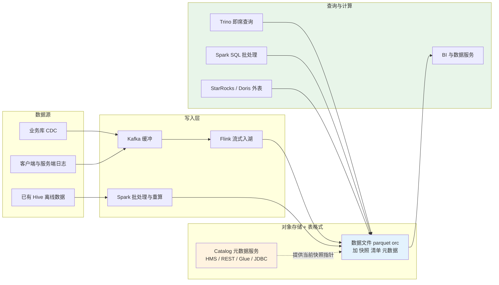
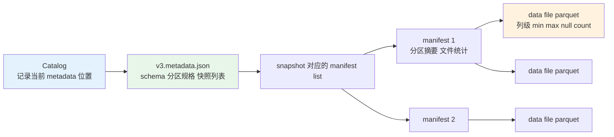
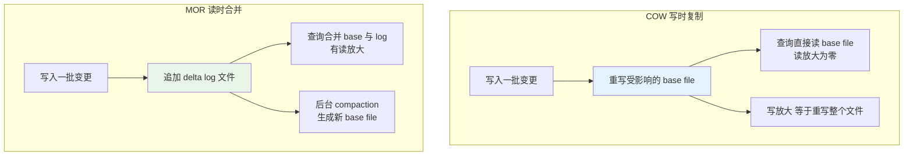

# 数据湖与湖仓一体

> 定位：把 parquet 文件堆在对象存储上，不叫数据湖——任务失败会留下半份文件，改个字段要重写全表，想回滚昨天的数据只能靠备份。这篇讲清 Iceberg、Hudi、Delta Lake、Paimon 四种表格式如何给对象存储补上 ACID、快照、时间旅行与 Schema 演进，Iceberg 元数据三层长什么样、Hudi 的 COW/MOR 怎么选、Paimon 为什么适合流批一体，以及湖仓落地真正的成本在哪里。

## 一、为什么需要它

一个典型的「假数据湖」事故现场：

1. **任务失败留下脏数据**。Spark 写 `INSERT OVERWRITE` 到一半失败，分区目录里一半新文件一半旧文件，查询结果既不是新数据也不是旧数据。
2. **改字段引发全链路停摆**。业务要在明细表加一个字段，Hive 表 `ALTER TABLE ADD COLUMNS` 之后，历史文件没有这一列，不同引擎读出来的结果不一致。
3. **无法回滚**。上线了错误的口径，想退回昨天的数据状态，只能把备份重新灌一遍。
4. **小文件压垮查询**。流式写入每天产生几十万个小文件，Trino 打开查询要先花几分钟列举文件。

Hive 表的问题不是「格式老旧」，而是**元数据与文件之间没有事务边界**：目录即分区、文件即数据、重命名是 copy+delete，没有任何机制保证「一批文件同时可见」。湖表格式做的就是把「文件集合」变成「带版本的快照」，用一次原子提交让下游看到一致状态。

先区分三个概念，很多选型争论源于混用：

| 概念 | 本质 | 数据形态 | 典型问题 |
|---|---|---|---|
| **数据湖** | 廉价存储 + 开放文件格式 | 对象存储上的 parquet/orc | 无事务、无 schema 约束、易成沼泽 |
| **数据仓库** | Schema 先行的封闭系统 | 内部专有格式 | 贵、扩展受限、半结构化数据难入 |
| **湖仓一体** | 湖的存储 + 仓的管理能力 | 开放文件 + 表格式元数据 | 依赖 compaction 与元数据运维 |

湖仓不是「湖 + 仓」两台系统拼起来，而是**在湖的文件之上加一层表语义**，让同一份数据既能被 Spark 批处理，也能被 Flink 流式写、Trino 即席查。

## 二、核心原理

### 2.1 湖仓的整体形态



读图要点：**存储与元数据分离**是湖仓的基本结构——数据文件在对象存储，快照指针在 Catalog；**写入与读取完全解耦**，多个引擎读同一张表，靠元数据而非目录约定达成一致。

### 2.2 表格式必须解决的六件事

| 能力 | 没有它会怎样 | 实现要点 |
|---|---|---|
| **ACID 提交** | 失败留下半份文件，读者看到中间态 | 先写文件，再原子替换元数据指针 |
| **快照与时间旅行** | 无法回滚、无法复现历史报表 | 每次提交生成新快照，旧快照按策略保留 |
| **Schema 演进** | 加字段/改类型要重写全表 | 用字段 ID 而非列名定位，读时按 ID 映射 |
| **分区演进** | 改分区策略必须重写历史 | 每个文件记录自己的分区规格，新旧共存 |
| **增量读** | 只能全量扫描找变化 | 快照间 diff、或记录变更日志 |
| **统计信息** | 查询无法裁剪文件 | 文件级 min/max、null count、record count |

这六件事决定了湖表的运维重点：**ACID 靠元数据、性能靠统计与 compaction、成本靠快照过期**。

### 2.3 Iceberg：元数据分层与隐藏分区

Iceberg 的设计核心是「**一切皆元数据，数据文件不可变**」。元数据分三层（metadata 文件、manifest list、manifest），由 Catalog 指向入口，查询依次裁剪：



读图要点：**裁剪发生在每一层**——Catalog 给快照，manifest list 按分区摘要剪掉整个 manifest，manifest 按文件级 min/max 剪掉文件，最后才读 parquet 的 row group。所以「查询慢」经常不是引擎问题，而是元数据层太多小文件或统计信息缺失。

四层的职责：

| 层 | 内容 | 规模量级参考 | 作用 |
|---|---|---|---|
| **Catalog** | 表名 → 当前 metadata.json 路径 | 每表一条 | 原子提交的 CAS 点 |
| **metadata.json** | schema、分区规格、快照列表、当前快照 | 几十 KB 到 MB | 表级版本 |
| **manifest list** | 每个 manifest 的路径、分区摘要、增减统计 | 与 manifest 数同阶 | 快照级文件清单 |
| **manifest file** | 每个 data file 的路径、分区值、列统计 | 与文件数同阶 | 文件级裁剪 |
| **data file** | parquet/orc/avro | 目标 128MB~512MB | 真实数据 |

**原子提交**的做法：写入新数据文件 → 写 manifest → 写 manifest list → 生成新的 metadata.json → 通过 Catalog 做一次「比较并替换」。若期间有别人提交成功，本次提交失败（`CommitFailedException`），需要基于最新元数据重试。这就是 Iceberg 的**乐观并发控制**。

**隐藏分区**是 Iceberg 相对 Hive 最实用的改进之一。分区不再是目录列，而是对某个列做变换：

| 变换 | 含义 | 例子 |
|---|---|---|
| `identity` | 原值分区 | `region` |
| `days` / `hours` | 时间截断 | `days(event_time)` |
| `bucket(N, col)` | 哈希分桶 | `bucket(16, order_id)` |
| `truncate(L, col)` | 字符串/数值截断 | `truncate(4, order_id)` |

好处是：**查询不用写分区列**，`WHERE event_time > ...` 会被自动转换成分区过滤；**分区策略可以演进**，新文件用新规格、旧文件保留旧规格，不需要重写历史数据。代价是分区变换的粒度要提前想清楚——按小时分区会直接放大元数据规模。

### 2.4 Hudi：COW / MOR 与增量读

Hudi 的核心抽象是**时间线（timeline）**和**文件组（file group）**。时间线上每个 instant 表示一次动作：`commit`、`deltacommit`、`replacecommit`、`clean`、`compaction`、`rollback`、`savepoint`。写入时按主键做索引，把记录路由到对应的 file group，再写入 file slice。

两种表类型的差别就在「写的时候做什么」：



读图要点：**COW 优化读、MOR 优化写**。COW 每次提交重写整个 file group，写放大明显但查询快；MOR 只追加日志，写入便宜，但查询要合并、且必须有人跑 compaction，否则日志越积越多。更新频繁、写入吞吐高的场景选 MOR，读多写少、要求查询稳定的场景选 COW。

**增量读**是 Hudi 的差异化能力：给定起止 instant，只返回这段时间内变更的记录，而不是全表扫描。它支撑了「增量 ETL」——上游入湖后，下游只消费变化部分，不必每天全量重算。MOR 还支持 `read_optimized`（只读 base file，快但有延迟）与 `snapshot`（合并日志，最新但更慢）两种读模式，可以按查询重要性选择。

索引决定 upsert 的效率：bloom filter 索引（默认，无外部依赖）、simple index（小表）、HBase 索引（大表高并发，但引入外部组件）、bucket 索引（按桶定位，减少扫描）。**没有索引的 upsert 会退化成全表 join**，这是 Hudi 写入慢的头号原因。

### 2.5 Paimon：LSM 结构与流批一体

Paimon 把 LSM 树的思路搬到了湖上：主键表按 bucket 组织，写入先进入内存缓冲，flush 成有序的 sorted run，后台按层合并（compaction）。它天生适合「持续 upsert + 下游要 changelog」的实时链路。

三个关键概念：

- **主键表 vs 追加表**：主键表支持按主键 upsert/delete，追加表只追加，写入更轻。
- **桶（bucket）**：决定并行度与文件布局。固定 bucket 数量可控但需要预估；较新版本支持动态 bucket 以缓解数据增长带来的倾斜，具体行为以所用版本为准。
- **changelog producer**：`none` 只存最终结果、`input` 在写入时记录变更、`full-compaction` 在合并时产出完整 changelog。下游要做流式消费（比如再算一层 DWS），就必须打开 changelog，否则读不到 `-U` 这类撤回消息。

它与 Flink 的结合最紧密：Paimon 的提交与 Flink checkpoint 对齐，checkpoint 成功才提交快照，从而在「流写入湖」这一段实现 Exactly-Once；同时支持 lookup join，把湖表当维表用，省掉外部 KV 存储。checkpoint 与状态机制本身见 [Flink 流式计算与状态管理](05-Flink流式计算与状态管理.md)。

### 2.6 四种表格式对比

| 维度 | Iceberg | Hudi | Delta Lake | Paimon |
|---|---|---|---|---|
| 元数据组织 | metadata + manifest 树 | timeline + 文件组 | `_delta_log` JSON + checkpoint | 快照 + LSM 清单 |
| 主要发起方生态 | Netflix，引擎中立 | Uber，Spark 生态深 | Databricks，Spark 优先 | Flink 社区，流批一体 |
| 更新模型 | CoW / MoR（v2） | CoW / MoR | CoW（含 deletion vectors） | LSM，主键更新友好 |
| 流式写入 | 支持，Flink 集成逐步完善 | 支持（MOR 更顺） | 支持（Structured Streaming） | 原生为流设计 |
| 增量读 | 快照 diff / 增量扫描 | 时间线增量读成熟 | Change Data Feed | 流读 changelog |
| 多引擎读取 | Spark/Trino/Flink 覆盖最广 | Spark 最好，其他一般 | Spark 最好 | Flink 最好，其他逐步完善 |
| 隐藏分区 | 支持，分区演进成熟 | 一般（依赖分区路径） | 支持（generated column 近似） | 支持 |
| 典型场景 | 多引擎共享的湖仓底座 | 已有 Hadoop/Hudi 存量、增量摄取 | Databricks 体系 | Flink 实时入湖 |

版本基线：本篇结论以 Iceberg 1.5、Flink 1.19、Hudi 0.14 量级的版本为准；Paimon 迭代较快，桶模式与 changelog 的具体行为以所用版本文档为准。

## 三、关键机制与配置

### 3.1 Iceberg 建表：隐藏分区与文件大小

```sql
CREATE TABLE lake.dwd_trade (
    order_id   BIGINT,
    user_id    BIGINT,
    channel    STRING,
    amount     DECIMAL(18, 2),
    event_time TIMESTAMP,
    dt         DATE
)
USING iceberg
PARTITIONED BY (days(event_time), bucket(16, order_id))
TBLPROPERTIES (
    'format-version' = '2',
    'write.target-file-size-bytes' = '268435456',
    'write.distribution-mode' = 'hash',
    'write.upsert.enabled' = 'true'
);
```

三个参数值得解释：`format-version=2` 才支持行级更新与删除；`write.target-file-size-bytes` 控制单文件大小，直接影响小文件数量；`write.distribution-mode=hash` 让相同分区键的数据进同一任务，减少提交时的文件碎片。

维护动作要按节奏跑，不要等出问题：

```sql
-- 合并小文件 目标 256MB 一次至少合并 5 个输入文件
CALL lake.system.rewrite_data_files(
    table => 'lake.dwd_trade',
    options => map('target-file-size-bytes', '268435456',
                   'min-input-files', '5'));

-- 过期快照 保留最近 10 个 其余按时间清理
CALL lake.system.expire_snapshots(
    table => 'lake.dwd_trade',
    older_than => TIMESTAMP '2026-11-01 00:00:00',
    retain_last => 10);

-- 清理不被任何快照引用的孤儿文件
CALL lake.system.remove_orphan_files(
    table => 'lake.dwd_trade',
    older_than => TIMESTAMP '2026-11-01 00:00:00');
```

顺序不能反：**先合并文件、再过期快照、最后清孤儿**。反过来会删掉仍被旧快照引用的文件，时间旅行直接报错。

### 3.2 Flink 写 Paimon：流式入湖

```sql
CREATE TABLE paimon_catalog.dw.dwd_trade (
    order_id   BIGINT,
    user_id    BIGINT,
    channel    STRING,
    amount     DECIMAL(18, 2),
    event_time TIMESTAMP(3),
    dt         STRING,
    PRIMARY KEY (dt, order_id) NOT ENFORCED
) PARTITIONED BY (dt)
WITH (
    'bucket' = '8',
    'bucket-key' = 'order_id',
    'changelog-producer' = 'input',
    'snapshot.time-retained' = '3 d',
    'snapshot.num-retained.min' = '10',
    'compaction.min.file-num' = '5'
);
```

要点：**主键必须包含分区列**，否则跨分区更新无法定位；`bucket-key` 选高基数列保证分布均匀；`changelog-producer=input` 让下游能消费变更；快照保留要覆盖「最坏重算窗口」，太短会让时间旅行失效。

### 3.3 Catalog 与元数据服务选型

| Catalog | 优点 | 风险 | 适用 |
|---|---|---|---|
| **Hive Metastore** | 生态最广、与 Hive/Spark 兼容好 | 老版本并发与锁是瓶颈，单点风险 | 已有 Hadoop 体系 |
| **REST Catalog** | 标准化、解耦实现、易接多引擎 | 需要自己保证服务高可用 | 新建湖仓、多引擎 |
| **AWS Glue** | 托管、免运维 | 云厂商绑定、跨云不便 | AWS 上的团队 |
| **JDBC Catalog** | 部署简单、适合测试与小规模 | 并发能力有限、数据库成单点 | 中小规模、POC |
| **Nessie** | 类 Git 的分支与提交、支持多分支开发 | 额外组件、运维成本 | 需要数据分支/隔离开发 |

Catalog 是**全链路单点**：它挂了，所有引擎都读不到表。生产上至少要做到「Catalog 服务多实例 + 后端数据库高可用」，并监控元数据操作延迟——提交变慢会直接拖垮写入作业。

### 3.4 小文件与 compaction

| 格式 | 合并手段 | 关键参数 | 触发方式 |
|---|---|---|---|
| Iceberg | `rewrite_data_files` | `target-file-size-bytes`、`min-input-files` | 定时调度或写入后触发 |
| Hudi | inline/async compaction、clustering | `hoodie.compact.inline.max.delta.commits`、clustering 计划 | 内联或独立作业 |
| Paimon | 异步 compaction | `compaction.min.file-num`、`compaction.max.file-num` | Flink 作业内或独立 compact job |
| Delta Lake | `OPTIMIZE` | `delta.targetFileSize` | 定时调度 |

```properties
# Hudi 写入端常用配置（键名以所用版本为准）
hoodie.table.type=COPY_ON_WRITE
hoodie.metadata.enable=true
hoodie.compact.inline=true
hoodie.compact.inline.max.delta.commits=5
hoodie.clean.automatic=true
hoodie.cleaner.policy=KEEP_LATEST_COMMITS
hoodie.cleaner.commits.retained=10
```

流式写入的典型节奏是「**每 1~5 分钟一个 checkpoint，每 N 个 checkpoint 合并一次小文件**」。checkpoint 太频繁会产生大量小文件与快照，太稀疏则数据可见延迟高——这是湖仓最常见的参数权衡。

## 四、生产坑点与排查

### 坑点 1：快照膨胀，元数据和存储双爆

**现象**：查询打开变慢，`metadata.json` 越来越大，对象存储账单翻倍；时间旅行能翻到两年前但没人用。
**原因**：只写不清理，每个 checkpoint 或每次批任务都产生快照，旧快照引用的文件永远不删。
**解法**：按「保留最近 N 个 + 最长时间窗」双维度过期快照；定期 `remove_orphan_files`；把「过期快照」纳入调度，而不是手工执行；重算或补数前先确认保留窗口够用。

### 坑点 2：并发写冲突，作业互相踩

**现象**：两个 Flink 作业写同一张表的不同分区，日志里高频 `CommitFailedException`，写入吞吐骤降。
**原因**：湖表的提交是乐观并发，同一时刻只有一个提交能成功；即使分区不同，元数据也是表级共享。
**解法**：按业务拆分表或分区，避免多作业写同一表；开启提交重试并拉长退避；把「小批高频写」改成「大批低频写」；必要时用锁服务或调度串行化同一表的写入。

### 坑点 3：Catalog 单点故障，全链路不可用

**现象**：HMS 或 JDBC Catalog 数据库重启，所有 Spark/Flink/Trino 作业同时失败，写入积压。
**原因**：Catalog 是元数据唯一入口，没有本地缓存兜底；老版本 HMS 在高并发提交下还有锁竞争。
**解法**：Catalog 服务与后端库都做高可用；读侧开启元数据缓存；写入失败要能重试而不是直接失败退出；监控元数据操作 P99 与连接数，提前扩容。

### 坑点 4：流写小文件，查询慢到不可用

**现象**：一张表几百 GB，却有上百万个文件，Trino 查询先花几分钟列举与打开文件。
**原因**：checkpoint 间隔短、并行度高、每个 subtask 每次提交都写新文件；compaction 没配或跑不动。
**解法**：调大 checkpoint 间隔（在延迟可接受范围内）、控制写入并行度、开启异步 compaction；用 Iceberg 的 `rewrite_data_files` 或 Paimon 的 compact 作业定期合并；查询侧用 manifest 统计而不是 `list` 对象存储。

### 坑点 5：Schema 演进把下游读挂

**现象**：上游给表加了字段或改了类型，第二天下游任务报 `ClassCastException`、`Schema mismatch`，甚至读到 null。
**原因**：不同引擎对演进的兼容程度不同；字段改名/删除对按名字读的引擎是破坏性变更；新字段无默认值导致历史数据为 null。
**解法**：只做兼容性变更（加字段、放宽类型），删除字段先下线消费方；用字段 ID 而非名字（Iceberg）；变更走数据契约评审，下游订阅 schema 变更事件；上线前用影子表验证多引擎读取。

### 坑点 6：把湖表当 Hive 表管理，绕过 Catalog 直接动文件

**现象**：有人手工 `mv` 或 `rm` 对象存储上的文件「清理空间」，随后所有查询报文件不存在，时间旅行也失效。
**原因**：湖表的文件由快照引用，绕过元数据直接操作文件会破坏一致性；对象存储的 rename 本身还是 copy+delete。
**解法**：禁止直接操作数据目录，所有变更走 SQL/API；用 `remove_orphan_files` 清理；对象存储开版本控制或回收站作为兜底；把数据目录权限收归平台团队。

## 五、选型、落地成本与边界

### 5.1 选型决策表

| 你的情况 | 建议 | 理由 |
|---|---|---|
| 多引擎（Spark/Trino/Flink）读同一张表，要引擎中立 | Iceberg | 生态覆盖最广、隐藏分区与分区演进成熟 |
| 已有 Hudi 存量、以增量摄取和 upsert 为主 | 继续 Hudi | 增量读成熟，迁移成本高收益低 |
| Flink 实时入湖、下游还要消费 changelog | Paimon | 流批一体、与 Flink checkpoint 对齐 |
| 深度使用 Databricks / Spark 生态 | Delta Lake | 工具链与托管服务最顺 |
| 数据量不大、只要简单报表 | 不用湖表 | Doris/ClickHouse 或 MySQL 更省事 |
| 只要长期归档、几乎不查 | 对象存储 + 压缩列存 | 不需要事务与快照 |

### 5.2 落地成本清单

湖仓的成本不只是存储费，真正的投入在运维：

- **元数据服务**：Catalog 高可用、备份、版本升级，至少 0.5 人力。
- **compaction 与清理**：定时作业、资源配额、失败告警，没有它三个月就退化。
- **权限与安全**：表级/列级权限、脱敏、审计，湖表比数仓更需要自己实现。
- **多引擎兼容测试**：同一个 schema 变更要在 Spark/Trino/Flink 上分别验证。
- **监控**：快照数量、文件数量、平均文件大小、提交失败率、元数据操作延迟，这五个指标比 CPU 更能反映湖表健康度。

### 5.3 什么团队不该上湖仓

- **数据量在千万行以内、报表固定**：MySQL 汇总表或单机 ClickHouse 足够，湖表只会增加复杂度。
- **没有 compaction 运维能力**：不合并小文件、不过期快照，湖表会退化成「更慢的 Hive」。
- **只用一种引擎且没有共享需求**：单引擎场景直接用它自带的表格式，收益有限。
- **要求毫秒级点查**：湖表是分析型存储，点查交给 KV/OLAP。

## 六、面试高频问法

**Q1：数据湖、数据仓库、湖仓一体有什么区别？**

**一句话结论**：数据湖是廉价存储加开放格式但缺事务；数仓有事务与 schema 但封闭且贵；湖仓是在湖的文件上加表格式元数据，兼具开放、低成本与 ACID。

展开：湖仓的关键不是「把两者装在一起」，而是用快照与元数据把「一批文件」变成「一个版本的表」，从而支持时间旅行、并发读写与多引擎共享。

加分点：指出湖仓把复杂度从「数据库内核」转移到了「compaction 与元数据运维」，不是免费午餐。

**Q2：Iceberg 怎么实现原子提交和 ACID？**

**一句话结论**：数据文件不可变，每次提交生成新的 manifest 与 metadata，最后通过 Catalog 做一次比较并替换的原子操作，成功即新快照可见，失败则整体不可见。

展开：读者只认 Catalog 里的当前 metadata 指针，旧快照继续被引用直到过期；并发提交靠乐观锁，冲突方重试；删除与更新用新的数据文件加删除文件表达，而不是原地修改。

加分点：说明对象存储没有真正的 rename，所以 Iceberg 用元数据指针而非目录切换来保证原子性。

**Q3：Iceberg 的元数据分几层？查询时怎么裁剪？**

**一句话结论**：Catalog → metadata.json → manifest list → manifest → data file 四层；裁剪依次按快照、分区摘要、文件统计（min/max、null count）进行，最后才读 parquet。

展开：manifest list 里的分区摘要可以整段跳过 manifest；manifest 里的列统计可以跳过文件；parquet 内部还有 row group 与 page 级裁剪。统计信息缺失时裁剪退化，表现为「扫描量远超预期」。

加分点：指出小文件多会让 manifest 层膨胀，所以 compaction 不只是省 IO，也是保元数据性能。

**Q4：隐藏分区解决了什么问题？**

**一句话结论**：分区不再是物理目录列，而是对列做变换并由引擎自动推导；查询不必写分区列，分区策略还能演进，不用重写历史数据。

展开：`days(event_time)`、`bucket(16, order_id)` 这类变换让分区粒度与业务解耦；每个文件记录自己的分区规格，新旧规格共存。

加分点：提醒「隐藏」不等于「免费」——分区粒度过细仍会产生海量分区与元数据。

**Q5：Hudi 的 COW 和 MOR 怎么选？**

**一句话结论**：读多写少、要求查询稳定选 COW；写多读少、更新频繁选 MOR，但必须配好 compaction，否则读放大越来越严重。

展开：COW 每次提交重写受影响 file group 的 base file，写放大高、读无额外合并；MOR 追加 delta log，写入便宜，查询合并 base 与 log，compaction 后生成新 base。

加分点：说明 MOR 的 `read_optimized` 与 `snapshot` 两种读模式，以及「compaction 落后」是 MOR 最典型的事故。

**Q6：Hudi 的增量读是怎么实现的？有什么用途？**

**一句话结论**：基于时间线记录每次提交的变更文件，给定起止 instant 只返回这期间的变更记录，用于增量 ETL 与 CDC 下游消费。

展开：每次 commit/deltacommit 都会记录新增与替换的 file slice，增量查询按 instant 区间扫描这些文件；相比全表扫描，数据量小一到两个数量级（量级参考）。

加分点：把它和「流式读」区分开——增量读是拉模式、按批次，流读是持续消费 changelog。

**Q7：Paimon 为什么适合流批一体？**

**一句话结论**：LSM 结构天然支持持续 upsert，提交与 Flink checkpoint 对齐实现 Exactly-Once，changelog producer 让下游能消费变更，批读只是流读的一个快照。

展开：主键表按 bucket 组织、后台合并 sorted run；Flink 写湖的两阶段提交保证不重不漏；同一张表既能被 Flink 流读，也能被 Spark/Trino 批读。

加分点：指出「流批一体」的代价是 compaction 必须持续运行，否则读放大会拖慢批查询。

**Q8：湖表小文件怎么治理？**

**一句话结论**：写入端控制并行度与 checkpoint 频率，运维端定期 compaction + 快照过期 + 孤儿文件清理，三者缺一不可。

展开：Iceberg 用 `rewrite_data_files` 做 bin-pack，Hudi 用 compaction/clustering，Paimon 用异步 compaction；目标文件大小通常 128MB~512MB。查询侧避免 `list` 对象存储，依赖 manifest 统计。

加分点：说明「合并」和「过期」的顺序——先合并、再过期、最后清孤儿，否则会删掉仍被引用的文件。

**Q9：多个作业同时写一张湖表，怎么避免冲突？**

**一句话结论**：湖表是表级乐观并发，最有效的办法是「按业务拆表/拆分区 + 减少提交频率 + 提交重试」，必要时用调度串行化。

展开：即使写不同分区，元数据仍是表级，提交仍会冲突；高频小批提交会放大冲突概率。拆表能根治，重试只能缓解。

加分点：提出「写入作业与 compaction 作业错峰」的运维实践，避免维护动作与写入抢提交。

## 小结

- 湖仓的本质是用表格式元数据给对象存储补上 ACID、快照、演进与增量读，而不是「湖 + 仓」两台系统。
- Iceberg 用三层元数据（metadata / manifest list / manifest）实现原子提交与逐层裁剪，隐藏分区让分区策略与查询解耦。
- Hudi 的 COW 优化读、MOR 优化写，增量读是其差异化能力，代价是 compaction 运维。
- Paimon 用 LSM 与 Flink checkpoint 对齐，成为实时入湖与流批一体的主流选择。
- 小文件、快照膨胀、并发提交冲突、Catalog 单点是四类高频事故，全部靠「定期维护 + 架构约束」治理。
- 湖仓不是所有团队都需要；数据量小、没有运维人力时，OLAP 或 MySQL 更划算。

## 参考资料

- Apache Iceberg 官方文档：Table Spec、Partitioning、Maintenance（Rewrite Data Files、Expire Snapshots）
- Apache Hudi 官方文档：Table Types（COW/MOR）、Timeline、Incremental Queries、Compaction
- Apache Paimon 官方文档：Primary Key Table、Changelog Producer、File Layout、Compaction
- Delta Lake 官方文档：Transaction Log、Time Travel、Optimize
- Apache Flink 官方文档：File Systems、Checkpointing、End-to-End Exactly-Once
- 论文：Lakehouse: A New Generation of Open Platforms that Unify Data Warehousing and Advanced Analytics（CIDR 2021）
